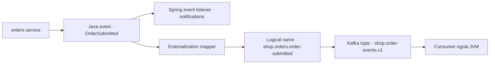
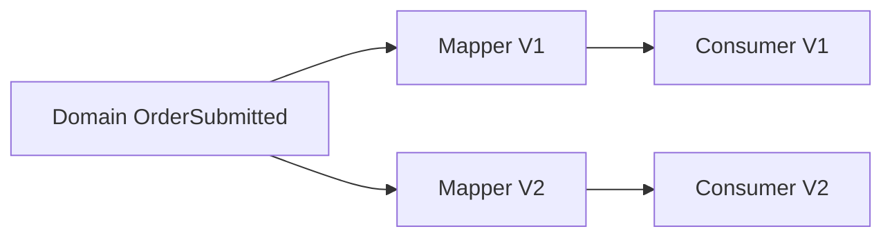
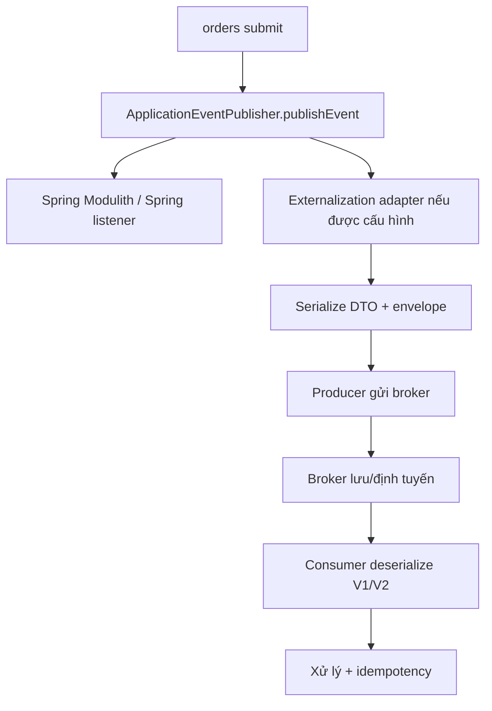
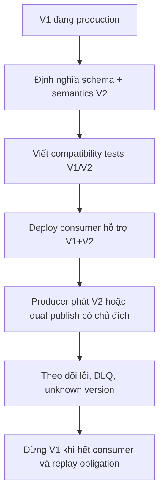
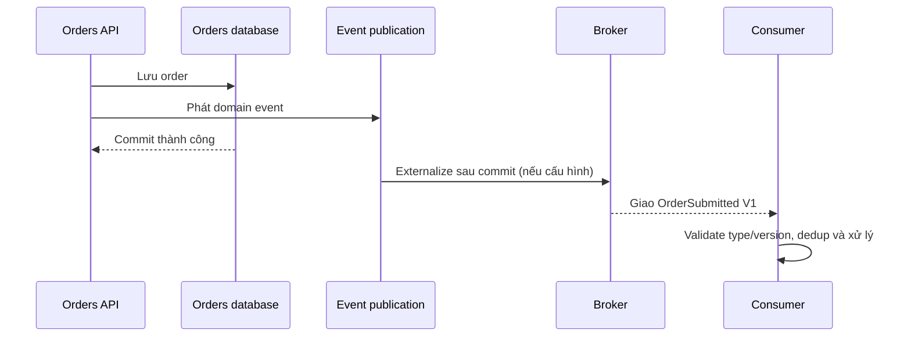

# Hợp đồng event name, payload và version

## 1. Khi một event vẫn phát nhưng consumer đã ngừng hiểu nó

Giả sử ứng dụng Spring Modulith có module `orders` phát sự kiện khi đơn hàng được chấp nhận. Module `notifications` nghe sự kiện để gửi email; một adapter khác chuyển sự kiện ra Kafka để hệ thống báo cáo xử lý. Nhóm phát triển đổi `OrderSubmitted` thành `OrderCreated`, đổi `amountCents` thành `total` và vẫn giữ topic Kafka cũ. Unit test của service có thể xanh, nhưng consumer khác sẽ gặp ba loại vấn đề:

1. **Event name:** consumer đăng ký hoặc định tuyến theo tên cũ nên không còn nhận/nhận diện event.
2. **Payload:** consumer đọc một field đã bị xóa, đổi kiểu hoặc đổi đơn vị.
3. **Version:** producer và consumer bất đồng về schema hay ý nghĩa của event nhưng không có quy tắc tương thích và chuyển phiên bản.

Ba yếu tố này tạo thành **hợp đồng event**. Hợp đồng không chỉ là một Java `record`; nó mô tả điều mà **module nguồn cam kết công bố** và những điều **module nhận có thể dựa vào**.

Bài học thuộc chương **Architectural contracts** của `SPRING_MODULITH_VERIFICATION_TESTING`. Theo mục tiêu học phần, ta phải bảo vệ ranh giới bằng `ApplicationModules` và quy tắc phụ thuộc; dùng `@ApplicationModuleTest` kiểm thử sự kiện; kiểm tra database, messaging và transaction khi cần; sau đó tạo quality gate CI để chặn thay đổi phá vỡ hợp đồng.

**Kết luận nền tảng:** “đã gọi `publishEvent(...)`” chưa chứng minh đúng **tên, payload, version**; và “`PublishedEvents` có event” chưa chứng minh consumer hoặc broker đã xử lý thành công.

## 2. Phân biệt ba “tên” dễ bị trộn lẫn

Trong Spring Modulith, một domain event có thể đi qua nhiều ranh giới:



Cần phân biệt:

| Thành phần | Ví dụ | Ai quan tâm? | Tác động khi thay đổi |
| --- | --- | --- | --- |
| **Java event type** | `com.example.shop.orders.OrderSubmitted` | Listener Java trong cùng ứng dụng; mã compile-time | Đổi class/package có thể làm các module consumer không compile |
| **Logical event name/type** | `shop.orders.order-submitted` | Envelope, dispatcher, registry/schema contract, consumer | Đổi tên có thể khiến message bị phân loại sai dù topic giữ nguyên |
| **Transport destination** | Kafka topic `shop.order-events.v1` hoặc RabbitMQ exchange/routing key | Adapter, broker, consumer group/subscription | Đổi route có thể làm message không đến consumer |
| **Payload schema name** | `OrderSubmittedPayloadV1` | Registry và công cụ tương thích | Đổi subject/schema có thể phá compatibility workflow |
| **Schema version** | `1` trong envelope | Producer, consumer, serializer/deserializer | Version không khớp có thể khiến reader từ chối event |

**Không giả định năm tên phải giống nhau.** Java type có thể được refactor nội bộ trong khi external event name cần giữ ổn định cho consumer độc lập. Ngược lại, đổi topic không đồng nghĩa thay schema.

Với event chỉ dùng **trong cùng JVM**, Java type và hành vi publication/listener thường là hợp đồng chính. Khi event được externalize ra Kafka, RabbitMQ, HTTP webhook hoặc event log, logical name, schema, version, route và khả năng đọc của consumer trở thành hợp đồng dài hạn.

## 3. Một “event contract card” phải ghi rõ điều gì?

Trước khi viết code, định nghĩa event dưới dạng một bảng có owner và cách kiểm chứng:

| Trường | Ví dụ cho `OrderSubmitted` |
| --- | --- |
| **Owner** | Application module `orders` |
| **Mốc nghiệp vụ** | Lệnh submit được chấp nhận sau validation và kiểm tra tồn kho |
| **Java event type** | `orders.OrderSubmitted` ở API công khai |
| **Logical event name** | `shop.orders.order-submitted` |
| **Current external schema version** | `1` |
| **Event identity** | `eventId` duy nhất của một lần công bố logic |
| **Aggregate identity** | `orderId` |
| **Occurred at** | `occurredAt`, thời điểm UTC/ISO-8601 |
| **Payload bắt buộc** | `orderId`, `sku`, `quantity`, `currency`, `totalMinor` |
| **Đơn vị và bất biến** | `quantity > 0`, `totalMinor > 0`, `currency` theo quy ước tiền tệ |
| **Không được phát khi** | Input sai hoặc tồn kho không đủ |
| **Consumer** | `notifications` và adapter analytics |
| **Delivery/ordering** | Xác định rõ: có thể trùng, có thể đến chậm; thứ tự theo aggregate nếu cần |
| **Transaction semantics** | Phát trong transaction nào, externalize sau commit hay không? |
| **Evolution policy** | Additive change được chấp nhận theo policy; breaking change cần version mới |
| **Bảo mật** | Không đưa thông tin cá nhân/bí mật không cần thiết vào payload |
| **Bằng chứng** | `PublishedEvents`, mapper/serialization test, consumer/integration test, `ApplicationModules.verify()` |

Đây là **mẫu hợp đồng**, không phải lời khẳng định Spring Modulith mặc định bảo đảm mọi mục trên. Ví dụ, `ApplicationEventPublisher` không tự cam kết “exactly once”, và một `KafkaTemplate.send(...)` không tự chứng minh delivery bền vững đến mọi consumer.

### Phân biệt event với command

Một event diễn đạt **điều đã xảy ra** (ví dụ “đơn đã được submit”), không phải mệnh lệnh trực tiếp “gửi email”. Tên `OrderSubmitted` mang ngữ nghĩa lịch sử hơn `SendConfirmationEmail`. Khi dùng event để giảm coupling, module `orders` không cần biết có bao nhiêu consumer.

Nhưng tên event phải phản ánh **đúng thời điểm nghiệp vụ**: nếu chỉ nhận request nhưng chưa kiểm tra payment, không nên gọi event là `OrderPaid` hoặc `OrderFinalized`.

## 4. Event name: đặt tên theo sự kiện nghiệp vụ ổn định

Tên tốt nên dễ nhận diện, tránh dính vào implementation. Một quy ước có thể dùng:

```text
<domain>.<module>.<past-tense-business-fact>
shop.orders.order-submitted
shop.orders.order-cancelled
shop.payments.payment-authorized
```

Đây là **quy ước ví dụ của dự án**, không phải cú pháp bắt buộc của Spring Modulith. Dự án có thể dùng `order.submitted` hoặc `com.example.OrderSubmitted`, miễn là ổn định và có quy tắc rõ.

### 4.1. Các tên nên tránh

| Tên | Vấn đề |
| --- | --- |
| `OrderServiceExecuted` | Bám vào cách triển khai, không diễn tả business fact |
| `OrderTableUpdated` | Buộc consumer biết chi tiết persistence |
| `SendEmail` | Command cho consumer cụ thể, tăng coupling |
| `Event1` hoặc `Update` | Mơ hồ, khó định tuyến và tra log |
| `OrderPaid` khi mới authorized | Sai nghĩa: authorization khác capture/settlement |
| `OrderSubmittedV2` đổi tên tùy tiện khi chỉ thêm field optional | Có thể tạo breaking routing dù semantics chính không đổi |

Tách **event logical name** khỏi **tên Java class** nếu event cần hỗ trợ consumer ngoài JVM qua nhiều phiên bản deploy. Có thể giữ `shop.orders.order-submitted` trong envelope khi refactor package Java nội bộ, miễn mapper/consumer contract giữ đúng semantics.

### 4.2. Quy tắc dùng version trong tên

Hai chiến lược phổ biến:

1. **Tên logic ổn định, version là metadata:** `type = "shop.orders.order-submitted"`, `schemaVersion = 1`. Có thể định tuyến theo cả type và version.
2. **Tên/type hoặc topic có major version:** `shop.orders.order-submitted.v1`, `shop.order-events.v1`. Khi breaking change, version mới được phát song song hoặc chuyển route.

Cả hai hợp lệ tùy tổ chức. Điểm quan trọng là **không pha trộn ngẫu nhiên**: vừa đổi Java class, event type, topic và version mà không có kế hoạch consumer migration.

## 5. Payload: contract là field, kiểu và ngữ nghĩa

Một payload JSON minh họa:

```json
{
  "eventId": "b4e30ea2-1b25-42af-89e2-48619723b347",
  "type": "shop.orders.order-submitted",
  "schemaVersion": 1,
  "aggregateId": "ORD-1001",
  "occurredAt": "2026-11-26T03:00:00Z",
  "data": {
    "orderId": "ORD-1001",
    "sku": "SKU-7",
    "quantity": 2,
    "currency": "VND",
    "totalMinor": 125000
  }
}
```

Đây là **external envelope gợi ý**, không phải định dạng JSON Spring Modulith tự phát sinh mặc định. Trường `data` chứa payload nghiệp vụ; envelope chứa thông tin dùng chung cho routing, correlation, replay và deduplication.

| Field | Kiểu mong muốn | Quy tắc cần nói rõ |
| --- | --- | --- |
| `eventId` | UUID dạng chuỗi | Ổn định khi **cùng một event** được gửi lại/retry |
| `type` | Chuỗi literal ổn định | Không đồng nhất với tên class Java |
| `schemaVersion` | Số nguyên dương | Tăng theo chính sách breaking/additive change được định nghĩa |
| `aggregateId` | Chuỗi | Khóa nghiệp vụ để nhóm/order; ví dụ `orderId` |
| `occurredAt` | Chuỗi timestamp UTC ISO-8601 | Là thời điểm sự kiện phát sinh, không nhất thiết thời điểm broker nhận |
| `data.orderId` | Chuỗi không rỗng | Định danh đơn, không phải khóa database tự suy |
| `data.sku` | Chuỗi | Quy ước chữ hoa/chữ thường nếu có |
| `data.quantity` | Số nguyên dương | Đơn vị: số lượng sản phẩm |
| `data.currency` | Mã tiền tệ | Thống nhất quy ước như ISO 4217 khi áp dụng |
| `data.totalMinor` | Số nguyên 64-bit | Đơn vị nhỏ nhất của tiền theo contract; lưu ý quy tắc từng tiền tệ |

**Một tên field đúng kiểu vẫn có thể sai contract:** nếu `totalMinor` từng là đồng rồi nay chuyển sang “nghìn đồng” mà vẫn để tên và version cũ, consumer có thể âm thầm tính tiền sai. Thay đổi ngữ nghĩa hoặc đơn vị là một **breaking change**, ngay cả khi JSON parser không báo lỗi.

### 5.1. Tránh rò dữ liệu nội bộ và thông tin nhạy cảm

Không đưa trực tiếp JPA entity, lazy proxy, access token, thông tin thẻ thanh toán hoặc toàn bộ user profile vào event chỉ để consumer “có đủ dữ liệu”. Các vấn đề gồm:

- Serialize ngoài ý định các quan hệ JPA, kể cả dữ liệu không cần thiết.
- Đưa schema database nội bộ thành contract xuyên module.
- Rủi ro lộ PII và tăng phạm vi truy cập dữ liệu khi message được lưu/replay.
- Consumer phụ thuộc vào field không được owner cam kết ổn định.

Payload nên là **DTO/sự kiện bất biến, có chủ sở hữu, chỉ chứa dữ liệu cần thiết**. Nếu consumer cần thêm dữ liệu, cân nhắc API truy vấn hoặc read model riêng theo quyền truy cập phù hợp.

## 6. API event công khai trong Spring Modulith

Giả sử các module:

```text
com.example.shop
├── ShopApplication.java
├── orders/
│   ├── OrderSubmitted.java         // public event API
│   ├── OrderSubmissionService.java
│   ├── internal/OrderPolicy.java
│   └── integration/OrderExternalMapper.java
├── inventory/
│   ├── InventoryAvailability.java // public API
│   └── internal/JdbcInventoryAvailability.java
└── notifications/
    └── internal/OrderSubmittedListener.java
```

Với mô hình mặc định thông dụng, `orders` và `inventory` là application modules; các subpackage `orders.internal`, `orders.integration` thuộc `orders`. Event `OrderSubmitted` nằm ở base package `orders` để module `notifications` được phép tham chiếu qua API mặc định.

### 6.1. Record domain event

```java
// src/main/java/com/example/shop/orders/OrderSubmitted.java
package com.example.shop.orders;

import java.time.Instant;

public record OrderSubmitted(
    String eventId,
    String orderId,
    String sku,
    int quantity,
    String currency,
    long totalMinor,
    Instant occurredAt
) {
}
```

Đây là **domain event trong JVM**. Nó không buộc phải có tên Java giống literal `shop.orders.order-submitted`. Các field ở record này được chọn để ánh xạ sang external envelope một cách tường minh, đồng thời ổn định event ID qua retry.

### 6.2. API mà `orders` được phép gọi

```java
// src/main/java/com/example/shop/inventory/InventoryAvailability.java
package com.example.shop.inventory;

public interface InventoryAvailability {

    boolean hasStock(String sku, int quantity);
}
```

`orders` chỉ tham chiếu API của `inventory`. Implementation `inventory.internal.JdbcInventoryAvailability` không cần có mặt trong test logic `orders` ở `STANDALONE`.

### 6.3. Policy của module nguồn

```java
// src/main/java/com/example/shop/orders/internal/OrderPolicy.java
package com.example.shop.orders.internal;

import org.springframework.stereotype.Component;

@Component
public class OrderPolicy {

    public void validate(
            String orderId,
            String sku,
            int quantity,
            String currency,
            long totalMinor) {

        if (orderId == null || orderId.isBlank()) {
            throw new IllegalArgumentException(
                "Order ID must not be blank");
        }
        if (sku == null || sku.isBlank()) {
            throw new IllegalArgumentException(
                "SKU must not be blank");
        }
        if (quantity <= 0) {
            throw new IllegalArgumentException(
                "Quantity must be positive");
        }
        if (!"VND".equals(currency)) {
            throw new IllegalArgumentException(
                "Only VND is supported in this example");
        }
        if (totalMinor <= 0) {
            throw new IllegalArgumentException(
                "Total must be positive");
        }
    }
}
```

Quy tắc currency chỉ là **giới hạn của ứng dụng ví dụ**, không phải khẳng định mọi ứng dụng chỉ xử lý VND. Ở hệ thống nhiều tiền tệ, contract phải phân biệt decimal precision, đơn vị nhỏ nhất và cách làm tròn cho từng currency.

## 7. Module nguồn phát event đúng thời điểm nghiệp vụ

Service `orders`:

```java
// src/main/java/com/example/shop/orders/OrderSubmissionService.java
package com.example.shop.orders;

import com.example.shop.inventory.InventoryAvailability;
import com.example.shop.orders.internal.OrderPolicy;
import java.time.Instant;
import java.util.UUID;
import org.springframework.context.ApplicationEventPublisher;
import org.springframework.stereotype.Service;

@Service
public class OrderSubmissionService {

    private final OrderPolicy policy;
    private final InventoryAvailability inventory;
    private final ApplicationEventPublisher events;

    public OrderSubmissionService(
            OrderPolicy policy,
            InventoryAvailability inventory,
            ApplicationEventPublisher events) {
        this.policy = policy;
        this.inventory = inventory;
        this.events = events;
    }

    public String submit(
            String orderId,
            String sku,
            int quantity,
            String currency,
            long totalMinor) {

        policy.validate(
            orderId, sku, quantity, currency, totalMinor);

        if (!inventory.hasStock(sku, quantity)) {
            throw new IllegalStateException(
                "Stock unavailable: " + sku);
        }

        var event = new OrderSubmitted(
            UUID.randomUUID().toString(),
            orderId,
            sku,
            quantity,
            currency,
            totalMinor,
            Instant.now());

        events.publishEvent(event);

        return "SUBMITTED:" + orderId;
    }
}
```

Service giữ quy tắc đơn giản để ta tập trung vào contract:

- Chỉ tạo event sau validation và kiểm tra tồn kho thành công.
- Một event có `eventId`, `orderId`, payload, timestamp.
- Khi input không hợp lệ hoặc tồn kho không đủ, **không** phát event.

**Giới hạn quan trọng của ví dụ:** service chưa lưu order vào database, chưa có transaction boundary và chưa bảo đảm idempotency khi cùng một HTTP command được gọi hai lần. Hai lần gọi `submit(...)` có thể tạo **hai event ID khác nhau** cho cùng `orderId`. Nếu nghiệp vụ cần “mỗi đơn chỉ submit một lần”, production phải bổ sung cơ chế unique business key/idempotency và kiểm thử riêng. Đừng coi `UUID.randomUUID()` là giải pháp exactly-once.

`ApplicationEventPublisher.publishEvent(...)` cũng không tự khẳng định transaction đã commit, listener đã xử lý hoặc broker đã nhận message. Những cam kết đó cần hạ tầng và bài kiểm chứng tương ứng.

## 8. Kiểm chứng điều kiện phát và payload bằng `PublishedEvents`

Bài `@ApplicationModuleTest` kiểm tra **hành vi của module `orders`**, không cần nạp implementation `inventory` thật.

Ví dụ với Spring Framework 6.2+:

```java
// src/test/java/com/example/shop/orders/OrderEventContractTest.java
package com.example.shop.orders;

import com.example.shop.inventory.InventoryAvailability;
import org.junit.jupiter.api.Test;
import org.springframework.beans.factory.annotation.Autowired;
import org.springframework.modulith.test.ApplicationModuleTest;
import org.springframework.modulith.test.PublishedEvents;
import org.springframework.test.context.bean.override.mockito.MockitoBean;

import static org.assertj.core.api.Assertions.assertThat;
import static org.assertj.core.api.Assertions.assertThatThrownBy;
import static org.mockito.BDDMockito.given;
import static org.mockito.Mockito.verifyNoInteractions;

@ApplicationModuleTest
class OrderEventContractTest {

    @Autowired
    OrderSubmissionService orders;

    @MockitoBean
    InventoryAvailability inventory;

    @Test
    void publishesWellFormedEvent(PublishedEvents events) {
        given(inventory.hasStock("SKU-7", 2))
            .willReturn(true);

        String result = orders.submit(
            "ORD-1001", "SKU-7", 2, "VND", 125000);

        assertThat(result).isEqualTo("SUBMITTED:ORD-1001");

        assertThat(events.ofType(OrderSubmitted.class))
            .singleElement()
            .satisfies(event -> {
                assertThat(event.eventId()).isNotBlank();
                assertThat(event.orderId())
                    .isEqualTo("ORD-1001");
                assertThat(event.sku())
                    .isEqualTo("SKU-7");
                assertThat(event.quantity()).isEqualTo(2);
                assertThat(event.currency()).isEqualTo("VND");
                assertThat(event.totalMinor())
                    .isEqualTo(125000);
                assertThat(event.occurredAt()).isNotNull();
            });
    }

    @Test
    void rejectsBadQuantityBeforeCheckingInventory(
            PublishedEvents events) {

        assertThatThrownBy(() ->
            orders.submit(
                "ORD-1002", "SKU-7", 0, "VND", 125000))
            .isInstanceOf(IllegalArgumentException.class);

        verifyNoInteractions(inventory);
        assertThat(events.ofType(OrderSubmitted.class))
            .isEmpty();
    }

    @Test
    void doesNotPublishWhenStockUnavailable(
            PublishedEvents events) {

        given(inventory.hasStock("SKU-X", 1))
            .willReturn(false);

        assertThatThrownBy(() ->
            orders.submit(
                "ORD-1003", "SKU-X", 1, "VND", 10000))
            .isInstanceOf(IllegalStateException.class);

        assertThat(events.ofType(OrderSubmitted.class))
            .isEmpty();
    }
}
```

**Ý nghĩa của bài test:**

1. `@ApplicationModuleTest` thường chọn `STANDALONE` cho module chứa class test, ở đây là `orders`.
2. `OrderSubmissionService` và `OrderPolicy` **chạy thật**.
3. `@MockitoBean InventoryAvailability` là test double ở API ngoài module.
4. `PublishedEvents` ghi nhận những event phù hợp do test công bố; assertion kiểm tra payload và negative cases.
5. Không kiểm tra listener `notifications`, Kafka topic hay JSON schema ở bài này.

`@MockitoBean` có từ Spring Framework 6.2. Trên stack Spring Boot cũ hơn có thể dùng `@MockBean` theo phiên bản tương thích; annotation của Boot được deprecated từ Boot 3.4. Cũng cần lưu ý các API `PublishedEvents` có thể có điều chỉnh giữa phiên bản Spring Modulith; dùng bản tương thích với dependency thực tế.

### Vì sao không chỉ assert “có event”?

Assertion `events.ofType(OrderSubmitted.class)` không đủ để bảo vệ contract nếu không kiểm tra `orderId`, `currency`, `totalMinor`, điều kiện phát và negative cases. Một refactor nhầm `amount` sang đơn vị khác có thể không làm test “có event” đỏ.

## 9. Ranh giới giữa domain event và external payload

Không bắt buộc đưa mọi Java domain event trực tiếp lên Kafka. Khi event có consumer ngoài JVM, một **mapper tại boundary** giúp:

- Đóng băng logical event name, schema version, tên field bên ngoài.
- Không cho consumer phụ thuộc vào package implementation hoặc Java serialization đặc thù.
- Ẩn metadata chỉ dùng nội bộ và tránh làm lộ JPA entity.
- Hỗ trợ tiến hóa external schema độc lập với refactor domain record.
- Kiểm thử JSON contract một cách rõ ràng.

### 9.1. Payload V1

```java
// src/main/java/com/example/shop/orders/integration/OrderSubmittedV1.java
package com.example.shop.orders.integration;

public record OrderSubmittedV1(
    String orderId,
    String sku,
    int quantity,
    String currency,
    long totalMinor
) {
}
```

`OrderSubmittedV1` ở đây là **DTO external contract**, không phải domain event listener trong JVM. Package `orders.integration` là internal của module `orders` trong mô hình mặc định; consumer ngoài JVM không import class Java này mà đọc JSON/schema đã công bố.

### 9.2. Envelope có thông tin định tuyến và phiên bản

```java
// src/main/java/com/example/shop/orders/integration/EventEnvelope.java
package com.example.shop.orders.integration;

import java.time.Instant;

public record EventEnvelope<T>(
    String eventId,
    String type,
    int schemaVersion,
    String aggregateId,
    Instant occurredAt,
    T data
) {
}
```

Envelope là **một quyết định thiết kế của hệ thống ví dụ**, không phải API do Spring Modulith tự bắt buộc. Khi dùng Avro/Protobuf hoặc schema registry, version có thể được lưu trong schema metadata/header theo cách khác.

### 9.3. Mapper tạo external contract ổn định

```java
// src/main/java/com/example/shop/orders/integration/OrderEventMapper.java
package com.example.shop.orders.integration;

import com.example.shop.orders.OrderSubmitted;
import org.springframework.stereotype.Component;

@Component
public class OrderEventMapper {

    public static final String TYPE =
        "shop.orders.order-submitted";

    public static final int VERSION = 1;

    public EventEnvelope<OrderSubmittedV1> toV1(
            OrderSubmitted domain) {

        var payload = new OrderSubmittedV1(
            domain.orderId(),
            domain.sku(),
            domain.quantity(),
            domain.currency(),
            domain.totalMinor());

        return new EventEnvelope<>(
            domain.eventId(),
            TYPE,
            VERSION,
            domain.orderId(),
            domain.occurredAt(),
            payload);
    }
}
```

**Điểm cốt lõi:** mapper dùng lại `eventId` và `occurredAt` từ domain event. Nếu cùng **một event** được gửi lại do retry, ID phải ổn định để consumer có cơ sở deduplicate. Không nên gọi `UUID.randomUUID()` **mỗi lần serialize/retry** vì sẽ biến cùng một sự kiện logic thành nhiều ID khác nhau.

Mapper này chỉ tạo Java DTO, **không tự gửi message**. Để externalize cần adapter Kafka/RabbitMQ hoặc cơ chế Spring Modulith event externalization phù hợp với phiên bản và cấu hình dự án.

## 10. Kiểm thử external event name, version và JSON schema

Một test riêng cho mapper giúp bảo vệ contract bên ngoài. Với ứng dụng Spring Boot có Jackson cấu hình phù hợp, có thể dùng một test JUnit thuần cho mapping:

```java
// src/test/java/com/example/shop/orders/integration/OrderEventMapperTest.java
package com.example.shop.orders.integration;

import com.example.shop.orders.OrderSubmitted;
import java.time.Instant;
import org.junit.jupiter.api.Test;

import static org.assertj.core.api.Assertions.assertThat;

class OrderEventMapperTest {

    private final OrderEventMapper mapper =
        new OrderEventMapper();

    @Test
    void mapsStableExternalIdentityAndPayload() {
        var domain = new OrderSubmitted(
            "evt-100",
            "ORD-1001",
            "SKU-7",
            2,
            "VND",
            125000,
            Instant.parse("2026-11-26T03:00:00Z"));

        var external = mapper.toV1(domain);

        assertThat(external.type())
            .isEqualTo("shop.orders.order-submitted");
        assertThat(external.schemaVersion())
            .isEqualTo(1);
        assertThat(external.eventId()).isEqualTo("evt-100");
        assertThat(external.aggregateId())
            .isEqualTo("ORD-1001");
        assertThat(external.occurredAt())
            .isEqualTo(domain.occurredAt());

        assertThat(external.data().orderId())
            .isEqualTo("ORD-1001");
        assertThat(external.data().currency())
            .isEqualTo("VND");
        assertThat(external.data().totalMinor())
            .isEqualTo(125000);
    }
}
```

Test trên bảo vệ **mapper-level contract**, chưa bảo vệ chính xác byte JSON trên wire. Nếu JSON được gửi ra ngoài, bổ sung một serialization contract test bằng `ObjectMapper` cấu hình như production:

```java
// Đoạn minh họa đặt trong Spring test có @Autowired ObjectMapper json
// và một EventEnvelope<OrderSubmittedV1> external đã tạo.
String encoded = json.writeValueAsString(external);
var tree = json.readTree(encoded);

assertThat(tree.path("type").asText())
    .isEqualTo("shop.orders.order-submitted");
assertThat(tree.path("schemaVersion").asInt())
    .isEqualTo(1);
assertThat(tree.path("data").path("totalMinor").asLong())
    .isEqualTo(125000L);
assertThat(tree.path("occurredAt").asText())
    .isEqualTo("2026-11-26T03:00:00Z");
```

Đoạn này cần import `com.fasterxml.jackson.databind.ObjectMapper` và AssertJ, cùng `@Autowired ObjectMapper json` hoặc cách tạo mapper có đăng ký Java Time module phù hợp. Không nên dùng `new ObjectMapper()` mặc định rồi mặc nhiên kỳ vọng serialize `Instant` đúng format nếu chưa cấu hình Jackson Java Time.

### Golden JSON để phát hiện regression

Một số nhóm duy trì một **golden example** của external message hoặc JSON Schema/Avro schema và kiểm tra bản serialize mới tương thích với nó. Nếu so sánh JSON object, hãy so sánh **cấu trúc parse** thay vì trật tự thuộc tính trong string, trừ khi chính wire format cam kết order.

Không viết một snapshot quá dễ cập nhật vô điều kiện. Nếu field bắt buộc đổi, CI nên buộc review contract, version và consumer impact.

## 11. Xây dựng schema contract tường minh

Với JSON, có thể mô tả `data` của V1 bằng JSON Schema. Ví dụ:

```json
{
  "$schema": "https://json-schema.org/draft/2020-12/schema",
  "title": "OrderSubmittedPayloadV1",
  "type": "object",
  "required": [
    "orderId",
    "sku",
    "quantity",
    "currency",
    "totalMinor"
  ],
  "properties": {
    "orderId": { "type": "string", "minLength": 1 },
    "sku": { "type": "string", "minLength": 1 },
    "quantity": { "type": "integer", "minimum": 1 },
    "currency": {
      "type": "string",
      "enum": ["VND"]
    },
    "totalMinor": {
      "type": "integer",
      "minimum": 1
    }
  },
  "additionalProperties": true
}
```

Đây là schema **mẫu cho ứng dụng ví dụ**. `additionalProperties: true` cho phép mở rộng field đối với validator dựa trên schema này, nhưng consumer Java vẫn có thể từ chối unknown field tùy cấu hình deserializer. **Schema chấp nhận field thêm không có nghĩa mọi consumer đều tương thích**.

Ngoài schema field, cần mô tả:

- Mã currency và cách biểu diễn tiền (minor units và quy tắc round).
- ID có phân biệt chữ hoa/thường không.
- Timestamp theo UTC, độ chính xác giây/milli/nano, yêu cầu clock.
- Những trường có thể `null`, vắng mặt, chuỗi rỗng hoặc giá trị default.
- Kích thước giới hạn của message và định dạng encoding.
- Quy tắc phân biệt một event với một lần retry/duplicate delivery.

Nếu dùng Avro hoặc Protobuf, các quy tắc tương thích khác JSON Schema. Không sao chép nguyên tắc “thêm field không bắt buộc luôn an toàn” giữa mọi công nghệ serialization mà không xem default, reader schema và registry compatibility mode.

## 12. Version: thay đổi nào tương thích, thay đổi nào phá contract?

Khái niệm **backward compatibility** và **forward compatibility** phải được định nghĩa theo producer/consumer:

- **Consumer mới đọc event cũ**: quan trọng khi replay event lịch sử hoặc consumer deploy trước producer.
- **Consumer cũ đọc event mới**: quan trọng khi producer deploy trước các consumer.
- **Full compatibility**: cả hai hướng theo chính sách/định dạng và phạm vi version đã cam kết.

Không có câu trả lời “vẫn tương thích” nếu chưa biết reader xử lý field lạ, default, enum, null và version nào.

### Bảng đánh giá thay đổi với JSON event V1

| Thay đổi | Mức rủi ro | Điều kiện để giữ tương thích |
| --- | --- | --- |
| Thêm field **optional** `sourceChannel` | Thường ít rủi ro | Consumer cũ bỏ qua unknown field; consumer mới xử lý vắng mặt/default |
| Thêm field **required** `customerTier` | Dễ breaking | Consumer mới đọc event V1 cũ có thể thiếu field |
| Xóa `sku` bắt buộc | Breaking | Consumer hiện tại có thể không xử lý được |
| Đổi `totalMinor` thành `totalAmount` | Breaking | Reader cũ tìm field cũ; cần mapping/version |
| Đổi `totalMinor` từ integer sang string | Breaking | Kiểu JSON thay đổi |
| Đổi đơn vị `totalMinor` mà không đổi tên/phiên bản | **Breaking về ngữ nghĩa** | Parser không giúp phát hiện tiền sai |
| Thêm enum value `PARTIALLY_CONFIRMED` | Có thể breaking | Consumer có exhaustive switch hoặc validator chỉ chấp nhận tập cũ |
| Đổi cấu trúc `occurredAt` | Có thể breaking | Reader/serializer khác format hoặc timezone |
| Thêm field chứa PII | Rủi ro bảo mật | Cần đánh giá quyền riêng tư và retention, không chỉ schema |
| Thay thứ tự property JSON | Thường không breaking | Nếu reader parse JSON theo key, không phụ thuộc raw string order |
| Đổi Kafka topic mà schema giữ nguyên | Breaking về routing | Subscription/ACL/consumer cần migration |
| Đổi logical event name mà payload y nguyên | Breaking về phân loại | Dispatcher có thể không nhận type cũ |

Hãy coi **schema compatibility**, **semantic compatibility**, **routing compatibility** và **operational compatibility** là những lớp khác nhau. Một JSON schema hợp lệ vẫn có thể khiến nghiệp vụ sai nếu timestamp thay nghĩa hoặc event được phát trước khi commit.

### 12.1. Quy tắc tăng version thực tế

Một chính sách đơn giản:

- **V1 không đổi:** sửa code nội bộ, giữ event name, shape, đơn vị, semantics.
- **V1 bổ sung optional field:** chỉ khi đã xác minh consumer cũ bỏ qua field lạ và consumer mới chấp nhận message cũ.
- **V2:** thay đổi bắt buộc, field name/type, semantics hoặc routing không thể giữ tương thích.
- **Deprecated V1:** phát song song/có adapter chuyển đổi trong giai đoạn migration theo thời gian hỗ trợ đã thỏa thuận.
- **Retire V1:** khi consumer đã chuyển và replay/backfill lịch sử được xử lý.

Version là **công cụ phối hợp thay đổi**, không phải số tự tăng mỗi lần deploy hoặc commit.

## 13. Bổ sung field V2: đừng chỉ dựa vào Java record constructor

Giả sử cần thêm `channel` để nhận diện nguồn đặt đơn. Một external DTO V2 có thể là:

```java
// DTO mới, nếu contract V2 được phê duyệt.
package com.example.shop.orders.integration;

public record OrderSubmittedV2(
    String orderId,
    String sku,
    int quantity,
    String currency,
    long totalMinor,
    String channel
) {
}
```

Consumer V2 không được đơn giản giả định mọi event cũ đều có `channel`. Một chính sách có thể quy định:

- Khi đọc V1: suy `channel = "UNKNOWN"` **nếu business đồng ý ý nghĩa đó**.
- Khi đọc V2: sử dụng `channel` mới, xử lý unknown/future values.
- Không reinterpret dữ liệu V1 cũ bằng một giá trị default sai sự thật.
- Giữ consumer V1 hoạt động trong migration nếu producer tiếp tục xuất V1.

Nếu đổi từ V1 sang V2 làm **breaking change**, tạo mapper V1/V2 riêng và giữ contract về tên, version/route nhất quán. Không âm thầm thay nội dung payload V1 đang có consumer.



**Chiến lược dual-publish:** nếu cùng một domain event được công bố ở hai external schema, phải ghi rõ đó là **hai representation của cùng event**. Có thể giữ `eventId` chung giữa V1/V2 và dùng tổ hợp `eventId + type + schemaVersion` khi cần phân biệt từng representation. Việc deduplicate thao tác nghiệp vụ vẫn phải dựa trên business key/idempotency semantics phù hợp, không đơn giản chỉ dựa vào version.

## 14. Version nằm trong envelope, header hay tên topic?

Không có một lựa chọn duy nhất. Một hợp đồng tốt phải chỉ rõ nơi consumer lấy version:

| Chiến lược | Ưu điểm | Hạn chế |
| --- | --- | --- |
| `schemaVersion` ở body/envelope | Dễ đọc bằng JSON, thuận tiện replay | Consumer phải parse envelope; dễ bị duplicate với header |
| Version ở message header | Không trộn với domain data | Header có thể mất khi chuyển transport/replay |
| Major version ở topic/routing key | Consumer dễ tách luồng breaking | Vận hành nhiều topic/ACL/retention; rollout phức tạp |
| Schema registry ID/version | Hợp với Avro/Protobuf và tooling | Phụ thuộc serializer/registry, compatibility policy |
| Kết hợp có chủ đích | Có thể vừa route vừa validate | Phải quy định nguồn sự thật và kiểm tra không mâu thuẫn |

Nếu vừa có `shop.order-events.v1` và `schemaVersion: 2`, **consumer nên làm gì?** Contract phải có quy tắc: từ chối/dead-letter, cảnh báo hoặc chấp nhận theo mapping được phê duyệt. Không nên để consumer âm thầm đoán.

Trong ví dụ, ta chọn `type` + `schemaVersion` trong envelope làm nguồn sự thật cho schema; topic là cấu hình transport riêng. Một tổ chức có thể chọn khác, nhưng phải ghi rõ và kiểm thử.

## 15. Spring Modulith event publication khác Kafka delivery

Một sự kiện đi qua nhiều bước:



Mỗi bước có lỗi khác nhau:

- **Publication:** code chưa phát event ở nhánh thành công, hoặc phát trước validation.
- **Mapping:** tên hoặc schema version sai.
- **Serialization:** Instant, số nguyên, field bắt buộc, unknown field.
- **Transport:** topic, serializer, ACL, connection, broker acknowledgement.
- **Consumption:** deserializer không nhận version, handler lỗi, transaction bất đồng bộ.
- **Business side effect:** gửi email trùng, cập nhật trạng thái sai, retry không an toàn.

Spring Modulith có các tính năng event publication và event externalization tùy module thư viện/cấu hình. Chúng có thể giúp quản lý publication và xử lý sau commit; **không được suy rằng chỉ cần dependency là có exactly-once end-to-end**. Cần quyết định persistence backend, retry, transaction boundary và cơ chế idempotency của consumer.

`@ApplicationModuleTest` với `PublishedEvents` hữu ích cho tầng publication. Tầng Kafka/RabbitMQ cần kiểm thử adapter, broker và consumer bằng môi trường tích hợp nếu đó là contract đang bảo vệ.

## 16. Adapter Kafka minh họa: sau commit mới externalize

Một cách tổ chức có thể tạo adapter riêng dùng mapper V1. Ví dụ dưới đây minh họa **chiến lược** event sau commit với Spring Kafka:

```java
// src/main/java/com/example/shop/orders/integration/KafkaOrderEventAdapter.java
package com.example.shop.orders.integration;

import com.example.shop.orders.OrderSubmitted;
import org.springframework.context.annotation.Profile;
import org.springframework.kafka.core.KafkaTemplate;
import org.springframework.stereotype.Component;
import org.springframework.transaction.event.TransactionPhase;
import org.springframework.transaction.event.TransactionalEventListener;

@Component
@Profile("kafka-integration")
public class KafkaOrderEventAdapter {

    private final OrderEventMapper mapper;
    private final KafkaTemplate<
        String, EventEnvelope<OrderSubmittedV1>> kafka;

    public KafkaOrderEventAdapter(
            OrderEventMapper mapper,
            KafkaTemplate<
                String, EventEnvelope<OrderSubmittedV1>> kafka) {
        this.mapper = mapper;
        this.kafka = kafka;
    }

    @TransactionalEventListener(
        phase = TransactionPhase.AFTER_COMMIT)
    public void afterOrderCommit(OrderSubmitted domain) {
        var external = mapper.toV1(domain);

        kafka.send(
            "shop.order-events.v1",
            domain.orderId(),
            external);
    }
}
```

**Các giả định bắt buộc:**

1. Đây là **biến thể tích hợp của ứng dụng** có producer Kafka và serializer cho `EventEnvelope<OrderSubmittedV1>`; ví dụ không tự tạo topic/broker.
2. `@Profile("kafka-integration")` chỉ bật adapter khi profile tương ứng active.
3. `@TransactionalEventListener(AFTER_COMMIT)` chỉ chạy sau commit của một transaction được Spring quản lý. **`OrderSubmissionService` minh họa ở phần 7 chưa có transaction**, nên nếu dùng nguyên code phần 7 mà không bổ sung transaction, listener này có thể không chạy (mặc định không có fallback execution). Đó là khác biệt thiết kế cần giải quyết ở integration test.
4. Lời gọi `kafka.send(...)` có thể **bất đồng bộ**. Việc method listener kết thúc không có nghĩa broker đã xác nhận durable delivery. Production cần theo dõi failure/retry và cơ chế publication bền vững thích hợp.
5. Bảo đảm “sau commit” không tự biến thay đổi database và gửi Kafka thành một transaction nguyên tử; cần xem outbox/event publication registry, recovery và idempotency theo yêu cầu.

Nếu dự án dùng Spring Modulith event externalization sẵn có thay cho adapter tự viết, hãy áp dụng API/cấu hình theo đúng phiên bản thư viện. **Hợp đồng type/version/payload vẫn phải được kiểm thử**, dù công cụ externalization đã làm phần routing.

## 17. Hợp đồng consumer: nhận đúng version và xử lý duplicate

Một consumer `notifications` có thể nhận domain event Java trong cùng JVM:

```java
// src/main/java/com/example/shop/notifications/internal/OrderSubmittedListener.java
package com.example.shop.notifications.internal;

import com.example.shop.orders.OrderSubmitted;
import org.springframework.modulith.events.ApplicationModuleListener;
import org.springframework.stereotype.Component;

@Component
public class OrderSubmittedListener {

    private final NotificationPort notificationPort;

    public OrderSubmittedListener(
            NotificationPort notificationPort) {
        this.notificationPort = notificationPort;
    }

    @ApplicationModuleListener
    void on(OrderSubmitted event) {
        notificationPort.sendOrderReceived(
            event.orderId(), event.sku());
    }
}
```

`NotificationPort` là interface giả định do module `notifications` sở hữu. Đoạn code chỉ minh họa listener; muốn chạy cần định nghĩa port và adapter/test double phù hợp. `@ApplicationModuleListener` có semantics transaction/async của Spring Modulith; kiểm thử cần lưu ý việc listener có mặt trong context, transaction và thời điểm hoàn tất.

Bài `@ApplicationModuleTest` của **module `orders`** ở `STANDALONE` không mặc nhiên tạo listener `notifications`. Để kiểm tra consumer, dùng test trong module nhận hoặc integration test có listener thật, kết hợp `Scenario`/cơ chế chờ điều kiện với timeout hữu hạn.

### 17.1. Consumer ngoài JVM phải nhận dạng version

Một consumer Kafka nhận envelope có thể điều phối theo `type` và `schemaVersion`:

```java
// Pseudocode Java minh họa chiến lược dispatch.
if (!"shop.orders.order-submitted".equals(type)) {
    return; // Chỉ nếu consumer contract cho phép bỏ qua type khác.
}

switch (schemaVersion) {
    case 1 -> consumeV1(payload);
    case 2 -> consumeV2(payload);
    default -> rejectUnsupportedVersion(
        type, schemaVersion, payload);
}
```

`consumeV1`, `consumeV2` và `rejectUnsupportedVersion` là phương thức giả định, không phải API Spring được cung cấp sẵn. **Không âm thầm parse version lạ như V1**. Tùy yêu cầu, consumer có thể đưa message vào dead-letter queue, cảnh báo, giữ để xử lý sau hoặc retry theo chính sách xác định.

Một version mới mà consumer không nhận được có thể gây retry vô hạn. Cần phân biệt **lỗi tạm thời** (broker/database timeout) với **lỗi schema cố định** (unsupported version), từ đó thiết kế retry/DLQ phù hợp.

### 17.2. Idempotency trong xử lý event

Event có thể được phát/lưu/giao lại do retry, network partition hoặc consumer restart. Nếu một handler gửi email hoặc ghi trạng thái, việc lặp có thể gây tác động hai lần.

Một chiến lược thường dùng:

- Dùng `eventId` để nhận diện event logic đã xử lý.
- Lưu dấu xử lý vào một storage có độ bền phù hợp.
- Kết hợp unique key và transaction khi cập nhật dữ liệu nội bộ.
- Với side effect ngoài transaction như email, cần thiết kế idempotency hoặc cơ chế tránh gửi lặp ở adapter.
- Phân biệt **event ID** với **business idempotency key** như `orderId`; cả hai có thể cần.

Không chỉ viết:

```java
if (!processed.contains(eventId)) {
    sendEmail();
    processed.add(eventId);
}
```

trong một tập `Set` in-memory rồi tuyên bố an toàn cho nhiều process, crash và concurrency. Cần test duplicate delivery, failure trước/sau side effect và điều kiện race theo hệ thống thật.

## 18. Test consumer: điều gì cần kiểm tra?

Phép kiểm thử consumer không nên chỉ assert “đã được gọi một lần” trong điều kiện lý tưởng. Với event contract có version, ít nhất cần kiểm tra:

| Scenario | Assertion quan trọng |
| --- | --- |
| Nhận V1 hợp lệ | Deserialize được; handler tạo đúng tác động |
| Nhận V1 lịch sử sau khi deploy code V2 | Consumer mới vẫn đọc được hoặc có migration rõ |
| Nhận V2 trên consumer cũ | Bỏ field optional đúng policy, hoặc từ chối theo route/version có chủ đích |
| Thiếu field bắt buộc | Validation fail có thông báo; không tạo tác động sai |
| Field tiền sai đơn vị/âm | Consumer xử lý theo rule, không ghi số tiền sai |
| Unknown event name | Không gọi nhầm handler |
| Unsupported schemaVersion | Gửi DLQ/cảnh báo đúng policy, không retry vô hạn |
| Duplicate `eventId` | Không nhân đôi business side effect |
| Cùng `orderId` nhưng sự kiện khác | Xử lý theo business idempotency và ordering đã định nghĩa |
| Timestamp ngoài dự kiến | Parse timezone/precision hoặc reject có chủ đích |
| Lỗi handler sau khi database commit một phần | Recovery/retry không làm trạng thái sai |

Các scenario này cần **assertion cụ thể** trên trạng thái, outgoing port, message đã phân loại hoặc DLQ. Đừng chỉ chờ `Thread.sleep(...)` cố định rồi kết luận xử lý bất đồng bộ xong.

## 19. Version evolution và triển khai từng bước

Khi một breaking change thực sự cần V2, có thể lên kế hoạch rollout:



Các bước trên là **một chiến lược đề xuất**, không phải thứ tự duy nhất. Với consumer deploy độc lập, nên thường ưu tiên làm consumer có thể đọc format mới trước khi producer phát nó. Nhưng nếu cần migrate topic, ACL, retention hoặc schema registry, kế hoạch phải tính tới hạ tầng tương ứng.

### 19.1. Khi dual-publish V1 và V2

Lưu ý:

- Hai representation của cùng event có thể đến consumer theo thứ tự khác nhau.
- Nếu một consumer subscribe cả hai, nó có thể thấy duplicate business fact.
- Event ID nên đủ ổn định để truy vết; dedup business action có thể cần `orderId` hoặc khóa nghiệp vụ khác.
- Có thể cần metadata correlation/causation để debug luồng liên hệ.
- Không ngừng phát V1 khi vẫn có consumer hoặc replay job cần V1.
- Phải kiểm tra thời gian lưu event lịch sử trước khi loại support version cũ.

**Versioning không chỉ là đổi field trong Java record**; nó là quy trình deploy và phối hợp giữa owner/consumer.

## 20. Event contract và ranh giới kiến trúc

Một event type công khai nằm ở module nguồn; consumer dùng kiểu đó tạo dependency **từ consumer tới producer** theo mô hình Java.

Ví dụ:

```text
notifications.OrderSubmittedListener
  -> imports orders.OrderSubmitted
  -> dependency notifications -> orders
```

Không có dependency `orders → notifications` chỉ vì module `orders` phát event.

Nếu dự án muốn giới hạn dependency, có thể khai báo:

```java
// src/main/java/com/example/shop/notifications/package-info.java
@org.springframework.modulith.ApplicationModule(
    allowedDependencies = "orders"
)
package com.example.shop.notifications;
```

Đây là ví dụ theo mô hình module mặc định; nếu `notifications` còn cần module khác thì danh sách phải phản ánh những dependency hợp lệ được quyết định, không tự chép nguyên xi.

Một architecture test:

```java
// src/test/java/com/example/shop/ModuleArchitectureTest.java
package com.example.shop;

import org.junit.jupiter.api.Test;
import org.springframework.modulith.core.ApplicationModules;

class ModuleArchitectureTest {

    @Test
    void verifiesEventOwnershipAndModuleBoundaries() {
        ApplicationModules.of(ShopApplication.class).verify();
    }
}
```

`ShopApplication` là class `@SpringBootApplication` ở package `com.example.shop` của dự án ví dụ.

`verify()` có thể phát hiện consumer import một kiểu trong `orders.internal`, dependency cycle hoặc quan hệ ngoài `allowedDependencies` theo cấu hình module. Nhưng phép kiểm tra **không tự biết** JSON event type có đổi từ `shop.orders.order-submitted` sang tên khác, hay consumer Python ngoài JVM có còn đọc được V1 không. Vì vậy cần **event contract tests** ngoài architecture test.

### 20.1. Đặt event trong base package hay named interface?

Nếu module `orders` có nhiều event được công bố, có thể đặt trong `orders.events` và công bố package bằng `@NamedInterface("events")`:

```java
// src/main/java/com/example/shop/orders/events/package-info.java
@org.springframework.modulith.NamedInterface("events")
package com.example.shop.orders.events;
```

Khi đó event type public nằm ở `orders.events.OrderSubmitted` và module nhận có thể được giới hạn dependency tới `orders::events`. Tuy nhiên, **đó là một phương án tổ chức khác** với ví dụ ở phần 6, nơi event nằm trực tiếp ở `orders`. Không di chuyển class trong bài mẫu mà không cập nhật import và metadata tương ứng.

Nếu codebase đã có consumer import `orders.OrderSubmitted`, chuyển sang `orders.events.OrderSubmitted` là thay đổi compile-time API cần migration; external logical name có thể được giữ ổn định nếu mapper contract vẫn giữ đúng.

## 21. Transaction và event publication registry: những gì version không giải quyết

Version đúng không bảo đảm event đến được consumer. Cần có hợp đồng **về giao dịch và độ tin cậy**:

| Câu hỏi | Rủi ro nếu bỏ qua |
| --- | --- |
| Event phát trước hay sau commit database? | Consumer thấy đơn chưa commit hoặc event cho dữ liệu rollback |
| Publication có được lưu bền khi JVM crash không? | Sự kiện mất trong khoảng giữa commit và gửi |
| Handler có thể chạy lại không? | Side effect trùng |
| Retry có dùng lại `eventId` cũ không? | Dedup thất bại |
| Broker acknowledgement được quan sát không? | Producer tưởng gửi thành công khi send chỉ mới enqueue |
| Consumer lưu offset trước hay sau business transaction? | Message có thể mất hoặc xử lý lặp |
| Reprocessing event lịch sử với schema cũ thế nào? | Consumer mới không đọc được archive |
| Lỗi version cố định đi đâu? | Retry vô hạn hoặc silent drop |

Spring Modulith cung cấp những cơ chế hỗ trợ event publication và integration tùy module thư viện, nhưng cách triển khai thực tế còn phụ thuộc event publication backend, transaction manager, adapter và cấu hình. Một bài `@ApplicationModuleTest` với `PublishedEvents` **không chứng minh** registry đã commit hoặc Kafka đã nhận thông điệp.

Nếu contract là “đơn đã lưu và event được phát đáng tin cậy”, cần một **integration test thực** có repository/transaction, backend event publication nếu sử dụng, và assertion về trạng thái publication sau các tình huống lỗi/khôi phục.

## 22. Kiểm thử database và event cùng một luồng

Một luồng production có thể là:



Đây là luồng **mục tiêu thiết kế**, không mặc định được đảm bảo nguyên tử ở mọi mũi tên. Muốn viết bài integration test đáng tin cậy:

1. Dùng database test (ví dụ PostgreSQL Testcontainers) và schema/migration đúng.
2. Giữ repository thật của `orders` nếu mục tiêu là transaction/persistence.
3. Định nghĩa service `@Transactional` hoặc boundary giao dịch phù hợp use case.
4. Cấu hình listener/externalization chạy sau commit theo semantics đã chọn.
5. Quan sát publication/outgoing message qua test adapter/broker.
6. Kiểm tra event name, schema version, business payload và event ID.
7. Kiểm tra rollback: không externalize event cho dữ liệu đã rollback nếu đó là hợp đồng.
8. Kiểm tra retry/duplicate với cơ chế idempotency.

`@Transactional` trên **phương thức test** có thể rollback giao dịch test cuối method, khiến listener `AFTER_COMMIT` không chạy theo cách bạn dự tính. Khi cần quan sát after-commit behavior, phải thiết kế test kiểm soát **commit thật** (ví dụ qua `TestTransaction` hoặc giao dịch riêng phù hợp) và cleanup rõ ràng. Đừng dùng `Thread.sleep(...)` như thay thế cho kiểm soát transaction completion.

## 23. Những gì test contract ngoài JVM cần xác minh

Với Kafka/RabbitMQ/HTTP webhook, một integration test có thể kiểm tra:

- Topic/exchange/routing key hoặc HTTP endpoint đúng với config.
- Key/partition strategy theo `aggregateId` nếu thứ tự theo đơn cần được giữ.
- Serializer tạo đúng envelope JSON/Avro/Protobuf.
- `type` và `schemaVersion` đúng, không lẫn với class name Java.
- Payload field names, required/nullable/default, integer precision và timestamps.
- Event ID giữ nguyên khi retry cùng một event.
- Consumer deserialize và xử lý đúng cả V1 lịch sử và V2 mới.
- Lỗi unsupported version được phân loại và chuyển tới dead-letter/recovery đúng policy.
- Consumer có thể chạy lại mà không nhân đôi side effect.
- Bảo mật: không phát field nhạy cảm, quyền truy cập topic và retention phù hợp.

### Không làm sai phạm vi kiểm thử

- **Unit test mapper:** bảo vệ mapping name/schema/payload, không cần broker.
- **Module test:** bảo vệ điều kiện phát event và payload domain qua `PublishedEvents`.
- **Producer integration:** bảo vệ serialization/route/ack/retry với broker test.
- **Consumer integration:** bảo vệ schema version và side effect với data/port thật hoặc stub ngoài.
- **Selected end-to-end:** bảo vệ hợp tác xuyên module trong vài kịch bản trọng yếu.
- **Architecture test:** bảo vệ module owner/API/internal/allowed dependencies.

Một test chỉ thấy `KafkaTemplate` bean được tạo không đủ chứng minh event đã tới broker. Một test chỉ mock repository không đủ chứng minh transaction và event publication registry hoạt động.

## 24. Bảng chẩn đoán lỗi event name/payload/version

| Dấu hiệu | Nguồn lỗi có thể | Hướng điều tra |
| --- | --- | --- |
| `PublishedEvents` không ghi nhận event | Service không phát, điều kiện nhánh khác, test gọi sai use case | Kiểm tra business rule, event publisher và assertion negative/positive |
| `PublishedEvents` có event nhưng Kafka không có message | Chưa bật adapter, transaction chưa commit, producer lỗi | Profile, listener bean, after-commit semantics, broker config |
| Consumer bỏ qua message không lỗi | Sai logical `type` hoặc routing rule | So contract name/type và topic |
| Deserialize lỗi thiếu field | Producer xóa/đổi field bắt buộc | So schema V1/V2, default/required rules |
| Deserialize lỗi unknown field | Consumer cấu hình reader quá chặt | Compatibility policy và deserializer configuration |
| Số tiền sai nhưng JSON parse thành công | Đổi đơn vị/semantics `totalMinor` | Semantic contract, negative tests và versioning |
| Consumer mới không đọc được archive V1 | Thiếu reader V1/migration | Replay contract, fixture lịch sử |
| Consumer cũ không nhận V2 | Breaking change phát trước deploy consumer | Rollout order hoặc dual-publish |
| Email gửi hai lần | Duplicate delivery hoặc duplicate command | Event/business idempotency và state transaction |
| Timestamp bị lệch | Timezone/precision/serialization khác | UTC ISO-8601, Java Time codec |
| Message ở DLQ lặp không hết | Version unsupported hoặc lỗi cố định | Reject vs retry policy, alert |
| Architecture `verify()` fail vì listener import internal | Event type bị đặt trong `orders.internal` | Công bố đúng API/base package/named interface |
| Module test thiếu bean `InventoryAvailability` | Scope `STANDALONE` | Mock/fake API hoặc test integration riêng |
| Event publication registry lỗi JPA | DB transaction/schema backend | Migration, datasource, transaction và fixture |

Lỗi cần được xử lý ở **đúng tầng**. Ví dụ thêm `@MockitoBean` không sửa schema version sai trên broker; tăng `BootstrapMode` cũng không sửa tên logical event đã đổi.

## 25. Quality gate CI bảo vệ contract như thế nào?

Một pipeline kiểm chứng thích hợp có thể gồm:

| Gate | Test | Contract được bảo vệ |
| --- | --- | --- |
| **Architecture** | `ApplicationModules.of(ShopApplication.class).verify()` | Module owner, public/internal và dependency direction |
| **Module behavior** | `@ApplicationModuleTest` + `PublishedEvents` | Điều kiện phát, payload domain, negative cases |
| **Mapper/schema** | JUnit mapper + JSON schema/serialization tests | Logical event name, fields, types, version |
| **Compatibility** | Consumer đọc V1/V2 mẫu, schema registry check | Backward/forward compatibility theo policy |
| **Persistence/transaction** | PostgreSQL/JPA/registry integration | Commit/rollback và publication persistence |
| **Broker adapter** | Kafka/RabbitMQ Testcontainers hoặc broker test | Route, serializer, producer/consumer, retry |
| **Consumer** | Listener/handler integration + idempotency | Xử lý đúng, không nhân đôi side effect |
| **Selected E2E** | Một số scenario liên module trọng yếu | Toàn đường đi có integration thật |

Cần chú ý **thứ tự và phạm vi**:

1. Architecture và module behavior tests có thể chạy nhanh trên mọi pull request.
2. Mapper/schema compatibility tests nên là gate bắt buộc mỗi khi sửa event DTO/mapping.
3. Broker/database integration tests chạy ở pipeline phù hợp với chi phí; những hợp đồng quan trọng phải được chặn trước phát hành.
4. Thay đổi V1/V2 cần được review như **API change**, không chỉ là sửa một record.
5. Lưu fixture message lịch sử ở nơi có kiểm soát và đảm bảo consumer mới đọc được trước khi producer rollout.
6. Khi CI fail, nêu rõ lỗi thuộc architecture, domain event, schema, transaction hay broker.

Đừng tăng version để che việc mapper vô tình đổi tên field; phải có quyết định hợp đồng rõ ràng và test consumer tương ứng.

## 26. Checklist review trước khi sửa một event

- [ ] Xác định **owner module** và nơi event type được công bố.
- [ ] Phân biệt **Java class name**, **logical event name**, **schema name/version** và **topic/routing key**.
- [ ] Có contract card với condition phát, payload, đơn vị, timestamp, ID và consumer.
- [ ] Không expose JPA entity, internal implementation hay dữ liệu nhạy cảm.
- [ ] Thay đổi được phân loại: compatible additive hay breaking.
- [ ] Consumer cũ có đọc được event mới không? Consumer mới có đọc được event lịch sử không?
- [ ] Nếu đổi version, đã có mapper/schema V1/V2 và rollout strategy.
- [ ] Thống nhất nguồn sự thật của version khi body/header/topic cùng xuất hiện.
- [ ] Event ID không đổi khi retry cùng event; business idempotency được xem xét riêng.
- [ ] Test `PublishedEvents` kiểm tra **payload và negative conditions**, không chỉ “có event”.
- [ ] Test mapper/serialization khóa tên logical event, version, schema và field.
- [ ] Listener/consumer test kiểm tra thành công, duplicate, unknown version và failure recovery.
- [ ] Integration test kiểm chứng transaction/commit và broker khi đó là requirement.
- [ ] `ApplicationModules.verify()` chạy độc lập trong CI để bảo vệ owner và API boundary.
- [ ] Phần tích hợp không bị mock mất nếu mục tiêu là kiểm tra delivery thực.
- [ ] Không thay đổi external route hoặc dừng V1 khi consumer/replay vẫn cần nó.

## 27. Bài tập thực hành: migration event V1 sang V2

**Bối cảnh:** producer `orders` đang phát:

```json
{
  "eventId": "evt-42",
  "type": "shop.orders.order-submitted",
  "schemaVersion": 1,
  "aggregateId": "ORD-42",
  "occurredAt": "2026-11-26T03:00:00Z",
  "data": {
    "orderId": "ORD-42",
    "sku": "SKU-7",
    "quantity": 2,
    "currency": "VND",
    "totalMinor": 125000
  }
}
```

Nhóm sản phẩm muốn thêm `salesChannel` với giá trị `WEB` hoặc `STORE`, đồng thời đổi `totalMinor` thành `total`.

### Phân tích trước khi sửa

**Thêm `salesChannel`:** có thể là additive change nếu optional/default và cả producer/consumer tương thích; cần kiểm tra reader cũ có bỏ unknown field không, reader mới có chấp nhận message lịch sử thiếu field không.

**Đổi `totalMinor` thành `total`:** không được coi đơn giản là rename “vô hại”. Cần xác định `total` có tiếp tục là đơn vị nhỏ nhất hay trở thành số thập phân; consumer V1 chắc chắn đang tìm tên `totalMinor`. Thông thường đây là breaking change cần migration hoặc giữ field cũ trong giai đoạn tương thích.

**Một kế hoạch an toàn:**

1. Giữ V1 không đổi trong lúc chuẩn bị V2.
2. Công bố V2 với contract rõ ràng về `total` và `salesChannel`.
3. Viết test golden JSON V1 và V2, test consumer mới đọc V1.
4. Triển khai consumer có thể xử lý hai version.
5. Chuyển producer theo chiến lược route/dual-publish đã thống nhất.
6. Kiểm tra không double-process cùng business event khi dual-publish.
7. Theo dõi DLQ/unknown version và hoàn tất migration trước khi ngừng V1.

### Bài tập cho người học

Viết thêm các test để kiểm tra:

- `OrderSubmissionService` không phát event khi quantity không hợp lệ.
- `OrderEventMapper` luôn phát logical name `shop.orders.order-submitted` và version `1` cho V1.
- Cùng domain `OrderSubmitted` được map hai lần phải giữ nguyên `eventId`.
- Consumer V2 đọc một message V1 thiếu `salesChannel` theo default đã định nghĩa.
- Consumer V1 gặp message V2 được xử lý theo policy (từ chối/dedicated topic/compatibility) thay vì âm thầm tính sai tiền.
- Duplicate message không tạo tác động thông báo hai lần.

## 28. Câu hỏi tự kiểm tra

1. Java event class name, logical event name và Kafka topic có bắt buộc giống nhau không?
2. Vì sao đổi `OrderSubmitted` Java class sang tên khác có thể khác tác động so với đổi `type` trong external envelope?
3. `schemaVersion` là số release ứng dụng hay phiên bản của external contract?
4. `eventId` và `orderId` có thể thay thế nhau trong mọi tình huống deduplication không?
5. Vì sao đổi đơn vị `totalMinor` mà giữ JSON number type là breaking change?
6. Thêm field optional có luôn an toàn với mọi JSON consumer không?
7. Vì sao `additionalProperties: true` trong JSON Schema chưa bảo đảm một Java consumer cũ đọc được field mới?
8. `PublishedEvents` chứng minh điều gì, và không chứng minh gì về Kafka broker?
9. `@TransactionalEventListener(AFTER_COMMIT)` có chạy khi không có transaction và `fallbackExecution` giữ mặc định không?
10. Vì sao trong test có `@Transactional` rollback cuối method, một listener after-commit có thể không chạy?
11. Nếu consumer bị gửi lại một event, mapper có nên tạo event ID mới mỗi lần serialize không?
12. Nếu module `notifications` import `orders.internal.OrderSubmitted`, phép kiểm nào cần phát hiện?
13. Vì sao `ApplicationModules.verify()` không thể chứng minh consumer Python tương thích schema V1?
14. Một consumer xử lý version không biết nên làm gì thay vì parse như V1?
15. Nếu producer dual-publish V1 và V2, business side effect có nguy cơ nào?
16. Tại sao event gửi trước khi database commit có thể phá hợp đồng?
17. Làm sao kiểm tra message không lộ JPA entity hoặc dữ liệu nhạy cảm?
18. Khi nào cần test PostgreSQL/Testcontainers và khi nào chỉ cần module test với mock?
19. Vì sao đổi topic nhưng không đổi payload vẫn có thể breaking?
20. Một quality gate CI nên có những nhóm test tối thiểu nào để bảo vệ name/payload/version?

**Gợi ý đáp án:** (1) không; (2) Java class ảnh hưởng consumer compile-time, external `type` ảnh hưởng định tuyến/dispatch; (3) phiên bản schema/contract theo policy; (4) không, event identity và aggregate/business identity khác nhau; (5) parser không nhận diện lỗi ngữ nghĩa tiền; (6) không, phụ thuộc cấu hình reader/default; (7) JSON validator và Jackson consumer là hai cơ chế khác; (8) event đã phát và payload domain, không đảm bảo broker delivery; (9) không mặc định; (10) không có commit để kích hoạt phase; (11) không, cùng event giữ ID ổn định; (12) `ApplicationModules.verify()`; (13) kiến trúc Java khác serialization compatibility ngoài JVM; (14) reject/route DLQ/alert theo policy; (15) double-process cùng business fact; (16) consumer có thể thấy dữ liệu chưa commit hoặc đã rollback; (17) contract review, mapper và serialization tests; (18) dùng database khi cần kiểm chứng persistence/commit thật; (19) consumer subscription/ACL/routing thay đổi; (20) architecture, module/`PublishedEvents`, mapper/schema compatibility và integration producer/consumer theo rủi ro.

## 29. Tóm tắt: ba bất biến cần khóa trong CI

**Event name:** thống nhất **logical name**, owner, route và cách consumer nhận dạng; không để refactor Java vô tình đổi tên event ngoài JVM.

**Payload:** mô tả field, kiểu, required/optional, đơn vị, timestamp, dữ liệu nhạy cảm và điều kiện phát; kiểm tra cả nhánh thành công lẫn nhánh không được phát.

**Version:** có chính sách tương thích, migration, hỗ trợ replay và consumer cũ/mới; không chỉ tăng một con số sau khi sửa schema.

**Ghi nhớ:** trong Spring Modulith, `ApplicationModules.verify()` bảo vệ **ranh giới module và quyền sở hữu API event**, `@ApplicationModuleTest` cùng `PublishedEvents` bảo vệ **điều kiện phát và payload domain**, còn các kiểm thử mapper/schema/consumer/database/messaging bảo vệ **logical name, external payload, version và delivery**. Chỉ khi phối hợp các lớp bằng chứng này trong quality gate CI, hợp đồng event mới thực sự được bảo vệ qua thay đổi code và triển khai độc lập.
