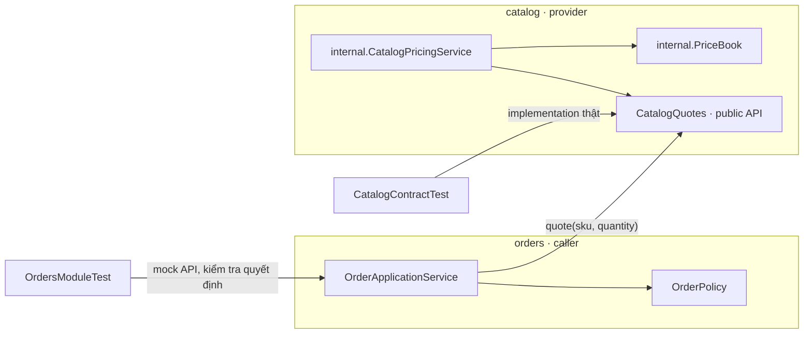
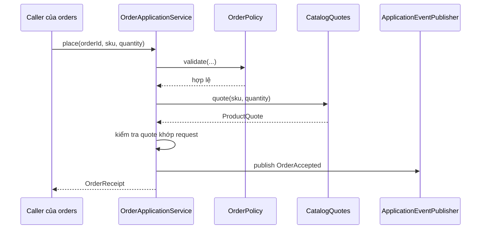
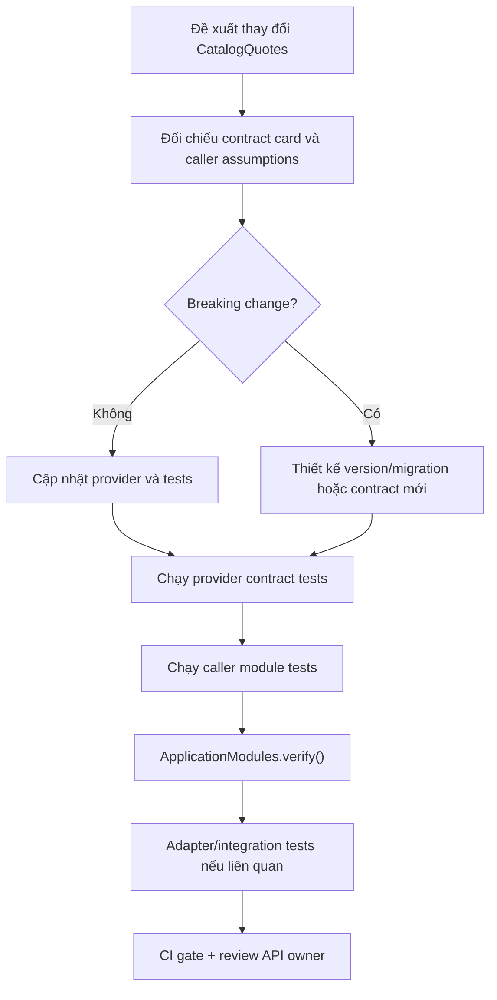

# Hợp đồng API giữa module gọi và module được gọi

## 1. Một lời gọi Java thành công chưa đủ bảo đảm hợp đồng

Trong ứng dụng Spring Modulith, module `orders` cần thông tin giá sản phẩm từ module `catalog`. Developer khai báo `CatalogQuotes.quote(sku, quantity)`, inject interface vào service đặt hàng và viết một test với Mockito trả về giá hợp lệ. Test xanh. Nhưng sau đó module `catalog` thay đổi hành vi: SKU không tồn tại trước đây ném `UnknownSkuException`, nay trả về `null`. Mã vẫn biên dịch vì signature không đổi, còn test `orders` vẫn xanh vì mock giữ hành vi cũ.

Đó là một dạng **lệch hợp đồng giữa module gọi (consumer/caller) và module được gọi (provider/callee)**.

Một hợp đồng API cấp module phải trả lời nhiều hơn “interface nào được import?”:

- **Caller cần gì?** Đầu vào nào được phép, kết quả nào nó dựa vào, lỗi nào nó có thể xử lý?
- **Provider cam kết gì?** Precondition, postcondition, bất biến, lỗi, ngữ nghĩa tiền tệ/định danh và trạng thái dữ liệu?
- **Hai bên được phép phụ thuộc nhau thế nào?** Module caller chỉ sử dụng public API/named interface của provider hay đang chạm vào implementation `internal`?
- **Kiểm chứng ở đâu?** Test phía caller có mô phỏng đúng contract, và test phía provider có chứng minh implementation thực sự tuân thủ không?
- **Khi API thay đổi, làm sao chặn hồi quy?** Architecture gate, module behavior, contract examples, integration tests và CI.

Bài học này thuộc chương **Architectural contracts** trong `SPRING_MODULITH_VERIFICATION_TESTING`. Mục tiêu học phần là kiểm chứng ranh giới kiến trúc với `ApplicationModules` và quy tắc phụ thuộc; luyện `@ApplicationModuleTest`, kiểm thử event, database và tích hợp; kết hợp các tầng bằng chứng thành quality gate CI ngăn phụ thuộc sai và hồi quy.

**Nguyên tắc cốt lõi:** API của một module là **lời hứa về hành vi và ranh giới**, không chỉ là tên class, chữ ký method hoặc việc Spring tìm được bean.

## 2. Định nghĩa rõ caller, provider và ba loại hợp đồng

Với ví dụ bán hàng:



Đừng dùng từ “contract” chung chung rồi chỉ viết một test. Có ít nhất ba lớp:

| Lớp | Hợp đồng được bảo vệ | Phép kiểm chứng phù hợp |
| --- | --- | --- |
| **Dependency contract** | `orders` được phép phụ thuộc `catalog` và chỉ dùng API được expose | `ApplicationModules.verify()`, public/internal, `allowedDependencies` |
| **Behavioral API contract** | `CatalogQuotes.quote(...)` trả giá đúng, ném lỗi đúng, không trả `null` ngoài quy ước | Provider module contract tests và caller behavior tests |
| **Integration contract** | Provider truy vấn repository/database/remote adapter thật, mapping và transaction đúng | JPA/JDBC hoặc HTTP integration tests, selected cross-module tests |

Thứ tự trách nhiệm:

1. **Provider** sở hữu API contract và implementation thực.
2. **Caller** công khai assumptions mình sử dụng từ contract ấy.
3. **Architecture test** kiểm tra hai bên sử dụng bề mặt công khai, không chạm implementation nội bộ.
4. **Integration test** bảo vệ đường đi bị mock ở module behavior test.

Một test Mockito ở caller không chứng minh provider; một test provider chạy xanh không chứng minh caller xử lý lỗi đúng; `ApplicationModules.verify()` không xác minh query SQL hay giá tiền.

## 3. Contract card: viết những điều có thể kiểm tra

Trước khi viết Java interface, hãy có một đặc tả đủ cụ thể.

| Thuộc tính | Contract của `CatalogQuotes.quote` |
| --- | --- |
| **Owner/provider** | Module `catalog` |
| **Caller** | Module `orders` |
| **API type** | `com.example.shop.catalog.CatalogQuotes` |
| **Operation** | `ProductQuote quote(String sku, int quantity)` |
| **Đầu vào hợp lệ** | `sku` không `null`/blank; `quantity > 0` |
| **SKU không tồn tại** | Ném `UnknownSkuException`, không trả `null` |
| **Input không hợp lệ** | Ném `IllegalArgumentException` trước khi truy vấn giá |
| **Kết quả hợp lệ** | Có `sku`, `quantity` đúng input; `currency`; `unitPriceMinor > 0`; `totalMinor = unitPriceMinor × quantity` |
| **Tiền tệ** | Giá trị số nguyên ở đơn vị nhỏ nhất theo quy ước của `currency`, trong ví dụ chỉ `VND` |
| **Overflow** | Không âm thầm tràn `long`; từ chối lượng đặt vượt miền biểu diễn |
| **Tác động phụ** | Truy vấn giá không tạo đơn, không charge payment |
| **Mức nhất quán** | Giá tại thời điểm lấy báo giá; không tự bảo đảm reservation/price lock |
| **Ownership của lỗi/DTO** | `ProductQuote` và `UnknownSkuException` thuộc API module `catalog` |
| **Kiểm chứng** | Provider contract tests, caller expectations, architecture gate, DB adapter tests |

Đặc tả này cố ý có **negative contracts**: không trả `null`, không silently overflow, không tạo tác động thanh toán. Chúng quan trọng như happy path.

Hãy viết rõ điều *chưa* được cam kết. Ví dụ `quote(...)` chưa bảo đảm giá có hiệu lực sau 30 phút, chưa giữ tồn kho, chưa idempotency cho thanh toán. Nếu caller dựa vào điều không được provider hứa, lỗi thiết kế vẫn có thể xảy ra dù từng module test xanh.

## 4. Cấu trúc Java thể hiện quyền sở hữu API

Ví dụ mô hình ứng dụng:

```text
src/main/java/com/example/shop/
├── ShopApplication.java
├── orders/
│   ├── package-info.java
│   ├── OrderApplicationService.java
│   ├── OrderReceipt.java
│   ├── OrderAccepted.java
│   └── internal/
│       └── OrderPolicy.java
├── catalog/
│   ├── CatalogQuotes.java
│   ├── ProductQuote.java
│   ├── UnknownSkuException.java
│   └── internal/
│       ├── CatalogPricingService.java
│       ├── PriceBook.java
│       └── InMemoryPriceBook.java
└── notifications/
    └── internal/
        └── OrderAcceptedListener.java

src/test/java/com/example/shop/
├── ModuleArchitectureTest.java
├── orders/OrdersConsumerContractTest.java
├── orders/OrdersCatalogIntegrationTest.java
└── catalog/CatalogProviderContractTest.java
```

Theo mô hình Spring Modulith mặc định thường gặp, `orders`, `catalog` và `notifications` là các application module nằm trong những package con trực tiếp của package ứng dụng gốc. `catalog.internal` và `orders.internal` thuộc chính module sở hữu chúng; không phải API mà module khác được phép import theo mặc định.

Nếu dự án tùy chỉnh cách nhận diện module, tên module hoặc named interfaces, hãy dùng **mô hình thực tế** do Spring Modulith phát hiện thay vì suy từ tên folder.

### 4.1. Spring Boot application root

```java
// src/main/java/com/example/shop/ShopApplication.java
package com.example.shop;

import org.springframework.boot.SpringApplication;
import org.springframework.boot.autoconfigure.SpringBootApplication;

@SpringBootApplication
public class ShopApplication {

    public static void main(String[] args) {
        SpringApplication.run(ShopApplication.class, args);
    }
}
```

## 5. Public API của provider: không lộ implementation

Module `catalog` công bố interface tại base package:

```java
// src/main/java/com/example/shop/catalog/CatalogQuotes.java
package com.example.shop.catalog;

public interface CatalogQuotes {

    /**
     * @throws IllegalArgumentException khi sku/quantity không hợp lệ
     * @throws UnknownSkuException khi sku không tồn tại
     */
    ProductQuote quote(String sku, int quantity);
}
```

DTO trả về ở cùng public API:

```java
// src/main/java/com/example/shop/catalog/ProductQuote.java
package com.example.shop.catalog;

public record ProductQuote(
    String sku,
    int quantity,
    String currency,
    long unitPriceMinor,
    long totalMinor
) {
}
```

Exception là một phần contract:

```java
// src/main/java/com/example/shop/catalog/UnknownSkuException.java
package com.example.shop.catalog;

public class UnknownSkuException extends RuntimeException {

    public UnknownSkuException(String sku) {
        super("Unknown SKU: " + sku);
    }
}
```

**Điểm quan trọng:** `ProductQuote` và `UnknownSkuException` nằm trong public API của `catalog`. Nếu đưa chúng vào `catalog.internal` rồi dùng chúng trong method signature `CatalogQuotes.quote(...)`, caller sẽ phụ thuộc vào internal type dù interface chính nằm ở base package.

Một Java class `public` ở `catalog.internal` không tự được xem là public API của application module. Public/internal của Spring Modulith và visibility của Java là hai quy tắc khác nhau.

### 5.1. Không đưa JPA entity ra ngoài

Không nên khai báo:

```java
// PHẢN VÍ DỤ: không dùng làm public contract.
public interface CatalogQuotes {
    com.example.shop.catalog.internal.ProductEntity
        quote(String sku, int quantity);
}
```

Đoạn này cố ý minh họa anti-pattern và giả định `ProductEntity` là class public ở internal. Nó làm caller phải biết entity, lazy-loading, mapping và thay đổi schema.

Thay bằng `ProductQuote` không chứa JPA/proxy, còn `catalog` chịu trách nhiệm ánh xạ dữ liệu nội bộ. Contract DTO không nên đẩy chi tiết database hoặc HTTP client sang caller.

## 6. Provider implementation thật nằm trong module `catalog`

Trong ví dụ học thuật, một `PriceBook` in-memory giúp test provider chạy mà không cần database. Nó là implementation nội bộ, **không phải production JPA test**.

### 6.1. Port nội bộ đọc bảng giá

```java
// src/main/java/com/example/shop/catalog/internal/PriceBook.java
package com.example.shop.catalog.internal;

import java.util.Optional;

interface PriceBook {
    Optional<UnitPrice> find(String sku);
}

record UnitPrice(String currency, long amountMinor) {
}
```

Hai kiểu này là package-private; chỉ các lớp trong package `catalog.internal` mới tham chiếu trực tiếp. Java compiler bổ sung một lớp bảo vệ visibility, còn Spring Modulith bảo vệ quyền truy cập module ở mức kiến trúc.

### 6.2. Adapter dữ liệu giả định

```java
// src/main/java/com/example/shop/catalog/internal/InMemoryPriceBook.java
package com.example.shop.catalog.internal;

import java.util.Map;
import java.util.Optional;
import org.springframework.stereotype.Repository;

@Repository
class InMemoryPriceBook implements PriceBook {

    private final Map<String, UnitPrice> prices = Map.of(
        "SKU-1", new UnitPrice("VND", 120000),
        "SKU-2", new UnitPrice("VND", 99000));

    @Override
    public Optional<UnitPrice> find(String sku) {
        return Optional.ofNullable(prices.get(sku));
    }
}
```

`Map` ở đây có dữ liệu cố định; test cần fixture riêng nếu dự án thay sang repository thật. Không dùng adapter in-memory để kết luận SQL, index, migration hoặc transaction của database đúng.

### 6.3. Implementation bảo vệ contract

```java
// src/main/java/com/example/shop/catalog/internal/CatalogPricingService.java
package com.example.shop.catalog.internal;

import com.example.shop.catalog.CatalogQuotes;
import com.example.shop.catalog.ProductQuote;
import com.example.shop.catalog.UnknownSkuException;
import org.springframework.stereotype.Service;

@Service
class CatalogPricingService implements CatalogQuotes {

    private final PriceBook priceBook;

    CatalogPricingService(PriceBook priceBook) {
        this.priceBook = priceBook;
    }

    @Override
    public ProductQuote quote(String sku, int quantity) {
        if (sku == null || sku.isBlank()) {
            throw new IllegalArgumentException(
                "SKU must not be blank");
        }
        if (quantity <= 0) {
            throw new IllegalArgumentException(
                "Quantity must be positive");
        }

        UnitPrice unit = priceBook.find(sku)
            .orElseThrow(() -> new UnknownSkuException(sku));

        if (unit.amountMinor() <= 0) {
            throw new IllegalStateException(
                "Invalid price book entry");
        }

        long total;
        try {
            total = Math.multiplyExact(
                unit.amountMinor(), quantity);
        } catch (ArithmeticException ex) {
            throw new IllegalArgumentException(
                "Total amount out of range", ex);
        }

        return new ProductQuote(
            sku, quantity, unit.currency(),
            unit.amountMinor(), total);
    }
}
```

Contract được implementation giữ:

- Input sai → `IllegalArgumentException` trước khi lookup.
- SKU không tồn tại → `UnknownSkuException`, không trả `null`.
- Input hợp lệ → `ProductQuote` với quantity và currency nhất quán.
- Total tính bằng phép nhân có kiểm tra overflow.
- Adapter `PriceBook` được giữ nội bộ và có thể thay bằng JPA/HTTP mà caller không cần biết.

Ở sản phẩm thật, còn cần quy tắc cho giá khuyến mãi, số thập phân, thuế, thời gian hiệu lực và khả năng snapshot giá. Những nội dung đó phải được thêm vào API contract khi thực sự được cam kết; không suy ra từ demo.

## 7. Caller chỉ được biết interface và DTO public

Module `orders` dùng `CatalogQuotes`. Nó không import `CatalogPricingService`, `PriceBook` hoặc `InMemoryPriceBook`.

### 7.1. DTO trả về từ use case của caller

```java
// src/main/java/com/example/shop/orders/OrderReceipt.java
package com.example.shop.orders;

public record OrderReceipt(
    String orderId,
    String currency,
    long totalMinor
) {
}
```

### 7.2. Sự kiện công khai của caller

```java
// src/main/java/com/example/shop/orders/OrderAccepted.java
package com.example.shop.orders;

public record OrderAccepted(
    String orderId,
    String sku,
    int quantity,
    String currency,
    long totalMinor
) {
}
```

`OrderAccepted` do `orders` sở hữu. Module `notifications` có thể phụ thuộc vào event type công khai của `orders`; `orders` không cần gọi trực tiếp implementation thông báo.

### 7.3. Validation thuộc quyền sở hữu caller

```java
// src/main/java/com/example/shop/orders/internal/OrderPolicy.java
package com.example.shop.orders.internal;

import org.springframework.stereotype.Component;

@Component
public class OrderPolicy {

    public void validate(
            String orderId, String sku, int quantity) {

        if (orderId == null || orderId.isBlank()) {
            throw new IllegalArgumentException(
                "Order ID must not be blank");
        }
        if (sku == null || sku.isBlank()) {
            throw new IllegalArgumentException(
                "SKU must not be blank");
        }
        if (quantity <= 0) {
            throw new IllegalArgumentException(
                "Quantity must be positive");
        }
    }
}
```

Caller có quyền validate dữ liệu đầu vào của chính use case, nhưng không nên tự nhân giá theo một quy tắc khác nếu provider đã cam kết `totalMinor`. Khi caller tính lại sai hoặc bỏ qua currency, hai module có thể lệch semantics dù type phù hợp.

### 7.4. Service thật dùng API contract

```java
// src/main/java/com/example/shop/orders/OrderApplicationService.java
package com.example.shop.orders;

import com.example.shop.catalog.CatalogQuotes;
import com.example.shop.catalog.ProductQuote;
import com.example.shop.orders.internal.OrderPolicy;
import org.springframework.context.ApplicationEventPublisher;
import org.springframework.stereotype.Service;

@Service
public class OrderApplicationService {

    private final OrderPolicy policy;
    private final CatalogQuotes catalog;
    private final ApplicationEventPublisher events;

    public OrderApplicationService(
            OrderPolicy policy,
            CatalogQuotes catalog,
            ApplicationEventPublisher events) {
        this.policy = policy;
        this.catalog = catalog;
        this.events = events;
    }

    public OrderReceipt place(
            String orderId, String sku, int quantity) {

        policy.validate(orderId, sku, quantity);

        ProductQuote quote = catalog.quote(sku, quantity);

        if (!sku.equals(quote.sku())
                || quote.quantity() != quantity) {
            throw new IllegalStateException(
                "Catalog quote mismatches the request");
        }

        var accepted = new OrderAccepted(
            orderId, quote.sku(), quote.quantity(),
            quote.currency(), quote.totalMinor());

        events.publishEvent(accepted);

        return new OrderReceipt(
            orderId, quote.currency(), quote.totalMinor());
    }
}
```

Đường đi:



Đây là mô hình **đặt hàng tối giản**. Nó chưa persist đơn vào database, chưa reserve tồn kho hoặc thanh toán. Do đó `OrderAccepted` ở ví dụ diễn đạt việc use case đã chấp nhận request sau quote; không nên mặc nhiên dùng nó làm tín hiệu “đơn đã thanh toán” hay “đã commit” trong sản phẩm thực.

### 7.5. Caller được phép tin provider đến đâu?

Service trên kiểm tra quote khớp `sku` và `quantity`, nhưng không kiểm tra mọi bất biến (ví dụ `totalMinor` dương) vì **provider đã cam kết** chúng. Nếu caller cần ranh giới phòng vệ với dữ liệu không đáng tin (HTTP external provider), có thể bổ sung validation ở adapter boundary. Cách thiết kế phải rõ: tránh hai implementation nghiệp vụ cạnh tranh nhau mà không có nguồn sự thật.

Một contract test provider phải chứng minh các postcondition mà caller được phép dựa vào.

## 8. Quy tắc phụ thuộc: đúng API chưa đủ nếu sai chiều

Giả sử `orders` chỉ được phép phụ thuộc vào `catalog`:

```java
// src/main/java/com/example/shop/orders/package-info.java
@org.springframework.modulith.ApplicationModule(
    allowedDependencies = "catalog"
)
package com.example.shop.orders;
```

Khi đó:

- `orders → catalog.CatalogQuotes`: hợp lệ theo ví dụ.
- `orders → catalog.ProductQuote`: hợp lệ, DTO thuộc API public.
- `orders → catalog.UnknownSkuException`: hợp lệ, exception thuộc API public.
- `orders → catalog.internal.CatalogPricingService`: **không hợp lệ**, dù implementation được khai báo Java `public`.
- `orders → notifications.internal.OrderAcceptedListener`: **không hợp lệ** và có thể tạo coupling ngược chiều.
- Một dependency mới tới module `billing`: cần quyết định kiến trúc và cập nhật `allowedDependencies` có chủ đích.

Nếu provider muốn công bố API ở subpackage, có thể dùng `@NamedInterface` và giới hạn như `catalog::pricing`. Nhưng không nên công bố toàn bộ subpackage `internal` chỉ để làm `verify()` xanh.

### 8.1. Dependency graph khác Spring bean graph

`allowedDependencies` không:

- tạo `CatalogQuotes` bean;
- chọn `catalog` làm dependency runtime trong `STANDALONE`;
- điều khiển `@ComponentScan` hoặc `@Import`;
- chứng minh `CatalogPricingService` thỏa contract.

Nó bảo vệ **quan hệ code được phép**. Runtime composition do `@ApplicationModuleTest`, `BootstrapMode`, bean registration và test doubles kiểm soát.

## 9. Kiểm chứng cấu trúc bằng `ApplicationModules.verify()`

Tạo JUnit test ở package root:

```java
// src/test/java/com/example/shop/ModuleArchitectureTest.java
package com.example.shop;

import org.junit.jupiter.api.Test;
import org.springframework.modulith.core.ApplicationModules;

class ModuleArchitectureTest {

    @Test
    void verifiesCallerProviderBoundaries() {
        ApplicationModules.of(ShopApplication.class).verify();
    }
}
```

Phép kiểm chứng này phân tích mô hình application module và những quy tắc Spring Modulith hỗ trợ: không phụ thuộc vào phần internal của module khác, không vi phạm `allowedDependencies` và không có vòng phụ thuộc không hợp lệ.

Điểm đặc biệt quan trọng: **không cần khởi động toàn bộ Spring Boot `ApplicationContext`** để kiểm tra kiến trúc. Bài test không cần PostgreSQL, Kafka hay payment gateway.

### Một lỗi kiến trúc điển hình

```java
// PHẢN VÍ DỤ ở module orders:
import com.example.shop.catalog.internal.CatalogPricingService;
```

Nếu class internal Java-public, import có thể biên dịch. Nhưng ứng dụng mất quyền thay đổi implementation `catalog` mà không ảnh hưởng `orders`. `ApplicationModules.verify()` phải đóng vai trò architecture gate bắt lỗi đó theo mô hình module đã khai báo.

**Không sửa bằng cách chuyển class internal ra base package hay mở rộng allowedDependencies vô điều kiện.** Hãy quay về `CatalogQuotes`, API mà provider sở hữu.

## 10. Provider contract test: chứng minh implementation giữ lời hứa

Giờ viết test ở package `com.example.shop.catalog` để bootstrap module **provider**. Ở đây dùng `PriceBook` in-memory thật để kiểm tra contract của `CatalogPricingService` qua public interface.

```java
// src/test/java/com/example/shop/catalog/CatalogProviderContractTest.java
package com.example.shop.catalog;

import org.junit.jupiter.api.Test;
import org.springframework.beans.factory.annotation.Autowired;
import org.springframework.modulith.test.ApplicationModuleTest;

import static org.assertj.core.api.Assertions.assertThat;
import static org.assertj.core.api.Assertions.assertThatThrownBy;

@ApplicationModuleTest
class CatalogProviderContractTest {

    @Autowired
    CatalogQuotes catalog;

    @Test
    void returnsQuoteWithCorrectBusinessMeaning() {
        ProductQuote quote = catalog.quote("SKU-1", 2);

        assertThat(quote.sku()).isEqualTo("SKU-1");
        assertThat(quote.quantity()).isEqualTo(2);
        assertThat(quote.currency()).isEqualTo("VND");
        assertThat(quote.unitPriceMinor())
            .isEqualTo(120000L);
        assertThat(quote.totalMinor())
            .isEqualTo(240000L);
    }

    @Test
    void rejectsUnknownSkuWithPublicException() {
        assertThatThrownBy(() ->
            catalog.quote("SKU-X", 1))
            .isInstanceOf(UnknownSkuException.class)
            .hasMessageContaining("SKU-X");
    }

    @Test
    void rejectsInvalidInput() {
        assertThatThrownBy(() ->
            catalog.quote("", 1))
            .isInstanceOf(IllegalArgumentException.class);

        assertThatThrownBy(() ->
            catalog.quote("SKU-1", 0))
            .isInstanceOf(IllegalArgumentException.class);
    }

    @Test
    void neverReturnsNegativeOrNullQuoteForValidSku() {
        ProductQuote quote = catalog.quote("SKU-2", 3);

        assertThat(quote).isNotNull();
        assertThat(quote.unitPriceMinor()).isPositive();
        assertThat(quote.totalMinor()).isPositive();
        assertThat(quote.totalMinor())
            .isEqualTo(
                quote.unitPriceMinor() * quote.quantity());
    }
}
```

**Điều được chứng minh:**

- `CatalogQuotes` là bean được expose bởi module `catalog`.
- Implementation `CatalogPricingService` thật thực thi quote.
- Các hậu điều kiện cơ bản không phụ thuộc vào việc caller dùng mock.
- Caller có thể dựa vào `UnknownSkuException` thay vì `null` cho SKU không có.

**Giới hạn:** demo sử dụng `InMemoryPriceBook` nên test này chưa chứng minh database, câu SQL, mapping JPA hoặc transaction thật. Khi thay adapter bằng JPA, provider contract test có thể cần fixture và datasource phù hợp; ngoài ra nên có persistence integration test riêng.

### Vì sao test qua interface thay vì inject implementation?

Inject `CatalogQuotes` giúp kiểm chứng đúng **bề mặt API mà caller nhìn thấy**. Nếu implementation đổi tên/package, test vẫn có lý do tồn tại. Test riêng cho nội bộ có thể inject implementation khi thật sự cần, nhưng không thay được phép xác minh public contract.

## 11. Caller contract test: giả lập phản hồi hợp lệ và lỗi theo đặc tả

Bài module test ở `orders` kiểm tra caller dùng API provider đúng cách. Trong `STANDALONE`, implementation thật của `catalog` thường không được nạp; cần mock `CatalogQuotes`.

```java
// src/test/java/com/example/shop/orders/OrdersConsumerContractTest.java
package com.example.shop.orders;

import com.example.shop.catalog.CatalogQuotes;
import com.example.shop.catalog.ProductQuote;
import com.example.shop.catalog.UnknownSkuException;
import org.junit.jupiter.api.Test;
import org.springframework.beans.factory.annotation.Autowired;
import org.springframework.modulith.test.ApplicationModuleTest;
import org.springframework.modulith.test.PublishedEvents;
import org.springframework.test.context.bean.override.mockito.MockitoBean;

import static org.assertj.core.api.Assertions.assertThat;
import static org.assertj.core.api.Assertions.assertThatThrownBy;
import static org.mockito.BDDMockito.given;
import static org.mockito.Mockito.verify;
import static org.mockito.Mockito.verifyNoInteractions;

@ApplicationModuleTest
class OrdersConsumerContractTest {

    @Autowired
    OrderApplicationService orders;

    @MockitoBean
    CatalogQuotes catalog;

    @Test
    void usesQuoteAndPublishesAcceptedOrder(
            PublishedEvents events) {

        given(catalog.quote("SKU-1", 2))
            .willReturn(new ProductQuote(
                "SKU-1", 2, "VND", 120000, 240000));

        OrderReceipt receipt =
            orders.place("ORD-1", "SKU-1", 2);

        assertThat(receipt.orderId()).isEqualTo("ORD-1");
        assertThat(receipt.currency()).isEqualTo("VND");
        assertThat(receipt.totalMinor()).isEqualTo(240000);

        assertThat(events.ofType(OrderAccepted.class))
            .singleElement()
            .satisfies(event -> {
                assertThat(event.orderId())
                    .isEqualTo("ORD-1");
                assertThat(event.sku())
                    .isEqualTo("SKU-1");
                assertThat(event.quantity()).isEqualTo(2);
                assertThat(event.currency()).isEqualTo("VND");
                assertThat(event.totalMinor())
                    .isEqualTo(240000);
            });

        verify(catalog).quote("SKU-1", 2);
    }

    @Test
    void doesNotCallProviderForInvalidQuantity(
            PublishedEvents events) {

        assertThatThrownBy(() ->
            orders.place("ORD-2", "SKU-1", 0))
            .isInstanceOf(IllegalArgumentException.class);

        verifyNoInteractions(catalog);
        assertThat(events.ofType(OrderAccepted.class))
            .isEmpty();
    }

    @Test
    void doesNotPublishWhenProviderRejectsSku(
            PublishedEvents events) {

        given(catalog.quote("SKU-X", 1))
            .willThrow(new UnknownSkuException("SKU-X"));

        assertThatThrownBy(() ->
            orders.place("ORD-3", "SKU-X", 1))
            .isInstanceOf(UnknownSkuException.class);

        assertThat(events.ofType(OrderAccepted.class))
            .isEmpty();
    }

    @Test
    void rejectsInconsistentQuoteInsteadOfPublishing(
            PublishedEvents events) {

        given(catalog.quote("SKU-1", 2))
            .willReturn(new ProductQuote(
                "SKU-OTHER", 2, "VND", 120000, 240000));

        assertThatThrownBy(() ->
            orders.place("ORD-4", "SKU-1", 2))
            .isInstanceOf(IllegalStateException.class);

        assertThat(events.ofType(OrderAccepted.class))
            .isEmpty();
    }
}
```

Trong ví dụ này:

1. `OrderApplicationService` và `OrderPolicy` thật được khởi tạo trong module `orders`.
2. `@MockitoBean` cung cấp collaborator giả cho `CatalogQuotes` bên ngoài module.
3. Test mô tả **assumptions của caller** đối với một provider hợp lệ.
4. `PublishedEvents` xác nhận event của module caller đã phát/không phát khi thích hợp.
5. Không có adapter `PriceBook`/JPA của `catalog` trong đường chạy test.

**Lưu ý phiên bản:** `@MockitoBean` có trong Spring Framework 6.2 trở lên, với Spring Boot/Spring Modulith tương thích. Dự án Spring Boot cũ hơn có thể cần `@MockBean`; annotation Boot này bị đánh dấu deprecated từ 3.4. Chọn đúng API theo stack đang sử dụng.

### Mock không tự kiểm tra được provider

Nếu provider đổi `quote(...)` để trả `null` với SKU không tồn tại, test Mockito ở `orders` vẫn mô phỏng `UnknownSkuException` và vẫn có thể xanh. **Vì thế provider contract test là bắt buộc cho những assumptions quan trọng của caller.**

Đừng tạo cảm giác an toàn giả bằng cách mock cả `OrderApplicationService` rồi assert kết quả mock trả ra. Điều đó không chạy logic caller cần bảo vệ.

## 12. Ma trận song phương: cùng contract nhưng trách nhiệm khác nhau

| Kịch bản | Caller test cần chứng minh | Provider test cần chứng minh |
| --- | --- | --- |
| SKU `SKU-1`, qty `2` | Caller dùng đúng `quote("SKU-1", 2)`, nhận total và phát `OrderAccepted` đúng | Provider thực sự trả `currency=VND`, `totalMinor=240000` |
| SKU không tồn tại | Caller không phát event, xử lý `UnknownSkuException` đúng | Provider ném đúng `UnknownSkuException` thay vì `null` |
| Quantity bằng `0` | Caller chặn trước khi gọi provider | Provider vẫn validate nếu API được gọi trực tiếp |
| Total vượt `long` | Caller không tự tính giá sai | Provider phải chặn overflow một cách tường minh |
| Provider trả quote không khớp SKU | Caller từ chối trạng thái không nhất quán | Provider không tạo quote sai SKU trong điều kiện bình thường |
| Đổi loại tiền tệ | Caller sử dụng currency như dữ liệu contract, không tự đổi đơn vị | Provider công bố đúng currency/amount theo định nghĩa |
| Provider dùng JPA thay in-memory | Caller không đổi vì API contract ổn định | Provider/adapter test chứng minh mapping, SQL và fixture thật |
| API tăng version/đổi DTO | Caller kiểm tra assumptions với contract mới | Provider bảo toàn backward compatibility hoặc migration |

**Một contract được bảo vệ tốt khi cả hai phía có test**, nhưng hai test không nên copy cùng một stub mà chưa bao giờ kiểm chứng kết quả production. Cần kết nối các ví dụ hợp đồng với provider thật.

## 13. Contract examples: tạo nguồn sự thật chung, tránh “mock ảo”

Vấn đề phổ biến trong dự án lớn là consumer viết mock theo trí tưởng tượng:

```java
given(catalog.quote("SKU-X", 1))
    .willReturn(null); // Caller tưởng SKU lạ trả null.
```

Trong khi provider có contract “ném `UnknownSkuException`”. Tất cả test caller có thể dựa trên một hành vi mà provider không bao giờ thực hiện.

Một phương án là xây dựng **contract examples** được provider và caller cùng review:

| ID | Input | Provider outcome | Caller expectation |
| --- | --- | --- | --- |
| `CAT-001` | `SKU-1`, `2` | Quote VND, unit 120000, total 240000 | OrderReceipt total 240000, event đúng |
| `CAT-002` | `SKU-X`, `1` | `UnknownSkuException` | Không công bố `OrderAccepted` |
| `CAT-003` | `SKU-1`, `0` | `IllegalArgumentException` | Caller từ chối trước khi gọi |
| `CAT-004` | SKU blank | `IllegalArgumentException` | Caller từ chối trước khi gọi |
| `CAT-005` | SKU hợp lệ, qty quá lớn | Từ chối nếu total overflow | Không tạo order với tổng tiền bị tràn |

Có thể thể hiện ví dụ chung qua fixtures, parameterized tests hoặc một thư viện test contract dùng chung **trong phạm vi dự án**. Tuy nhiên, đừng biến test contract thành module production thứ ba chỉ để chia sẻ vài hằng số; vị trí test support cần tuân thủ quy tắc build và ownership.

### 13.1. Provider làm chủ contract, consumer mô tả nhu cầu

Trong mô hình **consumer-driven contract**, consumer công bố những expectations tối thiểu nó cần, provider xác minh chúng trên implementation thực. Phù hợp đặc biệt khi nhiều ứng dụng deploy độc lập qua HTTP/message API.

Trong **modulith một repository**, compile-time API + `ApplicationModules.verify()` có thể chặn nhiều vi phạm cấu trúc. Nhưng contract behavior vẫn cần provider assertions; một thay đổi semantics có thể không gây compile error. Consumer-driven examples là kỹ thuật bổ sung, không thay architecture test.

### 13.2. Có nên tái sử dụng nguyên một lớp test ở cả hai module?

Có thể dùng JUnit 5 test interface/abstract contract test nếu muốn đảm bảo những assertions cốt lõi được chạy với implementation provider. Nhưng cách này phải tránh việc provider test sử dụng **chính mock consumer**: như vậy không có bằng chứng implementation thật tuân thủ.

Một chiến lược đơn giản hơn là ghi rõ contract card và các scenario IDs, rồi viết test provider và consumer độc lập theo cùng bảng. Khi scenario thay đổi, code review phải xem cả hai phía.

## 14. Tăng phạm vi: test cả caller và provider thật

Khi cần đảm bảo Spring wiring và hợp tác thực giữa `orders` và `catalog`, dùng `@ApplicationModuleTest` ở `orders` với `BootstrapMode.DIRECT_DEPENDENCIES` nếu `catalog` là dependency trực tiếp đã được Spring Modulith nhận diện.

```java
// src/test/java/com/example/shop/orders/OrdersCatalogIntegrationTest.java
package com.example.shop.orders;

import org.junit.jupiter.api.Test;
import org.springframework.beans.factory.annotation.Autowired;
import org.springframework.modulith.test.ApplicationModuleTest;
import org.springframework.modulith.test.ApplicationModuleTest.BootstrapMode;

import static org.assertj.core.api.Assertions.assertThat;

@ApplicationModuleTest(
    mode = BootstrapMode.DIRECT_DEPENDENCIES)
class OrdersCatalogIntegrationTest {

    @Autowired
    OrderApplicationService orders;

    @Test
    void callerUsesRealCatalogProvider() {
        OrderReceipt receipt =
            orders.place("ORD-INT-1", "SKU-1", 2);

        assertThat(receipt.totalMinor()).isEqualTo(240000L);
        assertThat(receipt.currency()).isEqualTo("VND");
    }
}
```

**Điều kiện của ví dụ:** `orders` thực sự có direct dependency `catalog`, module `catalog` dùng implementation in-memory trong code minh họa, không có bean thiếu hoặc auto-configuration thất bại. Nếu provider production là JPA hoặc HTTP adapter, test phải chuẩn bị database/test server, schema và fixtures trước khi có ý nghĩa.

### Bootstrap mode khác allowed dependencies

| Cơ chế | Điều khiển | Không tự đảm bảo |
| --- | --- | --- |
| `@ApplicationModule(allowedDependencies = "catalog")` | Quyền tạo dependency **code** của `orders` tới API `catalog` | Có bean `CatalogQuotes` trong module test |
| `STANDALONE` | Chọn module mục tiêu `orders` cho context test | Implementation thật `catalog` được nạp |
| `DIRECT_DEPENDENCIES` | Chọn `orders` và dependency module trực tiếp | Database/schema/provider service hoạt động |
| `ALL_DEPENDENCIES` | Chọn dependency trực tiếp và bắc cầu | Toàn bộ module độc lập đều được nạp |
| `@MockitoBean CatalogQuotes` | Thêm/thay collaborator mock trong test context | Provider thật chạy đúng |
| `ApplicationModules.verify()` | Kiểm tra ranh giới/module dependency | Business behavior, SQL và transaction đúng |

**Đừng đổi toàn bộ test sang `ALL_DEPENDENCIES` chỉ để “không còn thiếu bean”.** Dùng test double khi cần kiểm tra logic caller; mở rộng mode khi thật sự muốn chạy provider.

## 15. Khi API thay đổi: phân loại trước khi sửa code

Có những thay đổi khiến compiler báo lỗi, có những thay đổi nguy hiểm hơn vì compiler vẫn im lặng.

| Thay đổi ở provider | Loại rủi ro | Kỹ thuật phát hiện |
| --- | --- | --- |
| Đổi tên `CatalogQuotes` hoặc method `quote` | Source/binary compatibility | Compile, dependent module tests |
| Đổi return type `ProductQuote` thành `String` | Source compatibility | Compile và contract tests |
| Chuyển `ProductQuote` vào `catalog.internal` | Module boundary | `ApplicationModules.verify()` |
| Đổi `UnknownSkuException` thành `null` | Behavioral breaking change | Provider contract + consumer expectation tests |
| Đổi `totalMinor` thành đơn vị khác nhưng vẫn `long` | Semantic breaking change | Giá trị contract cụ thể, currency/unit assertions |
| Xóa field `currency` | API/data contract | Compile, serialization/DTO tests |
| Thêm field không bắt buộc ở wire JSON | Có thể compatible | Consumer compatibility test |
| Dùng `double` để tính tiền thay `long` | Precision/semantics | Provider boundary/rounding tests |
| Đổi in-memory provider sang JPA | Adapter/runtime | JPA integration, migration/fixture |
| Thêm remote call trong `quote` | Latency/timeout/failure modes | Adapter tests, timeout contract |
| Thêm side effect charge payment vào `quote` | Trái trách nhiệm API | Negative contract/integration review |
| Đổi behavior khi concurrent updates | Consistency/temporal contract | Concurrent/integration tests |

Nếu thay đổi là breaking, hãy chọn một trong các chiến lược: phát hành API/DTO version mới; giữ overload tương thích trong giai đoạn migration; cập nhật caller và provider trong cùng change set có tests; hoặc tách một interface mới có owner rõ ràng.

**Không nới `allowedDependencies` hoặc công bố internal chỉ để làm compile/test xanh** nếu thay đổi không đúng trách nhiệm module.

## 16. API contract gồm cả lỗi và sự khác biệt giữa lỗi nghiệp vụ/hạ tầng

Caller cần hiểu trường hợp nào là **business outcome** và trường hợp nào là **technical failure**.

Ví dụ:

| Tình huống | Contract đề xuất | Caller có thể làm gì? |
| --- | --- | --- |
| SKU không tồn tại | `UnknownSkuException` | Trả lỗi nghiệp vụ/không đặt đơn |
| Số lượng bằng 0 | `IllegalArgumentException` | Từ chối input ngay đầu use case |
| Giá không hợp lệ trong PriceBook | `IllegalStateException` | Báo lỗi hệ thống, không tạo đơn |
| DB timeout | Exception kỹ thuật thích hợp, có policy rõ | Retry/circuit breaker tùy ngữ cảnh |
| Network provider 5xx | Adapter map theo contract đã thiết kế | Không giả định SKU không tồn tại |
| Giá thay đổi giữa quote và commit | Business consistency policy | Requote, reserve hoặc price snapshot |
| Concurrent order cùng SKU | Không đồng nghĩa tồn kho được giữ | Cần reservation/transaction contract riêng |

Đừng biến mọi exception thành `UnknownSkuException` để caller dễ xử lý; như vậy lỗi database có thể bị hiểu là “sản phẩm không có”. Ngược lại, không nên để provider trả `null` cho mọi lỗi rồi buộc caller tự đoán ngữ nghĩa.

### 16.1. Exception Java cũng là một dạng public API

Khi caller bắt `UnknownSkuException`, class này phải thuộc public API hoặc named interface được công bố của `catalog`. Nếu exception nằm trong `catalog.internal`, caller đã bị buộc import internal type để thực hiện đúng hợp đồng lỗi.

Một lựa chọn khác là dùng kết quả typed (sealed interface, result type) thay exception. Dù chọn kiểu nào, cần thống nhất và kiểm chứng những outcome mà caller có quyền dựa vào.

## 17. Contract về idempotency, retry và thời gian

Một API trong JVM có thể trông giống lời gọi thuần nhưng thực tế tác động DB, lock hoặc remote service. Các cam kết cần chỉ rõ:

1. **Idempotency:** gọi hai lần cùng input có tạo hai side effect không?
2. **Consistency:** dữ liệu trả về là snapshot tại thời điểm nào?
3. **Timeout:** caller có được blocking vô hạn không; ai đặt timeout?
4. **Retry:** exception nào được retry, retry có tạo tác động trùng không?
5. **Concurrency:** có race khi hai request sử dụng cùng entity/stock?
6. **Transaction:** caller và provider có cần cùng transaction không, hoặc giao tiếp qua event/saga?
7. **Caching:** dữ liệu được cache trong bao lâu, có chấp nhận stale read không?

Với `CatalogQuotes.quote(...)` của ví dụ, contract mới chỉ là **tính báo giá**, không dự trữ stock. Nếu business đòi giữ giá/stock đến khi thanh toán, cần một API có thời hạn hiệu lực/reservation ID và transaction semantics, thay vì để caller mặc nhiên coi giá “đã khóa”.

**Mock provider thường quá lý tưởng:** nó không tự mô phỏng latency, transaction rollback hoặc lỗi kết nối. Đó là lý do provider adapter/integration test phải xem những failure mode thực tế khi API gọi I/O.

## 18. Data ownership: caller không được mượn repository để lách API

Một anti-pattern trong modulith:

```java
// PHẢN VÍ DỤ ở orders:
import com.example.shop.catalog.internal.CatalogJpaRepository;

class BadOrderService {
    // Directly read/write catalog's internal persistence model.
}
```

Cách này có thể “nhanh” nhưng phá ranh giới: module `orders` bị ghép chặt với JPA entity, repository, schema, transaction và quy tắc của `catalog`.

Hãy tạo API như `CatalogQuotes` hoặc một use case cụ thể phù hợp owner, thay vì expose repository.

### 18.1. SQL dạng chuỗi cũng có thể phá quyền sở hữu

Một đoạn như:

```java
// PHẢN VÍ DỤ: không tạo Java dependency trực tiếp tới catalog.
jdbcTemplate.update(
    "UPDATE catalog_products SET stock = stock - 1 WHERE sku = ?",
    sku);
```

không nhất thiết bị `ApplicationModules.verify()` phát hiện vì chuỗi SQL không phải type dependency Java tới package `catalog`. Quyền sở hữu dữ liệu cần được bảo vệ thêm bằng review query, quyền database/schema, integration test và các quy tắc kiến trúc riêng nếu dự án áp dụng.

### 18.2. Khi provider đổi từ in-memory sang JPA

Một provider test cần kiểm chứng query thật chứ không dùng mock repository để tuyên bố persistence đúng.

Khung thiết lập PostgreSQL Testcontainers trong module `catalog`:

```java
// src/test/java/com/example/shop/catalog/CatalogDatabaseContractTest.java
package com.example.shop.catalog;

import org.junit.jupiter.api.Test;
import org.springframework.modulith.test.ApplicationModuleTest;
import org.springframework.test.context.DynamicPropertyRegistry;
import org.springframework.test.context.DynamicPropertySource;
import org.testcontainers.containers.PostgreSQLContainer;
import org.testcontainers.junit.jupiter.Container;
import org.testcontainers.junit.jupiter.Testcontainers;

@Testcontainers
@ApplicationModuleTest
class CatalogDatabaseContractTest {

    @Container
    static PostgreSQLContainer<?> postgres =
        new PostgreSQLContainer<>("postgres:16-alpine");

    @DynamicPropertySource
    static void datasource(DynamicPropertyRegistry registry) {
        registry.add("spring.datasource.url",
            postgres::getJdbcUrl);
        registry.add("spring.datasource.username",
            postgres::getUsername);
        registry.add("spring.datasource.password",
            postgres::getPassword);
    }

    @Test
    void quoteUsesRealCatalogPersistence() {
        // Chuẩn bị ProductEntity/fixture trong catalog.
        // Gọi CatalogQuotes implementation thật.
        // Assert giá/currency/UnknownSkuException
        // và các ràng buộc transaction theo contract.
    }
}
```

Đây là **khung cấu hình**, chưa phải integration test hoàn chỉnh: nó cần Spring Data/JPA, entity/repository, driver, migration/schema, fixture, Docker và assertion thật. Trong dự án có cả `InMemoryPriceBook` và `JpaPriceBook`, chỉ có một implementation `PriceBook` phải được chọn rõ qua profile/condition; nếu không có thể gặp `NoUniqueBeanDefinitionException`.

Một bài test muốn kiểm chứng PostgreSQL nhưng vẫn gọi `InMemoryPriceBook` là ví dụ *context có DB nhưng đường hành vi không chạm DB*.

## 19. API đồng bộ và hợp đồng event: hai loại phụ thuộc khác nhau

Lời gọi `orders → catalog.CatalogQuotes` là **API đồng bộ**: caller chờ một kết quả để tiếp tục. Khi `OrderApplicationService` công bố `OrderAccepted`, module nhận có thể phản ứng qua event:

```java
// Ví dụ listener ở module notifications:
package com.example.shop.notifications.internal;

import com.example.shop.orders.OrderAccepted;
import org.springframework.modulith.events.ApplicationModuleListener;
import org.springframework.stereotype.Component;

@Component
class OrderAcceptedListener {

    @ApplicationModuleListener
    void on(OrderAccepted event) {
        // Tạo notification; bổ sung port và logic thật trong dự án.
    }
}
```

Dependency code lúc này là `notifications → orders` vì listener import event type công khai. Module `orders` không phải phụ thuộc trực tiếp `notifications`.

Cần hai loại contract tests:

| Synchronous API | Event API |
| --- | --- |
| Precondition/return DTO/exception | Điều kiện phát, payload, name/version nếu externalize |
| Caller gọi rồi nhận kết quả | Consumer nhận event có thể bất đồng bộ |
| Transaction/timeout của lời gọi | Transaction phase, retry, duplicate delivery |
| Provider test implementation thật | Source test `PublishedEvents`, listener test và broker tests |
| API source-level compile compatibility | Event schema/consumer compatibility nếu ngoài JVM |

`PublishedEvents` xác nhận sự kiện được công bố trong module test. Nó **không** chứng minh `@ApplicationModuleListener` của `notifications` đã xử lý xong, càng không bảo đảm Kafka gửi/nhận thành công. Với listener async, hãy kiểm tra điều kiện hoàn tất có timeout bằng tiện ích phù hợp như `Scenario` trong Spring Modulith Test khi phiên bản hỗ trợ.

Nếu event externalization dùng schema/version, cần mapper/serialization contract tests song song với Java module boundary verification.

## 20. Dùng contract tests hai chiều để chống sai lệch qua thời gian

Một quy trình thay đổi API an toàn:



Nếu có nhiều caller, provider owner cần xem các assumptions được consumer ghi nhận. Không nên chấp nhận thay đổi exception/type chỉ vì provider test mới được sửa xanh; những caller chưa migration vẫn có thể lỗi.

### Ba dấu hiệu drift thường gặp

- **Provider drift:** implementation đổi behavior, mock của caller không cập nhật.
- **Consumer drift:** caller bắt đầu dựa vào field/behavior provider chưa cam kết.
- **Infrastructure drift:** provider contract logic vẫn đúng trên fake nhưng JPA/HTTP adapter mới tạo lỗi runtime.

Muốn chặn cả ba, cần test ở **phía provider, phía caller và đúng adapter thực tế**; thêm architecture gate để bảo vệ đường phụ thuộc.

## 21. Khi nào cần contract testing kiểu consumer-driven bên ngoài modulith?

Không phải mọi giao tiếp trong một modulith cần công cụ contract testing qua HTTP như Pact. Nếu hai module cùng JVM và cùng repository, một Java public interface cùng architecture verification có thể là điểm khởi đầu hợp lý.

Kỹ thuật **consumer-driven contract (CDC)** đặc biệt hữu ích khi:

- Provider và caller deploy riêng (microservices hoặc plugin độc lập).
- Giao tiếp qua HTTP, gRPC, Kafka, message schema thay vì Java interface trực tiếp.
- Consumer chỉ dùng một phần API lớn và cần publisher xác minh kỳ vọng cụ thể.
- Có nhiều phiên bản producer/consumer cùng tồn tại.
- Cần kiểm chứng khả năng tương thích trước khi rollout thay đổi API.

Nhưng CDC cũng có giới hạn: nếu test chỉ kiểm tra DTO shape mà bỏ qua semantics, provider vẫn có thể gửi số tiền sai đơn vị. Cần ghi business outcome và negative cases vào hợp đồng tương ứng.

Trong bài này, **hợp đồng trực tiếp giữa `orders` và `catalog` là Java module API**. Contract examples và hai bộ module tests đã tạo bằng chứng hữu ích mà không cần một dịch vụ contract broker mới.

## 22. Quan sát bean trong context và phân biệt lỗi khác tầng

Nếu `OrdersConsumerContractTest` ở `STANDALONE` thiếu bean `CatalogQuotes`, lỗi có thể là:

```text
UnsatisfiedDependencyException:
  No qualifying bean of type
  'com.example.shop.catalog.CatalogQuotes' available
```

Điều này không chứng minh `orders` phụ thuộc `catalog` sai về kiến trúc. Nó thường có nghĩa **module test không nạp provider implementation** và chưa cung cấp test double.

Nếu `CatalogProviderContractTest` thiếu bean `CatalogQuotes`, nguyên nhân khác:

- `CatalogPricingService` không được nhận diện là component.
- Có `@Profile`/`@ConditionalOnProperty` khiến service không được tạo.
- Service có dependency thiếu trong `catalog`.
- Có nhiều implementation `CatalogQuotes` gây ambiguity.
- Class test đặt sai package hoặc mô hình module tùy chỉnh không như dự đoán.

### 22.1. Kiểm tra bean theo API type

Trong một bài test đã bootstrap được:

```java
// Bên trong lớp test đã inject ApplicationContext context.
String[] candidates =
    context.getBeanNamesForType(CatalogQuotes.class);

assertThat(candidates).hasSize(1);
```

Nếu muốn xác nhận instance là Mockito mock trong consumer test:

```java
// Bên trong consumer @ApplicationModuleTest.
assertThat(
    org.mockito.Mockito.mockingDetails(
        context.getBean(CatalogQuotes.class))
        .isMock())
    .isTrue();
```

Ngược lại, provider test không nên dùng mock `CatalogQuotes` rồi tuyên bố đã xác nhận implementation thật. Bảo vệ contract cần chạy đúng bean.

### 22.2. Bảng phân loại lỗi

| Triệu chứng | Tầng có khả năng | Việc cần làm |
| --- | --- | --- |
| `verify()` báo import `catalog.internal` | Kiến trúc | Đổi sang API public; không nới internal tùy tiện |
| `verify()` báo cycle | Kiến trúc | Thiết kế lại chiều dependency |
| `NoSuchBeanDefinitionException` ở consumer `STANDALONE` | Bootstrap context | Mock/fake API hoặc chọn mode tích hợp |
| Provider test báo sai total | Hợp đồng hành vi | Sửa quy tắc provider và đảm bảo caller assumptions |
| Caller test thất bại khi `UnknownSkuException` | Hợp đồng caller | Kiểm tra branch/negative event |
| JPA adapter fail migration | Tích hợp dữ liệu | Kiểm tra schema/fixture/transaction |
| Kafka listener không chạy | Event integration | Kiểm tra scope, profile, commit, async |
| API vẫn compile nhưng currency đổi đơn vị | Hợp đồng ngữ nghĩa | Thêm/sửa assertion giá trị, version/migration |
| Test xanh riêng nhưng fail cả suite | State/cache/fixture | Reset fake, dữ liệu DB, async completion |

**Không chữa một lỗi của tầng này bằng cách làm yếu tầng khác.** Nới `allowedDependencies` không tạo datasource. Thêm Mockito mock không sửa import internal. Bật full context không chứng minh API semantics.

## 23. Thiết kế CI quality gate theo rủi ro

Một chiến lược kiểm chứng cho `SPRING_MODULITH_VERIFICATION_TESTING` có thể chia:

| Gate | Ví dụ | Bảo vệ |
| --- | --- | --- |
| **Compile/unit** | Java compile, policy unit tests | Visibility, thuật toán thuần |
| **Architecture** | `ApplicationModules.of(ShopApplication.class).verify()` | Public/internal, allowed dependencies, cycles |
| **Provider contract** | `CatalogProviderContractTest` | Precondition/postcondition/exception/DTO |
| **Consumer contract** | `OrdersConsumerContractTest` | Caller assumptions và kết quả nghiệp vụ |
| **Selected module integration** | `OrdersCatalogIntegrationTest` | Caller và provider thật cùng context |
| **Persistence/adapter** | JPA/Testcontainers hoặc HTTP stub | Mapping, SQL, timeout, transaction |
| **Event contract** | `PublishedEvents` và listener test | Điều kiện phát và tiêu thụ |
| **Messaging/serialization** | Kafka/JSON schema test | Topic, event version, payload |
| **Selected end-to-end** | Luồng order trọng yếu | Hợp tác trên đường đi cần chứng minh |

Các tầng có thể được chia theo pipeline pull request, integration và trước phát hành tùy nguồn lực. Điều quan trọng là **mỗi contract quan trọng phải có phép kiểm tra bắt buộc trước khi thay đổi được phát hành**.

### Một PR đổi API cần bằng chứng gì?

Trước khi merge thay đổi `CatalogQuotes`:

- [ ] Owner `catalog` đã xác định impact và consumer của API.
- [ ] Thay đổi signature/DTO/exception được phân loại compatible hay breaking.
- [ ] Nếu breaking, có migration/versioning hoặc update caller đồng thời có chủ đích.
- [ ] Provider contract tests chứng minh behavior mới bằng implementation thật.
- [ ] Consumer module tests bảo vệ assumptions và negative cases.
- [ ] `ApplicationModules.verify()` chạy để chặn import internal/allowed dependency sai.
- [ ] Nếu adapter JPA/HTTP đổi, integration test chạy qua adapter thật.
- [ ] Currency, price unit, overflow và lỗi kỹ thuật có assertions cụ thể.
- [ ] Event phát/không phát theo kết quả caller được kiểm chứng.
- [ ] Nếu có consumer ngoài JVM, serialization/schema compatibility đã được đánh giá.
- [ ] Không thêm `@SpringBootTest` toàn ứng dụng chỉ để che thiếu bean trong test.
- [ ] Không mock thành phần mà bài test tuyên bố sẽ kiểm chứng.

## 24. Bài tập tình huống: provider thay đổi nhưng caller test vẫn xanh

**Bối cảnh.** Ban đầu `CatalogQuotes.quote("SKU-X", 1)` ném `UnknownSkuException`. Provider refactor để return `null` với SKU không có, còn `OrdersConsumerContractTest` vẫn viết:

```java
given(catalog.quote("SKU-X", 1))
    .willThrow(new UnknownSkuException("SKU-X"));
```

### Câu hỏi

1. Vì sao caller test có thể vẫn xanh?
2. Test nào phải đỏ để chặn thay đổi provider không tương thích?
3. Nếu không sửa, runtime caller có nguy cơ gì?
4. Có nên đổi contract của `catalog` ngay thành “trả null” và sửa mọi caller không?
5. Nếu nhiều consumer đã dùng exception cũ, có những phương án migration nào?

### Hướng giải

1. Mockito dùng stubbing do caller khai báo, không chạy implementation `CatalogPricingService`.
2. `CatalogProviderContractTest` phải assert exception với SKU không tồn tại và fail khi provider trả `null`.
3. `OrderApplicationService` có thể gây `NullPointerException` khi gọi `quote.sku()`, hoặc phát event sai nếu xử lý `null` không được định nghĩa.
4. Không đổi contract chỉ để test provider mới xanh; phải có quyết định của owner và đánh giá tất cả consumer.
5. Có thể giữ exception semantics, bổ sung API khác như `Optional<ProductQuote> findQuote(...)` nếu có yêu cầu mới, hoặc version/migration có kiểm chứng với toàn bộ caller.

**Kết luận:** sự nhất quán API phải được kiểm tra **ở cả hai đầu**. Consumer test đơn độc không thể xác minh provider; provider test không thể biết mọi quyết định caller sẽ làm sau phản hồi.

## 25. Bài tập thực hành: dùng một API contract khi thêm module mới

Giả sử module `promotions` mới cần dùng `catalog` để tính giá áp dụng khuyến mãi.

### Bước 1 — Xác định cái cần dùng

`promotions` cần `ProductQuote`, hay cần nguyên `CatalogPricingService`? Thường chỉ nên dùng API `CatalogQuotes` hoặc một contract nhỏ hơn do `catalog` công bố, không import `catalog.internal`.

### Bước 2 — Xác định quy tắc dependency

Nếu `promotions` được phép phụ thuộc `catalog`, khai báo trong metadata của `promotions` hoặc theo quy tắc architecture của dự án. Kiểm tra graph không tạo cycle `catalog → promotions → catalog`.

### Bước 3 — Tạo consumer assumptions

Ví dụ khuyến mãi cần:

- Quote có currency rõ ràng.
- Total không âm/tràn.
- SKU không tồn tại được biểu diễn bằng contract error.
- Không tự giả định giá giữ nguyên đến thời điểm thanh toán.

### Bước 4 — Viết test hai phía

- Provider `catalog`: test các hậu điều kiện quote bằng implementation thật.
- Caller `promotions`: mock/fake `CatalogQuotes` và assert logic giảm giá.
- Selected integration: test cả hai module khi một công thức liên module có rủi ro cao.
- Architecture: `ApplicationModules.verify()` để ngăn import internal và cycle.

### Bước 5 — Ghi review checklist

Nếu thêm một thông tin `discountEligible` vào `ProductQuote`, hãy hỏi: đó có thật là trách nhiệm `catalog` hay thuộc `promotions`? Một API contract tốt cũng bảo vệ **ranh giới ownership của tri thức nghiệp vụ**.

## 26. Câu hỏi tự kiểm tra

1. Hợp đồng giữa caller và provider khác gì một Java interface chỉ có method signature?
2. Tại sao một consumer test dùng Mockito có thể xanh khi provider production đã thay đổi behavior?
3. Ai sở hữu `CatalogQuotes`, `ProductQuote` và `UnknownSkuException` trong ví dụ?
4. Một class public trong `catalog.internal` có mặc nhiên là API mà `orders` được phép dùng không?
5. `allowedDependencies = "catalog"` có tự tạo `CatalogQuotes` bean trong `STANDALONE` không?
6. `@ApplicationModuleTest` của `catalog` nên inject `CatalogQuotes` hay mock toàn bộ API nếu mục tiêu là provider contract?
7. Vì sao test provider bằng `InMemoryPriceBook` chưa chứng minh adapter JPA SQL đúng?
8. `@ApplicationModuleTest(STANDALONE)` của `orders` cần mock collaborator nào trong ví dụ?
9. Provider trả `null` thay `UnknownSkuException` là thay đổi loại gì?
10. Đổi `totalMinor` từ đồng sang đơn vị khác nhưng vẫn `long` có thể được compiler phát hiện không?
11. Vì sao public API không nên trả về `CatalogJpaEntity` ở internal?
12. Khi nào `DIRECT_DEPENDENCIES` có ý nghĩa hơn mock `CatalogQuotes`?
13. `PublishedEvents` có tự chứng minh `notifications` đã xử lý event hoặc Kafka gửi message không?
14. Nếu caller cần giá được giữ cố định 30 phút, có thể tự suy từ `quote(...)` hiện tại không?
15. Một SQL string ghi thẳng bảng `catalog` từ `orders` có chắc `verify()` phát hiện không?
16. Tại sao `@Lazy` không giải quyết dependency cycle về mặt thiết kế?
17. Đổi exception semantics nhưng signature giữ nguyên cần lớp kiểm thử nào?
18. Làm thế nào để không bị hai module cùng sở hữu một công thức tính total?
19. Khi caller và provider deploy độc lập qua HTTP, consumer-driven contract testing có ích thêm ở điểm nào?
20. Chọn bốn gate quan trọng nhất để chặn vi phạm public/internal, provider drift, caller regression và JPA integration failure.

**Gợi ý đáp án:** (1) contract còn có pre/postconditions, lỗi, units, ownership và semantics; (2) mock chỉ chạy hành vi đã stub; (3) module `catalog`; (4) không; (5) không; (6) inject API và chạy implementation thật; (7) chưa chạy DB/schema/transaction; (8) `CatalogQuotes`; (9) breaking behavioral change; (10) không; (11) leak schema/internal type; (12) khi cần kiểm chứng wiring và cộng tác thật; (13) không, đó là phép kiểm publication; (14) không, cần reservation/price lock contract; (15) không chắc, SQL string không phải Java type dependency; (16) chỉ đổi thời điểm injection chứ không xóa quan hệ code; (17) provider contract và caller expectations/integration; (18) đặt owner tính giá là `catalog` và caller dùng `ProductQuote`; (19) xác minh consumer expectations với provider qua boundary/schema khi rollout độc lập; (20) `ApplicationModules.verify()`, provider contract, consumer module test và JPA integration test.

## 27. Checklist thiết kế một API mới giữa hai module

- [ ] Có **module owner/provider** và những caller được phép sử dụng.
- [ ] Public API/type/DTO/exception đặt tại base package hoặc named interface công bố có chủ đích.
- [ ] Implementation, repository và HTTP/JPA adapter không lộ qua signature.
- [ ] `allowedDependencies` thể hiện chiều code dependency đúng, không có cycle.
- [ ] Precondition, postcondition, nullability, lỗi và đơn vị dữ liệu đã rõ.
- [ ] Không giả định thêm idempotency, transaction hay latency nếu provider chưa cam kết.
- [ ] Có bảng scenario contract với positive **và negative** cases.
- [ ] Provider contract test dùng implementation thật và xác nhận kết quả quan sát được.
- [ ] Caller module test giữ logic của caller thật; mock/fake đúng contract của provider.
- [ ] Có ít nhất một integration test chung nếu hợp tác thật có rủi ro cao.
- [ ] Adapter database/HTTP/messaging được test ở mức thích hợp khi có I/O thật.
- [ ] Event được phát/không phát theo kết quả API và có listener test riêng nếu cần.
- [ ] API changes được review về source compatibility **và** semantic compatibility.
- [ ] `ApplicationModules.verify()` chạy trong CI bắt buộc.
- [ ] Không nới boundary hoặc mở rộng test context tùy tiện chỉ để hết lỗi.

## 28. Kết luận: hợp đồng phải được bảo vệ ở cả đầu gọi và đầu đáp

Một interface Java làm code của hai module **nói chuyện được**; một hợp đồng API tốt làm chúng **hiểu nhau đúng cách** và cho phép thay đổi độc lập.

Có thể ghi nhớ theo bốn lớp:

1. **Ai được gọi ai?** — `ApplicationModules.verify()`, API public/internal và `allowedDependencies`.
2. **Provider hứa điều gì?** — provider contract test chạy implementation thật, kiểm tra cả kết quả lẫn lỗi và invariant.
3. **Caller dựa vào điều gì?** — `@ApplicationModuleTest` của caller, mock/fake đúng semantics, assertions nghiệp vụ và sự kiện.
4. **Đường tích hợp có thật sự hoạt động không?** — selected cross-module tests, JPA/database, HTTP/messaging và transaction tests.

**Ghi nhớ:** đừng nhầm **mock bên caller** với bằng chứng provider đã giữ hợp đồng, và đừng nhầm **architecture test xanh** với bằng chứng runtime đúng. Trong `SPRING_MODULITH_VERIFICATION_TESTING`, bảo vệ hợp đồng API giữa module gọi và module được gọi nghĩa là đặt cả **kiểm chứng ranh giới**, **test hai phía** và **integration gate** vào CI để một thay đổi nhỏ không âm thầm phá người tiêu thụ của module.
