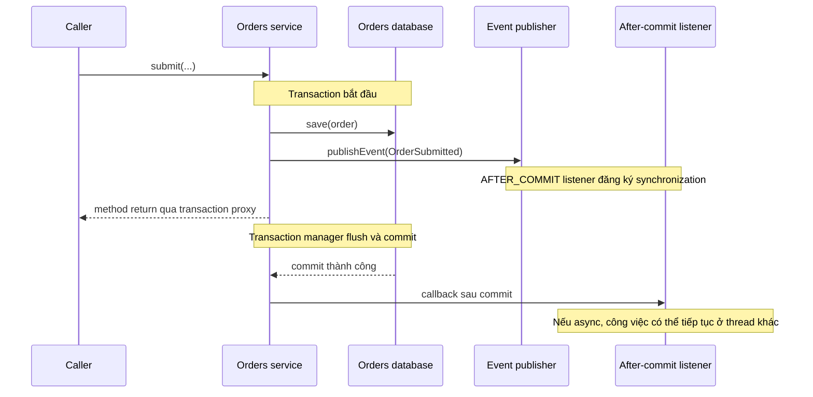
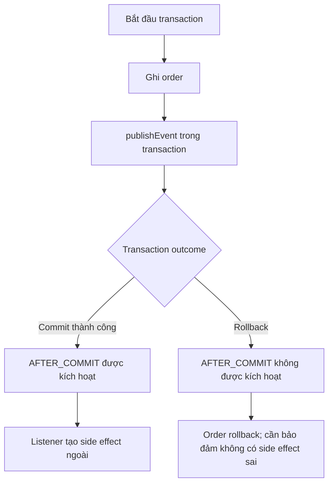
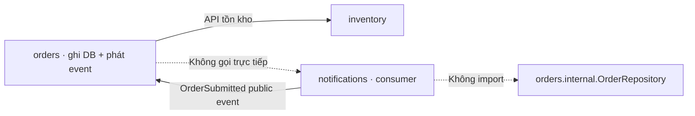
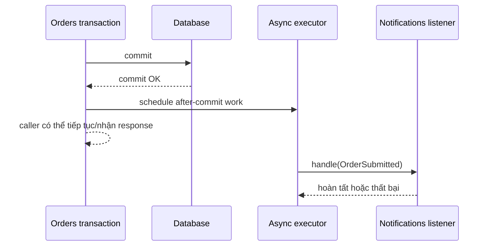
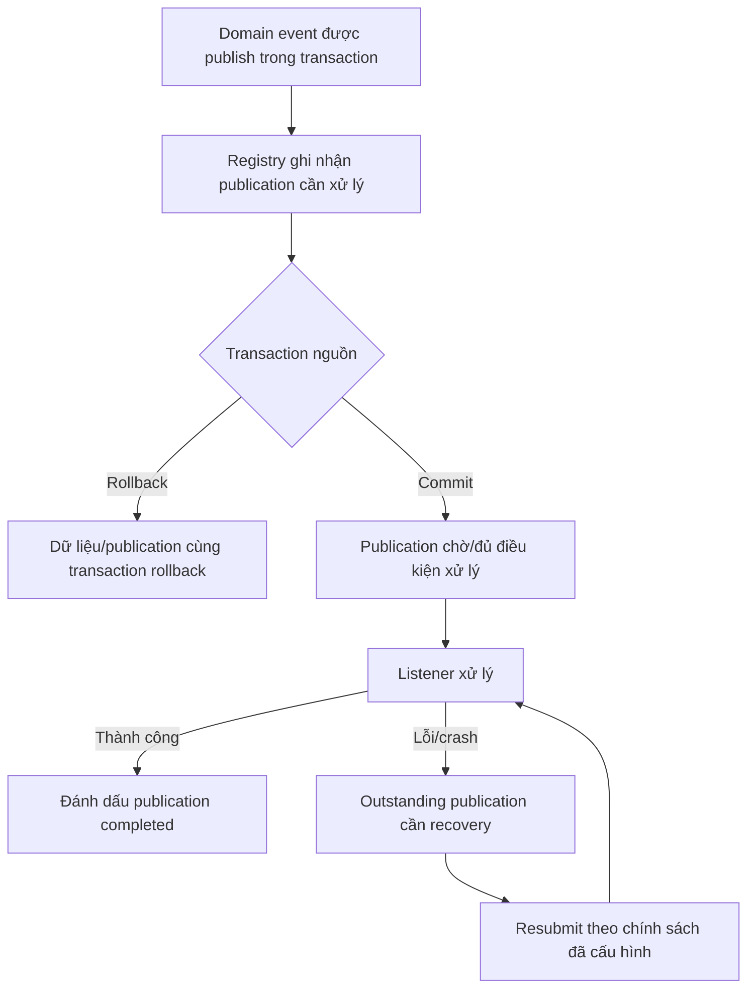
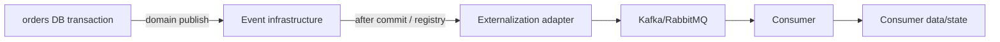

# Hợp đồng transaction và thời điểm publication

## 1. Event được phát không có nghĩa giao dịch đã commit

Một dịch vụ đặt hàng thường vừa ghi dữ liệu vừa phát domain event để module khác thực hiện công việc tiếp theo:

```java
@Transactional
public void submitOrder(...) {
    repository.save(order);
    events.publishEvent(new OrderSubmitted(...));
}
```

Đọc hai dòng code trên, rất dễ tưởng rằng:

> Khi listener nhìn thấy `OrderSubmitted`, bản ghi order chắc chắn đã được commit.

Kết luận này **không tự động đúng**.

Tại thời điểm `publishEvent(...)` được gọi, transaction của `submitOrder(...)` có thể vẫn đang mở. Một listener đồng bộ `@EventListener` thông thường có thể được gọi ngay, trước khi transaction commit. Nếu sau đó một exception khiến giao dịch rollback, listener đã có thể thực hiện side effect như gửi email hoặc gọi HTTP service bên ngoài.

Ngay cả khi chuyển listener sang `@TransactionalEventListener(phase = AFTER_COMMIT)`, vẫn còn những câu hỏi quan trọng:

- Nếu không có transaction đang hoạt động thì listener có chạy không?
- Nếu database commit thành công nhưng listener lỗi, có rollback order được nữa không?
- Nếu JVM dừng ngay sau commit, publication có được lưu bền để retry không?
- Nếu listener chạy lại, làm sao tránh gửi thông báo hoặc ghi dữ liệu hai lần?
- Nếu test method được `@Transactional` và tự rollback, bài test có thực sự kiểm chứng được hành vi `AFTER_COMMIT` không?

Bài học **“Hợp đồng transaction và thời điểm publication”** thuộc chương **Architectural contracts** của học phần `SPRING_MODULITH_VERIFICATION_TESTING`. Ta sẽ dùng kiến thức về transaction, `@ApplicationModuleTest`, kiểm thử sự kiện, cơ sở dữ liệu và tích hợp để kiểm chứng chính xác **thời điểm nào một side effect được phép xảy ra**; đồng thời giữ quy tắc phụ thuộc giữa application module được bảo vệ bằng `ApplicationModules` và quality gate CI.

**Luận điểm chính:** hợp đồng publication không chỉ trả lời *phát event gì*, mà còn trả lời *phát khi nào, trong transaction nào, ai xử lý và lỗi được khôi phục ra sao*.

## 2. Thuật ngữ phải phân biệt trước khi viết test

| Khái niệm | Ý nghĩa | Không đồng nghĩa với |
| --- | --- | --- |
| **Publish domain event** | Code gọi `ApplicationEventPublisher.publishEvent(...)` | Database đã commit hoặc consumer đã xử lý |
| **Synchronous listener** | Handler thường được gọi trong lời gọi publish cùng thread, nếu multicaster cấu hình mặc định | Handler luôn chạy sau commit |
| **Transaction synchronization** | Callback gắn với vòng đời transaction | Một hàng đợi bền vững qua JVM crash |
| **BEFORE_COMMIT** | Listener được gọi ở giai đoạn trước khi transaction commit | Commit chắc chắn sẽ thành công |
| **AFTER_COMMIT** | Listener được gọi sau khi transaction commit thành công | Delivery đến broker đã bền vững/exactly once |
| **AFTER_ROLLBACK** | Listener chạy khi transaction bị rollback | Các side effect bên ngoài trước đó cũng tự được hoàn tác |
| **AFTER_COMPLETION** | Listener chạy khi transaction hoàn tất, bất kể commit hay rollback | Biết chắc outcome nếu không kiểm tra thêm |
| **Event publication registry** | Cơ chế theo dõi publication tới transactional listeners khi được cài/cấu hình | Distributed transaction giữa DB và Kafka |
| **Idempotency** | Xử lý lặp mà không nhân đôi tác động nghiệp vụ | Không bao giờ nhận lại event |

Từ “publication” đôi khi dùng theo hai nghĩa. Trong bài này:

1. **Domain publication**: công bố event tới Spring application event infrastructure.
2. **External publication**: đưa event qua một adapter tới Kafka, RabbitMQ, HTTP webhook hoặc hệ thống khác.

Hai thao tác có thể nối nhau nhưng **không cùng một transaction theo mặc định**.

## 3. Contract card cho một use case có transaction

Giả sử module `orders` nhận lệnh submit và module `notifications` gửi xác nhận.

| Thành phần | Hợp đồng ví dụ |
| --- | --- |
| **Owner của lệnh** | Module `orders` |
| **Transaction owner** | `OrderSubmissionService.submit(...)` mở/đi vào transaction ghi đơn |
| **Dữ liệu cần ghi** | Một `OrderRecord` của module `orders` |
| **Điều kiện publish** | Input hợp lệ, tồn kho có sẵn, thao tác tạo đơn được chấp nhận |
| **Event** | `orders.OrderSubmitted` thuộc API công khai của `orders` |
| **Điều kiện consumer được tạo side effect** | Chỉ sau transaction ghi đơn commit thành công |
| **Khi transaction rollback** | Không gửi thông báo của đơn đã rollback |
| **Khi consumer lỗi sau commit** | Không quay ngược được commit nguồn; phải ghi nhận lỗi và retry/khắc phục |
| **Khi nhận event lặp** | Không tạo tác động thông báo trùng theo contract idempotency |
| **Database test** | Kiểm tra record commit/rollback theo scenario |
| **Event test** | Phân biệt “event được publish” và “AFTER_COMMIT listener thực thi” |
| **Architecture gate** | `notifications` chỉ phụ thuộc event API của `orders`, không đọc repository nội bộ |

Những hàng trên là **yêu cầu giả định cho ứng dụng ví dụ**. Một hệ thống có thể chủ đích xử lý listener đồng bộ trong transaction hoặc sử dụng outbox riêng. Khi đó phải viết contract khác; không mặc nhiên áp dụng `AFTER_COMMIT` cho mọi event.

## 4. Trục thời gian một transaction và publication

Với một service `@Transactional` và listener sau commit, trình tự điển hình là:



Sơ đồ mô tả **luồng logic**, không đảm bảo thứ tự callback với mọi listener hay mọi transaction manager. Phần thời điểm của `@Async`, event registry và adapter ngoại vi còn phụ thuộc cấu hình thực tế.

Ở nhánh rollback:



**Điểm khó:** một `@EventListener` đồng bộ thông thường có thể chạy ngay tại bước C, trước khi biết nhánh D. Vì thế không được dùng nó cho side effect không thể hoàn tác rồi chỉ dựa vào rollback của database để bảo đảm đúng.

## 5. `@EventListener` và `@TransactionalEventListener` khác nhau

### 5.1. Listener thường: xử lý lúc event được publish

```java
package com.example.shop.notifications.internal;

import com.example.shop.orders.OrderSubmitted;
import org.springframework.context.event.EventListener;
import org.springframework.stereotype.Component;

@Component
class ImmediateOrderObserver {

    @EventListener
    void on(OrderSubmitted event) {
        // Với multicaster đồng bộ mặc định, callback được gọi
        // ngay trong luồng publish, trước khi source commit.
    }
}
```

Trong cấu hình event multicaster mặc định, listener như trên thường chạy đồng bộ trong thread phát event. Nếu listener ném unchecked exception, nó có thể đi ngược về publisher và khiến transaction nguồn đánh dấu rollback. Tuy nhiên, nếu multicaster được tùy chỉnh sử dụng executor bất đồng bộ hoặc listener có cấu hình đặc biệt, hành vi về thread và exception có thể khác.

**Không đồng nhất `@EventListener` với “luôn sau commit”.**

### 5.2. Transactional listener: gắn callback với phase

```java
package com.example.shop.notifications.internal;

import com.example.shop.orders.OrderSubmitted;
import org.springframework.stereotype.Component;
import org.springframework.transaction.event.TransactionPhase;
import org.springframework.transaction.event.TransactionalEventListener;

@Component
class CommittedOrderObserver {

    @TransactionalEventListener(
        phase = TransactionPhase.AFTER_COMMIT)
    void on(OrderSubmitted event) {
        // Chỉ chạy trong callback sau successful commit
        // của transaction đang gắn với publication.
    }
}
```

`@TransactionalEventListener` đăng ký xử lý theo vòng đời transaction được Spring quản lý. Mặc định phase là **`AFTER_COMMIT`**; viết tường minh giúp reader thấy rõ hợp đồng.

Khi **không có transaction đang hoạt động**, listener mặc định **không được gọi**, trừ khi bật `fallbackExecution = true`. Bật fallback nghĩa là listener có thể xử lý event ngoài ngữ nghĩa “sau commit”, vì vậy không nên dùng để “chữa” việc caller quên transaction nếu business contract yêu cầu commit thật.

### 5.3. Bốn phase quan trọng

| Phase | Thời điểm tương đối | Trường hợp dùng hợp lý | Điểm cần tránh |
| --- | --- | --- | --- |
| `BEFORE_COMMIT` | Trước khi commit, còn cơ hội ảnh hưởng outcome | Kiểm tra/chuẩn bị dữ liệu cần cùng transaction | Đừng gửi email chắc chắn thành công trước commit |
| `AFTER_COMMIT` | Sau khi transaction commit thành công | Kích hoạt notification, indexing, externalization phù hợp | Exception lúc này không rollback commit nguồn |
| `AFTER_ROLLBACK` | Khi transaction đã rollback | Audit/cleanup theo failure contract | Không giả định tự hoàn tác side effect đã gửi ngoài JVM |
| `AFTER_COMPLETION` | Khi transaction hoàn tất, commit hoặc rollback | Telemetry/cleanup luôn cần chạy | Không coi mọi completion là thành công |

**`BEFORE_COMMIT` không bảo đảm commit sắp thành công**: database có thể từ chối commit hoặc một đồng bộ hóa khác có thể báo lỗi. **`AFTER_COMMIT` không bảo đảm side effect đã hoàn tất**: nếu listener bất đồng bộ hoặc gửi broker, còn một đoạn xử lý riêng sau callback.

## 6. Ví dụ xuyên suốt: orders, inventory và notifications

Ứng dụng mẫu:

```text
src/main/java/com/example/shop/
├── ShopApplication.java
├── orders/
│   ├── package-info.java
│   ├── OrderSubmitted.java
│   ├── OrderSubmissionService.java
│   └── internal/
│       └── persistence/
│           ├── OrderRecord.java
│           └── OrderRepository.java
├── inventory/
│   ├── InventoryAvailability.java
│   └── internal/
│       └── StockAdapter.java
└── notifications/
    ├── package-info.java
    └── internal/
        ├── OrderNotificationListener.java
        └── NotificationPort.java

src/test/java/com/example/shop/
├── ModuleArchitectureTest.java
├── orders/OrderPublicationContractTest.java
└── orders/TransactionPhaseContractTest.java
```

Theo cách nhận diện module mặc định phổ biến, `orders`, `inventory`, `notifications` là các application module. `orders.internal.persistence` thuộc chính `orders`; `inventory.internal` thuộc `inventory`. Tên module và API exposure phải được xác minh theo mô hình thực tế nếu dự án tùy chỉnh module detection.

### Sơ đồ phụ thuộc có chủ đích



Điểm quan trọng là `orders` phát event mà không phụ thuộc trực tiếp module `notifications`. Consumer tham chiếu kiểu event công khai của module nguồn.

### 6.1. Spring Boot root

```java
// src/main/java/com/example/shop/ShopApplication.java
package com.example.shop;

import org.springframework.boot.SpringApplication;
import org.springframework.boot.autoconfigure.SpringBootApplication;

@SpringBootApplication
public class ShopApplication {

    public static void main(String[] args) {
        SpringApplication.run(ShopApplication.class, args);
    }
}
```

### 6.2. Public API của module inventory

```java
// src/main/java/com/example/shop/inventory/InventoryAvailability.java
package com.example.shop.inventory;

public interface InventoryAvailability {

    boolean hasStock(String sku, int quantity);
}
```

`orders` được phép sử dụng API này. Trong module test `STANDALONE`, implementation `inventory.internal.StockAdapter` không tự phải được khởi động; có thể cung cấp `@MockitoBean InventoryAvailability` khi kiểm thử quy tắc nguồn.

### 6.3. Public event của module orders

```java
// src/main/java/com/example/shop/orders/OrderSubmitted.java
package com.example.shop.orders;

import java.time.Instant;
import java.util.UUID;

public record OrderSubmitted(
    UUID eventId,
    String orderId,
    String sku,
    int quantity,
    Instant occurredAt
) {
}
```

Đặt event tại base package `orders` giúp module nhận tham chiếu API công khai theo quy ước mặc định. `eventId` nhận diện một **event logic**; `orderId` nhận diện aggregate. Hai khóa có ý nghĩa khác nhau cho retry/deduplication.

### 6.4. Entity và repository do orders sở hữu

```java
// src/main/java/com/example/shop/orders/internal/persistence/OrderRecord.java
package com.example.shop.orders.internal.persistence;

import jakarta.persistence.Entity;
import jakarta.persistence.Id;
import jakarta.persistence.Table;

@Entity
@Table(name = "orders")
public class OrderRecord {

    @Id
    private String id;

    private String sku;
    private int quantity;

    protected OrderRecord() {
    }

    public OrderRecord(String id, String sku, int quantity) {
        this.id = id;
        this.sku = sku;
        this.quantity = quantity;
    }

    public String getId() {
        return id;
    }

    public String getSku() {
        return sku;
    }

    public int getQuantity() {
        return quantity;
    }
}
```

```java
// src/main/java/com/example/shop/orders/internal/persistence/OrderRepository.java
package com.example.shop.orders.internal.persistence;

import org.springframework.data.jpa.repository.JpaRepository;

public interface OrderRepository
        extends JpaRepository<OrderRecord, String> {
}
```

Một entity JPA không tự là Spring singleton bean. `OrderRepository` được Spring Data tạo proxy khi JPA/repository registration và `EntityManagerFactory` được cấu hình đúng.

**Quyền sở hữu:** cả hai kiểu nằm trong nội bộ `orders`, không trở thành API mà `notifications` được phép inject chỉ vì cùng dùng một database.

## 7. Transaction boundary ở service nguồn

Dịch vụ thật trong module `orders`:

```java
// src/main/java/com/example/shop/orders/OrderSubmissionService.java
package com.example.shop.orders;

import com.example.shop.inventory.InventoryAvailability;
import com.example.shop.orders.internal.persistence.OrderRecord;
import com.example.shop.orders.internal.persistence.OrderRepository;
import java.time.Instant;
import java.util.UUID;
import org.springframework.context.ApplicationEventPublisher;
import org.springframework.stereotype.Service;
import org.springframework.transaction.annotation.Transactional;

@Service
public class OrderSubmissionService {

    private final InventoryAvailability inventory;
    private final OrderRepository repository;
    private final ApplicationEventPublisher events;

    public OrderSubmissionService(
            InventoryAvailability inventory,
            OrderRepository repository,
            ApplicationEventPublisher events) {
        this.inventory = inventory;
        this.repository = repository;
        this.events = events;
    }

    @Transactional
    public String submit(
            String orderId, String sku, int quantity) {

        if (orderId == null || orderId.isBlank()
                || sku == null || sku.isBlank()
                || quantity <= 0) {
            throw new IllegalArgumentException(
                "Invalid order input");
        }

        if (!inventory.hasStock(sku, quantity)) {
            throw new IllegalStateException(
                "Stock unavailable: " + sku);
        }

        repository.save(
            new OrderRecord(orderId, sku, quantity));

        events.publishEvent(
            new OrderSubmitted(
                UUID.randomUUID(),
                orderId,
                sku,
                quantity,
                Instant.now()));

        return "SUBMITTED:" + orderId;
    }
}
```

**Những điều thực tế cần biết về đoạn code:**

1. `@Transactional` có tác dụng khi method được gọi **qua Spring-managed proxy** và có transaction manager phù hợp. Tự gọi `this.submit(...)` từ method cùng bean có thể bỏ qua proxy transaction mặc định.
2. `repository.save(...)` có thể chưa flush/commit xuống database ngay khi trở về. Với JPA, SQL/constraint có thể được kiểm tra ở flush hoặc commit.
3. `events.publishEvent(...)` được gọi **bên trong transaction**, trước khi biết commit thành công.
4. Service này **không đảm bảo exactly-once** cho hai HTTP command trùng nhau. `UUID.randomUUID()` tạo ID mới mỗi lần thực thi; cần business idempotency khi use case đòi hỏi.
5. Ví dụ chưa có thanh toán, inventory reservation hoặc event outbox bền vững. Không diễn giải `SUBMITTED` là “đã thanh toán”.
6. Production cần schema/migration, chính sách unique order ID, lỗi constraint và timestamp/clock phù hợp.

Sự khác biệt giữa **save đã gọi**, **flush đã chạy** và **commit hoàn tất** là nguyên nhân gốc của nhiều kiểm thử event sai.

## 8. Listener hậu commit thuộc module nhận

Trong module `notifications`, có thể sử dụng `@TransactionalEventListener` để chỉ xử lý một đơn đã commit:

```java
// src/main/java/com/example/shop/notifications/internal/OrderNotificationListener.java
package com.example.shop.notifications.internal;

import com.example.shop.orders.OrderSubmitted;
import org.springframework.stereotype.Component;
import org.springframework.transaction.event.TransactionPhase;
import org.springframework.transaction.event.TransactionalEventListener;

@Component
class OrderNotificationListener {

    private final NotificationPort notifications;

    OrderNotificationListener(NotificationPort notifications) {
        this.notifications = notifications;
    }

    @TransactionalEventListener(
        phase = TransactionPhase.AFTER_COMMIT)
    void on(OrderSubmitted event) {
        notifications.sendSubmissionConfirmation(
            event.eventId(), event.orderId());
    }
}
```

Interface nội bộ của module nhận:

```java
// src/main/java/com/example/shop/notifications/internal/NotificationPort.java
package com.example.shop.notifications.internal;

import java.util.UUID;

public interface NotificationPort {

    void sendSubmissionConfirmation(
        UUID eventId, String orderId);
}
```

Trong ứng dụng thực cần implementation `NotificationPort`. Test listener có thể cấp fake hoặc Mockito bean; production adapter có thể gọi email provider hoặc messaging. Hành vi của adapter ngoài JVM không được kiểm chứng chỉ nhờ listener nhận event.

Với `AFTER_COMMIT`, lời gọi port chỉ được bắt đầu khi transaction được đồng bộ hóa đã commit thành công. Tuy nhiên, nếu `sendSubmissionConfirmation(...)` lỗi, **đơn hàng đã commit và không bị rollback ngược**. Hợp đồng phải xác định cách ghi nhận, retry, dead-letter hoặc báo cáo lỗi.

### 8.1. Bản dùng `@ApplicationModuleListener`

Spring Modulith cung cấp annotation kết hợp cho listener của application module:

```java
package com.example.shop.notifications.internal;

import com.example.shop.orders.OrderSubmitted;
import org.springframework.modulith.events.ApplicationModuleListener;
import org.springframework.stereotype.Component;

@Component
class OrderNotificationModuleListener {

    private final NotificationPort notifications;

    OrderNotificationModuleListener(NotificationPort notifications) {
        this.notifications = notifications;
    }

    @ApplicationModuleListener
    void on(OrderSubmitted event) {
        notifications.sendSubmissionConfirmation(
            event.eventId(), event.orderId());
    }
}
```

Đây là **phương án thay thế** listener ở ví dụ trước, **không phải hai listener cần đăng ký đồng thời**. Nếu đặt cả hai class production, một event có thể gây **hai lần thông báo**.

Ở các phiên bản Spring Modulith thông dụng, `@ApplicationModuleListener` kết hợp đặc tính của listener sau commit với xử lý bất đồng bộ và transaction mới cho phần xử lý; hãy đối chiếu API/version thực tế của dự án. Điều kiện quan trọng vẫn là source phải có transaction đúng, hạ tầng async/listener hoạt động và kết quả xử lý được kiểm tra theo eventual consistency.

**Đừng hiểu annotation này là bảo đảm exactly-once end-to-end.** Registry, backend, retry và idempotency của consumer vẫn là những phần riêng cần thiết kế.

## 9. Một lỗi khó thấy: ghi database ở callback sau commit

Xét listener:

```java
@TransactionalEventListener(
    phase = TransactionPhase.AFTER_COMMIT)
void afterCommit(OrderSubmitted event) {
    notificationRepository.save(
        new NotificationRecord(event.orderId()));
}
```

Đây là **đoạn minh họa** với repository/entity giả định. Vấn đề là transaction của nguồn đã commit. Một số tài nguyên giao dịch có thể còn gắn với thread trong callback sau commit, nhưng những thao tác ghi mới **không nên được giả định sẽ được commit bởi transaction đã kết thúc**.

Khi cần ghi trạng thái mới sau commit, hãy mở một transaction độc lập theo đúng cơ chế proxy của Spring.

Ví dụ:

```java
package com.example.shop.notifications.internal;

import com.example.shop.orders.OrderSubmitted;
import org.springframework.stereotype.Service;
import org.springframework.transaction.annotation.Propagation;
import org.springframework.transaction.annotation.Transactional;

@Service
public class NotificationResultWriter {

    private final NotificationResultRepository repository;

    public NotificationResultWriter(
            NotificationResultRepository repository) {
        this.repository = repository;
    }

    @Transactional(propagation = Propagation.REQUIRES_NEW)
    public void record(OrderSubmitted event) {
        repository.save(
            new NotificationResult(
                event.eventId().toString(),
                event.orderId()));
    }
}
```

`NotificationResultRepository` và `NotificationResult` là kiểu thuộc module `notifications` được **giả định đã khai báo**; ví dụ chỉ thể hiện transaction boundary, không phải file độc lập có thể chạy ngay. Listener gọi bean khác:

```java
@Component
class RecordingAfterCommitListener {

    private final NotificationResultWriter writer;

    RecordingAfterCommitListener(
            NotificationResultWriter writer) {
        this.writer = writer;
    }

    @TransactionalEventListener(
        phase = TransactionPhase.AFTER_COMMIT)
    void on(OrderSubmitted event) {
        writer.record(event);
    }
}
```

Đoạn cuối lược bỏ package/import vì chỉ minh họa lời gọi từ listener. Quan trọng là `record(...)` là **public method trên một Spring bean khác**, được gọi qua proxy; `REQUIRES_NEW` không nên bị self-invocation bỏ qua.

### Vì sao transaction mới quan trọng?

- Transaction ghi order đã commit.
- Công việc ghi trạng thái thông báo là một unit of work khác.
- Nếu công việc này fail, order **không** quay lại trạng thái chưa commit.
- Cần retry/deduplication sao cho lần xử lý lại không tạo bản ghi trùng.

Ngay cả transaction mới cũng không làm hai database transaction thành một giao dịch nguyên tử. Nếu nghiệp vụ yêu cầu all-or-nothing trên hai bên, phải thay đổi boundary thiết kế, không chỉ gắn `REQUIRES_NEW`.

## 10. Một callback sau commit có thể chạy bất đồng bộ

Với `@Async` hoặc `@ApplicationModuleListener` có async semantics:



**Đừng viết test kiểu:**

```java
orders.submit("ORD-9", "SKU-1", 1);
verify(notificationPort).sendSubmissionConfirmation(...);
```

và kỳ vọng assertion luôn thành công khi listener chạy ở thread khác. Việc trả về từ `submit(...)` chỉ chứng minh phần đồng bộ và transaction nguồn đã đi qua proxy; công việc async có thể vẫn đang chạy.

Thay vào đó, chờ **điều kiện nghiệp vụ quan sát được**, có giới hạn thời gian, ví dụ:

```java
// Pseudocode trong integration test đã có
// notificationPort mock và sự kiện đã thực sự commit.
await()
    .atMost(Duration.ofSeconds(5))
    .untilAsserted(() ->
        verify(notificationPort)
            .sendSubmissionConfirmation(eventId, "ORD-9"));
```

`await()` là API của Awaitility, còn `eventId` phải được test biết từ dữ liệu/event. Đoạn code minh họa, không phải test độc lập chạy ngay. Spring Modulith Test cũng có tiện ích `Scenario` cho việc kích thích hành vi và chờ event/state phù hợp ở những phiên bản hỗ trợ.

Không dùng `Thread.sleep(1000)` như phép đồng bộ chính: chạy ở máy local có thể vừa đủ, nhưng CI chậm hơn sẽ tạo flaky test. Với xử lý async, luôn xác định **timeout, trạng thái thành công và lỗi có thể quan sát**.

## 11. `PublishedEvents` chứng minh gì và không chứng minh gì?

Trong `@ApplicationModuleTest`, `PublishedEvents` cho phép xác minh những event được công bố bởi hành vi đang kiểm thử.

Một module test nguồn:

```java
// src/test/java/com/example/shop/orders/OrderPublicationContractTest.java
package com.example.shop.orders;

import com.example.shop.inventory.InventoryAvailability;
import org.junit.jupiter.api.Test;
import org.springframework.beans.factory.annotation.Autowired;
import org.springframework.modulith.test.ApplicationModuleTest;
import org.springframework.modulith.test.PublishedEvents;
import org.springframework.test.context.bean.override.mockito.MockitoBean;

import static org.assertj.core.api.Assertions.assertThat;
import static org.assertj.core.api.Assertions.assertThatThrownBy;
import static org.mockito.BDDMockito.given;

@ApplicationModuleTest
class OrderPublicationContractTest {

    @Autowired
    OrderSubmissionService orders;

    @MockitoBean
    InventoryAvailability inventory;

    @Test
    void submitsAndPublishesDomainEvent(
            PublishedEvents events) {
        given(inventory.hasStock("SKU-1", 2))
            .willReturn(true);

        String result =
            orders.submit("ORD-1", "SKU-1", 2);

        assertThat(result).isEqualTo("SUBMITTED:ORD-1");

        assertThat(events.ofType(OrderSubmitted.class))
            .singleElement()
            .satisfies(event -> {
                assertThat(event.orderId())
                    .isEqualTo("ORD-1");
                assertThat(event.sku())
                    .isEqualTo("SKU-1");
                assertThat(event.quantity())
                    .isEqualTo(2);
                assertThat(event.eventId()).isNotNull();
                assertThat(event.occurredAt()).isNotNull();
            });
    }

    @Test
    void rejectsInvalidInputBeforePublication(
            PublishedEvents events) {
        assertThatThrownBy(() ->
            orders.submit("ORD-2", "SKU-1", 0))
            .isInstanceOf(IllegalArgumentException.class);

        assertThat(events.ofType(OrderSubmitted.class))
            .isEmpty();
    }
}
```

**Điều kiện chạy:** vì ví dụ `OrderSubmissionService` dùng JPA repository thật trong cùng module, module test cần có JPA infrastructure, DataSource, schema/migration và fixture tương thích. `@MockitoBean InventoryAvailability` chỉ thay API module ngoài, **không thay repository của `orders`**.

`@MockitoBean` có từ Spring Framework 6.2 trở lên; ở stack Spring Boot cũ hơn có thể dùng `@MockBean` tương thích. Tránh trộn annotation/mock override mechanisms tùy tiện.

### Giới hạn rõ ràng

| Assertion | Điều nó bảo vệ | Điều nó chưa bảo vệ |
| --- | --- | --- |
| `PublishedEvents.ofType(...)` không rỗng | Service đã gọi publish event phù hợp | Listener sau commit đã chạy |
| Kiểm tra payload | Domain event mang đúng dữ liệu | JSON/Kafka schema tương thích |
| Event không phát khi validation fail | Không tạo domain publication ở nhánh lỗi | Không có side effect từ một lời gọi trước khác |
| Repository có record sau lời gọi thành công | Dữ liệu đã được ghi theo tình huống test | Broker đã nhận event |
| Test listener có kết quả sau commit | Consumer xử lý khi transaction nguồn commit | Exactly-once qua crash/retry |
| Test publication registry | Registry lưu/tracking đúng khi cấu hình | Delivery end-to-end không mất/trùng trong mọi tình huống |

**Đặc biệt quan trọng:** `PublishedEvents` ghi nhận event khi được công bố. Nó **không phải giấy chứng nhận transaction đã commit**. Một event có thể được publish trong transaction rồi toàn bộ transaction rollback; test vẫn có thể quan sát lời gọi publication trong phạm vi phù hợp.

## 12. Test có `@Transactional` mặc định rollback: cái bẫy AFTER_COMMIT

Xét tình huống sau:

```java
@ApplicationModuleTest
@Transactional
class MisleadingCommitTest {

    @Autowired
    OrderSubmissionService orders;

    @MockitoBean
    InventoryAvailability inventory;

    @Test
    void assertsPublicationButNotCommit(
            PublishedEvents events) {
        given(inventory.hasStock("SKU-1", 1))
            .willReturn(true);

        orders.submit("ORD-TX-1", "SKU-1", 1);

        assertThat(events.ofType(OrderSubmitted.class))
            .isNotEmpty();
    }
}
```

Ví dụ lược bỏ import để tập trung vào ý nghĩa annotation; muốn chạy cần test database và schema như phần trước.

Với Spring Test-managed `@Transactional` test, transaction test thường **rollback sau khi method kết thúc**. Service `@Transactional` dùng propagation mặc định `REQUIRED` có thể tham gia **transaction của test**, không tự commit khi `orders.submit(...)` trả về.

Vì thế:

1. Bài test nhìn thấy event trong `PublishedEvents`.
2. Chưa có successful commit tại thời điểm assertion.
3. Listener `AFTER_COMMIT` có thể **không chạy** vì transaction test rollback.
4. Dữ liệu order viết trong transaction test có thể bị rollback.
5. Test xanh chỉ chứng minh **publication call**, không chứng minh hợp đồng “notification sau commit”.

Đây là lý do một bài test kiểm tra điều kiện publish và một bài kiểm tra transaction phase cần **tách mục tiêu**.

### 12.1. Kiểm soát commit bằng `TestTransaction`

Khi dùng Spring Test-managed transaction và cần commit thật trong test, Spring Test cung cấp `TestTransaction`:

```java
// Bên trong method của một test có @Transactional
// và transaction test đang active.
orders.submit("ORD-TX-2", "SKU-1", 1);

TestTransaction.flagForCommit();
TestTransaction.end(); // Kết thúc/commit transaction test hiện tại.

// Sau đây mới kiểm tra callback AFTER_COMMIT,
// database state hoặc eventual consumer side effect.
```

`TestTransaction` thuộc `org.springframework.test.context.transaction.TestTransaction`. Đoạn minh họa giả định đủ bean, stock mock đã được stub và method được chạy trong test transaction do Spring Test quản lý. Nếu listener bất đồng bộ, cần **đợi điều kiện hoàn tất** sau `end()`.

**Cảnh báo dữ liệu:** khi commit thật trong test, rollback mặc định không còn dọn thay bạn. Phải dùng fixture độc lập và cleanup rõ ràng để test không gây trạng thái rò giữa các class/test.

`TestTransaction.flagForRollback()` cũng hữu ích khi muốn chủ động kết thúc transaction test bằng rollback và xác minh callback `AFTER_COMMIT` **không** được gọi.

## 13. Test phase một cách xác định bằng `TransactionTemplate`

Để kiểm tra semantics của `AFTER_COMMIT` mà không phụ thuộc email hoặc listener bất đồng bộ, ta có thể đăng ký **một listener test đồng bộ** ghi lại event vào probe in-memory.

Đây là bài test transaction-phase riêng, **không** chứng minh Kafka, email hoặc publication registry. Nó giúp bảo vệ hai điều:

- Event publish trong một transaction **không làm callback AFTER_COMMIT chạy trước commit**.
- Rollback **không kích hoạt** callback AFTER_COMMIT.

### 13.1. Test hoàn chỉnh ở mức phase

```java
// src/test/java/com/example/shop/orders/TransactionPhaseContractTest.java
package com.example.shop.orders;

import com.example.shop.inventory.InventoryAvailability;
import java.time.Instant;
import java.util.List;
import java.util.UUID;
import java.util.concurrent.CopyOnWriteArrayList;
import org.junit.jupiter.api.BeforeEach;
import org.junit.jupiter.api.Test;
import org.springframework.beans.factory.annotation.Autowired;
import org.springframework.boot.test.context.TestConfiguration;
import org.springframework.context.ApplicationEventPublisher;
import org.springframework.context.annotation.Bean;
import org.springframework.modulith.test.ApplicationModuleTest;
import org.springframework.test.context.bean.override.mockito.MockitoBean;
import org.springframework.transaction.PlatformTransactionManager;
import org.springframework.transaction.event.TransactionPhase;
import org.springframework.transaction.event.TransactionalEventListener;
import org.springframework.transaction.support.TransactionTemplate;

import static org.assertj.core.api.Assertions.assertThat;
import static org.assertj.core.api.Assertions.assertThatThrownBy;

@ApplicationModuleTest
class TransactionPhaseContractTest {

    @Autowired
    PlatformTransactionManager transactionManager;

    @Autowired
    ApplicationEventPublisher publisher;

    @Autowired
    AfterCommitProbe probe;

    @MockitoBean
    InventoryAvailability inventory;

    @BeforeEach
    void clearProbe() {
        probe.clear();
    }

    @Test
    void invokesListenerOnlyAfterSuccessfulCommit() {
        var transactions =
            new TransactionTemplate(transactionManager);

        transactions.executeWithoutResult(status -> {
            publisher.publishEvent(event("ORD-10"));

            // Vẫn đang ở trong transaction:
            assertThat(probe.ids()).isEmpty();
        });

        // executeWithoutResult trả về sau transaction completion;
        // probe là transactional listener đồng bộ.
        assertThat(probe.ids())
            .containsExactly("ORD-10");
    }

    @Test
    void doesNotInvokeAfterCommitListenerOnRollback() {
        var transactions =
            new TransactionTemplate(transactionManager);

        assertThatThrownBy(() ->
            transactions.executeWithoutResult(status -> {
                publisher.publishEvent(event("ORD-11"));
                throw new IllegalStateException(
                    "Rollback deliberately");
            }))
            .isInstanceOf(IllegalStateException.class);

        assertThat(probe.ids()).isEmpty();
    }

    private static OrderSubmitted event(String orderId) {
        return new OrderSubmitted(
            UUID.randomUUID(),
            orderId,
            "SKU-1",
            1,
            Instant.parse("2026-01-01T00:00:00Z"));
    }

    @TestConfiguration(proxyBeanMethods = false)
    static class ProbeConfiguration {

        @Bean
        AfterCommitProbe afterCommitProbe() {
            return new AfterCommitProbe();
        }
    }

    static class AfterCommitProbe {

        private final List<String> observed =
            new CopyOnWriteArrayList<>();

        @TransactionalEventListener(
            phase = TransactionPhase.AFTER_COMMIT)
        public void on(OrderSubmitted event) {
            observed.add(event.orderId());
        }

        List<String> ids() {
            return List.copyOf(observed);
        }

        void clear() {
            observed.clear();
        }
    }
}
```

**Điều kiện để chạy:**

1. Có `PlatformTransactionManager` phù hợp trong test context, chẳng hạn từ JPA/DataSource đã cấu hình cho module `orders`.
2. `@TestConfiguration` lồng tĩnh được Spring Boot Test nạp thành bean theo cơ chế hỗ trợ test.
3. `AfterCommitProbe` dùng `@TransactionalEventListener` **đồng bộ**, không phải `@ApplicationModuleListener` async; vì vậy assertion ngay sau `TransactionTemplate` hợp lý.
4. Để chắc chắn `TransactionTemplate` tự bắt đầu/kết thúc transaction, test class **không** được có một Spring Test transaction bao ngoài (ví dụ `@Transactional` ở class/method). Nếu đã có transaction bao ngoài, propagation `REQUIRED` của template có thể chỉ tham gia và chưa commit.
5. Không sử dụng cùng probe mutable trong test chạy song song mà không kiểm soát state. `@BeforeEach` reset state chỉ an toàn khi các method không đồng thời thao tác chung bean.

Bài test này minh họa việc quan sát **phase**. Nó không chứng minh rằng một transaction commit ghi một order thật; muốn điều đó cần repository/database assertions.

### Vì sao không chọn `Thread.sleep(...)`?

Probe chạy đồng bộ sau commit, nên ta không cần chờ đoán bằng mili-giây. Nếu test listener production chạy async, hãy dùng test khác để chờ eventual state, không thay đổi tính đồng bộ của probe này để “cho giống” một cách thiếu kiểm soát.

## 14. Kiểm tra commit/rollback của database thật

Bài kiểm tra phase ở trên không thay thế persistence integration test. Để kiểm chứng contract:

> Sau khi submit thành công, order tồn tại trong database; nếu transaction rollback, order không tồn tại và listener AFTER_COMMIT không tạo tác động.

Ta cần một test có:

- Repository `OrderRepository` và entity `OrderRecord` thật.
- Một `PlatformTransactionManager` quản lý cùng DataSource.
- Schema/migration và fixture kiểm soát được.
- Cách kết thúc transaction rõ ràng.
- Assertion đọc lại dữ liệu **sau** khi commit hoặc rollback từ một transaction mới.
- Listener test/probe hoặc một adapter nhận side effect quan sát được.

### 14.1. PostgreSQL Testcontainers: khung hạ tầng

```java
// src/test/java/com/example/shop/orders/OrdersDatabaseContractTest.java
package com.example.shop.orders;

import org.junit.jupiter.api.Test;
import org.springframework.modulith.test.ApplicationModuleTest;
import org.springframework.test.context.DynamicPropertyRegistry;
import org.springframework.test.context.DynamicPropertySource;
import org.testcontainers.containers.PostgreSQLContainer;
import org.testcontainers.junit.jupiter.Container;
import org.testcontainers.junit.jupiter.Testcontainers;

@Testcontainers
@ApplicationModuleTest
class OrdersDatabaseContractTest {

    @Container
    static PostgreSQLContainer<?> postgres =
        new PostgreSQLContainer<>("postgres:16-alpine");

    @DynamicPropertySource
    static void datasource(
            DynamicPropertyRegistry registry) {
        registry.add("spring.datasource.url",
            postgres::getJdbcUrl);
        registry.add("spring.datasource.username",
            postgres::getUsername);
        registry.add("spring.datasource.password",
            postgres::getPassword);
    }

    @Test
    void verifiesCommittedOrderAndEventContract() {
        // Inject service/repository/probe thật.
        // Submit qua @Transactional service proxy.
        // Assert record tồn tại ở transaction mới.
        // Assert AFTER_COMMIT listener được gọi theo yêu cầu.
    }
}
```

Đây là **khung cấu hình**, chưa phải integration test hoàn chỉnh. Phải bổ sung Spring Data JPA, PostgreSQL driver, Testcontainers dependency, migration/schema bảng `orders`, các bean của module và assertion cụ thể. `@DynamicPropertySource` chỉ cung cấp JDBC properties, **không tự tạo schema**, còn `@ApplicationModuleTest` chỉ chọn phạm vi module nghiệp vụ.

Vì `OrderSubmissionService` cần `InventoryAvailability` từ module `inventory`, bài test `STANDALONE` có thể cần `@MockitoBean InventoryAvailability` hoặc chọn mode tích hợp phụ thuộc thật. Nếu mục tiêu là transaction của `orders`, mock stock API có thể hợp lý; nếu cần transaction/locking tồn kho thật, test phải mở rộng sang integration đúng mức.

### 14.2. “Đã gọi save” khác “đã commit”

Một assertion như:

```java
verify(repository).save(any(OrderRecord.class));
```

không chứng minh bản ghi tồn tại sau commit nếu `repository` là Mockito mock. Tương tự, đọc entity trong cùng persistence context trước khi flush có thể xác nhận state trong bộ nhớ nhưng chưa xác nhận database constraint đã được áp dụng.

Khi test SQL/JPA, giữ repository/EntityManager thật, commit hoặc flush theo mục tiêu, clear persistence context khi cần, rồi đọc trạng thái từ transaction phù hợp. Dữ liệu cần được cleanup sau test đã commit.

## 15. Vì sao `AFTER_COMMIT` không đồng nghĩa “delivery đáng tin cậy”?

Giả sử:

1. Transaction lưu `OrderRecord` commit thành công.
2. Listener `AFTER_COMMIT` chuẩn bị gửi email.
3. JVM crash trước khi gửi hoặc trước khi xác nhận kết quả.
4. Database đã có đơn hàng nhưng email không được gửi.

Chỉ dùng `@TransactionalEventListener` **không tự tạo một queue bền vững**. Khoảng lỗi sau commit là một phần của hợp đồng vận hành và phải có chiến lược khôi phục.

Một số cách giải quyết tùy nhu cầu:

| Chiến lược | Điểm mạnh | Giới hạn |
| --- | --- | --- |
| Listener sau commit, không persistence | Đơn giản cho side effect không quan trọng hoặc có thể tự tính lại | Có thể mất công việc khi process dừng |
| Spring Modulith event publication registry với backend phù hợp | Theo dõi publication còn outstanding và hỗ trợ cơ chế resubmission theo cấu hình | Không tự bảo đảm external service xử lý exactly once |
| Transactional outbox | Ghi outbox cùng transaction với dữ liệu nghiệp vụ, worker gửi sau | Cần poll/CDC/retry, dedup và vận hành |
| Message broker trực tiếp | Có routing/retention/consumer groups | Không tự có atomic commit với database nguồn |
| Synchronous API call trước commit | Caller biết response sớm | Side effect ngoài DB không rollback được nếu DB commit fail |

Không có phương án nào xóa hoàn toàn bài toán retry và idempotency ở consumer. Quan trọng là chọn **độ tin cậy được yêu cầu** rồi viết integration test cho chính contract đó.

## 16. Spring Modulith event publication registry: hiểu đúng trách nhiệm

Spring Modulith có cơ chế **Event Publication Registry** cho những publication tới transactional event listeners khi được cấu hình với module hỗ trợ và backend persistence tương ứng.

Về mặt ý tưởng:



Sơ đồ mang tính **khái niệm**. Chi tiết ghi nhận publication, lúc đánh dấu hoàn tất, cơ chế resubmission và backend hỗ trợ phụ thuộc phiên bản Spring Modulith, starter/module được cài và cấu hình ứng dụng.

### Những điều phải kiểm chứng chứ không được tự giả định

- Registry có thực sự được bật và có backend bền vững không?
- Bản ghi publication có tham gia transaction nguồn đúng yêu cầu không?
- Khi listener ném exception, trạng thái outstanding/completed ra sao?
- Sau restart có cơ chế resubmit những publication còn outstanding không, được kích hoạt như thế nào?
- Resubmission có giữ nguyên event identity và payload không?
- Consumer có idempotent khi cùng event được giao lại không?
- Việc mark completed lỗi sau side effect thành công có gây lặp hay không?
- Với Kafka externalization, cơ chế tracking có bao phủ đến **acknowledgement** nào hay chỉ đến callback gửi?

**Registry không phải distributed transaction** giữa database nguồn và email/Kafka. Nó giúp quản lý publication theo ngữ nghĩa của framework, nhưng contract delivery thực tế vẫn cần test ở điểm quan sát mà người dùng quan tâm.

## 17. Bốn cửa sổ lỗi cần đưa vào test plan

| Thời điểm lỗi | Trạng thái order có thể | Trạng thái thông báo có thể | Hợp đồng cần bảo vệ |
| --- | --- | --- | --- |
| **Trước commit** | Rollback | Chưa được phép tạo side effect hậu commit | Listener AFTER_COMMIT không chạy |
| **Commit thất bại** | Không tồn tại/không hoàn tất commit | Chưa được phép gửi | Xử lý constraint/DB error |
| **Sau commit, trước listener** | Đã commit | Chưa xử lý | Publication phải được theo dõi/retry nếu yêu cầu độ bền |
| **Sau side effect, trước khi mark completed** | Đã commit | Có thể đã gửi rồi | Xử lý duplicate an toàn/idempotent |

Đây là nguồn gốc của nhiều tình huống “đơn đã được tạo nhưng không có email” hoặc “một đơn nhận hai email”. Chỉ test happy path “listener được gọi một lần” không bảo vệ các cửa sổ lỗi này.

### 17.1. Khi listener fail sau commit, exception không thể quay ngược nguồn

Đừng viết business logic giả định rằng catch exception từ listener hậu commit sẽ làm database order rollback. Transaction đã hoàn tất. Nếu việc gửi notification là **điều kiện bắt buộc để trả thành công**, có thể thiết kế đang cần một boundary khác hoặc một trạng thái trung gian rõ ràng, chẳng hạn `PENDING_NOTIFICATION`.

Tính nhất quán cuối (eventual consistency) phải được mô tả minh bạch trong API và UI, không chỉ là hệ quả ngẫu nhiên của `@Async`.

## 18. Idempotency: hậu commit có thể bị gọi lại

Một số hệ thống đảm bảo **at-least-once delivery** hoặc có cơ chế resubmit khi listener không hoàn tất. Điều này có nghĩa một event có thể được xử lý nhiều lần.

Giả sử `OrderSubmitted` có `eventId`. Consumer có thể dùng một bảng `processed_events` hoặc unique constraint để ghi nhận xử lý:

```text
processed_events
  event_id         VARCHAR / UUID  PRIMARY KEY
  processed_at     TIMESTAMP
  consumer_name    VARCHAR
```

Mẫu ý tưởng:

1. Nhận event.
2. Kiểm tra/dành quyền xử lý `eventId` theo cơ chế transaction/unique constraint chống race.
3. Nếu đã xử lý, bỏ qua **side effect lặp**.
4. Nếu chưa xử lý, thực hiện thay đổi dữ liệu trong transaction phù hợp.
5. Đánh dấu hoàn tất với tính nguyên tử đủ cho dữ liệu nội bộ.
6. Với email/HTTP ngoài DB, thiết kế idempotency key hoặc adapter có cơ chế chống gửi trùng.

**Không đủ an toàn** nếu chỉ dùng:

```java
if (!processedIds.contains(eventId)) {
    sendEmail();
    processedIds.add(eventId);
}
```

trong một `HashSet` singleton. Cách đó không chịu được JVM crash, multi-instance, concurrent processing hoặc lỗi xảy ra giữa `sendEmail()` và `add(...)`.

### Event identity và business identity khác nhau

- `eventId`: một sự kiện logic, nên **ổn định khi retry cùng event**.
- `orderId`: aggregate/business key.
- `requestId`/idempotency key: nếu có, đại diện cho một lệnh được gửi lại.

Hai lệnh submit cùng `orderId` trong code demo có thể sinh hai `eventId` khác nhau. Nếu contract là “mỗi order chỉ submit một lần”, cần unique business key/constraint và test command idempotency ở module `orders`, không chỉ dedup theo `eventId` ở `notifications`.

## 19. Transaction propagation: `REQUIRES_NEW`, `REQUIRED` và self-invocation

### 19.1. `REQUIRED` thường tham gia transaction hiện có

Service `OrderSubmissionService.submit(...)` dùng `@Transactional` với propagation mặc định `REQUIRED`. Khi được gọi từ một transaction đang active (ví dụ Spring Test-managed transaction), nó thường **tham gia transaction ấy**.

Điều này giải thích tại sao service method trả về nhưng chưa có commit: proxy chỉ kết thúc lời gọi được lồng trong transaction bên ngoài.

### 19.2. `REQUIRES_NEW` tạo transaction riêng

Một bean dùng:

```java
@Transactional(propagation = Propagation.REQUIRES_NEW)
public void recordNotification(...) {
    // Ghi trạng thái notification trong transaction riêng.
}
```

có thể thực hiện đơn vị ghi độc lập, kể cả khi được gọi từ listener hậu commit. Nhưng:

- Nếu resource/connection pool thiếu tài nguyên, transaction mới vẫn có thể lỗi.
- Nếu listener gửi email rồi ghi trạng thái, crash ở giữa có thể dẫn tới duplicate khi retry.
- Transaction mới không làm side effect ngoài JVM atomic với database.
- Self-invocation thông thường có thể bỏ qua Spring proxy nên annotation không được áp dụng.

### 19.3. Đừng đặt annotation rồi không kiểm tra boundary

Có `@Transactional` trên method không bảo đảm mọi lời gọi đều đi qua proxy. Hãy test transaction outcome quan sát được, đồng thời review:

- Class/method có được Spring quản lý không?
- Method có được gọi qua Spring bean proxy không?
- Transaction manager được chọn có đúng DataSource/resource không?
- Propagation có tham gia transaction khác không?
- Có dùng thread async nơi thread-local transaction không tự được truyền sang không?

Hợp đồng nằm ở **hành vi commit/rollback**, không phải ở sự hiện diện của một annotation trong source.

## 20. Ngoại lệ, checked exception và rollback rule

Spring transaction thường mặc định rollback với unchecked exception như `RuntimeException` và `Error`; checked exception có thể không gây rollback nếu chưa có quy tắc tương ứng (tùy cấu hình phiên bản).

Ví dụ:

```java
@Transactional(rollbackFor = PaymentRejectedException.class)
public void placeOrder(...) throws PaymentRejectedException {
    // Nếu PaymentRejectedException là checked exception,
    // rollbackFor biểu diễn chủ đích rollback.
}
```

`PaymentRejectedException` là kiểu giả định trong ví dụ. Ở một số phiên bản/framework hoặc cấu hình toàn cục, chính sách rollback mặc định có thể được tùy chỉnh; khi đó phải kiểm tra theo config thực.

**Tình huống nguy hiểm:** business code bắt exception, log rồi trả “thành công” trong khi transaction vẫn commit. Hoặc một listener đồng bộ đã gửi email, sau đó service ném unchecked exception khiến database rollback.

Test plan nên có:

- Business exception xảy ra **trước publish**: không có event.
- Exception xảy ra **sau publish nhưng trước commit**: AFTER_COMMIT listener không chạy.
- Commit fail vì unique constraint: AFTER_COMMIT listener không chạy.
- Listener hậu commit fail: order vẫn commit, publication/retry state được quản lý theo contract.
- Checked exception: rollback/commit tuân theo rule được khai báo.

Không chỉ assert loại exception; cần assert **dữ liệu sau transaction** và side effect liên quan.

## 21. Sự kiện sau commit và module boundaries

Tại sao chủ đề này thuộc **Architectural contracts**, không chỉ là transaction programming?

Vì thời điểm publication quyết định **trách nhiệm của hai module**:

- `orders` sở hữu transaction tạo đơn và API `OrderSubmitted`.
- `inventory` công bố API kiểm tra tồn kho; `orders` không được import `inventory.internal`.
- `notifications` sở hữu side effect thông báo, chỉ biết `orders.OrderSubmitted`.
- Một lỗi thông báo sau commit không được làm `orders` “tự sửa” repository nội bộ của `notifications`.
- Nếu cần khôi phục publication, thành phần phục hồi phải có owner/module và backend rõ ràng.

### 21.1. Khai báo dependency được phép

Ví dụ:

```java
// src/main/java/com/example/shop/orders/package-info.java
@org.springframework.modulith.ApplicationModule(
    allowedDependencies = "inventory"
)
package com.example.shop.orders;
```

Và ở module nhận:

```java
// src/main/java/com/example/shop/notifications/package-info.java
@org.springframework.modulith.ApplicationModule(
    allowedDependencies = "orders"
)
package com.example.shop.notifications;
```

Các tên này giả định mô hình module mặc định. `allowedDependencies` quy định **quan hệ kiến trúc được phép**, không đăng ký bean hoặc điều khiển transaction.

Chiều dependency code:

```text
orders -> inventory.InventoryAvailability       (gọi API đồng bộ)
notifications -> orders.OrderSubmitted          (nhận event public)
orders -X-> notifications.internal.*            (không phụ thuộc trực tiếp)
notifications -X-> orders.internal.persistence  (không truy cập DB owner)
```

### 21.2. Architecture verification

```java
// src/test/java/com/example/shop/ModuleArchitectureTest.java
package com.example.shop;

import org.junit.jupiter.api.Test;
import org.springframework.modulith.core.ApplicationModules;

class ModuleArchitectureTest {

    @Test
    void verifiesModuleBoundaries() {
        ApplicationModules.of(ShopApplication.class).verify();
    }
}
```

`ApplicationModules.verify()` phát hiện những vi phạm ranh giới/phụ thuộc mà Spring Modulith mô hình hóa, như truy cập internal package, cycle và `allowedDependencies` bị vi phạm. Nó không cần khởi động toàn bộ `ApplicationContext`.

Nhưng nó **không chứng minh** listener sau commit đã chạy, registry đã lưu publication, SQL đã commit hoặc Kafka đã gửi message. Do đó architecture test phải đi cùng module test và integration tests.

## 22. Kiểm chứng phía module nhận

Một test `@ApplicationModuleTest` nằm trong package `notifications` thường bootstrap module nhận. Mục tiêu của nó là xác minh:

1. Listener production thực sự được đăng ký theo phase như contract.
2. Một event trong transaction **commit** dẫn tới kết quả notification.
3. Một event trong transaction **rollback** không dẫn tới tác động hậu commit.
4. Các công việc bất đồng bộ đã hoàn tất trước assertion.
5. Lỗi/delivery lặp được xử lý an toàn.

### 22.1. Contract test không nên nhầm test double với listener thật

Nếu mock luôn `OrderNotificationListener`, bạn chỉ xác minh Mockito được cấu hình, không thực thi code listener. Thay vào đó:

- Giữ listener thật.
- Mock/fake `NotificationPort` nếu mục tiêu là behavior của listener.
- Đảm bảo có transaction manager khi kiểm tra commit phase.
- Nếu adapter email/Kafka cần kiểm chứng, giữ adapter thật hoặc dùng server/broker test riêng.

### 22.2. Ví dụ cấu trúc test listener

```java
// Phác thảo một bài test có listener thật ở module notifications.
// Cần PlatformTransactionManager, NotificationPort test double
// và async/event configuration tương thích.
@ApplicationModuleTest
class NotificationHandlingContractTest {

    @Autowired
    ApplicationEventPublisher events;

    @Autowired
    PlatformTransactionManager transactionManager;

    @MockitoBean
    NotificationPort notifications;

    @Test
    void sendsOnlyAfterTransactionCommits() {
        new TransactionTemplate(transactionManager)
            .executeWithoutResult(status ->
                events.publishEvent(orderSubmitted("ORD-20")));

        // Nếu @ApplicationModuleListener async:
        // dùng await()/Scenario đợi notificationPort được gọi.
        // Verify orderId/eventId và negative rollback case.
    }
}
```

Đây là **phác thảo**: `orderSubmitted(...)` là test factory giả định; đoạn code lược bỏ import, setup transaction/JPA và phần assertion chủ ý để người học hoàn thiện theo ứng dụng thật. Không tuyên bố đây là test chạy được ngay.

Nếu module `notifications` không có repository/transaction manager do phạm vi `STANDALONE` và hạ tầng test chưa cấu hình, phải cấp transaction infrastructure phù hợp hoặc thiết kế một integration test có các dependency thật cần thiết. `@ApplicationModuleTest` không tự tạo transaction manager chỉ vì listener có `@ApplicationModuleListener`.

## 23. Sự khác nhau giữa “published”, “committed”, “handled” và “delivered”

Một test đáng tin cậy phải gọi tên đúng mức bảo đảm:

| Mức | Tín hiệu quan sát được | Test phù hợp |
| --- | --- | --- |
| **Published** | Domain event được công bố trong Spring context | `PublishedEvents` |
| **Committed** | Transaction nguồn commit, dữ liệu đọc lại còn tồn tại | Repository/JPA integration; transaction management |
| **Eligible for handling** | Listener `AFTER_COMMIT` đủ điều kiện chạy | Phase test/probe |
| **Handled** | Listener thật hoàn tất business action | Listener/module integration + state/port assertion |
| **Persistently recorded for retry** | Registry/outbox có outstanding/completed state | Backend publication integration |
| **Sent/acknowledged by broker** | Producer nhận kết quả theo contract adapter | Kafka/RabbitMQ integration |
| **Consumed** | Consumer thực sự xử lý và ghi trạng thái | Consumer integration/E2E |
| **Exactly once business effect** | Không nhân đôi tác động trong các kịch bản retry/duplicate | Idempotency tests + persistence/unique constraint |

Bảng cũng chỉ rõ vì sao **một phép kiểm** không thay được toàn bộ chuỗi.

Ví dụ `PublishedEvents` xanh + `OrderRepository.findById` xanh không đủ chứng minh `notifications` đã gửi thông báo. Ngược lại, một email mock được gọi trong listener đồng bộ cũng không chứng minh database nguồn commit thành công.

## 24. Transaction event externalization sang Kafka/RabbitMQ

Khi event được đưa ra broker, cần thêm các hợp đồng:

- Topic/exchange/routing key nào?
- Event name, schema version, payload và aggregate ID được ánh xạ ra sao?
- Adapter chạy trước hay sau commit?
- Có publication registry/outbox để phục hồi crash window không?
- Producer acknowledgement nghĩa là gì?
- Consumer offset được commit khi nào so với database side effect?
- Có retry, dead-letter và idempotency hay không?



**Không coi broker send là một phần atomic của transaction JPA chỉ vì method được gọi trong `@Transactional`.** Nếu cần độ bền cao, thiết kế outbox/registry/recovery và kiểm tra bằng integration tests.

### 24.1. Test adapter không được “mock mất” broker

Nếu mục tiêu chỉ là kiểm tra mapping domain event sang message type, unit test mapper là đủ.

Nếu mục tiêu là Kafka thật:

- Dùng broker test/Testcontainers và serializer phù hợp.
- Kiểm tra key/topic, schema và acknowledgement theo API.
- Assert consumer đọc được payload và xử lý đúng.
- Kiểm tra failure/retry/duplicate cases.
- Không chỉ `verify(kafkaTemplate).send(...)` rồi tuyên bố message đã vào broker.

Một module test `orders` ở `STANDALONE` có thể cố ý không nạp adapter externalization của module khác; đó là điều đúng nếu mục tiêu test chỉ là domain behavior.

## 25. Bảng sự cố thường gặp và cách điều tra

| Triệu chứng | Nguyên nhân khả dĩ | Kiểm tra đầu tiên |
| --- | --- | --- |
| `PublishedEvents` có event nhưng listener không chạy | Listener ngoài module test scope hoặc transaction rollback | Module bootstrap, phase, transaction test |
| `@TransactionalEventListener` không chạy khi gọi publish ngoài transaction | Mặc định `fallbackExecution = false` | Có transaction active không? |
| Listener chạy trước khi DB commit | Dùng `@EventListener` đồng bộ, không phải AFTER_COMMIT | Annotation và event multicaster |
| Listener hậu commit ghi DB nhưng mất record | Không mở transaction mới đúng cách | `REQUIRES_NEW` qua proxy, resource lifecycle |
| Email gửi nhưng order rollback | Side effect chạy trước commit | Tách AFTER_COMMIT hoặc thiết kế compensation |
| Order commit nhưng email không gửi | Lỗi/crash sau commit, không có recovery | Registry/outbox, outstanding publication |
| Email gửi hai lần | Retry/duplicate delivery | Event ID và idempotency storage |
| Test pass trên local, fail CI vì listener async | Assertion chạy quá sớm | Await eventual condition với timeout |
| `@Transactional` test không thấy AFTER_COMMIT | Transaction test rollback mặc định | `TestTransaction` hoặc `TransactionTemplate` |
| Repository save được gọi nhưng DB rỗng | Repository mock hoặc rollback | Phân biệt mock/real, transaction outcome |
| `BEFORE_COMMIT` listener chạy nhưng transaction vẫn rollback | Commit có thể fail sau callback | Đừng xem BEFORE_COMMIT là commit guarantee |
| Kafka `send` trả future nhưng không có message | Async failure/broker config | Producer acknowledgement, serializer, topic |
| Context thiếu `InventoryAvailability` | `STANDALONE` không nạp module inventory | `@MockitoBean`/fake hoặc dependency mode |
| Architecture `verify()` fail do internal import | Sai dependency package | API public/named interface, allowed deps |
| Registry không lưu publication | Chưa có backend/cấu hình hoặc transaction không đúng | Starter, schema, transaction, log |
| Checked exception không rollback như mong muốn | Rollback rule khác | `rollbackFor` và transaction config |

### Quy tắc debug theo tầng

1. Xem **stack trace gốc** trước khi thay annotation.
2. Xác định **event được publish trong hay ngoài transaction**.
3. Xác định **listener thường hay transactional**, phase và async behavior.
4. Xác định **transaction thực sự commit hay rollback**, không suy từ return value.
5. Xác định **side effect nằm ở database nào hoặc hệ thống ngoài JVM nào**.
6. Xem **registry/outbox và cơ chế retry** có được cài thật không.
7. Kiểm tra **duplicate delivery** và business idempotency.
8. Chạy `ApplicationModules.verify()` độc lập nếu nghi phụ thuộc sai.

Không giải quyết một lỗi transaction bằng cách nới `allowedDependencies`. Ngược lại, thay `@EventListener` bằng `@TransactionalEventListener` cũng không sửa một import trực tiếp vào `orders.internal.persistence` từ module khác.

## 26. Chọn mức test tương ứng với hợp đồng

| Hợp đồng muốn kiểm tra | Test tối thiểu có ý nghĩa | Hạ tầng cần thiết |
| --- | --- | --- |
| Service phát đúng domain event | `@ApplicationModuleTest` + `PublishedEvents` | Context module; mock API ngoài khi phù hợp |
| AFTER_COMMIT không chạy trước commit | `TransactionTemplate` + synchronous test probe | Transaction manager |
| AFTER_COMMIT không chạy sau rollback | Rollback test + phase probe | Transaction manager |
| Ghi order commit/rollback đúng | JPA/repository integration | Database/schema/transaction thật |
| Listener thật xử lý sau commit | Module listener test, chờ state/port | Listener bean, async/transaction setup |
| Publication còn outstanding khi handler fail | Registry integration test | Backend registry đã cấu hình |
| Gửi Kafka đúng topic/schema | Producer/broker integration | Broker test, serializer/ack |
| Consumer không lặp side effect | Idempotency integration test | Storage/unique constraint phù hợp |
| Không có module dependency sai | `ApplicationModules.verify()` | Mô hình module, không cần Boot full context |

Một suite tốt không nhất thiết có một test khổng lồ bao phủ tất cả. Nó có **nhiều bằng chứng nhỏ đúng trách nhiệm** và vài selected end-to-end scenarios cho rủi ro liên module quan trọng.

## 27. CI quality gate cho hợp đồng transaction/publication

Một pipeline có thể đặt các bước:

1. **Architecture gate:** `ApplicationModules.of(ShopApplication.class).verify()` để chặn import internal, dependency vòng và allowed dependencies sai.
2. **Module behavior gate:** `@ApplicationModuleTest` của `orders` kiểm tra điều kiện phát và payload `OrderSubmitted`.
3. **Transaction phase gate:** test với `TransactionTemplate` hoặc `TestTransaction` kiểm tra commit/rollback; không đánh đồng publication call với commit.
4. **Persistence gate:** JPA/database Testcontainers, migration, unique constraint và transaction outcomes.
5. **Listener integration gate:** listener thật, async completion và negative rollback cases.
6. **Reliability gate:** event publication registry/outbox, crash/failure window, retry và idempotency nếu reliability là yêu cầu.
7. **External messaging gate:** broker producer/consumer, schema, routing và ack.
8. **Selected cross-module gate:** một số use case quan trọng từ ghi dữ liệu đến consumer output.

```text
CI / Pull request
  ├── Compile + policy unit tests
  ├── ModuleArchitectureTest
  ├── Orders publication behavior tests
  ├── Transaction phase contract tests
  └── Các API/event contract tests quan trọng

CI / Integration & release gate
  ├── PostgreSQL + migration + rollback/commit tests
  ├── Listener async/retry/idempotency tests
  ├── Publication registry/outbox recovery tests
  └── Kafka/RabbitMQ producer-consumer integration
```

Cách chia pipeline phụ thuộc chi phí và rủi ro của dự án. Mọi hợp đồng **bắt buộc trước phát hành** phải có gate thực sự chạy; việc một integration test bị disable vĩnh viễn khiến quality gate chỉ còn là tên gọi.

### 27.1. Tiêu chí review pull request

- [ ] Transaction owner và resource được quản lý đã rõ.
- [ ] Không dùng `@EventListener` trước commit cho side effect không thể hoàn tác nếu contract yêu cầu sau commit.
- [ ] Không bật `fallbackExecution = true` chỉ để lấp lỗi thiếu transaction mà không xem lại semantics.
- [ ] Có test rollback khiến AFTER_COMMIT listener không tạo side effect.
- [ ] Test commit thực sự quan sát dữ liệu sau transaction.
- [ ] Test async chờ điều kiện có timeout, không chỉ `Thread.sleep(...)`.
- [ ] Code ghi DB sau commit dùng transaction mới thích hợp và proxy hoạt động.
- [ ] Publication registry/outbox được cấu hình và kiểm tra nếu có yêu cầu recovery.
- [ ] Retry/duplicate event có idempotency và các tình huống race được xem xét.
- [ ] Event payload/ID/type không leak implementation nội bộ hoặc dữ liệu nhạy cảm.
- [ ] `ApplicationModules.verify()` là gate bắt buộc độc lập.
- [ ] Adapter database/Kafka thật không bị mock mất ở bài test tích hợp.
- [ ] Có chiến lược cleanup cho test cố ý commit dữ liệu.

## 28. Bài tập thực hành: phân tích ba biến thể listener

Cho một service dùng `@Transactional`:

```java
@Transactional
public void submit(...) {
    repository.save(order);
    events.publishEvent(new OrderSubmitted(...));
    // Giả sử sau đó có thể ném IllegalStateException.
}
```

Ba biến thể:

**A. Listener thường**

```java
@EventListener
void on(OrderSubmitted event) {
    emailPort.send(event.orderId());
}
```

**B. Listener hậu commit**

```java
@TransactionalEventListener(
    phase = TransactionPhase.AFTER_COMMIT)
void on(OrderSubmitted event) {
    emailPort.send(event.orderId());
}
```

**C. Listener hậu commit bất đồng bộ theo Spring Modulith**

```java
@ApplicationModuleListener
void on(OrderSubmitted event) {
    emailPort.send(event.orderId());
}
```

Các đoạn là ví dụ ngắn, có method/class/import giả định. Hãy trả lời:

1. Nếu service publish event rồi ném `IllegalStateException` khiến transaction rollback, biến thể nào có nguy cơ đã gửi email?
2. Với B, nếu không có transaction, listener có chạy theo mặc định không?
3. Với C, liệu `submit(...)` trả về có bảo đảm email đã được gửi không?
4. Nếu email adapter lỗi sau commit, database order có rollback được nữa không?
5. Nếu process dừng sau commit và trước side effect, cần bổ sung gì khi hợp đồng yêu cầu khôi phục?
6. Nếu cùng event được retry, làm gì để tránh gửi email trùng?

**Gợi ý:** (1) A trong cấu hình listener đồng bộ mặc định; (2) không, trừ khi có fallback execution; (3) không nếu xử lý async; (4) không; (5) registry/outbox/recovery theo kiến trúc; (6) idempotency ở consumer/adapter và event ID ổn định.

## 29. Câu hỏi tự kiểm tra

1. `publishEvent(...)` có tự commit transaction hiện tại không?
2. Vì sao `@EventListener` thông thường có thể gây side effect trước commit?
3. `@TransactionalEventListener` mặc định xử lý phase nào?
4. `BEFORE_COMMIT` có bảo đảm transaction chắc chắn commit thành công không?
5. `AFTER_ROLLBACK` có tự xóa email đã gửi trước đó không?
6. Khi không có transaction, `@TransactionalEventListener` có chạy theo mặc định không?
7. `fallbackExecution = true` ảnh hưởng thế nào đến lời hứa “chỉ sau commit”?
8. `@ApplicationModuleListener` khác listener thường ở mục tiêu transaction/async nào?
9. Vì sao ghi DB trong callback AFTER_COMMIT có thể cần `REQUIRES_NEW`?
10. Tại sao self-invocation có thể làm `@Transactional` không có tác dụng?
11. Vì sao `PublishedEvents` xanh không chứng minh transaction nguồn đã commit?
12. Nếu test method có `@Transactional` và rollback mặc định, listener AFTER_COMMIT có chạy không?
13. `TestTransaction.flagForCommit()` và `TestTransaction.end()` giúp test điều gì?
14. Khi dùng `TransactionTemplate`, vì sao không nên vô tình có transaction test bên ngoài?
15. Vì sao một listener async cần assertion có timeout/đợi điều kiện?
16. Spring Modulith event publication registry có phải một distributed transaction với Kafka không?
17. Tại sao một event retry cần giữ event ID ổn định?
18. Event ID và order ID có thể dùng thay nhau cho mọi loại idempotency không?
19. Vì sao `@MockitoBean OrderRepository` không chứng minh JPA commit/rollback?
20. Nếu JDBC commit fail sau `BEFORE_COMMIT`, listener AFTER_COMMIT có chạy không?
21. Nếu listener hậu commit lỗi, nó có thể đảo ngược successful commit của order không?
22. Một SQL string trong `notifications` ghi vào bảng `orders` có chắc bị `ApplicationModules.verify()` phát hiện không?
23. Vì sao `ALL_DEPENDENCIES` không tự tạo database hoặc đảm bảo transaction semantics?
24. Khi nào nên dùng PostgreSQL Testcontainers thay vì một fake repository?
25. Một CI gate đầy đủ cho publication cần nhiều tầng bằng chứng nào?

**Đáp án gợi ý:** (1) không; (2) listener đồng bộ có thể chạy trong lời gọi publish khi transaction chưa kết thúc; (3) AFTER_COMMIT; (4) không; (5) không; (6) không; (7) listener có thể chạy ngoài transaction, không còn chờ commit; (8) listener module thường được thiết kế xử lý hậu commit bất đồng bộ và transaction riêng tùy phiên bản; (9) transaction cũ đã kết thúc; (10) lời gọi không đi qua Spring proxy; (11) ghi nhận publication call, không phải commit; (12) thường không; (13) chủ động commit transaction test trước assertion; (14) template `REQUIRED` có thể chỉ tham gia transaction ngoài; (15) công việc chưa chắc hoàn tất khi service trả về; (16) không; (17) dedup/replay; (18) không; (19) vì không chạy database thật; (20) không nếu commit thất bại; (21) không; (22) không chắc vì SQL string không tạo Java type dependency; (23) chỉ chọn phạm vi module, không cấu hình hạ tầng; (24) khi cần test SQL/mapping/commit thật; (25) architecture, module publication, transaction phase, persistence, listener, registry/retry và messaging integration theo rủi ro.

## 30. Checklist thiết kế một publication contract

- [ ] Ghi rõ ai sở hữu transaction nguồn và sự kiện.
- [ ] Ghi rõ điều kiện publish và điều kiện không được publish.
- [ ] Xác định listener dùng `@EventListener` hay `@TransactionalEventListener` ở phase nào.
- [ ] Nếu cần after commit, chứng minh source thực sự có transaction.
- [ ] Có test rollback và commit, không chỉ test `PublishedEvents`.
- [ ] Biết cách kiểm tra `@Transactional` test rollback mặc định và `TestTransaction`.
- [ ] Dùng `REQUIRES_NEW` đúng cách khi ghi dữ liệu mới sau commit nếu cần.
- [ ] Không dựa vào giao dịch nguồn để rollback email/broker call sau commit.
- [ ] Có cơ chế bền vững cho crash window khi business yêu cầu.
- [ ] Có idempotency và failure/retry contract cho consumer.
- [ ] Phân biệt event ID, aggregate ID và command idempotency key.
- [ ] Event type thuộc API công khai/named interface của module nguồn.
- [ ] Module nhận không import repository/entity internal của module nguồn.
- [ ] Có `ApplicationModules.verify()` và `@ApplicationModuleTest` trong CI.
- [ ] Có database/adapter integration test cho những phần không được mock.
- [ ] Các bài async test chờ điều kiện với timeout hữu hạn.
- [ ] Có fixture/cleanup cho những transaction thực sự commit trong test.
- [ ] Không coi một bài test xanh là bằng chứng exactly-once delivery.

## 31. Tổng kết: ba mốc không được đánh đồng

Hãy nhớ thứ tự ba mốc:

1. **Publish:** mã nguồn gọi `ApplicationEventPublisher.publishEvent(...)`.
2. **Commit:** transaction manager hoàn tất transaction nguồn thành công.
3. **Handle/deliver:** listener hoặc adapter thực hiện công việc hậu commit, có thể ở transaction/thread/hệ thống khác.

Giữa mỗi mốc có thể xảy ra rollback, exception, crash, retry hoặc duplicate. Vì thế một hợp đồng tốt phải diễn đạt rõ kết quả mong muốn ở **từng cửa sổ lỗi** chứ không chỉ mô tả happy path.

**Ghi nhớ:** trong Spring Modulith, dùng `@ApplicationModuleTest` và `PublishedEvents` để kiểm tra event được công bố; dùng `TransactionTemplate`/`TestTransaction` cùng database test để kiểm tra commit và rollback; dùng transactional listeners, event publication registry, idempotency và integration tests để bảo vệ side effect hậu commit; dùng `ApplicationModules.verify()` để giữ đúng chiều phụ thuộc giữa module. Đặt các kiểm chứng ấy vào quality gate CI mới biến **hợp đồng transaction và thời điểm publication** thành một cam kết có thể duy trì qua refactor và lỗi vận hành.
