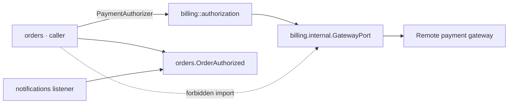
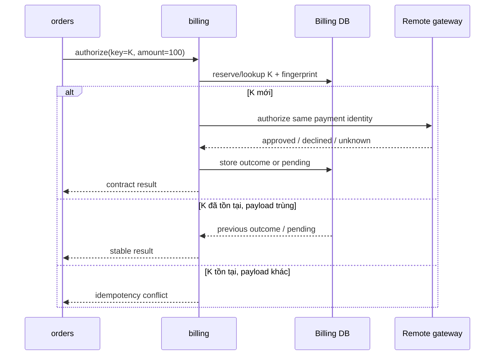
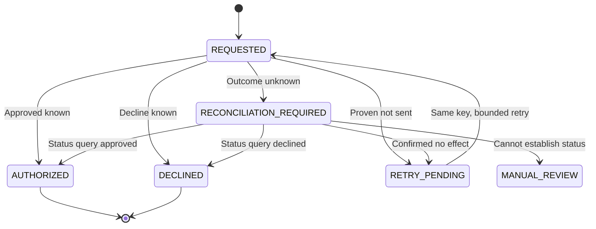
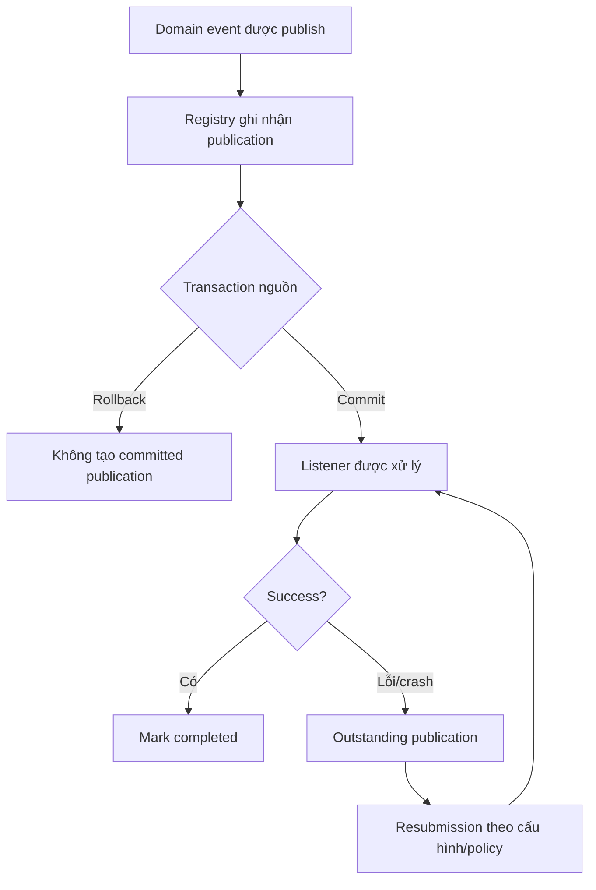

# Hợp đồng error và khả năng retry

## 1. Một timeout không chứng minh giao dịch đã thất bại

Giả sử module `orders` gọi API của module `billing` để ủy quyền thanh toán. Payment gateway nhận yêu cầu và xử lý thành công, nhưng response bị mất giữa đường. `orders` nhận timeout rồi gửi lại lệnh với một mã thanh toán mới. Kết quả có thể là **hai lần tác động thanh toán**, dù mục tiêu chỉ là phục hồi sau sự cố mạng.

Vấn đề không nằm riêng ở timeout. Nó nằm ở việc thiếu **hợp đồng error và khả năng retry** giữa hai application module:

- **Provider** trả loại kết quả/lỗi gì, và mỗi loại có ý nghĩa cụ thể nào?
- **Caller** được thử lại lúc nào, với cùng định danh hay một định danh mới?
- **Khi không biết side effect đã xảy ra chưa**, hệ thống tra cứu/đối soát bằng cách nào?
- **Một thao tác bị gọi lại** có tạo hai lần side effect không?
- Transaction và event publication có thể làm retry hoặc duplicate xuất hiện ở đâu?
- Kiểm thử nào chứng minh hợp đồng này được giữ khi refactor?

Trong chương **Architectural contracts** của học phần `SPRING_MODULITH_VERIFICATION_TESTING`, chúng ta bảo vệ cả ranh giới kiến trúc bằng `ApplicationModules` và quy tắc phụ thuộc, hành vi module bằng `@ApplicationModuleTest`, dữ liệu/sự kiện/tích hợp bằng các bài kiểm thử riêng, rồi gom chúng thành quality gate CI.

**Nguyên tắc:** một lỗi **có thể phục hồi** không có nghĩa **gọi lại ngay là an toàn**. Retry phải dựa trên ý nghĩa của lỗi, bằng chứng về side effect, idempotency và giới hạn attempt.

## 2. Phân loại lỗi trên ba trục

Đừng phân loại đơn giản `success/error`. Một hợp đồng tốt cần ba góc nhìn độc lập:

1. **Business hay technical:** provider chủ động từ chối theo nghiệp vụ, hay hệ thống gặp lỗi hạ tầng?
2. **Permanent hay transient:** cùng input sẽ tiếp tục thất bại, hay môi trường có thể hồi phục?
3. **Outcome known hay unknown:** chắc chắn thao tác không được thực hiện, chắc chắn có kết quả, hay chưa biết remote đã thực hiện chưa?

| Tình huống | Loại | Side effect | Retry phù hợp |
| --- | --- | --- | --- |
| Quantity bằng 0 | Input sai | Chưa gọi provider | Không retry cùng input |
| Thẻ bị từ chối có reason | Business decline | Outcome đã biết | Không retry vô hạn |
| Kết nối bị từ chối **trước khi gửi request**, có bằng chứng | Transient failure | Chắc chắn chưa gửi theo contract | Có thể bounded retry |
| Timeout **sau khi request đã được gửi** | Kết quả không xác định | Có thể đã thực hiện | Đối soát trước khi retry |
| Key cũ dùng với amount khác | Idempotency conflict | Không được thực hiện lệnh khác với cùng key | Dừng, sửa quy trình |
| DB deadlock, transaction đã rollback | Transient concurrency | Unit of work đã rollback | Có thể retry **cả transaction**, nếu mọi side effect an toàn |
| Consumer không hỗ trợ event version | Permanent contract error | Chưa xử lý đúng | DLQ/alert/migration, không retry nóng |
| Kafka producer mất acknowledgement | Outcome có thể không rõ | Broker có thể đã nhận | Delivery/recovery theo event identity |

**Đừng tự suy từ tên exception.** Một `IOException` có thể xảy ra trước khi gửi bytes hoặc sau khi server hoàn thành xử lý. Một HTTP `504` không chứng minh payment đã thất bại. Provider/adapter phải cung cấp **semantics** mà nó thực sự biết.

## 3. Những khái niệm bắt buộc trong retry contract

| Khái niệm | Ý nghĩa |
| --- | --- |
| **Retryable** | Được phép thử lại trong điều kiện, thời gian và attempt budget xác định |
| **Non-retryable** | Gửi lại nguyên yêu cầu không có ích hoặc có thể gây sai |
| **Outcome unknown** | Chưa xác định remote đã tạo side effect hay chưa |
| **Idempotency key** | Khóa ổn định gắn với một thao tác logic qua nhiều attempt |
| **Request fingerprint** | Cách phát hiện cùng key nhưng amount/currency/payload khác |
| **Business idempotency** | Không nhân đôi tác động nghiệp vụ dù nhận cùng yêu cầu nhiều lần |
| **Reconciliation** | Tra trạng thái thực của thao tác qua paymentId/idempotency key |
| **Retry budget** | Số attempt, tổng thời gian và tải được phép dùng để phục hồi |
| **Backoff/jitter** | Giãn cách attempts và tránh hàng loạt client thử lại cùng lúc |
| **Deadline** | Hạn cuối của toàn thao tác, không chỉ timeout của một request |
| **Dead-letter** | Đưa message không xử lý được vào luồng điều tra/khắc phục |
| **At-least-once** | Có thể delivery lặp, nên consumer phải chống lặp |

Không nên để mọi exception có chung directive `retry=true`. Cần tách rõ trường hợp **có thể retry**, **phải đối soát** và **phải dừng**.

## 4. Kiến trúc ví dụ: orders – billing – notifications

Cấu trúc ví dụ:

```text
src/main/java/com/example/shop/
├── ShopApplication.java
├── orders/
│   ├── package-info.java
│   ├── CheckoutService.java
│   ├── CheckoutState.java
│   └── OrderAuthorized.java
├── billing/
│   ├── api/
│   │   ├── package-info.java
│   │   ├── PaymentAuthorizer.java
│   │   ├── PaymentRequest.java
│   │   ├── PaymentDecision.java
│   │   ├── PaymentUnavailableException.java
│   │   └── PaymentOutcomeUnknownException.java
│   └── internal/
│       ├── DefaultPaymentAuthorizer.java
│       └── GatewayPort.java
└── notifications/
    └── internal/
        └── OrderAuthorizedListener.java

src/test/java/com/example/shop/
├── ModuleArchitectureTest.java
├── billing/PaymentProviderContractTest.java
└── orders/CheckoutConsumerContractTest.java
```

Theo cách nhận diện mặc định phổ biến của Spring Modulith, các package con trực tiếp là application modules; `billing.api` được công bố là named interface, còn `billing.internal` là phần implementation.



Hợp đồng kiến trúc: `orders` chỉ gọi API công khai của `billing`; không import HTTP client, repository, gateway-specific exception hoặc implementation trong `billing.internal`.

## 5. Expose API và khai báo dependency được phép

Công bố package con authorization:

```java
// src/main/java/com/example/shop/billing/api/package-info.java
@org.springframework.modulith.NamedInterface("authorization")
package com.example.shop.billing.api;
```

Giới hạn module caller:

```java
// src/main/java/com/example/shop/orders/package-info.java
@org.springframework.modulith.ApplicationModule(
    allowedDependencies = "billing::authorization"
)
package com.example.shop.orders;
```

Hợp đồng này **không tự đăng ký Spring bean** và **không điều khiển retry**. Nó chỉ quy định dependency code hợp lệ. Nếu tên module/named interface trong dự án được tùy chỉnh, cần dùng ID mà mô hình Spring Modulith thực sự nhận diện.

Kiểm chứng kiến trúc:

```java
// src/test/java/com/example/shop/ModuleArchitectureTest.java
package com.example.shop;

import org.junit.jupiter.api.Test;
import org.springframework.modulith.core.ApplicationModules;

class ModuleArchitectureTest {

    @Test
    void verifiesModuleBoundaries() {
        ApplicationModules.of(ShopApplication.class).verify();
    }
}
```

`ShopApplication` là lớp `@SpringBootApplication` ở `com.example.shop`. `verify()` có thể chặn quan hệ trái `allowedDependencies`, truy cập internal API và vòng phụ thuộc theo mô hình; nó **không chứng minh payment gateway xử lý idempotency hoặc timeout đúng**.

## 6. API phải phân biệt business outcome và technical error

### 6.1. Request giữ định danh của một thao tác logic

```java
// src/main/java/com/example/shop/billing/api/PaymentRequest.java
package com.example.shop.billing.api;

public record PaymentRequest(
    String paymentId,
    String orderId,
    long amountMinor,
    String currency,
    String idempotencyKey
) {
}
```

Ở ví dụ, `amountMinor` là số nguyên theo đơn vị tiền tệ đã định nghĩa và `currency = "VND"`. Production phải quy định rõ tiền tệ, precision/rounding, giới hạn giá trị và thời gian key còn hiệu lực. `idempotencyKey` cần **giữ nguyên trên các attempt của cùng operation**.

### 6.2. Known business outcome là typed result

```java
// src/main/java/com/example/shop/billing/api/PaymentDecision.java
package com.example.shop.billing.api;

public sealed interface PaymentDecision
        permits PaymentDecision.Approved,
                PaymentDecision.Declined {

    record Approved(String authorizationId)
            implements PaymentDecision {
    }

    record Declined(String reasonCode)
            implements PaymentDecision {
    }
}
```

`Approved` và `Declined` đều có nghĩa provider đã biết kết quả. `Declined` không phải một timeout kỹ thuật để retry liên tục. Nếu người dùng đổi phương thức thanh toán hoặc dữ liệu đầu vào, đó là một thao tác khác theo hợp đồng nghiệp vụ.

### 6.3. Error type nằm trong public API của provider

```java
// src/main/java/com/example/shop/billing/api/PaymentUnavailableException.java
package com.example.shop.billing.api;

public class PaymentUnavailableException
        extends RuntimeException {

    public PaymentUnavailableException(
            String message, Throwable cause) {
        super(message, cause);
    }
}
```

```java
// src/main/java/com/example/shop/billing/api/PaymentOutcomeUnknownException.java
package com.example.shop.billing.api;

public class PaymentOutcomeUnknownException
        extends RuntimeException {

    public PaymentOutcomeUnknownException(
            String message, Throwable cause) {
        super(message, cause);
    }
}
```

Quy tắc ví dụ:

- `PaymentUnavailableException`: adapter có bằng chứng yêu cầu **chưa được gửi/không thể được xử lý**. Caller có thể retry có giới hạn với **cùng key**.
- `PaymentOutcomeUnknownException`: remote **có thể đã xử lý** nhưng response không đủ tin cậy. Caller phải **đối soát** thay vì tự tạo lệnh thứ hai.

Tên exception không tự cung cấp bằng chứng. HTTP adapter thật phải thực thi chính xác quy tắc này và có integration test.

### 6.4. Public API của module billing

```java
// src/main/java/com/example/shop/billing/api/PaymentAuthorizer.java
package com.example.shop.billing.api;

public interface PaymentAuthorizer {

    /**
     * Approved/Declined: outcome đã biết.
     * PaymentUnavailableException: theo contract, chưa gửi.
     * PaymentOutcomeUnknownException: cần status lookup.
     * IllegalArgumentException: input không hợp lệ.
     */
    PaymentDecision authorize(PaymentRequest request);
}
```

Caller không nên phải bắt `billing.internal.GatewayTimeoutException` hoặc đọc field JSON của gateway cụ thể; đó là trách nhiệm dịch lỗi của provider.

## 7. Adapter nội bộ phân loại lỗi theo điều đã biết

Ví dụ một port ở `billing.internal`:

```java
// src/main/java/com/example/shop/billing/internal/GatewayPort.java
package com.example.shop.billing.internal;

import com.example.shop.billing.api.PaymentRequest;

public interface GatewayPort {

    GatewayReply authorize(PaymentRequest request);

    record GatewayReply(
        boolean approved,
        String authorizationId,
        String declineCode) {
    }

    // Adapter đã xác nhận request chưa được gửi.
    final class NotConnected extends RuntimeException {
        public NotConnected() {
            super("Connection not established");
        }
    }

    // Request có thể đã được remote xử lý.
    final class AmbiguousTimeout extends RuntimeException {
        public AmbiguousTimeout() {
            super("Remote outcome cannot be determined");
        }
    }
}
```

Hai exception nội bộ là **loại lỗi do ví dụ quy định**, không phải tên exception tự động của WebClient/RestClient hay mọi HTTP library. Khi không chứng minh được request chưa gửi, chọn loại **ambiguous**.

Provider implementation:

```java
// src/main/java/com/example/shop/billing/internal/DefaultPaymentAuthorizer.java
package com.example.shop.billing.internal;

import com.example.shop.billing.api.PaymentAuthorizer;
import com.example.shop.billing.api.PaymentDecision;
import com.example.shop.billing.api.PaymentOutcomeUnknownException;
import com.example.shop.billing.api.PaymentRequest;
import com.example.shop.billing.api.PaymentUnavailableException;
import org.springframework.stereotype.Service;

@Service
class DefaultPaymentAuthorizer implements PaymentAuthorizer {

    private final GatewayPort gateway;

    DefaultPaymentAuthorizer(GatewayPort gateway) {
        this.gateway = gateway;
    }

    @Override
    public PaymentDecision authorize(PaymentRequest request) {
        if (request == null
                || request.paymentId() == null
                || request.paymentId().isBlank()
                || request.orderId() == null
                || request.orderId().isBlank()
                || request.amountMinor() <= 0
                || !"VND".equals(request.currency())
                || request.idempotencyKey() == null
                || request.idempotencyKey().isBlank()) {
            throw new IllegalArgumentException(
                "Invalid authorization request");
        }

        try {
            GatewayPort.GatewayReply reply =
                gateway.authorize(request);

            if (reply.approved()) {
                return new PaymentDecision.Approved(
                    reply.authorizationId());
            }

            return new PaymentDecision.Declined(
                reply.declineCode());

        } catch (GatewayPort.NotConnected ex) {
            throw new PaymentUnavailableException(
                "Provider was not reached", ex);

        } catch (GatewayPort.AmbiguousTimeout ex) {
            throw new PaymentOutcomeUnknownException(
                "Reconciliation required", ex);
        }
    }
}
```

**Các giới hạn cần nói thẳng:**

1. Chưa có implementation production của `GatewayPort`; sẽ dùng mock trong provider test. Bài không khẳng định client HTTP có thể phân biệt chính xác mọi network exception.
2. Chưa có bảng idempotency, status lookup hoặc lock/concurrency protection. Truyền key chưa đủ để bảo đảm remote side effect chỉ xảy ra một lần.
3. Chưa validate toàn diện reply như `authorizationId` rỗng hay response mâu thuẫn; production cần xử lý invalid response tường minh.
4. Quy tắc `VND` chỉ là giới hạn của app mẫu.
5. Không tự động retry trong provider implementation; retry owner được chọn ở một tầng khác.

## 8. Caller quyết định kết quả, không tự retry mù

Event do `orders` sở hữu:

```java
// src/main/java/com/example/shop/orders/OrderAuthorized.java
package com.example.shop.orders;

public record OrderAuthorized(
    String orderId, String authorizationId) {
}
```

Trạng thái use case:

```java
// src/main/java/com/example/shop/orders/CheckoutState.java
package com.example.shop.orders;

public enum CheckoutState {
    AUTHORIZED,
    DECLINED,
    RETRY_LATER,
    OUTCOME_UNKNOWN
}
```

Implementation module caller:

```java
// src/main/java/com/example/shop/orders/CheckoutService.java
package com.example.shop.orders;

import com.example.shop.billing.api.PaymentAuthorizer;
import com.example.shop.billing.api.PaymentDecision;
import com.example.shop.billing.api.PaymentOutcomeUnknownException;
import com.example.shop.billing.api.PaymentRequest;
import com.example.shop.billing.api.PaymentUnavailableException;
import org.springframework.context.ApplicationEventPublisher;
import org.springframework.stereotype.Service;

@Service
public class CheckoutService {

    private final PaymentAuthorizer payments;
    private final ApplicationEventPublisher events;

    public CheckoutService(
            PaymentAuthorizer payments,
            ApplicationEventPublisher events) {
        this.payments = payments;
        this.events = events;
    }

    public CheckoutState authorize(
            String orderId, long amountMinor) {

        if (orderId == null || orderId.isBlank()
                || amountMinor <= 0) {
            throw new IllegalArgumentException(
                "Invalid checkout input");
        }

        var request = new PaymentRequest(
            "pay:" + orderId,
            orderId,
            amountMinor,
            "VND",
            "authorize:" + orderId);

        try {
            PaymentDecision decision =
                payments.authorize(request);

            if (decision instanceof PaymentDecision.Declined) {
                return CheckoutState.DECLINED;
            }

            if (decision instanceof PaymentDecision.Approved ok) {
                events.publishEvent(new OrderAuthorized(
                    orderId, ok.authorizationId()));
                return CheckoutState.AUTHORIZED;
            }

            throw new IllegalStateException(
                "Invalid provider response");

        } catch (PaymentUnavailableException ex) {
            return CheckoutState.RETRY_LATER;

        } catch (PaymentOutcomeUnknownException ex) {
            return CheckoutState.OUTCOME_UNKNOWN;
        }
    }
}
```

Giải thích:

- `Approved` mới được phát `OrderAuthorized`.
- `Declined` và các lỗi kỹ thuật **không** phát sự kiện authorized.
- `PaymentUnavailableException` chuyển thành trạng thái có thể lập lịch retry.
- `PaymentOutcomeUnknownException` chuyển thành trạng thái **cần đối soát**.
- Lệnh mới không được tự tạo payment ID khác khi retry cùng thao tác.
- Lỗi response trái contract không bị âm thầm coi là decline.

**Chưa phải workflow thanh toán production hoàn chỉnh:** code chưa persist `CheckoutState`, chưa có transaction/idempotency registry, chưa chống hai lần gọi `authorize(...)` đồng thời. Nếu use case thật có side effect, các trạng thái phải được lưu và chuyển đổi bằng giao dịch/concurrency control phù hợp.

## 9. Contract card giữa provider và caller

| Case | Provider cam kết | Caller phải làm | Caller không được làm |
| --- | --- | --- | --- |
| Approved | `Approved(authorizationId)` hợp lệ | Chuyển authorized, phát event đúng | Gửi payment operation mới |
| Declined | `Declined(reasonCode)` | Trả kết quả đã biết; cho người dùng lựa chọn | Retry nóng cùng input |
| Invalid input | Exception/typed error được định nghĩa | Sửa input, không gọi tiếp | Lặp request vô hạn |
| Không kết nối trước khi gửi (có bằng chứng) | `PaymentUnavailableException` | Bounded retry, cùng key | Tạo paymentId mới |
| Timeout sau-send | `PaymentOutcomeUnknownException` | Lưu pending, status lookup/reconcile | Kết luận failed |
| Key cũ dùng với amount khác | Idempotency conflict | Dừng và điều tra | Ép charge lần thứ hai |
| Cùng key, cùng payload đã xử lý | Outcome cũ hoặc pending theo policy | Tiếp tục từ outcome đã biết | Tạo side effect khác |
| Response gateway không hợp lệ | Technical contract error | Điều tra; nếu có thể đã xử lý thì đối soát | Tự chuyển thành business decline |

**Lưu ý:** xử lý conflict/idempotency durable là hợp đồng **cần được hiện thực hóa** ở gateway/backend và test integration. Class `DefaultPaymentAuthorizer` phía trên mới minh họa phân loại known/unknown, **chưa thực thi** lưu key hoặc status lookup.

## 10. Provider contract test với service thật

Test module `billing` inject `PaymentAuthorizer` thật và mock đúng `GatewayPort` nội bộ:

```java
// src/test/java/com/example/shop/billing/PaymentProviderContractTest.java
package com.example.shop.billing;

import com.example.shop.billing.api.PaymentAuthorizer;
import com.example.shop.billing.api.PaymentDecision;
import com.example.shop.billing.api.PaymentOutcomeUnknownException;
import com.example.shop.billing.api.PaymentRequest;
import com.example.shop.billing.api.PaymentUnavailableException;
import com.example.shop.billing.internal.GatewayPort;
import org.junit.jupiter.api.Test;
import org.springframework.beans.factory.annotation.Autowired;
import org.springframework.modulith.test.ApplicationModuleTest;
import org.springframework.test.context.bean.override.mockito.MockitoBean;

import static org.assertj.core.api.Assertions.assertThat;
import static org.assertj.core.api.Assertions.assertThatThrownBy;
import static org.mockito.BDDMockito.given;

@ApplicationModuleTest
class PaymentProviderContractTest {

    @Autowired
    PaymentAuthorizer payments;

    @MockitoBean
    GatewayPort gateway;

    private static PaymentRequest request() {
        return new PaymentRequest(
            "pay:ORD-1", "ORD-1",
            120000L, "VND", "authorize:ORD-1");
    }

    @Test
    void returnsKnownApproval() {
        given(gateway.authorize(request()))
            .willReturn(new GatewayPort.GatewayReply(
                true, "AUTH-1", null));

        assertThat(payments.authorize(request()))
            .isEqualTo(
                new PaymentDecision.Approved("AUTH-1"));
    }

    @Test
    void treatsBusinessDeclineAsKnown() {
        given(gateway.authorize(request()))
            .willReturn(new GatewayPort.GatewayReply(
                false, null, "CARD_DECLINED"));

        assertThat(payments.authorize(request()))
            .isEqualTo(
                new PaymentDecision.Declined(
                    "CARD_DECLINED"));
    }

    @Test
    void mapsFailureBeforeSendToUnavailable() {
        given(gateway.authorize(request()))
            .willThrow(new GatewayPort.NotConnected());

        assertThatThrownBy(() ->
            payments.authorize(request()))
            .isInstanceOf(
                PaymentUnavailableException.class);
    }

    @Test
    void mapsAmbiguousTimeoutToUnknownOutcome() {
        given(gateway.authorize(request()))
            .willThrow(new GatewayPort.AmbiguousTimeout());

        assertThatThrownBy(() ->
            payments.authorize(request()))
            .isInstanceOf(
                PaymentOutcomeUnknownException.class);
    }

    @Test
    void rejectsInvalidInput() {
        assertThatThrownBy(() ->
            payments.authorize(new PaymentRequest(
                "pay:ORD-1", "ORD-1",
                0, "VND", "authorize:ORD-1")))
            .isInstanceOf(IllegalArgumentException.class);
    }
}
```

Test này bảo vệ **mapping contract của provider**. Nó không chứng minh network client thật phân loại đúng connect refused/timeout, cũng không chứng minh remote đã idempotent.

`@MockitoBean` có từ Spring Framework 6.2, với các phiên bản Spring Boot/Spring Modulith tương thích. Trên stack cũ, `@MockBean` có thể là lựa chọn phù hợp; annotation của Boot deprecated từ 3.4.

## 11. Caller module test: mỗi outcome dẫn tới một quyết định

`@ApplicationModuleTest` của `orders` ở `STANDALONE` chạy `CheckoutService` thật, mock API của `billing`:

```java
// src/test/java/com/example/shop/orders/CheckoutConsumerContractTest.java
package com.example.shop.orders;

import com.example.shop.billing.api.PaymentAuthorizer;
import com.example.shop.billing.api.PaymentDecision;
import com.example.shop.billing.api.PaymentOutcomeUnknownException;
import com.example.shop.billing.api.PaymentRequest;
import com.example.shop.billing.api.PaymentUnavailableException;
import org.junit.jupiter.api.Test;
import org.springframework.beans.factory.annotation.Autowired;
import org.springframework.modulith.test.ApplicationModuleTest;
import org.springframework.modulith.test.PublishedEvents;
import org.springframework.test.context.bean.override.mockito.MockitoBean;

import static org.assertj.core.api.Assertions.assertThat;
import static org.assertj.core.api.Assertions.assertThatThrownBy;
import static org.mockito.ArgumentMatchers.any;
import static org.mockito.ArgumentMatchers.argThat;
import static org.mockito.BDDMockito.given;
import static org.mockito.Mockito.verify;
import static org.mockito.Mockito.verifyNoInteractions;

@ApplicationModuleTest
class CheckoutConsumerContractTest {

    @Autowired
    CheckoutService checkout;

    @MockitoBean
    PaymentAuthorizer payments;

    @Test
    void approvalPublishesCorrectEvent(PublishedEvents events) {
        given(payments.authorize(any(PaymentRequest.class)))
            .willReturn(
                new PaymentDecision.Approved("AUTH-1"));

        assertThat(checkout.authorize("ORD-1", 120000))
            .isEqualTo(CheckoutState.AUTHORIZED);

        verify(payments).authorize(argThat(req ->
            req.orderId().equals("ORD-1")
                && req.paymentId().equals("pay:ORD-1")
                && req.idempotencyKey()
                      .equals("authorize:ORD-1")
                && req.amountMinor() == 120000L));

        assertThat(events.ofType(OrderAuthorized.class))
            .singleElement()
            .satisfies(event -> {
                assertThat(event.orderId())
                    .isEqualTo("ORD-1");
                assertThat(event.authorizationId())
                    .isEqualTo("AUTH-1");
            });
    }

    @Test
    void declinedDoesNotPublishSuccess(PublishedEvents events) {
        given(payments.authorize(any(PaymentRequest.class)))
            .willReturn(
                new PaymentDecision.Declined("DECLINED"));

        assertThat(checkout.authorize("ORD-2", 120000))
            .isEqualTo(CheckoutState.DECLINED);

        assertThat(events.ofType(OrderAuthorized.class))
            .isEmpty();
    }

    @Test
    void knownPreSendFailureCanBeScheduledForRetry(
            PublishedEvents events) {

        given(payments.authorize(any(PaymentRequest.class)))
            .willThrow(new PaymentUnavailableException(
                "not sent", new IllegalStateException()));

        assertThat(checkout.authorize("ORD-3", 120000))
            .isEqualTo(CheckoutState.RETRY_LATER);

        assertThat(events.ofType(OrderAuthorized.class))
            .isEmpty();
    }

    @Test
    void unknownOutcomeRequiresReconciliation(
            PublishedEvents events) {

        given(payments.authorize(any(PaymentRequest.class)))
            .willThrow(new PaymentOutcomeUnknownException(
                "unknown", new IllegalStateException()));

        assertThat(checkout.authorize("ORD-4", 120000))
            .isEqualTo(CheckoutState.OUTCOME_UNKNOWN);

        assertThat(events.ofType(OrderAuthorized.class))
            .isEmpty();
    }

    @Test
    void badInputNeverCallsProvider() {
        assertThatThrownBy(() ->
            checkout.authorize("ORD-5", 0))
            .isInstanceOf(IllegalArgumentException.class);

        verifyNoInteractions(payments);
    }
}
```

**Test chứng minh:** caller hiểu đúng error contract và không phát event thành công khi declined/unknown. **Test chưa chứng minh:** provider thật có trả error đúng, payment gateway đã được bảo vệ idempotency, database đã commit hoặc Kafka consumer đã nhận event.

Không mock `CheckoutService` nếu chính caller behavior là phần cần chạy thật.

## 12. Hợp đồng retry nên có ít nhất ba quyết định

Thay vì một boolean `retryable` cho mọi exception, có thể sử dụng:

| Directive | Ý nghĩa | Ví dụ |
| --- | --- | --- |
| `STOP` | Không thử lại cùng input, cần business action hoặc sửa contract | Declined, invalid input |
| `RETRY_WITH_BACKOFF` | Có thể thử lại **cùng operation identity**, có giới hạn | Proven not-sent, safe idempotent work |
| `RECONCILE_FIRST` | Tra cứu trạng thái trước khi gửi thêm lệnh | Post-send timeout |
| `DEAD_LETTER` | Không tự retry message lỗi cố định | Unknown schema version |
| `RETRY_WHOLE_TRANSACTION` | Chạy lại đơn vị DB đã rollback chắc chắn | Deadlock nếu không có side effect ngoài |

Ví dụ classifier thuần:

```java
// src/main/java/com/example/shop/orders/internal/PaymentRetryPolicy.java
package com.example.shop.orders.internal;

import com.example.shop.billing.api.PaymentOutcomeUnknownException;
import com.example.shop.billing.api.PaymentUnavailableException;

public final class PaymentRetryPolicy {

    private PaymentRetryPolicy() {
    }

    public enum Directive {
        STOP, RETRY_WITH_BACKOFF, RECONCILE_FIRST
    }

    public static Directive classify(Throwable error) {
        if (error instanceof PaymentOutcomeUnknownException) {
            return Directive.RECONCILE_FIRST;
        }
        if (error instanceof PaymentUnavailableException) {
            return Directive.RETRY_WITH_BACKOFF;
        }
        return Directive.STOP;
    }
}
```

Đây chỉ là **quy tắc quyết định**, không phải vòng retry production. Nó giả định `PaymentUnavailableException` thực sự mang nghĩa “chưa gửi” theo contract, một giả định phải được provider chứng minh.

Một test JUnit ngắn:

```java
// Bên trong test có import AssertJ và các API ở trên.
assertThat(PaymentRetryPolicy.classify(
    new PaymentOutcomeUnknownException(
        "unknown", new RuntimeException())))
    .isEqualTo(
        PaymentRetryPolicy.Directive.RECONCILE_FIRST);

assertThat(PaymentRetryPolicy.classify(
    new PaymentUnavailableException(
        "not sent", new RuntimeException())))
    .isEqualTo(
        PaymentRetryPolicy.Directive.RETRY_WITH_BACKOFF);
```

Không dùng `catch (Exception) { retry(); }` vì như vậy lặp cả lỗi nghiệp vụ, input sai và lỗi schema không thể tự sửa.

## 13. Retry budget, backoff và deadline là phần của contract

Một policy rõ ràng nên mô tả:

1. **Ai là retry owner?** Module caller, adapter hay worker?
2. **Max attempts:** tổng lần thử bao gồm attempt đầu hay chỉ retry?
3. **Per-attempt timeout:** mỗi request chờ bao lâu?
4. **Total deadline:** hết thời gian toàn lệnh thì làm gì?
5. **Backoff:** thời gian giãn cách ra sao?
6. **Jitter:** giảm nhiều client đồng thời thử lại.
7. **Retry-After:** nếu provider trả header này, có tôn trọng không?
8. **Circuit breaker/bulkhead:** có hạn chế tải lên provider đang lỗi không?
9. **Cancellation:** caller hủy request thì workflow dừng hay chuyển background?
10. **Identity:** mọi attempt có giữ nguyên paymentId, key và request fingerprint không?
11. **Observability:** có attempt count, trace ID, lý do và tuổi của task?
12. **Escalation:** hết budget thì `RETRY_LATER`, manual review hay reconciliation?

Ví dụ thông số **chỉ minh họa** cho thao tác đã được xác nhận retry an toàn:

| Cấu hình | Ví dụ |
| --- | --- |
| Max attempts | 3 **tính cả lần đầu** |
| Per-attempt timeout | 1 s |
| Total deadline | 5 s |
| Backoff | 200 ms → 400 ms, có jitter |
| Key | Giữ nguyên `authorize:ORD-1` |
| Hết budget | Ghi lại trạng thái retry later và cảnh báo phù hợp |

Đây **không phải khuyến nghị cố định** cho một payment provider production. Với outcome unknown, tăng attempts hay backoff **không** thay thế reconciliation.

### Retry amplification

Nếu `orders` retry 3 lần, adapter `billing` retry 3 lần bên trong, HTTP client tự retry thêm 3 lần, một thao tác logic có thể thành **27 request**. Điều này có thể làm quá tải gateway khi nó đang lỗi.

Nên định nghĩa một retry owner trên mỗi boundary hoặc phối hợp các tầng bằng deadline/budget chung. Không bật retry ở mọi chỗ rồi chỉ kiểm tra happy path.

## 14. Tooling như Spring Retry/Resilience4j không quyết định semantics

Spring Retry, Resilience4j hoặc retry logic trong HTTP/message client chỉ là công cụ thực thi attempts, backoff, circuit breaker. **Chính contract** mới quyết định trường hợp nào được lặp lại.

Phản ví dụ:

```java
// PHẢN VÍ DỤ: annotation không chứng minh payment idempotent.
@Retryable
public void chargePayment(...) {
    gateway.charge(...);
}
```

Đoạn mã trên mang tính minh họa, lược bỏ import/config và không phải thứ Spring Modulith tự bật. Nếu dùng trong dự án, phải xem interceptor/proxy, retry policy, timeout, recovery callback và phiên bản thư viện. Tự gọi `this.method()` có thể bỏ qua proxy-based advice.

Bài test cần kiểm tra: đúng allowlist exception; attempts không vượt giới hạn; backoff có thể điều khiển bằng fake scheduler/clock; cùng key trên mọi attempt; outcome unknown **không** bị generic retry advice gọi lại ngay.

## 15. Idempotency: điều kiện để retry không tạo tác động trùng

Một `idempotencyKey` trong DTO không tự đảm bảo điều gì. Provider phải có thuật toán/storage và semantics:

- Khi key chưa tồn tại: ghi nhận operation, fingerprint và trạng thái.
- Khi key đã có cùng fingerprint: trả kết quả cũ hoặc trạng thái đang xử lý.
- Khi key đã có nhưng amount/currency khác: **conflict**, không thực hiện lệnh mới.
- Với nhiều thread/process cùng key: không có hai worker cùng charge do race.
- Sau restart: trạng thái đủ bền để nhận diện lệnh trước đó.
- Với timeout sau remote call: query status hoặc dùng key do remote provider hỗ trợ.
- Khi key hết hạn: hành vi và retention được ghi rõ, tránh replay ngoài ý muốn.

Một schema minh họa:

```text
payment_attempts
  idempotency_key    VARCHAR PRIMARY KEY
  request_hash       VARCHAR NOT NULL
  payment_id         VARCHAR NOT NULL
  state              VARCHAR NOT NULL
  authorization_id   VARCHAR NULL
  updated_at         TIMESTAMP NOT NULL
```

Một flow:



Sơ đồ là **phương án thiết kế**, chưa phải code production. Ghi row local và gọi gateway remote không nằm trong một distributed transaction mặc định. Cửa sổ crash giữa hai bước phải được xử lý qua remote idempotency/status lookup hoặc quy trình đối soát.

**Không dùng `HashMap` in-memory làm bảo đảm multi-instance/crash-safe** và không chỉ kiểm tra `containsKey` rồi charge: hai thread có thể cùng đi qua kiểm tra.

## 16. Outcome unknown cần trạng thái đối soát riêng

`PaymentOutcomeUnknownException` không thể được rút gọn thành `DECLINED`. Có thể đã thành công nhưng response mất.

Một state machine minh họa:



Một API như `findAuthorizationStatus(paymentId, idempotencyKey)` có thể hỗ trợ đối soát. Nếu payment provider không có API đó, hãy ghi rõ cách xử lý thủ công và hạn mức vận hành, không hứa retry tự giải quyết.

### HTTP status không đủ để biết side effect

| Tín hiệu | Cách hiểu thận trọng |
| --- | --- |
| `400` / `422` | Input sai theo contract; sửa trước khi gửi lại |
| `409` | Có thể là idempotency/version/business conflict; đọc error code |
| `429` | Rate limit; xem `Retry-After` và deadline, vẫn cần idempotency |
| `500` | Technical failure, side effect có thể đã xảy ra |
| `503` | Có thể transient; trước khi retry lệnh side effect cần biết outcome |
| `504` | Gateway timeout, **không chứng minh backend chưa xử lý** |
| Connection reset sau-send | Outcome chưa biết |
| Connect refused trước-send (có bằng chứng) | Có thể retry bounded |
| Response malformed | Technical error; nếu request đã được xử lý thì vẫn có thể unknown |

Không tự map mọi `5xx` sang `PaymentUnavailableException` rồi retry ngay.

## 17. Error contract ngoài JVM: mã lỗi có ngữ nghĩa

Trong cùng modulith, caller có thể bắt một public exception type. Nếu `billing` công bố HTTP API, cần wire error contract riêng và không gửi stack trace Java ra client.

Một envelope kiểu Problem Details minh họa:

```json
{
  "type": "https://errors.example.com/payment-outcome-unknown",
  "title": "Payment outcome unknown",
  "status": 202,
  "detail": "Authorization status requires reconciliation",
  "errorCode": "PAYMENT_OUTCOME_UNKNOWN",
  "paymentId": "pay:ORD-1",
  "retryDirective": "RECONCILE_FIRST"
}
```

Đây là **quy ước ứng dụng giả định**. `202 Accepted` chỉ phù hợp nếu API thực sự chấp nhận workflow bất đồng bộ; một timeout transport có thể không trả được HTTP response. Phải thiết kế status endpoint hoặc cơ chế đối soát riêng.

Không expose SQL, token, thông tin thẻ, internal package/class hoặc dữ liệu nhạy cảm trong `detail`. `errorCode` và `retryDirective` là các contract cần version/compatibility tests nếu consumer deploy độc lập.

## 18. Transaction không tự rollback remote side effect

Một service có thể làm:

```java
@Transactional
public void process(...) {
    paymentGateway.authorize(...);
    orderRepository.save(...);
}
```

Đoạn này rút gọn để minh họa nguy cơ: gateway đã xử lý nhưng transaction JPA sau đó rollback. Rollback local **không** quay ngược authorization ở hệ thống khác.

Khi retry **cả method** sau DB deadlock, lệnh payment có thể được gọi lại. Cần ít nhất một trong các thiết kế phù hợp:

- Tách remote call khỏi transaction có thể retry.
- Dùng idempotency key và lưu trạng thái hợp lệ.
- Trước khi gửi lại, đối soát nếu outcome có thể unknown.
- Có cơ chế compensation/void authorization khi business yêu cầu.
- Dùng state machine `PAYMENT_PENDING`, `AUTHORIZED`, `RECONCILIATION_REQUIRED`.
- Chỉ phát event `OrderAuthorized` sau khi state được xác nhận/commit theo contract.

### Lỗi transaction có thể xuất hiện lúc commit

`repository.save(...)` không nhất thiết flush/commit SQL ngay. Unique violation, optimistic lock, timeout hoặc deadlock có thể biểu hiện ở flush hoặc commit. Vì vậy test phải kiểm tra transaction outcome, không chỉ method repository trả về.

Một `@Transactional` test thường rollback cuối method, nên không được tự nhận “đã chứng minh commit” nếu chưa kiểm soát transaction bằng `TransactionTemplate`, `TestTransaction` hoặc đọc dữ liệu sau commit thật.

## 19. Lỗi database nào được retry?

| Nhóm lỗi | Có thể retry? | Điều kiện |
| --- | --- | --- |
| Unique constraint/duplicate key | Thường không gửi lại y nguyên | Có thể là duplicate business command; tra trạng thái |
| Optimistic lock conflict | Có thể đọc lại state rồi tính toán lại | Không dùng dữ liệu stale |
| Deadlock đã rollback | Có thể retry cả unit of work | Không có side effect ngoài không idempotent |
| Cannot acquire lock | Có thể transient | Retry budget, backoff và transaction mới |
| Data integrity violation | Thường permanent đối với input/schema hiện tại | Sửa dữ liệu hoặc migration |
| Connection failure trước khi transaction bắt đầu | Có thể transient | Chứng minh chưa có partial side effect |
| Query/commit timeout | Có thể unknown | Xác minh trạng thái DB/transaction trước retry |
| Serialization failure | Có thể retry transaction | Tùy DB isolation và đặc tính operation |

Tên exception cụ thể trong Spring Data/Spring DAO thay đổi theo driver, dialect và version. Không viết một allowlist rộng rồi coi mọi `DataAccessException` là retryable.

**Tuyệt đối không mock repository và tuyên bố đã kiểm thử transaction, lock hoặc unique constraint.** Những cam kết đó cần database integration.

## 20. JPA + Testcontainers: kiểm tra idempotency thực tế

Khung test PostgreSQL cho module `billing`:

```java
// src/test/java/com/example/shop/billing/BillingIdempotencyTest.java
package com.example.shop.billing;

import org.junit.jupiter.api.Test;
import org.springframework.modulith.test.ApplicationModuleTest;
import org.springframework.test.context.DynamicPropertyRegistry;
import org.springframework.test.context.DynamicPropertySource;
import org.testcontainers.containers.PostgreSQLContainer;
import org.testcontainers.junit.jupiter.Container;
import org.testcontainers.junit.jupiter.Testcontainers;

@Testcontainers
@ApplicationModuleTest
class BillingIdempotencyTest {

    @Container
    static PostgreSQLContainer<?> postgres =
        new PostgreSQLContainer<>("postgres:16-alpine");

    @DynamicPropertySource
    static void datasource(
            DynamicPropertyRegistry registry) {
        registry.add("spring.datasource.url",
            postgres::getJdbcUrl);
        registry.add("spring.datasource.username",
            postgres::getUsername);
        registry.add("spring.datasource.password",
            postgres::getPassword);
    }

    @Test
    void sameKeyMustNotCauseTwoCharges() {
        // TODO: cấu hình entity/repository/migration thật.
        // TODO: gọi đồng thời hai authorization cùng key.
        // TODO: fake remote ghi nhận số side effect.
        // TODO: assert một attempt logic và outcome ổn định.
    }
}
```

Đây là **khung hạ tầng, chưa phải test hoàn chỉnh**: cần entity, repository, schema/migration, driver, Testcontainers, Docker, fixture và assertion. `@ApplicationModuleTest` không tự tạo bảng SQL. Khi dùng một gateway stub, bài test phải chạy qua logic idempotency production chứ không mock mất chính service/repository được kiểm chứng.

Các scenario bắt buộc:

1. Cùng key, cùng payload gọi lặp → không tạo hai payment side effect.
2. Cùng key, payload khác → conflict.
3. Hai thread/process cùng key → concurrency protection đúng.
4. Crash sau remote success nhưng trước khi mark completed → reconciliation.
5. Transaction rollback không để lại trạng thái “đã xử lý” sai.
6. Retention/key expiry có quy tắc rõ.

## 21. HTTP adapter integration: phân biệt lỗi trước và sau gửi

Một controlled HTTP server/proxy hoặc test gateway nên tái tạo:

| Tình huống | Điều phải chứng minh |
| --- | --- |
| Gateway trả approved | Map đúng `Approved` và ID |
| Gateway trả business decline | Map thành `Declined`, không phải exception |
| Connect refused chắc chắn trước-send | Chỉ khi đủ bằng chứng mới map `PaymentUnavailableException` |
| Server nhận request rồi cố ý trì hoãn response | Map sang outcome unknown |
| Server xử lý rồi đóng kết nối | Không coi là “chưa charge” |
| HTTP 429 với `Retry-After` | Retry budget/backoff đúng nếu operation safe |
| HTTP 500/503/504 | Không blanket retry lệnh có side effect |
| JSON thiếu field bắt buộc | Technical contract error |
| Same key, same payload | Gateway idempotency contract được kiểm chứng |
| Same key, different payload | Conflict theo policy |

**Mock HTTP exception không chứng minh remote side effect đã/ chưa xảy ra.** Để kiểm tra ambiguity, test server cần ghi nhận lúc request được xử lý rồi mới cố ý cắt response.

Nếu provider có status lookup, test luôn nhánh reconciliation; không chỉ assert số lần gọi `authorize`.

## 22. Error và retry trong event consumption

`notifications` có thể phản ứng với sự kiện `OrderAuthorized`:

```java
// src/main/java/com/example/shop/notifications/internal/OrderAuthorizedListener.java
package com.example.shop.notifications.internal;

import com.example.shop.orders.OrderAuthorized;
import org.springframework.modulith.events.ApplicationModuleListener;
import org.springframework.stereotype.Component;

@Component
class OrderAuthorizedListener {

    private final NotificationPort notifications;

    OrderAuthorizedListener(NotificationPort notifications) {
        this.notifications = notifications;
    }

    @ApplicationModuleListener
    void on(OrderAuthorized event) {
        notifications.sendConfirmation(
            event.orderId(), event.authorizationId());
    }
}
```

`NotificationPort` là interface giả định thuộc `notifications`, cần implementation/fake phù hợp. Ở các phiên bản Spring Modulith thông dụng, `@ApplicationModuleListener` hỗ trợ semantics hậu commit, bất đồng bộ và transaction riêng; phải đối chiếu version/config của ứng dụng.

Khi listener fail **sau khi transaction nguồn commit**, sự cố không làm transaction authorize đã commit tự rollback. Cần một cơ chế theo dõi publication thất bại, retry có kiểm soát và consumer idempotency.

### Phân biệt retry lời gọi và retry event

| Caller → billing | Event → notifications |
| --- | --- |
| Có thể lặp payment side effect | Có thể lặp notification side effect |
| Khóa `paymentId`/`idempotencyKey` | Khóa `eventId` và consumer identity |
| Phân biệt outcome unknown trước retry | Phân biệt đã xử lý/chưa ack |
| Status lookup/reconciliation | Outstanding publication/replay/DLQ |
| Provider & HTTP adapter tests | Registry & listener integration tests |

Không nên áp một `@Retryable` chung cho mọi listener, vì poison event/version sai sẽ bị lặp vô hạn và làm tắc queue.

## 23. Event Publication Registry không phải distributed transaction

Spring Modulith có cơ chế **Event Publication Registry** cho transactional event publications khi được cài đặt và cấu hình backend tương thích.



Sơ đồ **khái niệm**; API/backend, cách lưu event, resubmission tự động hay thủ công và thời điểm mark completed phụ thuộc phiên bản Spring Modulith cùng cấu hình thực tế.

Những điều phải kiểm chứng:

- Backend bền vững và schema có thật.
- Publication được lưu theo transaction nguồn phù hợp.
- Listener fail → trạng thái outstanding không bị đánh dấu hoàn tất sai.
- Recovery/resubmit có được bật và hoạt động đúng không.
- Duplicate delivery không nhân đôi business side effect.
- Lỗi permanent chuyển quy trình điều tra, không retry vô hạn.
- Message gửi tới Kafka/email có contract acknowledgement riêng.

**Registry không biến database nguồn và email/Kafka thành một atomic transaction.** Nếu listener đã gửi email nhưng fail khi mark completed, việc retry có thể gửi lại; consumer phải idempotent.

## 24. Poison message và DLQ

Một message sai schema không thể tự hết lỗi do thời gian. Các trường hợp thường không nên retry nóng:

- Unknown event name hoặc schema version.
- Thiếu field bắt buộc.
- Currency hoặc enum value nằm ngoài contract.
- JSON không deserialize được theo schema.
- Domain invariant bị phá mà không có migration.
- Message chứa dữ liệu không được consumer phép xử lý.

Contract xử lý:

1. Phân loại permanent processing error.
2. Ghi mã lỗi và correlation/event ID đủ để điều tra, không lộ PII.
3. Đưa vào DLQ/quarantine nếu hạ tầng cho phép.
4. Alert owner của event/schema.
5. Có quy trình sửa consumer hoặc migrate dữ liệu rồi replay.
6. Đảm bảo replay không gây side effect lặp.

Với Kafka/RabbitMQ, broker acknowledgement và **business completion** khác nhau; không coi một message đã được ack là nghiệp vụ đã thực hiện chính xác.

## 25. Test event không đánh đồng published, committed, handled

`@ApplicationModuleTest` với `PublishedEvents` kiểm tra **event đã được công bố** từ module nguồn:

```java
// Snippet trong test orders đã inject checkout và mock payments.
given(payments.authorize(any(PaymentRequest.class)))
    .willReturn(new PaymentDecision.Approved("AUTH-1"));

checkout.authorize("ORD-1", 120000);

assertThat(events.ofType(OrderAuthorized.class))
    .singleElement()
    .satisfies(e ->
        assertThat(e.orderId()).isEqualTo("ORD-1"));
```

Không từ test này suy ra:

- Transaction database đã commit.
- Listener `notifications` đã chạy.
- Kafka producer đã nhận ack.
- Consumer đã gửi email.
- Event publication registry đã lưu/mark completed.
- Retry khi crash không tạo duplicate.

Nếu muốn kiểm chứng listener hậu commit, cần transaction nguồn thật và listener production trong context phù hợp; với async, chờ **điều kiện nghiệp vụ** có timeout hữu hạn, ví dụ tiện ích `Scenario` của Spring Modulith Test hoặc Awaitility.

Với test `@Transactional` của Spring Test, transaction thường rollback cuối method; `@TransactionalEventListener(AFTER_COMMIT)` có thể **không được gọi**. Có thể dùng `TransactionTemplate` không có transaction bao ngoài hoặc `TestTransaction.flagForCommit()` cùng `TestTransaction.end()` để kiểm tra commit thật, kèm cleanup dữ liệu.

## 26. Chẩn đoán theo tầng

| Triệu chứng | Tầng có khả năng | Hướng điều tra |
| --- | --- | --- |
| `ApplicationModules.verify()` báo import `billing.internal` | Architecture boundary | Đổi sang `billing.api` |
| `@ApplicationModuleTest(STANDALONE)` thiếu `PaymentAuthorizer` | Bootstrap context | `@MockitoBean`/fake hoặc mode hợp tác thật |
| Caller trả declined khi timeout | Provider/consumer semantics | Error mapping và contract tests |
| Payment bị charge hai lần | Idempotency/concurrency | Key, request hash, remote status |
| Retry vượt max attempts | Retry ownership/budget | Trace attempts từng tầng |
| HTTP 504 được map “chưa gửi” | Adapter ambiguity | Controlled fault injection |
| DB rollback nhưng remote đã charge | Transaction boundary | Reconciliation/compensation |
| Listener gửi email hai lần | Event redelivery/idempotency | Event ID, consumer storage |
| `PublishedEvents` có event nhưng listener không chạy | Scope/transaction phase | Commit, async và listener registration |
| Poison event retry mãi | Permanent error bị coi transient | DLQ/schema policy |
| Context có DB nhưng test vẫn dùng repository mock | Test sai đường đi | Giữ repository thật |
| CI xanh nhưng production drift | Thiếu adapter/provider contract | Bổ sung test phía provider và tích hợp |

Không giải quyết lỗi kiến trúc bằng cách thêm Mockito mock, và không giải quyết ambiguous network outcome bằng cách tăng `BootstrapMode`.

## 27. Chống hồi quy bằng cách cố tình phá contract

Một số mutation đáng kiểm tra bằng test:

| Thay đổi sai | Test phải đỏ |
| --- | --- |
| Đổi ambiguous timeout thành `PaymentUnavailableException` | Provider contract + HTTP fault test |
| Caller retry ngay khi unknown | Caller policy test |
| Caller tạo idempotency key mới mỗi attempt | Retry workflow test |
| Bỏ validation amount | Provider negative test |
| Cùng key, amount khác vẫn được charge | DB/provider idempotency integration |
| Bỏ unique constraint trong schema | Persistence integration |
| Consumer bỏ duplicate guard | Event consumer integration |
| Listener gửi event trước commit hoặc khi rollback | Transaction phase test |
| Chuyển event vào package `orders.internal` | `ApplicationModules.verify()` |
| Thêm retry ở ba tầng | Retry attempt/deadline test |
| Đổi errorCode wire mà không migrate consumer | Contract/schema compatibility test |

Điều này giúp phân biệt **có test** với **test thực sự bảo vệ lời hứa**.

## 28. CI quality gate cho error và khả năng retry

| Gate | Test ví dụ | Bằng chứng |
| --- | --- | --- |
| Compile/unit | `PaymentRetryPolicyTest` | Type, phân loại directive |
| Architecture | `ApplicationModules.verify()` | Allowed dependencies, public/internal, cycle |
| Provider module | `PaymentProviderContractTest` | Business/technical/unknown mapping |
| Consumer module | `CheckoutConsumerContractTest` | Caller decision, không phát event sai |
| HTTP integration | Controlled server/network faults | Timeout before/after send, response code |
| Persistence | PostgreSQL Testcontainers | Key uniqueness, concurrency, transaction |
| Event publication | Registry integration | Outstanding/completed/recovery |
| Consumer | Listener+idempotency tests | Duplicate/permanent/transient handling |
| Broker | Kafka/RabbitMQ integration | Delivery/serialization/ack/DLQ |
| Selected end-to-end | Checkout + reconciliation | Workflow rủi ro cao |

Không phải mọi test đều cần chạy cùng một lúc, nhưng **contract quan trọng phải có gate bắt buộc trước phát hành**. Architecture/module behavior thường có thể chạy trên mỗi pull request; database/broker/fault tests chạy ở tầng CI phù hợp chi phí.

### Các chỉ số cần theo dõi khi vận hành

- Số attempts mỗi operation/idempotency key.
- Tỷ lệ outcomes `APPROVED`, `DECLINED`, `UNAVAILABLE`, `UNKNOWN`.
- Tuổi trung bình/tối đa của trạng thái chờ reconciliation.
- Retry budget exhausted.
- Số event publication còn outstanding và thời gian chờ.
- DLQ size/age, lý do lỗi theo mã ổn định.
- Duplicate suppressed count.
- HTTP/gateway latency và error rate theo upstream.
- Correlation ID, trace ID, paymentId/eventId để điều tra.

Không log toàn bộ payment request, token hoặc dữ liệu thẻ chỉ để debug retry; phải tuân thủ privacy và phân quyền vận hành.

## 29. Bài tập thực hành: hai timeout cùng biểu hiện, hai quyết định khác nhau

**Case A:** client chưa thiết lập được kết nối TCP; adapter có bằng chứng request **chưa được gửi**.

**Case B:** server đã nhận request và hoàn tất charge, nhưng đóng connection trước khi gửi response.

Điền contract:

| Câu hỏi | A | B |
| --- | --- | --- |
| Public error | `PaymentUnavailableException` | `PaymentOutcomeUnknownException` |
| Retry ngay? | Có thể bounded retry | Không, phải đối soát trước |
| Giữ paymentId và idempotency key? | Có | Có |
| Cần status lookup? | Không bắt buộc nếu chắc chưa gửi | Cần nếu provider hỗ trợ |
| Hết budget/hết cách đối soát | Retry later/escalation | Manual reconciliation |
| Test bảo vệ | Provider mapping + bounded attempts | Controlled server post-send + status lookup |
| Sai lầm nguy hiểm | Đổi ID, retry không giới hạn | Coi timeout là decline hoặc gửi lệnh mới |

Mở rộng: nếu cùng key được dùng khi amount đổi từ `120000` sang `150000`, provider cần trả conflict hoặc sử dụng một operation/version **mới có chủ đích**. Không silently thay amount dưới cùng một idempotency key.

## 30. Câu hỏi tự kiểm tra

1. Vì sao timeout không đồng nghĩa provider chưa xử lý?
2. Ba trục nào giúp phân loại error?
3. Business decline và transient network failure khác gì nhau?
4. Khi nào `PaymentUnavailableException` được xem là retry-safe?
5. `PaymentOutcomeUnknownException` bắt caller làm gì?
6. Vì sao idempotency key phải ổn định trên các attempt?
7. Chỉ thêm key vào `PaymentRequest` có đủ chống charge trùng không?
8. Khi cùng key nhưng amount khác, provider nên trả gì?
9. `@ApplicationModuleTest` caller dùng mock có chứng minh provider implementation đúng không?
10. Test provider nên mock `PaymentAuthorizer` hay `GatewayPort`?
11. `allowedDependencies` có quyết định bean được tạo trong `STANDALONE` không?
12. `ApplicationModules.verify()` có kiểm tra gateway timeout semantics không?
13. `PublishedEvents` có chứng minh listener đã hoàn tất không?
14. Hệ thống có nên retry vô hạn một schema version lạ không?
15. Khi nào `REQUIRES_NEW` có thể cần ở listener hậu commit?
16. Vì sao transaction rollback local không undo remote charge?
17. Tại sao retry cả transaction sau deadlock có thể nguy hiểm?
18. Ba tầng mỗi tầng retry 3 lần tạo tối đa bao nhiêu attempts?
19. HTTP 504 có chứng minh remote chưa thực hiện side effect không?
20. `Retry-After` có thay idempotency được không?
21. Khi nào cần Testcontainers DB thật thay vì mock repository?
22. Vì sao `@Transactional` test có thể không chạy callback AFTER_COMMIT?
23. Event registry có bảo đảm exactly-once trên email/Kafka không?
24. Poison message nên được chuyển đi đâu sau policy?
25. Những gate nào cần có để bảo vệ error và retry contract?

**Đáp án gợi ý:** (1) response có thể mất sau side effect; (2) business/technical, transient/permanent, known/unknown outcome; (3) một bên là kết quả hợp lệ, bên kia là lỗi hạ tầng; (4) khi có bằng chứng chưa gửi hoặc operation được bảo vệ đúng bởi idempotency; (5) reconciliation; (6) để nhận diện cùng operation; (7) không; (8) conflict hoặc operation mới có chủ đích; (9) không; (10) mock `GatewayPort`, chạy provider thật; (11) không; (12) không; (13) không; (14) không; (15) khi ghi DB mới sau commit, qua Spring proxy; (16) hai hệ thống không có distributed transaction mặc định; (17) remote side effect có thể đã xảy ra; (18) 27; (19) không; (20) không; (21) khi kiểm tra SQL, constraint, isolation và transaction; (22) Spring Test rollback mặc định; (23) không; (24) DLQ/quarantine/manual review theo policy; (25) architecture, provider/consumer module, HTTP, DB/idempotency, event registry và broker integration.

## 31. Checklist trước khi merge thay đổi error/retry

- [ ] Đã xác định module owner, caller và public API/named interface.
- [ ] Phân biệt business decline, input invalid, transient failure và outcome unknown.
- [ ] Không dựa vào timeout/HTTP status đơn lẻ để suy side effect chưa xảy ra.
- [ ] Public error types và mã lỗi có semantics ổn định, được test ở cả hai phía.
- [ ] Có retry owner, max attempts, deadline, backoff, jitter và escalation.
- [ ] Không để nhiều tầng retry vô tình nhân attempts.
- [ ] Idempotency key ổn định, fingerprint và conflict policy rõ.
- [ ] Có reconciliation/status lookup cho ambiguous outcome.
- [ ] Có concurrency/DB integration test nếu cùng key có thể được xử lý song song.
- [ ] Không retry poison message hoặc business decline nguyên input.
- [ ] Provider contract test dùng implementation thật và mock đúng adapter.
- [ ] Caller `@ApplicationModuleTest` giữ service thật, kiểm tra negative event.
- [ ] HTTP fault test phân biệt trước-send/sau-send.
- [ ] Event listener test kiểm tra transaction phase, duplicate và eventual outcome.
- [ ] Registry/outbox recovery được kiểm tra nếu contract yêu cầu độ bền.
- [ ] `ApplicationModules.verify()` chạy ở CI và chặn import internal/cycle.
- [ ] Có tracing/correlation/metrics cho attempts, unknown, DLQ.
- [ ] Không đưa dữ liệu nhạy cảm vào log/error payload.
- [ ] Không nới `allowedDependencies` hoặc `BootstrapMode` chỉ để che một lỗi ở tầng khác.

## 32. Tổng kết

Một API module **không được xem là có hợp đồng lỗi tốt** chỉ vì đã khai báo vài exception. Hợp đồng phải chỉ rõ:

1. **Lỗi có ý nghĩa gì?** — known business outcome, technical transient, permanent hoặc unknown.
2. **Ai được phép làm gì tiếp theo?** — dừng, bounded retry hay reconciliation.
3. **Làm sao tránh side effect lặp?** — identity ổn định, idempotency storage, concurrency control.
4. **Làm sao kiểm chứng qua refactor?** — kiến trúc, provider/caller module tests, HTTP/database/event integrations.

**Ghi nhớ:** trong Spring Modulith, `ApplicationModules.verify()` bảo vệ ranh giới code; `@ApplicationModuleTest` bảo vệ quyết định của caller/provider; Testcontainers và integration tests bảo vệ transaction, idempotency, network ambiguity và consumer retry. Một **hợp đồng error và khả năng retry** đúng giúp hệ thống phục hồi có giới hạn **mà không tạo kết quả nghiệp vụ sai**, và phải được bảo vệ bằng quality gate CI.
