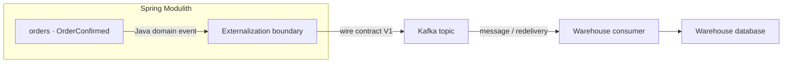
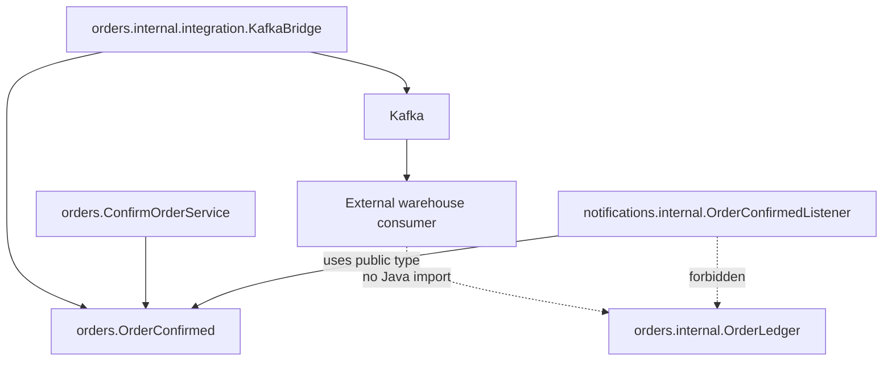
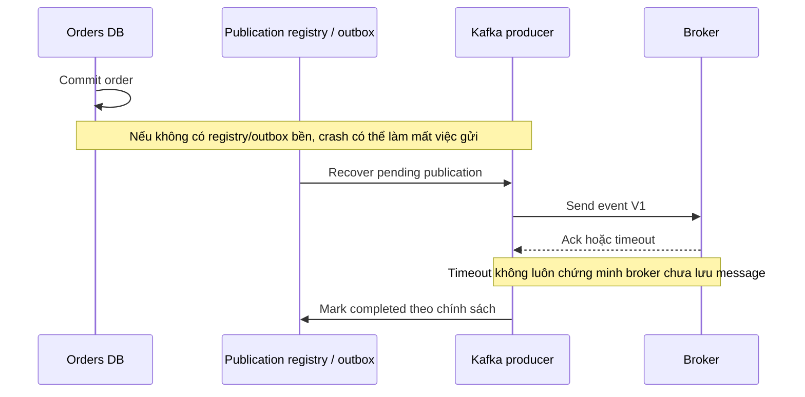
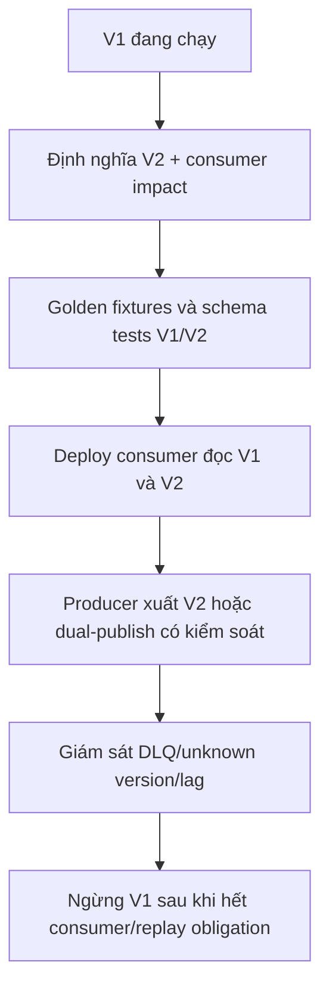
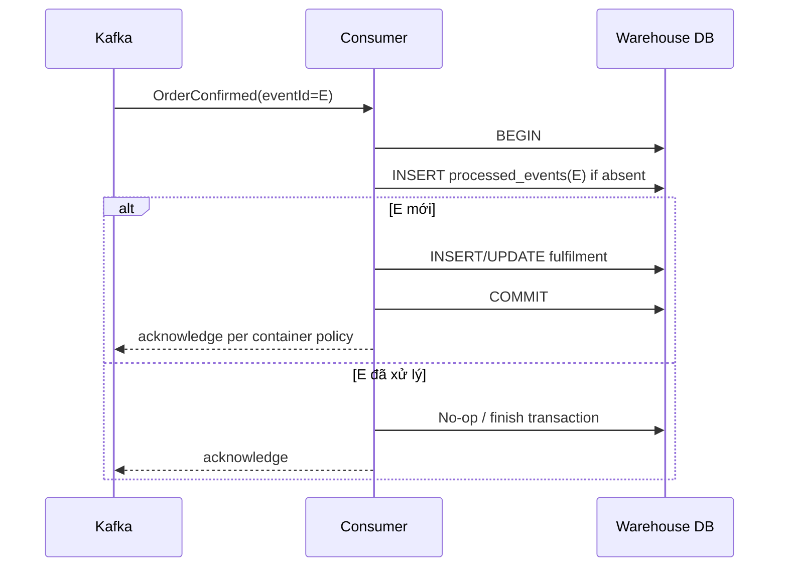

# Hợp đồng externalized event với consumer

## 1. Khi domain event đúng nhưng consumer ngoài JVM vẫn lỗi

Giả sử ứng dụng **Spring Modulith** có module `orders` phát `OrderConfirmed` sau khi xác nhận đơn. Trong cùng JVM, module `notifications` có thể lắng nghe event bằng một Java method nhận `OrderConfirmed`. Nhưng một hệ thống kho hàng deploy độc lập nhận sự kiện qua Kafka lại không đọc Java object trực tiếp: nó nhận **bytes/message** với tên, schema, payload, key, header và quy tắc delivery.

Một thay đổi tưởng như vô hại có thể làm consumer lỗi:

- Developer đổi tên Java record rồi dùng tên class làm event type trên wire.
- Field `totalMinor` bị đổi sang `totalAmount`; test `PublishedEvents` vẫn xanh.
- Spring callback gọi `KafkaTemplate.send(...)` nhưng producer chưa nhận broker acknowledgement.
- Consumer nhận lại cùng event sau restart và tạo hai phiếu xuất kho.
- Producer phát V2 trước khi consumer có reader V2.
- Module test `orders` xanh, nhưng Kafka route/topic hoặc serializer trong profile production sai.

Những vấn đề này chỉ có thể xử lý đúng khi xem **externalized event là một API contract giữa producer và consumer**, có owner, version, nghĩa nghiệp vụ và phép kiểm chứng độc lập.

Bài học thuộc chương **Architectural contracts** trong `SPRING_MODULITH_VERIFICATION_TESTING`. Đích học phần là kiểm chứng ranh giới module bằng `ApplicationModules`, thực hành `@ApplicationModuleTest`, kiểm thử sự kiện, dữ liệu, tích hợp và áp dụng quality gate CI. Riêng bài này tập trung vào **ranh giới từ application module trong JVM đến consumer bên ngoài JVM**.

**Điểm cần nhớ:** gọi `ApplicationEventPublisher.publishEvent(...)` không đồng nghĩa message đã được serialize đúng, broker nhận thành công hoặc consumer xử lý đúng một lần.

## 2. Ba lớp hợp đồng của một externalized event



| Lớp | Đối tượng | Kiểm chứng thích hợp |
| --- | --- | --- |
| **Module architecture** | Ai sở hữu event, module nào được import public type, có internal dependency/cycle không? | `ApplicationModules.verify()` |
| **Domain publication** | Use case phát event khi nào, phát payload nào, không phát khi lỗi nào? | `@ApplicationModuleTest` + `PublishedEvents` |
| **External producer/consumer contract** | Name, schema/version, JSON/Avro bytes, topic/key, compatibility, retries, idempotency | Mapper/schema tests, consumer tests, broker/database integration |

Không được đánh đồng các lớp. `ApplicationModules.verify()` phân tích dependency code trong ứng dụng, **không biết consumer Python/Go/Java ở repository khác đọc JSON schema nào**. `PublishedEvents` quan sát event ở Spring context, **không thay producer acknowledgement hoặc consumer processing assertion**.

## 3. Phân biệt các tên: Java type, logical type, schema và destination

Một domain event có thể có nhiều tên cùng lúc.

| Giá trị | Ví dụ | Phạm vi ổn định |
| --- | --- | --- |
| Java class | `com.example.shop.orders.OrderConfirmed` | Caller/listener Java trong cùng codebase |
| Logical event type | `shop.orders.order-confirmed` | Consumer phân loại business event |
| Schema identity | `OrderConfirmedPayloadV1` | Serialization và compatibility registry |
| Schema version | `1` | Reader/writer contract trên wire |
| Kafka topic | `shop.order-events.v1` | Subscription, retention, ACL, routing |
| Kafka key | `ORD-1001` | Partitioning và thứ tự theo aggregate, nếu cấu hình nhất quán |
| Event ID | UUID của **một lần xác nhận logic** | Replay/deduplication/trace |
| Aggregate ID | `ORD-1001` | Order identity; không thay event ID |
| Correlation ID | ID của luồng yêu cầu nghiệp vụ | Quan sát liên kết nhiều bước |

**Không bắt các tên phải giống nhau.** Refactor package Java có thể hợp lệ khi external logical type và schema vẫn giữ nguyên; đổi topic hoặc logical type có thể breaking dù Java class không đổi.

Đừng tự động dùng `event.getClass().getName()` làm external event type nếu consumer deploy độc lập. Đó là cách biến một refactor package Java thành breaking change ngoài JVM.

## 4. Event contract card: thiết kế trước khi gửi message

Ví dụ **hợp đồng externalized `OrderConfirmed` V1**:

| Mục | Cam kết |
| --- | --- |
| Producer owner | Application module `orders` |
| Consumer | Warehouse fulfillment service và các consumer đã đăng ký |
| Business fact | Một order được xác nhận theo quy tắc nghiệp vụ, không chỉ nhận HTTP request |
| Java domain type | `orders.OrderConfirmed` |
| Wire logical type | `shop.orders.order-confirmed` |
| Current wire version | `1` |
| Destination | Kafka `shop.order-events.v1` (cấu hình sản phẩm ví dụ) |
| Message key | `orderId` |
| Event identity | `eventId` dạng UUID; **giữ nguyên khi retry cùng event** |
| Event time | `occurredAt` UTC, ISO-8601 |
| Payload V1 | `orderId`, `currency`, `totalMinor` |
| Đơn vị tiền | `totalMinor` là số nguyên theo đơn vị tiền được quy định; ví dụ `VND` |
| Precondition publish | Order đã đi qua validation và thao tác xác nhận trong transaction nguồn |
| Delivery | Consumer phải **chịu được duplicate**; không giả định exactly-once end-to-end |
| Ordering | Xác định có yêu cầu thứ tự theo order không; không hứa global ordering |
| Version policy | Đổi không tương thích cần V2/migration; giữ fixture V1 |
| Invalid message | Validate; unsupported version đưa tới policy reject/DLQ thay vì retry vô hạn |
| Sensitive data | Không phát PII/payment secret hoặc entity JPA khi không cần |
| Bằng chứng | Architecture, publication, mapper/schema, producer/consumer, persistence/replay tests |

Các lựa chọn trên là **đặc tả của hệ thống ví dụ**, không phải default do Spring Modulith tự tạo. Trong dự án thực, phải ghi rõ owner của schema, thời gian hỗ trợ consumer V1, retention và kênh cảnh báo.

### Những điều ngoài phạm vi contract V1

Thông điệp này **không tự hứa** đã gửi email, đã xuất kho, đã thu tiền hay đã giao hàng. Một consumer không được suy từ `OrderConfirmed` rằng có thể bỏ qua quyền kiểm tra, tồn kho hoặc state machine riêng của nó.

## 5. Hợp đồng domain event khác hợp đồng message trên wire

| Domain event trong JVM | External message |
| --- | --- |
| Thường biểu diễn bằng Java record/class | Có thể là JSON, Avro, Protobuf |
| Listener Java có type được compiler kiểm tra | Consumer có thể deploy bằng ngôn ngữ khác |
| Package/method refactor gây ảnh hưởng Java callers | Field/name/version/route thay đổi gây ảnh hưởng consumer |
| `ApplicationEventPublisher` phát trong Spring context | Producer adapter serialize và gửi transport |
| `PublishedEvents` quan sát việc publish | Broker/consumer integration quan sát delivery và handling |
| Spring transaction phase ảnh hưởng listener | Còn cần ack, retention, replay, DLQ, idempotency |

Sự tách lớp này cho phép sửa domain model mà không bắt consumer Kafka cập nhật theo mọi lần refactor.

Nếu chỉ có in-process listener, việc thiết kế một bộ external schema/registry có thể không cần thiết. Nhưng một khi có consumer deploy độc lập, **wire contract phải được xem như API công khai dài hạn**.

## 6. Kiến trúc ví dụ: orders xuất event, warehouse ở bên ngoài

```text
com.example.shop/
├── ShopApplication.java
├── orders/
│   ├── OrderConfirmed.java                   // public domain event
│   ├── ConfirmOrderService.java
│   └── internal/
│       ├── OrderLedger.java                 // persistence port
│       ├── persistence/                      // production adapter
│       └── integration/
│           ├── OrderConfirmedPayloadV1.java
│           ├── ExternalEvent.java
│           ├── OrderConfirmedWireMapper.java
│           └── KafkaOrderConfirmedBridge.java
├── catalog/
│   └── CatalogLookup.java
└── notifications/
    └── internal/
        └── OrderConfirmedListener.java

Warehouse service (ứng dụng độc lập, minh họa)
└── consumer/
    ├── OrderConfirmedKafkaConsumer.java
    ├── FulfillmentUseCase.java
    └── ProcessedEventRepository.java
```

Trong mô hình Spring Modulith mặc định phổ biến, `orders`, `catalog` và `notifications` là các application module, còn `orders.internal.integration` vẫn **thuộc module `orders`**. Không tạo application module mới chỉ vì tên package là `integration`.

### Hướng phụ thuộc



Module nhận trong cùng JVM có thể import event type công khai của `orders`; application ngoài JVM dùng **schema và payload**, không import implementation `orders.internal`. Một consumer ngoài JVM không được tự đọc bảng nội bộ của `orders` thay vì tuân thủ event contract.

## 7. Khai báo quyền phụ thuộc giữa application modules

Nếu `notifications` chỉ cần public event của `orders`, có thể khai báo:

```java
// src/main/java/com/example/shop/notifications/package-info.java
@org.springframework.modulith.ApplicationModule(
    allowedDependencies = "orders"
)
package com.example.shop.notifications;
```

Ở đây event `OrderConfirmed` đặt tại base package `orders`, thuộc API mặc định. Nếu chuyển event sang `orders.events`, cần công bố named interface một cách có chủ đích, chẳng hạn:

```java
// Phương án thay thế: orders.events/package-info.java
@org.springframework.modulith.NamedInterface("events")
package com.example.shop.orders.events;
```

Sau đó consumer Java có thể được giới hạn quyền truy cập tới `orders::events`. **Không đồng thời coi hai vị trí event là cùng một ví dụ source code**; chuyển package sẽ đòi sửa import và có thể phá compile-time API của consumer JVM.

### Architecture test

```java
// src/test/java/com/example/shop/ModuleArchitectureTest.java
package com.example.shop;

import org.junit.jupiter.api.Test;
import org.springframework.modulith.core.ApplicationModules;

class ModuleArchitectureTest {

    @Test
    void verifiesEventOwnershipAndModuleBoundaries() {
        ApplicationModules.of(ShopApplication.class).verify();
    }
}
```

`ShopApplication` là class `@SpringBootApplication` ở `com.example.shop`. Bài test phát hiện những quan hệ dependency trái mô hình, nhưng **không kiểm tra external topic, JSON schema hoặc consumer version**. Cần thêm các gate khác.

## 8. Public domain event do orders sở hữu

```java
// src/main/java/com/example/shop/orders/OrderConfirmed.java
package com.example.shop.orders;

import java.time.Instant;
import java.util.UUID;

public record OrderConfirmed(
    UUID eventId,
    String orderId,
    String currency,
    long totalMinor,
    Instant occurredAt
) {
}
```

Ý nghĩa:

- `eventId` định danh **một sự kiện logic**; khi publish lại/replay cùng event, giữ ID cũ.
- `orderId` định danh aggregate. Một order có thể có nhiều event ở nhiều mốc, nên không thay `eventId` bằng `orderId` trong mọi tình huống dedup.
- `totalMinor` không phải `double` để tránh sai lệch tiền tệ do floating point.
- `occurredAt` là **thời điểm sự kiện xảy ra**, không nhất thiết là thời điểm broker nhận.

**Lưu ý production:** nếu service tạo `UUID.randomUUID()` mỗi lần caller gửi lại lệnh xác nhận, cùng một business operation có thể tạo nhiều event ID. Production cần lưu event identity/unique state transition hoặc dùng outbox/idempotency của lệnh, không chỉ dựa vào một UUID mới trong method.

## 9. Port lưu order: interface nội bộ không phải API xuyên module

```java
// src/main/java/com/example/shop/orders/internal/OrderLedger.java
package com.example.shop.orders.internal;

public interface OrderLedger {

    void confirm(
        String orderId, String currency, long totalMinor);
}
```

`OrderLedger` được khai báo Java `public` để các class trong package `orders` hoặc test cần tham chiếu. Nhưng vì nằm ở `orders.internal`, **nó không phải API được các module khác phép dùng** theo quy tắc mặc định.

Một implementation production có thể dùng JPA/JDBC trong `orders.internal.persistence`. Hợp đồng ở đây giả định `confirm(...)` ghi trạng thái của một order; unique key, transaction và concurrency protection sẽ cần integration tests riêng.

## 10. Service nguồn: publish trong transaction, không gửi Kafka trực tiếp

```java
// src/main/java/com/example/shop/orders/ConfirmOrderService.java
package com.example.shop.orders;

import com.example.shop.orders.internal.OrderLedger;
import java.time.Instant;
import java.util.UUID;
import org.springframework.context.ApplicationEventPublisher;
import org.springframework.stereotype.Service;
import org.springframework.transaction.annotation.Transactional;

@Service
public class ConfirmOrderService {

    private final OrderLedger ledger;
    private final ApplicationEventPublisher events;

    public ConfirmOrderService(
            OrderLedger ledger,
            ApplicationEventPublisher events) {
        this.ledger = ledger;
        this.events = events;
    }

    @Transactional
    public void confirm(
            String orderId, String currency, long totalMinor) {

        if (orderId == null || orderId.isBlank()
                || !"VND".equals(currency)
                || totalMinor <= 0) {
            throw new IllegalArgumentException(
                "Invalid confirmed order");
        }

        ledger.confirm(orderId, currency, totalMinor);

        events.publishEvent(new OrderConfirmed(
            UUID.randomUUID(),
            orderId,
            currency,
            totalMinor,
            Instant.now()));
    }
}
```

Giải thích **ranh giới trách nhiệm**:

1. `ConfirmOrderService` biết nghiệp vụ xác nhận order, không phải Kafka topic.
2. `ledger.confirm(...)` là thao tác thuộc module `orders`.
3. `ApplicationEventPublisher` công bố domain event trong Spring context.
4. `@Transactional` chỉ có hiệu lực khi method được gọi **qua Spring-managed proxy**, có transaction manager đúng resource.
5. Khi method đang trong transaction, gọi `publishEvent(...)` **không đồng nghĩa commit thành công**.
6. Class chưa có logic chống gọi `confirm(...)` hai lần hoặc chống tạo hai event cho cùng trạng thái. Đây là bài học về external contract, không phải implementation production hoàn chỉnh.

Trong production, event thường cần đại diện cho **state transition đã được chấp nhận**. Hãy kiểm tra constraint transaction, concurrency và idempotency của lệnh xác nhận, tránh phát `OrderConfirmed` khi trạng thái không thực sự thay đổi.

### Vì sao không gọi Kafka trực tiếp tại đây?

```java
// Anti-pattern nếu yêu cầu "chỉ phát khi order đã commit".
ledger.confirm(orderId, currency, totalMinor);
kafkaTemplate.send(topic, orderId, payload);
```

Nếu database transaction rollback sau lời gọi Kafka, consumer ngoài có thể nhận event về order **chưa hề commit**. Đồng thời một Kafka send không tự tham gia atomic transaction của JPA. Nên tách publication policy/adapter khỏi use case.

## 11. Module test: chứng minh điều kiện publish và payload domain

`@ApplicationModuleTest` của `orders` xác nhận logic nguồn ở mức module. Để cô lập persistence khi chỉ test domain publication, có thể override `OrderLedger` bằng Mockito bean:

```java
// src/test/java/com/example/shop/orders/OrderPublicationContractTest.java
package com.example.shop.orders;

import com.example.shop.orders.internal.OrderLedger;
import org.junit.jupiter.api.Test;
import org.springframework.beans.factory.annotation.Autowired;
import org.springframework.modulith.test.ApplicationModuleTest;
import org.springframework.modulith.test.PublishedEvents;
import org.springframework.test.context.bean.override.mockito.MockitoBean;

import static org.assertj.core.api.Assertions.assertThat;
import static org.assertj.core.api.Assertions.assertThatThrownBy;
import static org.mockito.Mockito.verify;
import static org.mockito.Mockito.verifyNoInteractions;

@ApplicationModuleTest
class OrderPublicationContractTest {

    @Autowired
    ConfirmOrderService orders;

    @MockitoBean
    OrderLedger ledger;

    @Test
    void publishesDomainEventWithExpectedFields(
            PublishedEvents events) {

        orders.confirm("ORD-1001", "VND", 125000L);

        verify(ledger).confirm(
            "ORD-1001", "VND", 125000L);

        assertThat(events.ofType(OrderConfirmed.class))
            .singleElement()
            .satisfies(event -> {
                assertThat(event.eventId()).isNotNull();
                assertThat(event.orderId())
                    .isEqualTo("ORD-1001");
                assertThat(event.currency()).isEqualTo("VND");
                assertThat(event.totalMinor())
                    .isEqualTo(125000L);
                assertThat(event.occurredAt()).isNotNull();
            });
    }

    @Test
    void invalidOrderDoesNotWriteOrPublish(
            PublishedEvents events) {

        assertThatThrownBy(() ->
            orders.confirm("", "VND", 125000L))
            .isInstanceOf(IllegalArgumentException.class);

        verifyNoInteractions(ledger);
        assertThat(events.ofType(OrderConfirmed.class))
            .isEmpty();
    }
}
```

**Điều kiện chạy:** `ConfirmOrderService` được gắn `@Transactional`, vì vậy test context cần `PlatformTransactionManager` tương thích (chẳng hạn DataSource/JPA test infrastructure). Bài code trên chỉ mô phỏng `OrderLedger`, **không** chứng minh database commit. Đối với module test chỉ kiểm logic, có thể cung cấp transaction manager test phù hợp; đối với transaction/DB contract phải dùng adapter thật. Nếu ứng dụng có JPA auto-configuration yêu cầu schema, cần chuẩn bị test datasource hoặc điều chỉnh cấu hình test có chủ đích.

**Lưu ý phiên bản:** `@MockitoBean` có trong Spring Framework 6.2+; trên Spring Boot cũ có thể cần `@MockBean` tương thích. API `PublishedEvents` thuộc Spring Modulith Test, chọn version tương thích với stack.

### Test này chưa chứng minh những gì?

- Java event đã được externalize.
- Producer đã tạo đúng `type`/`schemaVersion`.
- Kafka broker đã nhận hoặc lưu message.
- Transaction nguồn đã commit thành công nếu test dùng mock ledger/rollback.
- Consumer warehouse đã đọc message.
- Replay không tạo side effect trùng.

Những điều đó cần **external contract tests và integration tests**.

## 12. Thiết kế một envelope external rõ ràng

Một message JSON V1 minh họa:

```json
{
  "eventId": "1b2bb5da-6de6-4279-b92b-a3c8b9052841",
  "type": "shop.orders.order-confirmed",
  "schemaVersion": 1,
  "source": "urn:shop:orders",
  "aggregateId": "ORD-1001",
  "occurredAt": "2026-11-26T03:00:00Z",
  "data": {
    "orderId": "ORD-1001",
    "currency": "VND",
    "totalMinor": 125000
  }
}
```

Đây là **custom envelope của ứng dụng ví dụ**, không phải JSON mặc định do Spring Modulith tự tạo. Nếu chọn **CloudEvents**, các thuộc tính bắt buộc, tên trường như `id`, `source`, `specversion`, `type`, `time`, `data` và mapping version phải tuân thủ đặc tả CloudEvents; không gọi envelope trên là CloudEvents chỉ vì có vài trường trùng.

### Tách metadata và business payload

| Nhóm | Field | Consumer dùng để làm gì? |
| --- | --- | --- |
| Identity | `eventId` | Dedup và correlation |
| Classification | `type` | Chọn handler đúng business fact |
| Schema | `schemaVersion` | Chọn reader/migration đúng version |
| Producer owner | `source` | Phân biệt nguồn khi nhiều hệ thống dùng chung event type |
| Ordering key | `aggregateId` | Group/partition theo đơn nếu contract yêu cầu |
| Time | `occurredAt` | Event time, replay và audit |
| Business data | `data.orderId` | Xác định order |
| Business data | `data.currency`, `data.totalMinor` | Đơn vị và giá trị nghiệp vụ |

Không để consumer suy `schemaVersion` từ tên Java package hoặc từ `occurredAt`. Version phải được công bố rõ theo chính sách tổ chức.

## 13. Mapping từ domain event sang wire contract V1

DTO external đặt trong adapter nội bộ của module `orders`; consumer ngoài JVM không import những class này.

```java
// src/main/java/com/example/shop/orders/internal/integration/OrderConfirmedPayloadV1.java
package com.example.shop.orders.internal.integration;

public record OrderConfirmedPayloadV1(
    String orderId,
    String currency,
    long totalMinor
) {
}
```

```java
// src/main/java/com/example/shop/orders/internal/integration/ExternalEvent.java
package com.example.shop.orders.internal.integration;

import java.time.Instant;

public record ExternalEvent<T>(
    String eventId,
    String type,
    int schemaVersion,
    String source,
    String aggregateId,
    Instant occurredAt,
    T data
) {
}
```

Mapper có tên và version **tường minh**, không phụ thuộc Java class name:

```java
// src/main/java/com/example/shop/orders/internal/integration/OrderConfirmedWireMapper.java
package com.example.shop.orders.internal.integration;

import com.example.shop.orders.OrderConfirmed;
import org.springframework.stereotype.Component;

@Component
public class OrderConfirmedWireMapper {

    public static final String TYPE =
        "shop.orders.order-confirmed";

    public static final int VERSION = 1;

    public ExternalEvent<OrderConfirmedPayloadV1> toV1(
            OrderConfirmed event) {

        var data = new OrderConfirmedPayloadV1(
            event.orderId(),
            event.currency(),
            event.totalMinor());

        return new ExternalEvent<>(
            event.eventId().toString(),
            TYPE,
            VERSION,
            "urn:shop:orders",
            event.orderId(),
            event.occurredAt(),
            data);
    }
}
```

**Bất biến trọng yếu:** mapper **không tạo event ID mới**, không tự lấy `Instant.now()` trong mỗi lần retry và không thay giá trị `totalMinor`. Cùng một domain event được map lại nhiều lần phải mang cùng metadata/event identity. Đây là nền tảng để dedup/replay.

### Vì sao mapper là một boundary tốt?

- Đổi Java record/implementation nội bộ vẫn có thể giữ external schema V1.
- Producer có chỗ rõ ràng để kiểm tra type/version/field/unit.
- Có thể tạo mapper V2 song song V1 khi breaking change.
- Không lộ JPA entity, lazy proxy, token hoặc DTO internal ra consumer.
- Có thể unit test serialization mà không khởi động Kafka.

## 14. JSON Schema V1 và chính sách field

Một JSON Schema tối giản cho phần `data`:

```json
{
  "$schema": "https://json-schema.org/draft/2020-12/schema",
  "title": "OrderConfirmedPayloadV1",
  "type": "object",
  "required": ["orderId", "currency", "totalMinor"],
  "properties": {
    "orderId": {
      "type": "string",
      "minLength": 1
    },
    "currency": {
      "type": "string",
      "enum": ["VND"]
    },
    "totalMinor": {
      "type": "integer",
      "minimum": 1
    }
  },
  "additionalProperties": true
}
```

`additionalProperties: true` tạo khả năng một validator V1 **không từ chối field mới**, nhưng nó không bảo đảm mọi consumer JSON đều bỏ qua unknown properties. Một consumer dùng strict deserializer hoặc exhaustive enum có thể vẫn bị lỗi.

Schema còn cần một đặc tả cho envelope: `eventId` hợp lệ, `type` cố định, `schemaVersion` phù hợp, timestamp UTC. Ví dụ trên giới hạn `VND` **chỉ vì domain mẫu**; hệ thống đa tiền tệ cần định nghĩa quy tắc minor unit/decimal precision cho từng currency.

### Contract không thể được thay bằng validation schema

Schema có thể xác nhận `totalMinor` là integer dương, nhưng không thể tự biết **125000** được hiểu là đồng hay nghìn đồng sau refactor. **Semantic compatibility** cần ví dụ giá trị, bài test nghiệp vụ và review contract.

## 15. Producer contract test: kiểm tra cả mapper lẫn JSON bytes

Tạo một fixture cố định thay vì UUID/clock ngẫu nhiên:

```java
// src/test/java/com/example/shop/orders/OrderConfirmedWireContractTest.java
package com.example.shop.orders;

import com.example.shop.orders.internal.integration.OrderConfirmedWireMapper;
import com.fasterxml.jackson.databind.ObjectMapper;
import com.fasterxml.jackson.databind.SerializationFeature;
import com.fasterxml.jackson.datatype.jsr310.JavaTimeModule;
import java.time.Instant;
import java.util.UUID;
import org.junit.jupiter.api.Test;

import static org.assertj.core.api.Assertions.assertThat;

class OrderConfirmedWireContractTest {

    private final OrderConfirmedWireMapper mapper =
        new OrderConfirmedWireMapper();

    private final ObjectMapper json =
        new ObjectMapper()
            .registerModule(new JavaTimeModule())
            .disable(
                SerializationFeature.WRITE_DATES_AS_TIMESTAMPS);

    private static OrderConfirmed sample() {
        return new OrderConfirmed(
            UUID.fromString(
                "1b2bb5da-6de6-4279-b92b-a3c8b9052841"),
            "ORD-1001",
            "VND",
            125000L,
            Instant.parse("2026-11-26T03:00:00Z"));
    }

    @Test
    void keepsLogicalNameVersionAndBusinessFields()
            throws Exception {

        var external = mapper.toV1(sample());
        var tree =
            json.readTree(json.writeValueAsString(external));

        assertThat(tree.path("eventId").asText())
            .isEqualTo(
                "1b2bb5da-6de6-4279-b92b-a3c8b9052841");
        assertThat(tree.path("type").asText())
            .isEqualTo("shop.orders.order-confirmed");
        assertThat(tree.path("schemaVersion").asInt())
            .isEqualTo(1);
        assertThat(tree.path("aggregateId").asText())
            .isEqualTo("ORD-1001");
        assertThat(tree.path("occurredAt").asText())
            .isEqualTo("2026-11-26T03:00:00Z");
        assertThat(tree.path("data").path("currency").asText())
            .isEqualTo("VND");
        assertThat(tree.path("data").path("totalMinor").asLong())
            .isEqualTo(125000L);
    }

    @Test
    void remappingSameEventKeepsEventIdentity() {
        var first = mapper.toV1(sample());
        var second = mapper.toV1(sample());

        assertThat(first.eventId())
            .isEqualTo(second.eventId());
        assertThat(first.occurredAt())
            .isEqualTo(second.occurredAt());
    }
}
```

Ví dụ dùng **Jackson 2 API** phổ biến trong Spring Boot 3.x (`com.fasterxml.jackson...`). Các stack Spring Boot/Jackson khác có thể có namespace/configuration khác; phải chọn API theo dependency của dự án.

Unit test tự tạo `ObjectMapper` có Java Time module để serialize `Instant`. Khi ứng dụng dùng Jackson qua Spring Boot, nên bổ sung test dùng **ObjectMapper cấu hình như production**; nếu custom serializer, naming strategy hay header làm khác wire format, test ở trên chưa bao phủ.

### Điều test nên khóa và không nên khóa

Nên khóa: field names, types, value, type/version, units, timestamp policy, source/aggregate identity, required fields.

Không nên khóa thứ tự key trong JSON object nếu consumer parse theo tên field và contract không cam kết thứ tự đó. So sánh **JSON tree/JSON Schema** thường bền vững hơn so sánh byte string có thứ tự thuộc tính ngẫu nhiên.

## 16. Externalization adapter: send sau commit nhưng chưa chắc delivery bền

Một cách **tự viết adapter** dùng Spring Kafka và `@TransactionalEventListener`:

```java
// src/main/java/com/example/shop/orders/internal/integration/KafkaOrderConfirmedBridge.java
package com.example.shop.orders.internal.integration;

import com.example.shop.orders.OrderConfirmed;
import com.fasterxml.jackson.core.JsonProcessingException;
import com.fasterxml.jackson.databind.ObjectMapper;
import org.springframework.beans.factory.annotation.Value;
import org.springframework.context.annotation.Profile;
import org.springframework.kafka.core.KafkaTemplate;
import org.springframework.stereotype.Component;
import org.springframework.transaction.event.TransactionPhase;
import org.springframework.transaction.event.TransactionalEventListener;

@Component
@Profile("external-messaging")
public class KafkaOrderConfirmedBridge {

    private final OrderConfirmedWireMapper mapper;
    private final ObjectMapper json;
    private final KafkaTemplate<String, String> kafka;
    private final String topic;

    public KafkaOrderConfirmedBridge(
            OrderConfirmedWireMapper mapper,
            ObjectMapper json,
            KafkaTemplate<String, String> kafka,
            @Value("${shop.order-events.topic}") String topic) {
        this.mapper = mapper;
        this.json = json;
        this.kafka = kafka;
        this.topic = topic;
    }

    @TransactionalEventListener(
        phase = TransactionPhase.AFTER_COMMIT)
    public void afterCommit(OrderConfirmed event) {
        var external = mapper.toV1(event);

        try {
            String body = json.writeValueAsString(external);
            kafka.send(topic, event.orderId(), body);
        } catch (JsonProcessingException ex) {
            throw new IllegalStateException(
                "Cannot serialize OrderConfirmed V1", ex);
        }
    }
}
```

**Đây là adapter minh họa, không phải giải pháp durable production hoàn chỉnh.** Nó cố ý cho thấy các ranh giới:

1. `@Profile("external-messaging")` yêu cầu profile và Kafka configuration phù hợp trong môi trường tích hợp/production.
2. `@TransactionalEventListener(AFTER_COMMIT)` chỉ được gọi sau transaction nguồn commit thành công; **mặc định không chạy nếu không có transaction**, trừ khi bật `fallbackExecution`. Không bật fallback chỉ để test xanh nếu hợp đồng yêu cầu sau commit.
3. `kafka.send(...)` trả kết quả bất đồng bộ ở những Spring Kafka version phổ biến. Việc method trên kết thúc **không có nghĩa broker đã acknowledge message**.
4. Nếu JVM crash **sau DB commit, trước broker ack**, publication có thể mất hoặc outcome không rõ; phải thêm registry/outbox/recovery phù hợp.
5. Catch ở đây chỉ xử lý lỗi serialize đồng bộ. Lỗi producer/broker bất đồng bộ cần được quan sát qua kết quả send, monitor/retry và recovery policy.
6. Gửi Kafka từ callback hậu commit **không làm DB và Kafka thành distributed transaction nguyên tử**.
7. Adapter production phải có giới hạn retry, logging an toàn, duplicate handling và observability.

Nếu chỉ thay đổi `@TransactionalEventListener` sang `@EventListener` đồng bộ, message có thể được gửi **trước khi transaction nguồn commit**; đó là thay đổi ngữ nghĩa hợp đồng, cần integration test bắt lỗi.

## 17. Dùng cơ chế externalization của Spring Modulith khi phù hợp

Spring Modulith cung cấp khả năng **event externalization** thông qua các module hỗ trợ broker và cấu hình tương ứng trong các phiên bản thư viện thích hợp. Nó giúp ứng dụng chọn sự kiện cần externalize, xác định route/key, có thể áp dụng mapping/serialization và kết hợp với event publication infrastructure.

Tuy nhiên, không nên tuyên bố rằng chỉ cần có `@ApplicationModuleTest` hoặc `ApplicationEventPublisher` thì **mọi domain event tự xuất ra Kafka**. Cần lựa chọn dependency, starter/module broker, cấu hình, event selection và adapter phù hợp. API extension, annotation và DSL externalization có thể khác theo Spring Modulith version; hãy đối chiếu tài liệu cho **version mà dự án đang dùng** trước khi sao chép cấu hình.

Để tránh lẫn lộn, bài này dùng adapter tường minh `KafkaOrderConfirmedBridge` nhằm giải thích **contract trên wire**. Trong dự án production dùng cơ chế externalization tích hợp của Spring Modulith, vẫn cần giữ đủ các test về:

- Event selection: chỉ đúng event được externalize.
- Logical type và schema version không lấy ngẫu nhiên từ Java class.
- Route/key đúng hợp đồng.
- Mapper tạo đúng payload; không lộ internal/JPA entity.
- Transaction phase và eventual delivery/recovery.
- Ack, outstanding publication và idempotency.
- Consumer V1/V2 compatibility.
- Lỗi serialize, lỗi broker và replay.

**Một externalization framework là công cụ thực hiện contract, không phải bản thân contract.**

## 18. Event Publication Registry và cửa sổ lỗi

Sau commit có ba cửa sổ lỗi điển hình:



Spring Modulith Event Publication Registry có thể theo dõi publication tới transactional listeners khi các mô-đun persistence/backend tương ứng được cấu hình. Các cơ chế resubmission/recovery, trạng thái outstanding/completed và cách ghi nhận thành công phụ thuộc phiên bản/cấu hình và loại adapter.

**Không được suy tự động** rằng một listener gọi `kafka.send(...)` bất đồng bộ rồi return thì registry đã chờ broker ack. Nếu completion của listener xảy ra **trước** khi future producer hoàn tất, registry có thể không biểu diễn được lỗi gửi theo đúng điều operator mong đợi. Muốn độ bền cao, phải xác định rõ **điểm nào được coi là publication completed** và kiểm chứng bằng integration test.

### So sánh các mức bảo đảm

| Cơ chế | Giúp gì? | Không tự bảo đảm |
| --- | --- | --- |
| `@TransactionalEventListener(AFTER_COMMIT)` | Không xử lý hậu commit trước transaction commit | Không mất event sau crash |
| Event Publication Registry có backend bền | Theo dõi publication/recovery theo cấu hình | Exactly-once side effect bên consumer |
| Transactional outbox | Ghi intent cùng DB transaction | Producer không gửi duplicate khi retry |
| Kafka producer acknowledgement | Broker nhận theo chính sách producer | Consumer hoàn tất tác động nghiệp vụ |
| Consumer idempotency | Tránh xử lý lặp cùng event theo scope đã thiết kế | Không có lỗi business khác |
| Broker exactly-once features | Một số bảo đảm trong phạm vi Kafka transaction/processing | Atomicity với email/DB ngoài Kafka |

Với những luồng tài chính hoặc fulfilment trọng yếu, cần chọn độ bền theo requirement và **chứng minh qua failure scenarios**, không chỉ qua annotation.

## 19. Consumer không nên import domain Java implementation

Consumer warehouse deploy độc lập có thể viết bằng Java, Kotlin, Go hoặc Python. Contract của nó là **external message**; không nên bắt nó phụ thuộc vào:

- `orders.internal.persistence.OrderEntity`;
- `orders.internal.integration.KafkaOrderConfirmedBridge`;
- `com.example.shop.orders.ConfirmOrderService`;
- Một JAR implementation cùng version với producer chỉ để deserialize JSON.

Chia sẻ Java DTO artifact có thể hợp lý trong một số hệ thống cùng JVM, nhưng khi deploy độc lập, cách này dễ làm producer/internal refactor trở thành nghĩa vụ nâng cấp consumer. Schema registry/golden messages/IDL và compatibility tests thường tạo ranh giới rõ hơn.

### Vì sao không trả JPA entity làm payload?

- Lazy proxy/quan hệ dữ liệu có thể bị serialize ngoài ý định.
- Schema database của module nguồn biến thành public API.
- Dữ liệu riêng tư có thể bị lộ.
- Consumer lệ thuộc vào ORM implementation và lifecycle.
- Migration database khiến consumer lỗi dù business event semantics vẫn ổn định.

Sử dụng DTO external cụ thể như `OrderConfirmedPayloadV1` và mapper có test bảo vệ.

## 20. Consumer phải chọn handler theo type và version

Ví dụ consumer Java dùng Spring Kafka (đây là **ứng dụng độc lập**, không thuộc module `orders`):

```java
// Ví dụ package của warehouse service độc lập.
package com.example.warehouse.consumer;

import com.fasterxml.jackson.databind.JsonNode;
import com.fasterxml.jackson.databind.ObjectMapper;
import java.util.UUID;
import org.springframework.kafka.annotation.KafkaListener;
import org.springframework.stereotype.Component;

@Component
public class OrderConfirmedKafkaConsumer {

    private final ObjectMapper json;
    private final FulfillmentUseCase fulfillment;

    public OrderConfirmedKafkaConsumer(
            ObjectMapper json,
            FulfillmentUseCase fulfillment) {
        this.json = json;
        this.fulfillment = fulfillment;
    }

    @KafkaListener(
        topics = "${warehouse.orders.topic}",
        groupId = "warehouse-order-confirmed")
    public void onMessage(String body) throws Exception {
        JsonNode root = json.readTree(body);

        String type = root.path("type").asText();
        int version =
            root.path("schemaVersion").asInt(-1);

        if (!"shop.orders.order-confirmed".equals(type)) {
            throw new UnsupportedEventContractException(
                "Unexpected type: " + type);
        }

        if (version != 1) {
            throw new UnsupportedEventContractException(
                "Unsupported schemaVersion: " + version);
        }

        UUID eventId = UUID.fromString(
            root.path("eventId").asText());

        JsonNode data = root.path("data");
        String orderId = data.path("orderId").asText();
        String currency = data.path("currency").asText();
        long amount = data.path("totalMinor").asLong(-1);

        if (orderId.isBlank()
                || !"VND".equals(currency)
                || amount <= 0) {
            throw new InvalidEventPayloadException(
                "Invalid OrderConfirmed V1");
        }

        fulfillment.fulfillOnce(
            eventId, orderId, currency, amount);
    }
}
```

`FulfillmentUseCase`, `UnsupportedEventContractException` và `InvalidEventPayloadException` là các kiểu **giả định do consumer sở hữu**, phải định nghĩa và cấu hình error handler/DLQ tương ứng. Ví dụ dùng `JsonNode` để lộ rõ các bước kiểm tra; production nên có schema validation và type-safe reader, tránh `path(...).asText()` ngầm chấp nhận giá trị thiếu/không đúng kiểu.

Để làm production-safe, cũng cần kiểm tra:

- `root` không null (empty/invalid JSON).
- `eventId` là UUID hợp lệ và `aggregateId` khớp `orderId` theo contract.
- Timestamp/UTC, độ dài field, giá trị enum và schema constraints.
- Các trường bắt buộc có đúng JSON type chứ không chỉ convert mặc định.
- Consumer group, offset, error handler và DLQ policy.
- Message đến nhầm topic/type là skip, reject hay DLQ theo **topic contract**.

**Không bắt mọi exception rồi return thành công.** Nếu Kafka container coi method xử lý thành công, message có thể được ack/commit offset và mất cơ hội xử lý đúng.

## 21. Consumer contract test: phải chạy reader thật trên fixture của producer

Một consumer contract có thể test bằng **message V1 cố định** mà producer đã công bố:

```json
{
  "eventId": "1b2bb5da-6de6-4279-b92b-a3c8b9052841",
  "type": "shop.orders.order-confirmed",
  "schemaVersion": 1,
  "source": "urn:shop:orders",
  "aggregateId": "ORD-1001",
  "occurredAt": "2026-11-26T03:00:00Z",
  "data": {
    "orderId": "ORD-1001",
    "currency": "VND",
    "totalMinor": 125000
  }
}
```

Các test phía consumer cần chứng minh:

| Case | Input | Kết quả mong muốn |
| --- | --- | --- |
| `CON-001` | V1 hợp lệ | Gọi fulfilment đúng một business operation |
| `CON-002` | Thiếu `orderId` | Reject/DLQ, không tạo fulfilment |
| `CON-003` | `totalMinor` âm hoặc sai type | Validation error, không ghi dữ liệu |
| `CON-004` | `schemaVersion=2` khi chỉ hỗ trợ V1 | Unsupported version được phân loại, không retry vô hạn |
| `CON-005` | Unknown `type` | Tuân theo contract topic: filter hay DLQ |
| `CON-006` | V1 thêm field optional | Reader cũ vẫn chấp nhận nếu compatibility policy yêu cầu |
| `CON-007` | Event đã xử lý cùng `eventId` | Không nhân đôi business side effect |
| `CON-008` | Event cũ từ archive | Reader mới vẫn đọc được |
| `CON-009` | Timestamp không đúng định dạng | Reject/alert theo schema |
| `CON-010` | Hai event khác nhau cho cùng order | Xử lý theo state machine/ordering, không chỉ event ID |

**Không viết consumer contract test bằng chính mock của consumer.** Hãy dùng parser, validator và handler thực của consumer, với fake port nếu cần cô lập database/remote adapter. Bổ sung integration test thật khi xác minh idempotency và persistence.

## 22. Version compatibility là một ma trận, không phải số tự tăng

Giả sử nhà sản xuất thêm `salesChannel` cho V2. Cần phân biệt:

- **Consumer mới đọc event V1 cũ** khi replay lịch sử.
- **Consumer cũ đọc event mới** trong rollout không đồng thời.
- **Schema syntactic compatibility**: field, type, null/default/unknown.
- **Semantic compatibility**: currency/unit/meaning/condition publish.
- **Routing compatibility**: topic, header, logical type, key.
- **Operational compatibility**: retention, replay, retry, ACL và deploy order.

### Ma trận thay đổi V1

| Thay đổi | Có thể an toàn không? | Điều kiện |
| --- | --- | --- |
| Thêm field optional `salesChannel` | Có thể | Reader cũ bỏ unknown, reader mới xử lý vắng/default |
| Thêm required `customerTier` | Thường breaking | Consumer mới đọc V1 lịch sử sẽ thiếu field |
| Đổi `totalMinor` thành `totalAmount` | Breaking | Consumer đang tìm field cũ |
| Đổi integer thành string | Breaking | Parser/validator khác type |
| Đổi đơn vị tiền mà giữ integer | **Breaking về ngữ nghĩa** | Parse thành công nhưng tính sai |
| Thêm enum value | Có thể breaking | Exhaustive switch/strict validator |
| Thay JSON object property order | Thường không breaking | Reader parse theo field name |
| Đổi `occurredAt` từ UTC ISO sang epoch | Breaking format | Reader không còn parse như cũ |
| Đổi Kafka topic | Breaking về routing | Subscription/ACL/retention thay đổi |
| Đổi `type` nhưng giữ payload | Breaking phân loại | Handler không match logical type |
| Đổi key từ `orderId` sang random UUID | Có thể breaking ordering | Partition theo order không còn ổn định |

Không tuyên bố “thêm optional field luôn an toàn”; nó phụ thuộc deserializer và schema compatibility policy cụ thể. Với Avro/Protobuf, quy tắc reader/writer/default khác JSON; phải dùng tooling theo định dạng đã chọn.

## 23. Migration V1 → V2 khi có breaking change

Một rollout tương thích thường cần:



Khi **dual-publish** cùng một business fact ở V1 và V2:

- Hai message có thể đến theo thứ tự khác nhau.
- Consumer đăng ký cả hai có thể xử lý trùng.
- Giữ stable event identity và xác định rõ `eventId` có dùng chung qua representations không.
- Consumer có thể dedup theo event ID **cho business fact**, nhưng producer/transport có thể cần phân biệt `eventId + version/type` để theo dõi từng representation.
- Nếu V2 đổi semantics đến mức không còn là cùng fact, không dùng cùng identity một cách máy móc.
- Chỉ ngừng V1 sau khi xác nhận consumer và replay/backfill không còn cần nó.

Một schema version không phải version của mỗi Git commit. Cần tăng version khi contract thay đổi theo policy, không tăng chỉ để tránh review thay đổi phá tương thích.

## 24. Kafka key, partition và thứ tự xử lý

Trong Kafka, producer gửi:

```java
kafka.send(
    "shop.order-events.v1",
    event.orderId(),
    encodedJson);
```

Dùng `orderId` làm key có thể giúp các event của **cùng một order** vào cùng partition với partitioner/config phù hợp. Nhưng cần phân biệt:

- Kafka bảo đảm thứ tự bản ghi **trong một partition**, không có global ordering giữa mọi partition/topic.
- Consumer group có thể xử lý nhiều partition song song.
- Thay partition count, custom partitioner hoặc strategy key có thể làm thứ tự cùng aggregate khó giữ qua thời gian nếu không có thiết kế.
- Retry/DLQ có thể làm một event cũ được xử lý sau event mới.
- Duplicate/replay cần kiểm tra sequence/state transition, không chỉ thứ tự arrival.

Nếu warehouse cần sự kiện `OrderConfirmed` trước `OrderCancelled`, contract có thể bổ sung `aggregateVersion` hoặc sequence number do owner kiểm soát. **Timestamp không phải total ordering guarantee**.

### Ví dụ thứ tự đến sai

```text
Producer:
  1. OrderConfirmed(ORD-1001, version=5)
  2. OrderCancelled(ORD-1001, version=6)

Consumer thực tế:
  OrderCancelled đến trước (do replay/retry khác luồng)
  OrderConfirmed đến sau
```

Nếu consumer chỉ áp dụng “message mới nhất nhận được”, nó có thể mở lại order đã hủy. Cần state machine và version check hợp lệ với business contract, không chỉ thêm sleep/delay.

## 25. Event identity và consumer idempotency

Delivery qua broker thường nên được xem là **có thể trùng**. Một consumer nhận event, ghi fulfilment thành công, sau đó crash trước khi commit offset. Sau restart, broker có thể phát lại cùng event.

Consumer cần lưu trạng thái theo identity:

```text
processed_events
  consumer_name      VARCHAR
  event_id           UUID
  processed_at       TIMESTAMP
  PRIMARY KEY (consumer_name, event_id)
```

Dùng cặp `consumer_name + event_id` nếu nhiều consumer logic cùng dùng storage; một event có thể hợp lệ cho mỗi consumer khác nhau.

### Flow idempotent cho side effect ở cùng database



Với PostgreSQL có thể sử dụng unique constraint và một thao tác insert atomic như:

```sql
INSERT INTO processed_events (consumer_name, event_id, processed_at)
VALUES ('warehouse-fulfillment', :eventId, CURRENT_TIMESTAMP)
ON CONFLICT (consumer_name, event_id) DO NOTHING;
```

**Yêu cầu của thiết kế:** việc claim event và cập nhật fulfilment phải được quản lý trong **cùng transaction DB** phù hợp. Nếu insert trả 0 hàng, đó là duplicate đã xử lý; nếu business action thất bại, transaction cần rollback cả claim. Không chỉ dùng `existsById(...)` rồi `save(...)` trong hai bước không đồng bộ: race giữa hai consumer có thể làm trùng side effect.

### Khi side effect là email/HTTP bên ngoài

Transaction DB không thể tự rollback email đã gửi. Nếu consumer gửi email rồi crash trước khi lưu `processed_events`, retry có thể gửi lần hai. Cần remote idempotency key, outbox cho intent, state machine hoặc một cơ chế đối soát phù hợp. **Đừng khẳng định exactly-once end-to-end chỉ vì có unique index**.

## 26. Consumer error contract: retryable, permanent và outcome unknown

| Lỗi phía consumer | Nhóm | Policy ví dụ |
| --- | --- | --- |
| JSON không parse được | Permanent format error | DLQ/quarantine, không retry vô hạn |
| Unsupported schema version | Permanent contract mismatch | Alert/schema migration/DLQ |
| Thiếu required field | Permanent payload error | Reject/DLQ; không fulfil |
| Currency/amount trái invariant | Semantic contract error | Reject, owner điều tra |
| DB connection tạm mất | Có thể transient | Bounded retry + backoff |
| Deadlock/serialization conflict đã rollback | Có thể retry transaction | Không tạo external side effect trước rollback |
| Remote warehouse API timeout sau-send | Outcome unknown | Status lookup/idempotency, không retry mù |
| Duplicate `eventId` đã xử lý | Expected redelivery | Idempotent no-op |
| Event out-of-order | State/ordering conflict | Buffer/reconcile hoặc reject theo policy |
| Permission/ACL sai | Operational/configuration | Alert, không hot retry vô hạn |

Spring Kafka có error handler/recoverer và hỗ trợ dead-letter routing tùy phiên bản/cấu hình. **Chỉ ném exception không tự bảo đảm message đi DLQ**; phải cấu hình số lần retry, backoff, exception classification, DLT topic/producer và quy tắc commit offset.

Consumer không nên:

```java
try {
    handle(message);
} catch (Exception ignored) {
    // Trả về thành công -> broker có thể coi đã xử lý.
}
```

Mẫu này có thể biến mất message một cách im lặng. Ngược lại, retry vô hạn unsupported version sẽ làm backlog tăng mà không sửa dữ liệu.

## 27. Contract tiêu thụ không kết thúc ở việc deserialize

Một consumer hợp lệ cần trả lời:

1. `OrderConfirmed` mang business fact nào?
2. Consumer có quyền tạo fulfilment khi order đã confirmed nhưng chưa paid không?
3. Consumer được xử lý lại một event không? Hành vi idempotent là gì?
4. Khi nhận cancellation trước confirmation, điều gì xảy ra?
5. Consumer có cho phép replay lịch sử mà không phát lại tác động ngoài mong muốn?
6. Một `orderId` có thể có nhiều version event hợp lệ không?
7. Khi thiếu data do producer mới đổi contract, phải alert ai?
8. Thời gian giữ event và hỗ trợ V1 là bao lâu?
9. Có thông tin nhạy cảm trong payload hay log không?
10. Điều gì là “xử lý xong”: DB commit, gửi HTTP thành công hay broker ack?

**Deserialize thành công mới là điều kiện cần.** Semantic correctness và side effect correctness phải được kiểm tra bằng contract tests phía consumer.

## 28. Producer-driven và consumer-driven contract testing

Có hai cách bổ trợ nhau:

### Producer-driven

Owner `orders` công bố schema, golden fixtures và version policy. Producer test chứng minh output **đúng schema đã công bố**. Mỗi lần đổi mapper/DTO, CI bắt buộc so với schema/golden fixtures.

### Consumer-driven

Consumer warehouse công bố kỳ vọng thực sự của mình: trường cần đọc, version hỗ trợ, ngữ nghĩa tiền tệ, cách xử lý missing/duplicate/out-of-order. Producer chạy provider verification hoặc contract suite tương ứng trước khi phát V2.

| Câu hỏi | Producer test | Consumer test |
| --- | --- | --- |
| `type` có đúng không? | Mapper xuất literal chính xác | Dispatcher nhận/điều phối đúng |
| `schemaVersion` có được giữ? | V1 mapper luôn là 1 | V1 reader đọc được, V2 lạ được phân loại |
| `totalMinor` đúng unit? | Assertion ví dụ có giá trị cụ thể | Consumer tính/ghi theo đúng unit |
| Timestamp đúng format? | Serialize ổn định | Parse/replay ổn định |
| Field optional mới? | Schema policy cho phép | Consumer cũ không lỗi khi có extra |
| Event trùng? | Event ID ổn định khi resend | Không nhân đôi fulfilment |
| Broker route đúng? | Producer integration | Consumer subscribe đúng topic |
| Transaction/recovery? | Registry/outbox test | Retry/idempotency test |

Trong **một modulith cùng repository**, Java event type có compile-time safety cho các module **cùng JVM**; consumer ngoài JVM vẫn cần wire compatibility dù producer và consumer dùng cùng ngôn ngữ.

## 29. Kiểm thử transaction: published khác committed và delivered

Một câu hỏi thực tế: nếu `ConfirmOrderService` gọi `publishEvent(...)` rồi transaction lỗi, event external có ra Kafka không?

Bài test cần phân biệt:

- `PublishedEvents` ghi nhận event trong Spring context.
- `@TransactionalEventListener(AFTER_COMMIT)` chỉ đủ điều kiện khi transaction commit.
- Registry/outbox nếu được cấu hình bền vững có publication state theo transaction.
- Kafka send có acknowledgment riêng.
- Consumer có processing outcome riêng.

### Test transaction phase với một probe đồng bộ

```java
// Ý tưởng trong test có PlatformTransactionManager manager,
// ApplicationEventPublisher publisher và synchronous probe.
var transactions = new TransactionTemplate(manager);

transactions.executeWithoutResult(status -> {
    publisher.publishEvent(sampleOrderConfirmed());
    assertThat(probe.observed()).isEmpty();
});

assertThat(probe.observed())
    .containsExactly("ORD-1001");
```

Probe cần là bean có `@TransactionalEventListener(AFTER_COMMIT)` **đồng bộ**, còn `sampleOrderConfirmed()` là test factory. Đoạn này minh họa phương pháp, không phải test độc lập. Test rollback tương tự có thể ném exception/`setRollbackOnly()` rồi assert probe vẫn rỗng.

**Bẫy quan trọng:** nếu class test có Spring Test-managed `@Transactional`, nó thường rollback sau method; `TransactionTemplate` với `REQUIRED` có thể chỉ tham gia transaction ngoài. Khi cần commit thật, không đặt transaction test bao ngoài, hoặc dùng `TestTransaction.flagForCommit()` cùng `TestTransaction.end()` và cleanup dữ liệu.

### Tại sao adapter sau commit vẫn chưa đủ?

Một listener sau commit đồng bộ có thể gọi `kafka.send(...)`, nhưng send bất đồng bộ. Nếu method return trước ack, test probe xanh chỉ chứng minh **đã khởi tạo thao tác gửi**, không chứng minh broker đã ghi message. Cần test producer result/ack hoặc đọc message từ broker test.

## 30. Persistence integration: order state, outbox và identity

Để chứng minh **order đã commit trước khi externalized**, module `orders` cần một database integration test với implementation `OrderLedger` thật, schema/migration đúng và transaction manager production tương thích.

Một khung dùng PostgreSQL Testcontainers:

```java
// src/test/java/com/example/shop/orders/OrdersPersistenceContractTest.java
package com.example.shop.orders;

import org.junit.jupiter.api.Test;
import org.springframework.modulith.test.ApplicationModuleTest;
import org.springframework.test.context.DynamicPropertyRegistry;
import org.springframework.test.context.DynamicPropertySource;
import org.testcontainers.containers.PostgreSQLContainer;
import org.testcontainers.junit.jupiter.Container;
import org.testcontainers.junit.jupiter.Testcontainers;

@Testcontainers
@ApplicationModuleTest
class OrdersPersistenceContractTest {

    @Container
    static PostgreSQLContainer<?> postgres =
        new PostgreSQLContainer<>("postgres:16-alpine");

    @DynamicPropertySource
    static void datasource(
            DynamicPropertyRegistry registry) {
        registry.add("spring.datasource.url",
            postgres::getJdbcUrl);
        registry.add("spring.datasource.username",
            postgres::getUsername);
        registry.add("spring.datasource.password",
            postgres::getPassword);
    }

    @Test
    void confirmsOrderAndCommitsPublicationState() {
        // TODO: dùng OrderLedger JPA/JDBC thật;
        // tạo fixture/schema, gọi service qua proxy;
        // xác minh order đọc lại sau commit;
        // kiểm tra registry/outbox nếu được cấu hình.
    }
}
```

**Đây là khung hạ tầng, chưa phải test hoàn chỉnh**. Cần Postgres driver, Testcontainers, Docker, entity/repository/schema, migration, fixture, transaction assertions và cleanup. `@ApplicationModuleTest` không tự tạo bảng hoặc chứng minh commit chỉ vì context có DataSource.

Các scenario cốt lõi:

| Scenario | Assertion phải có |
| --- | --- |
| Confirm thành công | Order state đã commit, event identity bền nếu contract yêu cầu |
| Validation fail | Không ghi order, không publish domain event |
| DB constraint fail lúc flush/commit | Không có external event cho rollback transaction |
| Gọi lại confirm cùng order | Không tạo hai state transitions/events trái contract |
| Crash sau commit, trước send | Outstanding publication/outbox có recovery |
| Send ack bị mất nhưng broker đã ghi | Retry dùng cùng event ID, consumer chống duplicate |
| Outbox/registry retry | Không làm đổi type/schemaVersion/payload của cùng event |
| Schema migration | V1 fixture/history vẫn được đọc đúng |

Một `@MockitoBean OrderLedger` có thể hữu ích cho module behavior test, nhưng **không** được dùng làm bằng chứng SQL, unique constraint, isolation hoặc commit.

## 31. Broker integration: kiểm tra bytes thực sự rời producer và tới consumer

Với Kafka Testcontainers hoặc một broker test phù hợp, một test integration nên:

1. Khởi động broker bằng cấu hình tương thích ứng dụng.
2. Bật profile `external-messaging` và cung cấp `shop.order-events.topic`.
3. Cấu hình producer JSON serializer như code production.
4. Có transaction nguồn commit thật để listener `AFTER_COMMIT` chạy.
5. Subscribe topic từ consumer test độc lập hoặc Kafka client test.
6. Đọc key, payload, headers, type và schemaVersion.
7. Validate JSON Schema V1 và các giá trị business.
8. Test rollback: không có message mới liên quan đến transaction đó.
9. Test broker unavailable/future failure: quan sát exception/ack và registry/outbox nếu cần.
10. Test duplicate/replay cùng eventId, idempotency phía consumer.
11. Cleanup consumer group/topic/test fixture để tránh flaky cross-test.

### Đoạn test phác thảo có chủ đích

```java
// Sau khi broker và producer test được setup:
// 1. Confirm qua service có transaction và DB thật.
orders.confirm("ORD-1001", "VND", 125000L);

// 2. Poll một ConsumerRecord<String, String>
//    từ topic shop.order-events.v1 trong timeout hữu hạn.
ConsumerRecord<String, String> record =
    pollOneRecordWithTimeout();

// 3. Assert cả key và wire payload.
assertThat(record.key()).isEqualTo("ORD-1001");

JsonNode root = objectMapper.readTree(record.value());
assertThat(root.path("type").asText())
    .isEqualTo("shop.orders.order-confirmed");
assertThat(root.path("schemaVersion").asInt())
    .isEqualTo(1);
assertThat(root.path("data").path("totalMinor").asLong())
    .isEqualTo(125000L);
```

`pollOneRecordWithTimeout()`, `orders`, `objectMapper` và broker setup là test fixtures giả định. **Không gọi đây là test standalone có thể chạy ngay**. Tùy phiên bản, Testcontainers Kafka container class/package có khác biệt; phải chọn dependency tương thích thay vì copy nguyên snippet không cấu hình.

Quan trọng nhất: **một test chỉ `verify(kafkaTemplate).send(...)` không phải broker integration test**. Nó chỉ chứng minh adapter đã gọi method.

## 32. Consumer DB integration: xử lý trùng và concurrent delivery

Một bài consumer idempotency integration test dùng PostgreSQL hoặc database phù hợp nên giữ repository thật:

| Case | Dữ liệu/điều kiện | Assertion |
| --- | --- | --- |
| Một event hợp lệ | eventId mới | Tạo đúng một fulfilment |
| Giao lại cùng event | cùng eventId | Không tạo fulfilment thứ hai |
| Hai thread nhận cùng event | đồng thời | Unique constraint/transaction chống race |
| Event mới cho cùng order | eventId khác | Tuân state machine, không bị sai vì chỉ dedup theo orderId |
| Database rollback | lỗi giữa claim và business write | Không còn processed marker giả |
| Consumer crash sau commit nhưng trước offset commit | broker redelivery | Idempotent no-op |
| External HTTP side effect thành công rồi crash | remote result không rõ | Không gọi lại mù, phải có remote idempotency/reconcile |
| Version không hỗ trợ | V2 khi reader V1 | DLQ/alert; không ghi state thành công |

**Không chỉ test `processedRepository.existsById(eventId)`.** Hãy kiểm tra đường xử lý production (atomically claim + business update), bao gồm unique constraint và race.

Với email hoặc API ngoài database, transaction local chưa đủ để chống tác động trùng. Consumer phải có contract riêng với outbound adapter.

## 33. Observability: biết event mắc ở đoạn nào

Một trace lý tưởng liên kết:

```text
HTTP command / correlationId
  -> orders transactionId / orderId
  -> domain eventId
  -> publication registry/outbox record
  -> Kafka topic/partition/offset
  -> consumer group / delivery attempt
  -> warehouse processed_event record
  -> fulfilmentId
```

Các chỉ số giúp phân biệt lỗi:

- Số event được domain publish theo type.
- Số event externalized theo type/version.
- Producer send failure/ack latency.
- Publication outstanding count và age.
- Consumer lag theo group/partition.
- Unknown event type/version count.
- Validation failures theo schema version.
- Duplicate events suppressed count.
- Retry budget exhausted và DLQ age.
- Reconciliation/manual repair backlog.

Không log full payload có PII/token/card information. Dùng correlation ID/event ID và error code ổn định để điều tra.

### Một lỗi dễ nhầm khi monitor

**Producer đã ack Kafka** không có nghĩa **consumer đã fulfil**. Nếu dashboard chỉ có metric producer, sự cố ở consumer DB có thể bị bỏ qua. Monitoring phải đo tới **business outcome** theo yêu cầu.

## 34. Các anti-pattern cần chặn bằng review

### 34.1. Serialize domain entity trực tiếp

```java
// Anti-pattern: lộ implementation/schema.
kafka.send(topic, objectMapper.writeValueAsString(orderEntity));
```

Thay bằng mapper tạo payload contract, không đưa JPA entity hoặc lazy proxy lên wire.

### 34.2. Dùng tên Java class làm logical type

```java
// Anti-pattern khi consumer độc lập:
String type = event.getClass().getName();
```

Đổi package Java sẽ phá dispatcher ngoài JVM. Giữ logical type literal hoặc schema identity có contract.

### 34.3. Tạo UUID mới khi replay cùng event

```java
// Anti-pattern: mỗi retry tạo identity mới.
String eventId = UUID.randomUUID().toString();
producer.send(originalBusinessEvent, eventId);
```

Nếu đây là replay của **cùng event**, phải giữ ID gốc. Với một business command mới, có thể hợp lệ tạo event ID mới; phải phân biệt hai trường hợp.

### 34.4. Tin callback sau commit là outbox

`@TransactionalEventListener(AFTER_COMMIT)` chỉ thay thời điểm xử lý. Nó không tự tạo publication record bền vững hoặc xử lý producer async failure.

### 34.5. Bỏ qua unsupported version rồi ack

Nếu handler catch schema error và return như thành công, message có thể biến mất mà chưa xử lý. Dùng error taxonomy và DLQ/reconciliation có quan sát.

### 34.6. Retry vô hạn mọi exception

Poison message hoặc lỗi kiểu dữ liệu sẽ lặp mãi. Retry chỉ dành cho transient failure, có budget/backoff, và consumer phải idempotent.

### 34.7. Dùng `ApplicationModules.verify()` thay schema test

Architecture test không có quyền truy cập hợp đồng của consumer deploy ngoài JVM. Bắt buộc kiểm tra tên/type/schema/route bằng fixture/schema/integration.

### 34.8. Dùng một giant `@SpringBootTest` nhưng không assert payload

Full context chạy được không có nghĩa contract đúng. Test cần assertion **trên bytes và consumer outcome**.

## 35. Ma trận failure scenarios theo điểm đứt

| Điểm lỗi | Tác động | Gate cần bắt |
| --- | --- | --- |
| Service không phát event | Consumer không có thông tin | `@ApplicationModuleTest`, `PublishedEvents` |
| Service phát trước validation | Consumer nhận event sai | Negative module test |
| Transaction rollback sau publication call | Event không được externalized theo policy | Transaction/after-commit test |
| Mapper đổi `type` | Consumer không chọn handler | Producer wire contract |
| Mapper đổi đơn vị tiền | Consumer xử lý sai dù parse được | Semantic fixture/assertion |
| Producer topic/key sai | Consumer không nhận hoặc mất ordering | Kafka broker integration |
| JVM crash sau DB commit, trước send | Mất event nếu không durable | Registry/outbox recovery integration |
| Kafka ack bị mất | Producer có thể gửi lại | Duplicate producer/consumer scenario |
| Consumer unsupported version | Retry vô hạn hoặc mất message | Consumer error/DLQ test |
| Consumer DB fail sau parse | Redelivery | Transaction + retry integration |
| Consumer commit DB trước offset commit | Redelivery cùng event | Idempotency test |
| Consumer xử lý cùng event song song | Duplicate side effect | Unique constraint/concurrency test |
| Consumer gặp out-of-order event | State transition sai | Aggregate version/state machine test |
| V1 bị ngừng quá sớm | Consumer cũ/replay fail | Compatibility matrix và rollout gate |

Khi CI fail, phân loại rõ **domain publication**, **wire mapping**, **transport**, **consumer behavior**, **persistence/idempotency** hay **architecture dependency**. Không chữa lỗi schema bằng cách mở rộng `BootstrapMode`.

## 36. Quality gate CI: bảo vệ producer và consumer độc lập

| Gate | Test | Contract bảo vệ |
| --- | --- | --- |
| **Architecture** | `ApplicationModules.of(ShopApplication.class).verify()` | Owner/API boundary/cycles/dependencies |
| **Module behavior** | `OrderPublicationContractTest` | Điều kiện publish, payload domain |
| **Producer mapping** | `OrderConfirmedWireContractTest` | type, version, field, time, event ID |
| **Schema compatibility** | JSON Schema/Avro/Protobuf verification + historical fixtures | Reader/writer V1/V2 |
| **Transaction** | Commit/rollback/JPA test | Không externalize order rollback |
| **Reliability** | Registry/outbox/recovery tests | Outstanding, resend, ack handling |
| **Kafka producer** | Broker/Testcontainers | Topic/key/bytes/ack |
| **Consumer contract** | Reader/validator/handler trên golden fixtures | Parse, business invariants, unsupported version |
| **Consumer DB** | PostgreSQL/unique key/concurrency | Duplicate suppression |
| **Consumer messaging** | Container error handler/DLQ tests | Retry/backoff/permanent error |
| **Selected end-to-end** | Confirm → broker → warehouse | Business outcome trên đường quan trọng |

Một pipeline có thể chạy architecture, publication và schema tests trên mọi pull request, rồi chạy broker/database/recovery tests tại integration gate. Nhưng nếu một contract trọng yếu chỉ có integration test bị bỏ qua trước deploy, quality gate chưa bảo vệ được nó.

### Những kiểm tra nên chặn merge

- [ ] Thay đổi `type`/`schemaVersion`/field mà chưa cập nhật contract và consumer verification.
- [ ] Bỏ test golden message lịch sử.
- [ ] Externalize trực tiếp entity hoặc dữ liệu nhạy cảm.
- [ ] Dời public event vào `internal` khiến module Java khác phải import kiểu nội bộ.
- [ ] Bật adapter trước commit trong khi contract đòi sau commit.
- [ ] Dừng V1 khi consumer/replay chưa sẵn sàng.
- [ ] Bỏ idempotency ở consumer nhưng giữ at-least-once delivery.
- [ ] Cho unknown schema/poison event retry mãi.
- [ ] Bỏ broker ack/recovery assertions mà vẫn tuyên bố durable delivery.
- [ ] Không chứng minh key/ordering requirements.

## 37. Case study: thêm V2 nhưng consumer warehouse chưa nâng cấp

**Bối cảnh:** `orders` V1 có payload:

```json
{
  "orderId": "ORD-1001",
  "currency": "VND",
  "totalMinor": 125000
}
```

Nhóm producer đổi thành:

```json
{
  "orderId": "ORD-1001",
  "currency": "VND",
  "total": 125.0,
  "salesChannel": "WEB"
}
```

Producer vẫn gửi `type=shop.orders.order-confirmed` và `schemaVersion=1`.

### Vì sao sai?

1. Field `totalMinor` biến mất; reader V1 sẽ không còn giá trị nó kỳ vọng.
2. `total` đổi từ integer minor unit sang decimal có thể phá cả **cú pháp lẫn ngữ nghĩa**.
3. `schemaVersion` giữ nguyên che giấu một breaking change.
4. Consumer deploy độc lập có thể đang chạy V1 trong nhiều ngày.
5. Replay event lịch sử cần consumer hiểu **cả** schema cũ và mới khi migration.

### Kế hoạch thay thế

- Định nghĩa `OrderConfirmedPayloadV2` và schema version mới.
- Ghi rõ `total` là đơn vị gì, có nên dùng decimal/string hay tiếp tục minor units.
- Giữ test V1 và bổ sung producer test V2.
- Viết consumer test đọc V1 lịch sử và V2.
- Triển khai consumer hỗ trợ hai version trước khi producer phát V2, nếu policy cho phép.
- Nếu dual-publish, kiểm tra consumer không tạo hai fulfilment cho cùng business event.
- Theo dõi unknown version, DLQ, lag và error rate trước khi ngừng V1.

**Không đổi field chỉ để đẹp tên.** External payload là API có consumer thật, không phải một object nội bộ được phép sửa tùy ý.

## 38. Bài tập thực hành: xây dựng contract test 3 tầng

### Yêu cầu

Hệ thống có module `orders` và warehouse consumer deploy độc lập. Hãy viết test cho ba mục tiêu.

**Tầng A — Domain publication**

- Xác nhận đơn hợp lệ → đúng một `OrderConfirmed` với `eventId`, `orderId`, `currency`, `totalMinor`.
- Input không hợp lệ → không gọi ledger, không publish.
- Nếu service có transaction thật, rollback không tạo external side effect theo policy.

**Tầng B — Wire contract**

- Mapper tạo `type=shop.orders.order-confirmed`, `schemaVersion=1`.
- `occurredAt` là UTC ISO-8601.
- Event ID không đổi khi map cùng domain event nhiều lần.
- JSON V1 có đủ required fields, đúng type và semantic values.
- Không serialize ORM entity, token hoặc thông tin cá nhân không cần.

**Tầng C — Consumer behavior**

- Fixture V1 được reader thật chấp nhận.
- Missing `orderId` và unknown version → reject/DLQ đúng policy.
- Duplicate `eventId` không tạo hai fulfilment.
- Two concurrent messages cùng ID được unique constraint chặn.
- Replay V1 trên consumer mới vẫn hoạt động.
- Test producer/consumer qua Kafka Testcontainers khi cần chứng minh transport.

### Gợi ý áp dụng

Không mock hết mọi thứ trong một giant test. Chọn boundaries có chủ đích: A mock ledger nếu chỉ test publication nhưng cần transaction infrastructure phù hợp; B dùng mapper/serializer thật; C dùng consumer reader và database thật cho idempotency; broker test riêng giữ Kafka thật.

## 39. Câu hỏi tự kiểm tra

1. Domain event và externalized message khác nhau ở ranh giới nào?
2. Java class name có bắt buộc là wire logical `type` không?
3. Vì sao `ApplicationModules.verify()` không chứng minh consumer ngoài JVM đọc được V1?
4. `PublishedEvents` có chứng minh Kafka broker đã nhận message không?
5. `eventId` và `orderId` có thể thay nhau cho mọi deduplication không?
6. Vì sao mapper không nên tạo event ID mới khi retry cùng event?
7. `schemaVersion` cần gắn với version ứng dụng hay wire contract?
8. Đổi tên Kafka topic có thể breaking dù JSON không đổi không?
9. Thêm optional field luôn tương thích với mọi JSON consumer không?
10. Thay `totalMinor` bằng `total` decimal nhưng giữ version V1 sai ở đâu?
11. Vì sao `@TransactionalEventListener(AFTER_COMMIT)` không tự bảo đảm durable delivery?
12. Nếu không có transaction hoạt động, transactional listener mặc định có chạy không?
13. `KafkaTemplate.send(...)` trả về có đồng nghĩa broker ack không?
14. Registry/outbox có tự tạo exactly-once end-to-end không?
15. Khi producer không nhận được ack, consumer phải đề phòng điều gì?
16. Vì sao consumer dedup dùng unique constraint thay vì chỉ `existsById(...)`?
17. Consumer gửi email ngoài DB rồi crash có thể gây lỗi gì khi replay?
18. Kafka bảo đảm thứ tự toàn bộ events của mọi order không?
19. Khi nào phải dùng aggregateVersion/state machine ở consumer?
20. Unknown event version có nên retry vô hạn không?
21. Vì sao callback nhận message mà nuốt mọi exception có nguy cơ mất message?
22. Tại sao schema validator V1 cho phép additionalProperties vẫn chưa bảo đảm consumer cũ đọc được V2?
23. Với consumer deploy độc lập, nên triển khai consumer V2 trước hay producer V2 trước trong kế hoạch thông dụng?
24. Nếu dual-publish V1 và V2, nguy cơ business side effect nào xuất hiện?
25. Những test nào cần Kafka Testcontainers, những test nào không?
26. Vì sao test `@Transactional` có rollback mặc định có thể không kích hoạt callback AFTER_COMMIT?
27. Test nào kiểm tra DB order đã commit và message không mất sau crash?
28. Khi đổi Java package event nhưng giữ wire schema, những consumer nào có thể bị ảnh hưởng?
29. Vì sao không nên externalize JPA entity trực tiếp?
30. Một quality gate CI đầy đủ tối thiểu cần những nhóm bằng chứng nào?

**Đáp án gợi ý:** (1) biên Spring event trong JVM và transport/serialization ngoài JVM; (2) không; (3) không kiểm tra external reader/schema; (4) không; (5) không; (6) consumer cần dedup cùng event logic; (7) wire schema/contract; (8) có; (9) không, phụ thuộc reader policy; (10) breaking syntax/semantics không có migration; (11) không lưu bền hay chờ broker ack mặc định; (12) không, trừ fallback có chủ đích; (13) không; (14) không; (15) duplicate hoặc outcome unknown; (16) chống race/concurrent delivery; (17) side effect trùng; (18) không, thứ tự theo partition; (19) khi các sự kiện một aggregate có thể tới sai thứ tự; (20) không; (21) broker có thể coi xử lý thành công; (22) validator và deserializer khác cơ chế; (23) thường consumer hỗ trợ V1+V2 trước; (24) xử lý cùng fact hai lần; (25) broker integration cần Kafka, mapper/schema tests không; (26) không có commit; (27) persistence + registry/outbox/broker recovery integration; (28) listener Java trong JVM, nhưng consumer wire có thể không nếu logical type giữ; (29) rò schema/PII/lazy proxy; (30) architecture, publication, mapper/schema, compatibility, transaction/reliability, broker và consumer idempotency tests.

## 40. Checklist trước khi chấp nhận externalized event

- [ ] Event có **owner module** và business fact rõ.
- [ ] Java domain event là API công khai/named interface có chủ đích nếu module JVM khác dùng.
- [ ] Logical event type không phụ thuộc ngẫu nhiên vào Java class/package.
- [ ] Schema version, name, route/topic, key và source được ghi vào contract.
- [ ] Payload DTO không lộ ORM entity, secret hoặc PII không cần.
- [ ] Field có required/type/unit/default/nullability rõ.
- [ ] Event ID giữ ổn định khi resend/replay cùng event.
- [ ] Đã phân biệt event ID, aggregate ID và correlation ID.
- [ ] Condition phát và transaction commit phase được kiểm chứng.
- [ ] Có mapper/serialization test với golden JSON/schema.
- [ ] Consumer đọc được fixture V1 lịch sử và xử lý version mới theo policy.
- [ ] Có kế hoạch breaking change, V2 rollout và ngừng V1 có điều kiện.
- [ ] Broker key/ordering/partition semantics đã được xác định.
- [ ] Producer acknowledgement và publication completion có nghĩa rõ.
- [ ] Registry/outbox được cấu hình và test nếu yêu cầu durable recovery.
- [ ] Consumer có idempotency, retry budget, DLQ và error classification.
- [ ] Duplicate/concurrent redelivery không nhân đôi database side effect.
- [ ] External HTTP/email side effect được bảo vệ riêng.
- [ ] Không nhầm `PublishedEvents` với broker delivery hoặc consumer success.
- [ ] `ApplicationModules.verify()` là CI architecture gate bắt buộc.
- [ ] Có broker/database integration tests cho những cam kết runtime quan trọng.
- [ ] Có metrics/trace về outstanding publication, lag, unknown version, DLQ và duplicate.
- [ ] Không nới dependency, expose `internal` hoặc disable test chỉ để pipeline xanh.

## 41. Tổng kết: giữ lời hứa khi message rời JVM

Có bốn câu hỏi phải luôn được trả lời:

1. **Ai sở hữu event?** — module nguồn, public API và architectural dependency được `ApplicationModules.verify()` bảo vệ.
2. **Event mang gì trên wire?** — logical type, schema version, envelope, payload, unit và route được mapper/schema tests khóa chặt.
3. **Consumer xử lý thế nào?** — reader/validator, state machine, idempotency, retry/DLQ và compatibility được kiểm thử phía consumer.
4. **Message có đến được không?** — transaction commit, registry/outbox, producer ack, broker và recovery được integration tests chứng minh theo mức độ tin cậy yêu cầu.

**Ghi nhớ:** trong Spring Modulith, `@ApplicationModuleTest` và `PublishedEvents` bảo vệ **domain publication**, còn externalized event với consumer là **hợp đồng qua ranh giới serialization, transport và deploy độc lập**. Chỉ khi kết hợp `ApplicationModules.verify()`, mapper/schema tests, consumer contract tests và broker/database/reliability integration thành quality gate CI, chúng ta mới kiểm chứng được rằng một thay đổi nội bộ của module không âm thầm phá những hệ thống đang tiêu thụ event.
