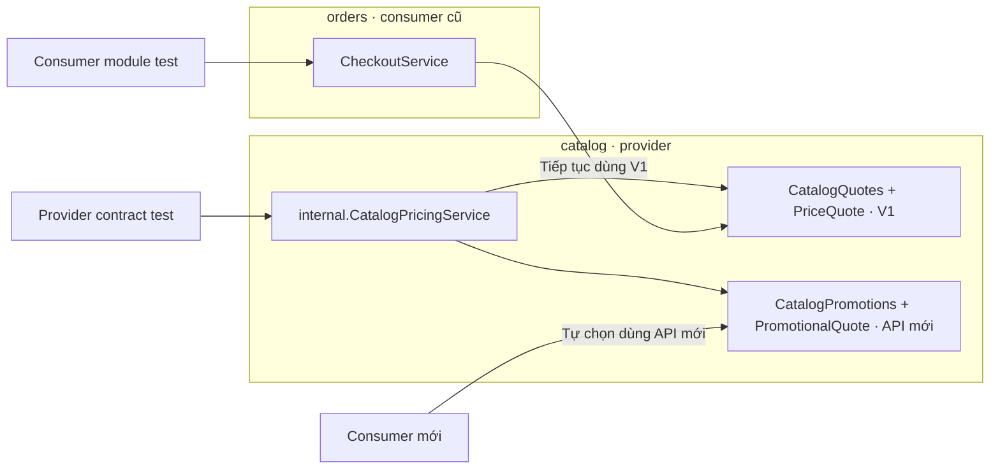
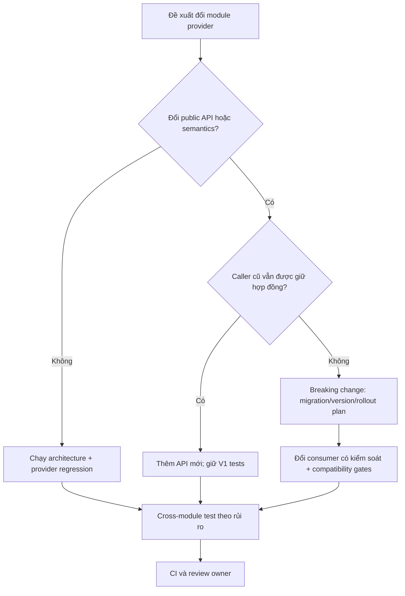

# Hợp đồng tương thích khi module thay đổi

## 1. Đổi implementation không đồng nghĩa được đổi hợp đồng

Module `orders` đang gọi `catalog.CatalogQuotes.quote("SKU-1", 2)` để lấy báo giá. Nhóm `catalog` muốn bổ sung báo giá khuyến mãi. Một cách sửa nhanh là đổi method `quote(...)` trả về DTO mới và bỏ exception cũ. Code mới có thể hợp lý ở phía `catalog`, nhưng những caller đang dựa vào API V1 sẽ gặp compile error, lỗi runtime hoặc—nguy hiểm hơn—nhận một kết quả có **cùng kiểu Java nhưng khác ý nghĩa**.

Đây là bài toán **hợp đồng tương thích khi module thay đổi**: module cung cấp phải biết **những lời hứa nào đã được consumer sử dụng**, rồi kiểm chứng rằng thay đổi mới vẫn giữ lời hứa hoặc có phương án migration rõ ràng.

Trong chương **Architectural contracts** của học phần `SPRING_MODULITH_VERIFICATION_TESTING`, mục tiêu là bảo vệ ranh giới module bằng `ApplicationModules` và quy tắc phụ thuộc; dùng `@ApplicationModuleTest`, kiểm thử event, dữ liệu, tích hợp và quality gate CI để ngăn hồi quy. Bài này tập trung vào câu hỏi:

> Sau khi một module được refactor hoặc mở rộng, làm sao chứng minh **các module đang dùng nó vẫn hoạt động đúng**?

Một hợp đồng tương thích tốt phải được viết thành **các điều kiện kiểm thử được**, không chỉ một lời cam kết “đã giữ backward compatibility”.

### Kết quả học tập

Sau bài học, bạn có thể:

1. Phân biệt tương thích **nguồn Java**, **binary**, **ranh giới kiến trúc**, **hành vi**, **event**, **cấu hình** và **dữ liệu**.
2. Thiết kế thay đổi **additive** không làm vỡ API V1 đang được dùng.
3. Viết JUnit provider contract tests cho implementation thật và consumer tests cho assumptions của module gọi.
4. Chạy selected cross-module test với `BootstrapMode.DIRECT_DEPENDENCIES` và kiểm chứng ranh giới bằng `ApplicationModules.verify()`.
5. Phân loại breaking change, quyết định migration và đặt quality gate tương ứng trong CI.

## 2. Tương thích là với ai, ở phạm vi nào?

Trong **modulith cùng repository**, các module thường compile và deploy cùng một ứng dụng. Điều này giúp compiler phát hiện nhiều thay đổi về API. Nhưng compiler **không** kiểm chứng các quy tắc nghiệp vụ; thêm nữa, event externalized hoặc database có thể được dùng bởi consumer/deployment bên ngoài.

| Trục tương thích | Ví dụ thay đổi | Công cụ kiểm chứng |
| --- | --- | --- |
| **Source compatibility** | Đổi tên method hoặc tham số làm caller không compile | Compile lại các module phụ thuộc, JUnit |
| **Binary compatibility** | Thay constructor/method signature khi có JAR cũ đã compile | Binary API diff, test old client artifact nếu có |
| **Architectural compatibility** | Chuyển public type vào `internal`, thêm vòng phụ thuộc | `ApplicationModules.verify()` |
| **Behavioral compatibility** | SKU không tồn tại trước đây ném exception, nay trả `null` | Provider contract + consumer behavior tests |
| **Data semantics** | `totalMinor` vẫn là `long` nhưng đổi đơn vị | Assertions giá trị cụ thể, integration tests |
| **Event compatibility** | Đổi logical type, payload/schema version hoặc topic | Producer/consumer contract + broker tests |
| **Configuration compatibility** | Đổi tên required property, thay default bật/tắt adapter | Binding/bootstrapping smoke tests |
| **Persistence compatibility** | Đổi bảng, cột, unique constraint | DB migration/integration, expand–migrate–contract |

**Không có một test duy nhất bảo vệ được tất cả các trục.**

`ApplicationModules.verify()` phát hiện vi phạm cấu trúc module; nó không biết một số tiền đã bị đổi từ “đồng” sang “nghìn đồng”. `@ApplicationModuleTest` có thể dùng Mockito cho provider; khi đó nó không chạy implementation provider. Cần các bằng chứng bổ sung đúng tầng.

### Phân biệt “backward” và “forward”

- **Backward compatibility:** consumer hiện có vẫn sử dụng được API/message do provider mới phát hành.
- **Forward compatibility:** consumer mới đọc/hiểu được dữ liệu hoặc message từ phiên bản cũ, quan trọng với event replay và migration.
- **Concurrent-version compatibility:** trong một khoảng chuyển tiếp, cả producer/consumer V1 và V2 phải cùng hoạt động.

Với monolith cùng deploy, có thể migrate tất cả Java callers trong một commit. Nhưng **event trên broker, dữ liệu đã lưu và consumer deploy độc lập** không biến mất khi ứng dụng được build lại.

## 3. Case xuyên suốt: giữ V1 của catalog khi bổ sung V2

Ví dụ gồm hai application modules:

```text
src/main/java/com/example/shop/
├── ShopApplication.java
├── catalog/
│   ├── CatalogQuotes.java             // API V1
│   ├── PriceQuote.java                // DTO V1
│   ├── UnknownSkuException.java       // Error V1
│   ├── CatalogPromotions.java         // API mới
│   ├── PromotionalQuote.java          // DTO mới
│   └── internal/
│       ├── PriceBook.java
│       ├── InMemoryPriceBook.java
│       └── CatalogPricingService.java
└── orders/
    ├── package-info.java
    ├── CheckoutService.java
    ├── CheckoutReceipt.java
    └── CheckoutAccepted.java

src/test/java/com/example/shop/
├── ModuleArchitectureTest.java
├── catalog/CatalogCompatibilityContractTest.java
├── orders/OrdersLegacyConsumerTest.java
└── orders/OrdersCatalogIntegrationTest.java
```

Theo cách nhận diện package mặc định thông dụng của Spring Modulith, `catalog` và `orders` là hai module. `catalog.internal` là phần implementation riêng của `catalog`, dù có class Java `public` ở đó.



**Chiến lược:** giữ nguyên signature, DTO và semantics của `CatalogQuotes` V1; công bố API mới riêng thay vì bắt mọi caller đổi ngay. Như vậy team có thể mở rộng chức năng và migrate từng consumer.

## 4. Hợp đồng V1 đã được công bố

### 4.1. Interface công khai

```java
// src/main/java/com/example/shop/catalog/CatalogQuotes.java
package com.example.shop.catalog;

public interface CatalogQuotes {
    PriceQuote quote(String sku, int quantity);
}
```

### 4.2. DTO có ngữ nghĩa ổn định

```java
// src/main/java/com/example/shop/catalog/PriceQuote.java
package com.example.shop.catalog;

public record PriceQuote(
    String sku,
    int quantity,
    String currency,
    long unitPriceMinor,
    long totalMinor
) {
}
```

### 4.3. Exception cũng thuộc API

```java
// src/main/java/com/example/shop/catalog/UnknownSkuException.java
package com.example.shop.catalog;

public class UnknownSkuException extends RuntimeException {

    public UnknownSkuException(String sku) {
        super("Unknown SKU: " + sku);
    }
}
```

**Contract V1**:

| Tình huống | Provider cam kết |
| --- | --- |
| `quote("SKU-1", 2)` | Trả quote đúng SKU, quantity, currency và tổng tiền |
| `SKU-1` giá 120000 VND/đơn vị | `unitPriceMinor=120000`, `totalMinor=240000` |
| Quantity bằng 0 hoặc âm | Ném `IllegalArgumentException` |
| SKU `null` hoặc blank | Ném `IllegalArgumentException` |
| SKU không tồn tại | Ném `UnknownSkuException`; **không trả `null`** |
| Tổng tiền vượt `long` | Fail rõ ràng, không âm thầm overflow |
| Đơn vị dữ liệu | `totalMinor` là đơn vị tiền đã được hợp đồng quy định; ví dụ dùng VND |
| Side effect | `quote` chỉ báo giá, không tạo order/charge payment |

**Đó là những điều V2 không được âm thầm làm sai.** Ngay cả khi method signature không đổi, đổi exception hoặc đơn vị tiền vẫn là breaking behavioral change.

## 5. API mới: bổ sung thay vì sửa V1

Giả sử `catalog` muốn trả báo giá khuyến mãi giảm **10%**, làm tròn giảm giá xuống đơn vị nhỏ nhất.

Tạo type mới thay vì thay đổi canonical constructor của `PriceQuote`:

```java
// src/main/java/com/example/shop/catalog/PromotionalQuote.java
package com.example.shop.catalog;

public record PromotionalQuote(
    PriceQuote base,
    long discountMinor,
    long payableMinor
) {
}
```

Interface mới:

```java
// src/main/java/com/example/shop/catalog/CatalogPromotions.java
package com.example.shop.catalog;

public interface CatalogPromotions {
    PromotionalQuote quoteWithPromotion(
        String sku, int quantity);
}
```

**V1 vẫn nguyên vẹn.** Một consumer mới có thể inject `CatalogPromotions`; consumer cũ tiếp tục inject `CatalogQuotes`.

### Vì sao không chỉ thêm một component vào record V1?

Giả sử thay:

```java
public record PriceQuote(
    String sku,
    int quantity,
    String currency,
    long unitPriceMinor,
    long totalMinor,
    long discountMinor
) {
}
```

Đây là thay đổi nguy hiểm vì:

- Code gọi constructor 5 tham số của record cũ không còn compile nếu không giữ overload tương thích.
- Binary cũ gọi constructor 5 tham số có thể gặp `NoSuchMethodError` nếu constructor đó bị xóa.
- `equals`, `hashCode`, `toString` và hình dạng dữ liệu record có thể đổi.
- Serializer/consumer có thể nhận thêm field hoặc thay đổi required properties ngoài mong đợi.

**Mẫu trong bài:** tạo `PromotionalQuote` mới, giữ `PriceQuote` V1 như cũ. Không dựa vào suy đoán “thêm field luôn tương thích”.

### Vì sao không thêm abstract method thẳng vào V1 interface?

Thêm method abstract vào một interface có thể giữ một số thuộc tính binary linkage cho các class cũ, nhưng **implementer source** cần cung cấp method mới khi recompile; nếu client mới gọi method đó trên implementation cũ, có thể gặp `AbstractMethodError`. Một `default method` có implementation tương thích là lựa chọn khác trong một số tình huống, nhưng nó cũng phải có semantics đúng.

Tách interface mới giúp quyền chọn nâng cấp của consumer rõ ràng hơn và tránh yêu cầu implementation cũ phải hiểu chức năng mới ngay lập tức.

## 6. Provider implementation thực thi đồng thời hai contract

Dùng nguồn giá in-memory để bài ví dụ tập trung vào compatibility, không phụ thuộc database.

### 6.1. Internal PriceBook

```java
// src/main/java/com/example/shop/catalog/internal/PriceBook.java
package com.example.shop.catalog.internal;

import java.util.Optional;

interface PriceBook {
    Optional<UnitPrice> find(String sku);
}

record UnitPrice(String currency, long amountMinor) {
}
```

```java
// src/main/java/com/example/shop/catalog/internal/InMemoryPriceBook.java
package com.example.shop.catalog.internal;

import java.util.Map;
import java.util.Optional;
import org.springframework.stereotype.Repository;

@Repository
class InMemoryPriceBook implements PriceBook {

    private final Map<String, UnitPrice> prices = Map.of(
        "SKU-1", new UnitPrice("VND", 120000L),
        "SKU-2", new UnitPrice("VND", 99000L));

    @Override
    public Optional<UnitPrice> find(String sku) {
        return Optional.ofNullable(prices.get(sku));
    }
}
```

`PriceBook` và `UnitPrice` thuộc internal package; không có module khác được phép import chúng làm API. Mã này là fixture minh họa; integration JPA sẽ được đánh giá riêng nếu production dùng DB.

### 6.2. Implementation giữ hành vi cũ và thêm hành vi mới

```java
// src/main/java/com/example/shop/catalog/internal/CatalogPricingService.java
package com.example.shop.catalog.internal;

import com.example.shop.catalog.CatalogPromotions;
import com.example.shop.catalog.CatalogQuotes;
import com.example.shop.catalog.PriceQuote;
import com.example.shop.catalog.PromotionalQuote;
import com.example.shop.catalog.UnknownSkuException;
import org.springframework.stereotype.Service;

@Service
class CatalogPricingService
        implements CatalogQuotes, CatalogPromotions {

    private final PriceBook priceBook;

    CatalogPricingService(PriceBook priceBook) {
        this.priceBook = priceBook;
    }

    @Override
    public PriceQuote quote(String sku, int quantity) {
        if (sku == null || sku.isBlank()) {
            throw new IllegalArgumentException(
                "SKU must not be blank");
        }
        if (quantity <= 0) {
            throw new IllegalArgumentException(
                "Quantity must be positive");
        }

        UnitPrice price = priceBook.find(sku)
            .orElseThrow(() -> new UnknownSkuException(sku));

        if (price.amountMinor() <= 0) {
            throw new IllegalStateException(
                "Invalid price book value");
        }

        long total;
        try {
            total = Math.multiplyExact(
                price.amountMinor(), quantity);
        } catch (ArithmeticException ex) {
            throw new IllegalArgumentException(
                "Total out of range", ex);
        }

        return new PriceQuote(
            sku, quantity, price.currency(),
            price.amountMinor(), total);
    }

    @Override
    public PromotionalQuote quoteWithPromotion(
            String sku, int quantity) {

        PriceQuote standard = quote(sku, quantity);

        // Chính sách ví dụ: giảm 10%, làm tròn xuống
        // đơn vị tiền nhỏ nhất.
        long discount = standard.totalMinor() / 10L;
        long payable = standard.totalMinor() - discount;

        return new PromotionalQuote(
            standard, discount, payable);
    }
}
```

Ba điểm đáng chú ý:

1. `quote(...)` của V1 vẫn chạy implementation thật và giữ postconditions cũ.
2. `quoteWithPromotion(...)` tái sử dụng quote V1 thay vì nhân bản logic tính tiền, sau đó áp dụng một chính sách mới có owner.
3. Không thay đổi API nội bộ theo cách bắt `orders` import `PriceBook` hoặc implementation.

Thay đổi **chưa được chứng minh tương thích** chỉ bằng code review. Chúng ta cần một regression test chạy cả hai API trong **cùng provider implementation**.

## 7. Provider compatibility tests: V1 phải tiếp tục đúng

Đặt test ở package `com.example.shop.catalog` để `@ApplicationModuleTest` bootstrap module provider.

```java
// src/test/java/com/example/shop/catalog/CatalogCompatibilityContractTest.java
package com.example.shop.catalog;

import org.junit.jupiter.api.Test;
import org.springframework.beans.factory.annotation.Autowired;
import org.springframework.modulith.test.ApplicationModuleTest;

import static org.assertj.core.api.Assertions.assertThat;
import static org.assertj.core.api.Assertions.assertThatThrownBy;

@ApplicationModuleTest
class CatalogCompatibilityContractTest {

    @Autowired
    CatalogQuotes legacyQuotes;

    @Autowired
    CatalogPromotions promotions;

    @Test
    void v1QuoteKeepsOriginalContract() {
        PriceQuote quote = legacyQuotes.quote("SKU-1", 2);

        assertThat(quote).isEqualTo(
            new PriceQuote(
                "SKU-1", 2, "VND", 120000L, 240000L));
    }

    @Test
    void v1UnknownSkuStillThrowsThePublicException() {
        assertThatThrownBy(() ->
            legacyQuotes.quote("MISSING", 1))
            .isInstanceOf(UnknownSkuException.class);
    }

    @Test
    void v1RejectsInvalidQuantity() {
        assertThatThrownBy(() ->
            legacyQuotes.quote("SKU-1", 0))
            .isInstanceOf(IllegalArgumentException.class);
    }

    @Test
    void v2AddsDiscountWithoutChangingV1() {
        PromotionalQuote offer =
            promotions.quoteWithPromotion("SKU-1", 2);

        assertThat(offer.base()).isEqualTo(
            new PriceQuote(
                "SKU-1", 2, "VND", 120000L, 240000L));
        assertThat(offer.discountMinor()).isEqualTo(24000L);
        assertThat(offer.payableMinor()).isEqualTo(216000L);

        // Một V2 call không được làm lệch hành vi V1.
        assertThat(legacyQuotes.quote("SKU-1", 2))
            .isEqualTo(offer.base());
    }
}
```

**Bằng chứng test này cung cấp:** bean thật `CatalogPricingService` tuân thủ contract V1 và V2, có kết quả giá trị cụ thể chứ không chỉ kiểm tra type. Hành vi “SKU không tồn tại ném exception” được giữ qua refactor.

**Giới hạn:** `InMemoryPriceBook` không chứng minh JPA query, transaction, migration hoặc remote price source. Nếu module dùng DB thật trong production, cần persistence integration riêng. Test này cũng không chứng minh binary compatibility với client JAR đã biên dịch theo phiên bản cũ.

### 7.1. Tại sao kiểm tra giá trị cụ thể quan trọng?

Nếu developer đổi `totalMinor` thành “đơn vị nghìn đồng” nhưng vẫn trả `long`, Java compiler và `ApplicationModules.verify()` đều có thể xanh. Test kỳ vọng **240000L** sẽ phát hiện thay đổi ngữ nghĩa, một loại breaking change nguy hiểm hơn compile error.

## 8. Consumer contract test: module orders cũ vẫn hoạt động

`orders` là consumer của API V1. Nó không biết `CatalogPromotions`.

### 8.1. Các type công khai của caller

```java
// src/main/java/com/example/shop/orders/CheckoutReceipt.java
package com.example.shop.orders;

public record CheckoutReceipt(
    String orderId,
    String currency,
    long totalMinor
) {
}
```

```java
// src/main/java/com/example/shop/orders/CheckoutAccepted.java
package com.example.shop.orders;

public record CheckoutAccepted(
    String orderId,
    String sku,
    String currency,
    long totalMinor
) {
}
```

Service thật của `orders`:

```java
// src/main/java/com/example/shop/orders/CheckoutService.java
package com.example.shop.orders;

import com.example.shop.catalog.CatalogQuotes;
import com.example.shop.catalog.PriceQuote;
import org.springframework.context.ApplicationEventPublisher;
import org.springframework.stereotype.Service;

@Service
public class CheckoutService {

    private final CatalogQuotes catalog;
    private final ApplicationEventPublisher events;

    public CheckoutService(
            CatalogQuotes catalog,
            ApplicationEventPublisher events) {
        this.catalog = catalog;
        this.events = events;
    }

    public CheckoutReceipt checkout(
            String orderId, String sku, int quantity) {

        if (orderId == null || orderId.isBlank()) {
            throw new IllegalArgumentException(
                "Order ID must not be blank");
        }

        PriceQuote quote = catalog.quote(sku, quantity);

        events.publishEvent(
            new CheckoutAccepted(
                orderId, quote.sku(), quote.currency(),
                quote.totalMinor()));

        return new CheckoutReceipt(
            orderId, quote.currency(), quote.totalMinor());
    }
}
```

Đây là một **use case tối giản không có database**, dùng để tập trung kiểm chứng tương thích. `CheckoutAccepted` nghĩa là luồng ví dụ chấp nhận checkout sau khi nhận quote, **không** có nghĩa đã thanh toán hoặc commit giao dịch thực. Production cần domain state và transaction riêng.

### 8.2. Test assumption ở phía caller

```java
// src/test/java/com/example/shop/orders/OrdersLegacyConsumerTest.java
package com.example.shop.orders;

import com.example.shop.catalog.CatalogQuotes;
import com.example.shop.catalog.PriceQuote;
import com.example.shop.catalog.UnknownSkuException;
import org.junit.jupiter.api.Test;
import org.springframework.beans.factory.annotation.Autowired;
import org.springframework.modulith.test.ApplicationModuleTest;
import org.springframework.modulith.test.PublishedEvents;
import org.springframework.test.context.bean.override.mockito.MockitoBean;

import static org.assertj.core.api.Assertions.assertThat;
import static org.assertj.core.api.Assertions.assertThatThrownBy;
import static org.mockito.BDDMockito.given;
import static org.mockito.Mockito.verify;

@ApplicationModuleTest
class OrdersLegacyConsumerTest {

    @Autowired
    CheckoutService checkout;

    @MockitoBean
    CatalogQuotes catalog;

    @Test
    void legacyCallerKeepsItsExpectedOutcome(
            PublishedEvents events) {

        given(catalog.quote("SKU-1", 2))
            .willReturn(new PriceQuote(
                "SKU-1", 2, "VND", 120000L, 240000L));

        CheckoutReceipt receipt =
            checkout.checkout("ORD-1", "SKU-1", 2);

        assertThat(receipt)
            .isEqualTo(
                new CheckoutReceipt("ORD-1", "VND", 240000L));
        verify(catalog).quote("SKU-1", 2);

        assertThat(events.ofType(CheckoutAccepted.class))
            .singleElement()
            .satisfies(event -> {
                assertThat(event.orderId()).isEqualTo("ORD-1");
                assertThat(event.sku()).isEqualTo("SKU-1");
                assertThat(event.totalMinor())
                    .isEqualTo(240000L);
            });
    }

    @Test
    void legacyErrorPathStillRejectsMissingSku(
            PublishedEvents events) {

        given(catalog.quote("MISSING", 1))
            .willThrow(new UnknownSkuException("MISSING"));

        assertThatThrownBy(() ->
            checkout.checkout("ORD-2", "MISSING", 1))
            .isInstanceOf(UnknownSkuException.class);

        assertThat(events.ofType(CheckoutAccepted.class))
            .isEmpty();
    }
}
```

`@MockitoBean` là API từ Spring Framework 6.2+, dùng với stack Boot/Modulith tương thích; ở Spring Boot cũ có thể cần `@MockBean`. `@ApplicationModuleTest` được đặt tại package `orders`, vì vậy implementation của module `catalog` **không tự nằm trong context `STANDALONE`**; mock API công khai là chủ đích.

**Điều được chứng minh:** code caller vẫn xử lý outcome và exception đã cam kết, phát/không phát event phù hợp.

**Điều chưa được chứng minh:** provider mới vẫn phát đúng outcome. Mock là dữ liệu do consumer định nghĩa; nếu provider đổi semantics mà stub chưa cập nhật, consumer test vẫn có thể xanh. Đó là lý do provider test ở phần trước **và** integration test ở phần sau cùng cần thiết.

## 9. Cross-module integration: thử caller với provider thật

Khi cả hai module thuộc cùng modulith và `orders` phụ thuộc trực tiếp `catalog`, có thể bootstrap chúng cùng lúc.

Đầu tiên khai báo dependency hợp lệ:

```java
// src/main/java/com/example/shop/orders/package-info.java
@org.springframework.modulith.ApplicationModule(
    allowedDependencies = "catalog"
)
package com.example.shop.orders;
```

Test tích hợp nhỏ:

```java
// src/test/java/com/example/shop/orders/OrdersCatalogIntegrationTest.java
package com.example.shop.orders;

import org.junit.jupiter.api.Test;
import org.springframework.beans.factory.annotation.Autowired;
import org.springframework.modulith.test.ApplicationModuleTest;
import org.springframework.modulith.test.ApplicationModuleTest.BootstrapMode;

import static org.assertj.core.api.Assertions.assertThat;

@ApplicationModuleTest(
    mode = BootstrapMode.DIRECT_DEPENDENCIES)
class OrdersCatalogIntegrationTest {

    @Autowired
    CheckoutService checkout;

    @Test
    void legacyCallerWorksAgainstRealNewProvider() {
        CheckoutReceipt receipt =
            checkout.checkout("ORD-IT-1", "SKU-1", 2);

        assertThat(receipt)
            .isEqualTo(
                new CheckoutReceipt(
                    "ORD-IT-1", "VND", 240000L));
    }
}
```

Trong ví dụ:

- `orders` trực tiếp import `CatalogQuotes` nên `catalog` là dependency được Spring Modulith nhận diện.
- `DIRECT_DEPENDENCIES` chọn module test và các module phụ thuộc **trực tiếp**, không phải “toàn bộ ứng dụng”.
- Không có `@MockitoBean CatalogQuotes`; service thật của `catalog` được gọi.
- Test kiểm tra **wiring + semantics khi hai module cùng hoạt động**, không chỉ stubbing của caller.

Nếu provider production dùng JPA/Kafka/HTTP, test tích hợp phải cung cấp hạ tầng và fixture phù hợp. Đổi sang `ALL_DEPENDENCIES` để hết thiếu bean mà không biết dependency nào cần thiết **không phải** một chiến lược compatibility.

### Vì sao cần ba bài kiểm khác nhau?

| Bài test | Provider thật? | Caller thật? | Điều chính được kiểm |
| --- | --- | --- | --- |
| `CatalogCompatibilityContractTest` | Có | Không | V1 và V2 semantics của provider |
| `OrdersLegacyConsumerTest` | Mock | Có | Assumptions, nhánh lỗi và event của caller |
| `OrdersCatalogIntegrationTest` | Có | Có | Wiring và kết quả thực xuyên module |

Một bộ tương thích đáng tin không chỉ là hai bộ mock đồng ý với nhau.

## 10. Architecture compatibility: bảo vệ API công khai

`CatalogQuotes`, `PriceQuote` và `UnknownSkuException` được công bố tại base package của `catalog`. Implementation `CatalogPricingService` và `PriceBook` vẫn ở `catalog.internal`.

Architecture test:

```java
// src/test/java/com/example/shop/ModuleArchitectureTest.java
package com.example.shop;

import org.junit.jupiter.api.Test;
import org.springframework.modulith.core.ApplicationModules;

class ModuleArchitectureTest {

    @Test
    void verifiesPublicApiAndAllowedDependencies() {
        ApplicationModules.of(ShopApplication.class).verify();
    }
}
```

Nếu refactor chuyển `PriceQuote` vào `catalog.internal` rồi `orders` vẫn import kiểu đó, `ApplicationModules.verify()` có thể phát hiện quan hệ trái boundary ngay cả khi class Java được khai báo `public`.

Nếu muốn công bố API ở subpackage `catalog.pricing`, hãy dùng `@NamedInterface` và cập nhật dependency như `catalog::pricing` **có chủ đích**, đồng thời migration import của consumer. Không công bố nguyên package `internal` chỉ để bỏ lỗi verify.

### Bảng hai mức tương thích

| Thay đổi | Compile caller | Architecture `verify()` |
| --- | --- | --- |
| Đổi implementation nội bộ nhưng giữ public API | Thường PASS | Thường PASS |
| Chuyển public API type sang internal và cập nhật import | Có thể PASS | Có thể FAIL |
| Thêm caller import `catalog.internal.PriceBook` | Nếu type Java-visible có thể PASS | FAIL theo rule mặc định |
| Thêm dependency ngược `catalog → orders` tạo cycle | Có thể PASS | FAIL nếu vi phạm cycle |
| Thêm `CatalogPromotions` trong public API | PASS với caller cũ | PASS nếu graph vẫn đúng |
| Đổi business rule “SKU thiếu trả null” | Có thể PASS | Có thể PASS; cần behavior tests |

Không dùng architectural compatibility như một lời bảo đảm cho business behavior.

## 11. Kiểm tra source và binary compatibility một cách thực tế

Java source compatibility và binary compatibility khác nhau:

- **Source:** biên dịch lại `orders` với phiên bản mới của `catalog` có thành công không?
- **Binary:** mã `orders` **đã compile trước đó** có liên kết/chạy được với JAR `catalog` mới không?

Trong modulith cùng build/deploy, compile toàn repository là cổng quan trọng. Nếu tổ chức phát hành shared module JAR cho ứng dụng khác hoặc giữ binary cũ ở runtime, cần **binary API comparison hoặc test với old compiled consumer**, vì chỉ compile code mới không kiểm tra JAR cũ.

### 11.1. Ví dụ reflection khóa signature V1

```java
// src/test/java/com/example/shop/catalog/CatalogApiShapeTest.java
package com.example.shop.catalog;

import java.lang.reflect.Method;
import org.junit.jupiter.api.Test;

import static org.assertj.core.api.Assertions.assertThat;

class CatalogApiShapeTest {

    @Test
    void oldMethodAndConstructorStillExist()
            throws NoSuchMethodException {

        Method operation = CatalogQuotes.class.getMethod(
            "quote", String.class, int.class);

        assertThat(operation.getReturnType())
            .isEqualTo(PriceQuote.class);

        assertThat(PriceQuote.class.getConstructor(
            String.class, int.class, String.class,
            long.class, long.class))
            .isNotNull();
    }
}
```

Test reflection này khóa method và record constructor V1, nhưng **chưa phải binary compatibility proof đầy đủ**: nó không chạy consumer JAR cũ và không kiểm tra toàn bộ public ABI.

Công cụ binary diff như Revapi/japicmp hoặc một test fixture dùng **old compiled artifact** có thể bổ sung nếu module được phân phối riêng. Đừng áp dụng chính sách binary compatibility phức tạp cho mọi class internal không phải API.

### 11.2. Phân loại thay đổi Java phổ biến

| Thay đổi | Đánh giá |
| --- | --- |
| Refactor implementation private/package internal | Thường compatible nếu behavior và bean wiring không đổi |
| Thêm interface/record công khai mới | Thường additive đối với caller cũ |
| Xóa/đổi tên `CatalogQuotes.quote` | Breaking source và có thể breaking binary |
| Đổi return type hoặc parameter types | Breaking với caller đang dùng |
| Thêm component vào Java record V1 | Có thể đổi constructor, binary/API/serialization semantics |
| Thêm abstract method vào interface cũ | Có thể phá source implementers; invoking trên old binary có thể gây `AbstractMethodError` |
| Thêm default method vào interface | Có thể tương thích hơn, nhưng phải xét conflict/semantics |
| Thay `UnknownSkuException` bằng `null` | Breaking behavior dù method signature giữ nguyên |
| Thay total currency unit nhưng vẫn trả `long` | Breaking semantics mà compiler không phát hiện |
| Thêm bean implementation cùng type trong Spring context | Có thể gây `NoUniqueBeanDefinitionException` lúc bootstrap |

“Additive” phải được đánh giá **theo consumer đang sử dụng**, không chỉ là số dòng code tăng.

## 12. Event compatibility khi module phát sự kiện

Trong ví dụ, `CheckoutService` publish `CheckoutAccepted` thuộc API của module `orders`. Nếu module `notifications` trong cùng JVM import record đó, sửa package/name/constructor sẽ ảnh hưởng Java compatibility.

Nếu event được **externalize sang Kafka**, ranh giới trở thành **logical type, schema version, key/topic và consumer contract**, không chỉ Java type.

Ví dụ wire V1 đã được công bố:

```json
{
  "type": "shop.orders.checkout-accepted",
  "schemaVersion": 1,
  "data": {
    "orderId": "ORD-1",
    "currency": "VND",
    "totalMinor": 240000
  }
}
```

### Khi đổi event cần giữ điều gì?

| Thay đổi | Rủi ro | Gate |
| --- | --- | --- |
| Đổi Java package nhưng giữ wire mapper | JVM consumer có thể phải migrate; external wire có thể vẫn giữ | Compile + architecture + mapper tests |
| Đổi `type` literal | External dispatcher không nhận ra | Producer/consumer contract |
| Đổi `totalMinor` thành `totalAmount` | JSON V1 consumer thiếu field | Schema compatibility |
| Đổi integer minor unit sang decimal major unit | Breaking semantic dù consumer parse được | Contract example theo giá trị |
| Thêm optional field | Có thể tương thích | Consumer cũ phải bỏ qua unknown field theo policy |
| Đổi Kafka topic/key | Consumer subscription/ordering ảnh hưởng | Broker integration |
| Thay điều kiện phát event | Consumer nghiệp vụ nhận khác thời điểm/sự kiện | `PublishedEvents` và transaction tests |

Một **producer mapping test** nên kiểm tra type/version và cả giá trị business cụ thể. Ví dụ với Jackson:

```java
// Phác thảo JUnit về payload đã serialize của wire V1.
// wireJson phải là kết quả của production mapper/serializer.
com.fasterxml.jackson.databind.JsonNode root =
    objectMapper.readTree(wireJson);

assertThat(root.path("type").asText())
    .isEqualTo("shop.orders.checkout-accepted");
assertThat(root.path("schemaVersion").asInt())
    .isEqualTo(1);
assertThat(root.path("data")
    .path("totalMinor").asLong())
    .isEqualTo(240000L);
```

Đây là **fragment** vì `objectMapper` và `wireJson` do fixture/mapper thực của dự án cung cấp. Không được dùng một chuỗi JSON do test tự viết rồi tuyên bố đã kiểm tra producer. Phải chạy **mapper production**, và consumer tương thích cần chạy reader/validator thật trên golden fixture.

**`PublishedEvents` chỉ chứng minh domain event được công bố trong Spring context**, không chứng minh Kafka broker đã nhận hoặc consumer ngoài JVM đã xử lý.

## 13. Database compatibility: schema cũng có consumer

Dù chỉ có một modulith, thay đổi schema của `catalog` có thể ảnh hưởng:

- Code của `catalog` đang dùng entity/repository cũ.
- Migration chạy theo nhiều giai đoạn rollout.
- Job/report hoặc consumer ngoài được phép đọc dữ liệu.
- Data đã lưu cần được chuyển đổi an toàn.
- Test transactions, unique constraints và query semantics.

### Expand–migrate–contract

Ví dụ muốn thay cột `price_minor` thành `unit_price_minor`:

1. **Expand:** thêm cột mới và code đọc/ghi tương thích khi cần hỗ trợ trạng thái chuyển tiếp.
2. **Migrate:** backfill dữ liệu và kiểm chứng row count, nullability, giá trị tiền.
3. **Switch:** triển khai code mới, xác minh reader/writer và nghiệp vụ.
4. **Contract:** chỉ xóa cột cũ khi mọi consumer/migration obligation đã kết thúc.

Với **single-step deployment thực sự**, một migration nguyên tử có thể đủ. Nhưng không được giả định mọi consumer dữ liệu deploy cùng lúc.

### Test có ý nghĩa

- Schema migration từ **dữ liệu V1 thực** sang V2 giữ đúng giá và currency.
- Entity/repository thật đọc/ghi đúng sau migration.
- Unique constraint và transaction vẫn bảo vệ invariant.
- Nếu có song song old/new app, chúng có thể đọc/ghi theo rollout contract.
- Không dùng mock repository để khẳng định schema đã tương thích.

Testcontainers/PostgreSQL là một lựa chọn để kiểm chứng SQL/dialect thực; `@ApplicationModuleTest` có thể giới hạn module nghiệp vụ nhưng **không tự tạo migration/fixture**.

## 14. Configuration compatibility: không đổi required key tùy tiện

Một thay đổi có thể giữ Java API nhưng làm mọi môi trường cũ không bootstrap được.

Ví dụ V1:

```yaml
catalog:
  pricing:
    currency: VND
```

V2 đổi khóa thành `catalog.pricing.default-currency` nhưng không hỗ trợ alias/migration. Với deployment chưa nâng config, context mới có thể fail hoặc dùng default sai.

**Contract cấu hình cần nói rõ:**

- Key cũ có còn được chấp nhận không?
- Nếu cả key cũ và mới cùng tồn tại, precedence là gì?
- Có default an toàn không, hay phải fail-fast?
- Property type/unit có đổi không?
- Profile/condition bật/tắt bean có thay đổi behavior?
- Có ngày loại bỏ deprecated key rõ ràng không?

Dùng `ApplicationContextRunner` để kiểm tra bootstrap với **bộ property V1** và bộ property mới, gồm cả negative case. Nếu bật thêm Kafka adapter mặc định ở V2, thêm bean/producer integration gate; context load có thể xanh dù broker không reachable.

### Một compatibility test tối thiểu cho cấu hình

```java
// Ý tưởng chạy cùng configuration binding thực của catalog.
runner.withPropertyValues(
    "catalog.pricing.currency=VND"
).run(context -> {
    assertThat(context.getStartupFailure()).isNull();
    assertThat(context.getBean(PricingProperties.class)
        .currency()).isEqualTo("VND");
});
```

Đây là fragment; `runner` phải đăng ký **PricingProperties đã triển khai compatibility alias**. `PricingProperties` chưa thuộc ví dụ Java chính ở phần 3–9, nên không coi snippet này là một test chạy được nếu chưa bổ sung model/config thực của dự án.

**Không chấp nhận** một property đổi semantics mà không có migration chỉ vì Java class vẫn compile.

## 15. Quy trình thay đổi: compatibility matrix trước, code sau

Trước khi sửa `catalog`, người review lập change matrix:

| Câu hỏi | Ví dụ trả lời | Bằng chứng |
| --- | --- | --- |
| API nào thuộc public contract? | `CatalogQuotes.quote` và `PriceQuote` | Module model/architecture test |
| Ai đang sử dụng V1? | `orders`, có thể có consumer độc lập | Dependency graph, consumer inventory |
| Thay đổi thuộc trục nào? | Behavioral và additive public API | Diff + contract card |
| V1 có được giữ không? | Có: method/DTO/error unchanged | Provider regression tests |
| API mới là gì? | `CatalogPromotions.quoteWithPromotion` | New provider test |
| Caller cũ còn chạy đúng không? | Có với implementation mới | `OrdersCatalogIntegrationTest` |
| Event/schema có đổi không? | Không trong ví dụ Java chính | Event/producer contract nếu externalized |
| Config/DB có đổi không? | Không trong ví dụ in-memory | Binding/persistence gates nếu có |
| Có cần version/migration không? | Không cho V1; consumer opt-in V2 | Review quyết định + CI |

**Quy tắc:** compatibility được đánh giá theo **hợp đồng consumer đã sử dụng**, không chỉ theo lớp provider đang sửa.

### Một cây quyết định nhỏ



## 16. Quality gate CI tập trung vào chống hồi quy tương thích

| Gate | Kiểm chứng | Điều kiện thất bại |
| --- | --- | --- |
| **Compile/source** | Compile toàn ứng dụng và caller modules | Consumer cũ không còn compile |
| **Architecture** | `ApplicationModules.verify()` | Public/internal, allowed dependency, cycle vi phạm |
| **Provider contract V1** | `CatalogCompatibilityContractTest` | DTO/error/semantics V1 đổi |
| **Provider contract mới** | Test `CatalogPromotions` | New API không đúng lời hứa |
| **Consumer module** | `OrdersLegacyConsumerTest` | Caller xử lý outcome, lỗi, event sai |
| **Cross-module integration** | `OrdersCatalogIntegrationTest` | Caller thật + provider mới không còn hợp tác đúng |
| **Binary API** | Diff old/new artifact nếu phân phối JAR | ABI break ngoài chính sách |
| **Wire compatibility** | Golden fixtures, consumer reader | V1 event/schema bị phá |
| **Config bootstrap** | Old/new property sets | App dùng config cũ không khởi động |
| **Persistence migration** | DB test từ dữ liệu V1 | Schema/state không tương thích |

Không cần bật Kafka hay PostgreSQL cho test V1 API thuần trong ví dụ. Nhưng **khi thay event/schema/adapter/DB thật**, phải thêm đúng integration gate; việc test mock xanh không đủ để bỏ qua tầng đó.

### Mutation checklist: lỗi nào khiến test nào đỏ?

| Refactor sai | Gate bắt buộc đỏ |
| --- | --- |
| `quote` đổi return type | Compile/API shape |
| `PriceQuote` thêm component rồi xóa constructor cũ | Compile, API shape/binary diff |
| `UnknownSkuException` đổi thành `null` | Provider V1 contract |
| `totalMinor` bị chia 1000 | Provider semantic assertion + cross-module |
| `orders` import `catalog.internal.PriceBook` | `ApplicationModules.verify()` |
| `CatalogPricingService` không còn là bean | Provider bootstrap/integration |
| `CatalogQuotes` có hai implementation không qualifier | Context bootstrap |
| `CheckoutAccepted` phát ở nhánh lỗi | Consumer `PublishedEvents` test |
| Wire V1 đổi `type` hoặc JSON field | Producer/consumer schema tests |
| V2 xóa DB column khi old reader còn dùng | Migration compatibility test |
| V2 đổi key required nhưng bỏ alias | Old-config bootstrap test |

Một test đáng tin có assertion đủ cụ thể để **đỏ khi hợp đồng bị vi phạm**; không chỉ assert “context loads”.

## 17. Bài tập tình huống: phân loại ba thay đổi

**Tình huống A:** `catalog` đổi thuật toán lưu giá trong `catalog.internal`, nhưng `CatalogQuotes`, `PriceQuote`, exception và kết quả quan sát được đều giữ nguyên.

Hướng xử lý: đây có thể là **implementation-compatible refactor**. Chạy provider V1 regression, architecture và integration persistence nếu kho giá thực tế thay đổi.

**Tình huống B:** developer thêm `discountMinor` vào `PriceQuote` V1 rồi bỏ constructor 5 tham số. Đơn hàng cũ không còn compile; old binary có thể gặp lỗi linkage.

Hướng xử lý: ưu tiên **DTO/API mới**, hoặc giữ constructor và mapping tương thích có test rõ; phân tích thêm serialization và semantics nếu DTO đã ra wire.

**Tình huống C:** method signature V1 vẫn giữ nhưng SKU không tồn tại nay trả `null`.

Hướng xử lý: đây là **behavioral breaking change**. Provider contract phải đỏ; nếu thật sự cần hành vi mới, công bố API mới trả `Optional` hoặc result type, giữ lời hứa V1 trong giai đoạn migration.

### Tự đánh giá

1. **Vì sao Java compile xanh chưa đủ?** — Vì lỗi behavior, đơn vị dữ liệu, event schema hoặc runtime wiring vẫn có thể xảy ra.
2. **Vì sao consumer test với mock chưa đủ?** — Vì mock phản ánh assumption cũ, không chạy implementation provider mới.
3. **Tại sao phải chạy test provider và cross-module?** — Một bài kiểm lời hứa của provider, bài kia kiểm cộng tác thật với caller.
4. **`ApplicationModules.verify()` kiểm gì?** — Ranh giới và quan hệ phụ thuộc giữa module theo mô hình Spring Modulith.
5. **Khi nào cần binary compatibility gate?** — Khi có consumer/JAR đã compile trước không được rebuild hoặc thay cùng lúc.
6. **Vì sao thêm field record có thể breaking?** — Canonical constructor/API và serialization có thể đổi.
7. **Event externalized có tự version theo Java class không?** — Không; logical type/schema là hợp đồng riêng.
8. **Đổi property bắt buộc có ảnh hưởng compatibility không?** — Có; deployment config cũ có thể không bootstrap được.

## 18. Checklist trước khi merge thay đổi module

- [ ] Có owner và danh sách consumer của API/event/config/data bị ảnh hưởng.
- [ ] Đã phân loại thay đổi source/binary/architecture/behavior/wire/config/persistence.
- [ ] V1 public interface, DTO và exception được giữ nguyên, hoặc có migration rõ.
- [ ] Không thay đơn vị dữ liệu hoặc semantics mà chỉ dựa vào compile.
- [ ] API mới có tên/type/owner rõ; không mở internal package tùy tiện.
- [ ] Provider contract tests chạy **implementation thật** với positive và negative cases.
- [ ] Consumer module tests xác nhận outcome và error handling đúng.
- [ ] Selected integration test dùng provider thật thay vì chỉ Mockito stubs.
- [ ] `ApplicationModules.verify()` chạy trong CI và không có dependency cycle.
- [ ] Nếu có old binaries, đã đánh giá ABI và old-client compatibility.
- [ ] Nếu event externalized đổi, có schema/golden fixtures và consumer migration.
- [ ] Nếu cấu hình đổi, có bootstrap tests với bộ property cũ và mới.
- [ ] Nếu DB đổi, có migration/integration trên dữ liệu V1 thực.
- [ ] CI gate không bị bỏ qua chỉ để pass refactor.
- [ ] Breaking change đã có version/rollout/rollback strategy và mốc bỏ V1.

## 19. Tổng kết

Khi một Spring Modulith module thay đổi, mục tiêu không phải đóng băng implementation. Mục tiêu là **cho phép implementation phát triển mà consumer tiếp tục dựa vào những lời hứa đã công bố**.

Bài tập thực hành quan trọng nhất là giữ **`CatalogQuotes` V1** và tạo API mới **`CatalogPromotions`**, rồi kiểm chứng theo ba hướng: provider contract test, caller `@ApplicationModuleTest` và selected integration với `DIRECT_DEPENDENCIES`. Thêm `ApplicationModules.verify()` để chặn việc refactor vượt ranh giới.

**Ghi nhớ:** tương thích không chỉ là “biên dịch được”. Hãy bảo vệ **hình dạng API, hành vi, ý nghĩa dữ liệu và đường phụ thuộc** bằng Java/JUnit; khi module công bố event, đổi config hoặc migration DB, bổ sung những contract/integration gates đúng ranh giới. Đó là cách quality gate CI ngăn một thay đổi cục bộ trở thành hồi quy xuyên module.
