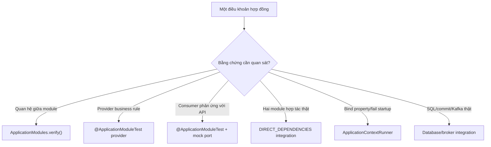

# Chuyển hợp đồng thành test có thể chạy tự động

## 1. Từ câu mô tả kiến trúc đến bằng chứng chạy trong CI

Một yêu cầu thường được viết như sau:

> Module `orders` chỉ được gọi API công khai của `catalog`; `catalog` phải trả giá đúng; khi đặt đơn thất bại thì không phát sự kiện thành công.

Câu này thể hiện chủ đích thiết kế, nhưng **chưa đủ để chặn hồi quy**. Nếu sau một lần refactor, `orders` import `catalog.internal`, hoặc `catalog` trả giá sai mà Java vẫn compile, ai sẽ phát hiện trước khi merge?

Trong học phần `SPRING_MODULITH_VERIFICATION_TESTING`, chúng ta dùng `ApplicationModules` và quy tắc phụ thuộc để giữ ranh giới kiến trúc, `@ApplicationModuleTest` để chạy hành vi của một module, kiểm thử event và database/tích hợp ở đúng phạm vi, rồi đặt các bằng chứng thành quality gate CI. Bài thuộc chương **Architectural contracts** và tập trung vào cách **chuyển hợp đồng thành test tự động**.

Một hợp đồng đủ khả năng kiểm thử phải có bốn thành phần:

1. **Owner:** module nào chịu trách nhiệm thực hiện lời hứa?
2. **Tiền điều kiện:** dữ liệu và trạng thái nào dẫn tới hành vi?
3. **Kết quả quan sát được:** giá trị, exception, event, bean, database state hoặc dependency graph nào cần đúng?
4. **Bằng chứng:** test nào phải đỏ nếu một điều kiện bị phá?

Ví dụ chuyển đổi:

| Hợp đồng còn mơ hồ | Hợp đồng có thể kiểm chứng |
| --- | --- |
| “Không được dùng nội bộ module khác” | `orders` chỉ phụ thuộc API `catalog.CatalogPrices`; `ApplicationModules.verify()` phải PASS |
| “Giá báo đúng” | `quote("SKU-1", 2)` trả `PriceQuote("SKU-1", 2, "VND", 120000, 240000)` |
| “Dữ liệu sai phải báo lỗi” | Quantity bằng 0 → `IllegalArgumentException`; không có quote |
| “Đặt đơn phải phát sự kiện” | Thành công → đúng một `OrderPlaced` mang `orderId`/`totalMinor`; lỗi → không có `OrderPlaced` |
| “Các module phải tích hợp được” | `orders` chạy với implementation `catalog` thật và kết quả trùng hợp đồng |

**Quy tắc quan trọng:** chọn assertion theo **điều người dùng/module khác nhìn thấy**, không chỉ theo dòng code được gọi. `verify(repository).save(...)` không chứng minh SQL commit; `PublishedEvents` không chứng minh broker đã nhận message; context khởi động không chứng minh quy tắc nghiệp vụ đúng.

## 2. Lập bảng contract ID → scenario → test

Dùng mã hợp đồng ổn định để người review, developer và CI dễ đối chiếu:

| Contract ID | Given / When | Then cần assert | Test chịu trách nhiệm |
| --- | --- | --- | --- |
| `ARCH-01` | Thay đổi dependency giữa `orders` và `catalog` | Không truy cập internal API, không dependency trái quy tắc/cycle | `ModuleArchitectureTest` |
| `CAT-01` | SKU-1 giá 120000 VND, quantity 2 | Tổng đúng 240000 VND | `CatalogProviderContractTest` |
| `CAT-02` | Quantity 0 | Ném `IllegalArgumentException` | `CatalogProviderContractTest` |
| `CAT-03` | SKU không tồn tại | Ném public `UnknownSkuException` | `CatalogProviderContractTest` |
| `ORD-01` | `orders` nhận quote hợp lệ | Trả receipt và công bố đúng một `OrderPlaced` | `OrdersConsumerContractTest` |
| `ORD-02` | `catalog` từ chối SKU | Exception truyền đúng, **không** công bố `OrderPlaced` | `OrdersConsumerContractTest` |
| `INT-01` | Chạy `orders` với `catalog` thật | Receipt và payload event đúng | `OrdersCatalogIntegrationTest` |
| `CFG-01` | Property giá thiếu hoặc bằng 0 | Startup fail-fast | `CatalogConfigurationContractTest` |

Một contract ID thường cần **positive case và negative case**. `ORD-01` mà chỉ assert `receipt != null` chưa đủ: service vẫn có thể trả sai tiền hoặc phát hai event. `ORD-02` mà chỉ assert exception chưa đủ: service có thể đã phát sự kiện trước khi ném lỗi.

### Chọn đúng tầng thử nghiệm



Sau mỗi thay đổi, hãy tự hỏi: **“Nếu cố tình phá hợp đồng này, test cụ thể nào sẽ đỏ?”** Nếu không trả lời được, hợp đồng chưa trở thành một gate tự động đáng tin.

## 3. Mã production tối thiểu: provider `catalog`

Ví dụ dùng Java 17+, Spring Boot có module Spring Modulith tương thích và Jakarta Bean Validation. Chúng ta chủ ý chọn một nguồn giá cố định để test **hành vi hợp đồng**, không giả vờ đã kiểm tra JPA hay gateway ngoài JVM.

### 3.1. Ứng dụng gốc và API công khai

```java
// src/main/java/com/example/shop/ShopApplication.java
package com.example.shop;

import org.springframework.boot.SpringApplication;
import org.springframework.boot.autoconfigure.SpringBootApplication;

@SpringBootApplication
public class ShopApplication {
    public static void main(String[] args) {
        SpringApplication.run(ShopApplication.class, args);
    }
}
```

```java
// src/main/java/com/example/shop/catalog/PriceQuote.java
package com.example.shop.catalog;

public record PriceQuote(
    String sku,
    int quantity,
    String currency,
    long unitPriceMinor,
    long totalMinor
) {
}
```

```java
// src/main/java/com/example/shop/catalog/CatalogPrices.java
package com.example.shop.catalog;

public interface CatalogPrices {
    PriceQuote quote(String sku, int quantity);
}
```

```java
// src/main/java/com/example/shop/catalog/UnknownSkuException.java
package com.example.shop.catalog;

public class UnknownSkuException extends RuntimeException {
    public UnknownSkuException(String sku) {
        super("Unknown SKU: " + sku);
    }
}
```

Đặt `CatalogPrices`, `PriceQuote` và `UnknownSkuException` tại base package `catalog` để chúng thuộc API module theo quy ước mặc định. Trong production, mã lỗi và ngữ nghĩa tiền tệ là những điều khoản hợp đồng cần giữ ổn định.

### 3.2. Cấu hình có validation

```java
// src/main/java/com/example/shop/catalog/internal/CatalogPriceProperties.java
package com.example.shop.catalog.internal;

import jakarta.validation.constraints.Min;
import jakarta.validation.constraints.NotBlank;
import org.springframework.boot.context.properties.ConfigurationProperties;
import org.springframework.validation.annotation.Validated;

@Validated
@ConfigurationProperties(prefix = "shop.catalog")
public record CatalogPriceProperties(
    @NotBlank String currency,
    @Min(1) long unitPriceMinor
) {
}
```

```java
// src/main/java/com/example/shop/catalog/internal/CatalogConfiguration.java
package com.example.shop.catalog.internal;

import org.springframework.boot.context.properties.EnableConfigurationProperties;
import org.springframework.context.annotation.Configuration;

@Configuration(proxyBeanMethods = false)
@EnableConfigurationProperties(CatalogPriceProperties.class)
class CatalogConfiguration {
}
```

`@ConfigurationProperties` phải được đăng ký thành bean; ở đây `@EnableConfigurationProperties` thực hiện việc đó. Với `spring-boot-starter-validation`, `@Validated` bảo vệ hai tiền điều kiện: currency không rỗng và đơn giá phải dương. Thông số của ví dụ là **120000 VND cho mỗi SKU-1**; con số này do test cung cấp rõ ràng.

### 3.3. Implementation thật của provider

```java
// src/main/java/com/example/shop/catalog/internal/CatalogPricing.java
package com.example.shop.catalog.internal;

import com.example.shop.catalog.CatalogPrices;
import com.example.shop.catalog.PriceQuote;
import com.example.shop.catalog.UnknownSkuException;
import org.springframework.stereotype.Service;

@Service
class CatalogPricing implements CatalogPrices {

    private final CatalogPriceProperties config;

    CatalogPricing(CatalogPriceProperties config) {
        this.config = config;
    }

    @Override
    public PriceQuote quote(String sku, int quantity) {
        if (sku == null || sku.isBlank() || quantity <= 0) {
            throw new IllegalArgumentException(
                "SKU and quantity must be valid");
        }

        if (!"SKU-1".equals(sku)) {
            throw new UnknownSkuException(sku);
        }

        long total = Math.multiplyExact(
            config.unitPriceMinor(), quantity);

        return new PriceQuote(
            sku,
            quantity,
            config.currency(),
            config.unitPriceMinor(),
            total);
    }
}
```

Vì `Math.multiplyExact` được sử dụng, phép tính không âm thầm overflow `long`. Nếu sản phẩm thật có nhiều SKU, cần nguồn dữ liệu và test của nguồn ấy. **Không kết luận rằng class in-memory này đã kiểm tra schema/transaction/database.**

## 4. Mã consumer `orders` và ranh giới module

`orders` sử dụng API của `catalog` và công bố event của chính mình.

```java
// src/main/java/com/example/shop/orders/OrderReceipt.java
package com.example.shop.orders;

public record OrderReceipt(
    String orderId,
    String currency,
    long totalMinor
) {
}
```

```java
// src/main/java/com/example/shop/orders/OrderPlaced.java
package com.example.shop.orders;

public record OrderPlaced(
    String orderId,
    String sku,
    int quantity,
    String currency,
    long totalMinor
) {
}
```

```java
// src/main/java/com/example/shop/orders/OrderPlacementService.java
package com.example.shop.orders;

import com.example.shop.catalog.CatalogPrices;
import com.example.shop.catalog.PriceQuote;
import org.springframework.context.ApplicationEventPublisher;
import org.springframework.stereotype.Service;

@Service
public class OrderPlacementService {

    private final CatalogPrices catalog;
    private final ApplicationEventPublisher events;

    public OrderPlacementService(
            CatalogPrices catalog,
            ApplicationEventPublisher events) {
        this.catalog = catalog;
        this.events = events;
    }

    public OrderReceipt place(
            String orderId, String sku, int quantity) {

        if (orderId == null || orderId.isBlank()) {
            throw new IllegalArgumentException(
                "Order ID must not be blank");
        }

        PriceQuote quote = catalog.quote(sku, quantity);

        events.publishEvent(new OrderPlaced(
            orderId,
            quote.sku(),
            quote.quantity(),
            quote.currency(),
            quote.totalMinor()));

        return new OrderReceipt(
            orderId,
            quote.currency(),
            quote.totalMinor());
    }
}
```

Class này cố tình **không có repository hay `@Transactional`**. Nó minh họa contract `ORD-01/02` của một service và domain publication, **không** tuyên bố đơn đã ghi database, đã commit hoặc gửi Kafka.

Đặt metadata dependency tại module caller:

```java
// src/main/java/com/example/shop/orders/package-info.java
@org.springframework.modulith.ApplicationModule(
    allowedDependencies = "catalog"
)
package com.example.shop.orders;
```

`orders` được phép import `catalog.CatalogPrices` và `catalog.PriceQuote`; không được phụ thuộc vào `catalog.internal.CatalogPricing`. Cấu hình `allowedDependencies` là ràng buộc kiến trúc, **không** làm Spring tự nạp provider trong mọi `@ApplicationModuleTest`.

## 5. Biến `ARCH-01` thành architecture test

Chúng ta cần một test **không phụ thuộc Mockito và không phải bootstrap toàn ứng dụng**.

```java
// src/test/java/com/example/shop/ModuleArchitectureTest.java
package com.example.shop;

import org.junit.jupiter.api.Test;
import org.springframework.modulith.core.ApplicationModules;

class ModuleArchitectureTest {

    @Test
    void modulesRespectDeclaredBoundaries() {
        ApplicationModules.of(ShopApplication.class).verify();
    }
}
```

`ApplicationModules.verify()` kiểm tra mô hình application module mà Spring Modulith nhận diện, trong đó có vi phạm ranh giới public/internal, dependency và cycle phù hợp quy tắc khai báo.

**Mutation để chứng minh gate:** cố tình cho `orders` import `catalog.internal.CatalogPricing`. Nếu type có visibility phù hợp để Java compile, `verify()` phải phát hiện vi phạm public API theo mô hình module mặc định. Không cần mở internal API hay nới `allowedDependencies` để “sửa” test; cần đưa hành vi thực sự cần dùng ra một API được công bố có chủ đích.

Điều test **không** chứng minh: tính tiền đúng, event payload đúng, property đã bind, Kafka hay database đã hoạt động. Những assertions này thuộc các test tiếp theo.

## 6. Biến `CAT-01/02/03` thành provider module tests

Test provider phải chạy **`CatalogPricing` thật**, không mock `CatalogPrices`. Cho các properties đầu vào minh bạch bằng `@TestPropertySource`.

```java
// src/test/java/com/example/shop/catalog/CatalogProviderContractTest.java
package com.example.shop.catalog;

import org.junit.jupiter.api.Test;
import org.springframework.beans.factory.annotation.Autowired;
import org.springframework.modulith.test.ApplicationModuleTest;
import org.springframework.test.context.TestPropertySource;

import static org.assertj.core.api.Assertions.assertThat;
import static org.assertj.core.api.Assertions.assertThatThrownBy;

@ApplicationModuleTest
@TestPropertySource(properties = {
    "shop.catalog.currency=VND",
    "shop.catalog.unit-price-minor=120000"
})
class CatalogProviderContractTest {

    @Autowired
    CatalogPrices catalog;

    @Test
    void cat01_returnsExactQuote() {
        PriceQuote quote = catalog.quote("SKU-1", 2);

        assertThat(quote).isEqualTo(
            new PriceQuote(
                "SKU-1", 2, "VND",
                120000L, 240000L));
    }

    @Test
    void cat02_rejectsNonPositiveQuantity() {
        assertThatThrownBy(() ->
            catalog.quote("SKU-1", 0))
            .isInstanceOf(IllegalArgumentException.class);
    }

    @Test
    void cat03_rejectsUnknownSkuWithPublicException() {
        assertThatThrownBy(() ->
            catalog.quote("MISSING", 1))
            .isInstanceOf(UnknownSkuException.class);
    }
}
```

Cấu trúc **Arrange–Act–Assert** dễ đọc:

- **Arrange:** `@TestPropertySource` đặt giá chính xác; cấu hình bean `CatalogPriceProperties` được validate.
- **Act:** gọi `CatalogPrices` qua Spring bean provider thật.
- **Assert:** kiểm tra đầy đủ kết quả và error types công khai.

Test này sẽ đỏ khi developer đổi `totalMinor` sang một đơn vị khác, trả `null` cho SKU lạ, hoặc lỡ loại `CatalogPricing` khỏi component scan. Đó là **provider contract test**—một phần đáng tin hơn việc viết stub `willReturn(new PriceQuote(...))` rồi coi provider đã đúng.

**Yêu cầu classpath:** Spring Boot Test, Spring Modulith Test, Jakarta Bean Validation provider, JUnit và AssertJ tương thích. Nếu không cài validation provider, một số negative configuration contracts sẽ không được thực thi đúng.

## 7. Biến `ORD-01/02` thành consumer module tests với `PublishedEvents`

Bài test đặt trong package `orders`. Ở `STANDALONE`, module `catalog` không nhất thiết được nạp; ta mock **cổng public của provider** để chạy `OrderPlacementService` thật.

```java
// src/test/java/com/example/shop/orders/OrdersConsumerContractTest.java
package com.example.shop.orders;

import com.example.shop.catalog.CatalogPrices;
import com.example.shop.catalog.PriceQuote;
import com.example.shop.catalog.UnknownSkuException;
import org.junit.jupiter.api.Test;
import org.springframework.beans.factory.annotation.Autowired;
import org.springframework.modulith.test.ApplicationModuleTest;
import org.springframework.modulith.test.PublishedEvents;
import org.springframework.test.context.bean.override.mockito.MockitoBean;

import static org.assertj.core.api.Assertions.assertThat;
import static org.assertj.core.api.Assertions.assertThatThrownBy;
import static org.mockito.BDDMockito.given;
import static org.mockito.Mockito.verify;
import static org.mockito.Mockito.verifyNoInteractions;

@ApplicationModuleTest
class OrdersConsumerContractTest {

    @Autowired
    OrderPlacementService orders;

    @MockitoBean
    CatalogPrices catalog;

    @Test
    void ord01_returnsReceiptAndPublishesExactEvent(
            PublishedEvents events) {

        given(catalog.quote("SKU-1", 2))
            .willReturn(new PriceQuote(
                "SKU-1", 2, "VND",
                120000L, 240000L));

        OrderReceipt result =
            orders.place("ORD-1", "SKU-1", 2);

        assertThat(result).isEqualTo(
            new OrderReceipt("ORD-1", "VND", 240000L));

        verify(catalog).quote("SKU-1", 2);

        assertThat(events.ofType(OrderPlaced.class))
            .singleElement()
            .satisfies(event -> {
                assertThat(event.orderId())
                    .isEqualTo("ORD-1");
                assertThat(event.sku())
                    .isEqualTo("SKU-1");
                assertThat(event.quantity())
                    .isEqualTo(2);
                assertThat(event.currency())
                    .isEqualTo("VND");
                assertThat(event.totalMinor())
                    .isEqualTo(240000L);
            });
    }

    @Test
    void ord02_doesNotPublishSuccessOnProviderFailure(
            PublishedEvents events) {

        given(catalog.quote("MISSING", 1))
            .willThrow(new UnknownSkuException("MISSING"));

        assertThatThrownBy(() ->
            orders.place("ORD-2", "MISSING", 1))
            .isInstanceOf(UnknownSkuException.class);

        assertThat(events.ofType(OrderPlaced.class))
            .isEmpty();
    }

    @Test
    void badOrderIdIsRejectedBeforeCallingCatalog(
            PublishedEvents events) {

        assertThatThrownBy(() ->
            orders.place("", "SKU-1", 1))
            .isInstanceOf(IllegalArgumentException.class);

        verifyNoInteractions(catalog);
        assertThat(events.ofType(OrderPlaced.class))
            .isEmpty();
    }
}
```

`@MockitoBean` thuộc Spring Framework 6.2+; với stack cũ hơn có thể dùng `@MockBean` phù hợp. Cơ chế test bean override và mock reset phải được đối chiếu version; ví dụ ở đây giả định Spring Test mặc định quản lý reset giữa các test.

**Điều test này bảo vệ:**

- `OrderPlacementService` thật xử lý quote và error.
- Event `OrderPlaced` có đủ field đúng và chỉ xuất hiện trong nhánh thành công.
- Trường hợp validation fail không gọi provider.
- Module `orders` không phụ thuộc implementation của `catalog` để kiểm tra hành vi riêng.

**Điều nó chưa bảo vệ:** `CatalogPricing` thật có trả giá đúng hay không, DB đã ghi gì, transaction đã commit hay event đã externalized. `PublishedEvents` ghi nhận **domain event được publish trong Spring context**, không phải xác nhận Kafka delivery.

## 8. Biến `INT-01` thành test tích hợp hai module thật

Cần một bài test không mock `CatalogPrices` để phát hiện việc các module riêng lẻ đều xanh nhưng khi ghép lại không còn đáp ứng contract.

```java
// src/test/java/com/example/shop/orders/OrdersCatalogIntegrationTest.java
package com.example.shop.orders;

import org.junit.jupiter.api.Test;
import org.springframework.beans.factory.annotation.Autowired;
import org.springframework.modulith.test.ApplicationModuleTest;
import org.springframework.modulith.test.ApplicationModuleTest.BootstrapMode;
import org.springframework.modulith.test.PublishedEvents;
import org.springframework.test.context.TestPropertySource;

import static org.assertj.core.api.Assertions.assertThat;

@ApplicationModuleTest(
    mode = BootstrapMode.DIRECT_DEPENDENCIES)
@TestPropertySource(properties = {
    "shop.catalog.currency=VND",
    "shop.catalog.unit-price-minor=120000"
})
class OrdersCatalogIntegrationTest {

    @Autowired
    OrderPlacementService orders;

    @Test
    void int01_callerWorksWithRealProvider(
            PublishedEvents events) {

        OrderReceipt receipt =
            orders.place("ORD-IT-1", "SKU-1", 2);

        assertThat(receipt).isEqualTo(
            new OrderReceipt(
                "ORD-IT-1", "VND", 240000L));

        assertThat(events.ofType(OrderPlaced.class))
            .singleElement()
            .satisfies(event -> {
                assertThat(event.orderId())
                    .isEqualTo("ORD-IT-1");
                assertThat(event.totalMinor())
                    .isEqualTo(240000L);
            });
    }
}
```

Vì `orders` phụ thuộc **trực tiếp** `catalog.CatalogPrices`, `BootstrapMode.DIRECT_DEPENDENCIES` nạp module mục tiêu và dependency trực tiếp theo mô hình Modulith. Có `CatalogPricing` thật và `CatalogPriceProperties` thật; không có `@MockitoBean CatalogPrices`.

Ba bài kiểm có vai trò khác nhau:

| Test | Service `orders` | Service `catalog` | Bằng chứng |
| --- | --- | --- | --- |
| Provider contract | Không nạp | **Thật** | Provider giữ hợp đồng |
| Consumer contract | **Thật** | Mock public port | Caller xử lý các kết quả được cam kết |
| Cross-module integration | **Thật** | **Thật** | Hai module hoạt động cùng nhau |

Một lỗi ở interface, bean registration, property binding hoặc giá trị provider thật có thể lộ ra ở test tích hợp. Đừng đổi mọi bài sang `ALL_DEPENDENCIES` chỉ để sửa thiếu bean; hãy xác định chính xác dependency cần cho hợp đồng.

## 9. Biến `CFG-01` thành negative startup test

Một class test `@ApplicationModuleTest` với property cố ý sai thường chết **trước khi chạy method JUnit**. Đó không phải cách tốt để assert “startup phải thất bại đúng như hợp đồng”. Sử dụng `ApplicationContextRunner` để quan sát kết quả tạo context trong assertion.

```java
// src/test/java/com/example/shop/catalog/CatalogConfigurationContractTest.java
package com.example.shop.catalog;

import com.example.shop.catalog.internal.CatalogPriceProperties;
import org.junit.jupiter.api.Test;
import org.springframework.boot.autoconfigure.AutoConfigurations;
import org.springframework.boot.autoconfigure.validation.ValidationAutoConfiguration;
import org.springframework.boot.context.properties.EnableConfigurationProperties;
import org.springframework.boot.test.context.runner.ApplicationContextRunner;
import org.springframework.context.annotation.Configuration;

import static org.assertj.core.api.Assertions.assertThat;

class CatalogConfigurationContractTest {

    private final ApplicationContextRunner runner =
        new ApplicationContextRunner()
            .withConfiguration(AutoConfigurations.of(
                ValidationAutoConfiguration.class))
            .withUserConfiguration(PropertiesOnly.class);

    @Test
    void cfg01_validValuesBindCorrectly() {
        runner.withPropertyValues(
            "shop.catalog.currency=VND",
            "shop.catalog.unit-price-minor=120000"
        ).run(context -> {
            assertThat(context.getStartupFailure()).isNull();

            CatalogPriceProperties properties =
                context.getBean(CatalogPriceProperties.class);

            assertThat(properties.currency()).isEqualTo("VND");
            assertThat(properties.unitPriceMinor())
                .isEqualTo(120000L);
        });
    }

    @Test
    void cfg01_missingCurrencyFailsAtBootstrap() {
        runner.withPropertyValues(
            "shop.catalog.unit-price-minor=120000"
        ).run(context ->
            assertThat(context.getStartupFailure()).isNotNull());
    }

    @Test
    void cfg01_zeroPriceFailsAtBootstrap() {
        runner.withPropertyValues(
            "shop.catalog.currency=VND",
            "shop.catalog.unit-price-minor=0"
        ).run(context ->
            assertThat(context.getStartupFailure()).isNotNull());
    }

    @Configuration(proxyBeanMethods = false)
    @EnableConfigurationProperties(
        CatalogPriceProperties.class)
    static class PropertiesOnly {
    }
}
```

**Hai giới hạn rõ ràng:**

- Runner này chỉ bind và validate `CatalogPriceProperties`. Nó **không** chứng minh `CatalogPricing` bean được scan hoặc `orders` inject provider thành công; `CatalogProviderContractTest` và `OrdersCatalogIntegrationTest` mới làm việc đó.
- Test cần `spring-boot-starter-validation` hoặc Bean Validation provider phù hợp; nếu thiếu, cần sửa dependency chứ không xóa negative assertion.

Cách viết này biến điều khoản “thiếu currency hoặc đơn giá không hợp lệ phải fail-fast” thành kiểm tra tự động, thay vì để phát hiện lúc startup ở CI/prod.

### Với transaction, database và external event thì sao?

Ứng dụng demo **chưa có database hoặc transaction boundary**. Vì vậy không được gán cho những test trên lời hứa “đã commit” hoặc “đã gửi Kafka”. Khi mở rộng bài toán:

| Contract mới | Test cần thêm | Assertion quan sát được |
| --- | --- | --- |
| `DB-01`: order ghi bền | JPA/repository với Postgres Testcontainers | Record đọc lại **sau commit**, rollback không còn record |
| `TX-01`: listener chỉ chạy hậu commit | `TransactionTemplate`/`TestTransaction` + listener probe | Callback `AFTER_COMMIT` chạy sau commit, không chạy sau rollback |
| `EVT-02`: event được externalize | Kafka producer/broker integration | Topic, key, payload, acknowledgement theo contract |
| `DEL-01`: replay không tạo side effect trùng | Consumer DB/idempotency integration | Một event ID bị gửi lại không nhân đôi business effect |

Dùng `@TransactionalEventListener(phase = AFTER_COMMIT)` không tự tạo publication record bền vững; `@ApplicationModuleListener` hay event publication registry cũng cần đúng dependency/backend/recovery semantics. Một bài test riêng phải thực hiện **giao dịch commit hoặc rollback thật** khi contract liên quan transaction. `PublishedEvents` xanh không thay thế bước ấy.

Trong JPA test, `repository.save(...)` được gọi không đồng nghĩa SQL đã commit; có thể cần flush/clear và quan sát trong transaction mới. Tương tự, `verify(kafkaTemplate).send(...)` không phải broker acknowledgement. **Chỉ viết gate cho tầng mà code thực sự có, và đặt đúng integration test khi mở rộng contract.**

## 10. Đưa các test thành quality gate trong CI

Một bộ test tốt vẫn vô dụng nếu không chạy trước khi merge hoặc nếu được bỏ qua khi xuất hiện lỗi.

### 10.1. Dependency và cấu hình test runner

Với Gradle và một tổ hợp Spring Boot/Modulith được quản lý version tương thích, dependency có thể gồm:

```groovy
dependencies {
    implementation "org.springframework.modulith:spring-modulith-starter-core"
    implementation "org.springframework.boot:spring-boot-starter-validation"

    testImplementation "org.springframework.boot:spring-boot-starter-test"
    testImplementation "org.springframework.modulith:spring-modulith-starter-test"
}

tasks.named("test") {
    useJUnitPlatform()
}
```

Đây là **mẫu dependency**, không phải thay đổi `build.gradle` trong nhiệm vụ này. Dự án phải dùng Spring Boot BOM/Spring Modulith BOM phù hợp để tránh trộn version. `@MockitoBean` yêu cầu Spring Framework 6.2+; nếu stack cũ, sửa annotation và dependencies tương ứng.

Lệnh trong pipeline Gradle:

```bash
./gradlew test
```

Không nhất thiết có script này trong mọi repository: nếu dự án dùng Maven, dùng Maven Surefire/Failsafe và lifecycle phù hợp. **Không có bước build nào được thực thi trong quá trình viết bài này.**

### 10.2. Gắn contract ID với test và điều kiện bắt buộc

| Gate CI | Test | Hợp đồng |
| --- | --- | --- |
| Architecture | `ModuleArchitectureTest` | `ARCH-01` |
| Provider behavior | `CatalogProviderContractTest` | `CAT-01/02/03` |
| Consumer behavior/event | `OrdersConsumerContractTest` | `ORD-01/02` |
| Cross-module integration | `OrdersCatalogIntegrationTest` | `INT-01` |
| Invalid config | `CatalogConfigurationContractTest` | `CFG-01` |
| DB/transaction (khi có) | Testcontainers/transaction integration | `DB-01/TX-01` |
| Messaging (khi có) | Broker + consumer contract | `EVT-02/DEL-01` |

Trong code review, điều kiện merge tối thiểu là: compile thành công, architecture gate xanh, provider/consumer module tests xanh và selected integration xanh. Với hệ thống thật có DB/Kafka, integration gates tương ứng phải chạy trước release; đừng chỉ giữ chúng ở dạng test bị `@Disabled` vĩnh viễn.

### 10.3. Kiểm tra test “có răng” bằng mutation

| Thay đổi sai có chủ đích | Gate phải đỏ |
| --- | --- |
| `orders` import `catalog.internal` | `ModuleArchitectureTest` |
| Provider trả tổng tiền 120000 thay vì 240000 | `CatalogProviderContractTest` và `OrdersCatalogIntegrationTest` |
| Provider trả `null` khi SKU không tồn tại | Provider/consumer error contract, cross-module nếu bổ sung negative case |
| `orders` publish `OrderPlaced` trước khi gọi catalog | `OrdersConsumerContractTest` negative path |
| `orders` publish hai event thành công | Assertion `singleElement()` ở consumer/integration |
| Bỏ `@EnableConfigurationProperties` | Provider/integration bootstrap |
| `unitPriceMinor=0` không bị validate | `CatalogConfigurationContractTest` |
| External event đổi schema khi có consumer | Producer/consumer wire contract gate được bổ sung |

**Lưu ý về bằng chứng:** một test consumer dùng Mockito để ném `UnknownSkuException` sẽ **không tự đỏ** nếu provider thật đổi sang trả `null`; provider contract test sẽ phải bắt lỗi ấy. Khi cần chứng minh lỗi xuyên module, thêm một negative integration test với provider thật.

## 11. Thực hành và checklist hoàn thành

### Bài tập 1 — Bổ sung hợp đồng `CAT-04`

Đặt yêu cầu: **tính tổng tiền không được overflow**. Với `unitPriceMinor` đủ lớn và quantity 2, `Math.multiplyExact` ném `ArithmeticException` thay vì trả tổng âm.

Hãy bổ sung một provider test có test property đơn giá phù hợp ở một context riêng hoặc kiểm tra hàm tính tiền với fixture có thể điều khiển. **Không** gộp đơn giá overflow vào test đang kỳ vọng 120000 vì sẽ làm các scenario phụ thuộc nhau. Ghi rõ exception type công khai mong muốn (giữ `ArithmeticException` hay map sang domain exception) trước khi triển khai.

### Bài tập 2 — Bổ sung một negative integration case

Trong `OrdersCatalogIntegrationTest`, gọi:

```java
@Test
void missingSkuMustNotPublishOrderPlaced(
        PublishedEvents events) {

    assertThatThrownBy(() ->
        orders.place("ORD-IT-2", "MISSING", 1))
        .isInstanceOf(UnknownSkuException.class);

    assertThat(events.ofType(OrderPlaced.class))
        .isEmpty();
}
```

Đặt method này **trong class integration test ở phần 8** và thêm import:

```java
import com.example.shop.catalog.UnknownSkuException;
import static org.assertj.core.api.Assertions.assertThatThrownBy;
```

Đây là một bài bổ sung nhỏ nhưng có giá trị: nó gọi **provider thật** rồi kiểm tra consumer không phát event thành công khi provider từ chối.

### Bài tập 3 — Thay implementation mà không đổi contract

Thay `CatalogPricing` bằng implementation truy vấn repository thật. Giữ nguyên `CatalogPrices`, `PriceQuote`, `UnknownSkuException` và các test `CAT-01/02/03`. Sau đó:

- Chạy lại provider/consumer/cross-module tests để phát hiện hồi quy hành vi.
- Thêm database integration test với schema/migration và dữ liệu `SKU-1` đúng 120000 nếu dùng JPA.
- Không mock repository trong test tuyên bố kiểm tra SQL.
- Nếu có transaction hoặc event sau commit, thêm test commit/rollback tương ứng.
- Chạy `ApplicationModules.verify()` để bảo đảm consumer không trực tiếp import repository nội bộ.

### Checklist Definition of Done

- [ ] Mỗi điều khoản có contract ID, owner, điều kiện đầu vào, kết quả quan sát và test chịu trách nhiệm.
- [ ] Có cả positive và negative cases cho failure paths quan trọng.
- [ ] Provider contract test chạy implementation thật, không mock service đang cần kiểm.
- [ ] Consumer module test chạy caller thật và chỉ mock API ngoài module.
- [ ] `PublishedEvents` assert **payload và số lượng**, không chỉ `isNotEmpty()`.
- [ ] Có selected cross-module test không mock provider.
- [ ] `ApplicationModules.verify()` chạy như một gate độc lập.
- [ ] Thiếu/sai cấu hình có negative bootstrap test.
- [ ] Khi dùng DB/transaction/Kafka, có integration test đúng điểm commit/ack thay vì suy từ Mockito.
- [ ] Test fixture rõ ràng, không phụ thuộc trạng thái máy developer.
- [ ] Các required CI checks thực sự chạy và làm merge/release thất bại khi contract bị phá.

**Ghi nhớ:** biến một architectural contract thành test tự động nghĩa là chuyển **“module phải làm gì”** thành **“JUnit phải quan sát được gì và fail khi nào”**. `ApplicationModules.verify()` giữ ranh giới phụ thuộc; `@ApplicationModuleTest` giữ hành vi provider/caller; `PublishedEvents` giữ domain publication; selected integration giữ hợp tác thật; bootstrap/DB/broker tests kiểm tra các cam kết runtime khi có. Tập hợp các bằng chứng có mã định danh và được thực thi trong CI mới trở thành **quality gate chống hồi quy**.
