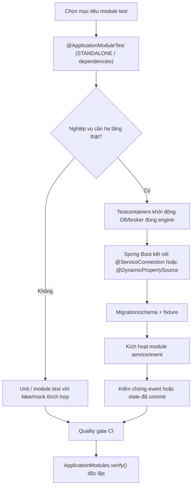
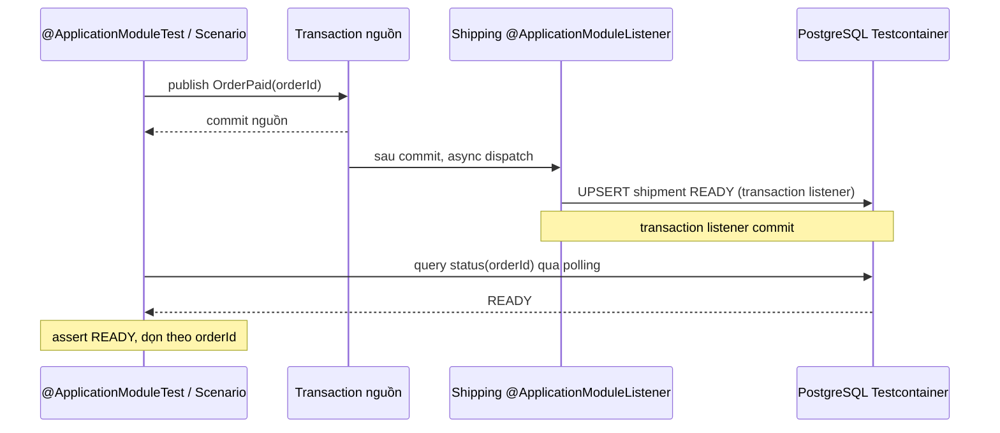

# Khi dùng Testcontainers cho module test

## 1. Mục tiêu học tập và câu trả lời ngắn

Trong học phần **SPRING_MODULITH_VERIFICATION_TESTING**, người học rèn kỹ năng kiểm chứng **ranh giới kiến trúc** bằng `ApplicationModules` và các quy tắc phụ thuộc module, đồng thời viết `@ApplicationModuleTest` kiểm tra sự kiện, cơ sở dữ liệu, tích hợp và dựng quality gate trong CI.

Chương **Testcontainers** trả lời câu hỏi: **Khi nào một module test của Spring Modulith cần một PostgreSQL, Kafka, RabbitMQ hoặc dịch vụ hạ tầng thật chạy trong container?**

**Nên dùng Testcontainers khi tính đúng đắn cần phụ thuộc vào hành vi của một hệ thống hạ tầng thật**, ví dụ:

- Transaction commit/rollback, isolation, khóa, unique constraint hoặc UPSERT theo PostgreSQL;
- Migration Flyway/Liquibase và mapping JPA/JDBC với database engine thực tế;
- Event Publication Registry có persistence, event listener ghi DB rồi đọc lại từ transaction khác;
- Kafka/RabbitMQ: topic, routing key, serialization, acknowledgment, consumer behavior;
- MongoDB, Redis, Elasticsearch hoặc service mà test double/H2 không mô phỏng đủ ngữ nghĩa.

**Không nên dùng Testcontainers chỉ vì một test có annotation `@ApplicationModuleTest`.** Nếu mục tiêu là kiểm chứng phụ thuộc module, business rule thuần Java hoặc một lời gọi collaborator qua interface, test không container có thể nhanh, rõ và đủ giá trị hơn.

> **Spring Modulith module test quyết định phạm vi Spring beans cần chạy. Testcontainers quyết định dịch vụ hạ tầng nào được chạy thật. Hai khái niệm bổ sung nhau, không thay thế nhau.**

Một test module tốt có thể **chạy riêng module `shipping` nhưng nối tới PostgreSQL thật**, đồng thời mock một client của hãng vận chuyển. Đó không phải là một end-to-end test toàn hệ thống.

## 2. Ma trận quyết định: có cần container không?

| Mục tiêu kiểm thử | Testcontainers? | Lý do |
| --- | --- | --- |
| `ApplicationModules.of(App.class).verify()` | **Không** | Kiểm chứng cấu trúc phụ thuộc code, không cần Docker. |
| Tính phí vận chuyển thuần Java | **Không** | Unit test thuần Java đủ và nhanh. |
| Một service gọi port `CarrierClient` | **Thường không** | Dùng mock/fake ở biên ngoài nếu chỉ kiểm tra cách phối hợp. |
| `@EventListener` phát event Spring đồng bộ không ghi DB | **Thường không** | Dùng `@ApplicationModuleTest` và `PublishedEvents` / `Scenario`. |
| JPA entity với PostgreSQL `jsonb`, UUID, custom query | **Có** | H2 không bảo đảm tương thích kiểu dữ liệu và SQL dialect. |
| Transaction rollback, isolation và unique constraint | **Có** | Phải kiểm tra bằng database engine thật của production. |
| `@ApplicationModuleListener` ghi DB trong transaction mới | **Nên dùng** | Phải xác minh commit và trạng thái quan sát được từ transaction độc lập. |
| Flyway/Liquibase migration hoạt động trên PostgreSQL | **Có** | Migration phải chạy được trên đúng database engine. |
| Kafka/RabbitMQ routing, serialization hoặc consumer | **Có** | Mock `ApplicationEventPublisher` không kiểm tra broker. |
| Full order→payment→shipping→external carrier | **Có thể cần nhiều container + integration scope khác** | Một `STANDALONE` module test không tự khởi động mọi module hay đối tác bên ngoài. |

**Câu hỏi quyết định:** “Nếu thay dịch vụ thật bằng fake/H2, test này có thể pass dù production sai không?” Nếu câu trả lời là **có**, Testcontainers thường mang lại giá trị đáng kể.

Ngược lại, nếu mục tiêu chỉ là bảo đảm `shipping` không phụ thuộc `order.internal`, việc dựng PostgreSQL làm tăng thời gian chạy mà không tăng khả năng phát hiện loại lỗi đó.

## 3. Testcontainers và `@ApplicationModuleTest` giải quyết hai trục khác nhau

`@ApplicationModuleTest` là test tích hợp kiểu Spring Boot có **giới hạn bootstrap theo application module**. Các chế độ cơ bản:

| Bootstrap mode | Spring beans được khởi động |
| --- | --- |
| `STANDALONE` (mặc định) | Module chứa lớp test. |
| `DIRECT_DEPENDENCIES` | Module hiện tại và các module mà nó phụ thuộc trực tiếp. |
| `ALL_DEPENDENCIES` | Module hiện tại và toàn bộ cây module upstream mà nó phụ thuộc. |

**Không suy luận** rằng `ALL_DEPENDENCIES` sẽ bật tất cả module **tiêu thụ event** theo chiều ngược lại. Ví dụ test nằm trong module `order` và listener ở `shipping` không tự được khởi động chỉ vì shipping sử dụng `OrderPaid`.

Một database Testcontainers thật **không thay đổi** phạm vi component scan của `@ApplicationModuleTest`. Nếu listener không nằm trong context, tạo thêm PostgreSQL container cũng không làm listener xuất hiện.



**Lựa chọn thiết kế tốt:** giữ **module scope nhỏ nhất có thể** và chỉ dựng đúng **dependency hạ tầng** cần kiểm tra. External HTTP API của carrier có thể được thay bằng `@MockitoBean`, trong khi PostgreSQL chạy thật để bắt lỗi transaction.

## 4. Một ví dụ thực tế: shipping ghi PostgreSQL sau event

Giả sử hệ thống có:

- Module `order` công bố `OrderPaid(orderId)`;
- Module `shipping` có listener `@ApplicationModuleListener` nhận event và tạo shipment;
- Dữ liệu shipment được lưu trong PostgreSQL;
- Một test cần chứng minh trạng thái `READY` đã **commit**, không chỉ là event xuất hiện.



Tại sao không dùng H2 ở ví dụ này? PostgreSQL hỗ trợ `ON CONFLICT` và kiểu `UUID`, và có quy tắc isolation/lock tương ứng. Một H2 chạy ở compatibility mode vẫn không nhất thiết tái hiện đủ những đặc tính đó.

Ở bài này, mã tham chiếu dùng **Testcontainers Java 2.x** và kiểu container mới `org.testcontainers.postgresql.PostgreSQLContainer`. Dự án dùng Testcontainers **1.x** phải sử dụng artifact/import tương ứng phiên bản cũ; không trộn API hai dòng.

## 5. Dependency: chọn bộ phiên bản tương thích

### 5.1. Maven cho Spring Boot và Testcontainers 2.x

Giả sử dự án đã quản lý dependency bằng **Spring Boot BOM/parent** tương thích và **Spring Modulith BOM** phù hợp:

```xml
<!-- Dependency runtime nếu module dùng JDBC/PostgreSQL -->
<dependency>
    <groupId>org.springframework.boot</groupId>
    <artifactId>spring-boot-starter-jdbc</artifactId>
</dependency>
<dependency>
    <groupId>org.postgresql</groupId>
    <artifactId>postgresql</artifactId>
    <scope>runtime</scope>
</dependency>

<!-- Test JUnit/Spring Modulith -->
<dependency>
    <groupId>org.springframework.modulith</groupId>
    <artifactId>spring-modulith-starter-test</artifactId>
    <scope>test</scope>
</dependency>

<!-- Testcontainers integration và PostgreSQL module 2.x -->
<dependency>
    <groupId>org.springframework.boot</groupId>
    <artifactId>spring-boot-testcontainers</artifactId>
    <scope>test</scope>
</dependency>
<dependency>
    <groupId>org.testcontainers</groupId>
    <artifactId>testcontainers-postgresql</artifactId>
    <scope>test</scope>
</dependency>
```

`spring-boot-starter-test` (JUnit 5, AssertJ, Spring Test) cũng phải có trong cấu hình kiểm thử nếu project chưa bổ sung. Nếu Spring Boot BOM của dự án **không** quản lý Testcontainers 2.x, cần khai báo BOM phiên bản 2.x nhất quán thay vì bỏ `<version>` một cách tùy tiện.

**Nếu dùng extension `@Testcontainers`/`@Container`**, bổ sung module JUnit 5 của Testcontainers 2.x:

```xml
<dependency>
    <groupId>org.testcontainers</groupId>
    <artifactId>testcontainers-junit-jupiter</artifactId>
    <scope>test</scope>
</dependency>
```

Trong ví dụ chính của bài, container là **Spring bean** do `@TestConfiguration` quản lý, nên không bắt buộc dùng JUnit extension `@Testcontainers`.

### 5.2. Phân biệt Testcontainers Java 1.x và 2.x

| Thành phần | Testcontainers 1.x | Testcontainers 2.x |
| --- | --- | --- |
| PostgreSQL artifact | `org.testcontainers:postgresql` | `org.testcontainers:testcontainers-postgresql` |
| JUnit Jupiter artifact | `org.testcontainers:junit-jupiter` | `org.testcontainers:testcontainers-junit-jupiter` |
| PostgreSQL import | `org.testcontainers.containers.PostgreSQLContainer` | `org.testcontainers.postgresql.PostgreSQLContainer` |
| Kiểu container | `PostgreSQLContainer<?>` (generic) | `PostgreSQLContainer` (không dùng generic) |

Một số class cũ có thể tồn tại để hỗ trợ chuyển đổi và được đánh dấu deprecated; **không nên** dựa vào chúng khi viết mã mới cho 2.x. Chọn một version set tương thích Spring Boot và Testcontainers mà dự án đang quản lý, không tự thêm các version khác nhau vào từng dependency.

### 5.3. Gradle tương đương (tham khảo)

```groovy
dependencies {
    implementation 'org.springframework.boot:spring-boot-starter-jdbc'
    runtimeOnly 'org.postgresql:postgresql'

    testImplementation 'org.springframework.boot:spring-boot-starter-test'
    testImplementation 'org.springframework.modulith:spring-modulith-starter-test'
    testImplementation 'org.springframework.boot:spring-boot-testcontainers'
    testImplementation 'org.testcontainers:testcontainers-postgresql'
}
```

Đoạn Gradle này giả định plugins/BOM của dự án quản lý version phù hợp. Cần thêm `testImplementation 'org.testcontainers:testcontainers-junit-jupiter'` **chỉ nếu** dùng JUnit extension trong mục 8.

## 6. Spring-managed container: `@TestConfiguration` + `@ServiceConnection`

Spring Boot hỗ trợ khai báo Testcontainers làm **bean của test context**. Khi bean dùng `@ServiceConnection`, Boot tạo `ConnectionDetails` cho dịch vụ tương ứng và tự động cấu hình datasource.

Đây là cách **ưu tiên trong ví dụ này** vì lifecycle container gắn với vòng đời Spring context. Nó giúp tránh một lỗi khó chịu: JUnit extension dừng `static @Container` ở cuối lớp test, trong khi TestContext cache vẫn giữ một `ApplicationContext` đang trỏ tới database đã tắt.

### 6.1. Test configuration

File `src/test/java/com/acme/shipping/PostgresTestConfiguration.java`:

```java
package com.acme.shipping;

import org.springframework.boot.test.context.TestConfiguration;
import org.springframework.boot.testcontainers.service.connection.ServiceConnection;
import org.springframework.context.annotation.Bean;
import org.testcontainers.postgresql.PostgreSQLContainer;

@TestConfiguration(proxyBeanMethods = false)
class PostgresTestConfiguration {

    @Bean
    @ServiceConnection
    PostgreSQLContainer postgresContainer() {
        return new PostgreSQLContainer("postgres:17-alpine")
                .withDatabaseName("shipping_test")
                .withUsername("test")
                .withPassword("test");
    }
}
```

Các điểm chính:

1. `PostgreSQLContainer` là type Testcontainers Java 2.x, không có dấu generic `<?>`.
2. `@TestConfiguration` là cấu hình **cho test**, không đưa vào cấu hình production.
3. `@Bean` cho phép Spring Boot quản lý việc start/stop container trước/sau các bean cần kết nối.
4. `@ServiceConnection` tạo thông tin kết nối, ví dụ JDBC connection details cho `DataSource`.
5. Host port của container được Testcontainers cấp phát; **không** cố định `localhost:5432`.
6. Credentials `test/test` dành cho container thử nghiệm, không phải secret production.

**Lưu ý:** Testcontainers cần Docker-compatible container runtime khả dụng trên máy hoặc CI. `@ServiceConnection` không thể làm PostgreSQL hoạt động khi không có runtime.

### 6.2. Import vào module test

```java
package com.acme.shipping;

import org.junit.jupiter.api.Test;
import org.springframework.context.annotation.Import;
import org.springframework.modulith.test.ApplicationModuleTest;

@ApplicationModuleTest
@Import(PostgresTestConfiguration.class)
class ShippingRepositoryModuleTests {

    @Test
    void startsWithRealPostgres() {
        // Ứng dụng đã bootstrap module shipping và kết nối PostgreSQL.
    }
}
```

`@Import` giúp cấu hình container được nạp một cách có chủ đích, ngay cả khi `@ApplicationModuleTest` giới hạn component scanning. **Không cần thêm `@SpringBootTest`** vì `@ApplicationModuleTest` đã tích hợp cách bootstrap Spring Boot test.

**Không nhầm:**

- `@ApplicationModuleTest`: chọn module cần khởi động;
- `@ServiceConnection`: nối bean cần dịch vụ tới container;
- `@Import`: đưa test configuration vào context;
- `@Testcontainers`: JUnit extension, **không cần** nếu lifecycle do Spring bean quản lý.

## 7. Dữ liệu kiểm thử: migration thật trước khi chạy assertion

Có PostgreSQL container chưa đủ; test phải có **schema giống ứng dụng đang dùng**. Nên dùng Flyway/Liquibase migration của dự án thay vì viết SQL tùy ý trong mọi method.

Ví dụ migration `src/main/resources/db/migration/V1__create_shipments.sql` (tên và version minh họa):

```sql
CREATE TABLE shipments (
    order_id UUID PRIMARY KEY,
    status   VARCHAR(32) NOT NULL,
    carrier  VARCHAR(32) NOT NULL
);
```

Nếu dự án đang có migration version khác, dùng version kế tiếp phù hợp; đừng tạo thêm một `V1` trùng. Với Spring Boot và Flyway/Liquibase được cấu hình đúng, migration chạy vào PostgreSQL container trong quá trình bootstrap.

**Vì sao chạy migration thật?**

- Phát hiện syntax SQL không tương thích;
- Phát hiện thiếu index, constraint, quan hệ khóa ngoại;
- Phát hiện mapping sai giữa Java `UUID` và PostgreSQL `uuid`;
- Phát hiện thay đổi schema mà unit test với mock repository không thấy.

Không nên dựa vào `hibernate.hbm2ddl.auto=create-drop` như phép thay thế cho việc kiểm chứng migration production nếu mục tiêu của test là tương thích schema thật.

## 8. Ví dụ hoàn chỉnh: module shipping với PostgreSQL thật

### 8.1. Event public của module order

File `src/main/java/com/acme/order/OrderPaid.java`:

```java
package com.acme.order;

import java.util.UUID;

public record OrderPaid(UUID orderId) {}
```

Event ở package gốc `com.acme.order` là API công khai mặc định của module `order`. Nếu event được đặt trong subpackage, hãy công bố qua named interface phù hợp để không vi phạm ranh giới Spring Modulith.

### 8.2. Repository JDBC của module shipping

File `src/main/java/com/acme/shipping/ShipmentRepository.java`:

```java
package com.acme.shipping;

import java.util.List;
import java.util.Optional;
import java.util.UUID;

import org.springframework.jdbc.core.JdbcTemplate;
import org.springframework.stereotype.Repository;

@Repository
class ShipmentRepository {

    private final JdbcTemplate jdbc;

    ShipmentRepository(JdbcTemplate jdbc) {
        this.jdbc = jdbc;
    }

    void upsertReady(UUID orderId) {
        jdbc.update("""
                INSERT INTO shipments(order_id, status, carrier)
                VALUES (?, 'READY', 'STANDARD')
                ON CONFLICT (order_id)
                DO UPDATE SET
                    status = EXCLUDED.status,
                    carrier = EXCLUDED.carrier
                """, orderId);
    }

    Optional<String> findStatus(UUID orderId) {
        List<String> rows = jdbc.query("""
                SELECT status FROM shipments
                WHERE order_id = ?
                """,
                (rs, rowNum) -> rs.getString(1),
                orderId);

        return rows.stream().findFirst();
    }

    int countByOrderId(UUID orderId) {
        Integer result = jdbc.queryForObject(
                "SELECT count(*) FROM shipments WHERE order_id = ?",
                Integer.class, orderId);
        return result == null ? 0 : result;
    }

    void delete(UUID orderId) {
        jdbc.update("DELETE FROM shipments WHERE order_id = ?", orderId);
    }
}
```

`INSERT ... ON CONFLICT` là **cú pháp PostgreSQL**. Đây chính là một ví dụ mà H2/SQLite có thể có hành vi, syntax hoặc constraint semantics khác. Testcontainers giúp xác nhận query thực sự chạy trên PostgreSQL.

`upsertReady` còn mang ý nghĩa **idempotent effect** ở cấp bản ghi: nếu event được xử lý lại cho cùng `orderId`, database giữ một shipment, không tạo thêm record thứ hai.

### 8.3. Listener giao dịch sau commit

File `src/main/java/com/acme/shipping/ShippingHandler.java`:

```java
package com.acme.shipping;

import com.acme.order.OrderPaid;
import org.springframework.modulith.events.ApplicationModuleListener;
import org.springframework.stereotype.Component;

@Component
class ShippingHandler {

    private final ShipmentRepository shipments;

    ShippingHandler(ShipmentRepository shipments) {
        this.shipments = shipments;
    }

    @ApplicationModuleListener
    public void on(OrderPaid event) {
        shipments.upsertReady(event.orderId());
    }
}
```

`@ApplicationModuleListener` đại diện cho listener giao dịch, chạy bất đồng bộ sau khi transaction nguồn commit, và xử lý trong transaction mới. Nếu handler ghi DB, sự hoàn tất nghiệp vụ được quan sát qua **trạng thái đã commit**, không phải chỉ qua việc gọi `publishEvent`.

Ứng dụng thực phải có cấu hình event/async phù hợp. Nếu module test không bật listener hoặc thiếu transaction manager, Testcontainers **không tự khắc phục** vấn đề đó.

### 8.4. Module test: một stimulus, một trạng thái DB đã commit

File `src/test/java/com/acme/shipping/ShippingPostgresModuleTest.java`:

```java
package com.acme.shipping;

import static org.assertj.core.api.Assertions.assertThat;

import java.time.Duration;
import java.util.UUID;

import com.acme.order.OrderPaid;
import org.junit.jupiter.api.Test;
import org.springframework.beans.factory.annotation.Autowired;
import org.springframework.context.annotation.Import;
import org.springframework.modulith.test.ApplicationModuleTest;
import org.springframework.modulith.test.Scenario;
import org.springframework.transaction.support.TransactionTemplate;

@ApplicationModuleTest
@Import(PostgresTestConfiguration.class)
class ShippingPostgresModuleTest {

    @Autowired ShipmentRepository shipments;
    @Autowired TransactionTemplate transactions;

    @Test
    void persistsShipmentAfterOrderPaid(Scenario scenario) {
        UUID orderId = UUID.randomUUID();

        // GIVEN: Không có shipment cũ cho ID của test.
        assertThat(shipments.findStatus(orderId)).isEmpty();

        // WHEN: phát một event trong transaction do Scenario quản lý.
        scenario.publish(new OrderPaid(orderId))
                .andCleanup(() ->
                        transactions.executeWithoutResult(tx ->
                                shipments.delete(orderId)))
                .andWaitAtMost(Duration.ofSeconds(8))
                .forStateChange(
                        () -> shipments.findStatus(orderId),
                        status -> status.filter("READY"::equals)
                                .isPresent())
                .andVerify(status -> {
                    assertThat(status).contains("READY");
                    assertThat(shipments.countByOrderId(orderId))
                            .isEqualTo(1);
                });
    }
}
```

**Luồng chạy:**

1. Spring Boot khởi động PostgreSQL container, tạo `DataSource` qua `@ServiceConnection` và áp dụng migration.
2. Spring Modulith khởi động **module shipping** trong phạm vi `@ApplicationModuleTest`.
3. `Scenario.publish(...)` gửi `OrderPaid` trong transaction mới.
4. `@ApplicationModuleListener` của shipping xử lý sau commit trong transaction riêng.
5. `forStateChange(...)` poll PostgreSQL cho đến khi tìm thấy `READY`.
6. `andVerify(...)` assert trạng thái cùng số bản ghi đúng ID.
7. `andCleanup(...)` dọn record mà listener đã commit, qua transaction hợp lệ.

**Điểm then chốt:** test không dùng `Thread.sleep(...)`, và không giả định event đã được phát đồng nghĩa với DB đã commit. `Duration.ofSeconds(8)` chỉ là deadline minh họa, cần điều chỉnh bằng số đo của CI.

**Ràng buộc vận hành:** test trên cần JUnit/Spring dependencies, PostgreSQL JDBC driver, schema migration, transaction infrastructure và Docker-compatible runtime. Không chạy được chỉ bằng một file Java độc lập.

## 9. Khi nào nên dùng `Scenario`, khi nào assert repository trực tiếp?

Testcontainers phục vụ **infrastructure fidelity**. Nó không bắt buộc DSL `Scenario` trong mọi test.

### Kiểm thử repository trực tiếp

```java
@Test
void upsertsWithoutDuplicate() {
    UUID orderId = UUID.randomUUID();

    try {
        shipments.upsertReady(orderId);
        shipments.upsertReady(orderId);

        assertThat(shipments.findStatus(orderId))
                .contains("READY");
        assertThat(shipments.countByOrderId(orderId))
                .isEqualTo(1);
    } finally {
        transactions.executeWithoutResult(tx ->
                shipments.delete(orderId));
    }
}
```

Đặt method này trong lớp `@ApplicationModuleTest` có container và repository như ví dụ trước.

**Nó chứng minh:** SQL UPSERT và unique constraint hoạt động trên PostgreSQL thật.

**Nó chưa chứng minh:** event `OrderPaid` được shipping listener xử lý đúng. Để kiểm chứng luồng event/transaction sau commit, dùng `Scenario.publish` hoặc `stimulate`.

### Kiểm thử module event + DB

```java
scenario.publish(new OrderPaid(orderId))
        .andWaitForStateChange(
                () -> shipments.findStatus(orderId),
                status -> status.filter("READY"::equals).isPresent())
        .andVerify(status -> assertThat(status).contains("READY"));
```

**Nó chứng minh:** luồng module từ event đầu vào đến state đã quan sát được.

**Nó chưa chứng minh:** gateway của hãng vận chuyển đã nhận request hay một Kafka consumer bên ngoài đã hoàn tất.

Hãy chọn kiểu test theo **rủi ro cần phát hiện**, không theo số annotation có thể sử dụng.

## 10. `@DynamicPropertySource`: lựa chọn khi không dùng `@ServiceConnection`

Spring Boot hỗ trợ cách đăng ký connection properties thủ công. Phương pháp này vẫn hữu ích khi dự án có phiên bản Boot cũ, dịch vụ chưa được `ServiceConnection` hỗ trợ, hoặc cần cấu hình đặc biệt.

Ví dụ **thay thế**, không dùng cùng lúc với cấu hình `@ServiceConnection` ở mục 6:

```java
package com.acme.shipping;

import org.junit.jupiter.api.Test;
import org.springframework.modulith.test.ApplicationModuleTest;
import org.springframework.test.context.DynamicPropertyRegistry;
import org.springframework.test.context.DynamicPropertySource;
import org.testcontainers.junit.jupiter.Container;
import org.testcontainers.junit.jupiter.Testcontainers;
import org.testcontainers.postgresql.PostgreSQLContainer;

@Testcontainers
@ApplicationModuleTest
class ShippingDynamicPropertiesTest {

    @Container
    static PostgreSQLContainer postgres =
            new PostgreSQLContainer("postgres:17-alpine");

    @DynamicPropertySource
    static void registerDatabase(DynamicPropertyRegistry registry) {
        registry.add("spring.datasource.url", postgres::getJdbcUrl);
        registry.add("spring.datasource.username", postgres::getUsername);
        registry.add("spring.datasource.password", postgres::getPassword);
    }

    @Test
    void canUsePostgres() {
        // Repository tests chạy trên datasource từ container.
    }
}
```

**Lưu ý:**

- Cần `testcontainers-junit-jupiter` của Testcontainers 2.x;
- `@Testcontainers` + `@Container` chịu trách nhiệm lifecycle theo **JUnit test class**;
- `@DynamicPropertySource` nối URL, username, password tới Spring Environment;
- Không hard-code host port: lấy `getJdbcUrl()` từ container;
- Nếu nhiều lớp test dùng Spring TestContext cache, có nguy cơ **context được giữ lại sau khi class-level container đã dừng**. Cân nhắc Spring-managed `@Bean @ServiceConnection` cho test cần lifecycle bền với context.

**Không nhầm `@ServiceConnection` và `@DynamicPropertySource`:** đây là hai cách cung cấp thông tin kết nối, không phải hai bước bắt buộc cùng thực hiện.

## 11. Đời sống container, Spring context và dữ liệu giữa các test

Để test ổn định, cần hiểu ba vòng đời khác nhau:

| Vòng đời | Ví dụ | Ai quản lý? |
| --- | --- | --- |
| **Container process** | PostgreSQL, Kafka, RabbitMQ | Spring Boot khi container là bean; JUnit extension khi dùng `@Container` |
| **Spring `ApplicationContext`** | Beans, datasource pool, listener, caches | Spring TestContext cache |
| **Database data** | Rows, schema, event registry publications | SQL/migration/transaction/cleanup của test |

Một `PostgreSQLContainer` được tái sử dụng có thể giúp giảm thời gian startup, nhưng **dữ liệu bên trong cũng được giữ lại**. Không giả định “container vẫn chạy” nghĩa là mỗi method có DB trắng.

### Những anti-pattern nguy hiểm

- Mỗi test dùng cùng `orderId = 1` hoặc cùng UUID cố định;
- Test B phụ thuộc dữ liệu do test A tạo;
- Gọi `deleteAll()` trong `@AfterEach` khi test song song cùng DB;
- `@Transactional` trên test rồi giả định rollback sẽ undo transaction của `Scenario.publish` và `@ApplicationModuleListener`;
- Dọn DB ngay khi thấy event đầu ra nhưng transaction listener chưa commit;
- Bật container reuse không kiểm soát trong CI.

### Chiến lược cách ly đáng tin

1. **Mỗi test có `UUID.randomUUID()`/business key riêng.**
2. **Mọi query, event matcher và cleanup lọc đúng business key đó.**
3. Nếu cần Given ở DB, **commit fixture trước khi listener chạy trong transaction khác**.
4. **Chờ state cuối đã commit**, rồi cleanup.
5. Khi test cần database trống tuyệt đối, cấp schema/database/container riêng theo suite phù hợp.
6. Khi chạy song song, bảo đảm không test nào xóa/đổi global fixture của test khác.

`@DirtiesContext` có thể làm Spring xây lại context, nhưng nó **không tự xóa database** hoặc message ngoài. Không dùng nó làm giải pháp dọn dữ liệu mặc định.

## 12. Transaction: PostgreSQL container làm lộ lỗi mà H2 có thể che

Ví dụ `@ApplicationModuleListener` vừa ghi DB vừa phát event:

```java
@ApplicationModuleListener
public void on(OrderPaid paid) {
    shipments.upsertReady(paid.orderId());
    events.publishEvent(
            new ShipmentPrepared(paid.orderId(), "STANDARD"));
}
```

Khi event `ShipmentPrepared` được phát **bên trong transaction listener**, một test `Scenario.andWaitForEventOfType(...)` có thể bắt được event **trước khi transaction ghi DB commit**.

**Nếu hợp đồng là “DB đã READY”**, dùng:

```java
scenario.publish(new OrderPaid(orderId))
        .andWaitForStateChange(
                () -> shipments.findStatus(orderId),
                value -> value.filter("READY"::equals).isPresent())
        .andVerify(value -> assertThat(value).contains("READY"));
```

Test trên kiểm tra bằng chính PostgreSQL thật. Truy vấn qua transaction đọc riêng có thể thấy state sau commit, thay vì suy ra từ thời điểm một Java event được phân phối.

### `@Transactional` trên method test không đủ rollback

Spring TestContext rollback transaction **do test quản lý** sau phương thức `@Transactional`. Nhưng `Scenario.publish(...)` chạy stimulus trong transaction mới và `@ApplicationModuleListener` xử lý trong transaction riêng. Dữ liệu đã commit từ các transaction độc lập không tự rollback theo test-managed transaction.

Vì vậy, dùng `andCleanup(...)` hoặc chiến lược dọn DB có chủ đích, và lưu ý listener còn chạy nền có thể tái tạo row sau cleanup nếu điều kiện chờ quá yếu.

## 13. Dùng container broker: khác Spring application event

`Scenario.publish(new OrderPaid(...))` phát **Spring application event trong `ApplicationContext`**. Nó không tự là Kafka producer/RabbitMQ publisher.

Nếu module có contract cần xác minh **serialize event rồi gửi Kafka**, dùng một Kafka Testcontainer và một producer/consumer test thực tế. Nếu contract cần xác minh **routing/exchange/queue**, dùng RabbitMQ container thật.

### So sánh

| Hành vi cần chứng minh | Hạ tầng test thích hợp |
| --- | --- |
| `@EventListener` đã nhận Spring event trong một module | Có thể chỉ cần `@ApplicationModuleTest`, không container. |
| Module ghi Spring event publication registry vào DB thật | PostgreSQL (hoặc DB production tương ứng) Testcontainer. |
| Event externalization đến Kafka topic đúng, consumer nhận payload | Kafka container + Spring Kafka client + assertion consumer. |
| RabbitMQ exchange/routing key/binding hoạt động | RabbitMQ container + client/Spring AMQP. |
| Gọi carrier REST API theo hợp đồng | Mock/fake HTTP server cho module test; integration contract test ở biên thích hợp. |

**Không nên chạy tất cả broker** trong mọi module test nếu chỉ một số test liên quan. Container đắt hơn test thuần code; đặt chúng trong profile/suite tích hợp có chủ đích.

Nếu viết test cho externalized events, kết quả `PublishedEvents` của Spring Modulith chỉ phản ánh Spring application events đã ghi nhận. Nó **không thay thế** quan sát broker hoặc effect của consumer.

## 14. CI: runtime, image, resource và bảo mật

Testcontainers dùng Docker-compatible runtime. Trên CI, trước khi chạy test, kiểm tra:

- Runner có quyền dùng container runtime và có thể pull image;
- Java/Testcontainers version khớp Spring Boot/test starter;
- PostgreSQL image tag được pin (ví dụ `postgres:17-alpine`), không dùng `latest`;
- Có đủ RAM/CPU/disk cho DB và các test khác;
- Network/rate limit của registry không khiến pull image thất bại thường xuyên;
- Container cleanup hoạt động, tránh rò rỉ resource;
- Nếu CI chạy job song song, ID/DB/schema của mỗi job không va chạm.

**Lưu ý an toàn:** việc cấp quyền truy cập Docker daemon/socket cho job CI không đáng tin có rủi ro bảo mật. Thiết kế runner tách biệt, chỉ cấp quyền cần thiết, không gắn Docker socket production vào pipeline chạy mã chưa được kiểm tra.

### Nên chia test theo tầng

```text
Quality gate ví dụ
├── 1. Unit test thuần Java (nhanh, không Docker)
├── 2. ApplicationModules.verify() (kiến trúc)
├── 3. @ApplicationModuleTest không container
├── 4. @ApplicationModuleTest + PostgreSQL Testcontainer
└── 5. Broker / full integration tests khi cần
```

Có thể chạy các tầng 1–3 trên mỗi thay đổi, và tầng 4–5 ở CI stage có container runtime. Quyết định bắt buộc/chọn lọc tùy mức rủi ro của dự án; **không** bỏ qua test DB/broker ở release gate nếu chính hành vi đó là trọng tâm production.

Một pipeline Maven có thể dùng `./mvnw test` nếu mọi test thuộc lifecycle đó, hoặc tách nhóm integration test bằng Surefire/Failsafe cấu hình trong dự án. Với Gradle có thể dùng `./gradlew test` và một integrationTest task riêng. Tên task phải dựa trên cấu hình build thực tế, không mặc định dự án đã có task tích hợp.

### Cân bằng tốc độ và độ tin cậy

- **Ưu tiên container do Spring quản lý** khi TestContext cache được tái sử dụng;
- Tránh khởi động nhiều PostgreSQL tương đương cho những test có thể chia sẻ một cấu hình;
- Dữ liệu **không được chia sẻ** chỉ vì container được chia sẻ;
- Pin image, tận dụng image cache CI khi có thể;
- Dùng readiness mechanism của Testcontainers, không `Thread.sleep(...)` để đợi DB;
- Sau container readiness, vẫn dùng `Scenario` để **chờ nghiệp vụ async** đạt event/state;
- Dùng deadline hữu hạn và log theo correlation ID để điều tra timeout.

## 15. Các lỗi thường gặp và cách chẩn đoán

| Triệu chứng | Nguyên nhân có thể | Hướng kiểm tra |
| --- | --- | --- |
| `Could not find a valid Docker environment` | Container runtime không chạy/không được phép truy cập | Kiểm tra Docker daemon/runner permissions. |
| Docker pull thất bại | Sai tag image, rate limit, registry/network | Pin tag, kiểm tra registry và cache. |
| `NoClassDefFoundError` với `PostgreSQLContainer` | Trộn Testcontainers 1.x/2.x artifact/import | Kiểm tra dependency tree, dùng đúng package/bộ version. |
| `No qualifying bean of type DataSource` | Thiếu JDBC starter/driver hoặc service connection config | Kiểm tra dependency và `@Import(TestConfiguration)`. |
| `Connection refused` dù container có vẻ đã chạy | Datasource trỏ localhost cố định hoặc container đã dừng | Dùng `@ServiceConnection`/URL động, kiểm tra lifecycle. |
| `relation "shipments" does not exist` | Migration chưa chạy hoặc sai schema | Kiểm tra Flyway/Liquibase, schema hiện tại. |
| `syntax error at or near ON CONFLICT` | Test không thực sự nối PostgreSQL hoặc SQL sai | In datasource metadata, kiểm tra image/dialect. |
| Duplicate key khi chạy suite | ID cố định, cleanup thiếu, retry không idempotent | UUID riêng, cleanup theo ID, UPSERT/ràng buộc DB. |
| Event test timeout, DB không thay đổi | Listener không được boot, transaction sai hoặc lỗi async | Kiểm tra `@ApplicationModuleTest` scope, commit, log listener. |
| Event test pass nhưng DB test fail | Event đến trước commit của listener | Chờ state DB đã commit bằng `andWaitForStateChange`. |
| Test pass riêng nhưng fail khi chạy cùng lớp khác | Context cache đang trỏ tới container JUnit đã stop | Chuyển container thành Spring bean hoặc quản lý lifecycle phù hợp. |
| Test chạy rất chậm | Pull/start container lặp lại, migration nặng, quá nhiều services | Tái sử dụng context hợp lệ, tách test levels và tối ưu setup. |

### Runbook ngắn khi module test PostgreSQL lỗi

1. **Container có start không?** Kiểm tra Docker runtime, image, Testcontainers logs.
2. **Spring có dùng đúng datasource không?** Kiểm tra `@ServiceConnection` hoặc `@DynamicPropertySource`.
3. **Schema có đúng không?** Xác nhận migration và table/column cần test.
4. **Bean listener có trong context không?** `@ApplicationModuleTest` giới hạn module.
5. **Transaction đã commit chưa?** Nhất là `@ApplicationModuleListener` sau commit.
6. **Query/predicate có đúng `orderId` và state đích không?** Không đợi sai event type.
7. **Cleanup và test isolation có đầy đủ không?** Kiểm tra các test chạy song song.
8. **Lỗi phát sinh ở code production hay hạ tầng?** Đọc root cause, không chỉ tăng timeout.

## 16. Kiểm chứng kiến trúc phải độc lập với Docker

Một phép kiểm kiến trúc mẫu:

```java
import org.junit.jupiter.api.Test;
import org.springframework.modulith.core.ApplicationModules;

class ModuleArchitectureTests {

    @Test
    void modulesRespectBoundaries() {
        ApplicationModules.of(Application.class).verify();
    }
}
```

`Application.class` là lớp Spring Boot application của dự án, cần thay bằng class thật. Test này kiểm tra cấu trúc module, phụ thuộc vòng, API package và các luật được khai báo; **không** cần PostgreSQL hay Kafka.

`@ApplicationModuleTest` có thể tự kích hoạt kiểm chứng cấu trúc tùy version/cấu hình, nhưng một test kiến trúc minh bạch trong quality gate vẫn hữu ích để tách lỗi cấu trúc khỏi lỗi môi trường Docker.

Không thay `ApplicationModules.verify()` bằng Testcontainers. Ngược lại, phép kiểm kiến trúc không cho biết SQL `ON CONFLICT` đúng hay transaction listener đã commit; hai loại kiểm thử giải quyết những rủi ro khác nhau.

## 17. Checklist chọn Testcontainers cho một module

- [ ] Đã xác định rủi ro nghiệp vụ cần engine DB/broker thật, thay vì chỉ muốn tăng “integration coverage”.
- [ ] `@ApplicationModuleTest` đặt trong đúng package module và có bootstrap mode thích hợp.
- [ ] External dependencies không liên quan được mock ở **biên** để test chỉ dựng hạ tầng cần thiết.
- [ ] Đã chọn bộ phiên bản Spring Boot/Spring Modulith/Testcontainers tương thích.
- [ ] Testcontainers 2.x dùng `testcontainers-postgresql` và `org.testcontainers.postgresql.PostgreSQLContainer`.
- [ ] Có Docker-compatible runtime trên local và CI.
- [ ] Container được nối bằng `@ServiceConnection` hoặc `@DynamicPropertySource` đúng cách, không cứng host port.
- [ ] Đã kiểm chứng container lifecycle phù hợp Spring TestContext cache.
- [ ] Schema migration production chạy trong test container.
- [ ] Fixture dùng ID riêng và đã commit nếu listener async cần đọc.
- [ ] Kiểm chứng **event** khi contract là event, **state DB** khi contract là dữ liệu đã commit.
- [ ] `Scenario` có deadline hữu hạn và matcher/predicate theo correlation ID.
- [ ] Cleanup dữ liệu đã commit và không xóa của test khác.
- [ ] Test kết quả idempotent khi event có thể retry/resubmit.
- [ ] Quality gate có `ApplicationModules.verify()` độc lập với container test.
- [ ] Container images được pin và CI đủ tài nguyên, quyền và giám sát lỗi.

## 18. Bài tập thực hành

1. **Chọn tầng kiểm thử:** Một module `pricing` tính giá từ tham số thuần Java. Có nên khởi động PostgreSQL container để kiểm tra công thức? Vì sao?
2. **Kiến trúc vs hạ tầng:** Module `shipping` import `com.acme.order.internal.OrderRepositoryImpl`. Testcontainers có phát hiện sai ranh giới không? Phép kiểm nào cần?
3. **SQL thật:** Repository dùng `INSERT ... ON CONFLICT` và kiểu PostgreSQL `uuid`. Viết lý do H2 có thể cho tín hiệu sai và vì sao nên dùng Postgres Testcontainer.
4. **@ServiceConnection:** Giải thích vai trò của `@TestConfiguration`, `@Bean`, `@ServiceConnection` và `@Import` trong module test.
5. **Version migration:** Chuyển một test từ Testcontainers 1.x sang 2.x. Đổi artifact PostgreSQL, JUnit Jupiter và import như thế nào?
6. **Context cache:** Một `static @Container` dừng sau test class A nhưng Spring context có thể được tái dùng trong test class B. Lỗi nào xảy ra, có giải pháp lifecycle nào tốt?
7. **Event và DB:** Listener xử lý `OrderPaid`, upsert shipment rồi commit. Viết `Scenario.publish` với `andWaitForStateChange(...)` chờ `READY` mà không dùng `Thread.sleep`.
8. **Idempotency:** Phát lại `OrderPaid` cùng `orderId`. Viết test chứng minh PostgreSQL có đúng một shipment.
9. **Fixture:** Vì sao việc insert order trong `@Transactional` test chưa commit có thể khiến listener `@ApplicationModuleListener` không đọc được?
10. **Broker:** Một test `PublishedEvents` thấy `ShipmentRequested`. Cần bổ sung gì để chứng minh Kafka consumer đã nhận message?
11. **Docker trên CI:** Liệt kê ít nhất bốn điều kiện runner cần có để chạy Testcontainers ổn định và an toàn.
12. **Timeout:** Container đã “ready” nhưng test vẫn timeout chờ shipment. Nêu ba nguyên nhân ở tầng Spring Modulith không liên quan tới container startup.
13. **Cleanup:** Hai test chạy song song cùng PostgreSQL container. Vì sao `deleteAll()` sau mỗi test nguy hiểm? Cách thay thế?
14. **Quality gate:** Thiết kế một pipeline có unit test, architecture verify, module test không Docker và module test có PostgreSQL; nêu mục đích mỗi tầng.

**Gợi ý:** (1) không, unit test đủ; (2) `ApplicationModules.verify()`; (3) dialect/isolation/mapping; (4) Spring-managed container + connection details; (5) `testcontainers-postgresql`, `testcontainers-junit-jupiter`, import mới; (6) Spring bean container hoặc lifecycle có kiểm soát; (7) state predicate READY; (8) assert count = 1; (9) transaction khác không thấy uncommitted data; (10) broker test; (11) runtime/permissions/image/resources/security; (12) listener scope, commit, matcher; (13) cleanup theo ID; (14) mỗi tầng bắt loại lỗi khác nhau.

## Tài liệu tham khảo

- [Spring Modulith — Integration Testing Application Modules](https://docs.spring.io/spring-modulith/reference/testing.html): `@ApplicationModuleTest`, bootstrap modes và phạm vi module.
- [Spring Modulith — Working with Application Events](https://docs.spring.io/spring-modulith/reference/events.html): `@ApplicationModuleListener`, event publication và transaction.
- [Spring Modulith — Verifying Application Module Structure](https://docs.spring.io/spring-modulith/reference/verification.html): kiểm chứng kiến trúc độc lập bằng `ApplicationModules.verify()`.
- [Spring Boot — Testcontainers Integration](https://docs.spring.io/spring-boot/reference/testing/testcontainers.html): container beans, JUnit extension, `@ServiceConnection`, lifecycle và caching.
- [Spring Boot — Development-time Services](https://docs.spring.io/spring-boot/reference/features/dev-services.html): `@TestConfiguration` và Spring-managed container.
- [Testcontainers for Java — PostgreSQL Module](https://java.testcontainers.org/modules/databases/postgres/): PostgreSQL container, module dependency và JDBC.
- [Testcontainers for Java — JUnit 5 Quickstart](https://java.testcontainers.org/quickstart/junit_5_quickstart/): `@Testcontainers` và `@Container`.
- [Testcontainers Java 2.0 Release Notes](https://github.com/testcontainers/testcontainers-java/releases/tag/2.0.0): đổi tên artifact và package module.
- [Spring Framework — Dynamic Property Sources](https://docs.spring.io/spring-framework/reference/testing/annotations/integration-spring/annotation-dynamicpropertysource.html): cấu hình datasource động trong test.
- [Spring Framework — Context Caching](https://docs.spring.io/spring-framework/reference/testing/testcontext-framework/ctx-management/caching.html): Spring context cache và giới hạn lifecycle.
