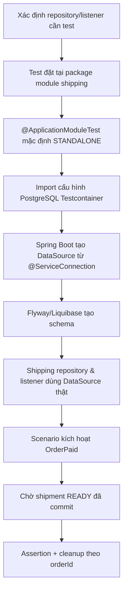
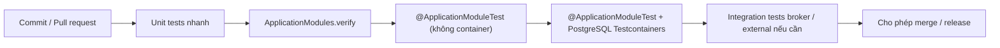

# Khởi tạo database container cho module mục tiêu

## 1. Mục tiêu bài học

Trong học phần **SPRING_MODULITH_VERIFICATION_TESTING**, việc kiểm chứng ứng dụng Spring Modulith gồm hai hướng: bảo vệ ranh giới module bằng `ApplicationModules` và các quy tắc phụ thuộc; kiểm chứng hành vi bằng `@ApplicationModuleTest`, sự kiện, cơ sở dữ liệu, tích hợp và quality gate trong CI.

Chủ đề **“Khởi tạo database container cho module mục tiêu”** tập trung vào một nhiệm vụ cụ thể:

> Khởi động một database tương đương môi trường ứng dụng thật, nối nó với Spring context của **module đang được kiểm thử**, áp dụng schema/migration phù hợp, tạo dữ liệu độc lập và xác minh kết quả nghiệp vụ đã được commit.

Không nhất thiết phải khởi động **toàn bộ ứng dụng** chỉ vì muốn dùng PostgreSQL thật. `@ApplicationModuleTest` giới hạn các bean thuộc module mục tiêu; Testcontainers cung cấp **hạ tầng chạy trong container** cho những bean đó.

Kết thúc bài, bạn cần làm được:

1. Xác định module nào sở hữu repository, listener và bảng dữ liệu cần kiểm thử.
2. Cấu hình PostgreSQL Testcontainer với Spring Boot `@ServiceConnection`.
3. Đưa container vào `@ApplicationModuleTest` bằng `@TestConfiguration` và `@Import`.
4. Chạy migration, kiểm tra datasource đã nối tới PostgreSQL thật và đọc/ghi dữ liệu.
5. Viết `Scenario` để kiểm chứng listener bất đồng bộ đã commit trạng thái DB.
6. Cô lập dữ liệu giữa các test, quản lý transaction, cleanup và khắc phục lỗi trên CI.

**Phạm vi ví dụ:** module `shipping` xử lý `OrderPaid` rồi tạo bản ghi shipment trong PostgreSQL. Bài dùng **Testcontainers Java 2.x**; với dự án dùng 1.x cần đổi dependency và package import tương ứng, không ghép lẫn API hai nhánh.

## 2. Phân biệt module mục tiêu và database container

Trong Spring Modulith, application module là **ranh giới mã và Spring beans**, không tự động là một database/schema riêng.

| Khái niệm | Ví dụ | Trách nhiệm |
| --- | --- | --- |
| **Module mục tiêu** | `com.acme.shipping` | Chứa repository, service, listener và quy tắc nghiệp vụ cần kiểm thử. |
| **Module cung cấp input contract** | `com.acme.order` | Công bố event `OrderPaid` trong API công khai. |
| **Bootstrap của bài test** | `@ApplicationModuleTest` | Chọn những module/bean có mặt trong Spring context. |
| **Database container** | PostgreSQL trong Testcontainers | Cung cấp SQL dialect, transaction, constraint và connection thực tế. |
| **Schema/migration** | `shipments`, Flyway/Liquibase | Tạo cấu trúc dữ liệu mà module sẽ sử dụng. |
| **Scenario** | `scenario.publish(new OrderPaid(id))` | Kích hoạt module rồi chờ event hoặc trạng thái cuối. |

Ví dụ, một ứng dụng dùng **một PostgreSQL chung cho cả order và shipping**. Trong module test shipping:

- Không cần khởi động tất cả service của order;
- Có thể chỉ import type `OrderPaid` thuộc API công khai của order;
- Repository shipping vẫn sử dụng **PostgreSQL container của test**;
- Những schema/table thực tế phụ thuộc vào migration mà test thực thi, **không phụ thuộc đơn giản vào việc module nào được bootstrap**.

**Sai lầm thường gặp:** `@ApplicationModuleTest` lọc bean và entity scan theo module, **không có nghĩa nó tự sinh database chỉ chứa bảng của module**. Database được tạo/cấu hình bởi datasource và migration; bạn phải chủ động quyết định áp dụng migration toàn ứng dụng hay nhóm migration thuộc module mục tiêu.

## 3. Chọn module trước khi khởi tạo database

Giả sử cấu trúc logic:

```text
com.acme
├── Application.java                  # Spring Boot application
├── order/
│   └── OrderPaid.java                # Public event contract
└── shipping/
    ├── ShipmentRepository.java       # JDBC / JPA
    ├── ShippingHandler.java          # @ApplicationModuleListener
    └── ShippingService.java          # Nghiệp vụ shipping
```

Đặt lớp test trong package `com.acme.shipping` hoặc subpackage của nó:

```java
package com.acme.shipping;

import org.springframework.modulith.test.ApplicationModuleTest;

@ApplicationModuleTest
class ShippingDatabaseIntegrationTests {
    // Các test shipping sẽ ở đây.
}
```

`@ApplicationModuleTest` mặc định dùng bootstrap mode `STANDALONE` — chủ yếu khởi động module chứa lớp test. Nó không tự khởi động những module **tiêu thụ event** ở chiều ngược lại.

| Mode | Module được bootstrap | Khi dùng |
| --- | --- | --- |
| `STANDALONE` | Module hiện tại | Ưu tiên khi test repository/listener trong module shipping. |
| `DIRECT_DEPENDENCIES` | Module hiện tại và module mà nó phụ thuộc trực tiếp | Khi cần chạy thật một dependency trực tiếp. |
| `ALL_DEPENDENCIES` | Toàn bộ cây phụ thuộc của module mục tiêu | Khi test yêu cầu nhiều upstream module, chấp nhận context rộng hơn. |

Chỉ mở rộng mode khi có mục tiêu rõ ràng. Một lỗi `NoSuchBeanDefinitionException` của cộng tác viên **ngoài module** có thể được xử lý bằng mock tại biên, thay vì khởi động cả ứng dụng.



## 4. Điều kiện tiên quyết

Bạn cần:

- Java và Spring Boot/Spring Modulith có các phiên bản tương thích trong cùng một dự án;
- JUnit Jupiter + AssertJ + `spring-modulith-starter-test`;
- PostgreSQL JDBC driver và Spring JDBC/JPA;
- Testcontainers PostgreSQL module;
- `spring-boot-testcontainers` nếu dùng `@ServiceConnection`;
- Một Docker-compatible runtime mà tiến trình test có quyền truy cập;
- Schema/migration cho bảng mà module mục tiêu sử dụng.

**Không cần cài PostgreSQL bằng tay**, không cần tạo database trong máy trước, cũng không cần cố định port `5432` trên host. Container tự khởi động database và cung cấp địa chỉ kết nối động.

Testcontainers thường tự quản lý readiness/startup của container. Tuy nhiên, “container đã ready” chỉ chứng minh dịch vụ database có thể nhận kết nối; nó **không chứng minh listener shipping đã xử lý event**, nên vẫn cần `Scenario` hoặc assertion nghiệp vụ sau đó.

## 5. Dependency nhất quán theo phiên bản

Ví dụ dưới đây theo **Testcontainers Java 2.x**. Spring Boot BOM/parent nên quản lý phiên bản dependency phù hợp với ứng dụng; nếu BOM không quản lý đúng nhánh Testcontainers cần dùng, hãy khai báo Testcontainers BOM thống nhất.

### 5.1. Maven

```xml
<!-- Sử dụng JDBC và PostgreSQL trong module shipping. -->
<dependency>
    <groupId>org.springframework.boot</groupId>
    <artifactId>spring-boot-starter-jdbc</artifactId>
</dependency>
<dependency>
    <groupId>org.postgresql</groupId>
    <artifactId>postgresql</artifactId>
    <scope>runtime</scope>
</dependency>

<!-- Test Spring/JUnit, Spring Modulith và service connections. -->
<dependency>
    <groupId>org.springframework.boot</groupId>
    <artifactId>spring-boot-starter-test</artifactId>
    <scope>test</scope>
</dependency>
<dependency>
    <groupId>org.springframework.modulith</groupId>
    <artifactId>spring-modulith-starter-test</artifactId>
    <scope>test</scope>
</dependency>
<dependency>
    <groupId>org.springframework.boot</groupId>
    <artifactId>spring-boot-testcontainers</artifactId>
    <scope>test</scope>
</dependency>
<dependency>
    <groupId>org.testcontainers</groupId>
    <artifactId>testcontainers-postgresql</artifactId>
    <scope>test</scope>
</dependency>
```

Đoạn này chỉ là **các dependency cần thiết để minh họa**, chưa phải `pom.xml` đầy đủ: dự án phải có Spring Boot build/parent/plugin và BOM phù hợp.

Nếu ứng dụng quản lý migration bằng Flyway, thêm Flyway dependencies tương ứng (trên các phiên bản Flyway gần đây cần module PostgreSQL chuyên dụng); với Liquibase thì thêm dependency Liquibase theo stack đang dùng.

### 5.2. Gradle (Groovy DSL)

```groovy
dependencies {
    implementation 'org.springframework.boot:spring-boot-starter-jdbc'
    runtimeOnly 'org.postgresql:postgresql'

    testImplementation 'org.springframework.boot:spring-boot-starter-test'
    testImplementation 'org.springframework.modulith:spring-modulith-starter-test'
    testImplementation 'org.springframework.boot:spring-boot-testcontainers'
    testImplementation 'org.testcontainers:testcontainers-postgresql'
}
```

`testcontainers-postgresql` **không tự thêm PostgreSQL JDBC driver**, vì vậy `org.postgresql:postgresql` vẫn cần thiết. Nếu dùng Testcontainers JUnit extension ở một biến thể khác, thêm `org.testcontainers:testcontainers-junit-jupiter`.

### 5.3. Đừng nhầm Testcontainers 1.x và 2.x

| Mục | Testcontainers 1.x | Testcontainers 2.x |
| --- | --- | --- |
| PostgreSQL artifact | `org.testcontainers:postgresql` | `org.testcontainers:testcontainers-postgresql` |
| PostgreSQL import | `org.testcontainers.containers.PostgreSQLContainer` | `org.testcontainers.postgresql.PostgreSQLContainer` |
| JUnit Jupiter artifact | `org.testcontainers:junit-jupiter` | `org.testcontainers:testcontainers-junit-jupiter` |
| Cách khai báo container | `PostgreSQLContainer<?>` | `PostgreSQLContainer` |

Các ví dụ tiếp theo cố ý dùng **một nhánh 2.x**, tránh tình trạng code không biên dịch vì lấy dependency 2.x nhưng import package của 1.x.

Nếu dự án đang dùng Spring Boot/Testcontainers 1.x, **giữ cùng một nhánh phiên bản** rồi đổi ví dụ tương ứng. Không nhất thiết nâng cấp framework chỉ để học bài này.

## 6. Cách khởi tạo ưu tiên: Spring-managed PostgreSQL container

Spring Boot hỗ trợ quản lý Testcontainers như **Spring beans** trong cấu hình test. Đây là lựa chọn thuận tiện khi kết hợp `@ApplicationModuleTest` với **Spring TestContext cache**.

### 6.1. Tạo `@TestConfiguration`

File minh họa `src/test/java/com/acme/shipping/ShippingPostgresTestConfig.java`:

```java
package com.acme.shipping;

import org.springframework.boot.test.context.TestConfiguration;
import org.springframework.boot.testcontainers.service.connection.ServiceConnection;
import org.springframework.context.annotation.Bean;
import org.testcontainers.postgresql.PostgreSQLContainer;

@TestConfiguration(proxyBeanMethods = false)
class ShippingPostgresTestConfig {

    @Bean
    @ServiceConnection
    PostgreSQLContainer shippingPostgres() {
        return new PostgreSQLContainer("postgres:17-alpine")
                .withDatabaseName("shipping_test")
                .withUsername("shipping")
                .withPassword("shipping");
    }
}
```

**Giải nghĩa từng thành phần:**

- `@TestConfiguration`: cấu hình chỉ dành cho test, không phải bean production.
- `@Bean`: biến container thành bean có vòng đời gắn với Spring context.
- `@ServiceConnection`: Spring Boot nhận diện `PostgreSQLContainer` và tạo thông tin kết nối cho JDBC/R2DBC hoặc các hệ tích hợp liên quan.
- `PostgreSQLContainer`: wrapper chạy PostgreSQL thật, cấp host/port động.
- `postgres:17-alpine`: tag image được pin để tránh thay đổi ngoài ý muốn do `latest`; chọn tag phù hợp với production.
- `shipping_test` và user/password: database thử nghiệm nằm **bên trong container**, không phải database production.

**Không gọi `container.start()` thủ công** trong method `@Bean`: khi container là Spring bean, Spring Boot quản lý start trước những bean phụ thuộc và stop sau khi các bean đó được hủy.

### 6.2. Đưa cấu hình vào đúng module test

```java
package com.acme.shipping;

import org.springframework.context.annotation.Import;
import org.springframework.modulith.test.ApplicationModuleTest;

@ApplicationModuleTest
@Import(ShippingPostgresTestConfig.class)
class ShippingDatabaseModuleTests {

    // Các test ở đây sẽ dùng PostgreSQL Testcontainer.
}
```

`@Import` bảo đảm cấu hình container được nạp vào test context dù `@ApplicationModuleTest` giới hạn module scanning. **Không cần thêm `@SpringBootTest`** bởi `@ApplicationModuleTest` đã dựa trên Spring Boot test.

### 6.3. Vì sao ưu tiên Spring-managed bean?

Spring TestContext có thể cache `ApplicationContext` giữa các test có cấu hình giống nhau. Nếu dùng `@Testcontainers` với `static @Container` do JUnit extension quản lý, container có thể dừng khi lớp test kết thúc, trong khi Spring context vẫn được cache và có thể được tái sử dụng ở lớp khác.

Một datasource giữ URL của **container đã bị dừng** sẽ khiến test tiếp theo lỗi kết nối.

Với Spring-managed container:

- Container được tạo/start trong lifecycle của Spring context;
- Những bean cần DB khởi động **sau** container;
- Các bean được destroy **trước** khi container dừng;
- Lifecycle phù hợp với context cache hơn khi nhiều module tests chia sẻ cấu hình.

**Lưu ý:** tái sử dụng container/context **không tự reset dữ liệu**. Các record đã commit vẫn cần được cô lập và cleanup.

## 7. `@ServiceConnection` có thực sự kết nối PostgreSQL chưa?

`@ServiceConnection` tạo `ConnectionDetails`. Tuy nhiên, để module dùng PostgreSQL thật, còn cần:

1. Spring Boot auto-configuration tạo `DataSource` hoặc `R2dbcConnectionFactory` tương ứng;
2. JDBC driver hoặc R2DBC driver có mặt;
3. Không có cấu hình custom datasource cố ý bỏ qua connection details;
4. Migration/schema được áp dụng vào đúng database;
5. Repository của module được inject đúng datasource.

**Đừng chỉ thấy log “PostgreSQLContainer started” rồi kết luận test đã dùng nó.** Hãy kiểm tra metadata của kết nối trong một test kỹ thuật:

```java
package com.acme.shipping;

import static org.assertj.core.api.Assertions.assertThat;

import javax.sql.DataSource;

import org.junit.jupiter.api.Test;
import org.springframework.beans.factory.annotation.Autowired;
import org.springframework.context.annotation.Import;
import org.springframework.modulith.test.ApplicationModuleTest;

@ApplicationModuleTest
@Import(ShippingPostgresTestConfig.class)
class ShippingDatabaseConnectionTests {

    @Autowired DataSource dataSource;

    @Test
    void usesRealPostgreSql() throws Exception {
        try (var connection = dataSource.getConnection()) {
            assertThat(
                    connection.getMetaData().getDatabaseProductName())
                    .isEqualTo("PostgreSQL");

            assertThat(connection.isValid(2)).isTrue();
        }
    }
}
```

Bài kiểm chứng này xác nhận JDBC `DataSource` trả kết nối PostgreSQL, chứ không phải H2 in-memory hay database giả định khác. `connection.isValid(2)` là kiểm tra hợp lệ của JDBC connection, **không** phải cách chờ listener hoàn thành.

### Những dấu hiệu kết nối nhầm database

- `DatabaseProductName` là `H2` thay vì PostgreSQL.
- Container start nhưng query chạy vào DB cài trên máy.
- Migration chạy trên một `DataSource` trong khi repository dùng datasource khác.
- Địa chỉ JDBC trỏ cố định `localhost:5432`; Testcontainers thường expose **mapped port động**.
- Tên bảng đang truy vấn thuộc schema khác hoặc sai `search_path`.

Khi ứng dụng có **nhiều datasource**, `spring.datasource.*` và `@ServiceConnection` mặc định có thể chưa đủ; cần biết bean nào dùng connection details nào, cấu hình qualifier/bean chính xác rồi kiểm tra từng datasource độc lập.

## 8. Khởi tạo schema bằng migration thực của module

Container mới khởi động thường có **database trống**. Trước khi repository shipping hoạt động, cần table, index, constraint, trigger nếu có.

### 8.1. Dùng Flyway hoặc Liquibase của ứng dụng

Giả sử module shipping lưu shipment:

```sql
CREATE TABLE shipments (
    order_id UUID PRIMARY KEY,
    status   VARCHAR(32) NOT NULL,
    carrier  VARCHAR(32) NOT NULL,
    updated_at TIMESTAMP WITH TIME ZONE NOT NULL DEFAULT NOW()
);

CREATE INDEX idx_shipments_status ON shipments(status);
```

SQL này có thể nằm trong Flyway migration của ứng dụng, chẳng hạn `db/migration/V1__create_shipments.sql` nếu chưa có version tương ứng.

Khi Spring Boot phát hiện Flyway/Liquibase và cấu hình đúng, nó áp dụng migration vào **DataSource được tạo từ container** trước khi các test thực hiện query.

**Không tạo một migration `V1` thứ hai** nếu project đã có `V1`; hãy dùng version hoặc thư mục migration thực tế của dự án. Bài này chỉ trình bày cấu trúc mẫu.

### 8.2. Migrations toàn ứng dụng hay theo module?

Tùy thiết kế production:

| Cách tổ chức production | Cách nên dùng trong module test |
| --- | --- |
| Cả ứng dụng dùng một chuỗi Flyway migration chung | Chạy migration **chung** trên container test, dù chỉ bootstrap module shipping. |
| Mỗi module có đường dẫn migration riêng và được cấu hình rõ | Chỉ định đúng `spring.flyway.locations`/Liquibase changelog theo module, nếu điều đó phản ánh cấu hình thực. |
| Các bảng có FK sang module khác | Đảm bảo migration tạo được bảng tham chiếu và constraint thật; không đơn giản lược bỏ để test xanh. |
| Mỗi module có datasource/schema độc lập | Cấu hình datasource/schema dành cho module đích; kiểm tra routing. |

**Cảnh báo:** module test **không tự động cắt Flyway migrations theo package Java**. Nếu Spring Boot vẫn chạy migration toàn ứng dụng, điều đó có thể đúng với production có database chung.

Chỉ override migration location cho test khi thực sự có chiến lược chia migration theo module; không “bỏ qua” những constraint mà test cần kiểm chứng.

### 8.3. Kiểm tra schema vừa khởi tạo

Với PostgreSQL thật, có thể truy vấn system catalog để kiểm tra table:

```java
@Test
void migrationCreatedShipmentTable() {
    Boolean present = jdbc.queryForObject(
            """
            SELECT EXISTS (
                SELECT 1
                FROM information_schema.tables
                WHERE table_schema = 'public'
                  AND table_name = 'shipments'
            )
            """,
            Boolean.class);

    assertThat(present).isTrue();
}
```

Đây là method thêm vào một lớp test đã inject `JdbcTemplate jdbc` và dùng AssertJ. Với schema khác `public`, phải sửa điều kiện tương ứng.

**Mục tiêu của kiểm tra:** khẳng định database container không chỉ “start được” mà còn có **schema thực tế mà shipping repository cần**.

## 9. Ví dụ repository JDBC dùng PostgreSQL

File `src/main/java/com/acme/shipping/ShipmentRepository.java`:

```java
package com.acme.shipping;

import java.util.List;
import java.util.Optional;
import java.util.UUID;

import org.springframework.jdbc.core.JdbcTemplate;
import org.springframework.stereotype.Repository;

@Repository
class ShipmentRepository {

    private final JdbcTemplate jdbc;

    ShipmentRepository(JdbcTemplate jdbc) {
        this.jdbc = jdbc;
    }

    void upsertReady(UUID orderId) {
        jdbc.update("""
                INSERT INTO shipments(order_id, status, carrier)
                VALUES (?, 'READY', 'STANDARD')
                ON CONFLICT (order_id)
                DO UPDATE SET
                  status = EXCLUDED.status,
                  carrier = EXCLUDED.carrier,
                  updated_at = NOW()
                """, orderId);
    }

    Optional<String> findStatus(UUID orderId) {
        List<String> results = jdbc.query("""
                SELECT status FROM shipments WHERE order_id = ?
                """,
                (rs, rowNum) -> rs.getString("status"),
                orderId);

        return results.stream().findFirst();
    }

    int countByOrderId(UUID orderId) {
        Integer count = jdbc.queryForObject(
                "SELECT COUNT(*) FROM shipments WHERE order_id = ?",
                Integer.class, orderId);
        return count == null ? 0 : count;
    }

    void deleteByOrderId(UUID orderId) {
        jdbc.update("DELETE FROM shipments WHERE order_id = ?", orderId);
    }
}
```

Đây là repository **thuộc module shipping**, không thuộc module order. Nó dùng đúng `JdbcTemplate` do Spring Boot cấu hình dựa trên PostgreSQL container.

`INSERT ... ON CONFLICT` là cú pháp PostgreSQL, phù hợp kiểm tra bằng database engine thật. Query `countByOrderId` cho phép kiểm tra idempotent effect ở mức DB: xử lý lại cùng `orderId` vẫn chỉ có một shipment.

**Tại sao cần PostgreSQL container thay vì mock repository?**

- Mock không kiểm chứng cú pháp `ON CONFLICT`.
- Mock không kiểm chứng unique constraint thật và cách JDBC bind `UUID`.
- Mock không kiểm chứng transaction/commit/rollback hoặc dialect SQL.
- Một DB tương thích không đầy đủ có thể pass test nhưng lỗi trên production PostgreSQL.

## 10. Test repository trước khi kiểm tra toàn luồng

Đừng bắt đầu bằng một Scenario phức tạp nếu chưa biết datasource, migration và repository có hoạt động.

Một test repository nhỏ:

```java
package com.acme.shipping;

import static org.assertj.core.api.Assertions.assertThat;

import java.util.UUID;

import org.junit.jupiter.api.Test;
import org.springframework.beans.factory.annotation.Autowired;
import org.springframework.context.annotation.Import;
import org.springframework.modulith.test.ApplicationModuleTest;
import org.springframework.transaction.support.TransactionTemplate;

@ApplicationModuleTest
@Import(ShippingPostgresTestConfig.class)
class ShippingRepositoryTests {

    @Autowired ShipmentRepository shipments;
    @Autowired TransactionTemplate transactions;

    @Test
    void upsertUsesRealPostgreSqlConstraint() {
        UUID orderId = UUID.randomUUID();

        try {
            transactions.executeWithoutResult(tx -> {
                shipments.upsertReady(orderId);
                shipments.upsertReady(orderId);
            });

            assertThat(shipments.findStatus(orderId))
                    .contains("READY");
            assertThat(shipments.countByOrderId(orderId))
                    .isEqualTo(1);
        } finally {
            transactions.executeWithoutResult(tx ->
                    shipments.deleteByOrderId(orderId));
        }
    }
}
```

**Bài test này chứng minh:**

- Migration tạo bảng `shipments` đúng;
- JDBC driver kết nối được tới PostgreSQL container;
- `INSERT ... ON CONFLICT` chạy được và có hiệu lực idempotent;
- Dữ liệu do test tạo có thể đọc lại sau commit;
- Cleanup không ảnh hưởng những `orderId` khác.

**Nó chưa chứng minh** `OrderPaid` được `ShippingHandler` lắng nghe, transaction sau commit hoặc event publication registry hoạt động. Các yêu cầu đó thuộc bài test module với `Scenario`.

## 11. Tích hợp `@ApplicationModuleListener` với DB đã khởi tạo

### 11.1. Event đầu vào do module order công bố

File `src/main/java/com/acme/order/OrderPaid.java`:

```java
package com.acme.order;

import java.util.UUID;

public record OrderPaid(UUID orderId) {}
```

Event nằm ở API công khai của module order. Nếu dự án đặt contract trong subpackage, cần khai báo named interface tương ứng và kiểm tra quy tắc phụ thuộc module.

### 11.2. Listener thuộc module shipping

File `src/main/java/com/acme/shipping/ShippingHandler.java`:

```java
package com.acme.shipping;

import com.acme.order.OrderPaid;
import org.springframework.modulith.events.ApplicationModuleListener;
import org.springframework.stereotype.Component;

@Component
class ShippingHandler {

    private final ShipmentRepository shipments;

    ShippingHandler(ShipmentRepository shipments) {
        this.shipments = shipments;
    }

    @ApplicationModuleListener
    public void on(OrderPaid paid) {
        shipments.upsertReady(paid.orderId());
    }
}
```

`@ApplicationModuleListener` là cách tích hợp event giữa các module thông qua listener bất đồng bộ, transactional và chạy sau commit. Handler chạy trong **transaction riêng**, vì vậy test không nên kiểm tra DB ngay lập tức sau khi gọi `publishEvent`.

**Vị trí test quan trọng:** nếu test được đặt tại `com.acme.shipping`, module shipping được bootstrap, nên listener nằm trong Spring context. Nếu test được đặt tại order ở chế độ `STANDALONE`, listener shipping có thể không tồn tại trong context; việc PostgreSQL container đã start **không làm listener xuất hiện**.

## 12. Test module hoàn chỉnh: chờ DB đã commit bằng `Scenario`

File `src/test/java/com/acme/shipping/ShippingPostgresScenarioTests.java`:

```java
package com.acme.shipping;

import static org.assertj.core.api.Assertions.assertThat;

import java.time.Duration;
import java.util.UUID;

import com.acme.order.OrderPaid;
import org.junit.jupiter.api.Test;
import org.springframework.beans.factory.annotation.Autowired;
import org.springframework.context.annotation.Import;
import org.springframework.modulith.test.ApplicationModuleTest;
import org.springframework.modulith.test.Scenario;
import org.springframework.transaction.support.TransactionTemplate;

@ApplicationModuleTest
@Import(ShippingPostgresTestConfig.class)
class ShippingPostgresScenarioTests {

    @Autowired ShipmentRepository shipments;
    @Autowired TransactionTemplate transactions;

    @Test
    void storesReadyShipmentAfterReceivingOrderPaid(
            Scenario scenario) {

        UUID orderId = UUID.randomUUID();

        // GIVEN: không có dữ liệu cũ cho khóa bài test.
        assertThat(shipments.findStatus(orderId)).isEmpty();

        // WHEN: phát event trong transaction do Scenario quản lý.
        scenario.publish(new OrderPaid(orderId))
                .andCleanup(() ->
                        transactions.executeWithoutResult(tx ->
                                shipments.deleteByOrderId(orderId)))
                .andWaitAtMost(Duration.ofSeconds(8))
                .forStateChange(
                        () -> shipments.findStatus(orderId),
                        status -> status.filter("READY"::equals)
                                .isPresent())
                .andVerify(status -> {
                    assertThat(status).contains("READY");
                    assertThat(shipments.countByOrderId(orderId))
                            .isEqualTo(1);
                });
    }
}
```

### Phân tích Given–When–Wait–Then

1. **Given:** `UUID.randomUUID()` tạo khóa riêng cho test, tránh đụng dữ liệu của test khác.
2. **When:** `Scenario.publish(new OrderPaid(orderId))` phát input event trong transaction mới để hỗ trợ transactional listener.
3. **Wait:** `andWaitAtMost(Duration.ofSeconds(8))` đặt giới hạn chờ; `forStateChange(...)` tiếp tục query PostgreSQL cho đến khi `status == READY`.
4. **Then:** `andVerify(...)` khẳng định trạng thái và số bản ghi cùng `orderId`.
5. **Cleanup:** `andCleanup(...)` xóa record do listener đã commit bằng một transaction riêng.

**Tại sao không chỉ `andWaitForEventOfType(...)`?** Bởi hợp đồng của test này là **database đã lưu trạng thái READY**. Một Java event có thể được phát khi transaction listener còn mở; quan sát event không mặc nhiên chứng minh PostgreSQL đã commit dữ liệu đó.

**Tại sao không `Thread.sleep(...)`?** `Scenario` kết thúc sớm khi đã thấy `READY`, nhưng vẫn báo timeout khi điều kiện không đạt trong giới hạn. Khoảng 8 giây chỉ là **deadline minh họa**, không phải delay bắt buộc hoặc SLA production.

### Lưu ý khi đã có `@Transactional` ở test

Không nên đặt `@Transactional` lên toàn bộ test và cho rằng mọi bản ghi tự rollback: stimulus và `@ApplicationModuleListener` có thể commit trong transaction độc lập. Nếu cần Given đã được listener async đọc, fixture phải **được commit trước** khi phát event. TransactionTemplate với propagation mặc định `REQUIRED` có thể tham gia transaction bao ngoài; khi test dùng outer transaction, cần tổ chức setup phù hợp hoặc propagation mới rõ ràng.

## 13. Khởi tạo dữ liệu Given cho module mục tiêu

Container và schema đã khởi động chưa phải là Given. Nếu listener shipping cần kiểm tra `orders`/`inventory` trước khi tạo shipment, bạn phải đảm bảo dữ liệu được **chuẩn bị và commit** trước stimulus.

Ví dụ phương án seed repository của module theo khóa test:

```java
UUID orderId = UUID.randomUUID();

transactions.executeWithoutResult(tx -> {
    orders.insertPaidOrder(orderId);
    inventory.insertAvailableStock(orderId, "SKU-42", 2);
});

scenario.publish(new OrderPaid(orderId))
        .andCleanup(() -> transactions.executeWithoutResult(tx -> {
            shipments.deleteByOrderId(orderId);
            inventory.deleteByOrderId(orderId);
            orders.deleteById(orderId);
        }))
        .andWaitForStateChange(
                () -> shipments.findStatus(orderId),
                status -> status.filter("READY"::equals).isPresent())
        .andVerify(status -> assertThat(status).contains("READY"));
```

Đây là **biến thể** cho dự án có các repository `orders`, `inventory`; chúng không có trong ví dụ module tối giản ở mục 9–12. Các lớp/bean thực tế cần được định nghĩa trong ứng dụng.

Khi dùng `@ApplicationModuleTest(STANDALONE)`, không nên tự động phụ thuộc repository của module khác nếu trái ranh giới. Có thể seed qua test fixture SQL hoặc một **test interface/hạ tầng dữ liệu** được thiết kế rõ, trong khi module shipping vẫn chỉ biết API công khai cần thiết. Cần tránh biến test thành một cách lách `ApplicationModules.verify()`.

**Quan trọng:** Given ở transaction chưa commit sẽ không được listener chạy trong transaction/thread khác nhìn thấy theo isolation thường gặp. Seed bằng transaction đã commit hoặc công cụ fixture có lifecycle rõ.

## 14. Cách thay thế: JUnit `@Testcontainers` + `@DynamicPropertySource`

Không phải mọi dự án đều sử dụng `@ServiceConnection`. Bạn có thể dùng JUnit Testcontainers extension để quản lý container, rồi đăng ký JDBC properties với Spring.

**Đây là phương án thay thế** cho cấu hình container ở mục 6–7, không dùng đồng thời với Spring-managed `@Bean`:

```java
package com.acme.shipping;

import org.junit.jupiter.api.Test;
import org.springframework.modulith.test.ApplicationModuleTest;
import org.springframework.test.context.DynamicPropertyRegistry;
import org.springframework.test.context.DynamicPropertySource;
import org.testcontainers.junit.jupiter.Container;
import org.testcontainers.junit.jupiter.Testcontainers;
import org.testcontainers.postgresql.PostgreSQLContainer;

@Testcontainers
@ApplicationModuleTest
class ShippingDynamicDataSourceTests {

    @Container
    static PostgreSQLContainer postgres =
            new PostgreSQLContainer("postgres:17-alpine");

    @DynamicPropertySource
    static void databaseSettings(DynamicPropertyRegistry registry) {
        registry.add("spring.datasource.url", postgres::getJdbcUrl);
        registry.add("spring.datasource.username", postgres::getUsername);
        registry.add("spring.datasource.password", postgres::getPassword);
    }

    @Test
    void runsAgainstContainerDatabase() {
        // Query JDBC/JPA và assertion tại đây.
    }
}
```

Cách này đòi hỏi artifact `testcontainers-junit-jupiter` tương ứng Testcontainers 2.x.

**Điểm khác biệt:**

- JUnit extension khởi động/dừng `static @Container` theo **lớp test**;
- Spring TestContext có thể cache `ApplicationContext` theo cấu hình lâu hơn vòng đời lớp test;
- Khi một context được tái sử dụng nhưng container JUnit đã dừng, các bean datasource có thể còn trỏ tới port cũ;
- `@ServiceConnection` và `@DynamicPropertySource` là **hai cách cung cấp kết nối**, không phải hai bước bắt buộc phải dùng cùng nhau.

### Khi nào chọn phương án nào?

| Nhu cầu | Lựa chọn |
| --- | --- |
| Spring Boot hiện đại, test Spring context dùng datasource thường xuyên | `@TestConfiguration @Bean @ServiceConnection`. |
| Dự án chưa có service connection hoặc cần đăng ký custom properties | `@DynamicPropertySource`. |
| JUnit test thuần, không dùng Spring context | `@Testcontainers @Container`. |
| Nhiều lớp Spring test chia sẻ cache context | Ưu tiên container **Spring-managed bean** để lifecycle đồng bộ với context. |
| Nhiều datasource/custom client | Cấu hình connection details/props cho **đúng bean mục tiêu** và xác minh thực tế. |

Không bắt buộc `@Testcontainers`/`@Container` khi đã dùng container Spring-managed `@Bean`.

## 15. Vì sao không nên cấu hình port 5432 cố định?

Testcontainers công bố JDBC URL dựa trên **host và mapped port động**, ví dụ máy có thể cấp port khác trong mỗi lần chạy. Vì thế:

```properties
# Anti-pattern: không dùng cấu hình này để "kết nối Testcontainer"
spring.datasource.url=jdbc:postgresql://localhost:5432/shipping_test
```

Cách này có thể vô tình trỏ tới PostgreSQL cài trên máy hoặc một container khác, khiến test pass giả.

**Đúng:**

- Dùng `@ServiceConnection` để Spring Boot tạo JDBC connection details;
- Hoặc `@DynamicPropertySource` lấy `postgres.getJdbcUrl()`, `getUsername()`, `getPassword()`;
- Không tự ghép `localhost` hoặc port cố định nếu không có yêu cầu mạng đặc biệt.

Cũng không cần gọi `postgres.getMappedPort(5432)` nếu `getJdbcUrl()` đã cung cấp URL hoàn chỉnh.

## 16. Context cache, container reuse và dữ liệu giữa test

Cần phân biệt:

| Lớp | Có thể được tái sử dụng? | Điều phải dọn |
| --- | --- | --- |
| Spring `ApplicationContext` | Có, qua TestContext cache | Mutable singleton/test configuration khi có state. |
| PostgreSQL container | Có, khi do Spring bean trong context được cache | Dữ liệu DB vẫn còn dù các method test kết thúc. |
| Bảng `shipments` | Có, đã commit | Row theo `orderId`, các bảng liên quan. |
| Listener async | Có thể đang chạy sau khi test chờ tín hiệu yếu | Đợi điều kiện hoàn tất thực sự trước cleanup. |
| Event publication registry | Có, khi persistence được bật | Bản ghi publication thuộc phạm vi test/recovery. |

### Chiến lược an toàn

- Tạo `orderId` riêng cho từng test.
- Không phụ thuộc thứ tự test chạy.
- Query và cleanup luôn dùng `WHERE order_id = ?`.
- Không gọi `DELETE FROM shipments` không điều kiện trong test chạy song song.
- Khi cần DB sạch toàn bộ, cấp schema/database/container riêng cho suite thay vì xóa dữ liệu của suite khác.
- Đừng đánh đồng `@DirtiesContext` với reset database: annotation đó quản lý cache của Spring context, không tự xóa DB đã commit.
- Không bật cơ chế reuse container không kiểm soát trên CI; nếu có reuse, phải có chiến lược dọn và cô lập dữ liệu.

### Event registry và retry

Nếu Spring Modulith Event Publication Registry được cấu hình persistent, việc xử lý event có thể được theo dõi và phục hồi. Retry/resubmission làm handler có thể được gọi lại. Repository `upsertReady` trong ví dụ giảm nguy cơ bản ghi trùng, nhưng **idempotency của cả workflow** còn phụ thuộc các side effect khác, ví dụ gửi message hoặc gọi external carrier.

Không xóa hàng loạt bảng publication registry trên DB test chia sẻ khi một task khác còn chạy. Với test recovery riêng, thiết kế database/fixture độc lập và quan sát đúng lifecycle publication.

## 17. Các lỗi khởi tạo container thường gặp

| Triệu chứng | Nguyên nhân cần kiểm tra | Biện pháp |
| --- | --- | --- |
| `Could not find a valid Docker environment` | Docker daemon/runtime không sẵn sàng, thiếu quyền | Cấu hình Docker/runner và quyền truy cập hợp lệ. |
| Container không khởi động | Image tag không tồn tại, registry/network lỗi, tài nguyên thiếu | Pin image hợp lệ, kiểm tra logs, network và RAM/disk. |
| `NoClassDefFoundError: PostgreSQLContainer` | Artifact 1.x/2.x hoặc import không khớp | Đồng bộ Testcontainers BOM và package import. |
| `No qualifying bean of type DataSource` | Thiếu JDBC starter, driver hoặc auto-configuration | Kiểm tra dependency và config DB. |
| Container start nhưng datasource vẫn dùng H2 | `@ServiceConnection` không được áp dụng | Đảm bảo `@Import`, `spring-boot-testcontainers`, kiểm tra JDBC metadata. |
| `Connection refused` ở test thứ hai | Context được cache nhưng JUnit container của lớp trước đã stop | Dùng Spring-managed container hoặc thay lifecycle có chủ đích. |
| `relation "shipments" does not exist` | Migration chưa chạy, sai schema hoặc datasource | Xác minh Flyway/Liquibase logs, `search_path` và table name. |
| `INSERT ON CONFLICT` bị syntax error | Query sai hoặc thực tế dùng database khác | Xác nhận productName `PostgreSQL`, schema và SQL. |
| Test `Scenario` timeout dù DB đã start | Listener không được bootstrap/không commit/matcher sai | Kiểm tra module scope, transaction và log listener. |
| Test thấy event nhưng không đọc được row | Event phát trước commit, transaction rollback hoặc query đọc snapshot cũ | Chờ DB state đã commit thay vì chỉ event. |
| CI chạy quá chậm | Image pull lặp, nhiều container, migration nặng | Cache image, reuse Spring context hợp lệ, chia test suite. |
| Hai test ảnh hưởng nhau | ID dùng chung hoặc cleanup toàn bảng | Dùng ID riêng và cleanup theo khóa. |

### Runbook ngắn

1. **Container:** Docker có chạy, image pull/start thành công chưa?
2. **Connection:** `DataSource` có thực sự là PostgreSQL từ container không?
3. **Schema:** Flyway/Liquibase đã tạo đúng bảng/constraint chưa?
4. **Module:** Repository và listener thuộc module mục tiêu có được scan/khởi tạo không?
5. **Transaction:** Event source commit chưa, listener có lỗi ở thread async không?
6. **Observation:** Test chờ đúng `orderId` và đúng state cuối chưa?
7. **Cleanup:** Dữ liệu từ lượt chạy trước hoặc test song song có làm nhiễu không?
8. **CI:** Runtime, image cache, resource limits và context lifecycle có ổn định không?

Nếu DB container start thành công nhưng test fail, **đừng tự động tăng timeout**. Hãy khoanh vùng tới bước connection/schema/module/transaction trước.

## 18. Quality gate: vừa kiểm chứng DB thật, vừa giữ ranh giới kiến trúc

Đoạn kiểm tra kiến trúc:

```java
import org.junit.jupiter.api.Test;
import org.springframework.modulith.core.ApplicationModules;

class ModuleArchitectureTests {

    @Test
    void respectsModuleBoundaries() {
        ApplicationModules.of(Application.class).verify();
    }
}
```

`Application.class` là Spring Boot application class thật của dự án. `ApplicationModules.verify()` phát hiện phụ thuộc sai, truy cập package nội bộ và quy tắc module bị vi phạm; **không** cần Docker hoặc PostgreSQL.

Ngược lại, test `ShippingPostgresScenarioTests` kiểm tra repository/listener/transaction thực tế nhưng không tự xác minh toàn bộ luật phụ thuộc giữa các module.

Một quality gate hữu ích:



**Lưu ý:** chạy những tầng nào ở từng pipeline stage tùy ngân sách CI và mức độ rủi ro. Nếu logic production phụ thuộc PostgreSQL dialect/transaction thì test có container cần là một **điều kiện chặn hồi quy phù hợp**, không chỉ chạy tùy hứng.

### Checklist trước khi báo hoàn tất

- [ ] Test nằm trong package của module mục tiêu.
- [ ] Biết `@ApplicationModuleTest` đang dùng mode nào và có đúng listener/repository không.
- [ ] Dependency Testcontainers, JDBC driver và Spring Boot tương thích một bộ phiên bản.
- [ ] Container khai báo trong `@TestConfiguration` và được import.
- [ ] `@ServiceConnection` tạo datasource dùng đúng container; đã kiểm tra metadata.
- [ ] Không cứng host/port, username/password production.
- [ ] Migration thật được áp dụng; bảng, index và constraint đúng.
- [ ] Repository query chạy với PostgreSQL dialect thật.
- [ ] `Scenario` kích hoạt event/service đúng một lần và chờ state đã commit.
- [ ] Given cần thiết đã commit trước listener async.
- [ ] Có transaction cleanup theo ID, không xóa global state của test khác.
- [ ] Không nhầm event xuất hiện với DB đã commit.
- [ ] Đã cân nhắc context caching/container lifecycle.
- [ ] CI runner có container runtime, image và tài nguyên cần thiết.
- [ ] Có `ApplicationModules.verify()` độc lập với hạ tầng DB.

## 19. Bài tập thực hành

Dựa trên module shipping và PostgreSQL container của bài:

1. **Chọn module:** Test đặt trong `com.acme.order` nhưng muốn kiểm tra `ShippingHandler` ở `com.acme.shipping`. Vì sao `@ApplicationModuleTest` mặc định có thể không khởi động handler? Hãy đổi vị trí test cho phù hợp.
2. **Dependency:** Viết danh sách dependency Maven cần cho Spring Modulith test, JDBC, PostgreSQL driver, Spring Boot service connection và Testcontainers PostgreSQL 2.x.
3. **Container config:** Tạo `@TestConfiguration` có `@Bean @ServiceConnection PostgreSQLContainer` dùng image được pin. Tại sao không cần gọi `start()` thủ công?
4. **Import:** Thêm `@Import(ShippingPostgresTestConfig.class)` vào `@ApplicationModuleTest`. Giải thích tác dụng của annotation này khi component scanning bị giới hạn theo module.
5. **Kết nối thật:** Viết một test sử dụng `DataSource.getConnection().getMetaData().getDatabaseProductName()` để xác nhận đây là PostgreSQL.
6. **Migration:** Thêm migration tạo bảng `shipments` với `UUID PRIMARY KEY` và `status`. Làm sao xác nhận migration chạy vào đúng datasource?
7. **Repository:** Triển khai `INSERT ... ON CONFLICT` trong repository shipping và assert hai lần upsert cùng ID vẫn chỉ có một row.
8. **Event listener:** Viết `@ApplicationModuleListener` nhận `OrderPaid` rồi gọi repository upsert. Vì sao phải đợi commit ở test?
9. **Scenario:** Viết `scenario.publish(new OrderPaid(id))` và `forStateChange(...)` chờ `READY` mà không dùng `Thread.sleep`.
10. **Given commit:** Test tạo record `orders` trong transaction chưa commit rồi phát event. Giải thích vì sao listener ở transaction khác có thể không thấy record.
11. **Lifecycle:** JUnit `static @Container` bị stop sau class A, nhưng Spring context còn cache. Test class B có thể gặp lỗi gì và sửa thế nào?
12. **Custom datasource:** Ứng dụng có hai `DataSource`. Tại sao chỉ có `spring.datasource.url` có thể không đủ để nối riêng database shipping?
13. **Isolation:** Hai test cùng PostgreSQL container chạy song song. Hãy thay `deleteAll()` bằng cleanup theo `orderId` và giải thích lợi ích.
14. **CI:** Thiết kế một job yêu cầu Docker-compatible runtime, image pull quyền phù hợp, chạy migration và test `@ApplicationModuleTest`. Nêu ba lỗi thường gặp của CI không liên quan business code.
15. **Kiến trúc:** Module shipping import trực tiếp `com.acme.order.internal.OrderRepositoryImpl`. PostgreSQL Scenario test có thể pass; phép kiểm nào cần thêm để phát hiện vi phạm này?

**Gợi ý:** (1) đặt test trong module shipping; (2) dependencies tương thích BOM; (3) Boot-managed container lifecycle; (4) nạp test config; (5) metadata product name; (6) migration đúng datasource/schema; (7) `count = 1`; (8) listener chạy sau commit trong transaction khác; (9) state predicate READY; (10) isolation không cho đọc uncommitted data; (11) Spring-managed container bean; (12) bean/qualifier cụ thể; (13) dữ liệu độc lập; (14) Docker/image/resource; (15) `ApplicationModules.verify()`.

## Tài liệu tham khảo

- [Spring Modulith — Integration Testing Application Modules](https://docs.spring.io/spring-modulith/reference/testing.html): `@ApplicationModuleTest`, module bootstrap modes, mock dependencies, `Scenario`.
- [Spring Modulith — Working with Application Events](https://docs.spring.io/spring-modulith/reference/events.html): `@ApplicationModuleListener`, event, commit và publication registry.
- [Spring Modulith — Verifying Application Module Structure](https://docs.spring.io/spring-modulith/reference/verification.html): `ApplicationModules.verify()`.
- [Spring Boot — Testcontainers](https://docs.spring.io/spring-boot/reference/testing/testcontainers.html): Spring-managed container, `@ServiceConnection`, lifecycle, JUnit extension.
- [Spring Boot — Development-time Services](https://docs.spring.io/spring-boot/reference/features/dev-services.html): `@TestConfiguration` cho Testcontainers.
- [Testcontainers Java — PostgreSQL Module](https://java.testcontainers.org/modules/databases/postgres/): artifact, image, kiểu `PostgreSQLContainer` và cơ chế start.
- [Testcontainers Java — JUnit 5 Quickstart](https://java.testcontainers.org/quickstart/junit_5_quickstart/): `@Testcontainers`, `@Container`.
- [Spring Framework — Dynamic Property Sources](https://docs.spring.io/spring-framework/reference/testing/annotations/integration-spring/annotation-dynamicpropertysource.html): `@DynamicPropertySource`.
- [Spring Framework — TestContext Context Caching](https://docs.spring.io/spring-framework/reference/testing/testcontext-framework/ctx-management/caching.html): Spring `ApplicationContext` cache giữa các test.
- [Spring Framework — Transaction Management in Tests](https://docs.spring.io/spring-framework/reference/testing/testcontext-framework/tx.html): test-managed transaction và rollback.
