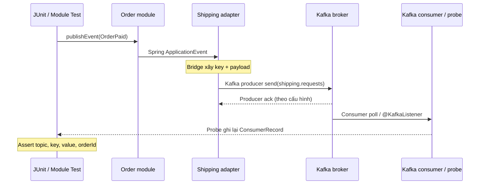
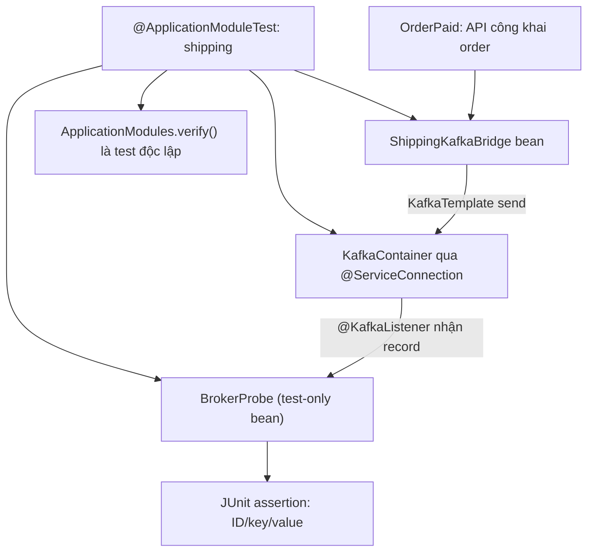
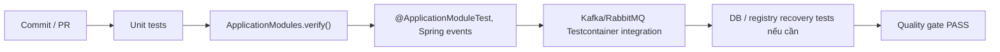

# Container message broker cho event flow

## 1. Mục tiêu bài học

Trong học phần **SPRING_MODULITH_VERIFICATION_TESTING**, người học dùng `ApplicationModules` và các quy tắc phụ thuộc để kiểm chứng ranh giới kiến trúc; dùng `@ApplicationModuleTest`, sự kiện, database, tích hợp và quality gate CI để ngăn phụ thuộc sai và hồi quy. Chương **Testcontainers** bổ sung khả năng kiểm chứng hành vi với hạ tầng thật.

Bài **“Container message broker cho event flow”** tập trung vào câu hỏi:

> Làm sao kiểm tra rằng một event trong Spring Modulith **thực sự được chuyển qua Kafka hoặc RabbitMQ**, đúng topic/queue, key và payload, thay vì chỉ nhìn thấy event trong `ApplicationContext`?

Ta sẽ:

1. Phân biệt **Spring application event** với **message đã được broker nhận**.
2. Chọn Kafka/RabbitMQ Testcontainer theo contract cần kiểm thử.
3. Khởi tạo Kafka container bằng Spring Boot `@ServiceConnection` trong `@ApplicationModuleTest`.
4. Dùng một consumer/probe thật qua Kafka để nhận message và xác minh correlation ID.
5. Viết phép chờ dựa trên điều kiện, không `Thread.sleep(...)`.
6. Hiểu hai đường tích hợp: adapter dùng `KafkaTemplate` và Spring Modulith event externalization với `@Externalized`.
7. Kiểm soát transaction, serialization, topic, idempotency, cleanup và hạ tầng CI.

**Lưu ý phiên bản:** ví dụ chính sử dụng **Testcontainers Java 2.x**, với `org.testcontainers.kafka.KafkaContainer` và artifact `testcontainers-kafka`. Dự án dùng 1.x cần kiểm tra dependency/package tương ứng. Ví dụ Java là cấu hình tham khảo cho một ứng dụng Spring Boot/Spring Modulith đã có build/BOM phù hợp; bài STEP 4 chưa chạy build hoặc vòng Content QA.

## 2. Ba tầng sự kiện khác nhau

Một luồng gửi message có thể có các mốc sau:



| Mốc | Có thể chứng minh bằng gì? | Không tự chứng minh |
| --- | --- | --- |
| `ApplicationEventPublisher.publishEvent(...)` được gọi | Unit/module test service và `PublishedEvents` | Broker đã nhận message. |
| `@EventListener` / `@ApplicationModuleListener` nhận event | Listener test và business state | Kafka producer gửi thành công. |
| Producer future hoàn thành thành công | Kafka broker đã xác nhận theo cấu hình producer/`acks` | Consumer đã đọc hoặc xử lý message. |
| Consumer test đọc được record | Message đã đi qua Kafka và được consumer quan sát | Consumer production xử lý nghiệp vụ thành công. |
| DB/read model do consumer cập nhật | State query đã thấy kết quả phù hợp | Mọi hệ thống ngoài đã hoàn tất. |

Vì vậy, **`Scenario.andWaitForEventOfType(...)` chỉ quan sát Spring event**, còn test broker cần một **consumer/adapter hoặc tín hiệu từ broker thực**. Đừng dùng `PublishedEvents` như bằng chứng thay thế cho Kafka/RabbitMQ delivery.

### Kafka hay RabbitMQ?

| Hạ tầng | Khái niệm chính | Hợp đồng cần kiểm chứng |
| --- | --- | --- |
| **Kafka** | Topic, partition, record key, consumer group, offset | Topic đúng, key tương quan, serializer, consumer đọc được record, partition/offset behavior. |
| **RabbitMQ (AMQP)** | Exchange, routing key, binding, queue, consumer acknowledgment | Message được route vào queue đúng, payload, publisher confirm/consumer behavior. |

Hai broker có ngữ nghĩa khác nhau. **Một Kafka topic không tương đương một RabbitMQ queue**; không lấy assertion về offset hoặc partition áp dụng nguyên vẹn cho RabbitMQ.

## 3. Khi nào module test cần container broker?

| Bài kiểm thử | Có cần broker container? | Vì sao |
| --- | --- | --- |
| `ApplicationModules.verify()` | **Không** | Chỉ kiểm chứng cấu trúc module và phụ thuộc package. |
| Business rule thuần Java | **Không** | Unit test đủ, chạy nhanh hơn. |
| Service phát `OrderPaid` trong Spring context | **Thường không** | `@ApplicationModuleTest` + `PublishedEvents`/`Scenario` là đủ. |
| Adapter tạo đúng key và payload trước khi gọi producer | **Chưa chắc** | Có thể mock producer để test chuyển đổi dữ liệu. |
| Kafka producer thật được broker xác nhận | **Có** | Cần kiểm tra broker, serializer, topic và kết nối. |
| Kafka consumer deserialization và xử lý record | **Có** | Cần broker, consumer group, offset và serialization thật. |
| RabbitMQ exchange/queue binding | **Có** | Fake không chứng minh routing/binding đúng. |
| Outbox/registry và retry toàn bộ event flow | **Thường có** broker + DB | Cần kiểm tra cả transaction bền vững lẫn phân phối message. |

**Nguyên tắc:** container chỉ nên bổ sung cho **rủi ro mà fake/mock không phát hiện được**. Không khởi động Kafka trong mọi `@ApplicationModuleTest` khi test không đi qua broker.

## 4. Phạm vi của `@ApplicationModuleTest` không thay đổi vì có container

Giả sử:

```text
com.acme
├── Application.java
├── order/
│   ├── OrderPaid.java           # Public Spring event contract
│   └── OrderService.java
└── shipping/
    ├── ShippingKafkaBridge.java
    ├── ShippingService.java
    └── ShippingBrokerModuleTests.java
```

`@ApplicationModuleTest` mặc định khởi động **module chứa lớp test** (`STANDALONE`). Nếu test trong `com.acme.shipping`, bean `ShippingKafkaBridge` được bootstrap; module `order` không cần khởi động service thật nếu test tự tạo `OrderPaid`.

Các mode `DIRECT_DEPENDENCIES` và `ALL_DEPENDENCIES` chỉ thêm module theo **đồ thị phụ thuộc của module đang test**. Chúng không tự khởi động mọi module tiêu thụ event theo chiều ngược lại.

**Testcontainers tạo hạ tầng** Kafka/RabbitMQ thật; nó không tự đưa các bean Spring của module khác vào context.

### Sơ đồ kiến trúc



Việc import type `OrderPaid` từ API của module `order` không có nghĩa test shipping phải khởi động mọi bean trong order. Tránh phụ thuộc vào `com.acme.order.internal.*`; Spring Modulith coi package gốc là API mặc định, còn subpackage khác cần được công bố qua named interface nếu muốn là API dùng chung.

## 5. Dependencies cho Kafka Testcontainer

Ví dụ Maven dành cho ứng dụng sử dụng Spring Boot và Spring Modulith BOM có phiên bản tương thích:

```xml
<!-- Spring Kafka client, producer, consumer và KafkaAdmin. -->
<dependency>
    <groupId>org.springframework.kafka</groupId>
    <artifactId>spring-kafka</artifactId>
</dependency>

<!-- Spring Boot + Spring Modulith testing. -->
<dependency>
    <groupId>org.springframework.boot</groupId>
    <artifactId>spring-boot-starter-test</artifactId>
    <scope>test</scope>
</dependency>
<dependency>
    <groupId>org.springframework.modulith</groupId>
    <artifactId>spring-modulith-starter-test</artifactId>
    <scope>test</scope>
</dependency>
<dependency>
    <groupId>org.springframework.boot</groupId>
    <artifactId>spring-boot-testcontainers</artifactId>
    <scope>test</scope>
</dependency>

<!-- Testcontainers Java 2.x. -->
<dependency>
    <groupId>org.testcontainers</groupId>
    <artifactId>testcontainers-kafka</artifactId>
    <scope>test</scope>
</dependency>
```

Dự án Spring Boot 4.x có thể dùng Kafka starter tương ứng của Boot thay vì khai báo `spring-kafka` trực tiếp. **Đừng sử dụng cùng lúc nhiều phiên bản Kafka client không tương thích**; để BOM/plugin của dự án quản lý phiên bản. Đoạn trên không thay thế `pom.xml` đầy đủ của ứng dụng.

Với Gradle (Groovy DSL):

```groovy
dependencies {
    implementation 'org.springframework.kafka:spring-kafka'

    testImplementation 'org.springframework.boot:spring-boot-starter-test'
    testImplementation 'org.springframework.modulith:spring-modulith-starter-test'
    testImplementation 'org.springframework.boot:spring-boot-testcontainers'
    testImplementation 'org.testcontainers:testcontainers-kafka'
}
```

### Phân biệt API theo phiên bản Testcontainers

| Thành phần | Testcontainers 1.x hoặc API cũ | Testcontainers 2.x trong bài |
| --- | --- | --- |
| Kafka artifact | `org.testcontainers:kafka` | `org.testcontainers:testcontainers-kafka` |
| Apache Kafka container | Có class cũ trong `org.testcontainers.containers` ở các phiên bản trước | `org.testcontainers.kafka.KafkaContainer` |
| Confluent Kafka image | Chọn container tương ứng với image | `org.testcontainers.kafka.ConfluentKafkaContainer` |
| JUnit Jupiter extension | `org.testcontainers:junit-jupiter` | `org.testcontainers:testcontainers-junit-jupiter` |

Dùng `KafkaContainer` với image `apache/kafka` hoặc `apache/kafka-native`; nếu dùng `confluentinc/cp-kafka` thì chọn `ConfluentKafkaContainer` theo tài liệu Testcontainers. Không trộn nhầm container type và image.

**Ví dụ bài học:** `new KafkaContainer("apache/kafka-native:3.8.0")`. Trong dự án thật, pin một image/version đã được CI kiểm thử và tương thích Kafka client.

## 6. Event đầu vào và bridge gửi Kafka

Để làm rõ **broker flow** mà không đòi hỏi một database/transaction manager thứ hai, ví dụ chính dùng `@EventListener` bình thường để chuyển Spring event thành Kafka record. Cách này kiểm tra **delivery tới broker**; phần sau mô tả biến thể `@ApplicationModuleListener` và `@Externalized`.

### 6.1. Event công khai của module order

File `src/main/java/com/acme/order/OrderPaid.java`:

```java
package com.acme.order;

import java.util.UUID;

public record OrderPaid(UUID orderId) {}
```

### 6.2. Adapter trong module shipping

File `src/main/java/com/acme/shipping/ShippingKafkaBridge.java`:

```java
package com.acme.shipping;

import com.acme.order.OrderPaid;
import org.slf4j.Logger;
import org.slf4j.LoggerFactory;
import org.springframework.context.event.EventListener;
import org.springframework.kafka.core.KafkaTemplate;
import org.springframework.stereotype.Component;

@Component
class ShippingKafkaBridge {

    private static final Logger log =
            LoggerFactory.getLogger(ShippingKafkaBridge.class);

    private static final String TOPIC = "shipping.requests";

    private final KafkaTemplate<String, String> kafka;

    ShippingKafkaBridge(KafkaTemplate<String, String> kafka) {
        this.kafka = kafka;
    }

    @EventListener
    public void whenOrderPaid(OrderPaid paid) {
        String id = paid.orderId().toString();

        // Định dạng chuỗi chỉ để minh họa transport trong bài học.
        String payload = "SHIPMENT_REQUESTED|" + id;

        kafka.send(TOPIC, id, payload)
                .whenComplete((ack, error) -> {
                    if (error != null) {
                        log.error("Kafka send failed: orderId={}", id, error);
                    }
                });
    }
}
```

**Ranh giới của ví dụ:**

- `ApplicationEventPublisher.publishEvent(new OrderPaid(id))` kích hoạt Spring `@EventListener`.
- `KafkaTemplate.send(...)` gửi **bất đồng bộ**, trả future; method listener có thể trả về trước khi broker xác nhận.
- `TOPIC` là Kafka topic, `id` là record key và payload là chuỗi thử nghiệm.
- Callback ghi log khi send fail, nhưng **không triển khai durable retry/outbox**. Đây là ví dụ minh họa giao tiếp broker, không phải bảo đảm giao hàng khi process crash.
- Production nên dùng schema payload có phiên bản (JSON, Avro, Protobuf...) và cơ chế retry/idempotency phù hợp, không dùng định dạng chuỗi tự chế.

**Vì sao chưa dùng `@ApplicationModuleListener` ở đây?** Annotation đó chạy sau commit và trong transaction riêng. Ví dụ chỉ có Kafka container nên không giả định `PlatformTransactionManager` đã được cấu hình. Để kiểm thử after-commit/registry, cần thêm transactional infrastructure phù hợp — ví dụ database Testcontainer — rồi dùng `Scenario.publish(...)` như một stimulus có commit.

## 7. Khởi tạo Kafka broker như Spring bean

Spring Boot hỗ trợ Testcontainers `@ServiceConnection`. Khi container là Spring bean trong `@TestConfiguration`, vòng đời Kafka được quản lý cùng Spring `ApplicationContext`, phù hợp việc context test có thể được cache giữa các lớp.

File `src/test/java/com/acme/shipping/KafkaBrokerTestConfig.java`:

```java
package com.acme.shipping;

import org.apache.kafka.clients.admin.NewTopic;
import org.springframework.boot.test.context.TestConfiguration;
import org.springframework.boot.testcontainers.service.connection.ServiceConnection;
import org.springframework.context.annotation.Bean;
import org.springframework.kafka.annotation.EnableKafka;
import org.springframework.kafka.config.TopicBuilder;
import org.testcontainers.kafka.KafkaContainer;

@TestConfiguration(proxyBeanMethods = false)
@EnableKafka
class KafkaBrokerTestConfig {

    @Bean
    @ServiceConnection
    KafkaContainer kafkaBroker() {
        return new KafkaContainer("apache/kafka-native:3.8.0");
    }

    @Bean
    NewTopic shippingRequestsTopic() {
        return TopicBuilder.name("shipping.requests")
                .partitions(1)
                .replicas(1)
                .build();
    }

    @Bean
    BrokerProbe brokerProbe() {
        return new BrokerProbe();
    }
}
```

**Giải thích:**

1. `@TestConfiguration` giữ cấu hình broker ở test scope, không thay thế config production.
2. `KafkaContainer` thuộc package Testcontainers Java 2.x, chạy một Kafka node cho test.
3. `@ServiceConnection` cho Spring Boot tạo `KafkaConnectionDetails` và cấu hình bootstrap servers; không hard-code `localhost:9092`.
4. `@Bean NewTopic` dùng Spring Kafka `KafkaAdmin` tạo topic với một partition và replication factor 1 cho single-node container.
5. `@EnableKafka` bật xử lý `@KafkaListener` cho probe ở mục tiếp theo.
6. `BrokerProbe` là bean **chỉ dành cho kiểm thử**, không phải consumer nghiệp vụ thật.

Một broker single-node với một partition thích hợp cho **đường đi cơ bản của record**. Nó không kiểm chứng tính chịu lỗi cluster nhiều node, rebalance phức tạp hoặc replication production.

**Không gọi `kafkaBroker().start()` trong bean method.** Spring Boot quản lý lifecycle của container bean. Cũng không cần `@Testcontainers`/`@Container` khi sử dụng bean container theo cách này.

## 8. Tạo một consumer probe thật qua Kafka

Test cần quan sát message **đã đi qua broker**. Ta khai báo một `@KafkaListener` trong test để nhận `ConsumerRecord<String,String>` rồi lưu bằng bộ sưu tập thread-safe.

File `src/test/java/com/acme/shipping/BrokerProbe.java`:

```java
package com.acme.shipping;

import java.util.Optional;
import java.util.UUID;
import java.util.concurrent.ConcurrentLinkedQueue;

import org.apache.kafka.clients.consumer.ConsumerRecord;
import org.springframework.kafka.annotation.KafkaListener;

class BrokerProbe {

    private final ConcurrentLinkedQueue<ConsumerRecord<String, String>>
            received = new ConcurrentLinkedQueue<>();

    @KafkaListener(
            topics = "shipping.requests",
            groupId = "shipping-probe-${random.uuid}")
    public void onMessage(ConsumerRecord<String, String> record) {
        received.add(record);
    }

    Optional<ConsumerRecord<String, String>> findFor(UUID orderId) {
        String id = orderId.toString();

        return received.stream()
                .filter(record -> id.equals(record.key()))
                .findFirst();
    }

    void discardFor(UUID orderId) {
        String id = orderId.toString();
        received.removeIf(record -> id.equals(record.key()));
    }
}
```

`groupId` dùng Spring property placeholder `${random.uuid}` do Spring Boot cung cấp để mỗi test context có consumer group riêng. Chuỗi Java trong code block trên không cần escape dấu `$`; nó sẽ được Spring giải quyết khi tạo Kafka listener.

**Tại sao cần `ConcurrentLinkedQueue`?**

- Consumer listener chạy trên thread của Spring Kafka, khác thread JUnit.
- Test đọc từ queue ở thread của mình, vì vậy cần data structure an toàn cho concurrent access.
- Mỗi record được tìm theo `orderId`/Kafka key để không nhận nhầm message của test khác.
- `discardFor(orderId)` chỉ dọn record của chính test đó, không xóa message của các test chạy song song.

**Quan trọng:** consumer test này quan sát **record tại Kafka**, không đại diện consumer production. Để kiểm chứng consumer nghiệp vụ đã commit DB, cần test có consumer production thật và state query tương ứng.

### Serializer/deserializer cho ví dụ chuỗi

Ta dùng `KafkaTemplate<String,String>` và `ConsumerRecord<String,String>`, nên cấu hình producer/consumer String serializer. Nếu thiếu, consumer có thể nhận `byte[]` hoặc producer không serialize đúng giá trị.

```properties
spring.kafka.producer.key-serializer=org.apache.kafka.common.serialization.StringSerializer
spring.kafka.producer.value-serializer=org.apache.kafka.common.serialization.StringSerializer

spring.kafka.consumer.key-deserializer=org.apache.kafka.common.serialization.StringDeserializer
spring.kafka.consumer.value-deserializer=org.apache.kafka.common.serialization.StringDeserializer
spring.kafka.consumer.auto-offset-reset=earliest
```

Ở test dưới đây, các thuộc tính được khai báo bằng `@TestPropertySource` để không sửa file config production. `auto-offset-reset=earliest` giúp consumer group mới không bỏ qua record đến trước khi hoàn tất partition assignment; nó **không tự tạo bảo đảm exactly-once**.

## 9. Module test end-to-end tại biên Kafka

File `src/test/java/com/acme/shipping/ShippingBrokerModuleTests.java`:

```java
package com.acme.shipping;

import static org.assertj.core.api.Assertions.assertThat;
import static org.awaitility.Awaitility.await;

import java.time.Duration;
import java.util.UUID;

import com.acme.order.OrderPaid;
import org.junit.jupiter.api.Test;
import org.springframework.beans.factory.annotation.Autowired;
import org.springframework.context.ApplicationEventPublisher;
import org.springframework.context.annotation.Import;
import org.springframework.modulith.test.ApplicationModuleTest;
import org.springframework.test.context.TestPropertySource;

@ApplicationModuleTest
@Import(KafkaBrokerTestConfig.class)
@TestPropertySource(properties = {
    "spring.kafka.producer.key-serializer="
            + "org.apache.kafka.common.serialization.StringSerializer",
    "spring.kafka.producer.value-serializer="
            + "org.apache.kafka.common.serialization.StringSerializer",
    "spring.kafka.consumer.key-deserializer="
            + "org.apache.kafka.common.serialization.StringDeserializer",
    "spring.kafka.consumer.value-deserializer="
            + "org.apache.kafka.common.serialization.StringDeserializer",
    "spring.kafka.consumer.auto-offset-reset=earliest"
})
class ShippingBrokerModuleTests {

    @Autowired ApplicationEventPublisher events;
    @Autowired BrokerProbe probe;

    @Test
    void sendsShipmentRequestThroughRealKafka() {
        UUID orderId = UUID.randomUUID();

        try {
            // WHEN: một Spring application event được phát.
            events.publishEvent(new OrderPaid(orderId));

            // THEN: chờ RECORD thật từ test Kafka consumer.
            await().atMost(Duration.ofSeconds(12))
                    .untilAsserted(() -> {
                        var observed = probe.findFor(orderId);

                        assertThat(observed).isPresent();

                        var record = observed.orElseThrow();
                        assertThat(record.topic())
                                .isEqualTo("shipping.requests");
                        assertThat(record.key())
                                .isEqualTo(orderId.toString());
                        assertThat(record.value())
                                .isEqualTo(
                                        "SHIPMENT_REQUESTED|" + orderId);
                    });
        } finally {
            // Chỉ dọn dữ liệu bộ nhớ của đúng orderId.
            probe.discardFor(orderId);
        }
    }
}
```

**Kết quả mà test chứng minh:**

- `@ApplicationModuleTest` khởi động đúng module `shipping` và adapter `ShippingKafkaBridge`.
- Spring Boot có Kafka container và một topic được tạo qua `KafkaAdmin`.
- Spring event `OrderPaid` kích hoạt adapter.
- Producer serialize key/value và gửi tới Kafka topic thật.
- Consumer probe **nhận record từ broker**, tìm được đúng `orderId`.
- Payload và topic có giá trị đúng contract trong giới hạn thời gian hữu hạn.

**Điều test chưa chứng minh:**

- Transaction nguồn/`AFTER_COMMIT` đã hoàn tất, vì ví dụ dùng `@EventListener` thông thường.
- Consumer production đã xử lý logic hoặc cập nhật DB.
- Không có message trùng hoặc retry sau thời điểm assertion.
- Message an toàn qua crash/restart hay có tính exactly-once end-to-end.

### Vì sao ở đây dùng Awaitility thay vì `Scenario.andWaitForEventOfType`?

`Scenario.andWaitForEventOfType(...)` chờ **Spring application event**, trong khi yêu cầu của bài là **record thực sự xuất hiện ở Kafka**. `BrokerProbe` là nguồn quan sát broker, nên `Awaitility.untilAsserted(...)` chờ một điều kiện trên probe là phù hợp.

Ở module test có transaction manager, có thể dùng `Scenario.stimulate(...)` và `andWaitForStateChange(...)` để chờ trạng thái probe, nhưng **không cần cố đưa `Scenario` vào** một test broker chỉ để có thêm DSL. Mục tiêu là chờ **đúng tín hiệu của hợp đồng**.

## 10. Tránh race condition khi consumer bắt đầu chậm

Một lỗi khó phát hiện:

1. Test phát `OrderPaid` ngay sau khi context bắt đầu.
2. Kafka producer gửi message trước khi consumer group của probe được assign partition.
3. Consumer mặc định `auto.offset.reset=latest` không đọc record cũ trong lần đầu tham gia group.
4. Test timeout dù broker đã lưu message.

Cách thiết kế:

- Tạo topic bằng `NewTopic` và để `KafkaAdmin` hoàn thành bootstrap.
- Dùng group riêng cho test context, không dùng group của consumer production.
- Với group mới, `auto-offset-reset=earliest` có thể đọc các record đã có từ trước; **luôn lọc theo correlation ID**.
- Nếu cần xác minh **consumer đã sẵn sàng trước send**, kiểm tra partition assignment hoặc dùng container listener readiness của Spring Kafka.
- Không sửa race bằng `Thread.sleep(2000)`; trên CI có thể vẫn chưa đủ.

Một số phép kiểm chỉ cần đọc bất kỳ record khớp ID trong thời gian chờ. Những test cần kiểm tra offset/partition hoặc consumer group rebalance phải cấu hình assignment/seek và isolation cụ thể hơn.

## 11. Kịch bản production: từ `@ApplicationModuleListener` tới broker

Ví dụ chính dùng `@EventListener` để giữ hạ tầng thử nghiệm tối thiểu. Trong ứng dụng Spring Modulith, nhiều đội chọn công bố event **sau commit**, tránh gửi message từ một transaction nghiệp vụ cuối cùng bị rollback.

Một adapter thay thế:

```java
@Component
class ShippingKafkaBridge {

    private final KafkaTemplate<String, String> kafka;

    ShippingKafkaBridge(KafkaTemplate<String, String> kafka) {
        this.kafka = kafka;
    }

    @ApplicationModuleListener
    public void whenOrderPaid(OrderPaid paid) {
        String id = paid.orderId().toString();

        // Phần gửi broker phải có failure handling/retry phù hợp.
        kafka.send("shipping.requests", id,
                "SHIPMENT_REQUESTED|" + id);
    }
}
```

**Đây là biến thể thay thế** cho listener `@EventListener` ở mục 6; không đăng ký đồng thời cả hai bean để tránh gửi trùng.

`@ApplicationModuleListener` có tính chất:

- Listener được kích hoạt **sau commit transaction phát event**;
- Chạy bất đồng bộ và trong một transaction riêng;
- Cần transaction manager/transactional infrastructure trong context test;
- Nếu gửi Kafka bằng API async rồi method trả về ngay, **việc listener kết thúc không tự chứng minh broker đã xác nhận record**.

Nếu mục tiêu là bảo đảm publication được theo dõi bền vững, cần cấu hình Spring Modulith **Event Publication Registry** cùng phương án retry/resubmission và xem xét cách bridge báo hoàn tất sau producer acknowledgment. Broker Testcontainer chỉ là một mắt xích; nó không thay thế database/event registry khi cần durability.

### Với `Scenario.publish(...)`

Khi module test có transaction manager phù hợp:

```java
scenario.publish(new OrderPaid(orderId))
        .andWaitForStateChange(
                () -> probe.findFor(orderId),
                java.util.Optional::isPresent)
        .andVerify(found -> {
            var record = found.orElseThrow();
            assertThat(record.key()).isEqualTo(orderId.toString());
        });
```

`probe` là test bean ở mục 8. Đoạn này dùng `Scenario` để phát stimulus **trong transaction mới** và poll **kết quả broker** qua probe, không chờ Spring event đầu vào. Nó chỉ chạy trong context đã cấu hình transactional infrastructure thích hợp và cần cleanup probe theo ID.

Đừng đặt `Scenario.publish` vào một Kafka-only test nếu không có `PlatformTransactionManager` rồi kết luận Kafka container lỗi khi bài test không khởi động được.

## 12. Spring Modulith `@Externalized`: không cần tự viết bridge

Spring Modulith hỗ trợ externalize những domain event chọn lọc thông qua các artifact:

- `spring-modulith-events-kafka` cho Kafka;
- `spring-modulith-events-amqp` cho AMQP/RabbitMQ;
- `spring-modulith-events-jms` cho JMS;
- Các mô-đun khác theo phiên bản framework.

Ví dụ event được externalize:

```java
package com.acme.shipping;

import java.util.UUID;
import org.springframework.modulith.events.Externalized;

@Externalized("shipping.requests")
public record ShipmentRequested(UUID orderId, String serviceLevel) {}
```

Khi ứng dụng đã cấu hình `spring-modulith-events-kafka` và publish `ShipmentRequested` trong luồng giao dịch phù hợp, cơ chế externalization sẽ chọn event này và chuyển ra Kafka topic `shipping.requests`. Event không được đánh dấu `@Externalized` mặc định không tự nhiên trở thành message ở broker chỉ vì có `KafkaContainer`.

**Đây là một thiết kế khác** với `ShippingKafkaBridge` ở mục 6. Nếu bật đồng thời cơ chế externalization và custom adapter gửi cùng sự kiện, rất dễ tạo **hai publication**; phải chọn một chủ sở hữu việc chuyển event ra ngoài.

### Phân biệt event nội bộ và externalized event

| Đặc điểm | Spring `ApplicationEventPublisher` | Spring Modulith `@Externalized` |
| --- | --- | --- |
| Phạm vi | Application context của ứng dụng | Broker nằm ngoài ứng dụng |
| API khởi phát | `publishEvent(event)` | Vẫn bắt đầu bằng domain event phù hợp |
| Điều kiện chọn event | Các Spring listeners nhận type | Cơ chế externalization chọn type được đánh dấu/cấu hình |
| Hạ tầng cần kiểm tra | Spring context | Spring context + Kafka/RabbitMQ thật |
| Assertion phù hợp | `PublishedEvents`, `Scenario` | Consumer/queue/broker state và payload |
| Failure/retry | Tùy listener và transaction | Phụ thuộc event publication infrastructure và cấu hình recovery |

Spring Modulith có hỗ trợ routing target. Ví dụ biểu thức routing key từ `orderId` trong annotation có cú pháp:

```java
@Externalized("shipping.requests::#{orderId()}")
public record ShipmentRequested(UUID orderId) {}
```

Khi dùng Kafka, phần routing target gắn với **topic**, còn routing key gắn với **record key** theo cơ chế externalizer. Kiểm tra đúng cách biểu thức được hỗ trợ trong phiên bản Spring Modulith của dự án và cấu hình serializer/key conversion trước khi dùng trong production.

**Tuyệt đối không xem `@Externalized` là phép biến đổi mọi message sang JSON một cách bất biến giữa các phiên bản.** Kiểm thử cần xác định serializer, payload schema, headers và version của contract thực tế.

## 13. Serialization: chuỗi, JSON, Avro và schema

Demo `"SHIPMENT_REQUESTED|<orderId>"` chỉ giúp nhìn rõ transport. Trong hệ thống thật, cần có định dạng được hai phía thống nhất.

Ví dụ JSON contract:

```json
{
  "eventId": "77777777-7777-4777-8777-777777777777",
  "orderId": "11111111-1111-4111-8111-111111111111",
  "eventType": "SHIPMENT_REQUESTED",
  "schemaVersion": 1
}
```

Các assertion nên phân biệt:

- **Key:** dùng khóa nghiệp vụ `orderId` hoặc partitioning key có chủ đích.
- **Payload:** trường dữ liệu, kiểu số/UUID, giá trị bắt buộc và semantic version.
- **Headers:** content type, trace/correlation ID, schema version nếu có.
- **Topic/exchange:** tên route vật lý phải đúng với hợp đồng đã cấu hình.
- **Deserializer:** test consumer có thể nhận `byte[]` nếu chưa chọn đúng serializer/deserializer.

Đối với JSON, nên parse payload bằng JSON parser rồi assert từng field; không chỉ dùng `contains(orderId.toString())` vì chuỗi có thể xuất hiện trong trường khác. Với Avro/Protobuf, dùng schema tương thích và decoder đúng.

**Nhãn message:** record có ID riêng (`eventId`) hữu ích để deduplicate. `orderId` là correlation ID nhưng nhiều event khác nhau có thể cùng orderId; nếu cần phân biệt từng publication, dùng event ID riêng.

## 14. RabbitMQ Testcontainer: biến thể cho AMQP flow

Nếu hệ thống dùng RabbitMQ, Testcontainers Java 2.x cung cấp artifact `testcontainers-rabbitmq` và class `org.testcontainers.rabbitmq.RabbitMQContainer`.

Dependency bổ sung/thay Kafka:

```xml
<dependency>
    <groupId>org.springframework.boot</groupId>
    <artifactId>spring-boot-starter-amqp</artifactId>
</dependency>
<dependency>
    <groupId>org.testcontainers</groupId>
    <artifactId>testcontainers-rabbitmq</artifactId>
    <scope>test</scope>
</dependency>
<dependency>
    <groupId>org.springframework.boot</groupId>
    <artifactId>spring-boot-testcontainers</artifactId>
    <scope>test</scope>
</dependency>
```

Spring-managed RabbitMQ test configuration:

```java
package com.acme.shipping;

import org.springframework.amqp.core.Queue;
import org.springframework.boot.test.context.TestConfiguration;
import org.springframework.boot.testcontainers.service.connection.ServiceConnection;
import org.springframework.context.annotation.Bean;
import org.testcontainers.rabbitmq.RabbitMQContainer;

@TestConfiguration(proxyBeanMethods = false)
class RabbitBrokerTestConfig {

    @Bean
    @ServiceConnection
    RabbitMQContainer rabbitBroker() {
        return new RabbitMQContainer("rabbitmq:4.1-management");
    }

    @Bean
    Queue shippingRequestsQueue() {
        return new Queue("shipping.requests", false);
    }
}
```

Spring Boot tạo Rabbit connection details từ typed container; Spring AMQP infrastructure có thể khai báo queue qua `RabbitAdmin` khi được cấu hình/auto-configured phù hợp.

Ví dụ adapter gửi qua **default exchange**, routing key là tên queue:

```java
rabbitTemplate.convertAndSend(
        "shipping.requests", "SHIPMENT_REQUESTED|" + orderId);
```

Trong đoạn này, `rabbitTemplate` là `RabbitTemplate` được inject vào bean/module test. Để xác minh message **đã đi qua RabbitMQ**, dùng test `@RabbitListener(queues = "shipping.requests")` với probe thread-safe hoặc một consumer thật đọc queue, rồi assertion trên payload.

Nếu production dùng **custom exchange và bindings**, phải thiết lập `Exchange`/`Queue`/`Binding` tương ứng; message gửi thành công vào broker không bảo đảm routing đến đúng queue khi binding/routing key sai.

**Lưu ý:** spring-modulith-events-amqp dùng routing target của framework, không đồng nhất với việc tự gọi `rabbitTemplate.convertAndSend(queueName, payload)`. Viết test theo hạ tầng mà code production thực sự sử dụng.

## 15. Không dùng `Thread.sleep` để chờ broker

Anti-pattern:

```java
events.publishEvent(new OrderPaid(orderId));
Thread.sleep(2_000);
assertThat(probe.findFor(orderId)).isPresent();
```

Nếu consumer mất 2,5 giây để được assign partition, test fail dù code đúng. Nếu 10 ms là đủ, test lãng phí thời gian. Nếu producer ném exception, ngủ thêm không giúp gì.

Đúng:

```java
events.publishEvent(new OrderPaid(orderId));

await().atMost(Duration.ofSeconds(12))
        .untilAsserted(() ->
                assertThat(probe.findFor(orderId)).isPresent());
```

Điều kiện phải đủ ý nghĩa. `probe.findFor(orderId)` kiểm tra **record từ broker**, không chỉ một cờ được đặt trước khi producer send.

Khi cần kiểm tra consumer production đã cập nhật database:

```java
await().atMost(Duration.ofSeconds(12))
        .untilAsserted(() ->
                assertThat(shipments.findStatus(orderId))
                        .contains("READY"));
```

`shipments` trong ví dụ là repository do ứng dụng cung cấp; không được giả định có sẵn trong test Kafka-only. Nếu DB transaction/consumer handler là trọng tâm, nên dùng database Testcontainer tương ứng và cleanup dữ liệu đã commit.

## 16. Transaction, retry và semantics của broker

Test broker phải đặt kỳ vọng đúng mức:

### 16.1. Producer acknowledgment không phải consumer success

Kafka producer future thành công theo `acks` chứng minh broker đã xác nhận producer record trong cấu hình hiện tại. Nó **không chứng minh consumer đã đọc**, càng không chứng minh consumer transaction/DB đã commit.

### 16.2. Phân biệt Spring listener và broker listener

- `@EventListener`: nhận Spring application event, đồng bộ theo mặc định.
- `@ApplicationModuleListener`: transactional, sau commit, bất đồng bộ, transaction mới.
- `@KafkaListener`: nhận Kafka record từ broker; offset acknowledgment và consumer group độc lập với transaction của publisher.
- `@RabbitListener`: nhận AMQP delivery; acknowledgment/requeue theo cấu hình Rabbit.

Các annotation không thể thay thế nhau.

### 16.3. Ít nhất một lần và idempotency

Khi có producer retry, consumer redelivery, outbox republish hoặc lỗi mạng không xác định, event có thể được xử lý lại. **Một `await(...).untilAsserted(...)` pass không chứng minh đúng một lần end-to-end.**

Nếu ứng dụng lưu shipment theo `orderId`, dùng unique business key/constraint, idempotent upsert và/hoặc bảng dedup theo `eventId`. Viết thêm test cố ý phát lại cùng event rồi xác nhận DB không tạo hiệu lực trùng.

### 16.4. Ordering

Kafka bảo toàn thứ tự theo **một partition**, không cho toàn bộ topic có nhiều partition hoặc giữa các consumer group. Record key là yếu tố quan trọng với phân vùng. RabbitMQ có ngữ nghĩa ordering/ack khác và redelivery có thể làm thứ tự quan sát khác.

Nếu contract yêu cầu A xảy ra trước B, thiết kế quan hệ nhân quả hoặc version/sequence theo aggregate; không kiểm tra dựa trên timestamp ở hai thread.

### 16.5. Event Publication Registry

Spring Modulith Event Publication Registry theo dõi publication cho transactional event listeners **khi persistence được cấu hình**. Nó không tự xuất hiện chỉ vì dự án thêm Kafka Testcontainer. Ngoài ra, việc registry đánh dấu completed phải dựa vào cơ chế externalizer/listener thành công theo thiết kế, không tự suy ra mọi downstream consumer đã xử lý.

Kịch bản phục hồi thực sự thường cần **hai loại container**:

- Database (lưu domain state, publication/outbox);
- Kafka/RabbitMQ (nơi record được phân phối).

Tách test happy path broker và test failure/retry/resubmission để dễ chẩn đoán.

## 17. Lifecycle, test isolation và CI

Có ít nhất ba phạm vi khác nhau:

| Thành phần | Vòng đời | Cần quản lý |
| --- | --- | --- |
| Kafka/RabbitMQ container | Spring context hoặc JUnit extension | Start/stop và cache context đúng. |
| Consumer probe | Bean test trong Spring context | Queue/bộ nhớ, correlation ID, group ID. |
| Message đã ghi vào broker | Topic/queue của container | Offset, consumer group, message còn tồn tại và test song song. |
| Database/outbox (nếu có) | Datasource riêng | Transaction, migration, data cleanup. |
| Listener async | Thread/executor | Completion, errors, retry, không để test sau nhận nhiễu. |

### Vì sao ưu tiên container do Spring quản lý?

Spring TestContext có thể **cache `ApplicationContext`** qua nhiều test class. Một `static @Container` do JUnit extension stop ở cuối lớp test, trong khi datasource/Kafka client ở context cache vẫn trỏ tới broker đã dừng, có thể làm test kế tiếp lỗi.

`@TestConfiguration @Bean @ServiceConnection` giúp broker sống cùng Spring context. Nhưng broker dùng lại **giữ dữ liệu/offset**, nên vẫn phải lọc theo ID và dùng group/namespace phù hợp.

### Chạy song song

- Đừng dùng cùng correlation ID cố định.
- Consumer group của probe phải tránh tranh chấp partition với consumer production hoặc probe từ context khác.
- Không gọi `probe.clear()` toàn cục khi test khác vẫn đang đọc từ queue; dọn theo ID.
- Nếu nhiều test cùng sử dụng một topic, chỉ kết luận dựa trên key/eventId của test hiện tại.
- Khi test cố ý đọc một topic sạch tuyệt đối, cân nhắc tạo topic theo suite/test context hoặc container riêng, không xóa topic đang được test khác sử dụng.
- Với broker state có tính toàn cục không thể cô lập, dùng chiến lược serialization test/`@ResourceLock` có lý do.

### CI

- Runner có Docker-compatible runtime và quyền pull/start container.
- Pin image `apache/kafka-native:3.8.0` hoặc tag đã được dự án phê duyệt; không dùng `latest`.
- Có đủ CPU/RAM/disk cho broker; Kafka có thể tiêu tốn nhiều tài nguyên hơn test thuần Java.
- Tránh mở broker port công khai không cần thiết; `@ServiceConnection` dùng mapped port động.
- Không cấp Docker socket production cho job chạy code không tin cậy.
- Tránh retry vô hạn để che flaky test; lưu log producer/consumer và container khi thất bại.
- Tách tầng kiến trúc, module test không broker và broker integration tests để vừa nhanh vừa kiểm chứng đúng rủi ro.

## 18. Những lỗi thường gặp

| Triệu chứng | Nguyên nhân có thể | Bước kiểm tra |
| --- | --- | --- |
| `Could not find a valid Docker environment` | Không có container runtime hoặc thiếu quyền | Docker/runner setup. |
| Kafka container không start | Image tag, registry network, resource limit | Logs, image version, CPU/RAM. |
| Spring vẫn kết nối `localhost:9092` | `@ServiceConnection` không được import/áp dụng | Test config và bootstrap servers. |
| `No qualifying bean of type KafkaTemplate` | Thiếu `spring-kafka` hoặc auto-config bị loại | Dependencies, `KafkaAutoConfiguration`. |
| Topic không tồn tại | `NewTopic` chưa được khai báo/`KafkaAdmin` chưa hoạt động | Topic bean, admin logs, broker metadata. |
| Producer log thành công nhưng probe timeout | Consumer chưa assigned, deserializer sai, group/offset sai | `auto-offset-reset`, assignment, group ID, serializer. |
| Probe nhận `[B@...` hoặc lỗi cast | Value deserializer mặc định không phải String | Cấu hình `StringDeserializer`/converter đúng payload. |
| Spring event test pass nhưng broker test fail | Chỉ mới công bố event nội bộ hoặc adapter không chạy | Kiểm tra bridge, externalization config và broker send. |
| Event đến broker nhưng consumer nghiệp vụ không cập nhật DB | Consumer lỗi, transaction rollback, business rule sai | Log `@KafkaListener`/`@RabbitListener`, DB state. |
| Test pass riêng nhưng fail suite | Context cache, group collision, topic cũ, shared probe state | Group/ID riêng, Spring-managed lifecycle. |
| Duplicate effects sau retry | Consumer thiếu idempotency hoặc dedup | Unique key, eventId, retry test. |
| CI timeout ngẫu nhiên | Broker startup/consumer assignment hoặc tài nguyên hạn chế | Readiness, logs, resource metrics, deadline có cơ sở. |

### Quy trình chẩn đoán theo từng tầng

1. **Container:** Broker đã start và sẵn sàng chưa?
2. **Connection:** `KafkaTemplate`/`RabbitTemplate` có kết nối đúng container không?
3. **Destination:** Topic, exchange/queue/binding đã tồn tại và đúng tên chưa?
4. **Publisher:** Spring event đã vào bridge/externalizer chưa? Có exception hoặc future thất bại không?
5. **Serialization:** Key/value có dùng serializer/deserializer tương thích không?
6. **Consumer:** Listener đã subscribe/assign partition hoặc bind queue đúng chưa?
7. **Correlation:** Record có đúng `orderId`/`eventId` của test không?
8. **Business state:** Nếu cần DB commit, test đã quan sát bằng repository độc lập chưa?
9. **CI isolation:** Test khác có tranh consumer group, xóa queue hoặc làm thay đổi offset không?

Không nâng timeout vô hạn trước khi làm rõ tầng bị lỗi.

## 19. Quality gate: kiến trúc và broker behavior là hai phép kiểm khác nhau

Kiến trúc được kiểm bằng:

```java
import org.junit.jupiter.api.Test;
import org.springframework.modulith.core.ApplicationModules;

class ArchitectureTests {

    @Test
    void verifiesModuleBoundaries() {
        ApplicationModules.of(Application.class).verify();
    }
}
```

`Application.class` là Spring Boot application class của dự án; cần thay bằng lớp thực.

`ApplicationModules.verify()` phát hiện phụ thuộc vòng, truy cập package nội bộ và luật phụ thuộc module bị vi phạm. Nó **không** chứng minh rằng Kafka đã nhận `ShipmentRequested`.

Ngược lại, consumer probe có thể nhận message đúng dù module `shipping` đang phụ thuộc sai vào `com.acme.order.internal.*`. Do đó, cần giữ hai lớp phép kiểm trong CI.



### Checklist nghiệm thu

- [ ] Đã xác định mục tiêu là Spring event, broker record hay downstream state.
- [ ] Broker được chọn theo công nghệ production: Kafka hoặc RabbitMQ.
- [ ] Dependencies Testcontainers, Spring Boot, Spring Kafka/AMQP tương thích.
- [ ] `@ApplicationModuleTest` đặt ở module sở hữu bridge/listener cần kiểm tra.
- [ ] `@ServiceConnection` tạo connection details; không cứng `localhost:9092`/`5672`.
- [ ] Topic/queue/binding được khai báo và sẵn sàng trước stimulus.
- [ ] Serializer/deserializer phù hợp payload contract.
- [ ] Probe là consumer **qua broker thật**, không phải mock `KafkaTemplate`.
- [ ] Chờ theo điều kiện và timeout hữu hạn, không `Thread.sleep`.
- [ ] Có correlation ID/business key và matcher, tránh nhận nhầm message.
- [ ] Consumer group/offset và context cache được quản lý đúng vòng đời.
- [ ] Không đồng thời dùng bridge thủ công và `@Externalized` để gửi trùng.
- [ ] Khi cần after-commit, đã cấu hình transaction manager/registry phù hợp.
- [ ] Khi cần DB state, có database integration test và cleanup.
- [ ] Có kiểm chứng idempotency khi message có thể bị phát/đọc lại.
- [ ] Architecture test `ApplicationModules.verify()` vẫn chạy độc lập với Docker.

## 20. Bài tập thực hành

1. **Phân biệt tầng:** Test `PublishedEvents` nhận `OrderPaid` có chứng minh Kafka nhận record không? Cần thêm quan sát gì?
2. **Module scope:** Vì sao test Kafka bridge nên đặt ở `com.acme.shipping` nếu bridge nằm trong module đó?
3. **Kafka dependency:** Ghi tên artifact Testcontainers 2.x và đúng import cho Apache Kafka container.
4. **Khởi tạo:** Tạo `@TestConfiguration` với `@Bean @ServiceConnection KafkaContainer` và `NewTopic` một partition.
5. **Serializer:** Producer gửi `String` nhưng consumer nhận `byte[]`. Những thuộc tính nào cần sửa?
6. **Probe:** Viết `@KafkaListener` lưu `ConsumerRecord<String,String>` bằng cấu trúc thread-safe và tìm theo `orderId`.
7. **Chờ không sleep:** Dùng Awaitility chờ probe có record đúng ID, assert topic/key/value trong thời hạn hữu hạn.
8. **Consumer readiness:** Vì sao group mới dùng `auto-offset-reset=latest` có thể bỏ qua record gửi trước khi assignment? Có những cách giảm rủi ro nào?
9. **@ApplicationModuleListener:** Khi đổi bridge từ `@EventListener` sang `@ApplicationModuleListener`, cần bổ sung điều gì cho transaction và event publication/retry?
10. **Externalization:** Chú thích một event với `@Externalized("shipping.requests")`. Tại sao không nên giữ custom bridge gửi cùng event?
11. **RabbitMQ:** Tạo `RabbitMQContainer`, queue `shipping.requests` và gửi bằng `RabbitTemplate` qua default exchange. Nếu dùng custom exchange thì cần thêm gì?
12. **Ordering:** Kafka có đảm bảo thứ tự giữa mọi partition không? Cần key/sequence như thế nào để kiểm thử theo aggregate?
13. **Idempotency:** Consumer xử lý cùng `eventId` hai lần. Viết điều kiện DB để khẳng định không tạo hai shipment.
14. **Isolation:** Hai test dùng cùng broker nhưng cùng consumer group. Hiện tượng gì có thể xảy ra và cách sửa?
15. **Context cache:** Vì sao `static @Container` theo JUnit class có thể xung đột với Spring context cache? Giải pháp nào phù hợp?
16. **CI:** Nêu tối thiểu bốn điều kiện môi trường cần có để broker container chạy ổn định và an toàn.
17. **Quality gate:** Thiết kế hai test độc lập để phát hiện (a) shipping import `order.internal` sai, (b) shipping gửi message tới sai topic.

**Định hướng:** (1) chưa, cần consumer/broker probe; (2) module bootstrap đúng bean; (3) `testcontainers-kafka` / `org.testcontainers.kafka.KafkaContainer`; (4) container bean + KafkaAdmin topic; (5) serializer/deserializer String; (6) queue thread-safe; (7) `untilAsserted`; (8) earliest/group readiness; (9) commit và transaction manager; (10) tránh double publish; (11) exchange/binding/routing; (12) Kafka ordering theo partition; (13) dedup business key; (14) group tranh partitions; (15) Spring-managed lifecycle; (16) runtime/image/resources/permissions; (17) `verify()` và broker test.

## Tài liệu tham khảo

- [Spring Modulith — Integration Testing Application Modules](https://docs.spring.io/spring-modulith/reference/testing.html): `@ApplicationModuleTest`, module scope, `Scenario`.
- [Spring Modulith — Working with Application Events](https://docs.spring.io/spring-modulith/reference/events.html): `@ApplicationModuleListener`, `@Externalized`, Kafka/AMQP event externalization và registry.
- [Spring Modulith — Event Externalization Sample](https://github.com/spring-projects/spring-modulith/tree/main/spring-modulith-examples/spring-modulith-example-kafka): ví dụ Spring event chuyển ra Kafka.
- [Spring Modulith — Verifying Application Module Structure](https://docs.spring.io/spring-modulith/reference/verification.html): `ApplicationModules.verify()`.
- [Spring Boot — Testcontainers](https://docs.spring.io/spring-boot/reference/testing/testcontainers.html): `@ServiceConnection`, Kafka/Rabbit connection details và lifecycle Spring-managed container.
- [Testcontainers for Java — Kafka Module](https://java.testcontainers.org/modules/kafka/): `KafkaContainer`, `ConfluentKafkaContainer` và Kafka image phù hợp.
- [Testcontainers for Java — RabbitMQ Module](https://java.testcontainers.org/modules/rabbitmq/): RabbitMQ module, container config và AMQP endpoints.
- [Spring Kafka — Serialization, Deserialization and Message Conversion](https://docs.spring.io/spring-kafka/reference/kafka/serdes.html): key/value serializers và message converter.
- [Spring Framework — TestContext Context Caching](https://docs.spring.io/spring-framework/reference/testing/testcontext-framework/ctx-management/caching.html): cache context và phạm vi bean.
- [Awaitility — Documentation](https://github.com/awaitility/awaitility/wiki/Usage): `untilAsserted` và giới hạn chờ theo điều kiện.
