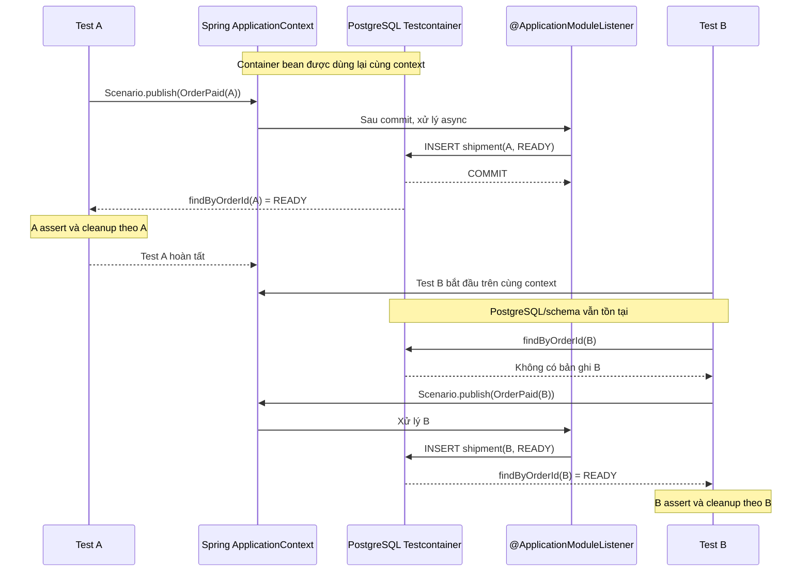
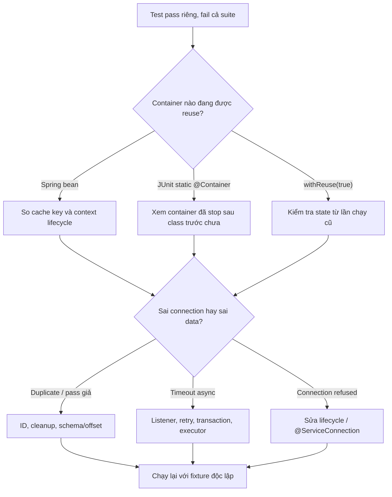

# Reuse container và nguy cơ chia sẻ trạng thái

## 1. Vì sao tái sử dụng container vừa hữu ích vừa nguy hiểm?

Trong học phần **SPRING_MODULITH_VERIFICATION_TESTING**, chúng ta kiểm chứng **ranh giới kiến trúc** của Spring Modulith bằng `ApplicationModules` và các luật phụ thuộc module; kiểm chứng **hành vi** qua `@ApplicationModuleTest`, event, cơ sở dữ liệu, tích hợp và quality gate CI.

Ở chương **Testcontainers**, việc khởi động lại PostgreSQL, Kafka hay RabbitMQ cho mỗi bài test có thể tốn chi phí lớn: pull image, khởi động process, tạo schema, chạy migration, kết nối client và chờ readiness. **Reuse container** giúp giảm một phần chi phí đó.

Nhưng câu hỏi quan trọng không chỉ là:

> “Có thể dùng lại container không?”

Mà còn là:

> **“Khi container được dùng lại, trạng thái nào của test trước vẫn còn và làm sao bảo đảm test tiếp theo độc lập?”**

Ví dụ, test A phát `OrderPaid(A)` rồi listener shipping tạo `Shipment(A, READY)`. Nếu PostgreSQL vẫn hoạt động khi test B chạy:

- Bảng `shipments` có thể vẫn chứa bản ghi của A.
- Test B dùng ID cố định có thể lỗi unique constraint.
- Truy vấn không lọc ID có thể đọc nhầm shipment của A và **pass giả**.
- Event Publication Registry có thể còn publication chờ retry từ A.
- Listener bất đồng bộ của A có thể hoàn tất **sau khi B bắt đầu**.
- Một consumer Kafka dùng lại group có thể đã thay đổi offset.
- Mutable singleton/cache của Spring cũng có thể còn state của A.

**Mục tiêu học tập:** phân biệt **tái sử dụng hạ tầng** với **tái sử dụng dữ liệu**, nắm đúng vòng đời của Testcontainers/Spring/JUnit và thiết kế test không phụ thuộc trạng thái từ test khác.

## 2. Bốn phạm vi tái sử dụng khác nhau

Một chữ “reuse” có thể chỉ những hành vi rất khác nhau.

| Phạm vi | Cơ chế | Container tồn tại đến khi nào? | Dữ liệu còn lại? |
| --- | --- | --- | --- |
| **Trong một lớp JUnit** | `@Testcontainers` + `static @Container` | Từ trước method đầu tới sau method cuối của lớp test | **Có**, nếu không xóa |
| **Cùng Spring `ApplicationContext`** | `@TestConfiguration @Bean @ServiceConnection` | Theo lifecycle của context; có thể được cache qua nhiều lớp test | **Có**, nếu không xóa |
| **Singleton container trong một JVM** | Một static container khởi động thủ công, dùng qua nhiều lớp test | Thường đến cuối JVM/test run nếu không stop trước | **Có**, nếu không xóa |
| **Qua nhiều lần chạy/JVM** | `withReuse(true)` với opt-in Testcontainers reusable containers | Có thể tiếp tục chạy sau test process kết thúc | **Có**, thậm chí qua nhiều lần chạy |

Không được đánh đồng:

- **Spring TestContext cache** là cơ chế của Spring Framework, **không** có nghĩa Testcontainers experimental reuse đã được bật.
- **`static @Container`** chỉ chia sẻ trong một lớp test theo JUnit extension, **không** bảo đảm sống tới khi cả suite Spring test dùng xong context.
- **`withReuse(true)`** là cơ chế thực nghiệm của Testcontainers, cần cấu hình opt-in và lifecycle đặc biệt; **không phù hợp để mặc định bật trên CI**.
- **Container mới** cũng không luôn đồng nghĩa toàn bộ trạng thái ứng dụng mới nếu còn Redis, broker, singleton hay external service được dùng chung.

### Phân biệt bốn lớp state

| Lớp trạng thái | Ví dụ | Có thể rò giữa test? |
| --- | --- | --- |
| **Spring** | Singleton map, cache, mock config, executor | Có, khi `ApplicationContext` được cache |
| **Database** | Rows, sequences, transaction logs, migration history | Có, khi dùng lại DB/container |
| **Event/message** | Event registry, Kafka offsets, RabbitMQ queues, retry state | Có, kể cả sau khi method test kết thúc |
| **Hệ thống ngoài/JVM** | Static fields, file, HTTP stub, Redis ngoài container | Có; xóa PostgreSQL không xóa chúng |

**Nguyên tắc:** giữ hạ tầng tái sử dụng nếu có lợi, nhưng **không chia sẻ fixture nghiệp vụ một cách ngầm định**.

## 3. Sơ đồ thời gian: container vẫn sống sau khi test A kết thúc



Sơ đồ mô tả **một thiết kế đúng**: mỗi test dùng ID riêng, đợi DB commit và cleanup theo ID. Nếu A dùng `deleteAll()` trong khi B đang chạy, hoặc B chỉ query `SELECT COUNT(*) FROM shipments` mà không lọc order, việc chia sẻ container có thể gây race condition hoặc pass giả.

## 4. Vì sao Spring-managed container thường là lựa chọn an toàn hơn?

Spring Boot cho phép tạo container như một **Spring bean** trong test context. Tài liệu Spring Boot nêu rõ:

- Bean container được tạo và khởi động **trước** các bean phụ thuộc vào nó.
- Bean container được dừng **sau** khi các bean sử dụng nó bị destroy.
- Bean container thường được khởi động **một lần cho mỗi `ApplicationContext`**.
- Khi Spring TestContext cache cùng một context, nhiều test/lớp test có thể dùng một container instance.

Đây là kiểu **reuse trong phạm vi context**, không phải cơ chế experimental `withReuse(true)`.

### 4.1. Dependency tham khảo

Ví dụ dùng **Testcontainers Java 2.x** và PostgreSQL:

```xml
<dependency>
    <groupId>org.springframework.boot</groupId>
    <artifactId>spring-boot-starter-jdbc</artifactId>
</dependency>
<dependency>
    <groupId>org.postgresql</groupId>
    <artifactId>postgresql</artifactId>
    <scope>runtime</scope>
</dependency>
<dependency>
    <groupId>org.springframework.boot</groupId>
    <artifactId>spring-boot-starter-test</artifactId>
    <scope>test</scope>
</dependency>
<dependency>
    <groupId>org.springframework.modulith</groupId>
    <artifactId>spring-modulith-starter-test</artifactId>
    <scope>test</scope>
</dependency>
<dependency>
    <groupId>org.springframework.boot</groupId>
    <artifactId>spring-boot-testcontainers</artifactId>
    <scope>test</scope>
</dependency>
<dependency>
    <groupId>org.testcontainers</groupId>
    <artifactId>testcontainers-postgresql</artifactId>
    <scope>test</scope>
</dependency>
```

Ví dụ này giả định dự án có Spring Boot BOM, Spring Modulith BOM và Testcontainers dependency management **tương thích**. Nếu dự án còn dùng Testcontainers 1.x, artifact là `org.testcontainers:postgresql` và import class là `org.testcontainers.containers.PostgreSQLContainer`; không trộn các phiên bản.

Để chạy migration thực, ứng dụng cũng cần Flyway/Liquibase và dependencies cho PostgreSQL phù hợp phiên bản. Một file Maven đầy đủ còn có Spring Boot parent/plugins; đoạn trên chỉ tập trung vào dependency liên quan.

### 4.2. Khai báo PostgreSQL container thành bean test

File `src/test/java/com/acme/shipping/SharedPostgresTestConfig.java`:

```java
package com.acme.shipping;

import org.springframework.boot.test.context.TestConfiguration;
import org.springframework.boot.testcontainers.service.connection.ServiceConnection;
import org.springframework.context.annotation.Bean;
import org.testcontainers.postgresql.PostgreSQLContainer;

@TestConfiguration(proxyBeanMethods = false)
class SharedPostgresTestConfig {

    @Bean
    @ServiceConnection
    PostgreSQLContainer postgres() {
        return new PostgreSQLContainer("postgres:17-alpine")
                .withDatabaseName("shipping_test")
                .withUsername("test")
                .withPassword("test");
    }
}
```

Trong Testcontainers Java 2.x:

- Artifact PostgreSQL là `testcontainers-postgresql`.
- Import `PostgreSQLContainer` từ `org.testcontainers.postgresql`.
- Type `PostgreSQLContainer` **không sử dụng generic `<?>`** như mã 1.x trước đây.
- Không tự gọi `start()` hay `stop()` trong bean method này; Spring Boot quản lý lifecycle.

`@ServiceConnection` giúp Spring Boot tạo `ConnectionDetails` cho `DataSource`. Nó không tự xóa DB trước mỗi test. Spring context được cache thì container và dữ liệu trong nó có thể tiếp tục tồn tại.

### 4.3. Import cấu hình vào đúng module test

```java
package com.acme.shipping;

import org.springframework.context.annotation.Import;
import org.springframework.modulith.test.ApplicationModuleTest;

@ApplicationModuleTest
@Import(SharedPostgresTestConfig.class)
class ShippingModuleDatabaseTests {
    // Những bài test thực tế nằm ở đây.
}
```

`@ApplicationModuleTest` mặc định bootstrap module chứa lớp test (`STANDALONE`), ở đây là `shipping`. PostgreSQL container không làm Spring tự khởi động mọi module khác. Nếu handler shipping là bean cần kiểm chứng, lớp test nên nằm trong package module shipping hoặc cấu hình bootstrap có chủ đích.

### 4.4. Một context không đồng nghĩa một test method

Spring Framework cache `ApplicationContext` theo **cấu hình** (cache key), không theo tên test method. Các yếu tố như `@Import`, properties, bean overrides, test customizers và cấu hình context ảnh hưởng tới việc hai lớp test có cùng cache key hay không.

Vì vậy, không khẳng định “mọi lớp cùng dùng một PostgreSQL container” nếu cấu hình của chúng khác nhau; cũng không khẳng định “mỗi lớp luôn có container mới”. Muốn biết thực tế, quan sát Spring TestContext cache và lifecycle container trong logs.

## 5. Định nghĩa bài toán nghiệp vụ: shipping lưu shipment

Giả sử module `order` công bố event `OrderPaid`, module `shipping` nhận event rồi lưu shipment `READY` trong PostgreSQL.

### 5.1. Public event contract

`src/main/java/com/acme/order/OrderPaid.java`:

```java
package com.acme.order;

import java.util.UUID;

public record OrderPaid(UUID orderId) {}
```

Event trong package gốc `com.acme.order` là API module công khai theo tổ chức Spring Modulith mặc định. Nếu project đặt event trong subpackage, cần công bố qua named interface thích hợp; không để shipping import class nội bộ `com.acme.order.internal.*`.

### 5.2. Migration/schema

Một migration thực tế có thể định nghĩa:

```sql
CREATE TABLE shipments (
    order_id UUID PRIMARY KEY,
    status VARCHAR(32) NOT NULL,
    carrier VARCHAR(32) NOT NULL
);
```

Dùng Flyway/Liquibase migration của ứng dụng để tạo bảng trong PostgreSQL container. Tên file/version phải phù hợp chuỗi migration đang có, không tạo file `V1` trùng với ứng dụng thật.

**Khi tái sử dụng container, migration không tự “xóa và tạo lại” mỗi test.** Flyway có bảng lịch sử version; việc thêm/chỉnh migration sau khi container đã dùng nhiều lần cần được kiểm chứng như một nâng cấp schema thực, không dựa vào dữ liệu cũ tình cờ khớp.

### 5.3. Repository JDBC có idempotent upsert

`src/main/java/com/acme/shipping/ShipmentRepository.java`:

```java
package com.acme.shipping;

import java.util.List;
import java.util.Optional;
import java.util.UUID;

import org.springframework.jdbc.core.JdbcTemplate;
import org.springframework.stereotype.Repository;

@Repository
class ShipmentRepository {

    private final JdbcTemplate jdbc;

    ShipmentRepository(JdbcTemplate jdbc) {
        this.jdbc = jdbc;
    }

    void saveReady(UUID orderId) {
        jdbc.update("""
                INSERT INTO shipments(order_id, status, carrier)
                VALUES (?, 'READY', 'STANDARD')
                ON CONFLICT (order_id)
                DO UPDATE SET
                  status = EXCLUDED.status,
                  carrier = EXCLUDED.carrier
                """, orderId);
    }

    Optional<String> statusOf(UUID orderId) {
        List<String> rows = jdbc.query(
                "SELECT status FROM shipments WHERE order_id = ?",
                (rs, index) -> rs.getString(1), orderId);

        return rows.stream().findFirst();
    }

    int countByOrderId(UUID orderId) {
        Integer count = jdbc.queryForObject(
                "SELECT COUNT(*) FROM shipments WHERE order_id = ?",
                Integer.class, orderId);
        return count == null ? 0 : count;
    }

    void deleteByOrderId(UUID orderId) {
        jdbc.update("DELETE FROM shipments WHERE order_id = ?", orderId);
    }
}
```

Bản ghi được định danh bằng `order_id`. `ON CONFLICT` giúp dữ liệu không bị nhân bản nếu cùng event được xử lý lại. Tuy nhiên, **UPSERT trên bảng shipment không tự đảm bảo tất cả side effect khác đều idempotent**, ví dụ gọi carrier hoặc phát Kafka message.

### 5.4. Listener sau commit

`src/main/java/com/acme/shipping/ShippingHandler.java`:

```java
package com.acme.shipping;

import com.acme.order.OrderPaid;
import org.springframework.modulith.events.ApplicationModuleListener;
import org.springframework.stereotype.Component;

@Component
class ShippingHandler {

    private final ShipmentRepository shipments;

    ShippingHandler(ShipmentRepository shipments) {
        this.shipments = shipments;
    }

    @ApplicationModuleListener
    public void on(OrderPaid event) {
        shipments.saveReady(event.orderId());
    }
}
```

`@ApplicationModuleListener` xử lý sau commit của transaction nguồn, bất đồng bộ và trong transaction riêng. Khi Testcontainers được reuse, **listener của test A vẫn có thể đang xử lý** lúc JUnit bắt đầu test B; vì vậy cần chờ tín hiệu hoàn tất phù hợp.

## 6. Test độc lập trên một PostgreSQL container có thể được tái sử dụng

Trong một lớp `@ApplicationModuleTest`, hai test method sẽ dùng cùng Spring context/container bean theo cấu hình thông thường, nhưng mỗi test phải có **data identity riêng**.

`src/test/java/com/acme/shipping/ShippingIsolationTests.java`:

```java
package com.acme.shipping;

import static org.assertj.core.api.Assertions.assertThat;

import java.time.Duration;
import java.util.UUID;

import com.acme.order.OrderPaid;
import org.junit.jupiter.api.Test;
import org.springframework.beans.factory.annotation.Autowired;
import org.springframework.context.annotation.Import;
import org.springframework.modulith.test.ApplicationModuleTest;
import org.springframework.modulith.test.Scenario;
import org.springframework.transaction.support.TransactionTemplate;

@ApplicationModuleTest
@Import(SharedPostgresTestConfig.class)
class ShippingIsolationTests {

    @Autowired ShipmentRepository shipments;
    @Autowired TransactionTemplate transactions;

    @Test
    void firstOrderIsIndependent(Scenario scenario) {
        verifyReadyShipment(UUID.randomUUID(), scenario);
    }

    @Test
    void secondOrderIsIndependent(Scenario scenario) {
        verifyReadyShipment(UUID.randomUUID(), scenario);
    }

    private void verifyReadyShipment(UUID orderId, Scenario scenario) {

        // GIVEN: riêng orderId của test; không giả định DB trắng.
        assertThat(shipments.statusOf(orderId)).isEmpty();

        scenario.publish(new OrderPaid(orderId))
                .andCleanup(() ->
                        transactions.executeWithoutResult(tx ->
                                shipments.deleteByOrderId(orderId)))
                .andWaitAtMost(Duration.ofSeconds(8))
                .forStateChange(
                        () -> shipments.statusOf(orderId),
                        status -> status.filter("READY"::equals)
                                .isPresent())
                .andVerify(status -> {
                    assertThat(status).contains("READY");
                    assertThat(shipments.countByOrderId(orderId))
                            .isEqualTo(1);
                });
    }
}
```

### Vì sao ví dụ này tránh state leakage?

1. **Không phụ thuộc thứ tự test:** không có test nào cần bản ghi do test khác tạo.
2. **ID riêng:** `UUID.randomUUID()` giúp ngăn trùng business key.
3. **Given rõ:** kiểm tra record của chính ID hiện tại chưa tồn tại.
4. **Stimulus một lần:** `Scenario.publish(new OrderPaid(orderId))` kích hoạt luồng shipping.
5. **State đúng:** supplier truy vấn PostgreSQL tới khi `READY`, không chỉ chờ một event Java nội bộ.
6. **Assertion có ý nghĩa:** `countByOrderId(orderId) == 1` xác nhận một shipment theo ID.
7. **Cleanup có mục tiêu:** chỉ xóa row của order hiện tại trong transaction riêng.

Không phải Testcontainers tự làm được các việc này. Chính **thiết kế test** mới giữ dữ liệu của từng phương thức độc lập dù container được dùng lại.

### Hai điều cần nhớ

- **Reuse container ≠ reuse fixture:** container sống lâu hơn, dữ liệu test phải được tạo/dọn theo hợp đồng mỗi lần.
- **Mã cleanup có thể chạy khi test thất bại:** `Scenario.andCleanup(...)` hữu ích cho side effect, nhưng không thay thế mọi cơ chế dọn Given được tạo trước khi Scenario bắt đầu.

## 7. Transaction: vì sao `@Transactional` không đủ xóa dữ liệu?

Spring TestContext thường rollback transaction do `@Transactional` trên test quản lý. Tuy nhiên, `Scenario.publish(...)` / `stimulate(...)` của Spring Modulith chạy stimulus trong **transaction mới** để hỗ trợ transactional listeners.

`@ApplicationModuleListener` cũng xử lý trong transaction riêng sau commit. Do đó:

> Dữ liệu do Scenario và listener **đã commit độc lập** không tự rollback chỉ vì method JUnit có `@Transactional`.

Ví dụ anti-pattern:

```java
@Transactional
@Test
void assumesListenerChangesAreRolledBack(Scenario scenario) {
    UUID orderId = UUID.randomUUID();

    scenario.publish(new OrderPaid(orderId))
            .andWaitForStateChange(
                    () -> shipments.statusOf(orderId),
                    status -> status.filter("READY"::equals)
                            .isPresent())
            .andVerify(status -> assertThat(status).contains("READY"));

    // Sai nếu tin rằng rollback của JUnit sẽ xóa shipment
    // mà @ApplicationModuleListener đã commit ở transaction riêng.
}
```

**Giải pháp:** cleanup trong transaction rõ ràng như `TransactionTemplate`, hoặc cấp database/schema riêng cho test suite và reset theo lifecycle được kiểm soát.

### Given cũng cần commit nếu listener đọc từ transaction khác

Nếu Given tạo `OrderRow` trong transaction test chưa commit, listener async không nhìn thấy dữ liệu đó theo isolation thông thường.

Ví dụ setup đúng khi **không có transaction bao ngoài**:

```java
transactions.executeWithoutResult(tx ->
        orders.insertPaidOrder(orderId));

scenario.publish(new OrderPaid(orderId))
        .andWaitForStateChange(
                () -> shipments.statusOf(orderId),
                status -> status.filter("READY"::equals).isPresent())
        .andVerify(status -> assertThat(status).contains("READY"));
```

`orders` là repository giả định của ứng dụng; ví dụ cơ bản ở mục 5 không cần bảng orders. `TransactionTemplate` với propagation mặc định `REQUIRED` chỉ commit sau callback nếu **không** có transaction bao ngoài. Nếu test đang có outer transaction, cần tổ chức Given trong transaction độc lập và commit trước stimulus.

## 8. Cleanup khi nhiều bảng có quan hệ khóa ngoại

Một handler thực tế có thể ghi vào `shipments`, `shipment_items` và `audit_entries`; thậm chí phát event ra broker. Chỉ xóa `shipments` có thể lỗi foreign key hoặc để lại audit state.

Một helper minh họa:

```java
void cleanOrder(UUID orderId) {
    transactions.executeWithoutResult(tx -> {
        shipmentItems.deleteByOrderId(orderId);
        auditEntries.deleteByOrderId(orderId);
        shipments.deleteByOrderId(orderId);
        orders.deleteById(orderId);
    });
}
```

Ở đây `shipmentItems`, `auditEntries` và `orders` là các bean **do dự án thực cung cấp**, không phải API của Spring Modulith. Thứ tự xóa phải dựa trên schema FK thật.

### Không cleanup toàn bảng khi test có thể chạy song song

```java
// Nguy hiểm với shared PostgreSQL:
@AfterEach
void cleanup() {
    jdbc.update("DELETE FROM shipments");
}
```

Test A có thể xóa cả shipment của B trong lúc B đang đợi `READY`. B báo timeout dù listener xử lý đúng.

Nên thay bằng:

```java
transactions.executeWithoutResult(tx ->
        shipments.deleteByOrderId(orderId));
```

Nếu test cần một DB **hoàn toàn trắng** để kiểm tra migration hoặc global invariant, hãy dùng schema/database/container riêng hoặc khóa chạy tuần tự có chủ đích; không xóa toàn bộ state của suite đang chạy song song.

### Cleanup phải chờ tín hiệu đủ mạnh

Nếu listener phát một Spring event **trước khi commit** DB, test chờ event rồi cleanup có thể đua với transaction đang chạy. Chọn `andWaitForStateChange(...)` với truy vấn DB từ transaction khác khi mục tiêu là dữ liệu đã commit.

Nếu còn task bất đồng bộ thứ cấp hoặc retry sau khi DB đạt `READY`, cần thiết kế tín hiệu hoàn tất mạnh hơn hoặc isolation cấp container/schema. Không có timeout nào bảo đảm một task “không bao giờ chạy lại” trong tương lai.

## 9. Reuse kiểu JUnit: `static @Container` chỉ chia sẻ trong lớp

Một mẫu thường gặp với Testcontainers JUnit extension:

```java
import org.junit.jupiter.api.Test;
import org.testcontainers.junit.jupiter.Container;
import org.testcontainers.junit.jupiter.Testcontainers;
import org.testcontainers.postgresql.PostgreSQLContainer;

@Testcontainers
class PostgreSqlJunitTests {

    @Container
    static PostgreSQLContainer postgres =
            new PostgreSQLContainer("postgres:17-alpine");

    @Test
    void firstTest() {
        // Dùng cùng container với secondTest().
    }

    @Test
    void secondTest() {
        // Database vẫn có dữ liệu của firstTest nếu chưa dọn.
    }
}
```

Vòng đời theo Testcontainers JUnit 5:

| Trường container | Start | Stop | Phạm vi dữ liệu |
| --- | --- | --- | --- |
| `static @Container` | Trước các method của lớp | Sau method cuối của lớp | Chia sẻ giữa các method |
| Instance `@Container` | Trước mỗi method | Sau mỗi method | Thường tách container theo method |
| `@Bean` trong Spring context | Khi context tạo bean | Khi context đóng | Có thể chia sẻ giữa nhiều lớp test cùng context |

**Cảnh báo:** Testcontainers JUnit extension được tài liệu mô tả là đã kiểm thử với chế độ chạy tuần tự; không nên mặc định giả định nó an toàn khi chạy parallel mà không thiết kế resource isolation.

### Vấn đề với Spring Context cache

Giả sử test class A dùng `@SpringBootTest` hoặc `@ApplicationModuleTest` và `static @Container`; sau khi class A hoàn tất, JUnit extension **dừng container**. Nhưng Spring TestContext có thể **tiếp tục cache `ApplicationContext`**; lớp B với cùng cấu hình có thể được cung cấp datasource đã trỏ tới URL của container A **đã dừng**.

Triệu chứng điển hình:

- Test A pass, test B `Connection refused`.
- DataSource vẫn giữ JDBC URL/port cũ.
- Dọn bean lúc đóng context cũng lỗi vì dịch vụ bên ngoài đã dừng.

**Khuyến nghị với Spring Boot test:** ưu tiên `@TestConfiguration @Bean @ServiceConnection` hoặc cơ chế import container phù hợp để container và context có lifecycle gắn với nhau. Chỉ dùng JUnit-managed container khi bạn thực sự cần lifecycle theo lớp và kiểm soát việc context được cache.

## 10. Reuse kiểu singleton trong một JVM

Một chiến lược khác là khởi động một container trong static initializer của base class, rồi cho nhiều test class dùng chung nó. Đây là **singleton container pattern**, **khác** experimental `withReuse(true)`.

```java
package com.acme.testinfra;

import org.testcontainers.postgresql.PostgreSQLContainer;

public abstract class SharedPostgresBase {

    protected static final PostgreSQLContainer POSTGRES =
            new PostgreSQLContainer("postgres:17-alpine");

    static {
        POSTGRES.start();
    }
}
```

Các test kế thừa `SharedPostgresBase` có thể dùng `POSTGRES.getJdbcUrl()`. Với Spring context, thường cần `@DynamicPropertySource` khai báo trên base class hoặc cấu hình được kế thừa.

**Không gắn `@Container`/`@Testcontainers` vào singleton này** nếu mục tiêu là tồn tại qua nhiều lớp test: JUnit extension có thể stop nó ở cuối lớp đầu tiên.

**Giới hạn:**

- Container tồn tại trong phạm vi JVM, không mặc nhiên qua lần chạy mới.
- State được chia sẻ **giữa mọi lớp** dùng singleton.
- Khó quản lý hơn khi test classes có cấu hình Spring context khác nhau hoặc chạy nhiều JVM forks.
- Nếu cần lifecycle Spring context rõ ràng, bean container do Spring Boot quản lý thường dễ hiểu hơn.

Việc có static singleton **không thay thế** cleanup, schema migration và correlation ID. Nó chỉ tiết kiệm startup; nó không tạo tính độc lập cho test.

## 11. Experimental reusable containers: `withReuse(true)`

Testcontainers Java còn có tính năng **Reusable Containers (Experimental)**. Nó tìm container đang chạy có cấu hình khớp và tái sử dụng qua nhiều **lần chạy chương trình**, thay vì tự dừng sau suite.

Tài liệu chính thức cảnh báo:

- Tính năng này vẫn **thực nghiệm** và behavior có thể thay đổi;
- Container được giữ lại sau khi test kết thúc;
- Không phù hợp cho CI;
- Một số tính năng như networking/resource cleanup có giới hạn;
- Container cũ mang theo state, schema và dữ liệu từ lần chạy trước.

### 11.1. Cách bật opt-in trên máy phát triển

Tùy chọn 1: thiết lập biến môi trường **trên máy cá nhân**:

```text
TESTCONTAINERS_REUSE_ENABLE=true
```

Tùy chọn 2: thêm vào `~/.testcontainers.properties` trên máy cá nhân:

```properties
testcontainers.reuse.enable=true
```

Không dùng file `testcontainers.properties` trên classpath của dự án để kích hoạt khả năng này cho tất cả cộng tác viên. Đó là chính sách môi trường cá nhân, không nên âm thầm áp dụng toàn repository/CI.

### 11.2. Khởi động thủ công, không JUnit extension

```java
import org.testcontainers.postgresql.PostgreSQLContainer;

class LocalReusablePostgres {

    static final PostgreSQLContainer POSTGRES =
            new PostgreSQLContainer("postgres:17-alpine")
                    .withDatabaseName("local_reuse")
                    .withUsername("test")
                    .withPassword("test")
                    .withReuse(true);

    static {
        POSTGRES.start();
    }
}
```

**Điều kiện sử dụng:**

- `withReuse(true)` chỉ yêu cầu reuse; môi trường còn phải được opt-in.
- Gọi `start()` thủ công.
- **Không** cho JUnit extension hoặc try-with-resources tự gọi `stop()/close()` nếu mục tiêu là giữ container sau chương trình.
- Cấu hình container phải **khớp** để lần chạy sau có thể nhận lại container trước đó.
- Khi cần bỏ container reuse, người phát triển phải dọn nó có chủ đích; đừng giả định cơ chế cleanup chuẩn tự giải quyết.

**Không nên ghép `withReuse(true)` vào `@Bean` rồi mặc định tin rằng container sống mãi:** Spring quản lý bean có thể gọi stop khi context đóng. Chọn **một chủ sở hữu lifecycle** rõ ràng; mục tiêu của Spring-managed bean khác mục tiêu reusable container qua nhiều JVM.

### 11.3. Vì sao không dùng experimental reuse trên CI?

Một pipeline chất lượng cần **trạng thái đầu vào xác định, tái lập được**. Container tồn tại xuyên nhiều job/lần chạy có thể chứa:

- Dữ liệu test cũ, seed cũ;
- Flyway migration history đã áp dụng ở revision trước;
- Kafka topics/offsets/consumer groups cũ;
- RabbitMQ queues và message chưa ack;
- Redis keys, caches, token hoặc file;
- Event Publication Registry còn publication pending/failed.

Khi CI runner được tái sử dụng, hai pipeline có thể ảnh hưởng nhau mà không nhìn thấy. Thay vì `withReuse(true)`, hãy để **Spring context cache** hoặc Testcontainers lifecycle bình thường giúp tối ưu **trong cùng một test run**, với reset dữ liệu có chủ đích.

## 12. Database migration và schema drift khi container tồn tại lâu

Tái sử dụng PostgreSQL giúp tiết kiệm startup, nhưng có thể làm test migration **không còn phản ánh trạng thái sạch**.

Ví dụ:

1. Lần chạy A, schema migration đã tạo cột `carrier`.
2. Lần chạy B, code/migration thay đổi nhưng vẫn dùng lại container A.
3. Test B pass vì cột đã tồn tại, dù một database mới có thể lỗi migration.
4. Dev khác tạo container mới và nhận lỗi khác B.

Hoặc ngược lại: test B lỗi do schema cũ không khớp mã mới, dù một DB sạch với migration mới hoàn toàn đúng.

### Giải pháp

- Có ít nhất một nhóm test áp dụng **migration từ database sạch** trong CI.
- Nếu muốn kiểm thử nâng cấp schema, viết test **migration upgrade** với state cũ được chuẩn bị có chủ đích.
- Không tùy tiện chỉnh migration đã phát hành và kỳ vọng container reuse sẽ phản ánh trạng thái mới.
- Không dùng `ddl-auto=create-drop` như cách thay thế duy nhất cho Flyway/Liquibase nếu production dùng migration thật.
- Tránh reset/hủy `flyway_schema_history` trên database đang được test khác sử dụng.

**Phân biệt mục tiêu:** database sạch dùng để kiểm chứng khả năng bootstrap từ đầu; database đang có dữ liệu dùng để kiểm chứng upgrade/backward compatibility. Không nhập nhằng hai loại test vì container reuse.

## 13. Kafka và RabbitMQ còn nhiều trạng thái hơn row DB

Reuse không chỉ nguy hiểm với PostgreSQL. Broker có các loại state **ẩn khỏi assertion Java thông thường**.

### 13.1. Kafka

| State dùng chung | Nguy cơ |
| --- | --- |
| Topic còn tồn tại | Test pass do topic cũ, dù code tạo topic bị thiếu. |
| Consumer group offsets | Consumer mới cùng group có thể bỏ qua record đã được đọc ở test trước. |
| Message/retention | Probe có thể thấy record từ test cũ nếu không lọc `eventId`/`orderId`. |
| Partition assignment | Hai consumer cùng group tranh partition, test phụ thuộc timing. |
| Broker config/ACL | Test không tái hiện cấu hình mới vì dùng lại broker cũ. |

Ví dụ điều kiện yếu:

```java
await().atMost(Duration.ofSeconds(5))
        .untilAsserted(() ->
                assertThat(probe.anyShipmentRequested()).isTrue());
```

Nếu Kafka còn message của test A, test B có thể pass mà message B chưa tới.

Điều kiện mạnh hơn:

```java
UUID orderId = UUID.randomUUID();

await().atMost(Duration.ofSeconds(5))
        .untilAsserted(() ->
                assertThat(probe.findByOrderId(orderId)).isPresent());
```

`probe` là **test-only consumer** do ứng dụng/test cung cấp, không phải class dựng sẵn của Testcontainers. Test broker cần xác nhận topic/key/payload và consumer group phù hợp. Khi muốn chứng minh downstream consumer cập nhật DB, chờ state DB đã commit.

### 13.2. RabbitMQ

State có thể tồn tại sau một test:

- Exchange, queue và binding;
- Message chưa ack, message requeue;
- Consumer đang subscribe;
- Dead-letter queue và retry queue;
- Routing keys hoặc policy được cấu hình từ test cũ.

Nếu một test chỉ assert queue có message mà không kiểm tra correlation ID, nó có thể nhận message từ test trước. **Tạo queue theo namespace test/suite** hoặc dọn có mục tiêu, không purge queue mà test khác còn sử dụng.

### 13.3. Redis/caches

Redis Testcontainer dùng chung có thể giữ key, TTL, lock hoặc session của test A. Khi cần test cache, dùng key namespace theo test, ví dụ `test:<runId>:<orderId>`, và cleanup cùng namespace. `@DirtiesContext` không xóa Redis ngoài ứng dụng.

**Quy tắc tổng quát:** dùng lại process/hạ tầng được, nhưng cần kiểm soát **namespace, key, group, topic, queue và trạng thái nghiệp vụ**.

## 14. Event Publication Registry, async listener và retry

Spring Modulith cung cấp **Event Publication Registry** để theo dõi việc phân phối event tới transactional listeners khi module persistence tương ứng đã được cấu hình.

Với một PostgreSQL container dùng chung, registry có thể còn:

- Publication đang chờ;
- Publication thất bại;
- Publication đang xử lý;
- Publication đã hoàn tất (tùy completion mode và phiên bản).

Nếu application hỗ trợ republish/resubmit, một publication do test A tạo **có thể được xử lý lại** trong một lúc khác. Khi đó:

1. Test A đã thấy event đầu ra nên kết thúc.
2. Cleanup xóa shipment của A.
3. Retry/resubmission của A chạy sau.
4. Listener tái tạo shipment A trong PostgreSQL dùng chung.
5. Test B bất ngờ thấy dữ liệu A hoặc registry state còn lại.

**Bài học:** `Scenario.toArrive()` chỉ xác nhận có event phù hợp trong cửa sổ quan sát; nó không chứng minh không có retry về sau.

### Phương án an toàn

- Chọn điều kiện hoàn tất phản ánh **transaction cuối đã commit**, không chỉ “handler bắt đầu”.
- Dùng **business key và idempotent handler**; unique constraint/idempotent UPSERT.
- Có test recovery riêng với database/broker fixture cô lập.
- Không xóa toàn bảng event registry đang dùng chung để “đảm bảo test xanh”.
- Khi cần kiểm tra lifecycle registry, chọn API/contract phù hợp phiên bản Spring Modulith và cấu hình persistence thực tế.
- Phân biệt “completed publication” với “downstream Kafka consumer đã xử lý”; đây là hai hợp đồng khác nhau.

Không phải mọi ứng dụng đều bật registry persistence; chỉ viết assertion về bảng registry nếu project đã thêm module persistence tương ứng và schema được tạo.

## 15. Chạy song song: reuse tăng nguy cơ race condition

Spring test có thể chạy tuần tự hoặc song song tùy JUnit/build config. Khi shared container được dùng bởi nhiều test:

- Test A và B cùng update một row cố định;
- `@AfterEach` của A xóa dữ liệu B;
- Hai consumer Kafka dùng chung group nhận record không dự đoán được;
- Một test khởi tạo schema trong khi test khác đang query;
- Cleanup của A cạnh tranh với transaction listener của B;
- Thread pool/connection pool chung bị nghẽn và gây timeout.

### Thiết kế độc lập theo business ID

```java
UUID orderId = UUID.randomUUID();

scenario.publish(new OrderPaid(orderId))
        .andWaitForStateChange(
                () -> shipments.statusOf(orderId),
                status -> status.filter("READY"::equals).isPresent())
        .andVerify(status -> assertThat(status).contains("READY"));
```

Bổ sung cleanup theo ID, transaction phù hợp. Với broker, thêm `eventId` hoặc correlation key riêng, consumer group có chủ đích.

### Khi thật sự cần tài nguyên global không thể chia

JUnit Jupiter có `@ResourceLock`:

```java
import org.junit.jupiter.api.Test;
import org.junit.jupiter.api.parallel.ResourceAccessMode;
import org.junit.jupiter.api.parallel.ResourceLock;

@ResourceLock(
        value = "shared-schema-migration",
        mode = ResourceAccessMode.READ_WRITE)
@Test
void updatesGlobalSchema() {
    // Chỉ chạy đồng thời với test không tranh cùng lock.
}
```

`@ResourceLock` chỉ bảo vệ giữa những test cùng tôn trọng lock trong test engine; **không** chặn job CI khác hoặc process bên ngoài. Dùng lock như một giải pháp có mục đích, không thay thế cách ly dữ liệu khi có thể.

### Chọn isolation phù hợp với rủi ro

| Rủi ro | Giải pháp ưu tiên |
| --- | --- |
| Nhiều order cùng bảng | ID riêng, cleanup theo `orderId` |
| Schema migration/global DDL | Database/schema riêng hoặc chạy tuần tự |
| Kafka message cũ | Correlation ID + group/offset strategy |
| RabbitMQ routing | Queue namespace riêng/binding chính xác |
| Redis key chung | Prefix theo test/suite |
| Singleton mutable | Reset theo khóa hoặc context tách biệt |
| Async retry sau test | Dừng/đợi task đúng contract, DB/namespace cô lập |

## 16. `@DirtiesContext` không phải nút “xóa dữ liệu”

Spring Framework dùng `@DirtiesContext` để loại một `ApplicationContext` khỏi cache và tạo context mới khi cần.

```java
@DirtiesContext(
        methodMode = DirtiesContext.MethodMode.AFTER_METHOD)
@Test
void changesGlobalSingletonConfiguration() {
    // Test cố ý làm bẩn state của context.
}
```

Khi container là **Spring bean**, đóng context có thể khiến container bean bị stop; context sau đó có thể khởi động container mới. Tuy nhiên:

- `@DirtiesContext` **không phải lệnh SQL `TRUNCATE`**.
- Nó không xóa Kafka topic/offset trên **broker bên ngoài** hoặc reusable container khác.
- Nó có chi phí bootstrap đáng kể và có thể giảm hiệu quả reuse.
- Nếu một container experimental reuse được quản lý riêng, việc đóng Spring context không nhất thiết khởi tạo một dịch vụ có trạng thái mới.

**Khuyến nghị:** dùng `@DirtiesContext` khi test thật sự làm bẩn **Spring context**, không dùng nó như cơ chế cleanup DB mặc định. Với dữ liệu đã commit, nên cleanup đúng business key hoặc tách database/schema.

## 17. Runbook: test pass riêng nhưng fail cả suite

Đây là dấu hiệu thường gặp của state leakage, nhưng cũng có thể do resource exhaustion/timing. Hãy kiểm tra theo thứ tự:



| Triệu chứng | Nguyên nhân gợi ý | Hành động |
| --- | --- | --- |
| Test B `Connection refused` sau A | JUnit stop container, Spring context vẫn cache | Ưu tiên container Spring bean |
| Duplicate key trên PostgreSQL | Reuse DB có row cũ/ID cố định | UUID riêng và cleanup theo ID |
| Test pass dù handler bị tắt | Đọc state/event từ test cũ | Kiểm tra correlation ID và Given |
| Flyway checksum mismatch | Migration thay đổi nhưng schema/history cũ | Kiểm tra migration policy; test bootstrap sạch |
| Kafka consumer không thấy message mới | Offset/group bị chia sẻ | Group có chủ đích, key riêng, reset phù hợp |
| RabbitMQ consumer nhận message cũ | Queue giữ message pending | Queue namespace hoặc cleanup có kiểm soát |
| `Scenario` timeout trên CI | Listener async chậm, DB pool nghẽn hoặc matcher sai | Log theo orderId, xem transaction/executor |
| DB row tái xuất hiện sau cleanup | Retry/resubmission chưa hết | Chờ điều kiện hoàn tất mạnh hơn, idempotency |
| Test song song xóa dữ liệu nhau | `deleteAll()`/global cleanup | Cleanup theo ID hoặc DB riêng |
| Nhiều container khởi động lại | Test contexts khác cache key | Chuẩn hóa cấu hình hợp lý; đo cache stats |

### Kiểm tra Spring cache

Spring Framework hỗ trợ log cache ở mức DEBUG:

```properties
logging.level.org.springframework.test.context.cache=DEBUG
```

Có thể kiểm tra số lần cache hit/miss, context mới, context bị evict. Mức cache mặc định được giới hạn; khi context bị loại khỏi cache hoặc JVM fork khác, container bean có thể bị khởi động lại.

Không giả định “tất cả test có cùng `@ApplicationModuleTest` đều dùng chung context”: cache key còn phụ thuộc test properties, imports, mock/bean override và nhiều yếu tố cấu hình.

## 18. Quality gate CI: tối ưu nhưng giữ tính tái lập

Một CI cho Spring Modulith nên phân tầng:

```text
Quality gate
├── Unit test Java (không container)
├── ApplicationModules.verify() (kiến trúc)
├── @ApplicationModuleTest không hạ tầng ngoài
├── @ApplicationModuleTest + PostgreSQL/Kafka/RabbitMQ
└── Test migration / recovery / idempotency chuyên biệt
```

Test kiến trúc độc lập:

```java
import org.junit.jupiter.api.Test;
import org.springframework.modulith.core.ApplicationModules;

class ModuleArchitectureTests {

    @Test
    void verifiesModuleBoundaries() {
        ApplicationModules.of(Application.class).verify();
    }
}
```

`Application.class` là Spring Boot application class thật của dự án. `ApplicationModules.verify()` bắt lỗi phụ thuộc module và API package, **không cần Docker**. Ngược lại, container test kiểm tra DB dialect, broker routing và event flow, **không tự phát hiện vi phạm package internal**.

### Quy tắc reuse cho CI

- **Không bật experimental `withReuse(true)` trên CI** như một mặc định; cần trạng thái tái lập được và cleanup đầy đủ.
- Có thể dùng **Spring-managed container bean/context caching trong cùng một run** để giảm startup, nhưng cleanup dữ liệu vẫn bắt buộc.
- Runner có Docker-compatible runtime, image tag được pin, resource giới hạn và quyền truy cập an toàn.
- Khi kiểm tra migration từ đầu, dùng **database mới sạch**.
- Test cần retry/recovery hoặc global DDL nên có isolation rộng hơn các test CRUD thông thường.
- Không để `@Transactional` trên JUnit tạo cảm giác an toàn giả về rollback của Scenario/listener.
- Không giải quyết flaky test bằng `Thread.sleep` hoặc tăng timeout vô hạn.
- Nếu cần đo lợi ích performance, so sánh **thời gian startup/container count** và số lỗi state leakage trước/sau, không tối ưu theo cảm giác.

### Checklist nghiệm thu

- [ ] Đã chọn rõ kiểu reuse: JUnit class, Spring context, singleton JVM hay experimental cross-run.
- [ ] Biết ai start/stop container; không trộn JUnit lifecycle với singleton theo cách gây stop sớm.
- [ ] Test Spring ưu tiên `@Bean @ServiceConnection` khi cần lifecycle gắn context.
- [ ] Không ngầm định container được tái sử dụng có database sạch.
- [ ] Given, event, matcher, repository query và cleanup đều theo ID riêng.
- [ ] Dữ liệu đã commit từ Scenario/listener được dọn theo transaction phù hợp.
- [ ] Không cleanup toàn bảng/topic/queue khi chạy song song trên resource chia sẻ.
- [ ] Có biện pháp cho async retry hoặc task còn chạy sau test.
- [ ] Consumer group, offset, queue/binding và Redis prefix không gây giao thoa.
- [ ] Migration trên DB sạch có test riêng.
- [ ] `@DirtiesContext` chỉ dùng khi cần reset context, không thay thế cleanup DB.
- [ ] CI không dựa vào `withReuse(true)` và có test `ApplicationModules.verify()`.

## 19. Bài tập thực hành

1. **Phân loại reuse:** Giải thích sự khác nhau giữa `static @Container`, Spring `@Bean @ServiceConnection` và `withReuse(true)`. Cơ chế nào có thể giữ container qua nhiều lần chạy?
2. **Context cache:** Hai lớp `@ApplicationModuleTest` có cùng cấu hình và dùng Spring-managed PostgreSQL bean. Tại sao có thể chỉ start container một lần? Khi nào kết quả khác?
3. **Sai lifecycle:** Lớp A dùng `static @Container` rồi JUnit stop, lớp B tái sử dụng Spring context. Nêu lỗi có thể xảy ra và cách khắc phục.
4. **Hai test cùng ID:** Thay UUID ngẫu nhiên bằng ID cố định, bỏ cleanup rồi chạy suite hai lần. Dự đoán duplicate key hoặc pass giả.
5. **Cleanup:** Viết `andCleanup(...)` xóa shipment theo `orderId` trong transaction riêng; vì sao `deleteAll()` nguy hiểm khi chạy song song?
6. **Given:** Listener async cần đọc `orders`. Vì sao record insert trong transaction test chưa commit có thể vô hình? Tạo Given đã commit như thế nào?
7. **Event registry:** Khi test A kết thúc nhưng có publication pending, test B có thể gặp hiện tượng gì nếu registry và DB được reuse?
8. **Idempotency:** Handler nhận lại `OrderPaid(A)`. Viết assertion DB chứng minh chỉ có một shipment A; liệu điều đó đã chứng minh không có duplicate Kafka message chưa?
9. **Migration:** Container reusable còn Flyway history từ revision trước. Nêu hai loại sai lệch có thể xuất hiện và cách test bootstrap từ database sạch.
10. **Kafka:** Hai test dùng cùng consumer group, test B không thấy record đúng ID. Giải thích offset/partition và cách thiết kế probe.
11. **RabbitMQ:** Queue còn message từ test trước. Đề xuất cách chọn namespace và cleanup để không purge dữ liệu của test khác.
12. **@DirtiesContext:** Khi nào annotation này giúp? Tại sao nó không tự xóa một Kafka broker reusable bên ngoài?
13. **Reuse experimental:** Liệt kê cấu hình opt-in, `withReuse(true)`, cách start và vì sao không dùng với `@Container`/CI.
14. **Parallel:** Hai test cùng `DELETE FROM shipments` trong `@AfterEach`. Chỉ ra race và đề xuất khóa/fixture riêng.
15. **CI:** Thiết kế quality gate có test kiến trúc, PostgreSQL module test, migration-from-empty và retry/idempotency test. Nêu test nào nên chạy với DB/container sạch.
16. **Quan sát:** Test pass riêng nhưng fail cả suite. Hãy lập runbook 5 bước phân biệt lỗi lifecycle container, state leakage, transaction và concurrency.

**Gợi ý đáp án:** (1) chỉ experimental `withReuse` có mục tiêu cross-run; (2) Spring TestContext cache key; (3) Spring-managed bean; (4) dữ liệu tồn tại qua test; (5) xóa theo ID; (6) commit Given trước listener; (7) retry tạo side effect đến muộn; (8) DB idempotency khác message duplication; (9) kiểm chứng migration DB sạch; (10) group/offset/key; (11) namespace; (12) context không bằng broker; (13) opt-in local + manual start; (14) isolation và ResourceLock khi cần; (15) database mới cho migration; (16) kiểm tra logs/cache/ID/commit/retry.

## Tài liệu tham khảo

- [Spring Boot — Testcontainers](https://docs.spring.io/spring-boot/reference/testing/testcontainers.html): lifecycle container bean, `@ServiceConnection`, JUnit extension và cảnh báo Spring context cache.
- [Spring Framework — TestContext Context Caching](https://docs.spring.io/spring-framework/reference/testing/testcontext-framework/ctx-management/caching.html): cache key, hit/miss, eviction và `@DirtiesContext`.
- [Testcontainers Java — Reusable Containers](https://java.testcontainers.org/features/reuse/): `withReuse(true)`, opt-in, manual lifecycle, cảnh báo không dùng cho CI.
- [Testcontainers Java — JUnit 5](https://java.testcontainers.org/test_framework_integration/junit_5/): `@Container` static/instance, lifecycle và lưu ý test song song.
- [Testcontainers — Lifecycle Management Guide](https://testcontainers.com/guides/testcontainers-container-lifecycle/): JUnit lifecycle, singleton container pattern và lỗi phối hợp với Spring cache.
- [Testcontainers — PostgreSQL Module](https://java.testcontainers.org/modules/databases/postgres/): container PostgreSQL, module và phiên bản tương ứng.
- [Spring Modulith — Integration Testing Application Modules](https://docs.spring.io/spring-modulith/reference/testing.html): `@ApplicationModuleTest`, `Scenario`, transaction mới và `andCleanup`.
- [Spring Modulith — Working with Application Events](https://docs.spring.io/spring-modulith/reference/events.html): `@ApplicationModuleListener`, Event Publication Registry, retry và completion modes.
- [Spring Modulith — Verifying Application Module Structure](https://docs.spring.io/spring-modulith/reference/verification.html): `ApplicationModules.verify()` kiểm chứng ranh giới kiến trúc.
- [JUnit Jupiter — Parallel Execution](https://junit.org/junit5/docs/current/user-guide/#writing-tests-parallel-execution): `@ResourceLock` và kiểm soát resource dùng chung.
