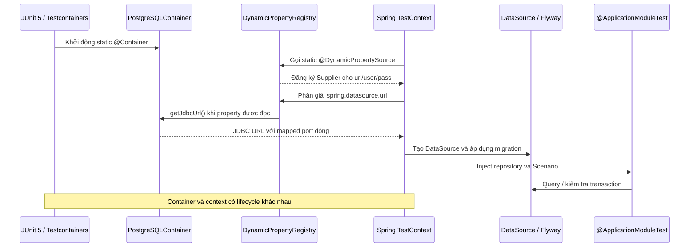

# DynamicPropertySource với container

## 1. Vấn đề: container khởi động rồi, Spring kết nối vào đâu?

Trong học phần **SPRING_MODULITH_VERIFICATION_TESTING**, chúng ta kiểm chứng ranh giới kiến trúc của Spring Modulith bằng `ApplicationModules` và các quy tắc phụ thuộc giữa module; thực hành `@ApplicationModuleTest`, kiểm thử sự kiện, database, tích hợp và bổ sung quality gate CI để ngăn lỗi phụ thuộc và hồi quy.

Ở chương **Testcontainers**, chủ đề **“DynamicPropertySource với container”** giải quyết một bài toán rất cụ thể:

> Testcontainers cấp host, mapped port, JDBC URL hoặc bootstrap servers **động**. Làm cách nào đưa những giá trị đó vào Spring `Environment` **trước khi** Spring tạo `DataSource`, Kafka producer hoặc những bean phụ thuộc vào hạ tầng?

Ví dụ, PostgreSQL container có thể chạy ở host `localhost` với mapped port `53417` trong một lần test và `62108` ở lần khác. Nếu test cứng `jdbc:postgresql://localhost:5432/shipping_test`, nó có thể kết nối nhầm database cài trên máy hoặc thất bại trên CI.

Spring TestContext cung cấp:

- `@DynamicPropertySource`: khai báo **phương thức static** trong lớp test để đóng góp thuộc tính động.
- `DynamicPropertyRegistry`: đăng ký cặp `property name → Supplier`.
- `Supplier`: đọc giá trị hiện tại từ container, ví dụ `postgres::getJdbcUrl`, khi Spring cần phân giải thuộc tính.
- `@ApplicationModuleTest`: giới hạn phạm vi Spring beans của **module mục tiêu**, hoàn toàn độc lập với việc property được lấy từ Testcontainers.

**Ý chính:** `@DynamicPropertySource` không khởi động container và không thay đổi ranh giới application module. Nó chỉ giúp **Spring lấy đúng cấu hình kết nối** từ hạ tầng đã được quản lý bởi một lifecycle khác.

## 2. Vòng đời của container, dynamic property và Spring context



Sơ đồ biểu diễn quan hệ logic, **không quy định thứ tự từng callback nội bộ tuyệt đối** của JUnit và Spring. Điểm quan trọng là: container phải **đã start trước khi Supplier cần gọi** `getJdbcUrl()` và các bean phụ thuộc phải dùng property đã đăng ký.

### Ba trách nhiệm khác nhau

| Thành phần | Trách nhiệm | Không tự làm |
| --- | --- | --- |
| `@Testcontainers` + `@Container` | JUnit extension quản lý start/stop container | Không tự gán JDBC URL vào `Environment` khi không có cách tích hợp |
| `@DynamicPropertySource` | Đăng ký property động cho Spring TestContext | Không start/stop container, không tạo table |
| `@ApplicationModuleTest` | Bootstrap module mục tiêu và các bean trong phạm vi khai báo | Không tự tạo Docker container hoặc bật mọi module trong ứng dụng |

Nếu test sử dụng **Spring-managed container** với `@Bean` thay cho JUnit extension, lifecycle đổi sang Spring; khi đó có thể dùng `@ServiceConnection` hoặc `DynamicPropertyRegistrar`. Các lựa chọn sẽ được so sánh ở mục 12–13.

## 3. Chữ ký chính xác của `@DynamicPropertySource`

Spring Framework yêu cầu phương thức mang annotation:

1. Là phương thức **`static`**.
2. Nhận **chính xác một tham số** `DynamicPropertyRegistry`.
3. Gọi `registry.add(name, supplier)` để đăng ký giá trị.
4. Nằm trong lớp test, hoặc được kế thừa theo cơ chế TestContext thích hợp.

Ví dụ tối thiểu:

```java
import org.springframework.test.context.DynamicPropertyRegistry;
import org.springframework.test.context.DynamicPropertySource;

@DynamicPropertySource
static void databaseProperties(DynamicPropertyRegistry registry) {
    registry.add("spring.datasource.url", postgres::getJdbcUrl);
    registry.add("spring.datasource.username", postgres::getUsername);
    registry.add("spring.datasource.password", postgres::getPassword);
}
```

Trong ví dụ, `postgres` phải là một trường `static` tham chiếu container đã được quản lý/khởi động. Đây là đoạn cấu hình **nằm bên trong lớp test**, không phải phương thức độc lập.

### `Supplier` được gọi khi nào?

`DynamicPropertyRegistry.add(String, Supplier<Object>)` nhận supplier và giá trị được truy xuất **khi property được phân giải**. Vì vậy dùng:

```java
registry.add("spring.datasource.url", postgres::getJdbcUrl);
```

hoặc:

```java
registry.add("spring.datasource.url",
        () -> postgres.getJdbcUrl());
```

Không dùng:

```java
// SAI: add yêu cầu Supplier, không nhận trực tiếp String.
registry.add("spring.datasource.url", postgres.getJdbcUrl());
```

Cũng không nên biến supplier thành công cụ **chạy lại nghiệp vụ** hay tạo thêm container mỗi lần property được đọc:

```java
// SAI VỀ THIẾT KẾ: mỗi lượt phân giải có thể start resource khác.
registry.add("spring.datasource.url", () -> {
    var db = new PostgreSQLContainer("postgres:17-alpine");
    db.start();
    return db.getJdbcUrl();
});
```

Supplier nên chỉ **đọc endpoint** của container mà test đã sở hữu. Bản thân `@DynamicPropertySource` không phải factory tạo container.

## 4. Chuẩn bị dependency nhất quán

Ví dụ chính dùng **Testcontainers Java 2.x**, Java 17+ và PostgreSQL thật để kiểm chứng module `shipping`. Phiên bản Spring Boot, Spring Modulith và Testcontainers phải được BOM/build tool của dự án quản lý nhất quán.

### Maven (các dependency liên quan)

```xml
<!-- Database driver / JDBC -->
<dependency>
    <groupId>org.springframework.boot</groupId>
    <artifactId>spring-boot-starter-jdbc</artifactId>
</dependency>
<dependency>
    <groupId>org.postgresql</groupId>
    <artifactId>postgresql</artifactId>
    <scope>runtime</scope>
</dependency>

<!-- Spring/JUnit + Spring Modulith -->
<dependency>
    <groupId>org.springframework.boot</groupId>
    <artifactId>spring-boot-starter-test</artifactId>
    <scope>test</scope>
</dependency>
<dependency>
    <groupId>org.springframework.modulith</groupId>
    <artifactId>spring-modulith-starter-test</artifactId>
    <scope>test</scope>
</dependency>

<!-- Testcontainers Java 2.x: PostgreSQL + JUnit 5 extension -->
<dependency>
    <groupId>org.testcontainers</groupId>
    <artifactId>testcontainers-postgresql</artifactId>
    <scope>test</scope>
</dependency>
<dependency>
    <groupId>org.testcontainers</groupId>
    <artifactId>testcontainers-junit-jupiter</artifactId>
    <scope>test</scope>
</dependency>
```

**`@DynamicPropertySource` không đòi hỏi `spring-boot-testcontainers`**. Module `spring-boot-testcontainers` cần khi dùng các tiện ích của Spring Boot như `@ServiceConnection`; test thuần `@DynamicPropertySource` với JUnit extension chỉ cần Spring Test và Testcontainers dependency phù hợp.

Nếu dự án dùng Flyway/Liquibase, cần dependency migration và cấu hình tương thích để schema được tạo trước lúc test repository chạy.

### Gradle Groovy DSL

```groovy
dependencies {
    implementation 'org.springframework.boot:spring-boot-starter-jdbc'
    runtimeOnly 'org.postgresql:postgresql'

    testImplementation 'org.springframework.boot:spring-boot-starter-test'
    testImplementation 'org.springframework.modulith:spring-modulith-starter-test'
    testImplementation 'org.testcontainers:testcontainers-postgresql'
    testImplementation 'org.testcontainers:testcontainers-junit-jupiter'
}
```

Đây là phần dependency tham khảo, không phải build file đầy đủ; Gradle plugins/BOM của dự án vẫn phải cung cấp version tương thích.

### Testcontainers Java 1.x và 2.x

| Thành phần | 1.x | 2.x trong bài |
| --- | --- | --- |
| PostgreSQL artifact | `org.testcontainers:postgresql` | `org.testcontainers:testcontainers-postgresql` |
| PostgreSQL import | `org.testcontainers.containers.PostgreSQLContainer` | `org.testcontainers.postgresql.PostgreSQLContainer` |
| Type phổ biến | `PostgreSQLContainer<?>` | `PostgreSQLContainer` |
| JUnit Jupiter artifact | `org.testcontainers:junit-jupiter` | `org.testcontainers:testcontainers-junit-jupiter` |

Đừng copy import 1.x vào code dùng artifact 2.x rồi kết luận `@DynamicPropertySource` bị lỗi: đó là lỗi dependency/import xảy ra **trước** khi Spring đọc properties.

## 5. Mẫu đầy đủ: `@Testcontainers` + `@DynamicPropertySource`

Module `com.acme.shipping` sử dụng một PostgreSQL container thật. Test class đặt trong package của module mục tiêu.

File `src/test/java/com/acme/shipping/ShippingDatabaseConnectionTests.java`:

```java
package com.acme.shipping;

import static org.assertj.core.api.Assertions.assertThat;

import javax.sql.DataSource;

import org.junit.jupiter.api.Test;
import org.springframework.beans.factory.annotation.Autowired;
import org.springframework.modulith.test.ApplicationModuleTest;
import org.springframework.test.context.DynamicPropertyRegistry;
import org.springframework.test.context.DynamicPropertySource;
import org.testcontainers.junit.jupiter.Container;
import org.testcontainers.junit.jupiter.Testcontainers;
import org.testcontainers.postgresql.PostgreSQLContainer;

@Testcontainers
@ApplicationModuleTest
class ShippingDatabaseConnectionTests {

    @Container
    static PostgreSQLContainer postgres =
            new PostgreSQLContainer("postgres:17-alpine")
                    .withDatabaseName("shipping_test")
                    .withUsername("test")
                    .withPassword("test");

    @DynamicPropertySource
    static void configureDatabase(DynamicPropertyRegistry registry) {
        registry.add("spring.datasource.url", postgres::getJdbcUrl);
        registry.add("spring.datasource.username", postgres::getUsername);
        registry.add("spring.datasource.password", postgres::getPassword);
    }

    @Autowired DataSource dataSource;

    @Test
    void usesPostgresFromTheContainer() throws Exception {
        try (var connection = dataSource.getConnection()) {
            assertThat(connection.getMetaData().getDatabaseProductName())
                    .isEqualTo("PostgreSQL");
            assertThat(connection.isValid(2)).isTrue();
        }
    }
}
```

**Giải thích từng lớp:**

- `@Testcontainers` đăng ký JUnit Jupiter extension của Testcontainers.
- `@Container static PostgreSQLContainer` tạo một instance được quản lý **trong phạm vi lớp test**; JUnit extension start/stop nó theo lifecycle của lớp.
- `@DynamicPropertySource` cung cấp ba property cho Spring Boot datasource auto-configuration.
- `@ApplicationModuleTest` chỉ bootstrap các Spring beans trong **module shipping** (mặc định `STANDALONE`), dù PostgreSQL phục vụ cả ứng dụng ngoài production.
- `DataSource` được Spring tạo từ JDBC driver + các property động.
- `getDatabaseProductName()` xác nhận repository không vô tình kết nối vào H2 hoặc một PostgreSQL cài sẵn ở máy.

**Chưa được chứng minh:** migration đã có bảng, query domain chạy đúng, event listener đã xử lý hoặc transaction đã commit. Test này chỉ xác minh **kết nối ban đầu**. Các mục sau bổ sung kiểm thử repository và Scenario.

### Vì sao không hard-code port?

`getJdbcUrl()` bao gồm mapped host/port động của container. Đừng viết:

```properties
# Anti-pattern khi mục tiêu là kết nối Testcontainer:
spring.datasource.url=jdbc:postgresql://localhost:5432/shipping_test
```

Port `5432` trên host có thể đang được PostgreSQL khác dùng. Testcontainers thường map **port 5432 của container** tới một port host bất kỳ. Để lấy endpoint chính xác, dùng `postgres::getJdbcUrl`.

## 6. Tại sao ba property phải được đăng ký cùng nhau?

Spring Boot cần thông tin kết nối hoàn chỉnh cho một `DataSource`. Với PostgreSQL container, thông tin cơ bản là:

| Property | Giá trị động | Vai trò |
| --- | --- | --- |
| `spring.datasource.url` | `postgres::getJdbcUrl` | Host, mapped port, tên database. |
| `spring.datasource.username` | `postgres::getUsername` | Tài khoản bên trong container. |
| `spring.datasource.password` | `postgres::getPassword` | Mật khẩu thử nghiệm. |

Đăng ký mỗi URL nhưng để username/password lấy từ profile production có thể dẫn tới authentication failure hoặc — nguy hiểm hơn — dùng nhầm credentials ngoài ý muốn.

Có thể đăng ký thêm những property **thực sự cần** như schema riêng:

```java
registry.add("app.shipping.schema", () -> "shipping_test_schema");
```

Nhưng đây là **custom property do ứng dụng định nghĩa**. Spring Boot không tự áp dụng `app.shipping.schema` vào `DataSource` nếu code/config của dự án không đọc nó.

**Bảo mật:** ví dụ `test/test` chỉ dành cho container tạm thời. Không đưa credentials production vào Git, logs của test hoặc tham số của công cụ debug.

## 7. `@DynamicPropertySource` được ưu tiên hơn file properties

Spring Framework quy định dynamic properties có **độ ưu tiên cao hơn** các nguồn như:

- `@TestPropertySource`;
- environment variables của hệ điều hành;
- Java system properties;
- `@PropertySource` và nhiều nguồn property được khai báo thông thường.

Ví dụ:

```properties
# application-test.properties:
spring.datasource.url=jdbc:postgresql://localhost:5432/some_database
```

Khi `@DynamicPropertySource` thêm `spring.datasource.url`, Spring `Environment` trong test sẽ lấy **giá trị dynamic** theo quy tắc precedence, thay vì URL trong file trên.

### Vì sao vẫn có thể kết nối sai dù dynamic property đúng?

Vì có thêm cơ chế khác: Spring Boot `@ServiceConnection` tạo `ConnectionDetails`, và **connection details có ưu tiên hơn các connection-related properties** đối với auto-configuration hỗ trợ chúng.

Nếu vô tình đăng ký hai đường cho cùng datasource:

```java
@Container
@ServiceConnection
static PostgreSQLContainer postgres = ...;

// Và lại thêm:
@DynamicPropertySource
static void db(DynamicPropertyRegistry registry) {
    registry.add("spring.datasource.url", otherPostgres::getJdbcUrl);
}
```

thì `DataSource` có thể sử dụng **connection details của `postgres`**, không phải URL của `otherPostgres`. Phép đọc `Environment.getProperty("spring.datasource.url")` vì vậy chưa đủ để chứng minh DataSource đang dùng server nào.

**Khuyến nghị:** chọn **một** cách kết nối chính cho mỗi service — `@ServiceConnection` hoặc `@DynamicPropertySource`. Khi bắt buộc kết hợp để cung cấp **custom property khác**, tránh đăng ký trùng cùng loại endpoint và kiểm tra JDBC metadata thực tế.

## 8. Khởi tạo schema bằng migration thật

Container mới thường chưa có bảng business. Với Spring Boot và Flyway/Liquibase được cấu hình đúng, migration của ứng dụng sẽ chạy vào `DataSource` do dynamic property cung cấp.

Ví dụ migration minh họa:

```sql
CREATE TABLE shipments (
    order_id UUID PRIMARY KEY,
    status VARCHAR(32) NOT NULL,
    carrier VARCHAR(32) NOT NULL
);
```

Có thể dùng Flyway file `db/migration/V1__create_shipments.sql` **nếu** version 1 chưa được sử dụng; trong repository thật phải chọn version phù hợp với lịch sử migration hiện có.

**Ba điểm cần xác minh:**

1. Spring Boot kết nối đúng PostgreSQL container **trước khi Flyway chạy**.
2. Migration tạo bảng ở schema mà repository thật query (ví dụ `public`).
3. Test module scope không mặc nhiên tách Flyway migration theo package Java. Nếu production dùng migration chung, test có thể cần chạy migration chung.

Nếu mục tiêu là kiểm thử PostgreSQL dialect, tránh thay bằng H2 chỉ để suite chạy nhanh. Một SQL như `ON CONFLICT`, unique constraint hoặc transaction isolation có thể khác giữa các engine.

## 9. Repository JDBC: state để `Scenario` quan sát

Định nghĩa public event từ module `order`:

`src/main/java/com/acme/order/OrderPaid.java`:

```java
package com.acme.order;

import java.util.UUID;

public record OrderPaid(UUID orderId) {}
```

Ở đây `OrderPaid` thuộc package gốc module `order`, tức API công khai mặc định theo Spring Modulith. Module shipping nên dùng **event contract công khai**, không import lớp `com.acme.order.internal.*`.

Repository shipping:

`src/main/java/com/acme/shipping/ShipmentRepository.java`:

```java
package com.acme.shipping;

import java.util.List;
import java.util.Optional;
import java.util.UUID;

import org.springframework.jdbc.core.JdbcTemplate;
import org.springframework.stereotype.Repository;

@Repository
class ShipmentRepository {

    private final JdbcTemplate jdbc;

    ShipmentRepository(JdbcTemplate jdbc) {
        this.jdbc = jdbc;
    }

    void upsertReady(UUID orderId) {
        jdbc.update("""
                INSERT INTO shipments(order_id, status, carrier)
                VALUES (?, 'READY', 'STANDARD')
                ON CONFLICT (order_id)
                DO UPDATE SET
                    status = EXCLUDED.status,
                    carrier = EXCLUDED.carrier
                """, orderId);
    }

    Optional<String> statusOf(UUID orderId) {
        List<String> values = jdbc.query(
                "SELECT status FROM shipments WHERE order_id = ?",
                (rs, rowNum) -> rs.getString(1),
                orderId);

        return values.stream().findFirst();
    }

    int countByOrderId(UUID orderId) {
        Integer count = jdbc.queryForObject(
                "SELECT COUNT(*) FROM shipments WHERE order_id = ?",
                Integer.class,
                orderId);
        return count == null ? 0 : count;
    }

    void deleteByOrderId(UUID orderId) {
        jdbc.update("DELETE FROM shipments WHERE order_id = ?", orderId);
    }
}
```

**Ý nghĩa đối với bài `@DynamicPropertySource`:** `JdbcTemplate` phụ thuộc `DataSource`; `DataSource` lấy URL/credentials từ dynamic properties; repository không cần biết container đang dùng host/port nào.

`upsertReady(...)` kiểm tra cú pháp PostgreSQL và có hiệu lực idempotent ở mức **một row theo `order_id`**. Nó không tự đảm bảo mọi side effect khác là exactly-once.

## 10. Listener async trong module mục tiêu

`src/main/java/com/acme/shipping/ShippingHandler.java`:

```java
package com.acme.shipping;

import com.acme.order.OrderPaid;
import org.springframework.modulith.events.ApplicationModuleListener;
import org.springframework.stereotype.Component;

@Component
class ShippingHandler {

    private final ShipmentRepository shipments;

    ShippingHandler(ShipmentRepository shipments) {
        this.shipments = shipments;
    }

    @ApplicationModuleListener
    public void on(OrderPaid event) {
        shipments.upsertReady(event.orderId());
    }
}
```

`@ApplicationModuleListener` kết hợp xử lý sự kiện Spring **sau commit**, chạy bất đồng bộ và trong transaction riêng (`REQUIRES_NEW`).

Một database container thật giúp kiểm tra:

- Listener có thể mở transaction và ghi qua JDBC;
- PostgreSQL xử lý `ON CONFLICT` đúng;
- Sau commit, test đọc được state từ transaction khác;
- Dữ liệu đã commit cần được cleanup cho bài test tiếp theo.

**Container khởi động thành công không chứng minh listener có trong Spring context.** `@ApplicationModuleTest` mặc định chỉ khởi động module chứa lớp test. Hãy đặt test trong `com.acme.shipping` để listener shipping được bootstrap, hoặc mở rộng mode một cách có chủ đích.

## 11. Ví dụ module test đầy đủ: dynamic properties + Scenario + DB

Cùng một cấu hình container như mục 5, nhưng kiểm tra cả luồng `OrderPaid → ShippingHandler → PostgreSQL`:

`src/test/java/com/acme/shipping/ShippingDynamicPropertyTests.java`:

```java
package com.acme.shipping;

import static org.assertj.core.api.Assertions.assertThat;

import java.time.Duration;
import java.util.UUID;

import com.acme.order.OrderPaid;
import org.junit.jupiter.api.Test;
import org.springframework.beans.factory.annotation.Autowired;
import org.springframework.modulith.test.ApplicationModuleTest;
import org.springframework.modulith.test.Scenario;
import org.springframework.test.context.DynamicPropertyRegistry;
import org.springframework.test.context.DynamicPropertySource;
import org.springframework.transaction.support.TransactionTemplate;
import org.testcontainers.junit.jupiter.Container;
import org.testcontainers.junit.jupiter.Testcontainers;
import org.testcontainers.postgresql.PostgreSQLContainer;

@Testcontainers
@ApplicationModuleTest
class ShippingDynamicPropertyTests {

    @Container
    static PostgreSQLContainer postgres =
            new PostgreSQLContainer("postgres:17-alpine")
                    .withDatabaseName("shipping_test")
                    .withUsername("test")
                    .withPassword("test");

    @DynamicPropertySource
    static void configureDatabase(DynamicPropertyRegistry registry) {
        registry.add("spring.datasource.url", postgres::getJdbcUrl);
        registry.add("spring.datasource.username", postgres::getUsername);
        registry.add("spring.datasource.password", postgres::getPassword);
    }

    @Autowired ShipmentRepository shipments;
    @Autowired TransactionTemplate transactions;

    @Test
    void persistsReadyShipmentAfterEvent(Scenario scenario) {
        UUID orderId = UUID.randomUUID();

        // GIVEN: Không dựa vào trạng thái của test khác.
        assertThat(shipments.statusOf(orderId)).isEmpty();

        scenario.publish(new OrderPaid(orderId))
                .andCleanup(() ->
                        transactions.executeWithoutResult(tx ->
                                shipments.deleteByOrderId(orderId)))
                .andWaitAtMost(Duration.ofSeconds(8))
                .forStateChange(
                        () -> shipments.statusOf(orderId),
                        status -> status.filter("READY"::equals)
                                .isPresent())
                .andVerify(status -> {
                    assertThat(status).contains("READY");
                    assertThat(shipments.countByOrderId(orderId))
                            .isEqualTo(1);
                });
    }
}
```

### Phân tích chính xác điều test chứng minh

- **Given:** tạo `orderId` ngẫu nhiên, không phụ thuộc test trước.
- **Container:** JUnit khởi động PostgreSQL thật.
- **Dynamic properties:** Spring datasource lấy JDBC URL và credentials từ container đang chạy.
- **Stimulus:** `Scenario.publish(...)` phát `OrderPaid` trong transaction mới để transactional listener được kích hoạt.
- **Processing:** `ShippingHandler` nhận event sau commit, ghi DB trong transaction riêng.
- **Wait:** supplier poll repository đến khi `status == READY`.
- **Verify:** xác nhận state và số row của đúng `orderId`.
- **Cleanup:** `andCleanup(...)` dọn row do listener đã commit bằng transaction riêng.

**Không dùng `Thread.sleep(...)`.** Timeout 8 giây chỉ là giới hạn chờ minh họa, không phải thời gian test phải ngủ hay SLA của production.

**Điều kiện chạy:** project phải có Spring Boot application, module shipping, PostgreSQL driver, datasource và transaction manager, migration/schema, các dependency phù hợp và Docker-compatible runtime. Đây là ví dụ tham khảo; Worker không chạy Gradle/Maven ở giai đoạn viết nội dung STEP 4.

### Khi cần kiểm tra event thay vì DB

Nếu hợp đồng là module phát `ShipmentPrepared(orderId)`, có thể dùng:

```java
scenario.publish(new OrderPaid(orderId))
        .andWaitForEventOfType(ShipmentPrepared.class)
        .matching(event -> event.orderId().equals(orderId))
        .toArriveAndVerify(event ->
                assertThat(event.orderId()).isEqualTo(orderId));
```

`ShipmentPrepared` là event **do ứng dụng định nghĩa** (chưa được listener ở mục 10 phát). Đoạn này chỉ chạy sau khi dự án triển khai contract event đầu ra. Quan sát event **không tự chứng minh database đã commit** — vì thế bài kiểm tra DB ở trên dùng state predicate.

## 12. `@DynamicPropertySource` hay `@ServiceConnection`?

Spring Boot hiện đại hỗ trợ `@ServiceConnection` để tự tạo connection details cho các container được nhận diện, và có thể quản lý container bằng Spring bean. Đây là một phương án **khác** với `@DynamicPropertySource`.

| Tiêu chí | `@DynamicPropertySource` | `@ServiceConnection` |
| --- | --- | --- |
| Cách cấu hình | Đăng ký property name và supplier thủ công | Boot tự tạo `ConnectionDetails` khi nhận diện container |
| Độ linh hoạt | Cao: hỗ trợ custom property, host/port, nhiều đích | Tốt cho service được Boot hỗ trợ |
| Code lặp | Cần URL, username, password (hoặc endpoint khác) | Thường ít hơn |
| Nơi dùng | Spring TestContext; hợp với JUnit-managed/externally-managed container | Spring Boot test integration |
| Dependency thêm | Không cần `spring-boot-testcontainers` riêng cho annotation này | Cần `spring-boot-testcontainers` |
| Vòng đời container | **Không quản lý**; phụ thuộc JUnit/manual lifecycle | Cũng không tự quyết lifecycle nếu chỉ đặt trên field; Spring-managed bean mới gắn container với context |
| Nguy cơ trộn cấu hình | Sai property name hoặc credentials | Connection details có thể override connection-related properties |

### Phương án `@ServiceConnection` với container bean

```java
package com.acme.shipping;

import org.springframework.boot.test.context.TestConfiguration;
import org.springframework.boot.testcontainers.service.connection.ServiceConnection;
import org.springframework.context.annotation.Bean;
import org.testcontainers.postgresql.PostgreSQLContainer;

@TestConfiguration(proxyBeanMethods = false)
class ShippingPostgresConfig {

    @Bean
    @ServiceConnection
    PostgreSQLContainer postgres() {
        return new PostgreSQLContainer("postgres:17-alpine")
                .withDatabaseName("shipping_test");
    }
}
```

Import vào module test:

```java
@ApplicationModuleTest
@Import(ShippingPostgresConfig.class)
class ShippingWithServiceConnectionTests {
    // DataSource được Boot cấu hình từ connection details.
}
```

`@Import` là Spring annotation; test cần import các type Java tương ứng. Đây là **mẫu thay thế** cho cách đăng ký bằng `@DynamicPropertySource` ở mục 5/11, không nên bật cả hai cho cùng datasource nếu không có mục đích rõ.

**Vì sao Spring-managed bean thường tốt cho nhiều lớp test?** Container tồn tại theo `ApplicationContext`, nên khi Spring cache context qua nhiều test class, container còn sống trong thời gian context đó cần kết nối.

## 13. `DynamicPropertyRegistrar`: giá trị động lấy từ Spring bean

Từ **Spring Framework 6.2**, ngoài static `@DynamicPropertySource` còn có `DynamicPropertyRegistrar`. Nó là bean trong Spring context, có thể inject bean container do Spring quản lý để cung cấp custom properties.

Cách này hữu ích khi:

- Container được khai báo bằng `@Bean`;
- Thuộc tính custom của ứng dụng cần giá trị động;
- Dịch vụ chưa có service connection tương ứng;
- Muốn lifecycle container và Spring context được quản lý đồng bộ.

Ví dụ **không dùng `@ServiceConnection` cho datasource**, mà đăng ký thủ công bằng registrar:

```java
package com.acme.shipping;

import org.springframework.boot.test.context.TestConfiguration;
import org.springframework.context.annotation.Bean;
import org.springframework.test.context.DynamicPropertyRegistrar;
import org.testcontainers.postgresql.PostgreSQLContainer;

@TestConfiguration(proxyBeanMethods = false)
class ShippingRegistrarTestConfig {

    @Bean
    PostgreSQLContainer postgresForTests() {
        return new PostgreSQLContainer("postgres:17-alpine")
                .withDatabaseName("shipping_test")
                .withUsername("test")
                .withPassword("test");
    }

    @Bean
    DynamicPropertyRegistrar postgresProperties(
            PostgreSQLContainer postgresForTests) {

        return registry -> {
            registry.add(
                    "spring.datasource.url",
                    postgresForTests::getJdbcUrl);
            registry.add(
                    "spring.datasource.username",
                    postgresForTests::getUsername);
            registry.add(
                    "spring.datasource.password",
                    postgresForTests::getPassword);
        };
    }
}
```

Trong test:

```java
@ApplicationModuleTest
@Import(ShippingRegistrarTestConfig.class)
class ShippingRegistrarTests {
    // Test module có datasource từ Spring-managed container.
}
```

**Sự khác biệt cốt lõi:**

- `@DynamicPropertySource` là phương thức **static ở lớp test**, thường đọc container external/JUnit-managed.
- `DynamicPropertyRegistrar` là **bean** được Spring nhận diện và gọi để đăng ký properties, có thể dùng bean khác trong context.
- Nếu dự án dùng Spring Framework **trước 6.2**, không mặc định có `DynamicPropertyRegistrar`.

Khi registrar phụ thuộc container bean, Spring có cơ chế khởi tạo dependency trước khi đăng ký giá trị; với Spring Boot container bean, lifecycle được tổ chức phù hợp. Đừng tự tạo lại container trong callback registrar.

**Cảnh báo:** registrar có thể khiến những bean mà nó tương tác được khởi tạo sớm, do đó cần tránh vòng phụ thuộc (ví dụ container config lại phụ thuộc một `DataSource` vốn cần property từ registrar).

## 14. Phạm vi `ApplicationContext` và nguy cơ container dừng quá sớm

Một lỗi hay gặp trong test Spring Boot:

1. Lớp test A có `@Testcontainers` và `static @Container`.
2. Spring TestContext tạo `ApplicationContext` dùng JDBC URL từ `@DynamicPropertySource`.
3. Lớp A hoàn tất, JUnit extension **dừng container**.
4. Spring vẫn **cache context** vì cấu hình test có thể được tái dùng.
5. Lớp test B nhận context đang trỏ tới JDBC URL/port của container đã dừng.

Triệu chứng: test chạy riêng thành công, nhưng chạy cả suite thì `Connection refused`, health check lỗi hoặc bean destruction exception.

### Vì sao static không đồng nghĩa sống cùng Spring context?

`static @Container` chỉ có nghĩa container được JUnit extension chia sẻ giữa các **test method trong lớp**. Nó không bảo đảm container sống qua mọi test class có chung Spring cache key.

`@DynamicPropertySource` cũng **không quản lý việc stop/start**. Nó cung cấp Supplier; sau khi Spring tạo `DataSource`, connection pool có thể đã giữ URL cũ. Dù Supplier ở nơi khác bắt đầu trả về một URL mới, điều đó **không tự tạo lại datasource** đã được khởi tạo.

### Hướng xử lý

| Phương án | Lợi ích | Đánh đổi |
| --- | --- | --- |
| **Spring-managed container bean** + `@ServiceConnection` | Lifecycle khớp Spring context; code ít | Cần Spring Boot integration phù hợp |
| Spring-managed container bean + `DynamicPropertyRegistrar` | Lifecycle khớp context, linh hoạt custom properties | Cần Spring Framework 6.2+, nhiều code hơn |
| Singleton container được start thủ công trong phạm vi JVM | Không bị JUnit extension stop sau một lớp | Tự quản lý lifecycle và cleanup, có thể dùng chung state |
| `@DirtiesContext(classMode = AFTER_CLASS)` | Tránh cache lại context của test class sau khi kết thúc | Bootstrap lại context/container, tốn thời gian |

**Không dùng `@DirtiesContext` như nút dọn database.** Annotation này ảnh hưởng Spring context cache; dữ liệu trong container reusable bên ngoài hay broker khác vẫn còn. Chọn phương án theo yêu cầu về performance, test isolation và lifecycle của dự án.

## 15. Khi kế thừa `@DynamicPropertySource` từ base class

Spring TestContext hỗ trợ kế thừa dynamic property methods từ superclass, interface và một số nested test arrangement.

Ví dụ một base class dùng container **singleton trong một JVM**:

```java
package com.acme.testinfra;

import org.springframework.test.context.DynamicPropertyRegistry;
import org.springframework.test.context.DynamicPropertySource;
import org.testcontainers.postgresql.PostgreSQLContainer;

public abstract class SharedPostgresTestBase {

    protected static final PostgreSQLContainer POSTGRES =
            new PostgreSQLContainer("postgres:17-alpine")
                    .withDatabaseName("shared_tests");

    static {
        POSTGRES.start();
    }

    @DynamicPropertySource
    static void postgresProperties(DynamicPropertyRegistry registry) {
        registry.add("spring.datasource.url", POSTGRES::getJdbcUrl);
        registry.add("spring.datasource.username", POSTGRES::getUsername);
        registry.add("spring.datasource.password", POSTGRES::getPassword);
    }
}
```

Các test class kế thừa có thể dùng chung container và phương thức property registration.

**Không gắn `@Container` và `@Testcontainers` cho singleton này** nếu mục tiêu là giữ nó sống qua nhiều test class: JUnit extension có thể stop container khi một lớp kết thúc.

### Cẩn trọng với Spring cache key

Một phương thức `@DynamicPropertySource` được **kế thừa** không có nghĩa mỗi subclass đương nhiên nhận một context mới. Nếu mỗi subclass dùng container hoặc config động khác nhau nhưng Spring cache key được xem là tương đương, có nguy cơ **context A tái dùng endpoint của B** hoặc ngược lại.

Spring Framework lưu ý có trường hợp cần `@DirtiesContext` trên base class khi dynamic properties **thay đổi giữa các subclass**. Đây là cách khắc phục có điều kiện; đối với hạ tầng dùng chung nhiều test, một singleton container với **cùng một endpoint** nhất quán thường an toàn hơn việc thay giá trị mutable của supplier trong cùng context.

### Không làm điều này

```java
// Anti-pattern: thay static reference trong mỗi @BeforeAll subclass
// rồi mong Spring tự cấu hình lại DataSource của context đã cache.
SharedState.postgres = new PostgreSQLContainer("postgres:17-alpine");
SharedState.postgres.start();
```

Một `DataSource` đã tạo không tự đổi JDBC URL khi static field thay đổi. Nếu thật sự cần container khác cho mỗi subclass, phải bảo đảm context/lifecycle khác tương ứng.

## 16. Kết nối Kafka container bằng `@DynamicPropertySource`

`@DynamicPropertySource` không chỉ dành cho JDBC. Nó phù hợp khi muốn đăng ký **bootstrap servers động** của Kafka.

Ví dụ dùng Testcontainers Java 2.x:

```java
import org.springframework.test.context.DynamicPropertyRegistry;
import org.springframework.test.context.DynamicPropertySource;
import org.testcontainers.junit.jupiter.Container;
import org.testcontainers.junit.jupiter.Testcontainers;
import org.testcontainers.kafka.KafkaContainer;

@Testcontainers
class KafkaPropertiesExample {

    @Container
    static KafkaContainer kafka =
            new KafkaContainer("apache/kafka-native:3.8.0");

    @DynamicPropertySource
    static void configureKafka(DynamicPropertyRegistry registry) {
        registry.add(
                "spring.kafka.bootstrap-servers",
                kafka::getBootstrapServers);
    }
}
```

Đây là **đoạn cấu hình** để lồng vào một lớp Spring integration test thực sự (ví dụ `@ApplicationModuleTest`); chỉ có `@Testcontainers` mà không bật Spring TestContext thì `@DynamicPropertySource` không tự tạo một Spring application context.

Các dependency liên quan:

```xml
<dependency>
    <groupId>org.springframework.kafka</groupId>
    <artifactId>spring-kafka</artifactId>
</dependency>
<dependency>
    <groupId>org.testcontainers</groupId>
    <artifactId>testcontainers-kafka</artifactId>
    <scope>test</scope>
</dependency>
```

Với Kafka, dynamic property chỉ giúp client **kết nối broker**. Nó không:

- Tự tạo topic, serializer/deserializer, consumer group;
- Đảm bảo Spring application event đã externalize ra Kafka;
- Chứng minh consumer production nhận và xử lý record;
- Biến `Scenario.andWaitForEventOfType(...)` thành một phép kiểm broker delivery.

**Kiểm thử broker flow** cần producer/consumer thật hoặc kiểm tra downstream state. Nếu chỉ `PublishedEvents` thấy Java event, không thể suy ra Kafka đã nhận message.

### Một ví dụ multi-container

Nếu module cần cả PostgreSQL và Kafka, có thể đăng ký cả hai từ cùng một phương thức:

```java
@DynamicPropertySource
static void infrastructure(DynamicPropertyRegistry registry) {
    registry.add("spring.datasource.url", postgres::getJdbcUrl);
    registry.add("spring.datasource.username", postgres::getUsername);
    registry.add("spring.datasource.password", postgres::getPassword);
    registry.add("spring.kafka.bootstrap-servers",
            kafka::getBootstrapServers);
}
```

Trong đó `postgres` và `kafka` là **hai trường static container đã có lifecycle rõ ràng**. Không cần khai báo một `@DynamicPropertySource` riêng cho từng container nếu bài test không yêu cầu tách cấu hình.

## 17. Custom properties và nhiều datasource

Giả sử ứng dụng dùng:

- `primaryDataSource` cho order;
- `shippingDataSource` riêng cho shipping;
- Một thuộc tính custom `app.shipping.datasource.url` do `@ConfigurationProperties` của dự án đọc.

Bạn có thể đăng ký:

```java
@DynamicPropertySource
static void shippingDbProperties(DynamicPropertyRegistry registry) {
    registry.add("app.shipping.datasource.url",
            shippingPostgres::getJdbcUrl);
    registry.add("app.shipping.datasource.username",
            shippingPostgres::getUsername);
    registry.add("app.shipping.datasource.password",
            shippingPostgres::getPassword);
}
```

`shippingPostgres` là container của module shipping. **Điều kiện:** ứng dụng thực phải khai báo custom datasource configuration đọc `app.shipping.datasource.*`; Spring Boot không tự tạo bean `shippingDataSource` chỉ vì có các key này.

Với nhiều datasource, nguy cơ cấu hình nhầm còn cao:

- Repository shipping có thể được inject datasource của order.
- Flyway/Liquibase chạy vào datasource chính thay vì shipping.
- `@ServiceConnection` mặc định có thể gắn vào bean không dự định nếu config phức tạp.
- Transaction manager của `@ApplicationModuleListener` có thể không phải transaction manager của repository cần test.

Hãy kiểm tra **thực tế**:

1. Bean `JdbcTemplate`/repository dùng datasource nào?
2. Metadata product, JDBC URL và database/schema nào?
3. Migration đã chạy trên datasource nào?
4. Transaction manager nào bao quanh listener?

Chỉ kiểm tra `Environment.getProperty("app.shipping.datasource.url")` **không đủ** để chứng minh bean sử dụng chính thuộc tính đó.

## 18. Transaction, rollback và state được quan sát

Khi test module phát sự kiện:

```java
scenario.publish(new OrderPaid(orderId))
        .andWaitForStateChange(
                () -> shipments.statusOf(orderId),
                state -> state.filter("READY"::equals).isPresent())
        .andVerify(state ->
                assertThat(state).contains("READY"));
```

Có ít nhất hai transaction:

1. `Scenario.publish(...)` tạo stimulus trong transaction mới để transactional listener được kích hoạt.
2. `@ApplicationModuleListener` chạy **sau commit**, bất đồng bộ và trong transaction khác.

**`@DynamicPropertySource` không thay đổi transaction semantics.** Nó chỉ cung cấp JDBC URL/credentials. Database do Testcontainers chạy vẫn xử lý commit/rollback theo PostgreSQL thực.

### Đừng giả định `@Transactional` JUnit rollback mọi side effect

Một `@Transactional` trên test có thể rollback **test-managed transaction**, nhưng không undo transaction độc lập của Scenario hay listener đã commit.

Vì vậy, với database dùng chung/cached container:

- Tạo ID riêng cho từng test;
- Commit Given nếu listener ở transaction khác cần đọc;
- Chờ đúng DB state đã commit thay vì event được phát khi transaction còn mở;
- Dọn dữ liệu đã commit bằng `TransactionTemplate` hoặc reset database có kiểm soát;
- Không xóa toàn bảng nếu có test song song.

### Given trước event

```java
// Đúng khi chạy ngoài outer test-managed transaction.
transactions.executeWithoutResult(tx ->
        orders.insertPaidOrder(orderId));

scenario.publish(new OrderPaid(orderId))
        .andWaitForStateChange(
                () -> shipments.statusOf(orderId),
                state -> state.filter("READY"::equals).isPresent())
        .andVerify(state -> assertThat(state).contains("READY"));
```

`orders` là repository minh họa chỉ có trong ứng dụng nếu dự án định nghĩa. `TransactionTemplate` với propagation mặc định `REQUIRED` sẽ tham gia outer transaction nếu có; không nên kết luận “Given đã commit” khi test đang có transaction bao ngoài. Khi cần, tách setup khỏi outer transaction hoặc cấu hình `REQUIRES_NEW` đúng mục đích.

## 19. Dọn state và kiểm thử song song

Kết nối đúng container mới là **điều kiện cần**. Nếu database container được dùng lại giữa nhiều method, trạng thái có thể rò:

| Loại state | Ví dụ | Cách hạn chế |
| --- | --- | --- |
| Rows | `shipments` còn row của test trước | `UUID` riêng, cleanup `WHERE order_id = ?` |
| Sequences / identity | ID tăng dần qua nhiều test | Không khẳng định ID phải bắt đầu từ 1 |
| Event registry | Publication pending/retry | Test registry riêng, tránh xóa bảng toàn cục |
| Async listener | Test A còn chạy khi B bắt đầu | Chờ điều kiện hoàn tất thực sự, quan sát log |
| Cache singleton | Map/cache giữ dữ liệu test trước | Reset theo khóa hoặc context riêng |
| Kafka topic/offset | Consumer group test trước đã commit offset | Group/correlation ID riêng, cleanup có chủ đích |

**Anti-pattern:**

```java
@AfterEach
void cleanEverything() {
    jdbc.update("DELETE FROM shipments"); // Có thể xóa dữ liệu test B.
}
```

**Thay thế theo ID:**

```java
transactions.executeWithoutResult(tx ->
        shipments.deleteByOrderId(orderId));
```

Nếu test cần schema thật sự sạch để kiểm chứng migrations, dùng database/schema/container riêng phù hợp với scope, hoặc điều phối test không chạy song song. `@DirtiesContext` không đồng nghĩa xóa DB được reuse bên ngoài context.

## 20. Những lỗi cấu hình thường gặp

| Triệu chứng | Nguyên nhân khả dĩ | Cách xử lý |
| --- | --- | --- |
| `@DynamicPropertySource` không được gọi | Test không chạy qua Spring TestContext hoặc method không đúng chữ ký | Dùng `@ApplicationModuleTest`/Spring test, phương thức `static`, một `DynamicPropertyRegistry` |
| Lỗi biên dịch ở `registry.add` | Truyền `String` thay vì `Supplier` | Dùng `postgres::getJdbcUrl`, không gọi method ngay |
| `Mapped port can only be obtained after the container is started` | Supplier được phân giải trước khi container start | Sửa JUnit/Spring-managed lifecycle |
| `Connection refused` dù có container | URL/port sai hoặc container đã stop | Kiểm tra `getJdbcUrl()` và Spring context caching |
| Spring dùng H2/DB khác | Autoconfig không đọc dynamic property, bean datasource custom | Kiểm tra `DataSource` thực, JDBC metadata |
| `Authentication failed` | Chỉ override URL, credentials vẫn lấy từ config khác | Đăng ký đủ URL/user/password |
| Property có giá trị đúng nhưng DB vẫn sai | `@ServiceConnection` tạo connection details ưu tiên hơn property | Chọn một phương án config và kiểm tra bean thực |
| `NoClassDefFoundError: PostgreSQLContainer` | Trộn import/artifact Testcontainers 1.x/2.x | Đồng bộ dependency và package |
| `relation "shipments" does not exist` | Migration chưa chạy, sai schema hoặc datasource | Kiểm tra migration logs/schema và kết nối thật |
| Listener test không chạy | Module không được bootstrap, transaction nguồn chưa commit | Đặt test ở module nhận, dùng Scenario và xem logs |
| Test A pass, B `Connection refused` | JUnit stop container nhưng Spring context vẫn cache | Ưu tiên Spring-managed container/registrar |
| Test B thấy dữ liệu của A | DB container dùng lại, thiếu cleanup hoặc filter ID | Dùng ID riêng, cleanup theo ID |
| Kafka producer không kết nối | Dùng sai key property hoặc bootstrap servers | Đăng ký `spring.kafka.bootstrap-servers` từ container |
| CI không tìm được Docker | Runtime/permission không có | Sửa runner, không sửa JDBC properties |
| Timeout chỉ trên CI | Startup, DB pool, listener/executor hoặc matcher | Kiểm tra root cause trước khi tăng deadline |

### Runbook 8 bước

1. **Container:** image có start không, Docker runtime có sẵn không?
2. **Property registration:** method `static` đúng chữ ký, đã được Spring TestContext phát hiện chưa?
3. **Supplier:** có đọc từ đúng instance container đã start không?
4. **Environment:** `spring.datasource.url`/`spring.kafka.bootstrap-servers` thực tế là gì (không log password)?
5. **Bean thật:** `DataSource` hoặc Kafka client sử dụng endpoint nào, có `ConnectionDetails` ưu tiên không?
6. **Schema/module:** migration và các bean thuộc `@ApplicationModuleTest` có mặt đúng phạm vi không?
7. **Transaction/Scenario:** input event được commit chưa, listener có lỗi async, predicate đúng ID/status không?
8. **Isolation/CI:** context cache, container stop, dữ liệu cũ và test song song có gây nhiễu không?

## 21. Quality gate CI: kiểm chứng endpoint động và module boundary

`@DynamicPropertySource` giúp test dùng hạ tầng thật nhưng **không thay thế kiểm chứng kiến trúc**.

```java
import org.junit.jupiter.api.Test;
import org.springframework.modulith.core.ApplicationModules;

class ModuleArchitectureTests {

    @Test
    void verifiesDependencies() {
        ApplicationModules.of(Application.class).verify();
    }
}
```

Thay `Application.class` bằng Spring Boot application class của dự án.

`ApplicationModules.verify()` kiểm tra phụ thuộc vòng, truy cập package nội bộ và luật phụ thuộc module. Nó không quan tâm URL PostgreSQL hay Kafka broker có đúng hay không.

Một quality gate nên có:

- **Unit test nhanh:** business rule không cần Docker.
- **Architecture verify:** `ApplicationModules.verify()` độc lập với container.
- **`@ApplicationModuleTest` không container:** service/domain event khi mock/fake đủ dùng.
- **`@ApplicationModuleTest` + PostgreSQL Testcontainer:** SQL dialect, migration, transaction, persistence state.
- **Broker integration test:** Kafka/RabbitMQ endpoint, serialization, routing và consumer effect khi có contract.
- **Retry/idempotency test:** dữ liệu bền vững, duplicate event và recovery nếu ứng dụng sử dụng registry.

### Đảm bảo chạy được trên CI

- Có Docker-compatible runtime và quyền cần thiết.
- Pin image tag, không dùng `latest` để tránh biến động.
- Dùng mapped URL/port từ container; không cứng `localhost:5432`.
- Migrations chạy trên database test đúng engine.
- Spring TestContext và JUnit container lifecycle không mâu thuẫn.
- Hạn chế log credentials, không chia sẻ database production.
- Có timeout hữu hạn và logs tương ứng để tìm lỗi container/handler.
- Test độc lập theo ID, không phụ thuộc thứ tự chạy.
- Không bật experimental container reuse xuyên nhiều job CI khi yêu cầu môi trường tái lập.
- Nếu thay `@ServiceConnection` bằng dynamic properties, cần kiểm tra cả URL **và** bean datasource thật.

### Checklist trước khi hoàn tất bài test

- [ ] Phân biệt rõ ai quản lý lifecycle container: JUnit, Spring bean hay manual singleton.
- [ ] `@DynamicPropertySource` là `static` và nhận duy nhất một `DynamicPropertyRegistry`.
- [ ] `registry.add(...)` nhận supplier, không gọi getter quá sớm.
- [ ] Dùng URL/port từ container thật, không hard-code host port.
- [ ] Đăng ký đủ credentials và property names đúng Spring Boot auto-config.
- [ ] Không trộn `@ServiceConnection` trùng endpoint không có chủ đích.
- [ ] Xác minh `DataSource`/client thực dùng đúng container.
- [ ] Có migration/schema đúng với DB production.
- [ ] `@ApplicationModuleTest` bootstrap đúng module listener/repository.
- [ ] `Scenario` chờ state sau commit khi hợp đồng là dữ liệu bền vững.
- [ ] Có cleanup side effect đã commit và dữ liệu test độc lập.
- [ ] Cân nhắc Spring TestContext cache khi dùng JUnit `static @Container`.
- [ ] Khi cần custom property hoặc container bean, biết `DynamicPropertyRegistrar` là lựa chọn từ Spring Framework 6.2.
- [ ] CI chạy test kiến trúc và test hạ tầng theo tầng phù hợp.

## 22. Bài tập thực hành

1. **Ý nghĩa API:** Giải thích `@DynamicPropertySource` làm gì và tại sao nó không tự start PostgreSQL container.
2. **Chữ ký:** Viết đúng phương thức `static void configure(DynamicPropertyRegistry registry)` để đưa JDBC URL vào Spring Environment.
3. **Supplier:** Phân biệt `postgres::getJdbcUrl` với `postgres.getJdbcUrl()`; tại sao một cách biên dịch đúng với `registry.add`?
4. **Credentials:** Nếu chỉ đăng ký URL mà không đăng ký username/password, những lỗi hoặc rủi ro nào có thể xảy ra?
5. **Database thật:** Viết test dùng `DataSource.getConnection().getMetaData().getDatabaseProductName()` để xác nhận PostgreSQL.
6. **Migration:** Đặt migration tạo bảng `shipments` vào vị trí được dự án quản lý. Vì sao container start thành công chưa chứng minh schema đã sẵn sàng?
7. **Module scope:** Test ở package `order` muốn kiểm tra listener `shipping`. Vì sao PostgreSQL container không tự bootstrap listener shipping?
8. **Scenario:** Viết `Scenario.publish(new OrderPaid(id))` và chờ `statusOf(id) == READY` không dùng `Thread.sleep`.
9. **Rollback:** Tại sao `@Transactional` trên test không tự rollback dữ liệu do `@ApplicationModuleListener` đã commit?
10. **Connection precedence:** Nếu có `@ServiceConnection` và `@DynamicPropertySource` trỏ hai PostgreSQL khác nhau, vì sao chỉ nhìn `Environment` chưa đủ?
11. **JUnit lifecycle:** Lớp A kết thúc, JUnit stop `static @Container` nhưng context còn được cache. Lớp B có thể gặp vấn đề gì?
12. **Spring-managed alternative:** Tạo `@TestConfiguration @Bean @ServiceConnection PostgreSQLContainer` để tránh lifecycle mismatch khi dùng context cache.
13. **DynamicPropertyRegistrar:** Viết một `DynamicPropertyRegistrar` bean inject container bean rồi đăng ký JDBC URL. Phiên bản Spring Framework tối thiểu để dùng API này là bao nhiêu?
14. **Inheritance:** Khi nhiều subclass kế thừa một `@DynamicPropertySource` nhưng dùng endpoint khác nhau, rủi ro context cache là gì?
15. **Kafka:** Đăng ký `spring.kafka.bootstrap-servers` từ một KafkaContainer và nêu assertion bổ sung cần có để chứng minh broker nhận message.
16. **Nhiều datasource:** Đăng ký `app.shipping.datasource.url`. Tại sao Spring Boot không tự tạo một custom `shippingDataSource` từ key này?
17. **CI:** Lập runbook phân biệt Docker runtime lỗi, supplier phân giải quá sớm, migration sai và listener không được bootstrap.
18. **Chạy song song:** Hai test cùng PostgreSQL container dùng `DELETE FROM shipments` sau mỗi test. Thiết kế cleanup an toàn hơn.
19. **Kiến trúc:** Module shipping import `com.acme.order.internal.OrderRepositoryImpl` nhưng Scenario vẫn pass. Phép kiểm nào cần chạy để phát hiện sai ranh giới?
20. **Chọn công cụ:** Khi nào nên dùng `@DynamicPropertySource` thay vì `@ServiceConnection` hoặc `DynamicPropertyRegistrar`?

**Định hướng đáp án:** (1) đăng ký properties; (2) static + registry; (3) supplier lazy; (4) authentication/credentials nhầm; (5) metadata `PostgreSQL`; (6) migration; (7) module scope; (8) state predicate; (9) transaction riêng; (10) ConnectionDetails precedence; (11) stale endpoint; (12) Spring-managed lifecycle; (13) Framework 6.2+; (14) cache key và property khác; (15) consumer/broker probe; (16) cần `@ConfigurationProperties`/bean config; (17) tách tầng; (18) cleanup theo ID; (19) `ApplicationModules.verify()`; (20) cần custom props hoặc không có service connection.

## Tài liệu tham khảo

- [Spring Framework — Context Configuration with Dynamic Property Sources](https://docs.spring.io/spring-framework/reference/testing/testcontext-framework/ctx-management/dynamic-property-sources.html): `DynamicPropertyRegistry`, `@DynamicPropertySource`, precedence, inheritance và `DynamicPropertyRegistrar`.
- [Spring Framework — DynamicPropertySource Javadoc](https://docs.spring.io/spring-framework/docs/current/javadoc-api/org/springframework/test/context/DynamicPropertySource.html): yêu cầu `static`, một `DynamicPropertyRegistry` và lưu ý cache.
- [Spring Framework — DynamicPropertyRegistry Javadoc](https://docs.spring.io/spring-framework/docs/current/javadoc-api/org/springframework/test/context/DynamicPropertyRegistry.html): `add(String, Supplier<Object>)`.
- [Spring Boot — Testcontainers](https://docs.spring.io/spring-boot/reference/testing/testcontainers.html): `@DynamicPropertySource`, `@ServiceConnection`, Spring-managed containers và lifecycle với TestContext cache.
- [Spring Boot — Development-time Services](https://docs.spring.io/spring-boot/reference/features/dev-services.html): container beans và `DynamicPropertyRegistrar`.
- [Testcontainers Java — PostgreSQL Module](https://java.testcontainers.org/modules/databases/postgres/): PostgreSQL container, JDBC URL, dependency tương ứng.
- [Testcontainers Java — JUnit 5 Integration](https://java.testcontainers.org/test_framework_integration/junit_5/): `@Testcontainers`, static/instance `@Container` và vòng đời.
- [Spring Framework — TestContext Context Caching](https://docs.spring.io/spring-framework/reference/testing/testcontext-framework/ctx-management/caching.html): context cache keys và `@DirtiesContext`.
- [Spring Modulith — Integration Testing Application Modules](https://docs.spring.io/spring-modulith/reference/testing.html): `@ApplicationModuleTest`, `Scenario`, transaction mới và cleanup.
- [Spring Modulith — Working with Application Events](https://docs.spring.io/spring-modulith/reference/events.html): `@ApplicationModuleListener` và transaction/event publication.
- [Spring Modulith — Verifying Application Module Structure](https://docs.spring.io/spring-modulith/reference/verification.html): `ApplicationModules.verify()` bảo vệ ranh giới module.
