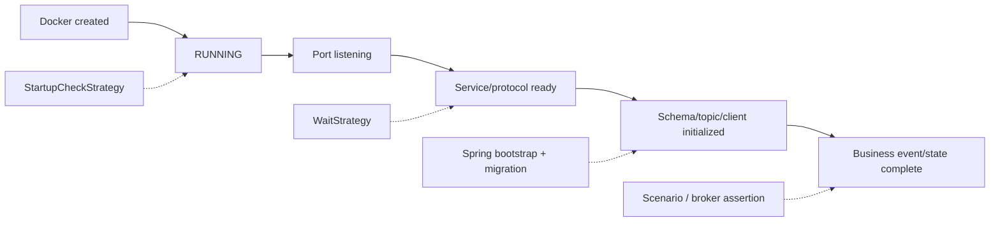
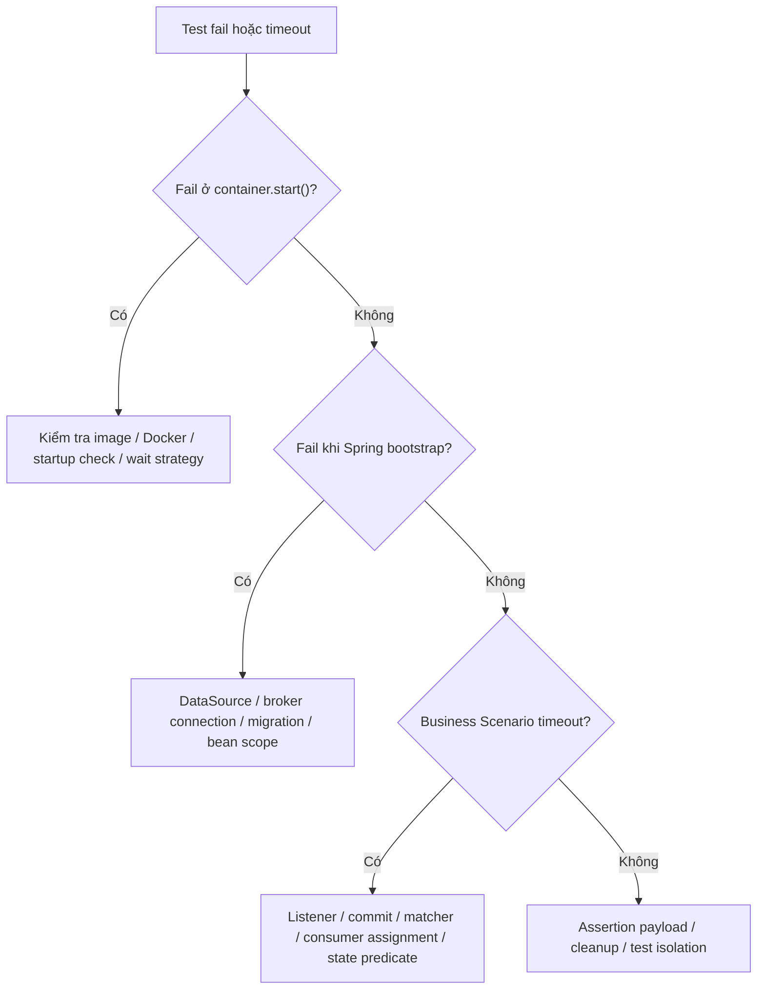

# Wait strategy và thời điểm dependency sẵn sàng

## 1. Xác định đúng thời điểm “ready” trước khi kiểm thử module

Trong học phần **SPRING_MODULITH_VERIFICATION_TESTING**, mục tiêu của kiểm thử là bảo vệ ranh giới module bằng `ApplicationModules` và các quy tắc phụ thuộc, đồng thời dùng `@ApplicationModuleTest`, kiểm thử sự kiện, database và tích hợp để chặn hồi quy trong CI.

Với Testcontainers, **container đã được tạo hoặc đang chạy không đồng nghĩa dependency đã đủ sẵn sàng cho một phép kiểm thử cụ thể**.

Ví dụ PostgreSQL vừa khởi động có thể ở trạng thái Docker `running` nhưng chưa chấp nhận kết nối JDBC từ tiến trình JUnit. Một Kafka broker có thể mở cổng TCP nhưng topic chưa được khai báo hoặc consumer vẫn chưa được gán partition. Một REST service có thể mở port `8080` nhưng chưa hoàn tất khởi tạo cache, migration hoặc dependency upstream.

Chủ đề **“Wait strategy và thời điểm dependency sẵn sàng”** vì vậy cần trả lời hai câu hỏi riêng:

1. **Testcontainers phải đợi tín hiệu nào trước khi trả về từ `container.start()`?**
2. **JUnit/Spring Modulith phải đợi điều kiện nào trước khi kết luận nghiệp vụ đã hoàn tất?**

> **Nguyên tắc:** chọn tín hiệu hoàn tất ở **đúng tầng**. Testcontainers chờ *hạ tầng có thể sử dụng*; Spring Boot bootstrap và migration chuẩn bị *ứng dụng*; `Scenario` hoặc phép kiểm tích hợp chờ *kết quả nghiệp vụ*.

Không sử dụng `Thread.sleep(...)` như một phép chứng minh readiness.

## 2. Sáu mốc thời gian: không được đánh đồng

| Mốc | Tín hiệu | Có thể kiểm chứng bằng | Vẫn chưa được bảo đảm |
| --- | --- | --- | --- |
| **T0 — Container created** | Docker tạo container | Container ID/logs | Tiến trình đã chạy |
| **T1 — Process running** | Docker state `running` | `StartupCheckStrategy` | Service đã mở port |
| **T2 — Network listening** | Port được map và mở | `Wait.forListeningPort()` | Service xử lý request/query hợp lệ |
| **T3 — Protocol ready** | HTTP 200, Redis PONG, JDBC query... | HTTP/log/healthcheck wait hoặc client probe | Schema/topic/consumer nghiệp vụ đã sẵn |
| **T4 — Application initialized** | Spring beans, migration, topic/binding, consumer assignment | Spring bootstrap + assertion theo dependency | Event nghiệp vụ đã xử lý |
| **T5 — Business completed** | DB `READY` đã commit, event đầu ra, broker record đúng ID | `Scenario` hoặc Awaitility theo trạng thái | Các side effect nằm ngoài contract |



**Tầng nào nên là điều kiện của `container.start()`?** Thông thường là T2 hoặc T3. **Tầng nào thuộc module test?** T4 và đặc biệt là T5. Không cố dùng một log line lúc container khởi động để thay assertion nghiệp vụ được thực hiện sau stimulus.

### Ví dụ triệu chứng

- `Connection refused` sau `start()`: có thể port chưa thực sự truy cập được từ JVM hoặc container đã dừng.
- `relation "shipments" does not exist`: PostgreSQL có thể đã ready nhưng migration/schema chưa đúng.
- Kafka producer gửi được nhưng test consumer timeout: broker có thể đã ready nhưng consumer chưa được assign partition.
- `Scenario` timeout dù DB query hoạt động: listener có thể chưa được bootstrap, transaction nguồn chưa commit, predicate sai hoặc task async lỗi.

## 3. Phân biệt `WaitStrategy` với `StartupCheckStrategy`

Tài liệu Testcontainers phân biệt rõ:

| API | Câu hỏi | Kịch bản phù hợp |
| --- | --- | --- |
| `WaitStrategy` qua `waitingFor(...)` | “Tiến trình bên trong container **đã sử dụng được chưa**?” | Chờ port, HTTP endpoint, Docker HEALTHCHECK, log hoặc nhiều tín hiệu kết hợp |
| `StartupCheckStrategy` qua `withStartupCheckStrategy(...)` | “Container **đạt trạng thái chạy mong muốn chưa**?” | Daemon chạy dài hạn hoặc job chạy một lần rồi exit code 0 |
| `withStartupTimeout(...)` trên wait strategy | “Chờ tín hiệu readiness **tối đa bao lâu**?” | Giới hạn thời gian khởi động của dependency |
| `Scenario.andWaitAtMost(...)` | “**Sau stimulus**, business outcome xuất hiện trước deadline không?” | Chờ event/state của application module |

Theo tài liệu Testcontainers, `GenericContainer` thông thường đợi **cổng được map đầu tiên** bắt đầu lắng nghe, với timeout mặc định khoảng **60 giây**. Đây là một phép kiểm network cơ bản, **không phải** chứng nhận service đã sẵn sàng đầy đủ.

```java
GenericContainer<?> server =
        new GenericContainer<>(DockerImageName.parse("nginx:1.27-alpine"))
                .withExposedPorts(80);
```

Khi không cấu hình `waitingFor(...)` khác, Testcontainers sử dụng readiness check mặc định. Code trên chỉ là cấu hình container, cần import `org.testcontainers.containers.GenericContainer` và `org.testcontainers.utility.DockerImageName`.

**Không dùng** `new OneShotStartupCheckStrategy()` cho PostgreSQL/Kafka daemon: chúng cần **tiếp tục chạy**, không phải exit code 0 rồi dừng.

## 4. Khi nào `Wait.forListeningPort()` là đủ?

`Wait.forListeningPort()` có ích khi service chỉ cần chấp nhận kết nối TCP hoặc khi đã có kiểm chứng protocol riêng ở tầng test.

```java
import org.testcontainers.containers.GenericContainer;
import org.testcontainers.containers.wait.strategy.Wait;
import org.testcontainers.utility.DockerImageName;

GenericContainer<?> redis =
        new GenericContainer<>(DockerImageName.parse("redis:7.4-alpine"))
                .withExposedPorts(6379)
                .waitingFor(Wait.forListeningPort()
                        .withStartupTimeout(Duration.ofSeconds(60)));
```

`Duration` trong đoạn trên là `java.time.Duration`. Đây là mẫu ngắn minh họa; nếu điều kiện đúng của bài test yêu cầu thực thi lệnh Redis, nên bổ sung phép probe `PING` sau khi container start.

### Giới hạn của port wait

Port mở có thể chỉ phản ánh socket đã bind, trong khi:

- Server chưa load xong cấu hình;
- Database đang recovery hoặc chưa chấp nhận transaction;
- HTTP service chưa hoàn tất initial cache;
- Kafka broker chưa tạo topic;
- Consumer chưa tham gia group;
- Migration còn đang chạy trong process khác.

**Sai lầm thường gặp:** tăng `withStartupTimeout` từ 60 lên 180 giây rồi mặc định cho rằng port wait sẽ kiểm chứng được các điều kiện trên. Kéo dài thời gian chờ **không làm thay đổi định nghĩa readiness**.

## 5. HTTP wait: một phép kiểm thực sự vào endpoint

Với HTTP service, `Wait.forHttp(path)` thường có ý nghĩa hơn mở port vì nó gọi endpoint và kiểm tra status. Ví dụ JUnit 5 **độc lập và có thể chạy** với Nginx:

```java
package com.acme.testing;

import static org.assertj.core.api.Assertions.assertThat;

import java.net.URI;
import java.net.http.HttpClient;
import java.net.http.HttpRequest;
import java.net.http.HttpResponse;
import java.time.Duration;

import org.junit.jupiter.api.Test;
import org.testcontainers.containers.GenericContainer;
import org.testcontainers.containers.wait.strategy.Wait;
import org.testcontainers.junit.jupiter.Container;
import org.testcontainers.junit.jupiter.Testcontainers;
import org.testcontainers.utility.DockerImageName;

@Testcontainers
class HttpWaitStrategyTests {

    @Container
    static final GenericContainer<?> nginx =
            new GenericContainer<>(
                    DockerImageName.parse("nginx:1.27-alpine"))
                    .withExposedPorts(80)
                    .waitingFor(
                            Wait.forHttp("/")
                                    .forStatusCode(200)
                                    .withStartupTimeout(
                                            Duration.ofSeconds(90)));

    @Test
    void readyMeansHttpEndpointAnswers() throws Exception {
        String url = "http://" + nginx.getHost()
                + ":" + nginx.getMappedPort(80) + "/";

        var request = HttpRequest.newBuilder(URI.create(url))
                .GET()
                .build();

        var response = HttpClient.newHttpClient().send(
                request, HttpResponse.BodyHandlers.ofString());

        assertThat(response.statusCode()).isEqualTo(200);
    }
}
```

**Phân tích:**

1. `@Container static`: JUnit extension start container trước test method và stop sau lớp.
2. `withExposedPorts(80)`: Testcontainers map port trong container tới port host động.
3. `Wait.forHttp("/")`: thực hiện HTTP check tại endpoint `/`.
4. `forStatusCode(200)`: chỉ coi HTTP 200 là ready.
5. `withStartupTimeout(Duration.ofSeconds(90))`: giới hạn chờ T3, **không ép container ngủ 90 giây**.
6. Test thực hiện thêm request để chứng minh HTTP endpoint có thể truy cập từ JVM.

**Đặt `Wait.forHttp("/actuator/health/readiness")` khi nào?** Khi **image thực sự phục vụ endpoint đó**, và endpoint phản ánh các dependency cần sẵn sàng. Đây không phải endpoint mặc định của Nginx; không copy nguyên path Actuator vào ví dụ Nginx.

### Nhiều status code và TLS

Testcontainers hỗ trợ:

```java
Wait.forHttp("/")
        .forStatusCode(200)
        .forStatusCode(301);
```

Và:

```java
Wait.forHttp("/health")
        .usingTls();
```

Chỉ chấp nhận `401`/`302` khi đó là contract readiness có chủ đích. Nếu chấp nhận mọi status từ server, test có thể đánh dấu **ready khi app đang lỗi**.

## 6. Log wait: hữu ích, nhưng log line chưa chắc là readiness bền vững

`Wait.forLogMessage(regex, times)` thích hợp với image có log startup ổn định, ví dụ Redis công bố “Ready to accept connections”.

```java
package com.acme.testing;

import static org.assertj.core.api.Assertions.assertThat;

import java.time.Duration;

import org.junit.jupiter.api.Test;
import org.testcontainers.containers.GenericContainer;
import org.testcontainers.containers.wait.strategy.Wait;
import org.testcontainers.junit.jupiter.Container;
import org.testcontainers.junit.jupiter.Testcontainers;
import org.testcontainers.utility.DockerImageName;

@Testcontainers
class RedisLogReadinessTests {

    @Container
    static final GenericContainer<?> redis =
            new GenericContainer<>(DockerImageName.parse("redis:7.4-alpine"))
                    .withExposedPorts(6379)
                    .waitingFor(
                            Wait.forLogMessage(
                                    ".*Ready to accept connections.*\\n", 1)
                                    .withStartupTimeout(
                                            Duration.ofSeconds(75)));

    @Test
    void redisCanActuallyRespondToPing() throws Exception {
        var result = redis.execInContainer("redis-cli", "ping");

        assertThat(result.getExitCode()).isZero();
        assertThat(result.getStdout().trim()).isEqualTo("PONG");
    }
}
```

Đây là hai tầng kiểm chứng khác nhau:

- `Wait.forLogMessage(...)` đợi đúng thông báo khởi động.
- `redis-cli ping` xác nhận **một thao tác protocol có nghĩa** còn thực hiện được.

### Các bẫy của log wait

- Regex quá rộng như `".*started.*"` có thể khớp dòng không liên quan.
- Log format thay đổi khi nâng version image hoặc log level.
- `times` sai làm timeout dù service đã sẵn sàng; một số image ghi log “ready” hơn một lần trong quá trình restart/init.
- Log báo “started” nhưng listener socket/host networking vẫn chưa nhận request.
- Regex không có `\\n` hoặc escape sai trong Java string có thể khiến pattern không khớp.

**Khuyến nghị:** dùng log wait nếu log message là hợp đồng khởi động ổn định của image; khi cần đảm bảo truy cập được từ JVM, bổ sung protocol probe hoặc lựa chọn chiến lược có điều kiện mạnh hơn.

## 7. Docker HEALTHCHECK: khi image định nghĩa được “healthy”

Nếu image có **Docker HEALTHCHECK** đáng tin cậy, Testcontainers có:

```java
GenericContainer<?> service =
        new GenericContainer<>(
                DockerImageName.parse("my-company/my-service:1.0"))
                .withExposedPorts(8080)
                .waitingFor(Wait.forHealthcheck()
                        .withStartupTimeout(Duration.ofSeconds(120)));
```

Đây là **mẫu cấu hình cho image riêng của dự án**, không phải image mẫu có thể kéo từ registry công khai. Điều kiện tiên quyết: image/container thực sự cấu hình Docker healthcheck có thể chuyển sang trạng thái `healthy`.

Ví dụ ý tưởng Dockerfile:

```dockerfile
HEALTHCHECK --interval=5s --timeout=2s --retries=12 \
  CMD wget -q -O /dev/null http://localhost:8080/actuator/health/readiness || exit 1
```

Dockerfile này giả định image có `wget` và ứng dụng cung cấp endpoint Actuator readiness. Nếu điều kiện không đúng, healthcheck sẽ fail dù process vẫn đang chạy.

**Phải phân biệt:**

- `Wait.forHealthcheck()` đọc **Docker health status**.
- `Wait.forHttp(...)` tự gửi HTTP request tới endpoint.
- Spring Boot Actuator `/actuator/health/readiness` là **HTTP endpoint của ứng dụng**, không tự biến thành Docker HEALTHCHECK nếu Dockerfile/container không khai báo healthcheck.

Một healthcheck lỏng như `ps -ef | grep java` không chứng minh ứng dụng sử dụng được database hay broker.

## 8. Kết hợp nhiều readiness signal với `WaitAllStrategy`

Có hệ thống cần cả **port mở** và **tín hiệu ứng dụng**. `WaitAllStrategy` cho phép kết hợp nhiều wait strategies:

```java
import java.time.Duration;
import org.testcontainers.containers.GenericContainer;
import org.testcontainers.containers.wait.strategy.Wait;
import org.testcontainers.containers.wait.strategy.WaitAllStrategy;
import org.testcontainers.utility.DockerImageName;

GenericContainer<?> nginx =
        new GenericContainer<>(DockerImageName.parse("nginx:1.27-alpine"))
                .withExposedPorts(80)
                .waitingFor(
                        new WaitAllStrategy()
                                .withStrategy(Wait.forListeningPort())
                                .withStrategy(
                                        Wait.forHttp("/")
                                                .forStatusCode(200))
                                .withStartupTimeout(
                                        Duration.ofSeconds(90)));
```

**Khi nào đáng kết hợp?**

- Một HTTP check có thể trả status đúng nhưng cần xác nhận thêm port/service khác.
- Một log signal báo init hoàn tất nhưng vẫn cần endpoint trả lời.
- Một ứng dụng cung cấp riêng health endpoint và một điểm kết nối thứ hai.

**Không nên lạm dụng:** với Nginx ở ví dụ này, HTTP 200 vốn thường đã đủ, nên thêm port strategy chủ yếu mang tính minh họa. Tổ hợp nhiều wait conditions sẽ khó bảo trì nếu một điều kiện không thuộc contract service.

Đặc biệt, `WaitAllStrategy` có nhiều chế độ quản lý timeout theo API phiên bản. Đừng giả định cấu hình mỗi inner strategy tự động cộng dồn thành một deadline chính xác; hãy đo khi cần và đặt **giới hạn trên rõ ràng**.

## 9. Startup strategy cho daemon khác one-shot job

Testcontainers mặc định kiểm tra container **đang chạy và chưa exit**. Điều này phù hợp PostgreSQL, Kafka, Redis, Nginx và đa số services dài hạn.

Nhưng một container chạy migration, seed hoặc lệnh kiểm tra schema có thể **exit code 0 rồi kết thúc đúng chủ đích**. Với loại container này, điều kiện “process vẫn running” là **sai**.

Testcontainers có `OneShotStartupCheckStrategy`:

```java
import java.time.Duration;
import org.testcontainers.containers.GenericContainer;
import org.testcontainers.containers.startupcheck.OneShotStartupCheckStrategy;
import org.testcontainers.utility.DockerImageName;

GenericContainer<?> job =
        new GenericContainer<>(DockerImageName.parse("busybox:1.36"))
                .withCommand("sh", "-c", "echo schema-check-done")
                .withStartupCheckStrategy(
                        new OneShotStartupCheckStrategy()
                                .withTimeout(Duration.ofSeconds(20)));

job.start();
// Thành công khi job thoát với exit code 0 trong timeout.
```

Đây là ví dụ **minh họa startup check**, không chạy migration database thật. Với một migration job production, exit code 0 cũng chưa đủ nếu script không thực sự kiểm tra schema; test phải kiểm tra bảng/constraint sau job.

### Lỗi thường gặp

- **Daemon** PostgreSQL + one-shot strategy: không thể mong database exit 0 rồi vẫn phục vụ JDBC.
- **One-shot job** + chỉ chờ port: job có thể không mở port nào.
- **Log wait** “migrated” trong khi lệnh migration exit code 1: log từng xuất hiện không đồng nghĩa job thành công.
- **Chờ job xong** nhưng không đảm bảo Spring datasource đọc đúng schema do job tạo.

Không dùng one-shot strategy cho toàn bộ `@ApplicationModuleTest`: ứng dụng Spring/JUnit không phải một container one-shot của Testcontainers.

## 10. Chọn timeout đúng tầng, không tăng mù quáng

Có ít nhất **ba deadline độc lập** trong một test có PostgreSQL + async listener:

| Deadline | Áp dụng vào | Triệu chứng khi hết hạn |
| --- | --- | --- |
| **Container readiness timeout** | Testcontainers chờ DB/Kafka/Nginx sẵn sàng | Container start fail, logs startup/port/health |
| **Spring bootstrap / migration timeout** | Context, migration, connection pool, client init | `ApplicationContext` load fail, Flyway/JDBC exception |
| **Business wait timeout** | `Scenario.andWaitAtMost(...)` hoặc Awaitility | Event/state không xuất hiện, listener/predicate cần điều tra |

Ví dụ:

```java
// Container: hạ tầng có thể khởi động.
.waitingFor(Wait.forHttp("/")
        .withStartupTimeout(Duration.ofSeconds(90)));

// Module test: sau stimulus, nghiệp vụ phải hoàn tất đúng điều kiện.
scenario.publish(new OrderPaid(orderId))
        .andWaitAtMost(Duration.ofSeconds(7))
        .forStateChange(
                () -> shipments.statusOf(orderId),
                status -> status.filter("READY"::equals).isPresent())
        .andVerify(status -> assertThat(status).contains("READY"));
```

Hai đoạn ở trên thuộc **hai vị trí cấu hình khác nhau**, được ghép để so sánh; không copy liên tiếp vào một method Java.

**Khi timeout xuất hiện:**

- Hết hạn trong `container.start()` → kiểm tra Docker image, port, health endpoint, log/strategy.
- Fail khi tạo `DataSource`/migration → xem JDBC endpoint, credential, schema, readiness protocol.
- Timeout trong `Scenario` → xem listener Spring, transaction commit, executor, query supplier, correlation ID.
- CI job hết toàn bộ thời gian → xem tổng startup + bootstrap + nhiều timeout test; không giải quyết bằng một tham số duy nhất.

**Không có timeout 5 s hoặc 120 s đúng cho mọi dự án**. Chọn deadline từ độ trễ quan sát được trên runner CI và độ biến thiên hợp lý; phải đủ ngắn để báo lỗi, đủ dài cho khởi động hợp lệ.

## 11. PostgreSQL: “ready” của database không phải “schema đã tồn tại”

PostgreSQL Testcontainers cung cấp container type chuyên biệt `PostgreSQLContainer`. Theo implementation của Testcontainers, nó có sẵn **wait strategy chuyên biệt dựa trên log readiness**, khác với mặc định chỉ đợi first mapped port. Không nên thay nó bằng `Wait.forListeningPort()` đơn giản mà không cân nhắc có thể làm **giảm độ mạnh** của điều kiện khởi động.

**Tuy vậy**, một thông báo readiness từ database process chưa luôn chứng minh JVM trên host đã truy cập được mapped port hoặc ứng dụng đã có schema. Trên một số runtime Docker có lớp chuyển tiếp port, có thể có độ trễ rất ngắn giữa process “ready” và host JDBC reachable. Vì vậy, phép kiểm đầu tiên nên thực hiện **JDBC handshake/query thực** qua `DataSource`.

### Ba phép kiểm riêng

1. **Service**: container start theo wait strategy của Postgres type.
2. **Connection**: `DataSource.getConnection()`, metadata và `SELECT 1`.
3. **Schema**: bảng/migration `shipments` đã tồn tại trong đúng schema.

```sql
-- Khi DataSource đã kết nối:
SELECT 1;

SELECT to_regclass('public.shipments') IS NOT NULL;
```

Nếu JDBC kết nối thành công nhưng query thứ hai trả `false`, vấn đề là **migration/schema**, không phải đơn thuần port wait.

### Có nên dùng `Thread.sleep(2000)` sau `postgres.start()`?

Không. Với lỗi mapped port chưa thể truy cập, cần xác định lỗi trong readiness/host networking rồi dùng protocol-level retry phù hợp hoặc nâng Testcontainers/runtime khi có bản sửa. Với schema chưa tồn tại, sửa migration; sleep không làm một migration bị thiếu tự xuất hiện.

## 12. Spring Boot quản lý dependency readiness trong `@ApplicationModuleTest`

Khi Testcontainers được khai báo thành **Spring bean**, Spring Boot quản lý lifecycle để container được start trước những bean phụ thuộc và stop sau khi các bean đó bị destroy. Điều này phù hợp với Spring TestContext cache: một `ApplicationContext` có thể được tái sử dụng giữa nhiều test.

### Cấu hình PostgreSQL cho module shipping

Ví dụ dùng **Testcontainers Java 2.x** và Spring Boot `@ServiceConnection`.

`src/test/java/com/acme/shipping/ShippingPostgresInfra.java`:

```java
package com.acme.shipping;

import org.springframework.boot.test.context.TestConfiguration;
import org.springframework.boot.testcontainers.service.connection.ServiceConnection;
import org.springframework.context.annotation.Bean;
import org.testcontainers.postgresql.PostgreSQLContainer;

@TestConfiguration(proxyBeanMethods = false)
class ShippingPostgresInfra {

    @Bean
    @ServiceConnection
    PostgreSQLContainer postgres() {
        // Giữ wait strategy chuyên biệt sẵn có của PostgreSQLContainer.
        return new PostgreSQLContainer("postgres:17-alpine")
                .withDatabaseName("shipping_test")
                .withUsername("test")
                .withPassword("test");
    }
}
```

Lớp test:

```java
@ApplicationModuleTest
@Import(ShippingPostgresInfra.class)
class ShippingReadyTests {
    // Các test kết nối và nghiệp vụ sẽ triển khai bên dưới.
}
```

**Điểm quan trọng:**

- `@ServiceConnection` tạo connection details để Spring Boot cấu hình datasource.
- Không cần `@Testcontainers` và `@Container` khi container là Spring bean.
- Không gọi `postgres.start()` thủ công trong `@Bean`; Spring Boot chịu trách nhiệm start.
- `@Import` nạp test configuration vào context của **module shipping**.
- `@ApplicationModuleTest` giới hạn bean của module, nhưng **không thay đổi cơ chế readiness của PostgreSQL**.
- Khi context được cache, container có thể được dùng lại; dữ liệu DB không tự reset.

Nếu dự án sử dụng Testcontainers 1.x, artifact/import của `PostgreSQLContainer` khác. Ví dụ trên chỉ dùng API 2.x; dependency phải đồng bộ với Spring Boot BOM/parent phù hợp.

### Cách nối qua `@DynamicPropertySource`

Một hướng thay thế là JUnit-managed container:

```java
@Testcontainers
@ApplicationModuleTest
class ShippingDynamicPropertiesTests {

    @Container
    static PostgreSQLContainer postgres =
            new PostgreSQLContainer("postgres:17-alpine");

    @DynamicPropertySource
    static void databaseProperties(DynamicPropertyRegistry registry) {
        registry.add("spring.datasource.url", postgres::getJdbcUrl);
        registry.add("spring.datasource.username", postgres::getUsername);
        registry.add("spring.datasource.password", postgres::getPassword);
    }
}
```

Đoạn minh họa cần imports của JUnit/Testcontainers, `@DynamicPropertySource` và `DynamicPropertyRegistry`. Nó không tự chứng minh schema đã sẵn. **Lưu ý lifecycle:** JUnit có thể stop `static @Container` khi lớp test kết thúc trong khi Spring context còn cache; vì vậy với nhiều Spring test classes, Spring-managed container bean thường dễ quản lý hơn.

**Không coi `@ServiceConnection`/`@DynamicPropertySource` là wait strategy.** Chúng đưa endpoint vào Spring, không xác định service đã đủ sẵn sàng ở tầng nghiệp vụ.

## 13. Ví dụ hoàn chỉnh: kiểm chứng ba mốc của module shipping

Giả sử `shipping` nhận `OrderPaid` rồi tạo shipment `READY` trong PostgreSQL. Ta kiểm chứng:

- PostgreSQL **thật** có thể trả lời query;
- Schema `shipments` được migration tạo;
- Listener Spring Modulith đã commit `READY` sau event.

### 13.1. Migration

Trong hệ thống có Flyway/Liquibase phù hợp, migration ví dụ:

```sql
CREATE TABLE shipments (
    order_id UUID PRIMARY KEY,
    status VARCHAR(32) NOT NULL
);
```

Tên file/version migration phải theo cấu hình thực của dự án; không tạo `V1` trùng với migration đã tồn tại.

### 13.2. Public event contract

`src/main/java/com/acme/order/OrderPaid.java`:

```java
package com.acme.order;

import java.util.UUID;

public record OrderPaid(UUID orderId) {}
```

Event này là API công khai của module `order`. Không để module `shipping` import lớp `com.acme.order.internal.*`.

### 13.3. Repository và listener thuộc module shipping

`src/main/java/com/acme/shipping/ShipmentRepository.java`:

```java
package com.acme.shipping;

import java.util.List;
import java.util.Optional;
import java.util.UUID;

import org.springframework.jdbc.core.JdbcTemplate;
import org.springframework.stereotype.Repository;

@Repository
class ShipmentRepository {

    private final JdbcTemplate jdbc;

    ShipmentRepository(JdbcTemplate jdbc) {
        this.jdbc = jdbc;
    }

    void upsertReady(UUID orderId) {
        jdbc.update("""
                INSERT INTO shipments(order_id, status)
                VALUES (?, 'READY')
                ON CONFLICT (order_id)
                DO UPDATE SET status = EXCLUDED.status
                """, orderId);
    }

    Optional<String> statusOf(UUID orderId) {
        List<String> rows = jdbc.query(
                "SELECT status FROM shipments WHERE order_id = ?",
                (rs, index) -> rs.getString(1),
                orderId);
        return rows.stream().findFirst();
    }

    void delete(UUID orderId) {
        jdbc.update("DELETE FROM shipments WHERE order_id = ?", orderId);
    }
}
```

`src/main/java/com/acme/shipping/ShippingHandler.java`:

```java
package com.acme.shipping;

import com.acme.order.OrderPaid;
import org.springframework.modulith.events.ApplicationModuleListener;
import org.springframework.stereotype.Component;

@Component
class ShippingHandler {

    private final ShipmentRepository shipments;

    ShippingHandler(ShipmentRepository shipments) {
        this.shipments = shipments;
    }

    @ApplicationModuleListener
    public void on(OrderPaid event) {
        shipments.upsertReady(event.orderId());
    }
}
```

### 13.4. JUnit/Spring Modulith test tách hai loại readiness

`src/test/java/com/acme/shipping/ShippingReadinessModuleTests.java`:

```java
package com.acme.shipping;

import static org.assertj.core.api.Assertions.assertThat;

import java.time.Duration;
import java.util.UUID;

import javax.sql.DataSource;

import com.acme.order.OrderPaid;
import org.junit.jupiter.api.Test;
import org.springframework.beans.factory.annotation.Autowired;
import org.springframework.context.annotation.Import;
import org.springframework.jdbc.core.JdbcTemplate;
import org.springframework.modulith.test.ApplicationModuleTest;
import org.springframework.modulith.test.Scenario;
import org.springframework.transaction.support.TransactionTemplate;

@ApplicationModuleTest
@Import(ShippingPostgresInfra.class)
class ShippingReadinessModuleTests {

    @Autowired DataSource dataSource;
    @Autowired JdbcTemplate jdbc;
    @Autowired ShipmentRepository shipments;
    @Autowired TransactionTemplate transactions;

    @Test
    void dependencyIsQueryableAndSchemaExists() throws Exception {
        try (var connection = dataSource.getConnection()) {
            assertThat(connection.getMetaData()
                    .getDatabaseProductName()).isEqualTo("PostgreSQL");
            assertThat(connection.isValid(2)).isTrue();
        }

        Integer one = jdbc.queryForObject(
                "SELECT 1", Integer.class);
        assertThat(one).isEqualTo(1);

        Boolean tableExists = jdbc.queryForObject("""
                SELECT to_regclass('public.shipments') IS NOT NULL
                """, Boolean.class);
        assertThat(tableExists).isTrue();
    }

    @Test
    void listenerEventuallyCommitsReadyState(Scenario scenario) {
        UUID orderId = UUID.randomUUID();

        scenario.publish(new OrderPaid(orderId))
                .andCleanup(() -> transactions.executeWithoutResult(tx ->
                        shipments.delete(orderId)))
                .andWaitAtMost(Duration.ofSeconds(7))
                .forStateChange(
                        () -> shipments.statusOf(orderId),
                        status -> status.filter("READY"::equals)
                                .isPresent())
                .andVerify(status ->
                        assertThat(status).contains("READY"));
    }
}
```

**Phân tích phép kiểm đầu:**

- `getDatabaseProductName()` xác định đang nối PostgreSQL thật, không phải H2.
- `SELECT 1` xác nhận JDBC query thực thi được tại thời điểm test.
- `to_regclass('public.shipments')` kiểm tra schema được migration tạo.
- Nếu test fail ở đoạn nào, có thể khoanh vùng **kết nối** hoặc **migration** trước khi điều tra nghiệp vụ.

**Phân tích phép kiểm thứ hai:**

- `Scenario.publish` tạo stimulus trong transaction phù hợp với transactional event listener.
- `@ApplicationModuleListener` chạy sau commit trong transaction riêng, bất đồng bộ.
- `forStateChange(...)` đọc lại DB tới khi thấy `READY`; **không** chỉ kiểm tra port hoặc sự tồn tại của một Spring event.
- `andWaitAtMost` là deadline của **nghiệp vụ**, không phải startup timeout của PostgreSQL.
- `andCleanup` xóa row theo đúng `orderId` trong transaction riêng sau Scenario, vì dữ liệu đã commit không tự rollback theo test JUnit.

**Điều kiện chạy:** cần datasource, JDBC driver, transaction manager, migration, Docker-compatible runtime và các Testcontainers/Spring dependencies tương thích. Test STEP 4 chỉ được soạn để sử dụng, **không chạy Gradle/Maven ở giai đoạn này**.

## 14. Dependency readiness với Kafka: broker ready chưa đủ

Kafka minh họa rõ sự khác nhau giữa T3 và T4/T5:

1. Testcontainers khởi động Kafka container.
2. Spring Kafka tạo producer/consumer/admin connections.
3. `KafkaAdmin`/`NewTopic` chuẩn bị topic.
4. Listener container tham gia consumer group và được assign partition.
5. Producer gửi message của stimulus.
6. Consumer nhận record hoặc cập nhật DB, test mới có bằng chứng nghiệp vụ.

**Broker mở port** không bảo đảm consumer đã có partition assignment. Nếu test gửi ngay rồi consumer group mới được tạo với `auto-offset-reset=latest`, message đến trước assignment có thể bị bỏ qua.

### Tách hai điều kiện

```java
// Hạ tầng broker được Spring Boot khởi tạo qua KafkaContainer.
// Code này chạy sau khi đã có bean KafkaListenerEndpointRegistry.
var listener = registry.getListenerContainer("shippingProbe");
assertThat(listener).isNotNull();
```

`registry` là bean `org.springframework.kafka.config.KafkaListenerEndpointRegistry` được inject, còn `shippingProbe` là `id` của một `@KafkaListener` thực trong ứng dụng/test configuration. Việc `getListenerContainer(...) != null` chỉ chứng minh listener **đã được đăng ký**, chưa chứng minh partition được assign.

Khi test có dependency `spring-kafka-test`, có thể chờ assignment:

```java
import org.springframework.kafka.test.utils.ContainerTestUtils;

// registry.getListenerContainer("shippingProbe") trả MessageListenerContainer.
var listener = registry.getListenerContainer("shippingProbe");
assertThat(listener).isNotNull();

ContainerTestUtils.waitForAssignment(listener, 1);
```

Phép chờ này thuộc **readiness của consumer**, khác với việc chờ message cụ thể. Đối số `1` là số partition kỳ vọng trong ví dụ topic test một partition; phải thay bằng cấu hình thật của test.

Sau khi consumer ready, mới kích hoạt stimulus và đợi **record có correlation ID** hoặc **state đã commit**. Có thể dùng Awaitility với test probe:

```java
await().atMost(Duration.ofSeconds(10))
        .untilAsserted(() ->
                assertThat(probe.findByOrderId(orderId)).isPresent());
```

`probe` là test-only consumer/record store do dự án định nghĩa; `await()` là Awaitility. **Không** dùng `Scenario.andWaitForEventOfType(...)` để kết luận Kafka đã nhận message: API đó quan sát Spring application events.

### RabbitMQ tương tự nhưng khác protocol

Với RabbitMQ, container/process healthy chưa chứng minh exchange/queue/binding đúng. Test nên khai báo topology qua Spring AMQP (ví dụ `RabbitAdmin` + `Queue`/`Binding`), rồi thực hiện publish/consume thật, assert payload/ack khi đó là contract.

**Quy tắc:** broker readiness là điều kiện khởi đầu; **destination topology và consumer readiness** là điều kiện tiếp theo; **message nghiệp vụ đúng** mới là kết quả cuối.

## 15. Nhiều containers: `dependsOn(...)` và giới hạn của thứ tự start

Một container ứng dụng có thể cần Redis/PostgreSQL trước khi chính nó start. Testcontainers hỗ trợ `GenericContainer.dependsOn(otherContainer)` để điều phối dependency trước khi start container phụ thuộc.

Ví dụ cú pháp:

```java
GenericContainer<?> redis =
        new GenericContainer<>(DockerImageName.parse("redis:7.4-alpine"))
                .withExposedPorts(6379)
                .waitingFor(Wait.forLogMessage(
                        ".*Ready to accept connections.*\\n", 1));

GenericContainer<?> nginx =
        new GenericContainer<>(DockerImageName.parse("nginx:1.27-alpine"))
                .dependsOn(redis)
                .withExposedPorts(80)
                .waitingFor(Wait.forHttp("/").forStatusCode(200));
```

Ví dụ này chỉ minh họa API **thứ tự khởi động**, không có nghĩa Nginx thật sự cần Redis. Khi gọi `nginx.start()`, Testcontainers khởi động dependency theo cơ chế này.

**Các giới hạn quan trọng:**

- `dependsOn(...)` không tự tạo Spring bean dependency hoặc JPA repository.
- Nó không tạo schema Flyway hay Kafka topic.
- Nó không đảm bảo consumer đã subscribe.
- Container chạy trong Docker network cần dùng đúng **network alias/port nội bộ**, không dùng mapped host port của JVM để thay địa chỉ container-to-container.
- Nếu dùng Spring-managed container beans, Spring Boot có thể khởi động container theo thứ tự `sequential` hoặc `parallel` tùy cấu hình; đừng bật parallel khi việc khởi tạo có dependency thực tế chưa được mô hình hóa rõ.

**Đừng biến tất cả container thành một chuỗi chờ dài** nếu chúng không thực sự phụ thuộc nhau. Có thể cho services độc lập start song song để cải thiện CI; những phụ thuộc có quan hệ nhân quả cần được khai báo/kiểm chứng riêng.

## 16. Anti-pattern và cách sửa

| Anti-pattern | Vì sao sai | Cách sửa |
| --- | --- | --- |
| `Thread.sleep(5000)` sau `container.start()` | Delay tùy ý, vẫn có thể chưa ready hoặc lãng phí | Chọn `WaitStrategy` đúng tín hiệu |
| Chỉ đợi Docker `running` rồi query DB | Process running chưa chứng minh JDBC reachable | Dùng readiness phù hợp + JDBC query |
| Chờ port 5432 rồi assume schema đầy đủ | Port mở không tạo table | Migration + kiểm tra table/constraint |
| `Wait.forHttp("/health")` cho image không có endpoint | Chờ điều kiện không bao giờ đạt | Xác nhận API readiness đúng image |
| Log regex `".*started.*"` quá rộng | Dễ pass từ một dòng không phản ánh service ready | Regex đặc thù hoặc protocol check |
| Thay default PostgreSQL wait bằng port-only | Có thể yếu hơn wait strategy chuyên biệt | Giữ default, test JDBC/schema ở tầng phù hợp |
| `withStartupTimeout` rất lớn để che lỗi | Tăng delay nhưng không sửa tín hiệu sai | Xác định lỗi container vs migration vs business |
| Kafka ready rồi assert consumer nhận ngay | Consumer group/topic có thể chưa ready | Chờ assignment và record đúng ID |
| Chờ `OrderPaid` do chính test phát | Pass trước khi module shipping xử lý | Chờ output event hoặc DB state |
| Chờ record tồn tại nhưng vẫn `PENDING` | Predicate quá yếu | Predicate `status == READY` |
| Supplier polling giữ snapshot cũ | Không quan sát dữ liệu đã commit | Query mới mỗi lượt |
| Dùng `@DirtiesContext` để “sửa” Docker readiness | Context reset không xử lý root cause | Sửa lifecycle/wait/endpoints |
| Dùng `@ServiceConnection` nhưng quên migration | Connection details chỉ cấu hình endpoint | Chạy Flyway/Liquibase đúng datasource |
| Cleanup DB trước khi listener commit | Có thể đua với transaction listener | Chờ state đã commit rồi cleanup theo ID |

### Một quy trình chẩn đoán tối giản



Đọc **root cause** và log của tầng lỗi tương ứng; không thay mọi lỗi bằng “tăng timeout”.

## 17. CI: quan sát readiness thay vì đoán

Khi bài test pass local nhưng fail CI, hãy thu thập **thời điểm và tín hiệu**:

| Dữ liệu quan sát | Ý nghĩa |
| --- | --- |
| Thời gian pull/start image | Docker/network/runner resource |
| Container logs và `getLogs()` | Lỗi init hoặc readiness line |
| Host/mapped port (không log credentials) | Kiểm tra endpoint đúng |
| HTTP status / Docker health status | Readiness service |
| JDBC `SELECT 1` và migration logs | DB connection/schema |
| Kafka topic + partition assignment | Client/subscription readiness |
| `orderId`, event payload, state query | Business completion và correlation |
| Thời điểm hết hạn container wait/Scenario | Xác định tầng timeout |

### Log khi container chưa ready

Testcontainers có API `container.getLogs()` và `followOutput(...)`. Dùng có chủ đích để đọc nguyên nhân service không đạt readiness. Tránh in connection passwords, token hoặc dữ liệu bí mật lên CI logs.

**Không dùng `getLogs()` như cơ chế polling thủ công thay cho `WaitStrategy`.** Logs là công cụ chẩn đoán; wait strategy là cơ chế chuẩn hóa điều kiện.

### Các nguyên nhân thường gặp trên CI

- Docker-compatible runtime không hoạt động, thiếu quyền hoặc image pull bị giới hạn;
- Runner thiếu RAM/CPU làm init DB/Kafka chậm;
- HTTP endpoint readiness phụ thuộc dịch vụ chưa sẵn sàng;
- Port forwarding trên Docker Desktop/VM có độ trễ;
- Testcontainers/JUnit lifecycle dừng container trước khi Spring cached context dùng xong;
- Migration chạy vào datasource khác;
- Test chạy song song xóa fixture hoặc tranh consumer group;
- Event listener lỗi trên thread async nhưng stack trace không xuất hiện ở assertion thread.

### Quality gate cần tách kiến trúc và runtime

```java
import org.junit.jupiter.api.Test;
import org.springframework.modulith.core.ApplicationModules;

class ModuleArchitectureVerificationTests {

    @Test
    void moduleDependenciesAreValid() {
        ApplicationModules.of(Application.class).verify();
    }
}
```

`Application.class` là Spring Boot application class thật. `ApplicationModules.verify()` phát hiện vi phạm ranh giới module, không cần Docker; nó không chứng minh PostgreSQL ready hoặc event đã xử lý.

Tầng còn lại dùng `@ApplicationModuleTest` + Testcontainers để xác minh transaction, SQL/schema và tích hợp. Một pipeline nên giữ cả hai thay vì dùng test “container ready” để thay thế test kiến trúc hoặc test nghiệp vụ.

## 18. Checklist chọn chiến lược chờ

- [ ] Đã ghi rõ dependency thực sự cần **port**, **protocol**, **health**, **schema**, **subscription** hay **business state**.
- [ ] Phân biệt `StartupCheckStrategy` với `WaitStrategy`.
- [ ] Dùng `Wait.forHttp(...)` khi image có endpoint readiness đúng contract.
- [ ] Dùng `Wait.forLogMessage(...)` chỉ khi log format ổn định và đủ tin cậy.
- [ ] Dùng `Wait.forHealthcheck()` khi image có Docker HEALTHCHECK đúng.
- [ ] Tránh thay wait strategy chuyên biệt của PostgreSQL bằng port-only không có lý do.
- [ ] Có deadline cho hạ tầng, nhưng không dùng deadline như một delay cố định.
- [ ] `@ServiceConnection`/`@DynamicPropertySource` trỏ đúng container đang sống.
- [ ] Spring TestContext/JUnit container lifecycle không làm stale endpoint.
- [ ] Migration/schema và các bean module đã khởi tạo trước test nghiệp vụ.
- [ ] Broker test biết topic/queue và consumer assignment là mốc riêng.
- [ ] `Scenario` chờ event/state **đầu ra**, không chờ event input do test tự phát.
- [ ] State supplier đọc dữ liệu mới, predicate phản ánh trạng thái cuối.
- [ ] Có cleanup theo correlation ID sau transaction đã commit.
- [ ] Khi timeout, có logs và biết chính xác tầng nào thất bại.
- [ ] CI chạy `ApplicationModules.verify()` riêng với test tích hợp.

## 19. Bài tập thực hành

1. **Phân loại:** Đặt từng trạng thái “Docker running”, “JDBC SELECT 1 thành công”, “Flyway tạo shipments”, “Shipment READY” vào đúng tầng T1–T5.
2. **Port vs HTTP:** Dùng `GenericContainer` Nginx, chuyển từ `Wait.forListeningPort()` sang `Wait.forHttp("/")`; giải thích sự khác nhau.
3. **HTTP lỗi:** Thay endpoint `/` bằng `/does-not-exist` và chỉ chấp nhận HTTP 200. Dự đoán lỗi ở container startup hay assertion?
4. **Log regex:** Redis đổi thông điệp log. Vì sao test có thể timeout mặc dù Redis PONG? Hãy thiết kế protocol check thay thế.
5. **HEALTHCHECK:** Vì sao `Wait.forHealthcheck()` không tự hoạt động nếu Docker image chưa khai báo `HEALTHCHECK`?
6. **WaitAll:** Dùng `WaitAllStrategy` để kết hợp port và HTTP; nói rõ trường hợp nào hai tín hiệu thực sự có giá trị độc lập.
7. **One-shot:** Một container chạy migration rồi exit code 0. Vì sao default “must stay running” không phù hợp? Dùng startup strategy nào?
8. **PostgreSQL:** Container đã báo ready nhưng `DataSource` đôi lúc `Connection refused` trên CI. Cần kiểm tra những gì trước khi thêm sleep?
9. **Schema:** `SELECT 1` thành công nhưng `relation "shipments" does not exist`. Đây là lỗi wait strategy hay migration?
10. **Module scope:** Test chạy trong module `order`, listener `shipping` không có trong context. PostgreSQL container ready có sửa được lỗi đó không?
11. **Scenario:** Viết `scenario.publish(new OrderPaid(id))` đợi `statusOf(id) == READY` và cleanup theo ID, không `Thread.sleep`.
12. **Kafka:** Broker open port nhưng `@KafkaListener` chưa có partition. Test cần thêm bước nào trước khi publish?
13. **Two timeouts:** Container có deadline 90 s, Scenario có deadline 7 s. Hai số đó quản lý phần nào của quy trình?
14. **Chạy song song:** Test A dọn toàn bảng khi B đang chờ shipment. Vì sao cả hai container đều healthy nhưng B timeout?
15. **CI runbook:** Thiết kế bảng log/thời điểm cho container start, Spring bootstrap, schema migration và business wait.
16. **Quality gate:** Một test chứng minh Kafka ready nhưng module shipping import `order.internal` sai. Phép kiểm nào phát hiện vi phạm?

**Định hướng đáp án:** (1) process/protocol/schema/business; (2) port khác HTTP 200; (3) startup wait timeout; (4) log brittle, dùng PING/health; (5) thiếu Docker health status; (6) khi cần hai điều kiện độc lập; (7) `OneShotStartupCheckStrategy`; (8) mapped port/lifecycle/driver/logs; (9) migration; (10) không, sửa module bootstrap; (11) `andWaitForStateChange`; (12) topic và assignment; (13) infrastructure vs business; (14) fixture state leakage; (15) tách tầng; (16) `ApplicationModules.verify()`.

## Tài liệu tham khảo

- [Testcontainers Java — Waiting for containers to start or be ready](https://java.testcontainers.org/features/startup_and_waits/): default port wait, HTTP, log, healthcheck, startup check, `dependsOn`.
- [Testcontainers Java — Container logs](https://java.testcontainers.org/features/container_logs/): `getLogs()` và `followOutput(...)`.
- [Testcontainers Java — PostgreSQL](https://java.testcontainers.org/modules/databases/postgres/): typed PostgreSQL container và connection settings.
- [Testcontainers Java — JUnit 5](https://java.testcontainers.org/test_framework_integration/junit_5/): `@Testcontainers`, `static @Container` và lifecycle.
- [Testcontainers Java — WaitAllStrategy Javadoc](https://javadoc.io/static/org.testcontainers/testcontainers/2.0.5/org/testcontainers/containers/wait/strategy/WaitAllStrategy.html): kết hợp nhiều wait strategies và timeout mode.
- [Spring Boot — Testcontainers](https://docs.spring.io/spring-boot/reference/testing/testcontainers.html): container beans, `@ServiceConnection` và thứ tự lifecycle trong Spring context.
- [Spring Kafka — KafkaListener Lifecycle Management](https://docs.spring.io/spring-kafka/reference/kafka/receiving-messages/kafkalistener-lifecycle.html): `KafkaListenerEndpointRegistry` và trạng thái listener.
- [Spring Kafka — Testing Applications](https://docs.spring.io/spring-kafka/reference/testing.html): `ContainerTestUtils.waitForAssignment(...)` và consumer readiness.
- [Spring Modulith — Integration Testing Application Modules](https://docs.spring.io/spring-modulith/reference/testing.html): `@ApplicationModuleTest`, `Scenario`, event/state wait và cleanup.
- [Spring Modulith — Working with Application Events](https://docs.spring.io/spring-modulith/reference/events.html): `@ApplicationModuleListener` và transaction/event handling.
- [Spring Modulith — Verifying Application Module Structure](https://docs.spring.io/spring-modulith/reference/verification.html): `ApplicationModules.verify()` cho quality gate kiến trúc.
