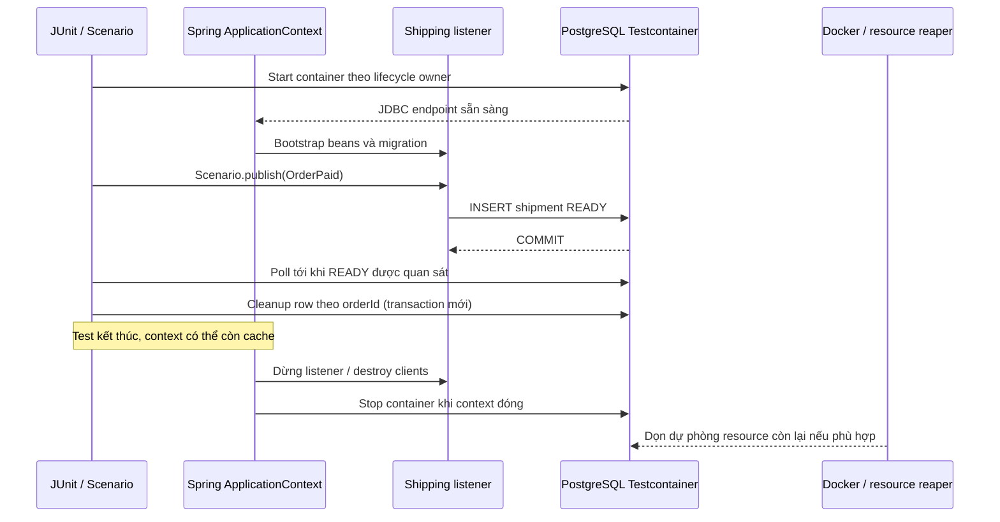

# Dọn container khi test hoặc suite kết thúc

## 1. Đúng tài nguyên, đúng chủ sở hữu, đúng thời điểm

Trong học phần **SPRING_MODULITH_VERIFICATION_TESTING**, các phép kiểm `@ApplicationModuleTest` có thể dùng PostgreSQL, Kafka hoặc RabbitMQ Testcontainers để xác minh hành vi module, bên cạnh `ApplicationModules.verify()` để bảo vệ ranh giới kiến trúc. Bài **“Dọn container khi test hoặc suite kết thúc”** tập trung vào một phần thường bị bỏ sót: **ai chịu trách nhiệm dừng và xóa container, khi nào được phép dừng, và dữ liệu nào phải dọn trước đó**.

**Ba công việc khác nhau, không thay thế cho nhau:**

1. **Dọn dữ liệu của test**: xóa row, message probe, fixture hoặc publication record theo khóa test khi dependency **vẫn chạy**.
2. **Đóng client và Spring context**: dừng listener, executor, connection pool hoặc bean đang dùng dependency.
3. **Dừng/xóa container và tài nguyên Docker**: giải phóng process, mapped port, network/volume do bài test quản lý.

Nếu đảo thứ tự, ta có thể gặp `Connection refused` trong callback `@PreDestroy`, listener vẫn cố ghi vào DB đã dừng, hoặc test sau nhận nhầm dữ liệu từ test trước. Ngược lại, nếu chỉ dừng container mà không cleanup fixture giữa các method, những method dùng chung container vẫn có thể gây pass giả.

> **Quy tắc cốt lõi:** test phải có **một chủ sở hữu lifecycle rõ ràng**. Không gọi `stop()` thủ công khi JUnit extension hoặc Spring Boot đang quản lý container đó. Không dùng `Thread.sleep(...)` để thay cho hoàn tất nghiệp vụ, và không coi `@Transactional` rollback của JUnit là cách dọn mọi transaction từ `Scenario`.

## 2. Bảng quyết định: ai dừng container và ở thời điểm nào?

| Cách tạo container | Ai quản lý vòng đời? | Thời điểm dừng thông thường | Có nên gọi `stop()`? |
| --- | --- | --- | --- |
| `@Container` là **instance field**, có `@Testcontainers` | JUnit Jupiter extension | Sau **mỗi test method** | **Không**, extension tự dừng |
| `@Container` là **static field**, có `@Testcontainers` | JUnit Jupiter extension | Sau **test method cuối cùng của lớp** | **Không**, extension tự dừng |
| `@Bean` trả container trong `@TestConfiguration` | Spring Boot / Spring `ApplicationContext` | Khi context tương ứng **đóng** | **Không**, Spring tự dừng |
| `new GenericContainer(...); start()` trong `try-with-resources` | Scope `try` / `AutoCloseable` | Khi ra khỏi scope, kể cả exception | **Không cần**, `close()` tự chạy |
| `@BeforeAll start()` và `@AfterAll stop()`, **không** dùng `@Container` | Chính lớp JUnit | Sau các test của lớp | **Có**, ở `@AfterAll` |
| Static **singleton container** khởi động thủ công cho nhiều lớp | Chủ sở hữu singleton + Testcontainers/Ryuk | Thường theo **JVM test run**, không theo lớp | **Không dừng ở lớp con**; quản lý kết thúc suite rõ ràng |
| `withReuse(true)` + opt-in reuse thực nghiệm | Người phát triển/lifecycle thủ công | Có thể tiếp tục chạy sau test/JVM | **Không** nếu mục tiêu là reuse giữa các lần chạy |

**Không có `@AfterAll` nào tự động áp dụng cho toàn bộ mọi lớp trong suite.** `@AfterAll` thông thường thuộc *một test class*. Nếu cần giữ dependency tới khi nhiều lớp đã chạy, dùng container gắn với Spring context, một singleton được quản lý đúng phạm vi JVM, hoặc cơ chế suite-level rõ ràng của test framework.

Tài liệu Testcontainers cũng lưu ý JUnit extension **chưa được hỗ trợ/kiểm thử cho chạy parallel** theo cùng mô hình lifecycle. Khi nhiều test chạy song song trên cùng Docker runtime, cần thiết kế resource isolation thay vì chỉ giả định extension sẽ đồng bộ mọi trường hợp.

## 3. Sơ đồ vòng đời và thứ tự cleanup



Hình này mô tả **trường hợp container do Spring quản lý**. Nếu container do JUnit `@Container` quản lý, việc stop xảy ra theo vòng đời JUnit class/method và có thể **đến trước** lúc Spring context cache bị đóng — chính là nguồn lỗi cần tránh ở Spring integration tests.

**Phân biệt “kết thúc test” và “kết thúc Spring context”:** Spring TestContext có thể cache một `ApplicationContext` để tái sử dụng giữa nhiều test class. Context có thể bị đóng khi bị `@DirtiesContext`, khi cache evict, hoặc ở lúc JVM shutdown. Vì thế container Spring-managed **không nhất thiết dừng sau mỗi test class**.

## 4. JUnit-managed container: instance field, dừng sau mỗi method

Ví dụ này kiểm tra lifecycle của một Redis container thông qua JUnit extension. Nó không khởi động Spring context; JUnit chịu trách nhiệm hoàn toàn.

```java
package com.acme.testing;

import static org.assertj.core.api.Assertions.assertThat;

import org.junit.jupiter.api.Test;
import org.testcontainers.containers.GenericContainer;
import org.testcontainers.junit.jupiter.Container;
import org.testcontainers.junit.jupiter.Testcontainers;
import org.testcontainers.utility.DockerImageName;

@Testcontainers
class PerMethodRedisTests {

    @Container
    final GenericContainer<?> redis =
            new GenericContainer<>(
                    DockerImageName.parse("redis:7.4-alpine"))
                    .withExposedPorts(6379);

    @Test
    void firstMethodHasRunningRedis() throws Exception {
        assertRedisReady();
    }

    @Test
    void secondMethodGetsManagedRedis() throws Exception {
        assertRedisReady();
    }

    private void assertRedisReady() throws Exception {
        assertThat(redis.isRunning()).isTrue();

        var ping = redis.execInContainer("redis-cli", "ping");
        assertThat(ping.getExitCode()).isZero();
        assertThat(ping.getStdout().trim()).isEqualTo("PONG");
    }
}
```

**Kết quả cần hiểu:**

- `redis` là **instance field `@Container`**, nên extension start trước và stop sau **từng test method**.
- Hai method không cần gọi `redis.start()` hoặc `redis.stop()`.
- Test assert container đang chạy **trong method** và Redis thực sự trả `PONG`, không cần sleep.
- Mỗi method dùng vòng đời container riêng; đánh đổi là startup cost lớn hơn.

**Cảnh báo:** không thêm `@AfterEach void stopRedis() { redis.stop(); }`. Dù `stop()` thường idempotent trong một số implementation, gọi stop lặp lại làm mờ chủ sở hữu resource và có thể ảnh hưởng teardown diagnostics.

## 5. JUnit-managed container: static field, dừng sau class

Với `static @Container`, extension start **một lần trước các method** và stop sau method cuối của **lớp**, kể cả khi các method thông thường thất bại mà JUnit vẫn hoàn thành quá trình teardown.

```java
package com.acme.testing;

import static org.assertj.core.api.Assertions.assertThat;

import org.junit.jupiter.api.Test;
import org.testcontainers.containers.GenericContainer;
import org.testcontainers.junit.jupiter.Container;
import org.testcontainers.junit.jupiter.Testcontainers;
import org.testcontainers.utility.DockerImageName;

@Testcontainers
class ClassScopedRedisTests {

    @Container
    static final GenericContainer<?> REDIS =
            new GenericContainer<>(
                    DockerImageName.parse("redis:7.4-alpine"))
                    .withExposedPorts(6379);

    @Test
    void redisIsReadyForFirstTest() throws Exception {
        var result = REDIS.execInContainer("redis-cli", "ping");
        assertThat(result.getStdout().trim()).isEqualTo("PONG");
    }

    @Test
    void redisIsReadyForSecondTest() {
        assertThat(REDIS.isRunning()).isTrue();
    }
}
```

**Không dùng `@AfterAll` để stop `REDIS`:** khi `@Testcontainers` đang quản lý, extension đã chịu trách nhiệm teardown. Nếu cần biết container có được dọn sau class không, kiểm tra logs hoặc Docker resource từ **bên ngoài vòng đời test class**, thay vì thử kết nối Redis sau khi extension đã stop.

### Chi phí và khả năng chia sẻ state

Hai method trên dùng **chung Redis process và key space**; vì vậy container chưa dừng giữa chúng không có nghĩa dữ liệu tự reset. Nếu method A ghi key `shipment:A`, method B vẫn có thể đọc key đó. Cần namespace theo test hoặc xóa có chọn lọc, đặc biệt khi parallel.

## 6. Start thủ công: dọn quyết định bằng `try-with-resources`

Testcontainers container implements `AutoCloseable`, nên `try-with-resources` là lựa chọn rõ ràng khi không dùng JUnit extension hoặc Spring-managed bean.

```java
package com.acme.testing;

import static org.assertj.core.api.Assertions.assertThat;

import org.junit.jupiter.api.Test;
import org.testcontainers.containers.GenericContainer;
import org.testcontainers.utility.DockerImageName;

class ExplicitRedisLifecycleTests {

    @Test
    void stopsContainerAtEndOfScope() throws Exception {
        try (GenericContainer<?> redis =
                new GenericContainer<>(
                        DockerImageName.parse("redis:7.4-alpine"))
                        .withExposedPorts(6379)) {

            redis.start();

            var ping = redis.execInContainer("redis-cli", "ping");
            assertThat(ping.getExitCode()).isZero();
            assertThat(ping.getStdout().trim()).isEqualTo("PONG");
        } // AutoCloseable.close() dừng container.
    }
}
```

**Lợi thế:**

- Chỗ **bắt đầu** và **kết thúc** resource được thể hiện cùng nhau.
- Nếu assertion hoặc code bên trong ném exception, Java vẫn gọi `close()` khi thoát scope.
- Không có `@Container` nên không bị hai cơ chế cùng quản lý resource.
- Phù hợp test utility, test một thao tác hoặc các trường hợp không dùng Spring TestContext cache.

**Giới hạn:** container này dừng khi method kết thúc. Nếu Spring `DataSource`/Kafka client trong một **cached ApplicationContext** đang dùng nó, kết thúc scope có thể làm context giữ endpoint **đã chết**. Không chọn `try-with-resources` cho một dependency mà bạn muốn context reuse qua nhiều test class.

### `@BeforeAll` / `@AfterAll` khi tự quản lý

```java
package com.acme.testing;

import static org.assertj.core.api.Assertions.assertThat;

import org.junit.jupiter.api.AfterAll;
import org.junit.jupiter.api.BeforeAll;
import org.junit.jupiter.api.Test;
import org.testcontainers.containers.GenericContainer;
import org.testcontainers.utility.DockerImageName;

class ManualClassLifecycleTests {

    static final GenericContainer<?> REDIS =
            new GenericContainer<>(
                    DockerImageName.parse("redis:7.4-alpine"))
                    .withExposedPorts(6379);

    @BeforeAll
    static void beforeAll() {
        REDIS.start();
    }

    @AfterAll
    static void afterAll() {
        REDIS.stop();
    }

    @Test
    void queryRedisWhileRunning() throws Exception {
        var result = REDIS.execInContainer("redis-cli", "ping");
        assertThat(result.getStdout().trim()).isEqualTo("PONG");
    }
}
```

Ở đây **lớp test** là lifecycle owner; không có `@Testcontainers`/`@Container`. Mẫu này dùng để minh họa start/stop có chủ đích. Một exception nghiêm trọng khiến process bị kill không bảo đảm `@AfterAll` có cơ hội chạy — cần dọn dự phòng từ Testcontainers/resource reaper và runner.

## 7. Spring-managed container: dừng khi `ApplicationContext` đóng

Trong `@ApplicationModuleTest`, cách dễ kiểm soát nhất là khai báo Testcontainer làm **Spring bean**. Spring Boot quản lý thứ tự startup/shutdown sao cho container được start trước các bean phụ thuộc và stop **sau** khi bean phụ thuộc đã destroy.

Ví dụ dùng **Testcontainers Java 2.x**:

`src/test/java/com/acme/shipping/ShippingPostgresTestConfig.java`

```java
package com.acme.shipping;

import org.springframework.boot.test.context.TestConfiguration;
import org.springframework.boot.testcontainers.service.connection.ServiceConnection;
import org.springframework.context.annotation.Bean;
import org.testcontainers.postgresql.PostgreSQLContainer;

@TestConfiguration(proxyBeanMethods = false)
class ShippingPostgresTestConfig {

    @Bean
    @ServiceConnection
    PostgreSQLContainer postgres() {
        return new PostgreSQLContainer("postgres:17-alpine")
                .withDatabaseName("shipping_test")
                .withUsername("test")
                .withPassword("test");
    }
}
```

Trong lớp test:

```java
@ApplicationModuleTest
@Import(ShippingPostgresTestConfig.class)
class ShippingPersistenceTests {
    // Spring Boot quản lý PostgreSQLContainer cùng ApplicationContext.
}
```

Các import `@ApplicationModuleTest` và `@Import` phải có trong lớp thực tế, như ví dụ hoàn chỉnh ở mục 11.

### Đặc điểm đáng lưu ý

- `@ServiceConnection` tạo `ConnectionDetails` cho PostgreSQL datasource.
- `@Bean` gắn lifecycle container với **Spring ApplicationContext**.
- Không cần `@Testcontainers`, `@Container` hoặc tự gọi `start()/stop()`.
- Container được dùng lại khi Spring TestContext tái sử dụng cùng context configuration.
- **Đóng context mới là mốc stop**, không phải hoàn tất mỗi `@Test`.
- `@DirtiesContext` có thể khiến context đóng trước khi suite kết thúc; không dùng tùy tiện.
- Container Spring-managed không tự reset rows giữa các test.

**Điểm quan trọng cho teardown:** khi bean JDBC connection pool, Kafka listener hoặc Spring-managed executor có destructor, Spring Boot cố gắng destroy các bean phụ thuộc **trước khi stop container**. Đây là khác biệt có ý nghĩa so với JUnit `@Container` khi Spring vẫn cache một context.

## 8. Lỗi điển hình: JUnit dừng container trước khi Spring context đóng

Hãy xét lớp A:

```java
@Testcontainers
@ApplicationModuleTest
class ShippingTestA {

    @Container
    static PostgreSQLContainer postgres =
            new PostgreSQLContainer("postgres:17-alpine");

    @DynamicPropertySource
    static void register(DynamicPropertyRegistry registry) {
        registry.add("spring.datasource.url", postgres::getJdbcUrl);
        registry.add("spring.datasource.username", postgres::getUsername);
        registry.add("spring.datasource.password", postgres::getPassword);
    }
}
```

`PostgreSQLContainer` dùng package `org.testcontainers.postgresql` (Testcontainers 2.x); `@DynamicPropertySource` thuộc Spring Test.

Trình tự rủi ro:

1. JUnit extension start `postgres` cho lớp A.
2. Spring tạo `DataSource` trong `ApplicationContext` từ JDBC URL động.
3. A hoàn tất, JUnit extension **stop** container.
4. Spring TestContext **vẫn cache context** có datasource, entity manager, listeners.
5. Lớp B có cấu hình tương đương được cung cấp context từ cache, nhưng JDBC URL trỏ tới mapped port cũ → `Connection refused`.
6. Ngay cả callback destroy của client bean lúc context đóng về sau cũng có thể gặp lỗi kết nối.

Điều này **không xảy ra với mọi cặp lớp test**, vì Spring cache key phụ thuộc imports, properties, bean overrides và nhiều phần cấu hình. Tuy nhiên, là một failure mode đã được Spring Boot cảnh báo.

### Hai phương án xử lý

**Ưu tiên:** chuyển container sang `@TestConfiguration @Bean @ServiceConnection` để context sở hữu lifecycle.

**Khi bắt buộc dùng JUnit `@Container`:** quản lý cache/context có chủ đích, ví dụ `@DirtiesContext(classMode = AFTER_CLASS)` để không giữ lại context đã trỏ tới container bị dừng. Đánh đổi: tạo lại context/container tốn thời gian và có thể ảnh hưởng chạy song song.

Không thêm `@AfterAll void stopContainer()` ở lớp A để sửa lỗi này — JUnit extension vốn đã stop rồi; điều cần sửa là **mối quan hệ giữa lifecycle của container và lifecycle của context**.

## 9. `@DirtiesContext`: đóng context có điều kiện, không phải dọn DB mặc định

`@DirtiesContext` báo Spring rằng cached `ApplicationContext` đã bị “làm bẩn” và cần **đóng/loại khỏi cache**, để cấu hình tương tự được bootstrap mới vào lần dùng sau.

Ví dụ một bài test có lý do thật sự cần **context mới** sau lớp:

```java
import org.springframework.test.annotation.DirtiesContext;

@ApplicationModuleTest
@Import(ShippingPostgresTestConfig.class)
@DirtiesContext(classMode = DirtiesContext.ClassMode.AFTER_CLASS)
class ShippingIsolatedContextTests {
    // Đã thay đổi mutable singleton configuration cần context mới.
}
```

Với PostgreSQL container là Spring bean, việc đóng context thường khiến bean container được stop và một context mới có thể tạo container mới sau đó.

Tuy nhiên:

- `@DirtiesContext` **không tự chạy `DELETE FROM shipments`** trên database bên ngoài.
- Nếu database nằm trong **reusable container** do người khác quản lý, context mới không bảo đảm DB mới.
- Nếu Kafka, RabbitMQ hoặc Redis ở process khác vẫn tồn tại, message/offset/keys vẫn có thể còn.
- Dùng annotation này trên mọi test method làm mất phần lớn lợi ích Spring context cache.
- Khi test class chạy song song mà cùng sử dụng context, đóng context có thể ảnh hưởng test khác; cần tránh hoặc quản lý lịch chạy rõ ràng.

**Khuyến nghị:** chỉ dùng `@DirtiesContext` khi **Spring state/context** không còn phù hợp để reuse. Với dữ liệu nghiệp vụ đã commit, ưu tiên cleanup theo business key hoặc cấp database/schema riêng.

## 10. Ryuk/resource reaper: tuyến dọn tài nguyên dự phòng

Testcontainers Java thường dùng **Ryuk resource reaper** để hỗ trợ thu hồi những tài nguyên Docker do một phiên test quản lý: container, và tùy cơ chế còn có network/volume của phiên đó.

**Vai trò của Ryuk:**

- Giảm nguy cơ container orphan khi JVM kết thúc mà không kịp gọi `stop()` theo đường bình thường.
- Thu hồi resource gắn với phiên Testcontainers qua Docker metadata/labels.
- Không thay thế việc chủ sở hữu test đóng resource đúng lúc khi test còn chạy.

**Không phải trách nhiệm của Ryuk:**

- Xóa từng row trong PostgreSQL **đang được dùng lại** giữa các method;
- Dọn Kafka consumer group/offset hoặc RabbitMQ queue của một broker cố ý giữ lại;
- Gỡ volume bind-mounted hoặc file mà người dùng tạo ngoài phạm vi Testcontainers quản lý;
- Chứng minh một listener async đã hoàn tất transaction;
- Bảo đảm dọn được mọi tài nguyên trên mọi môi trường khi Docker runtime hoặc cleanup helper không khả dụng.

### Khi nào cần quan tâm đến `TESTCONTAINERS_RYUK_DISABLED`?

Testcontainers có tùy chọn môi trường:

```text
TESTCONTAINERS_RYUK_DISABLED=true
```

Chỉ tắt Ryuk **khi** môi trường đã có một chính sách cleanup đáng tin cậy và việc chạy Ryuk không được phép/không được hỗ trợ (một số CI/rootless runtimes). Đây không phải tối ưu hiệu năng nên bật đại trà.

Nếu tắt Ryuk:

- Testcontainers có thể vẫn cố dọn khi JVM shutdown bình thường;
- Một process bị kill cưỡng bức hoặc runner bị mất có thể để lại resource;
- Cần runner/job-level cleanup theo đúng **resource thuộc phiên đó** hoặc disposable runner;
- Phải hiểu quyền Docker và chính sách bảo mật của CI trước khi cấu hình.

**Không tắt Ryuk để “khắc phục flaky test”** khi chưa biết root cause; làm vậy có thể khiến orphan tích lũy. Các lệnh xóa Docker hàng loạt không được chạy trên daemon dùng chung nếu chưa biết resource nào thuộc job.

## 11. Dừng container không thay thế cleanup dữ liệu đã commit

Đây là điểm liên quan trực tiếp tới Spring Modulith: `Scenario.publish(...)` kích hoạt stimulus trong **transaction mới**; `@ApplicationModuleListener` chạy sau commit, bất đồng bộ, trong transaction riêng. Dữ liệu listener đã commit không tự rollback theo transaction của method JUnit.

**Trong một PostgreSQL container dùng chung giữa các test method**, phải dọn dữ liệu **trước khi container bị stop**.

### Ví dụ domain nhỏ

Event công khai từ module `order`:

```java
package com.acme.order;

import java.util.UUID;

public record OrderPaid(UUID orderId) {}
```

Repository thuộc module `shipping` (migration phải tạo bảng `shipments`):

```sql
CREATE TABLE shipments (
    order_id UUID PRIMARY KEY,
    status VARCHAR(32) NOT NULL
);
```

```java
package com.acme.shipping;

import java.util.List;
import java.util.Optional;
import java.util.UUID;

import org.springframework.jdbc.core.JdbcTemplate;
import org.springframework.stereotype.Repository;

@Repository
class ShipmentRepository {

    private final JdbcTemplate jdbc;

    ShipmentRepository(JdbcTemplate jdbc) {
        this.jdbc = jdbc;
    }

    void saveReady(UUID orderId) {
        jdbc.update("""
                INSERT INTO shipments(order_id, status)
                VALUES (?, 'READY')
                ON CONFLICT (order_id)
                DO UPDATE SET status = EXCLUDED.status
                """, orderId);
    }

    Optional<String> statusOf(UUID orderId) {
        List<String> rows = jdbc.query(
                "SELECT status FROM shipments WHERE order_id = ?",
                (rs, rowNum) -> rs.getString(1),
                orderId);
        return rows.stream().findFirst();
    }

    void delete(UUID orderId) {
        jdbc.update("DELETE FROM shipments WHERE order_id = ?", orderId);
    }
}
```

Listener có transactional semantics:

```java
package com.acme.shipping;

import com.acme.order.OrderPaid;
import org.springframework.modulith.events.ApplicationModuleListener;
import org.springframework.stereotype.Component;

@Component
class ShippingHandler {

    private final ShipmentRepository repository;

    ShippingHandler(ShipmentRepository repository) {
        this.repository = repository;
    }

    @ApplicationModuleListener
    public void on(OrderPaid event) {
        repository.saveReady(event.orderId());
    }
}
```

### `Scenario.andCleanup(...)`: chạy cả khi thành công lẫn thất bại

Javadoc của Spring Modulith xác định `andCleanup(Runnable)` đăng ký callback chạy **sau khi Scenario hoàn tất, bất kể kết quả thành công hay lỗi**.

```java
package com.acme.shipping;

import static org.assertj.core.api.Assertions.assertThat;

import java.time.Duration;
import java.util.UUID;

import com.acme.order.OrderPaid;
import org.junit.jupiter.api.Test;
import org.springframework.beans.factory.annotation.Autowired;
import org.springframework.context.annotation.Import;
import org.springframework.modulith.test.ApplicationModuleTest;
import org.springframework.modulith.test.Scenario;
import org.springframework.transaction.support.TransactionTemplate;

@ApplicationModuleTest
@Import(ShippingPostgresTestConfig.class)
class ShippingCleanupModuleTests {

    @Autowired ShipmentRepository shipments;
    @Autowired TransactionTemplate transactions;

    @Test
    void persistsAndCleansShipment(Scenario scenario) {
        UUID orderId = UUID.randomUUID();

        scenario.publish(new OrderPaid(orderId))
                .andCleanup(() ->
                        transactions.executeWithoutResult(tx ->
                                shipments.delete(orderId)))
                .andWaitAtMost(Duration.ofSeconds(8))
                .forStateChange(
                        () -> shipments.statusOf(orderId),
                        state -> state.filter("READY"::equals)
                                .isPresent())
                .andVerify(state ->
                        assertThat(state).contains("READY"));

        // Sau terminal operation, callback cleanup đã chạy.
        assertThat(shipments.statusOf(orderId)).isEmpty();
    }
}
```

**Phân tích kỹ:**

1. Test tạo `orderId` riêng, không dùng ID cố định giữa các test.
2. `Scenario.publish(...)` kích hoạt `OrderPaid` trong transaction phù hợp.
3. `andWaitForStateChange(...)` đọc từ PostgreSQL tới khi row đã đạt `READY`.
4. `andCleanup(...)` dọn **đúng row** qua `TransactionTemplate`.
5. Assertion sau terminal operation xác nhận row đã được xóa, trong **ca thành công**.
6. Nếu terminal operation ném assertion/timeout, `andCleanup` vẫn là callback được Scenario quản lý. Vì execution bị ném lỗi, assertion cuối sẽ không chạy — nên không dùng nó làm bằng chứng cleanup của ca thất bại.

**Giới hạn khi async task chưa kết thúc:** nếu Scenario timeout mà listener vẫn đang xử lý, cleanup có thể chạy **trước** khi listener sau đó ghi lại row. Khi có retry/resubmission, cần một điều kiện hoàn tất mạnh hơn hoặc cô lập DB/test resource. “Cleanup callback đã chạy” không tương đương “không thể còn side effect đến muộn”.

**Giới hạn setup:** nếu exception xảy ra **trước khi Scenario đăng ký cleanup**, chẳng hạn setup Given bị lỗi, callback này không bảo vệ tài nguyên đã được tạo trước đó. Dùng `try/finally` hoặc `@AfterEach` phù hợp cho Given được tạo ngoài chuỗi Scenario.

### Dọn nhiều bảng có FK

Nếu listener còn tạo `shipment_items` và `shipment_audit`, cleanup cần xóa theo đúng thứ tự phụ thuộc:

```java
transactions.executeWithoutResult(tx -> {
    shipmentItems.deleteByOrderId(orderId);
    shipmentAudit.deleteByOrderId(orderId);
    shipments.delete(orderId);
});
```

`shipmentItems`/`shipmentAudit` là các repository **giả định của dự án**, không phải API có sẵn của Spring Modulith. Đừng gọi `deleteAll()` trên container dùng chung khi test có thể chạy song song.

## 12. Bài kiểm thử cleanup thất bại: phạm vi nào thật sự được đảm bảo?

Hãy phân biệt **ba đường thất bại**:

| Đường thất bại | JUnit `@Container` / Spring bean | `Scenario.andCleanup` | Điều cần thêm |
| --- | --- | --- | --- |
| Assertion JUnit thất bại bình thường | Framework vẫn thực thi teardown theo lifecycle | Nếu Scenario đã chạy/đăng ký, callback cleanup được gọi | Log/kiểm tra cleanup nếu cleanup ném lỗi |
| Exception từ listener async, Scenario timeout | Container **không nên** dừng khi method còn cần tiếp tục dọn | Callback được chạy ở giai đoạn hoàn tất Scenario | Cách ly dữ liệu, xử lý task đến muộn và retry |
| JVM bị `kill -9`/runner mất đột ngột | Teardown Java có thể không chạy | Không thể kỳ vọng callback chạy | Ryuk, runner-level cleanup/disposable runner và kiểm tra orphan |

**Không nên viết bài kiểm thử bằng cách cố gọi `System.exit(...)` hoặc kill JVM đang chạy toàn bộ test** chỉ để chứng minh Ryuk hoạt động; điều đó phá hỏng test harness và có thể để lại tài nguyên trên máy. Với kiểm thử độ bền cleanup, dùng một tiến trình test riêng có giám sát và một Docker daemon/runner cô lập.

### Vì sao `@AfterEach` không đủ cho toàn suite?

`@AfterEach` chạy sau từng method trong lớp. Nếu chứa:

```java
@AfterEach
void destroyPostgres() {
    postgres.stop();
}
```

trong khi `postgres` là `static @Container` hoặc Spring bean, method test sau hoặc context còn cache sẽ gặp connection lỗi. `@AfterEach` nên dọn **fixture thuộc method**, không dừng một dependency **thuộc class/context**.

## 13. Singleton container qua nhiều lớp: không dừng từ một lớp con

Testcontainers mô tả một pattern khởi động container ở static initializer để nhiều test class cùng sử dụng trong **một JVM test run**.

```java
package com.acme.testinfra;

import org.testcontainers.postgresql.PostgreSQLContainer;

public abstract class SharedPostgresBase {

    protected static final PostgreSQLContainer POSTGRES =
            new PostgreSQLContainer("postgres:17-alpine");

    static {
        POSTGRES.start();
    }
}
```

Một test class có thể kế thừa `SharedPostgresBase` và đăng ký JDBC URL bằng `@DynamicPropertySource`, hoặc trực tiếp dùng `POSTGRES.getJdbcUrl()` trong test JDBC không có Spring.

**Cần tránh:**

```java
@AfterAll
static void stopSharedPostgres() {
    POSTGRES.stop(); // Sai nếu các test class khác còn cần.
}
```

**Lý do:** `@AfterAll` kết thúc một lớp, không phải toàn bộ suite/JVM. Một lớp dừng singleton trong khi lớp khác còn dùng nó sẽ gây `Connection refused` và state không nhất quán.

Trong pattern singleton **không có `@Container`/`@Testcontainers`**, Testcontainers resource reaper hỗ trợ cleanup vào cuối phiên JVM khi môi trường cho phép. Nếu tổ chức muốn **explicit suite-level shutdown**, phải có một owner thực sự bao trùm tất cả lớp test; không gắn stop tùy tiện vào lớp đầu tiên.

**Lưu ý nhiều JVM forks:** static singleton nằm trong phạm vi **mỗi JVM**, không chia sẻ memory/static reference qua process. Mỗi fork có thể tạo container riêng; cấu hình Maven/Gradle forks ảnh hưởng số container và chi phí CI.

## 14. `withReuse(true)`: ngoại lệ cố ý không dừng sau test

Tính năng **Reusable Containers (Experimental)** của Testcontainers cho phép giữ container sống qua nhiều test executions có cùng cấu hình.

Ví dụ phục vụ **phát triển local**, không dùng làm mặc định cho CI:

```java
import org.testcontainers.postgresql.PostgreSQLContainer;

class LocalReusablePostgres {

    static final PostgreSQLContainer POSTGRES =
            new PostgreSQLContainer("postgres:17-alpine")
                    .withDatabaseName("local_reuse")
                    .withReuse(true);

    static {
        POSTGRES.start();
    }
}
```

Cần opt-in từ môi trường người phát triển, ví dụ:

```text
TESTCONTAINERS_REUSE_ENABLE=true
```

hoặc `testcontainers.reuse.enable=true` trong `~/.testcontainers.properties`. Không bật bằng file cấu hình classpath để vô tình ảnh hưởng toàn đội.

**Đúng theo tài liệu Testcontainers:**

- Gọi `start()` thủ công.
- **Không** gọi `stop()` trực tiếp hoặc gián tiếp qua `@Container`/`try-with-resources` khi muốn reuse.
- Container có thể còn chạy **sau** lần chạy test/JVM.
- Cấu hình container phải khớp thì lượt sau mới có thể tái sử dụng.
- Đây là tính năng **thực nghiệm và không phù hợp để dùng mặc định trong CI**.

Nếu yêu cầu thực tế là “đảm bảo mọi container được dọn khi suite kết thúc”, **đừng bật `withReuse(true)`**. Mục tiêu của reusable container đi ngược với chính yêu cầu dừng/xóa ở cuối test run.

## 15. Dọn broker và registry: dừng process vẫn chưa đủ

Với Kafka, RabbitMQ hoặc Redis, những gì cần cleanup **trong lúc broker còn chạy** có thể khác PostgreSQL:

| Tài nguyên | State thuộc một test | Cleanup có mục tiêu |
| --- | --- | --- |
| PostgreSQL | `shipments`, order fixtures, publication rows | `DELETE ... WHERE order_id = ?` trong transaction |
| Kafka | Topic test, record, consumer-group offsets, probe queue | Topic/group namespace riêng hoặc correlation ID; không xóa topic chung |
| RabbitMQ | Queue, bindings, unacked/requeued messages | Queue namespace riêng và consumer teardown; không purge queue của test khác |
| Redis | Key, TTL, locks, cache namespace | Xóa key theo prefix riêng của test/suite |
| Spring Modulith registry | Pending/failed publications, retries | Test recovery riêng với state và lifecycle được quản lý |

**Một ví dụ Kafka rất dễ sai:** test A dùng một broker chia sẻ và xóa topic `shipping.requests` ở `@AfterEach`. Test B đang publish tới topic đó có thể fail ngẫu nhiên. Nếu cả A và B cần topic, hãy dùng correlation ID riêng; nếu cần topology hoàn toàn riêng, tạo topic với namespace theo suite hoặc container/broker riêng.

**Một ví dụ RabbitMQ:** đóng container trước khi `@RabbitListener` hoàn tất ack/cleanup có thể khiến client bean đóng lỗi. Khi broker là Spring bean, Boot giúp quản lý thứ tự destroy; nhưng bài test vẫn phải chờ **điều kiện nghiệp vụ/ack đúng contract**, không chỉ dựa vào container stop.

**Publication registry:** event retry có thể tạo row **sau** cleanup nếu listener còn chạy; dừng DB container không chứng minh workflow đã hoàn tất. Test idempotency, recovery và retry nên có chiến lược cô lập state riêng.

## 16. Xác minh container thực sự đã dừng mà không gây hại daemon chung

Có hai cấp quan sát:

### A. Trong test, khi container vẫn đang thuộc phạm vi test

```java
assertThat(postgres.isRunning()).isTrue();
```

Assertion này chỉ phù hợp **trong thời gian owner vẫn cho phép container chạy**. Không gọi `stop()` giữa test để thử nó xuống rồi kỳ vọng các bean khác tiếp tục hoạt động.

### B. Ngoài test run, bằng Docker resource inventory

Một người vận hành có thể kiểm tra container còn tồn tại sau khi toàn bộ suite/JVM kết thúc:

```bash
docker container ls -a
```

**Cách kiểm tra an toàn:**

1. Chạy test trên một Docker runtime/CI runner **được cô lập hoặc biết rõ resource thuộc job**.
2. Ghi nhận ID của container test từ logs/metadata trong lúc chạy.
3. Sau khi suite/JVM đóng, kiểm tra **đúng các ID đó** còn running/exited hay đã được xóa.
4. Phân biệt container test với Ryuk/helper/container của người khác.
5. Nếu thấy orphan, kiểm tra JVM shutdown, Ryuk, quyền Docker, cấu hình reuse và quá trình job bị kill.

Không dùng:

```bash
# KHÔNG làm trên Docker daemon dùng chung:
docker system prune -a --volumes
```

Lệnh trên có thể xóa images, volumes và resources **không thuộc bài test**. Tương tự, không dùng `docker rm -f $(docker ps -aq)` trên host chia sẻ để “dọn cho sạch”; cần xác định ownership/labels và phạm vi trước.

### Không nhất thiết dọn mọi image pull

Container stop/remove giải phóng process/port và tài nguyên do nó quản lý. **Docker images** thường được cache trên runner để test kế tiếp khởi động nhanh hơn. Không cần xóa tất cả images sau mỗi test run nếu runner quản lý disk quota bình thường.

Ngoài ra, nếu test bind mount thư mục host hoặc sử dụng named volume nằm ngoài phạm vi Testcontainers quản lý, container stop **không tự xóa dữ liệu host** đó. Cần quản lý file/volume theo owner riêng.

## 17. Runbook: container còn sống, dừng quá sớm hoặc rò state

| Triệu chứng | Nguyên nhân thường gặp | Hướng xử lý |
| --- | --- | --- |
| Test B `Connection refused` sau lớp A | `static @Container` dừng nhưng Spring context vẫn cache | Chuyển sang Spring-managed container hoặc quản lý context |
| Sau suite vẫn có container chạy | `withReuse(true)`, singleton, Ryuk không chạy hoặc JVM bị kill | Xác định owner/reuse policy, kiểm tra logs và resource reaper |
| `@PreDestroy` của bean lỗi kết nối | Container dừng trước client bean | Spring-managed lifecycle; không stop sớm |
| Lỗi `No such container` lúc teardown | Hai bên cùng gọi stop/xóa resource | Chọn một lifecycle owner |
| Test pass riêng, fail cả suite | DB rows, cache/offset hoặc registry state còn lại | Correlation ID, fixture cleanup, schema/group isolation |
| JUnit test fail nhưng container vẫn tồn tại tạm thời | Teardown/helper chưa hoàn tất hoặc CI job còn sống | Xem đúng mốc kết thúc toàn suite/JVM |
| CI job timeout, container còn orphan | Runner kill, Ryuk bị tắt/không có quyền | Disposable runner hoặc job-level cleanup an toàn |
| Test method sau mất DB | `@AfterEach` stop một `static @Container` | Bỏ stop thủ công, chỉ dọn rows |
| Mỗi lớp tạo một PostgreSQL mới | Spring cache key khác nhau, context evict | Rà cấu hình/imports, giảm phân mảnh context khi hợp lý |
| Cleanup row xong nhưng row xuất hiện lại | Retry/async listener đến muộn | Chờ dấu mốc cuối, idempotency và isolation |
| `@DirtiesContext` làm suite chậm | Recreate container/context không cần thiết | Cleanup theo ID thay vì rebuild context |
| Docker disk đầy dù container đã stop | Images/volumes/logs ngoài phạm vi cleanup | Runner disk policy, ownership-scoped GC |

### Quy trình phân loại một lỗi teardown

1. **Owner:** container do JUnit, Spring, manual lifecycle hay reusable feature quản lý?
2. **Scope:** method, class, context, JVM hay nhiều lần chạy?
3. **Mốc lỗi:** trong assertion, `@AfterEach`, `@AfterAll`, context destruction hay JVM shutdown?
4. **Loại resource:** container process, network/volume, DB row, Kafka offset hay singleton?
5. **Còn người sử dụng không?** Spring bean, listener async hoặc test class khác có cần resource đó không?
6. **Mức cleanup phù hợp:** xóa fixture, đóng context, stop container hay CI runner disposal?
7. **Failure path:** exception bình thường hay abrupt process termination?
8. **Xác minh:** query theo business key trước stop; kiểm tra container ID sau khi suite kết thúc.

Không tăng timeout hoặc thêm `Thread.sleep(...)` trước khi trả lời những câu hỏi này.

## 18. CI quality gate: yêu cầu dọn resource nhưng không phá cache hợp lệ

Một pipeline Spring Modulith nên có test kiến trúc **không cần Docker** và test hành vi có Testcontainers:

```java
import org.junit.jupiter.api.Test;
import org.springframework.modulith.core.ApplicationModules;

class ModuleArchitectureTests {

    @Test
    void verifiesBoundaries() {
        ApplicationModules.of(Application.class).verify();
    }
}
```

`Application.class` là Spring Boot application class thực tế của dự án.

### Chính sách CI đề xuất

- Chạy container test trên **disposable runner** khi có thể, hoặc runner có cơ chế garbage collection **chỉ trên resource do job tạo**.
- Không bật experimental `withReuse(true)` mặc định trong CI.
- Giữ Ryuk hoạt động khi runtime hỗ trợ; nếu buộc phải tắt, thay bằng **cleanup policy có kiểm chứng**.
- Với Spring module test dùng context cache, ưu tiên container được khai báo `@Bean @ServiceConnection`.
- Không đặt `stop()` trong `@AfterEach` nếu dependency sống theo class/context/suite.
- Mỗi test tự dọn fixture đã commit theo ID; không xóa dữ liệu toàn cục khi test chạy song song.
- Chạy migration từ database mới cho nhóm test cần kiểm chứng bootstrap sạch.
- Không dùng `@DirtiesContext` đại trà để ép stop container nhanh sau mỗi method.
- Khi suite fail giữa chừng, phải lưu nguyên nhân startup/teardown và kiểm tra orphan resource theo job ID, không chạy `docker system prune` trên daemon dùng chung.
- Dùng `ApplicationModules.verify()` để bảo vệ module boundaries; container lifecycle test không phát hiện lỗi import `order.internal.*`.

### Checklist nghiệm thu

- [ ] Đã xác định chủ sở hữu lifecycle cho **mỗi** container.
- [ ] `@Container` instance và static được dùng đúng scope.
- [ ] Không gọi `stop()` thủ công khi JUnit extension quản lý container.
- [ ] Không gọi `stop()` thủ công khi container là Spring bean.
- [ ] Không để `@AfterEach` dừng dependency dùng chung.
- [ ] Với manual lifecycle, có `try-with-resources` hoặc `@AfterAll` phù hợp scope.
- [ ] Với Spring context cache, không để container JUnit chết trước những bean còn sống.
- [ ] `@DirtiesContext` chỉ dùng khi context thực sự cần rebuild.
- [ ] Có cleanup DB/broker/registry theo business ID khi container vẫn hoạt động.
- [ ] `Scenario.andCleanup(...)` được đăng ký cho side effect đã commit.
- [ ] Đã cân nhắc timeout/async retry vẫn có thể để lại side effect đến muộn.
- [ ] Ryuk/resource reaper và chính sách Docker runner được hiểu rõ.
- [ ] Không bật cross-run reuse trên CI cần state tái lập.
- [ ] Có phương án xác minh đúng container ID được dọn sau test run.
- [ ] Không xóa tài nguyên Docker của job/người dùng khác.
- [ ] Architecture verify và behavior test cùng có mặt trong quality gate.

## 19. Bài tập thực hành

1. **Ownership:** Phân loại năm container theo owner: instance `@Container`, static `@Container`, Spring `@Bean`, `try-with-resources`, `withReuse(true)`.
2. **Sau method/class:** Với `@Testcontainers`, static container khác instance container ở thời điểm stop như thế nào?
3. **Double stop:** Một lớp dùng `@Container` và `@AfterAll { postgres.stop(); }`. Vì sao không nên có hai chủ sở hữu lifecycle?
4. **Scope sai:** Container được dùng chung hai test class, nhưng lớp A có `@AfterAll` stop. Lớp B có thể gặp lỗi gì?
5. **JDBC cache:** Spring context được cache sau khi JUnit static container stop. Giải thích vì sao DataSource không tự cập nhật URL.
6. **Spring bean:** Viết `@TestConfiguration @Bean @ServiceConnection PostgreSQLContainer` và chỉ ra thời điểm Boot stop container.
7. **try-with-resources:** Tạo GenericContainer Redis, `start()`, kiểm tra `PING`, dừng an toàn nếu assertion ném lỗi.
8. **DirtiesContext:** Annotation có xóa row trong PostgreSQL reusable bên ngoài không? Khi nào dùng hợp lý?
9. **Commit:** Vì sao rollback của `@Transactional` JUnit không xóa dữ liệu `@ApplicationModuleListener` đã commit?
10. **Scenario cleanup:** Dùng `andCleanup(...)` xóa `shipments` theo `orderId` và kiểm tra sau terminal operation.
11. **Timeout:** Nếu Scenario timeout nhưng listener vẫn xử lý, cleanup có thể gây race như thế nào? Nêu cách cô lập.
12. **Broker:** Vì sao không được xóa Kafka topic chung của cả suite trong `@AfterEach`?
13. **Ryuk:** Ryuk giải quyết loại resource nào? Vì sao nó không dọn fixture trong DB vẫn đang chạy?
14. **Kill process:** Khi CI runner bị kill cưỡng bức, Java `@AfterAll` có được đảm bảo chạy không? Cần giải pháp dự phòng nào?
15. **Reuse:** Vì sao `withReuse(true)` và yêu cầu “xóa container sau mỗi suite” mâu thuẫn nhau?
16. **Docker ownership:** Nêu cách kiểm tra container ID sau khi suite kết thúc mà không xóa container của người khác.
17. **Parallel:** Hai test cùng PostgreSQL và một method gọi `DELETE FROM shipments` không điều kiện. Thiết kế cleanup đúng scope.
18. **Quality gate:** Một suite dọn Docker đúng nhưng module `shipping` import `com.acme.order.internal.*`. Phép kiểm nào cần chạy?
19. **Context lifecycle:** Nêu ba lý do Spring context đóng trước JVM shutdown và tác động đến Spring-managed container.
20. **Kiểm thử lỗi:** Lập bảng phân biệt lỗi teardown bình thường, async retry muộn và JVM crash; điều gì có thể được bảo đảm ở từng trường hợp?

**Gợi ý hướng giải:** (1) JUnit/Spring/manual/reuse; (2) method vs class; (3) owner duy nhất; (4) stale endpoint; (5) pool đã giữ cấu hình; (6) stop khi context đóng; (7) `AutoCloseable`; (8) không, chỉ context; (9) transaction riêng; (10) cleanup trong transaction mới; (11) listener tái tạo row; (12) topic shared; (13) Docker resources; (14) không, Ryuk/runner cleanup; (15) cross-run reuse giữ container; (16) so ID và labels; (17) cleanup theo ID; (18) `ApplicationModules.verify()`; (19) `@DirtiesContext`, LRU eviction, JVM shutdown; (20) tách cleanup Java khỏi cleanup dự phòng.

## Tài liệu tham khảo

- [Testcontainers Java — JUnit 5 integration](https://java.testcontainers.org/test_framework_integration/junit_5/): vòng đời instance/static `@Container` và lưu ý parallel tests.
- [Testcontainers Java — Manual container lifecycle](https://java.testcontainers.org/test_framework_integration/manual_lifecycle_control/): `start()`, `stop()`, `AutoCloseable` và singleton container pattern.
- [Testcontainers Java — Reusable Containers (Experimental)](https://java.testcontainers.org/features/reuse/): `withReuse(true)`, opt-in local, cảnh báo không dùng cho CI.
- [Testcontainers Java — Custom configuration / Ryuk](https://java.testcontainers.org/features/configuration/): resource reaper và `TESTCONTAINERS_RYUK_DISABLED`.
- [Spring Boot — Testcontainers](https://docs.spring.io/spring-boot/reference/testing/testcontainers.html): container Spring beans, `@ServiceConnection`, lifecycle và lỗi khi context cache vượt scope JUnit container.
- [Spring Framework — Context Caching](https://docs.spring.io/spring-framework/reference/testing/testcontext-framework/ctx-management/caching.html): cache key, evictions, shutdown hooks.
- [Spring Framework — @DirtiesContext](https://docs.spring.io/spring-framework/reference/testing/annotations/integration-spring/annotation-dirtiescontext.html): đóng context và loại khỏi cache.
- [Spring Framework — Parallel Test Execution](https://docs.spring.io/spring-framework/reference/testing/testcontext-framework/parallel-test-execution.html): giới hạn khi test chia sẻ context hoặc external resources.
- [Spring Modulith — Integration Testing Application Modules](https://docs.spring.io/spring-modulith/reference/testing.html): `@ApplicationModuleTest`, `Scenario`, transaction mới, `andCleanup(...)`.
- [Spring Modulith — Scenario.When Javadoc](https://docs.spring.io/spring-modulith/docs/current/api/org/springframework/modulith/test/Scenario.When.html): contract `andCleanup(Runnable)` khi thành công hoặc thất bại.
- [Spring Modulith — Verifying Application Module Structure](https://docs.spring.io/spring-modulith/reference/verification.html): `ApplicationModules.verify()` và quality gate.
