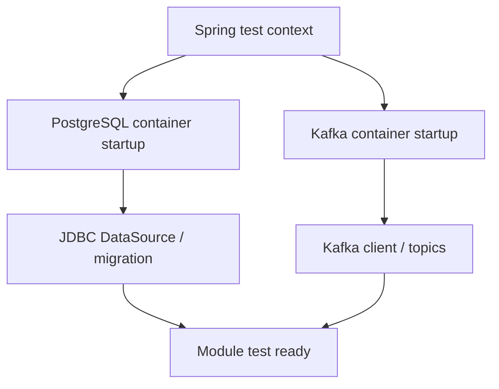
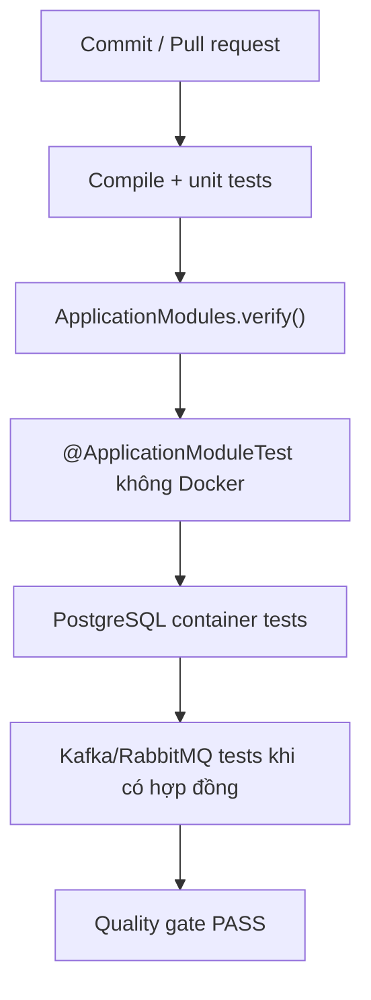

# Chi phí khởi động container trong CI

## 1. Tối ưu chi phí khởi động, không tối ưu bằng cách bỏ kiểm chứng

Trong chương **Testcontainers** của học phần **SPRING_MODULITH_VERIFICATION_TESTING**, mục tiêu là kiểm chứng ranh giới Spring Modulith bằng `ApplicationModules` và quy tắc phụ thuộc, đồng thời kiểm tra hành vi module qua `@ApplicationModuleTest`, event, cơ sở dữ liệu và tích hợp trước khi cho phép thay đổi đi qua **quality gate CI**.

Đối với CI, mỗi PostgreSQL/Kafka/RabbitMQ Testcontainer được khởi động đều có thể phát sinh chi phí: kiểm tra Docker runtime, tải image còn thiếu, tạo container, start process, chờ readiness, cấu hình Spring beans, chạy migration và tạo fixture. Khi cùng một loại container bị tạo đi tạo lại giữa nhiều test, chi phí này có thể lớn hơn chính thời gian assertion.

**Câu hỏi của bài:** làm sao đo và giảm **thời gian đến lúc bài test thật sự bắt đầu kiểm chứng nghiệp vụ**, mà vẫn chạy đúng DB/broker, giữ trạng thái độc lập và không che lỗi?

### Xác định phạm vi tối ưu

| Phép kiểm | Cần Docker? | Vì sao |
| --- | --- | --- |
| `ApplicationModules.of(Application.class).verify()` | Không | Kiểm chứng đồ thị phụ thuộc, API package và ranh giới module. |
| Unit test nghiệp vụ thuần Java | Không | Không kiểm tra SQL dialect hay broker delivery. |
| `@ApplicationModuleTest` với collaborator fake | Không nhất thiết | Kiểm thử module behavior, event Spring hoặc service orchestration. |
| `@ApplicationModuleTest` có JDBC PostgreSQL thật | Có | Bắt lỗi migration, SQL, constraint và transaction. |
| Kafka/RabbitMQ externalization và consumer thật | Có | Kiểm chứng broker endpoint, serialization và delivery. |

**Không giảm thời gian CI bằng cách thay PostgreSQL thật bằng H2 nếu lỗi cần phát hiện phụ thuộc PostgreSQL.** Tối ưu đúng là giảm startup **trùng lặp**, reuse theo vòng đời an toàn, quản lý image cache và chỉ dựng hạ tầng cho những phép kiểm thực sự cần nó.

## 2. Mô hình chi phí: cold start, warm start và critical path

Để điều tra chậm, hãy tách những mốc này:

```mermaid
flowchart LR
    A["Runner / Docker ready"] --> B["Dependency resolve / compile"]
    B --> C["Image local?"]
    C -->|"Không"| D["Pull image layers"]
    C -->|"Có"| E["Create container"]
    D --> E
    E --> F["Start + wait strategy"]
    F --> G["Spring context bootstrap"]
    G --> H["Datasource / migration / topic"]
    H --> I["Given + test stimulus"]
    I --> J["Wait event / DB state"]
    J --> K["Assertions + cleanup"]
    K --> L["Reports / teardown"]
```



Một cách ghi chép hữu ích:

\[
T_{\mathrm{container\_ready}}
\approx T_{\mathrm{image\_pull\;nếu\;thiếu}}
+T_{\mathrm{create}}
+T_{\mathrm{start/wait}}
\]

\[
T_{\mathrm{first\_assertion}}
\approx T_{\mathrm{container\_ready}}
+T_{\mathrm{Spring\_bootstrap}}
+T_{\mathrm{migration}}
+T_{\mathrm{fixture}}
\]

Đây là **phân rã để chẩn đoán**, không phải công thức cộng chính xác khi có các thao tác chồng lấn hoặc container khởi động song song. **Thời gian wall-clock của CI** được quyết định bởi *critical path* qua các bước phụ thuộc, không chỉ bằng tổng CPU time của mọi container.

| Trạng thái runner | Chi phí đặc trưng | Cách nhận biết |
| --- | --- | --- |
| **Cold image cache** | Pull image/layer trước khi start | Logs có download/extract image; runner mới, chưa có image |
| **Warm image cache** | Không cần pull lại cùng image | `start()` vẫn phải tạo và khởi động process |
| **Warm Spring context** | Có thể bỏ qua cả context/container bootstrap | Context cache hit, bean container còn sống |
| **Warm DB process** | Migration đã chạy, data/connection còn | **Nguy cơ chia sẻ state** giữa các test |
| **Fresh test process/fork** | Static Spring TestContext cache được tạo lại | Không tái sử dụng cache giữa các JVM |

### Ví dụ tính chi phí *giả định*, không phải benchmark

Giả sử **24 test** có thời gian logic trung bình **0,3 giây/test** và PostgreSQL startup **8 giây/lần** trong một runner nhất định, khi chạy **tuần tự**:

| Cách tổ chức | Số lượt PostgreSQL start | Ước tính phần startup + logic |
| --- | ---: | ---: |
| Mỗi test một PostgreSQL mới | 24 | `24 × 8 + 24 × 0,3 = 199,2 s` |
| Hai Spring contexts dùng container riêng | 2 | `2 × 8 + 24 × 0,3 = 23,2 s` |

Các số trên chỉ minh họa **độ nhạy đối với số lần start**, không bao gồm compile, pull image, migration, cleanup và không dự đoán tốc độ CI thật. Nếu test chạy song song, phép cộng tuần tự này **không** cho thời gian thực. Phải đo sau khi thay đổi cấu hình.

**Tín hiệu cần thu thập:** số lần pull, số lần container start, số Spring contexts thực sự tạo, số fork JVM, thời gian migration, thời gian test logic và phần đuôi chậm p95.

## 3. JUnit 5 đo chi phí container start và JDBC readiness thực tế

Không đo startup bằng một `@Test` thông thường sau `@Container static` rồi lấy thời gian của method: JUnit extension đã start container **trước khi method bắt đầu**, nên kết quả thiếu phần quan trọng nhất.

Muốn đo `start()` trực tiếp, bài test **tự quản lý lifecycle**:

```java
package com.acme.testing;

import static org.assertj.core.api.Assertions.assertThat;

import java.sql.DriverManager;
import java.util.concurrent.TimeUnit;

import org.junit.jupiter.api.Tag;
import org.junit.jupiter.api.Test;
import org.testcontainers.postgresql.PostgreSQLContainer;

@Tag("integration")
class PostgresStartupCostTests {

    @Test
    void measuresContainerReadyAndFirstJdbcQuery()
            throws Exception {

        long beforeStart = System.nanoTime();
        long afterReady;
        long afterQuery;

        try (PostgreSQLContainer postgres =
                     new PostgreSQLContainer("postgres:17-alpine")
                             .withDatabaseName("startup_cost_test")
                             .withUsername("test")
                             .withPassword("test")) {

            postgres.start();
            afterReady = System.nanoTime();

            try (var connection = DriverManager.getConnection(
                    postgres.getJdbcUrl(),
                    postgres.getUsername(),
                    postgres.getPassword());
                 var statement = connection.createStatement();
                 var result = statement.executeQuery("SELECT 1")) {

                assertThat(result.next()).isTrue();
                assertThat(result.getInt(1)).isEqualTo(1);
            }

            afterQuery = System.nanoTime();

            assertThat(postgres.isRunning()).isTrue();
        }

        long afterClose = System.nanoTime();

        System.out.printf(
                "TC_METRIC container_ready_ms=%d jdbc_query_ms=%d "
                        + "close_ms=%d%n",
                millis(afterReady - beforeStart),
                millis(afterQuery - afterReady),
                millis(afterClose - afterQuery));
    }

    private static long millis(long nanos) {
        return TimeUnit.NANOSECONDS.toMillis(nanos);
    }
}
```

**Dependency cần có:** JUnit 5, AssertJ, PostgreSQL JDBC driver, và Testcontainers Java 2.x `org.testcontainers:testcontainers-postgresql` (import `org.testcontainers.postgresql.PostgreSQLContainer`). Bài test này **không cần `@Testcontainers`/`@Container`**: `try-with-resources` sở hữu việc `close()` ngay cả khi assertion lỗi.

### Diễn giải ba số đo

- `container_ready_ms`: gồm Docker image availability/pull (nếu có), tạo process, start và wait strategy của `PostgreSQLContainer`. **Không thể** dùng một số này để suy riêng đúng thời gian tải image.
- `jdbc_query_ms`: từ lúc container start trả về đến sau JDBC handshake và `SELECT 1`; có cả tạo connection/statement.
- `close_ms`: phần đóng container theo đường Java bình thường, không đại diện mọi cleanup bất đồng bộ của Docker runner.

Test xác nhận PostgreSQL **thực sự trả lời JDBC**; nó không chạy schema migration hay `@ApplicationModuleTest`. Những bước sau cần được đo riêng trong suite Spring.

**Cách kiểm chứng:** chạy bài test trên runner sạch và runner có image cache, thu các dòng `TC_METRIC` kèm logs pull image; so sánh các lần lặp trong cùng điều kiện CPU/RAM/runner. Không được gọi lượt chạy đầu trên máy phát triển là “cold” nếu image `postgres:17-alpine` đã tồn tại.

## 4. Thiết kế phép đo CI không gây kết luận sai

Đo một lần rất dễ gây nhiễu bởi network, image cache, CPU throttle, JVM JIT, disk hoặc parallel jobs. Hãy xác định **kịch bản** trước khi so số liệu.

| Nhóm đo | Điều kiện giữ cố định | Thước đo chính |
| --- | --- | --- |
| **Cold CI runner** | Runner mới, image không có sẵn, version image pin | Pull time, `container_ready_ms`, end-to-end job |
| **Warm image cache** | Cùng image và runner đã có image, vẫn tạo container mới | `container_ready_ms` không chứa pull đáng kể |
| **Warm context** | Cùng JVM, context cache key tương đương, không làm bẩn context | Số context loads, cache hit/miss, số container starts |
| **Multiple containers** | Cùng bộ DB/broker và tài nguyên runner | Sequential vs parallel startup wall-clock |
| **Full module suite** | Cùng test set, fixture, forks và CI resources | Job duration, p50/p95, failure rate, số lần rerun |

### Checklist thu số liệu

1. Ghi commit/build config, Docker/Testcontainers/Spring Boot version, image tag và CPU/RAM runner.
2. Ghi loại runner: **ephemeral** hay **persistent**; image cache có sẵn không.
3. Ghi số JVM forks, song song ở mức job/test class/method và số container đồng thời.
4. Thu log mốc `container.start()`/readiness, Spring context load, Flyway/Liquibase, test methods và teardown.
5. Chạy nhiều lượt tương đương; báo **median/p50, p95**, số lần timeout/fail và độ lệch, không chỉ “lần nhanh nhất”.
6. Giữ nguyên assertions và dữ liệu test; tối ưu không được vô tình giảm lượng kiểm chứng.
7. Chạy lại trên **runner sạch** để bảo đảm cấu hình không chỉ hoạt động nhờ state cũ.

### Spring Context cache là một nguồn metric riêng

Spring Framework lưu `ApplicationContext` trong **static cache của cùng JVM**, dùng key tạo từ configuration, imports, active profiles, property sources, bean overrides và các customizers khác. Theo tài liệu, cache mặc định có giới hạn **32 contexts** và dùng LRU eviction.

Bật log cache trong test profile hoặc cấu hình test:

```properties
logging.level.org.springframework.test.context.cache=DEBUG
```

Xem các lượt **hit/miss** và số context được load. Khi một test dùng `@DirtiesContext`, có thêm một lần bootstrap về sau; khi mỗi class có một `@MockitoBean`/test property khác nhau, các cache keys có thể khác và làm tăng startup.

**Không ép tăng `spring.test.context.cache.maxSize` ngay lập tức**: đó chỉ là một biến tham số. Phải xác nhận cache eviction thật sự là nguyên nhân chậm; giữ quá nhiều contexts còn tăng RAM và số container đang sống.

## 5. Giảm số lần start bằng Spring-managed container và module context

Đối với các bài `@ApplicationModuleTest` thực sự cần PostgreSQL, cách giảm chi phí an toàn thường là **start container một lần trên mỗi Spring `ApplicationContext`**, dùng Spring Boot `@Bean @ServiceConnection`.

### 5.1. Cấu hình một PostgreSQL container cho module shipping

`src/test/java/com/acme/shipping/ShippingPostgresITConfig.java`:

```java
package com.acme.shipping;

import org.springframework.boot.test.context.TestConfiguration;
import org.springframework.boot.testcontainers.service.connection.ServiceConnection;
import org.springframework.context.annotation.Bean;
import org.testcontainers.postgresql.PostgreSQLContainer;

@TestConfiguration(proxyBeanMethods = false)
class ShippingPostgresITConfig {

    @Bean
    @ServiceConnection
    PostgreSQLContainer postgres() {
        return new PostgreSQLContainer("postgres:17-alpine")
                .withDatabaseName("shipping_test")
                .withUsername("test")
                .withPassword("test");
    }
}
```

Để biên dịch, project phải quản lý một bộ version **Spring Boot/Spring Modulith/Testcontainers tương thích**, có `spring-boot-testcontainers`, `testcontainers-postgresql`, `spring-modulith-starter-test`, PostgreSQL JDBC driver, `spring-boot-starter-test` và JDBC/JPA starter tương ứng.

**Đặc tính lifecycle:**

- `@ServiceConnection` tạo connection details cho Spring Boot `DataSource`.
- Container là **Spring bean**, được start trước các bean phụ thuộc và stop sau khi các bean đó bị destroy.
- Khi Spring TestContext tái sử dụng context, container bean cũng có thể được dùng lại giữa các phương thức/lớp.
- **Không** thêm `@Testcontainers`/`@Container` hoặc gọi `start()/stop()` thủ công với bean này.
- Reuse **process** không tự xóa row DB; dữ liệu test phải độc lập.

### 5.2. Hai phép kiểm cùng module, không tạo container cho mỗi method

`src/test/java/com/acme/shipping/ShippingPostgresModuleTests.java`:

```java
package com.acme.shipping;

import static org.assertj.core.api.Assertions.assertThat;

import javax.sql.DataSource;

import org.junit.jupiter.api.Test;
import org.springframework.beans.factory.annotation.Autowired;
import org.springframework.context.annotation.Import;
import org.springframework.jdbc.core.JdbcTemplate;
import org.springframework.modulith.test.ApplicationModuleTest;

@ApplicationModuleTest
@Import(ShippingPostgresITConfig.class)
class ShippingPostgresModuleTests {

    @Autowired DataSource dataSource;
    @Autowired JdbcTemplate jdbc;

    @Test
    void connectsToActualPostgreSql() throws Exception {
        try (var connection = dataSource.getConnection()) {
            assertThat(connection.getMetaData()
                    .getDatabaseProductName())
                    .isEqualTo("PostgreSQL");
        }
    }

    @Test
    void executesSqlOnContainerDatabase() {
        Integer value = jdbc.queryForObject(
                "SELECT 1", Integer.class);
        assertThat(value).isEqualTo(1);
    }
}
```

Hai test method **không cần tạo PostgreSQL mới** giữa chúng. Spring quản lý container theo context; xác nhận hiệu quả thực tế bằng cache DEBUG logs và Testcontainers container-start logs.

**Không suy rằng mọi test class dùng `@ApplicationModuleTest` đều tự động chia một context.** Import, properties, mock bean, profiles, test bootstrap mode hay JVM forks khác nhau đều có thể làm thay đổi cache key hoặc ngăn chia sẻ context.

### 5.3. Vì sao kiểu JUnit container có thể làm CI chậm?

| Khai báo | Số lần start trong tình huống đơn giản | Rủi ro |
| --- | --- | --- |
| Instance `@Container` | Mỗi test method | Startup cao nhất nếu có nhiều method |
| Static `@Container` | Mỗi test class | Ít hơn, nhưng không sống qua nhiều class |
| Spring `@Bean @ServiceConnection` | Mỗi Spring context được tạo | Phù hợp cache context; vẫn cần isolation DB |
| Static singleton manual | Một lần trong JVM nếu quản lý đúng | Khó quản lý ownership, state giữa test classes |
| `withReuse(true)` experimental | Có thể qua nhiều JVM/runs | **Không phù hợp CI**; state không tái lập |

Spring Boot cảnh báo trường hợp JUnit `static @Container` **đã dừng** sau class A trong khi cached Spring context vẫn sống và được tái sử dụng bởi class B. Việc tối ưu startup bằng cách “dùng static container” nhưng sai lifecycle có thể làm **CI flaky**, tốn nhiều thời gian rerun hơn số thời gian tiết kiệm.

## 6. Tối ưu image pull và runner: cold cache khác reuse container

Tại mỗi job, container startup còn phụ thuộc nơi đặt **Docker image layers**:

- **Runner ephemeral:** có thể phải pull image mỗi job nếu base image/runner cache chưa có layer.
- **Runner persistent:** có thể dùng lại image layer đã tải; nhưng cần quản lý disk quota và không để dữ liệu test bị giữ ngoài ý muốn.
- **Image registry:** latency, bandwidth, authentication và rate limit có thể chiếm phần lớn **cold startup**.
- **Image tag:** dùng version pin (ví dụ `postgres:17-alpine`), không dùng `latest` để kiểm chứng tính tái lập.
- **Image pull policy:** Testcontainers mặc định có thể dùng image từ local Docker cache nếu có; policy thay đổi hành vi tải image, không làm Spring tự reuse container.

### Quy trình an toàn

1. Ghi lại **image tag** được các bài kiểm thử thực sự cần.
2. Trên CI runner do tổ chức sở hữu/cho phép, cấu hình image caching hoặc pre-pull có quản lý theo chính sách runner.
3. So sánh **cold runner** và **warm runner** riêng, không gộp hai loại thành một con số.
4. Theo dõi disk pressure và số image tag; nhiều tag hơi khác nhau có thể làm cache mất tác dụng.
5. Đừng chia sẻ **database data volume** chỉ để tận dụng Docker image cache. **Image layer cache** và **running container/data volume reuse** là hai cơ chế khác nhau.

Ví dụ lệnh pre-pull **chỉ trên runner có quyền sử dụng Docker**:

```bash
docker pull postgres:17-alpine
```

Lệnh này tải image, **không** khởi động PostgreSQL và không tạo test database. Để kiểm chứng giá trị, đo riêng thời gian pre-pull và **tổng thời gian job**; di chuyển pull sang một step khác cùng job không tự làm tổng wall-clock giảm.

### Vì sao không bật experimental reusable containers trên CI?

`withReuse(true)` cần opt-in và chủ động giữ container sau khi chương trình kết thúc. Testcontainers chính thức ghi rõ đây là tính năng **thực nghiệm và không phù hợp cho CI**, vì trạng thái cũ, cleanup và networking có thể gây vấn đề. Dùng lại **Spring container bean trong một run** thường là điểm tối ưu hợp lý hơn: giảm startup mà giữ lifecycle có chủ sở hữu và có điểm kết thúc.

**Bảo mật:** truy cập Docker daemon/socket trên CI là quyền nhạy cảm. Không đưa Docker socket của host production vào job chạy mã không đáng tin, và không dùng `docker system prune -a --volumes` trên daemon dùng chung để “dọn sau benchmark”.

## 7. Khởi động song song: khi nào giảm critical path, khi nào phản tác dụng?

Nếu suite cần **PostgreSQL và Kafka độc lập**, start tuần tự có thể cho một critical path dài:

```text
Sequential (minh họa)
PostgreSQL startup ──────────┐
                             Kafka startup ──────────┐
                                                      Spring bootstrap
```

Nếu chúng **không phụ thuộc nhau**, một số phiên bản Spring Boot cho phép các **container beans** start song song:

```properties
spring.testcontainers.beans.startup=parallel
```

Tài liệu Spring Boot mô tả giá trị mặc định là `sequential` và lựa chọn `parallel` cho container beans. Đặt property này ở **test configuration** có chủ đích và đo lại. Không nhầm nó với “chạy JUnit test methods song song”.



### Điều kiện nên bật song song

- Dependency thực sự độc lập; không có service phải **ready** trước khi service còn lại khởi động.
- Runner có đủ CPU, RAM, network bandwidth và Docker capacity.
- Không tạo quá nhiều broker/DB đồng thời khiến tất cả **tranh tài nguyên** và timeout.
- Cấu hình không vô tình tạo nhiều Spring contexts riêng chỉ vì thay property ở từng class.
- Metrics p50/p95 và số lỗi phải tốt hơn khi chạy tuần tự.

**Không khuyến nghị** bật parallel container startup cho mọi suite mà không thử nghiệm. Với CPU/RAM ít, chạy 4 PostgreSQL + 4 Kafka đồng thời có thể **chậm hơn** vì contention và làm tăng flaky tests.

### Ba loại song song phải phân biệt

| Tầng | Ví dụ | Điều cần kiểm soát |
| --- | --- | --- |
| **Parallel container beans** | `spring.testcontainers.beans.startup=parallel` | Độc lập startup và Docker resources |
| **Parallel JUnit methods/classes** | JUnit Jupiter parallel execution | Dữ liệu chung, Spring context, listener và test order |
| **Parallel CI jobs/JVM forks** | Nhiều runner jobs/build workers | Image cache, RAM, volume/network, Spring cache không chia sẻ qua JVM |

Testcontainers JUnit Jupiter extension được tài liệu nêu là chỉ được thử nghiệm với **test execution tuần tự**; chạy parallel bằng extension không được hỗ trợ chính thức. Không dùng “test passed một lần khi parallel” làm bảo chứng cho cách tổ chức đó.

**Đo độ lợi:** so thời gian từ trước khi start container đầu tiên tới khi **cả hai dependency sẵn sàng**, không cộng chồng các log duration rồi gọi đó là CI wall-clock.

## 8. Tối ưu migration và fixture nhưng không làm yếu test module

Container đã sẵn sàng không có nghĩa Spring context đã bootstrap xong:

- JDBC driver/connection pool còn phải kết nối.
- Flyway/Liquibase có thể chạy nhiều migrations.
- Bean wiring và listener cần khởi tạo.
- Kafka topics/consumer group cần chuẩn bị.
- Given cho bài test phải được tạo/commit đúng transaction.
- Event xử lý bất đồng bộ cần deadline riêng để quan sát state cuối.

### Làm gì trước khi tối ưu?

| Thao tác | Tối ưu hợp lý | Tránh |
| --- | --- | --- |
| **Migration** | Chạy đúng chuỗi migration production; nhóm test cần DB clean dùng DB/schema riêng | Bỏ migrations/constraint chỉ để giảm thời gian |
| **Fixture** | Tạo đúng bản ghi test cần; setup theo khóa riêng | Seed toàn bộ dump production cho mỗi method |
| **DB cleanup** | `DELETE ... WHERE business_key = ?` khi test chia DB | `TRUNCATE` toàn bảng đang được test khác dùng |
| **Async assertion** | `Scenario.andWaitForStateChange` theo state đã commit | `Thread.sleep(...)` hoặc chỉ chờ event input |
| **Wait strategy** | Readiness phù hợp DB/broker | Thay health/protocol check bằng port-only để “nhanh hơn” |
| **Test scope** | `@ApplicationModuleTest` tối thiểu đủ module | Mở rộng `ALL_DEPENDENCIES` không có lý do |
| **Broker** | Dựng Kafka/RabbitMQ chỉ cho test external delivery | Kafka container trong unit/architecture test |

### Ví dụ một phép kiểm nghiệp vụ chờ đúng state

Giả sử shipping module có `ShipmentRequested(UUID id)` (public event contract), listener `@ApplicationModuleListener` ghi bảng `shipment_requests(id, state)` và `ShipmentRepository.statusOf(UUID)` query state đã commit. Đây là **các class do ứng dụng cung cấp**, không phải class của Testcontainers.

```java
@Test
void eventEventuallyProducesCommittedState(Scenario scenario) {
    UUID id = UUID.randomUUID();

    scenario.publish(new ShipmentRequested(id))
            .andCleanup(() ->
                    transactions.executeWithoutResult(tx ->
                            shipments.deleteById(id)))
            .andWaitAtMost(Duration.ofSeconds(8))
            .forStateChange(
                    () -> shipments.statusOf(id),
                    status -> status.filter("READY"::equals)
                            .isPresent())
            .andVerify(status ->
                    assertThat(status).contains("READY"));
}
```

Đoạn trên nằm trong `@ApplicationModuleTest` đã inject `TransactionTemplate transactions` và `ShipmentRepository shipments`, có import `java.util.UUID`, `java.time.Duration`, `org.springframework.modulith.test.Scenario` cùng AssertJ. Đây là **bước kiểm chứng nghiệp vụ**, không phải đo container startup.

**Tại sao đặc biệt liên quan tới chi phí CI?**

- Nếu thay cơ chế đợi bằng `Thread.sleep(3000)` ở 100 test, CI tốn thêm thời gian ngủ cố định dù listener hoàn tất sớm.
- Nếu predicate không lọc `id`, một hàng từ test khác có thể khiến bài test pass giả khi container được reuse.
- Nếu JUnit `@Transactional` rollback test-managed transaction nhưng listener đã commit trong transaction riêng, không cleanup sẽ làm suite chậm/flaky ở những lượt sau.
- Nếu đặt timeout quá ngắn chỉ để “tối ưu”, CI có thể phát sinh rerun tốn hơn; timeout phải có căn cứ từ phân phối độ trễ thật.

### Không nhập nhằng các deadline

**Container startup timeout** kiểm soát khi nào dependency được coi là ready. **Scenario business timeout** kiểm soát khoảng thời gian sau stimulus mà state/event phải xuất hiện. Hai deadline không thay thế nhau và cần được đo/ghi log riêng.

## 9. Quality gate theo chi phí và rủi ro: không bỏ mất loại lỗi quan trọng

Một cấu trúc pipeline minh họa:



Test kiến trúc tách riêng:

```java
import org.junit.jupiter.api.Test;
import org.springframework.modulith.core.ApplicationModules;

class ModuleArchitectureTests {

    @Test
    void moduleBoundariesAreValid() {
        ApplicationModules.of(Application.class).verify();
    }
}
```

Thay `Application.class` bằng lớp Spring Boot application thực tế. Bài test này không cần Docker; đừng buộc nó đợi PostgreSQL chỉ vì tất cả test đặt chung một integration suite.

### Thiết kế các tầng theo ngân sách thời gian

| Tầng | Tần suất đề xuất | Chi phí lớn nhất | Gate cần giữ |
| --- | --- | --- | --- |
| Unit + architecture | Mỗi PR/commit | JVM/compile | Phải nhanh, không cần Docker |
| Module tests không container | Mỗi PR/commit | Spring bootstrap | Phụ thuộc module và event behavior |
| PostgreSQL container | Mỗi PR hoặc stage CI bắt buộc theo rủi ro | Pull, DB startup, migrations | SQL dialect, constraint, transaction |
| Broker integration | Mỗi PR hoặc integration stage theo rủi ro | Broker startup, consumer readiness | Delivery, topic/routing, payload |
| Recovery/migration-from-empty | Release/merge gate theo criticality | DB/broker sạch và setup đặc thù | Upgrade, duplicate retry, phục hồi |

Đây là **gợi ý tổ chức**, không phải lý do tự động bỏ test rủi ro cao khỏi PR. Nếu thay đổi ảnh hưởng migration hoặc event broker contract, CI của thay đổi đó phải có phép kiểm tương ứng trước merge/release.

### Ví dụ lệnh chạy (phụ thuộc cấu hình build của dự án)

```bash
# Maven: chạy test theo lifecycle đã được project khai báo.
./mvnw -B test

# Gradle: chạy test theo các task đã được project cấu hình.
./gradlew test
```

Nếu project tách integration tests bằng Maven Failsafe hoặc Gradle `integrationTest` task, gate phải **gọi đúng stage/task đó**. Không mặc định `mvn test` hoặc `gradle test` đã chạy mọi `*IT`.

**Không nên tự động skip container tests** khi Docker không sẵn trong một stage bắt buộc: gate sẽ chuyển từ “đã kiểm chứng” thành “không hề chạy”. Sửa runner hoặc phân tách stage rõ ràng, ghi nhận tình trạng test chưa được thực thi.

## 10. Runbook chẩn đoán chi phí, checklist và bài tập

### Bảng giải thích số liệu bất thường

| Triệu chứng CI | Nghi ngờ đầu tiên | Phép kiểm |
| --- | --- | --- |
| Lần đầu rất chậm, lần sau nhanh | Image pull/cache | Logs image pull, runner mới/cũ, image tag |
| Mỗi method tốn thời gian start PostgreSQL | Instance `@Container` | Đếm container start, chuyển scope khi hợp đồng cho phép |
| Nhiều class tạo context mới | Cache key khác, forks, `@DirtiesContext` | Spring cache DEBUG hits/misses; imports/profiles/bean overrides |
| Đổi sang static container thì suite flaky | JUnit stop container trước cached context | Chọn Spring-managed bean/lifecycle thích hợp |
| Parallel startup chậm hơn sequential | CPU/RAM/network contention | So critical path, resource metrics, p95 timeout |
| DB container start nhanh nhưng test chậm | Migration/fixture | Flyway logs, SQL setup, connection pool |
| Kafka ready nhưng test đợi lâu | Consumer assignment/offset | Topic/group/partition/log listener |
| `Scenario` tốn nhiều thời gian | Predicate yếu/sai hoặc listener lỗi | Correlation ID, state query, transaction logs |
| Pipeline tổng không giảm sau pre-pull | Chi phí chỉ chuyển sang step pre-pull | So **job wall-clock**, không chỉ `container.start()` |
| Test pass riêng nhưng fail suite | DB data/registry/async retry leakage | UUID, cleanup, context reuse và retry logs |
| Image pull timeout hoặc registry throttling | Registry/network/permission | Registry status, tags, auth, retries có giới hạn |
| CI cần rerun nhiều lần | Flaky test làm tăng chi phí tổng | Đo failure rate và root cause, không chỉ duration pass |

### Checklist tối ưu có kiểm chứng

- [ ] Có baseline theo **cùng code/test set/runner class**, phân biệt cold và warm cache.
- [ ] Đã đo `container.start()` và first query; không dùng JUnit method time để suy container static startup.
- [ ] Đếm Spring TestContext cache hits/misses, container starts và JVM forks.
- [ ] Đã chọn scope thích hợp: module test không container, PostgreSQL hoặc broker thật khi cần.
- [ ] Container trong Spring test có lifecycle gắn context; không bị JUnit stop trước khi context đóng.
- [ ] Giữ image tag ổn định, có chính sách caching/pre-pull an toàn và đo **tổng job time**.
- [ ] Không bật `withReuse(true)` experimental trên CI.
- [ ] Chỉ bật parallel container startup nếu các service độc lập và runner đủ tài nguyên.
- [ ] Không giảm độ mạnh wait strategy, bỏ migrations hoặc thay thế assertions bằng sleep.
- [ ] Fixture và cleanup có business key riêng; state được quan sát **sau commit**.
- [ ] Đo p50, p95, timeout rate và rerun rate trước/sau; tối ưu mà flaky tăng là chưa đạt.
- [ ] Chạy architecture verify độc lập với Docker, tích hợp DB/broker vẫn có gate phù hợp.
- [ ] Không xóa Docker resources của job khác, không dùng production credentials/runtime.
- [ ] Khi cần migration-from-empty, dùng database/container mới, không dựa state reuse.

### Bài tập thực hành

1. **Phân rã:** Với một job chậm 8 phút, nêu những mốc cần log để tách pull, startup, Spring bootstrap, migration, fixture và Scenario.
2. **Đo đúng:** Vì sao đo duration bên trong `@Test` khi dùng `static @Container` không phản ánh container startup? Viết phép đo quanh `postgres.start()`.
3. **Cold/warm:** Hai lượt chạy cùng image cho kết quả 70 s và 9 s. Những thông tin nào còn thiếu trước khi kết luận toàn bộ chênh lệch là network image pull?
4. **Chi phí lặp:** Với 24 test/8 giây mỗi container start, tính phần startup khi tạo container theo method và khi chỉ có 2 context; nêu giả định tuần tự.
5. **Context cache:** Hai lớp đều có `@ApplicationModuleTest` nhưng khác `@MockitoBean`. Vì sao có thể phát sinh hai contexts/container starts?
6. **Lifecycle:** JUnit `static @Container` dừng trước khi cached Spring context được lớp khác dùng. Mô tả lỗi và cách sửa.
7. **Image policy:** Tại sao pin `postgres:17-alpine` tốt hơn `latest` khi so benchmark giữa hai commit?
8. **Parallel:** PostgreSQL và Kafka độc lập được start song song nhưng p95 CI xấu hơn. Nêu các chỉ số CPU/RAM/network cần thu và cách ra quyết định.
9. **Migration:** DB startup chỉ 3 giây, Spring context mất 35 giây. Làm thế nào xác định chi phí migrations hay bean init mà không bỏ migration?
10. **Quality gate:** Một thay đổi làm SQL `ON CONFLICT` sai trên PostgreSQL nhưng H2 test vẫn xanh. Có nên bỏ Testcontainers vì chậm? Chọn tối ưu phù hợp hơn.
11. **Flaky:** Sau khi bật reuse, số lần rerun tăng từ mức nền lên đáng kể. Cần kiểm tra những shared states và transaction nào?
12. **ROI:** Trình bày bảng trước/sau gồm median/p95 job time, số container starts, context cache misses và failure rate. Điều kiện nào xác nhận tối ưu thực sự thành công?

**Gợi ý:** (1) đo mốc riêng; (2) startup nằm trước method; (3) runner/cache/CPU/network chưa đồng nhất; (4) 192 giây startup so với 16 giây startup trong giả định; (5) khác cache key; (6) Spring-managed container; (7) cố định phiên bản; (8) resource contention; (9) migration logs và bean startup logs; (10) giữ PostgreSQL thật, giảm số lượt startup; (11) ID/DB/registry/offset/listener; (12) CI nhanh hơn **và** không tăng fail/flaky.

## Tài liệu tham khảo

- [Spring Boot — Testcontainers](https://docs.spring.io/spring-boot/reference/testing/testcontainers.html): lifecycle của Spring-managed container beans, `@ServiceConnection` và cảnh báo JUnit container/context cache.
- [Spring Boot — Development-time Services](https://docs.spring.io/spring-boot/reference/features/dev-services.html): `spring.testcontainers.beans.startup=parallel` và lựa chọn sequential/parallel.
- [Spring Framework — TestContext Context Caching](https://docs.spring.io/spring-framework/reference/testing/testcontext-framework/ctx-management/caching.html): cache keys, static cache/JVM forks, LRU, DEBUG metrics và `@DirtiesContext`.
- [Testcontainers for Java — Postgres Module](https://java.testcontainers.org/modules/databases/postgres/): PostgreSQL container, artifact và JDBC driver.
- [Testcontainers for Java — JUnit Jupiter](https://java.testcontainers.org/test_framework_integration/junit_5/): instance/static `@Container`, lifecycle và lưu ý parallel execution.
- [Testcontainers for Java — Startup and Wait Strategies](https://java.testcontainers.org/features/startup_and_waits/): startup/readiness timeout và wait strategy.
- [Testcontainers for Java — Image Pull Policy](https://java.testcontainers.org/features/advanced_options/): local image cache và tùy chọn pull policy.
- [Testcontainers for Java — Reusable Containers (Experimental)](https://java.testcontainers.org/features/reuse/): cảnh báo không dùng cross-run reuse trên CI.
- [Spring Modulith — Integration Testing Application Modules](https://docs.spring.io/spring-modulith/reference/testing.html): `@ApplicationModuleTest`, `Scenario` và event/state waiting.
- [Spring Modulith — Verification](https://docs.spring.io/spring-modulith/reference/verification.html): kiểm chứng ranh giới bằng `ApplicationModules.verify()`.
