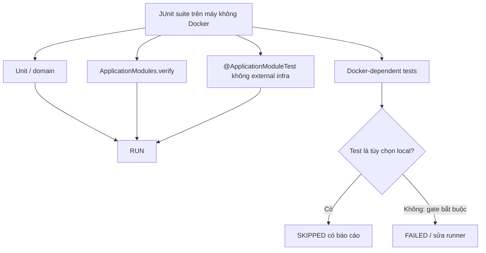

# Chạy test khi Docker không sẵn sàng

## 1. Quyết định đúng: chạy, bỏ qua có báo cáo hay thất bại?

Trong chương **Testcontainers** của học phần **SPRING_MODULITH_VERIFICATION_TESTING**, các bài kiểm thử kiến trúc bằng `ApplicationModules`, kiểm thử module bằng `@ApplicationModuleTest`, kiểm thử sự kiện, cơ sở dữ liệu và tích hợp có **nhu cầu hạ tầng khác nhau**. Khi Docker không sẵn sàng, phản ứng đúng không phải luôn “bỏ qua tất cả test”, cũng không phải luôn “cho toàn bộ build thất bại”.

Trước hết phải xác định **hợp đồng của từng nhóm kiểm thử**.

| Nhóm test | Ví dụ | Docker không sẵn sàng trên máy cá nhân | Docker không sẵn sàng ở CI bắt buộc |
| --- | --- | --- | --- |
| **Unit/domain** | Quy tắc phí vận chuyển, validate đơn hàng | **RUN** và phải pass/fail theo code | **RUN** |
| **Architecture verification** | `ApplicationModules.of(Application.class).verify()` | **RUN**; không cần Docker | **RUN**, quality gate bắt buộc |
| **Module test không hạ tầng ngoài** | `@ApplicationModuleTest` với collaborator được mock đúng biên | **RUN** | **RUN** |
| **Docker integration tùy chọn ở local** | Smoke test PostgreSQL bằng JUnit `@Testcontainers(disabledWithoutDocker = true)` | **SKIPPED**, hiển thị lý do, không giả là pass | **Không dùng cách skip này cho gate** |
| **Docker integration bắt buộc** | `@ApplicationModuleTest` dùng PostgreSQL/Kafka thật | Không chọn chạy trong fast suite; khi yêu cầu chạy thì **FAIL** nếu thiếu Docker | **FAIL** sớm, không đổi thành skipped |

**Ba kết quả khác nhau:**

- **PASSED**: test đã *chạy* và assertion thành công.
- **SKIPPED / DISABLED**: test *không chạy*. Đây không phải bằng chứng code đã được kiểm chứng.
- **FAILED**: test được yêu cầu chạy nhưng setup hoặc assertion không đạt. Nếu Docker là dependency bắt buộc của CI, thiếu Docker là **lỗi môi trường phải chặn merge/release**.

Nguyên tắc của bài: **local được phép bỏ qua phần thử nghiệm hạ tầng tùy chọn; CI bắt buộc phải chứng minh test hạ tầng đã chạy hoặc báo lỗi**. Các phép kiểm kiến trúc/module không cần Docker vẫn phải chạy bình thường.

## 2. Chẩn đoán chính xác thế nào là “Docker không sẵn sàng”

Testcontainers for Java cần một **Docker-API-compatible container runtime** mà tiến trình chạy JUnit có thể truy cập. Sự cố thường gặp không chỉ là “chưa cài Docker”.

| Hiện tượng | Ý nghĩa khả dĩ | Bước kiểm tra |
| --- | --- | --- |
| `docker: command not found` | CLI không có trong `PATH` | Cài/cấu hình CLI cho runner, hoặc dùng runner phù hợp |
| `Cannot connect to the Docker daemon` | Docker Engine/Desktop chưa chạy, socket/endpoint sai hoặc thiếu quyền | `docker info`, cấu hình runtime/socket |
| `Could not find a valid Docker environment` | Testcontainers Java không phát hiện được Docker API tương thích | Xem logs Testcontainers, `DOCKER_HOST`/TLS/socket |
| `Permission denied` khi truy cập socket | User/JVM không có quyền Docker | Kiểm tra quyền socket, nhóm user và chính sách runner |
| `docker info` chạy được nhưng Java thất bại | JVM/container chạy trong namespace/host khác hoặc config Docker API khác CLI | So sánh `DOCKER_HOST`, runtime của Java, Docker context và logs Testcontainers |
| Docker chạy nhưng image pull lỗi | Registry/network/auth/rate limit, **không** phải daemon vắng mặt | Thử pull image đúng tag và kiểm tra registry |
| Docker chạy nhưng Ryuk fail | Helper resource reaper không khởi động/không truy cập Docker | Xem quyền/runtime và logs Ryuk; **không tắt mù quáng** |
| Container start nhưng JDBC `Connection refused` | Mapped host/port, readiness hoặc container lifecycle | Kiểm tra `getJdbcUrl()`, wait strategy, context cache |
| `relation "shipments" does not exist` | DB có thể đã ready nhưng migration/schema thiếu hoặc sai | Kiểm tra Flyway/Liquibase và datasource thật |

### Lệnh chẩn đoán trước khi sửa test

Linux/macOS/CI shell:

```bash
docker version
docker info
docker context ls
docker ps
```

Windows PowerShell:

```powershell
docker version
docker info
docker context ls
Get-ChildItem Env:DOCKER_HOST -ErrorAction SilentlyContinue
```

Cần phân biệt:

1. **CLI có tồn tại không?** `docker version` có thể in thông tin client nhưng không kết nối được server.
2. **Daemon có truy cập được không?** `docker info` phải trả thành công với thông tin server.
3. **JVM đang chạy ở đâu?** IDE/Windows host, WSL, Docker container hay CI runner có thể nhìn những endpoint khác nhau.
4. **Runtime có hỗ trợ các tính năng cần thiết không?** Container networking, port mapping, resource reaper và image pull có thể cần cấu hình riêng.
5. **Đây thật sự là “không có Docker” hay lỗi sau khi Docker sẵn?** Docker hoạt động nhưng migration/SQL/Kafka topic sai thì test vẫn phải fail; đừng skip theo mọi `Exception`.

**Cảnh báo bảo mật:** truy cập Docker daemon/socket là quyền nhạy cảm. Không mở Docker TCP API không TLS hoặc mount Docker socket của host production vào job không tin cậy chỉ để làm test xanh.

## 3. Luôn có một bộ test chạy được khi không có Docker

Cách tách bài test tốt bắt đầu từ **hợp đồng cần chứng minh**, không phải từ việc runtime nào đang hoạt động.

### 3.1. Architecture test không phụ thuộc container

File minh họa `src/test/java/com/acme/ModuleBoundariesTests.java`:

```java
package com.acme;

import org.junit.jupiter.api.Test;
import org.springframework.modulith.core.ApplicationModules;

class ModuleBoundariesTests {

    @Test
    void noModuleBreaksItsBoundary() {
        ApplicationModules.of(Application.class).verify();
    }
}
```

`Application.class` là Spring Boot application class thực tế trong `com.acme`. `ApplicationModules.verify()` kiểm tra phụ thuộc module, truy cập API package và những luật kiến trúc được khai báo; **không cần `DataSource`, Spring application context hay Docker**.

Khi kiểm thử kiến trúc đã phát hiện việc `shipping` import class `order.internal.*`, thiếu Docker **không** phải lý do trì hoãn phát hiện lỗi này.

### 3.2. Unit test vẫn chạy, không thay bằng container giả

Ví dụ logic thuần trong module shipping:

```java
package com.acme.shipping;

import static org.assertj.core.api.Assertions.assertThat;

import org.junit.jupiter.api.Test;

class ShippingFeeRulesTests {

    @Test
    void freeShippingStartsAtThreshold() {
        assertThat(ShippingFeeRules.feeFor(500_000))
                .isZero();
        assertThat(ShippingFeeRules.feeFor(499_999))
                .isPositive();
    }
}
```

`ShippingFeeRules` là class domain **do ứng dụng cần cung cấp**. Test chỉ minh họa rằng phép kiểm quy tắc thuần Java **không có bất kỳ dependency Docker nào**; nó không chứng minh SQL, migration hay broker.

### 3.3. `@ApplicationModuleTest` không mặc nhiên cần Docker

`@ApplicationModuleTest` giới hạn Spring beans theo module (mặc định `STANDALONE`). Một module không dùng external datasource/broker, hoặc những collaborator ngoài biên đã được thay thế phù hợp bằng `@MockitoBean`, có thể bootstrap và chạy mà không cần Testcontainers.

**Không làm điều này:** gắn `@TestConfiguration` tạo PostgreSQLContainer vào **mọi** lớp `@ApplicationModuleTest` theo một base class toàn cục, rồi sau đó phải bỏ qua toàn bộ module tests khi Docker tắt. Cấu hình container chỉ nên được import vào các bài test cần hợp đồng DB/broker thật.



## 4. Tùy chọn ở local: `@Testcontainers(disabledWithoutDocker = true)`

Testcontainers JUnit 5 extension có thuộc tính **`disabledWithoutDocker = true`**. Khi môi trường không có Docker tương thích, extension có thể **disable test thay vì fail**. Đây là cơ chế chính thức, phù hợp cho bài test tích hợp **tùy chọn trên máy phát triển**.

Ví dụ PostgreSQL smoke test dùng Testcontainers Java **2.x**:

```java
package com.acme.shipping;

import static org.assertj.core.api.Assertions.assertThat;

import java.sql.DriverManager;

import org.junit.jupiter.api.Tag;
import org.junit.jupiter.api.Test;
import org.testcontainers.junit.jupiter.Container;
import org.testcontainers.junit.jupiter.Testcontainers;
import org.testcontainers.postgresql.PostgreSQLContainer;

@Tag("docker-optional")
@Testcontainers(disabledWithoutDocker = true)
class OptionalPostgresSmokeTests {

    @Container
    static final PostgreSQLContainer postgres =
            new PostgreSQLContainer("postgres:17-alpine")
                    .withDatabaseName("shipping_smoke")
                    .withUsername("test")
                    .withPassword("test");

    @Test
    void jdbcConnectionActuallyWorks() throws Exception {
        try (var connection = DriverManager.getConnection(
                postgres.getJdbcUrl(),
                postgres.getUsername(),
                postgres.getPassword());
             var statement = connection.createStatement();
             var rows = statement.executeQuery("SELECT 1")) {

            assertThat(connection.getMetaData()
                    .getDatabaseProductName())
                    .isEqualTo("PostgreSQL");
            assertThat(rows.next()).isTrue();
            assertThat(rows.getInt(1)).isEqualTo(1);
        }
    }
}
```

**Phần cần hiểu:**

- `@Testcontainers` kích hoạt extension quản lý vòng đời `@Container`.
- `disabledWithoutDocker = true` làm bài test được **skip** nếu thiếu Docker; đây là quyết định **theo hạ tầng**, không phải catch exception sau khi test lỗi.
- Khi Docker sẵn, container được start; test kết nối **JDBC thật** và kiểm tra `SELECT 1`.
- `@Tag("docker-optional")` cho phép build tools lọc nhóm tùy chọn. Tag **không** tự kiểm tra Docker.
- Class này chỉ là smoke test độc lập, **không** dùng Spring `ApplicationContext` và không cần `@ServiceConnection`.

**Dependencies:** `spring-boot-starter-test` hoặc JUnit/AssertJ tương đương, `org.testcontainers:testcontainers-postgresql`, `org.testcontainers:testcontainers-junit-jupiter` (Testcontainers 2.x) và `org.postgresql:postgresql`. Nếu dự án dùng Testcontainers 1.x, artifact/import khác; đừng trộn 1.x và 2.x.

### Phải kiểm chứng nhánh SKIPPED

Thực hành trên máy **cố ý không có Docker**:

1. Chạy **riêng** `OptionalPostgresSmokeTests`.
2. Quan sát JUnit/Test reports: test **disabled/skipped** và có lý do Docker không sẵn.
3. Không được ghi vào báo cáo rằng PostgreSQL smoke test “PASSED”.
4. Khi bật Docker, chạy lại và xác nhận **executed + PASSED**.
5. Cố ý làm SQL assertion sai khi Docker sẵn để chứng minh lỗi business **thực sự làm test fail**, không bị `disabledWithoutDocker` che.

### Giới hạn quan trọng

Không dùng `@Testcontainers(disabledWithoutDocker = true)` cho một lớp tích hợp mà **CI yêu cầu phải chạy**. Nếu CI không có Docker, kết quả có thể là **SKIPPED**, build vẫn có thể báo xanh và không ai phát hiện SQL/broker regression.

**Không thay bằng `Assumptions.assumeTrue(...)` bên trong method** để “skip nếu Docker vắng”: với `static @Container`, Testcontainers extension có thể cố khởi động container **trước khi body của `@Test` chạy**, nên assumption đặt trong method là **quá muộn** để ngăn lỗi setup.

## 5. Tích hợp bắt buộc: `@ApplicationModuleTest` phải fail khi Docker vắng

Với một quality gate cần chứng minh PostgreSQL dialect, constraint và migration, hãy **không bật auto-skip**. Cách đơn giản là dùng tag `docker-required`, chỉ chạy class này ở stage có Docker, để Testcontainers/Spring Boot **fail** nếu dependency không sẵn sàng.

### 5.1. PostgreSQLContainer là Spring bean của test context

File `src/test/java/com/acme/shipping/ShippingPostgresRequiredConfig.java`:

```java
package com.acme.shipping;

import org.springframework.boot.test.context.TestConfiguration;
import org.springframework.boot.testcontainers.service.connection.ServiceConnection;
import org.springframework.context.annotation.Bean;
import org.testcontainers.postgresql.PostgreSQLContainer;

@TestConfiguration(proxyBeanMethods = false)
class ShippingPostgresRequiredConfig {

    @Bean
    @ServiceConnection
    PostgreSQLContainer postgres() {
        return new PostgreSQLContainer("postgres:17-alpine")
                .withDatabaseName("shipping_required")
                .withUsername("test")
                .withPassword("test");
    }
}
```

`@Bean @ServiceConnection` giúp Spring Boot gắn container với vòng đời Spring `ApplicationContext`. Đây là phương án thích hợp cho nhiều bài `@ApplicationModuleTest` dùng context cache: container không bị JUnit `static @Container` stop sớm khi một lớp kết thúc.

### 5.2. Test bắt buộc kiểm chứng PostgreSQL và schema

File `src/test/java/com/acme/shipping/ShippingDockerRequiredTests.java`:

```java
package com.acme.shipping;

import static org.assertj.core.api.Assertions.assertThat;

import javax.sql.DataSource;

import org.junit.jupiter.api.Tag;
import org.junit.jupiter.api.Test;
import org.springframework.beans.factory.annotation.Autowired;
import org.springframework.context.annotation.Import;
import org.springframework.jdbc.core.JdbcTemplate;
import org.springframework.modulith.test.ApplicationModuleTest;

@Tag("docker-required")
@ApplicationModuleTest
@Import(ShippingPostgresRequiredConfig.class)
class ShippingDockerRequiredTests {

    @Autowired DataSource dataSource;
    @Autowired JdbcTemplate jdbc;

    @Test
    void bootsWithRealPostgreSql() throws Exception {
        try (var connection = dataSource.getConnection()) {
            assertThat(connection.getMetaData()
                    .getDatabaseProductName())
                    .isEqualTo("PostgreSQL");
            assertThat(connection.isValid(2)).isTrue();
        }

        assertThat(jdbc.queryForObject(
                "SELECT 1", Integer.class))
                .isEqualTo(1);
    }

    @Test
    void migrationCreatedShipmentsTable() {
        Boolean present = jdbc.queryForObject("""
                SELECT to_regclass('public.shipments') IS NOT NULL
                """, Boolean.class);

        assertThat(present).isTrue();
    }
}
```

**Điều kiện trước khi chạy:** dự án có Spring Boot + Spring Modulith BOM tương thích, starter test, Spring JDBC/JPA, PostgreSQL JDBC driver, `spring-boot-testcontainers`, `testcontainers-postgresql` và Flyway/Liquibase migration tạo bảng `public.shipments` trong database test. Nếu schema khác `public`, thay query theo schema thực tế.

**Kết quả có ý nghĩa:**

- Docker **không sẵn** → Spring không thể start container bean → **test FAIL**, không tự skip.
- Docker có nhưng PostgreSQL **không ready** → setup/test FAIL, cần xem wait/connection.
- Docker/PostgreSQL ready nhưng **migration không tạo bảng** → `migrationCreatedShipmentsTable` FAIL.
- Docker, driver, datasource và migration đều đúng → cả hai method **đã chạy và PASSED**.

**Không thêm `@Testcontainers(disabledWithoutDocker = true)` hoặc `@EnabledIfEnvironmentVariable` vào class required này** trừ khi CI có cơ chế bắt buộc xác nhận điều kiện chạy. Nếu không, một biến môi trường thiếu có thể biến gate thành skip im lặng.

### 5.3. Khi cần kiểm chứng event flow sau commit

Nếu shipping module có `OrderPaid`, `ShippingHandler @ApplicationModuleListener` và `ShipmentRepository.statusOf(UUID)`, mở rộng test required bằng phép kiểm `Scenario`:

```java
@Test
void orderPaidIsCommittedToPostgres(Scenario scenario) {
    UUID orderId = UUID.randomUUID();

    scenario.publish(new OrderPaid(orderId))
            .andCleanup(() ->
                    transactions.executeWithoutResult(tx ->
                            shipments.deleteByOrderId(orderId)))
            .andWaitAtMost(Duration.ofSeconds(8))
            .forStateChange(
                    () -> shipments.statusOf(orderId),
                    status -> status.filter("READY"::equals)
                            .isPresent())
            .andVerify(status ->
                    assertThat(status).contains("READY"));
}
```

Đây là **method bổ sung** vào lớp `@ApplicationModuleTest` đã inject `ShipmentRepository shipments` và `TransactionTemplate transactions`, cùng các imports `UUID`, `Duration`, `Scenario` và `OrderPaid` của ứng dụng. Không phải đoạn copy nguyên là chạy được nếu ứng dụng chưa có event/repository/listener và migration tương ứng.

**Mục tiêu:** chứng minh PostgreSQL đã nhận và commit state sau event, không chỉ chứng minh container start. `@ApplicationModuleListener` xử lý trong transaction riêng, nên `@Transactional` rollback của test **không thay** cleanup side effect đã commit.

## 6. Phân nhóm test Maven/Gradle để fast suite vẫn chạy offline

Tag giúp không phải khởi tạo Spring context/containers của những bài **không được chọn**. Nó khác với đợi test fail lúc bootstrap rồi mới bỏ qua.

### 6.1. Maven Surefire/JUnit Platform

Đặt tag:

```java
@Tag("docker-required")
class ShippingDockerRequiredTests { /* ... */ }

@Tag("docker-optional")
class OptionalPostgresSmokeTests { /* ... */ }
```

Lệnh chạy **fast suite không Docker**:

```bash
./mvnw -B -DexcludedGroups=docker-required,docker-optional test
```

Lệnh chạy **chỉ Docker-required tests** trên runner có Docker:

```bash
./mvnw -B -Dgroups=docker-required test
```

Maven Surefire hỗ trợ JUnit tags thông qua `groups` và `excludedGroups`. Class `*Tests` phù hợp test discovery convention của Surefire; nếu dự án dùng `*IT` ở Maven Failsafe, cần cấu hình và gọi đúng phase/plugin, ví dụ `verify`, thay vì tin `mvn test` sẽ tìm tất cả.

**Lưu ý build config:** nếu dự án đã khai báo groups/excludedGroups trong `pom.xml` hoặc chạy nhiều modules, xác nhận tham số từ CLI có hiệu lực với provider đang dùng và lớp required thật sự được discover. Khi không có Docker, fast suite vẫn có thể **PASS** vì nó **chủ động không chọn** các test Docker; CI Docker stage vẫn phải chạy.

### 6.2. Gradle (Groovy DSL)

Ví dụ tách hai tasks trong build script:

```groovy
tasks.named('test', Test) {
    useJUnitPlatform {
        excludeTags 'docker-required', 'docker-optional'
    }
}

tasks.register('dockerTest', Test) {
    group = 'verification'
    description = 'Runs integration tests that require Docker'

    testClassesDirs = sourceSets.test.output.classesDirs
    classpath = sourceSets.test.runtimeClasspath

    useJUnitPlatform {
        includeTags 'docker-required'
    }

    shouldRunAfter tasks.named('test')
}
```

Chạy local không Docker:

```bash
./gradlew test
```

Chạy stage tích hợp có Docker:

```bash
./gradlew dockerTest
```

**Quan trọng:** ví dụ trên chỉ minh họa một build có Java plugin, JUnit Platform và test classes trong `sourceSets.test`. Nếu dự án đã có `integrationTest` task/test suite riêng, nên nối tag vào task đó thay vì tạo task trùng lặp. Nếu IDE chạy trực tiếp class `docker-required` trên máy không Docker, test **phải fail** — tag không tự skip ở IDE.

### Nhìn vào số test đã thực thi

| Kịch bản | Fast suite | Docker-required stage | Trạng thái pipeline mong đợi |
| --- | --- | --- | --- |
| Local không Docker | Các test không Docker chạy | Không được chọn | Fast suite pass/fail theo code; **không kết luận tích hợp đã pass** |
| Local có Docker, chọn tự chạy optional | Fast suite vẫn có thể chỉ chạy test nhanh | Optional có thể RUN | Report phân biệt optional run/skip |
| CI có Docker | Fast suite chạy | Required **RUN** | Cả hai tầng phải pass |
| CI bắt buộc nhưng không Docker | Fast suite vẫn có thể pass | **FAIL** ở preflight hoặc test setup | Toàn pipeline **FAIL**, không merge |

## 7. Quality gate CI: fail-fast và phát hiện “tất cả đều skipped”

Một CI job cần Docker phải **chứng minh ít nhất ba điều**:

1. **Runner có Docker API** và policy quyền phù hợp.
2. **Build thực sự discover và thực thi** những test tích hợp bắt buộc.
3. **Test hạ tầng và nghiệp vụ chạy thành công**; không được thay thế bằng skip/fallback.

### 7.1. Preflight script cho runner POSIX

Đoạn sau là phần **minh họa của CI stage required** trên một runner đã cài Docker CLI và có `mvnw`:

```bash
#!/usr/bin/env sh
set -eu

if [ "${RUN_REQUIRED_DOCKER_TESTS:-}" != "true" ]; then
    echo "CI configuration error: required Docker stage not enabled" >&2
    exit 2
fi

if ! docker info >/dev/null 2>&1; then
    echo "Required Docker tests cannot run: Docker API unavailable" >&2
    exit 3
fi

./mvnw -B -Dgroups=docker-required -DfailIfNoTests=true test
```

Ở CI configuration của job này, đặt `RUN_REQUIRED_DOCKER_TESTS=true`. Biến môi trường đóng vai trò **điều kiện kiểm tra cấu hình stage**, *không* phải cách skip test required. Nếu runner không có Docker → exit khác 0 **trước khi** mất thời gian bootstrap Spring.

**Giới hạn:** `docker info` kiểm tra Docker client/server tại shell, nhưng không đảm bảo JUnit JVM và Testcontainers sẽ sử dụng cùng endpoint/network. Khi test thật vẫn lỗi Docker discovery, cần kiểm tra `DOCKER_HOST`, socket, TLS, môi trường Java và logs.

### 7.2. Chống CI xanh khi không có test nào chạy

Một job có thể pass dù mọi test bị filter, disabled hoặc skipped. Hãy kiểm tra:

- Test reports của **đúng task/phase** (`Surefire XML`, `Gradle Test reports`).
- Có ít nhất **một** test `docker-required` được **executed**, không chỉ discovered.
- Số **skipped/disabled** trong Docker-required stage là **0**, trừ ngoại lệ được duyệt và giải thích.
- Không có `@Testcontainers(disabledWithoutDocker = true)` hoặc `Assumptions.assumeTrue(...)` ở class required.
- Khi tạo thêm test required, discovery conventions có nhận class mới không.
- `-DfailIfNoTests=true` có thể bắt tình huống **không có test được chọn**, nhưng **không đủ** để phát hiện một nhóm test **được discover rồi bị skip**; cần kiểm tra số thực thi/skipped trong reports.

### 7.3. Kiểm tra âm tính bắt buộc

Một phép xác minh CI thực tế đáng làm trong runner thử nghiệm:

1. Chạy required stage với Docker hoạt động: kết quả **executed + pass**.
2. Chạy required stage trên **runner thử nghiệm không truy cập Docker**: preflight hoặc test setup **fail**.
3. Tắt preflight trong một bản thử riêng để xác minh class required **không tự skip** mà báo lỗi thiếu Docker.
4. Đảm bảo fast suite không phụ thuộc Docker vẫn tiếp tục chạy khi Docker tắt.
5. Quan sát báo cáo để phân biệt **skipped**, **passed**, **failed**.

**Không tự tắt Docker của host đang phục vụ đồng nghiệp hoặc pipeline khác** để thực hành. Dùng runner, container VM hoặc môi trường sandbox do bạn sở hữu.

## 8. Khi muốn chọn chạy bằng biến môi trường thay vì dò Docker

Một số đội muốn người phát triển **chủ động opt-in** vào các bài Spring integration test, thay vì mỗi lần JUnit discovery lại phải chờ Docker detection.

JUnit có annotation:

```java
import org.junit.jupiter.api.Tag;
import org.junit.jupiter.api.condition.EnabledIfEnvironmentVariable;

@Tag("docker-optional")
@EnabledIfEnvironmentVariable(
        named = "RUN_LOCAL_DOCKER_IT",
        matches = "true")
class LocalOnlyDockerIntegrationTests {
    // Test tích hợp tùy chọn, được bật có chủ đích.
}
```

**Ý nghĩa khác hẳn `disabledWithoutDocker = true`:**

| Cơ chế | Quyết định dựa vào | Khi Docker không có nhưng được bật |
| --- | --- | --- |
| `@Testcontainers(disabledWithoutDocker = true)` | Testcontainers kiểm tra khả năng tìm Docker | **SKIPPED** |
| `@EnabledIfEnvironmentVariable` | Giá trị biến môi trường (regex) | Test **RUN rồi FAIL** nếu nó cần Docker |
| `@Tag` + build filter | Test được chọn hay không ở discovery | Nếu được chọn và không có Docker, test **FAIL** nếu không có skip khác |

Ví dụ:

- `RUN_LOCAL_DOCKER_IT` không có → local-only class **DISABLED**, dù Docker có thể đang chạy.
- `RUN_LOCAL_DOCKER_IT=true` và Docker chạy → test được thực thi.
- `RUN_LOCAL_DOCKER_IT=true` nhưng Docker không chạy → test được thực thi và container bootstrap **FAIL**, không tự skip.

**Không đặt annotation môi trường này trên Docker-required class của CI** nếu job không kiểm tra flag bắt buộc: một sai sót trong pipeline (quên set env) có thể làm tất cả required tests thành skipped mà build vẫn xanh.

### Tránh cách skip quá muộn

```java
@Test
void unsafeManualSkip() {
    // Quá muộn nếu @Container static đã được extension start
    // trước khi test body được gọi.
    Assumptions.assumeTrue(checkDockerSomehow());
    // ...
}
```

`Assumptions` là JUnit API, còn `checkDockerSomehow()` chỉ là **placeholder minh họa anti-pattern**, không phải method có sẵn. Đừng bọc mọi `Exception` từ `postgres.start()` rồi gọi `assumeTrue(false)`: lỗi migration, auth, image hoặc repository cũng có thể bị biến thành skipped, làm mất ý nghĩa quality gate.

## 9. Các hướng khắc phục khi Docker thật sự không hoạt động

Chọn giải pháp theo **tầng hỏng**, thay vì sửa ngẫu nhiên vào code test:

| Tầng hỏng | Hướng xử lý phù hợp | Không nên làm |
| --- | --- | --- |
| Máy dev chưa có Docker Desktop/Engine | Khởi động/cài runtime được tổ chức hỗ trợ; hoặc chỉ chạy fast suite | Giả lập PostgreSQL rồi gọi đó là “đã kiểm thử PostgreSQL” |
| Docker CLI có nhưng daemon/socket không truy cập | Sửa Docker context, daemon, quyền user/socket | Tắt hết tests hoặc đổi `disabledWithoutDocker=true` trên required |
| JVM ở trong container/CI job | Cấu hình access đến Docker API và mapped host phù hợp runtime | Cứng `localhost:2375` không TLS hoặc mở Docker socket công khai |
| Testcontainers không tìm Docker dù CLI được | Kiểm tra `DOCKER_HOST`, TLS, `DOCKER_CERT_PATH`, Java process env, Testcontainers logs | Bỏ qua mọi `IllegalStateException` |
| Image pull thất bại | Kiểm tra registry/proxy/auth và image tag | Gọi lỗi đó là Docker không sẵn và skip |
| Ryuk/resource reaper không khởi động | Kiểm tra permissions, runtime và cleanup policy | Tắt `TESTCONTAINERS_RYUK_DISABLED` mù quáng |
| DB container ready nhưng migration lỗi | Sửa Flyway/Liquibase/schema/datasource | Thay wait strategy bằng port-only và giả là pass |
| Kafka broker ready nhưng consumer không nhận | Kiểm tra topic, group/offset, serializer, listener | Chỉ assert Spring `PublishedEvents` để che broker flow |

### Docker Desktop, WSL và remote daemon

- **Windows/macOS:** kiểm tra Docker Desktop/Engine đang chạy và đúng context.
- **Linux:** kiểm tra Docker daemon và quyền socket của user thực thi build.
- **WSL/remote Docker:** kiểm tra endpoint mà **Java process** có thể truy cập; mapped host/port có thể khác môi trường chạy Docker CLI.
- **CI:** dùng runner có container runtime được hỗ trợ và quyền phù hợp; nếu runner tổ chức không cung cấp Docker, chuyển **Docker-required stage** sang runner khác hoặc sửa cấu hình job, không biến nó thành skipped.

Không thể đảm bảo một alternative runtime tương thích đầy đủ mọi tính năng (network, Ryuk, bind mounts, host mapping) chỉ vì có Docker-compatible API. Kiểm tra môi trường theo tài liệu Testcontainers cho loại runtime cụ thể.

### Debug logs cần thu

- Logs bắt đầu Testcontainers và Docker discovery;
- Docker CLI/server version, context và permission (không in secret);
- Container ID và logs khi fail;
- Image pull errors;
- `DataSource` URL/metadata nhưng **không log password**;
- Spring context bootstrap/module scope;
- Test reports: passed, failed, skipped, số test thực thi.

**Không đề xuất chạy các lệnh xóa Docker hàng loạt trên daemon dùng chung** để khắc phục lỗi môi trường. Dọn resource theo owner/job và dùng disposable CI runner khi có thể.

## 10. Checklist, bài tập và tài liệu tham khảo

### Checklist thiết kế chế độ không Docker

- [ ] Phân loại rõ unit, architecture, module không infra, optional Docker và required Docker tests.
- [ ] Unit và `ApplicationModules.verify()` chạy **ngay cả khi Docker không có**.
- [ ] Không import Testcontainers configuration vào mọi `@ApplicationModuleTest` một cách ngầm định.
- [ ] Optional local test dùng `@Testcontainers(disabledWithoutDocker = true)` hoặc opt-in flag có lý do.
- [ ] Báo cáo optional **SKIPPED** chứ không nhận là PASSED.
- [ ] Required CI **không** có annotation/assumption tự disable khi Docker vắng.
- [ ] Maven/Gradle có task/tag lọc fast suite và Docker stage rõ ràng.
- [ ] Docker-required job fail sớm khi Docker API không truy cập được.
- [ ] Test reports xác nhận có test required **thực sự chạy** và không bị skip ngoài dự kiến.
- [ ] `@ServiceConnection`/`@DynamicPropertySource` trỏ đúng container và lifecycle.
- [ ] Test DB kiểm tra SQL/schema; test broker kiểm tra message qua broker, không chỉ event Spring.
- [ ] Phân biệt lỗi thiếu Docker với image pull, readiness, migration và business failure.
- [ ] Không mở Docker socket/host API thiếu kiểm soát để sửa lỗi CI.
- [ ] Có phép thử âm tính: CI required **FAIL** khi Docker không khả dụng.
- [ ] CI architecture/module boundary gate vẫn chạy cùng integration gate.

### Bài tập thực hành

1. **Phân loại:** Một test `ApplicationModules.verify()` và một test `@ApplicationModuleTest` dùng PostgreSQLContainer. Test nào phải chạy khi Docker tắt? Vì sao?
2. **Optional JUnit:** Dùng `@Testcontainers(disabledWithoutDocker = true)` với PostgreSQLContainer và `SELECT 1`. Khi Docker vắng, trạng thái JUnit đúng là gì?
3. **Không nhầm skipped/pass:** Chạy optional smoke test trên runner không Docker; kiểm tra XML report. Vì sao build exit code 0 không có nghĩa PostgreSQL đã được kiểm chứng?
4. **Lỗi setup:** Viết test `@Container static` và đặt `Assumptions.assumeTrue(...)` trong method. Tại sao nó có thể quá muộn để bỏ qua?
5. **Required Spring test:** Tạo `@TestConfiguration @Bean @ServiceConnection PostgreSQLContainer`; import vào `@ApplicationModuleTest` có `@Tag("docker-required")`. Khi daemon không chạy, kết quả mong muốn là gì?
6. **Migration:** Docker có, PostgreSQL start được, nhưng `to_regclass('public.shipments')` trả null. Đây là lỗi Docker availability hay migration/schema?
7. **Maven:** Viết lệnh chạy fast suite loại hai tag và lệnh chạy chỉ `docker-required`. Cần kiểm tra điều gì trong Surefire report?
8. **Gradle:** Tạo `dockerTest` task `includeTags("docker-required")` và task `test` `excludeTags(...)`. Khi nào mỗi task chạy?
9. **Preflight:** Viết POSIX shell kiểm tra `docker info` và trả exit code khác 0 nếu Docker thiếu; vì sao không chỉ tin vào CLI có cài?
10. **Cấu hình CI sai:** Required tests đều mang `@EnabledIfEnvironmentVariable` nhưng CI quên set biến. Vì sao quality gate có thể báo xanh giả?
11. **Image pull:** `docker info` thành công nhưng không pull được `postgres:17-alpine`. Tại sao không được coi là “Docker unavailable → skip”?
12. **Remote daemon:** Docker CLI ở host A dùng được, Java test ở container B không tìm Docker. Nêu những endpoint/quyền/biến môi trường cần so sánh.
13. **Spring Modulith:** Khi Docker không có, chạy architecture verification và module tests không DB. Những rủi ro SQL/event externalization nào vẫn cần CI stage riêng để phát hiện?
14. **Kiểm tra âm tính:** Thiết kế hai lượt chạy Docker-required stage — một có Docker, một trên runner cô lập không Docker — và chỉ ra expected passed/failed/skipped counts.
15. **Bảo mật:** Vì sao không mở Docker daemon qua TCP không TLS chỉ để giải quyết lỗi Testcontainers trong CI?

**Đáp án định hướng:** (1) architecture vẫn chạy; (2) skipped/disabled; (3) không executed; (4) extension start trước body; (5) fail; (6) migration; (7) tag filter + report count; (8) fast vs integration stage; (9) daemon/server phải reachable; (10) disabled toàn bộ; (11) lỗi registry/network; (12) `DOCKER_HOST`/socket/TLS/host mapping; (13) cần DB/broker thật; (14) required không được skipped; (15) quyền Docker rất nhạy cảm.

### Tài liệu tham khảo

- [Testcontainers Java — JUnit 5 Quickstart](https://java.testcontainers.org/quickstart/junit_5_quickstart/): `@Testcontainers(disabledWithoutDocker = true)` và điều kiện disable khi Docker không sẵn.
- [Testcontainers Java — JUnit 5 Integration](https://java.testcontainers.org/test_framework_integration/junit_5/): static/instance `@Container`, lifecycle và extension.
- [Testcontainers Java — Supported Docker Environments](https://java.testcontainers.org/supported_docker_environment/): Docker discovery, runtime tương thích và cấu hình endpoint.
- [Testcontainers Java — Custom Configuration](https://java.testcontainers.org/features/configuration/): Docker host, registry, resource reaper và cấu hình Testcontainers.
- [Spring Boot — Testcontainers](https://docs.spring.io/spring-boot/reference/testing/testcontainers.html): `@ServiceConnection`, Spring-managed container beans và lifecycle với TestContext cache.
- [JUnit 5 — EnabledIfEnvironmentVariable](https://docs.junit.org/5.14.2/api/org.junit.jupiter.api/org/junit/jupiter/api/condition/EnabledIfEnvironmentVariable.html): class/method condition theo biến môi trường và regex.
- [Maven Surefire — JUnit Platform and Tags](https://maven.apache.org/surefire/maven-surefire-plugin/examples/junit-platform.html): `groups`, `excludedGroups` và test discovery.
- [Gradle — Testing in Java & JVM Projects](https://docs.gradle.org/current/userguide/java_testing.html): `useJUnitPlatform`, `includeTags` và `excludeTags`.
- [Spring Modulith — Integration Testing Application Modules](https://docs.spring.io/spring-modulith/reference/testing.html): `@ApplicationModuleTest`, `Scenario` và kiểm thử module.
- [Spring Modulith — Verification](https://docs.spring.io/spring-modulith/reference/verification.html): `ApplicationModules.verify()` để duy trì quality gate kiến trúc không phụ thuộc Docker.
