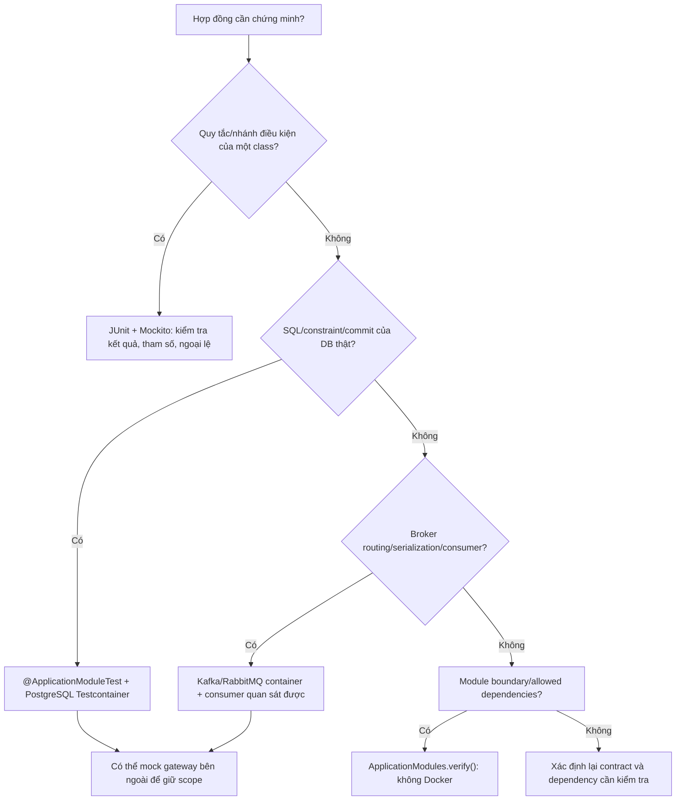
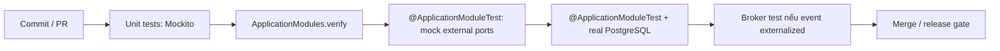

# Phân biệt container test với mock test

## 1. Hai loại bằng chứng khác nhau, không phải hai cách viết cùng một test

Trong học phần **SPRING_MODULITH_VERIFICATION_TESTING**, mục tiêu không chỉ là cho JUnit trả về màu xanh. Ta cần kiểm chứng **ranh giới kiến trúc** bằng `ApplicationModules` và luật phụ thuộc module, **hành vi của module** bằng `@ApplicationModuleTest`, cùng những hợp đồng tích hợp về sự kiện, cơ sở dữ liệu và message broker trước khi đưa chúng vào quality gate CI.

Chủ đề **“Phân biệt container test với mock test”** trả lời câu hỏi:

> Khi test dùng Mockito và khi test dùng PostgreSQL/Kafka/RabbitMQ Testcontainers, **mỗi test thực sự chứng minh điều gì, và không chứng minh được điều gì?**

**Mock test** thay một collaborator bằng đối tượng do test kiểm soát: test có thể quyết định giá trị trả về, ném lỗi và ghi nhận lời gọi. Nó phù hợp kiểm chứng **quyết định của thành phần đang test** khi đầu vào/cộng tác viên có hành vi đã định.

**Container test** chạy một dependency thật trong container (ví dụ PostgreSQL) để thực thi JDBC protocol, SQL, constraint hoặc transaction. Testcontainers chủ yếu cung cấp **hạ tầng thật có vòng đời test**; nó không tự sinh assertion đúng và không tự bảo đảm hệ thống bên ngoài production được mô phỏng đầy đủ.

| Câu hỏi | Mock test | Container test |
| --- | --- | --- |
| Khi carrier trả về `STANDARD`, service có tạo đúng shipment không? | **Rất phù hợp** | Có thể kiểm chứng, nhưng container thường không cần |
| Service có gọi repository đúng một lần và đúng tham số không? | **Trực tiếp** qua `verify(...)` | Quan sát hiệu ứng DB thường giá trị hơn đếm lời gọi |
| Câu SQL `INSERT ... ON CONFLICT` có chạy trên PostgreSQL không? | **Không** | **Có**, nếu dùng PostgreSQL thật |
| Primary key và `CHECK` constraint có được áp dụng không? | Chỉ mô phỏng lỗi nếu tự stub | **Có**, bằng ghi DB và assert exception |
| Transaction có rollback dữ liệu sau SQL exception không? | Không chứng minh transaction manager/DB thật | **Có**, khi thao tác qua Spring transaction và DB thật |
| Message thực sự tới Kafka topic/consumer không? | Mock producer **không chứng minh** | Có, khi broker container và consumer probe thật được dùng |
| HTTP request đi qua TCP/TLS thực không? | Mock client hoặc `MockMvc` không nhất thiết | Chỉ khi test thực sự gọi HTTP endpoint trên network |
| Module import package nội bộ của module khác sai không? | Không phải nhiệm vụ của mock | Container cũng **không** thay thế `ApplicationModules.verify()` |

**Sai lầm phổ biến:** viết một `@ApplicationModuleTest` có `@MockitoBean ShipmentStore` rồi gọi đó là “PostgreSQL integration test”. Nếu không có `DataSource` thật và SQL thật được thực thi, test đó chỉ xác nhận logic/lời gọi ở một biên đã giả lập.

Ngược lại, **dùng Testcontainer không đồng nghĩa tất cả collaborator đều thật**. Test có thể dùng **PostgreSQL thật + mock carrier API** để kiểm chứng chính xác phần SQL của module mà không cần gọi dịch vụ vận chuyển bên ngoài.

## 2. Chọn công cụ theo rủi ro cần bắt, không theo độ “cao cấp”

Một phép kiểm thử chỉ đáng tin khi **oracle** (điều kiện quyết định pass/fail) tương ứng với **hợp đồng cần chứng minh**.



### Các test thường bị đánh giá quá mức

| Test được viết | Nó chứng minh | Nó **không** chứng minh |
| --- | --- | --- |
| `verify(repo).save(shipment)` | Service gọi mock đúng tham số | Bảng tồn tại; INSERT thành công; DB commit |
| `when(carrier.choose(...)).thenReturn("STANDARD")` | Service phản ứng đúng với giá trị đã lập trình | Provider carrier production trả giá trị đó |
| `@MockitoBean KafkaTemplate` và `verify(send(...))` | Adapter gọi producer method | Kafka đã lưu record, topic/serializer/consumer đúng |
| `@ApplicationModuleTest` + PostgreSQL `SELECT 1` | Datasource có thể query PostgreSQL | Listener đã xử lý event; schema business đúng |
| `Scenario.andWaitForEventOfType(...)` | Spring event mong đợi được publish | Event đã ra external broker hoặc DB đã commit |
| `Scenario.andWaitForStateChange(...)` đọc row `READY` | Module đưa DB tới trạng thái quan sát được | Toàn bộ hệ thống ngoài đã hoàn tất mọi side effect |

**Tiêu chí nâng cấp từ mock lên container:** nếu một lỗi có thể nằm ở *protocol, dialect, transaction, schema, routing hoặc serialization* mà mock không thực thi, cần một phép kiểm hạ tầng thật ở đúng biên. Không nhất thiết thay toàn bộ mock bằng real services trong một test duy nhất.

### Mức độ cô lập

- **Unit/mock:** tạo trực tiếp class; Mockito mock các ports; không khởi động Spring context hay Docker.
- **Module test với mock:** dùng `@ApplicationModuleTest` để kiểm tra bean wiring/hành vi trong module, mock các cộng tác viên ngoài biên.
- **Module test với container:** giữ module thật và hạ tầng thật cho đúng rủi ro (PostgreSQL/Kafka...), mock những integration *khác* để test có scope xác định.
- **Cross-system/e2e:** đưa các systems vào flow thật hơn; chi phí và độ không xác định tăng, nhưng cần cho một số contract end-to-end.

**Mock không có nghĩa kiểm thử kém chất lượng; container không tự làm kiểm thử tốt hơn.** Chúng là các phép đo khác nhau.

## 3. Một mô hình nghiệp vụ dùng xuyên suốt cả hai loại test

Giả sử module `shipping` nhận lệnh chuẩn bị vận chuyển cho một đơn đã thanh toán. Hệ thống:

1. Hỏi `CarrierQuoteGateway` chọn mã hãng vận chuyển.
2. Tạo `Shipment(orderId, carrierCode, READY)`.
3. Lưu qua `ShipmentStore`.
4. Khi chạy production, `ShipmentStore` có implementation JDBC/PostgreSQL.

Ta sẽ **không thay đổi business service** giữa hai bộ test: chỉ thay cách cung cấp collaborator và cách quan sát kết quả.

### 3.1. Domain và ports

Ví dụ trong package `com.acme.shipping`:

```java
package com.acme.shipping;

import java.util.UUID;

public record Shipment(
        UUID orderId,
        String carrierCode,
        String status) {}
```

`src/main/java/com/acme/shipping/ShipmentStore.java`:

```java
package com.acme.shipping;

import java.util.Optional;
import java.util.UUID;

public interface ShipmentStore {

    void save(Shipment shipment);

    Optional<Shipment> find(UUID orderId);

    void delete(UUID orderId);
}
```

`src/main/java/com/acme/shipping/CarrierQuoteGateway.java`:

```java
package com.acme.shipping;

import java.util.UUID;

public interface CarrierQuoteGateway {
    String selectCarrier(UUID orderId);
}
```

`CarrierQuoteGateway` là **port** mà module shipping cần; implementation gọi carrier bên ngoài thuộc adapter/integration production do ứng dụng phải cung cấp. Trong unit/module test, ta có thể mock port này để không gọi network không liên quan tới hợp đồng đang kiểm tra.

### 3.2. Service có transaction khi chạy qua Spring

`src/main/java/com/acme/shipping/ShippingService.java`:

```java
package com.acme.shipping;

import java.util.UUID;

import org.springframework.stereotype.Service;
import org.springframework.transaction.annotation.Transactional;

@Service
public class ShippingService {

    private final ShipmentStore store;
    private final CarrierQuoteGateway carrierGateway;

    public ShippingService(
            ShipmentStore store,
            CarrierQuoteGateway carrierGateway) {
        this.store = store;
        this.carrierGateway = carrierGateway;
    }

    @Transactional
    public Shipment prepare(UUID orderId) {
        if (orderId == null) {
            throw new IllegalArgumentException("orderId is required");
        }

        String carrier = carrierGateway.selectCarrier(orderId);

        if (carrier == null || carrier.isBlank()) {
            throw new IllegalStateException("Carrier is unavailable");
        }

        Shipment shipment =
                new Shipment(orderId, carrier, "READY");

        store.save(shipment);
        return shipment;
    }
}
```

**Điều cần chứng minh bằng mock:** chọn đúng carrier, tạo đúng `Shipment`, không gọi `save` khi input hoặc carrier không hợp lệ, chuyển lỗi phù hợp.

**Điều cần chứng minh bằng container:** Spring thực sự tạo transaction, JDBC implementation chạy được trên PostgreSQL, bảng/constraint chính xác, dữ liệu commit và có thể đọc lại.

Khi ta khởi tạo `new ShippingService(mockStore, mockCarrier)` trực tiếp trong unit test, annotation `@Transactional` **không kích hoạt Spring AOP proxy**. Vì vậy unit test không được nhận là đã kiểm chứng commit/rollback thật.

## 4. Mock test: rất nhanh và kiểm soát nhánh điều kiện chính xác

JUnit 5 + Mockito chạy **không Docker, không Spring context**. Dùng `MockitoExtension` để tạo mocks và inject collaborator.

`src/test/java/com/acme/shipping/ShippingServiceUnitTests.java`:

```java
package com.acme.shipping;

import static org.assertj.core.api.Assertions.assertThat;
import static org.assertj.core.api.Assertions.assertThatThrownBy;
import static org.mockito.BDDMockito.given;
import static org.mockito.Mockito.verify;
import static org.mockito.Mockito.verifyNoInteractions;

import java.util.UUID;

import org.junit.jupiter.api.Test;
import org.junit.jupiter.api.extension.ExtendWith;
import org.mockito.ArgumentCaptor;
import org.mockito.InjectMocks;
import org.mockito.Mock;
import org.mockito.junit.jupiter.MockitoExtension;

@ExtendWith(MockitoExtension.class)
class ShippingServiceUnitTests {

    @Mock ShipmentStore store;
    @Mock CarrierQuoteGateway carrierGateway;

    @InjectMocks ShippingService service;

    @Test
    void createsReadyShipmentUsingChosenCarrier() {
        UUID id = UUID.randomUUID();
        given(carrierGateway.selectCarrier(id))
                .willReturn("STANDARD");

        Shipment result = service.prepare(id);

        assertThat(result.orderId()).isEqualTo(id);
        assertThat(result.carrierCode()).isEqualTo("STANDARD");
        assertThat(result.status()).isEqualTo("READY");

        ArgumentCaptor<Shipment> saved =
                ArgumentCaptor.forClass(Shipment.class);

        verify(store).save(saved.capture());
        assertThat(saved.getValue()).isEqualTo(result);
        verify(carrierGateway).selectCarrier(id);
    }

    @Test
    void rejectsUnavailableCarrierWithoutWriting() {
        UUID id = UUID.randomUUID();
        given(carrierGateway.selectCarrier(id))
                .willReturn("");

        assertThatThrownBy(() -> service.prepare(id))
                .isInstanceOf(IllegalStateException.class)
                .hasMessage("Carrier is unavailable");

        verify(carrierGateway).selectCarrier(id);
        verifyNoInteractions(store);
    }

    @Test
    void rejectsNullOrderBeforeCallingCollaborators() {
        assertThatThrownBy(() -> service.prepare(null))
                .isInstanceOf(IllegalArgumentException.class);

        verifyNoInteractions(carrierGateway, store);
    }
}
```

### Chính xác test này chứng minh gì?

- Business service xây đúng `Shipment` với carrier do gateway cung cấp.
- Khi carrier không có, service không gọi store.
- Khi `orderId == null`, không collaborator nào được gọi.
- Nếu người sửa code đảo nhánh `if` hoặc lưu dù carrier rỗng, unit test báo fail.

**Nó không chạy bất kỳ câu SQL nào.** Mockito mặc định không mở `DataSource`, không kiểm tra constraint, không commit transaction. `verify(store).save(...)` xác nhận một **interaction với mock**, không phải một **hiệu ứng bền vững**.

### Tránh over-specification

Không cần `verifyNoMoreInteractions(...)` cho mọi collaborator nếu contract chỉ quan tâm giá trị trả về và dữ liệu đã lưu. Kiểm tra quá nhiều lời gọi nội bộ làm test dễ gãy khi refactor mà hành vi không đổi. Dùng `ArgumentCaptor` khi tham số lưu là **một phần hợp đồng**, như `orderId`, `status`, carrier.

**Độ tin cậy của mock phụ thuộc việc stub có giống contract thật hay không.** Nếu gateway production đôi lúc trả `null`, unit test nên mô phỏng nhánh đó; nếu mock luôn trả giá trị “đẹp”, test không chứng minh code chịu lỗi với carrier thật.

## 5. Container test: PostgreSQL thật, không mock store cần kiểm chứng

Bây giờ giữ nguyên `ShippingService` nhưng dùng **JDBC implementation thật** của `ShipmentStore` và PostgreSQL Testcontainer.

### 5.1. Schema/migration

Một Flyway migration minh họa (dùng version chưa trùng với migrations hiện có của dự án):

```sql
CREATE TABLE shipping_shipments (
    order_id UUID PRIMARY KEY,
    carrier_code VARCHAR(32) NOT NULL,
    status VARCHAR(16) NOT NULL
        CHECK (status IN ('READY', 'FAILED'))
);
```

Nếu production dùng Flyway/Liquibase, test phải chạy migration thực tế vào `DataSource` của container. `@ApplicationModuleTest` giới hạn Spring beans theo module, **không tự tách migration theo package Java**.

### 5.2. JDBC implementation

`src/main/java/com/acme/shipping/JdbcShipmentStore.java`:

```java
package com.acme.shipping;

import java.util.List;
import java.util.Optional;
import java.util.UUID;

import org.springframework.jdbc.core.JdbcTemplate;
import org.springframework.stereotype.Repository;

@Repository
class JdbcShipmentStore implements ShipmentStore {

    private final JdbcTemplate jdbc;

    JdbcShipmentStore(JdbcTemplate jdbc) {
        this.jdbc = jdbc;
    }

    @Override
    public void save(Shipment shipment) {
        jdbc.update("""
                INSERT INTO shipping_shipments
                        (order_id, carrier_code, status)
                VALUES (?, ?, ?)
                """,
                shipment.orderId(),
                shipment.carrierCode(),
                shipment.status());
    }

    @Override
    public Optional<Shipment> find(UUID orderId) {
        List<Shipment> values = jdbc.query("""
                SELECT order_id, carrier_code, status
                FROM shipping_shipments
                WHERE order_id = ?
                """,
                (rs, rowNum) -> new Shipment(
                        rs.getObject("order_id", UUID.class),
                        rs.getString("carrier_code"),
                        rs.getString("status")),
                orderId);

        return values.stream().findFirst();
    }

    @Override
    public void delete(UUID orderId) {
        jdbc.update(
                "DELETE FROM shipping_shipments WHERE order_id = ?",
                orderId);
    }
}
```

Ở unit test, `ShipmentStore` là mock. Ở module test, `JdbcShipmentStore` là bean `@Repository` thật, tạo SQL cho PostgreSQL; **chúng không được đăng ký đồng thời dưới cùng contract nếu không có ý định cụ thể**.

### 5.3. PostgreSQL container là test bean

Ví dụ dùng Spring Boot hỗ trợ `@ServiceConnection` và **Testcontainers Java 2.x**:

`src/test/java/com/acme/shipping/ShippingPostgresTestConfig.java`:

```java
package com.acme.shipping;

import org.springframework.boot.test.context.TestConfiguration;
import org.springframework.boot.testcontainers.service.connection.ServiceConnection;
import org.springframework.context.annotation.Bean;
import org.testcontainers.postgresql.PostgreSQLContainer;

@TestConfiguration(proxyBeanMethods = false)
class ShippingPostgresTestConfig {

    @Bean
    @ServiceConnection
    PostgreSQLContainer postgres() {
        return new PostgreSQLContainer("postgres:17-alpine")
                .withDatabaseName("shipping_test")
                .withUsername("test")
                .withPassword("test");
    }
}
```

**Phần hạ tầng phải có:** Spring Boot JDBC starter, PostgreSQL JDBC driver, `spring-boot-starter-test`, `spring-modulith-starter-test`, `spring-boot-testcontainers` và `testcontainers-postgresql`, với BOM/versions tương thích. Nếu dùng Flyway/Liquibase, bổ sung dependency migration đúng phiên bản.

- `@Bean @ServiceConnection`: Spring Boot lấy connection details từ typed container; không hard-code `localhost:5432`.
- Container sống cùng Spring `ApplicationContext` và có thể được dùng lại khi context cache hit.
- Không gắn `@Testcontainers` / `@Container` vào bean này và không gọi `start()/stop()` thủ công.
- Tái sử dụng container **không có nghĩa dữ liệu được reset** giữa các test.

### 5.4. `@ApplicationModuleTest` dùng real store, mock đúng gateway ngoài biên

`src/test/java/com/acme/shipping/ShippingPostgresModuleTests.java`:

```java
package com.acme.shipping;

import static org.assertj.core.api.Assertions.assertThat;
import static org.mockito.BDDMockito.given;
import static org.mockito.Mockito.verify;

import java.util.UUID;
import javax.sql.DataSource;

import org.junit.jupiter.api.Test;
import org.springframework.beans.factory.annotation.Autowired;
import org.springframework.context.annotation.Import;
import org.springframework.jdbc.core.JdbcTemplate;
import org.springframework.modulith.test.ApplicationModuleTest;
import org.springframework.test.context.bean.override.mockito.MockitoBean;
import org.springframework.transaction.support.TransactionTemplate;

@ApplicationModuleTest
@Import(ShippingPostgresTestConfig.class)
class ShippingPostgresModuleTests {

    // Đây là boundary bên ngoài được thay bằng Mockito.
    @MockitoBean CarrierQuoteGateway carrierGateway;

    // Đây là các bean thật của module và infrastructure.
    @Autowired ShippingService shipping;
    @Autowired ShipmentStore store;
    @Autowired DataSource dataSource;
    @Autowired JdbcTemplate jdbc;
    @Autowired TransactionTemplate transactions;

    @Test
    void commitsShipmentToRealPostgres() throws Exception {
        UUID id = UUID.randomUUID();
        given(carrierGateway.selectCarrier(id))
                .willReturn("STANDARD");

        try {
            Shipment result = shipping.prepare(id);

            assertThat(result)
                    .isEqualTo(new Shipment(id, "STANDARD", "READY"));
            assertThat(store.find(id)).contains(result);
            verify(carrierGateway).selectCarrier(id);

            try (var connection = dataSource.getConnection()) {
                assertThat(connection.getMetaData()
                        .getDatabaseProductName())
                        .isEqualTo("PostgreSQL");
            }

            Integer count = jdbc.queryForObject("""
                    SELECT COUNT(*)
                    FROM shipping_shipments
                    WHERE order_id = ?
                    """, Integer.class, id);

            assertThat(count).isEqualTo(1);
        } finally {
            // Tránh rò dữ liệu đã commit sang test tiếp theo.
            transactions.executeWithoutResult(tx ->
                    store.delete(id));
        }

        assertThat(store.find(id)).isEmpty();
    }
}
```

**Tầng nào là thật?**

| Thành phần | Trong test này | Hệ quả |
| --- | --- | --- |
| `ShippingService` | **Real Spring bean** | Chạy wiring và `@Transactional` proxy |
| `JdbcShipmentStore` / `ShipmentStore` | **Real repository** | Thực thi `INSERT/SELECT/DELETE` |
| `DataSource` | **Real PostgreSQL connection** | Kiểm tra driver, SQL dialect, connection |
| `shipping_shipments` | **Real schema/constraint** | Kiểm chứng migration đúng DB |
| `CarrierQuoteGateway` | **Mockito bean** | Không gọi provider/carrier network |
| `@ApplicationModuleTest` | **Real module-scoped Spring context** | Chỉ bootstrap beans thuộc phạm vi module |
| Docker/PostgreSQL process | **Real database engine trong container** | Cần Docker-compatible runtime |

**Điều quan trọng:** Spring Modulith `@ApplicationModuleTest` mặc định dùng bootstrap mode `STANDALONE` — chỉ module chứa test class. `@MockitoBean` cho gateway bên ngoài làm rõ boundary mà ta chưa muốn tích hợp thật. Không mở rộng `ALL_DEPENDENCIES` hoặc khởi động mọi module khi mục tiêu chỉ là shipping + PostgreSQL.

### Lưu ý về `@MockitoBean`

`@MockitoBean` của Spring Framework 6.2+ nằm ở:

```java
import org.springframework.test.context.bean.override.mockito.MockitoBean;
```

Mặc định annotation dùng chiến lược **replace or create**: khi không có bean phù hợp trong context, nó có thể tạo mock bean mới. Trong ví dụ, điều này là có chủ đích vì implementation `CarrierQuoteGateway` ở hệ thống ngoài không được bootstrap trong module `STANDALONE`.

Nếu mục tiêu test là **bắt buộc thay thế một bean thực đã tồn tại**, hãy cân nhắc `@MockitoBean(enforceOverride = true)` để test fail nếu không tìm thấy bean đó; nhưng **không dùng** `enforceOverride = true` cho port chưa có bean trong context cô lập ở ví dụ này.

Dự án Spring Boot/Spring Framework cũ có thể dùng `@MockBean` thay vì `@MockitoBean`; cần đồng bộ với phiên bản thật và hiểu rằng `@MockBean` đã bị deprecate ở Spring Boot 3.4.

## 6. Đưa một lỗi thật vào test: constraint và rollback

Cần một phép kiểm mà **mock test có thể xanh nhưng container test phải đỏ** khi hạ tầng bị hỏng.

### 6.1. Unique key: database có thật sự từ chối bản ghi trùng không?

Thêm vào lớp module test có `JdbcTemplate jdbc`, `ShipmentStore store` và `TransactionTemplate transactions`:

```java
@Test
void postgresEnforcesPrimaryKey() {
    UUID id = UUID.randomUUID();

    try {
        jdbc.update("""
                INSERT INTO shipping_shipments
                        (order_id, carrier_code, status)
                VALUES (?, ?, ?)
                """, id, "STANDARD", "READY");

        assertThatThrownBy(() -> jdbc.update("""
                INSERT INTO shipping_shipments
                        (order_id, carrier_code, status)
                VALUES (?, ?, ?)
                """, id, "EXPRESS", "READY"))
                .isInstanceOf(DuplicateKeyException.class);

        assertThat(store.find(id))
                .contains(new Shipment(id, "STANDARD", "READY"));
    } finally {
        transactions.executeWithoutResult(tx ->
                store.delete(id));
    }
}
```

Các imports bổ sung:

```java
import static org.assertj.core.api.Assertions.assertThatThrownBy;
import org.springframework.dao.DuplicateKeyException;
```

**Phép kiểm này bắt được lỗi mà mock không thấy**: nếu migration vô tình bỏ primary key, lần insert thứ hai có thể thành công và test fail. Mockito mock `ShipmentStore.save(...)` không chạy unique constraint, trừ khi bạn **tự lập trình** cho mock ném exception — làm vậy chỉ kiểm tra service phản ứng với exception, **không** kiểm tra schema.

### 6.2. Rollback thật: insert rồi ném exception

Khi muốn xác minh một Spring transaction rollback theo PostgreSQL, có thể dùng `TransactionTemplate`:

```java
@Test
void databaseRollbackReallyRemovesUncommittedRow() {
    UUID id = UUID.randomUUID();

    assertThatThrownBy(() ->
            transactions.executeWithoutResult(tx -> {
                jdbc.update("""
                        INSERT INTO shipping_shipments
                                (order_id, carrier_code, status)
                        VALUES (?, ?, ?)
                        """, id, "STANDARD", "READY");

                throw new IllegalStateException("force rollback");
            }))
            .isInstanceOf(IllegalStateException.class);

    assertThat(store.find(id)).isEmpty();
}
```

**Điều được chứng minh:** Spring transaction manager và PostgreSQL rollback row do transaction này tạo. **Điều chưa được chứng minh:** mọi đường đi qua `ShippingService` đều rollback theo ý định; để kiểm tra điều đó, cần kích hoạt lỗi **sau một ghi SQL** bằng chính service method/proxy hoặc dùng một test-specific component phù hợp.

Không để test method bị bao bởi một outer `@Transactional` mà không hiểu propagation: `TransactionTemplate` mặc định có thể **tham gia outer transaction**, làm điểm commit/rollback khác kỳ vọng.

### Hai phép kiểm bổ sung thường có giá trị

- **Schema constraint:** thử insert `status = 'UNKNOWN'` và assert database từ chối bởi `CHECK` constraint, rồi rollback/cleanup phù hợp.
- **Migration từ database sạch:** dùng container/schema mới, chạy Flyway/Liquibase rồi query `information_schema` hoặc thực thi query nghiệp vụ. Container reuse có thể khiến test pass do bảng từ lần trước vẫn còn.

**Không chỉ chứng minh “container started”.** Test `SELECT 1` xác nhận kết nối, nhưng không đủ chứng minh hành vi repository, unique constraint, commit hoặc migration business.

## 7. Kết hợp mock và container là một test đúng — khi biên được ghi rõ

Có ba kết hợp dễ gây nhầm:

| Cấu hình | Phép kiểm phù hợp | Cách báo cáo trung thực |
| --- | --- | --- |
| `@Mock ShipmentStore` + `@Mock CarrierQuoteGateway`, không Spring | Business decisions trong service | **Unit test với mocks**, không DB integration |
| `@ApplicationModuleTest` + `@MockitoBean CarrierQuoteGateway` + **real JdbcShipmentStore/PostgreSQL** | Module wiring, JDBC/transaction thật, carrier response được giả lập | **Module integration test với DB thật + external port mocked** |
| `@ApplicationModuleTest` + `@MockitoBean ShipmentStore` + PostgreSQLContainer được start nhưng **không dùng** | Chủ yếu kiểm tra logic/call trên mock; container là chi phí thừa | Không gọi là đã kiểm chứng SQL |

### Trường hợp test kết hợp hữu ích

Module shipping có hai loại rủi ro:

1. **Carrier provider** là API HTTP nằm ngoài module, không cần thật trong test DB.
2. **Shipment persistence** phụ thuộc PostgreSQL SQL và transaction, cần thật.

Giải pháp: mock `CarrierQuoteGateway`, giữ `JdbcShipmentStore` và PostgreSQL thật. Điều này giảm bất định từ network carrier nhưng vẫn bắt lỗi SQL/migration.

### Khi test bằng mock có thể tạo tự tin giả

Ví dụ:

```java
given(store.find(id))
        .willReturn(Optional.of(
                new Shipment(id, "STANDARD", "READY")));

assertThat(store.find(id)).isPresent();
```

Test này chỉ hỏi lại **chính giá trị vừa stub**, không thực hiện nghiệp vụ và gần như không kiểm tra production code.

Một test khác:

```java
verify(kafkaTemplate).send("shipping.requests", id, payload);
```

Nó có thể phù hợp kiểm tra **mapping tham số** của adapter. Nhưng Kafka topic không tồn tại, value serializer bị sai hoặc consumer production không nhận record đều có thể **không bị phát hiện** bởi lời gọi Mockito.

**Câu hỏi tự kiểm:** nếu xóa migration của `shipping_shipments` hoặc đổi topic Kafka thành tên sai, test này có fail không? Nếu không, đừng tuyên bố nó đã kiểm chứng phần đó.

### Mock boundary vẫn phải tôn trọng kiến trúc

`@MockitoBean` giúp bootstrapping module với dependency ngoài biên, **không** cho phép module import trực tiếp class `com.acme.order.internal.*`. Vẫn cần một bài `ApplicationModules.verify()` độc lập để bắt phụ thuộc sai.

## 8. Event bất đồng bộ: đừng nhầm verify mock với state sau commit

Trong Spring Modulith, event flow có thể kết hợp Spring application event, `@ApplicationModuleListener` và persistence. Một mock assertion xảy ra ngay sau khi publish **không tự chứng minh async listener đã hoàn tất**.

Giả sử module order công bố public event:

```java
package com.acme.order;

import java.util.UUID;

public record OrderPaid(UUID orderId) {}
```

Module shipping có listener:

```java
package com.acme.shipping;

import com.acme.order.OrderPaid;
import org.springframework.modulith.events.ApplicationModuleListener;
import org.springframework.stereotype.Component;

@Component
class OrderPaidListener {

    private final ShippingService shipping;

    OrderPaidListener(ShippingService shipping) {
        this.shipping = shipping;
    }

    @ApplicationModuleListener
    public void on(OrderPaid event) {
        shipping.prepare(event.orderId());
    }
}
```

`@ApplicationModuleListener` được thiết kế cho xử lý sự kiện **sau commit**, bất đồng bộ và trong transaction riêng. Vì vậy:

```java
// YẾU hoặc RACE: listener có thể chưa chạy xong.
events.publishEvent(new OrderPaid(id));
verify(store).save(any());
```

Hơn nữa, nếu `store` ở đây là mock, assertion chỉ xác nhận một method được gọi ở thời điểm quan sát, không có DB commit.

### Đúng hơn: dùng `Scenario` chờ trạng thái từ real repository

Bổ sung bài test riêng trong module `shipping`, với cùng `@ApplicationModuleTest`, `@Import(ShippingPostgresTestConfig.class)` và `@MockitoBean CarrierQuoteGateway`:

```java
@Test
void paidEventEventuallyPersistsReadyShipment(
        Scenario scenario) {

    UUID id = UUID.randomUUID();
    given(carrierGateway.selectCarrier(id))
            .willReturn("STANDARD");

    scenario.publish(new OrderPaid(id))
            .andCleanup(() ->
                    transactions.executeWithoutResult(tx ->
                            store.delete(id)))
            .andWaitAtMost(Duration.ofSeconds(8))
            .forStateChange(
                    () -> store.find(id),
                    found -> found.filter(
                            shipment -> "READY".equals(
                                    shipment.status()))
                            .isPresent())
            .andVerify(found ->
                    assertThat(found).contains(
                            new Shipment(id, "STANDARD", "READY")));
}
```

Các biến `carrierGateway`, `transactions` và `store` là những field đã inject trong lớp module test ở mục 5. Import `org.springframework.modulith.test.Scenario`, `com.acme.order.OrderPaid` và `java.time.Duration` trong lớp test thực tế.

**Đây là phép kiểm khác với pure unit mock:**

- Stimulus là Spring event trong transaction phù hợp.
- Listener của module shipping thực sự được bootstrap.
- Carrier gateway là mock, nên test kiểm soát sự lựa chọn hãng.
- `store.find(id)` truy vấn **PostgreSQL thật**, lặp cho tới khi thấy `READY` của **đúng orderId**.
- `andCleanup(...)` dọn row đã commit bằng transaction độc lập.

**Vì sao không chỉ `andWaitForEventOfType(OrderPaid.class)`?** Đó là **event đầu vào do test tự publish**, không phải kết quả shipping. Nếu hợp đồng là DB đã ghi thành công, phải chờ state DB. Nếu module còn phát output event, có thể chờ `ShipmentPrepared(id)` với matcher ID, nhưng event đó không tự chứng minh commit trừ khi protocol/transaction của ứng dụng quy định như vậy.

### Đến muộn và retry

Ngay cả `Scenario` có timeout hữu hạn vẫn có thể kết thúc khi listener lỗi hoặc task chậm. Nếu publication registry/resubmission được bật, side effect đến muộn có thể xảy ra **sau** callback cleanup. Đối với test recovery/idempotency, cần isolation mạnh hơn (database/schema riêng, có kế hoạch retry và trạng thái quan sát rõ), không chỉ tăng timeout.

## 9. Thiết kế CI: cả mock và container cùng có nhiệm vụ

Chênh lệch chi phí và tốc độ là có thật:

| Tiêu chí | Unit/mock test | Module + PostgreSQL Testcontainer |
| --- | --- | --- |
| Thời gian bootstrap | Rất thấp; không cần Spring/Docker | Tốn Docker start, readiness, Spring bootstrap và migration |
| Độ ổn định môi trường | Ít phụ thuộc external resources | Phụ thuộc Docker runtime, image, CPU/RAM, networking |
| Điều khiển lỗi biên | Stub return/exception rất dễ | Cần tạo điều kiện thực tế hoặc cấu hình dependency |
| Phát hiện lỗi SQL/dialect/schema | Không | Có khi real repository và migrations được chạy |
| Dễ định vị lỗi | Thường hẹp, từ logic một class | Cần chẩn đoán container/schema/transaction/module |
| Giá trị kiến trúc `verify()` | Không tự bao gồm | Cũng không tự bao gồm |

### Phân tầng quality gate



Một test kiến trúc tối giản:

```java
import org.junit.jupiter.api.Test;
import org.springframework.modulith.core.ApplicationModules;

class ModuleArchitectureTests {

    @Test
    void verifiesBoundaries() {
        ApplicationModules.of(Application.class).verify();
    }
}
```

Thay `Application.class` bằng Spring Boot application class thật. Phép kiểm này **không cần Docker**.

### CI phải chạy thật, không chỉ được discover

- Unit/mock và architecture tests có thể chạy trong fast stage không Docker.
- Database/broker tests là stage tích hợp cần Docker-compatible runtime và image pin version.
- Với `@ApplicationModuleTest` và PostgreSQL thật, runner phải start được container; nếu stage bắt buộc không có Docker, kết quả phải **FAILED**, không biến thành `SKIPPED`.
- Theo dõi số **executed / passed / failed / skipped** trong test reports để phát hiện integration suite bị filter hết.
- Không dùng `@Testcontainers(disabledWithoutDocker = true)` trên integration gate bắt buộc: cơ chế đó phù hợp test tùy chọn ở local.
- Dùng Spring-managed container bean và Spring context cache khi nhiều module tests cần cùng DB; mọi fixture vẫn phải cleanup theo business ID.
- Khi có flaky CI, phân biệt Docker/image/readiness, migration, transaction, event/consumer và assertion predicate; không thay bằng `Thread.sleep(...)`.

### Tags để phân nhóm (ví dụ JUnit)

```java
@Tag("unit")
class ShippingServiceUnitTests { /* Mockito only */ }

@Tag("integration-db")
@ApplicationModuleTest
@Import(ShippingPostgresTestConfig.class)
class ShippingPostgresModuleTests { /* Real PostgreSQL */ }
```

Trong ví dụ code hoàn chỉnh, thêm `import org.junit.jupiter.api.Tag;`. Hãy nối tags vào Maven Surefire/Gradle test task theo cấu hình thực. **Một tag không tự khởi động hay tự bỏ qua Docker**; nó chỉ giúp test discovery chọn đúng nhóm.

**Không khuyến nghị dùng một “siêu test” chứa PostgreSQL, Kafka, HTTP carrier và mọi module cho mọi thay đổi.** Những test nặng như vậy khó định vị lỗi. Nên tách contract, để mỗi test thực hiện đúng hạ tầng cần kiểm tra.

## 10. Cách chẩn đoán kết quả, checklist và bài tập

### Bảng chẩn đoán: test xanh nhưng vẫn có lỗi

| Hiện tượng | Lý do có thể | Test cần bổ sung |
| --- | --- | --- |
| Mockito `verify(store).save` pass nhưng production báo `relation not found` | Chưa chạy SQL và migration | PostgreSQL container + JDBC insert/query |
| Mock trả `STANDARD` nhưng provider carrier production lỗi | Mock thay thế hẳn provider | HTTP contract test/WireMock hoặc integration test provider phù hợp |
| Unit test pass nhưng `order_id` trùng gây lỗi | Mock không thực thi unique constraint | PostgreSQL duplicate-key test |
| Test mở được `SELECT 1` nhưng service không lưu shipment | Chỉ kiểm tra connection, chưa gọi service | Module test real `ShippingService` + real `JdbcShipmentStore` |
| `@MockitoBean ShipmentStore` + container start nhưng test vẫn không bắt lỗi SQL | Bean store thật bị thay bằng mock | Bỏ mock repository, kiểm tra `DataSource` và row DB |
| Mockito verify producer call pass nhưng Kafka không có record | Mock không đi qua broker | Kafka container + producer/consumer probe |
| `Scenario` thấy event nhưng DB thiếu row | Event xuất hiện trước commit hoặc assertion sai tầng | Poll PostgreSQL state `READY` theo ID |
| Unit mock test phản ứng đúng lỗi SQL nhưng transaction chưa rollback | Mock throw không kiểm tra transaction manager | Spring transaction test trên PostgreSQL |
| Container test pass nhưng module import `order.internal` | Runtime behavior không kiểm chứng luật package | `ApplicationModules.verify()` |
| Test pass riêng nhưng fail cả suite | Chia sẻ DB/registry/consumer state | UUID/correlation ID, cleanup, context lifecycle |

### Checklist lựa chọn test

- [ ] Đã viết rõ **hợp đồng**: business decision, method interaction, schema/transaction, broker delivery hay architecture boundary.
- [ ] Unit test thực sự **gọi production service**, không chỉ hỏi lại một mock đã stub.
- [ ] Mockito kiểm tra output và tham số quan trọng; không khóa quá nhiều chi tiết triển khai.
- [ ] Khi cần SQL/transaction, `JdbcShipmentStore` **không bị mock**.
- [ ] Container test dùng DB engine đúng production, JDBC metadata và migration thật.
- [ ] `@MockitoBean` chỉ thay **external port** có chủ đích, không che collaborator cốt lõi đang cần kiểm chứng.
- [ ] `@ApplicationModuleTest` ở đúng package module; chỉ mở rộng bootstrap modes nếu có lý do.
- [ ] Đã kiểm tra primary key/constraint và rollback nếu đó là rủi ro cần bắt.
- [ ] Async event test chờ đúng **business outcome** theo correlation ID.
- [ ] Dữ liệu đã commit được cleanup theo ID, không `DELETE ALL` khi test có thể chạy song song.
- [ ] Architecture `ApplicationModules.verify()` có test độc lập.
- [ ] CI bắt buộc chạy cả test nhanh và test tích hợp; không tính skipped là passed.
- [ ] Nếu test fail, biết nó thuộc tầng Mockito expectation, Spring wiring, JDBC/migration hay Docker readiness.

### Bài tập thực hành

1. **Phân loại:** Một test gọi `verify(repo).save(...)` không có DB. Nó chứng minh điều gì và không chứng minh điều gì?
2. **Cùng business code:** Dùng `ShippingService` ở mục 3, viết unit test khi `CarrierQuoteGateway` trả `null`. Xác minh không lưu shipment.
3. **Không lạm dụng mock:** Vì sao `@MockitoBean ShipmentStore` trong bài test PostgreSQL làm mất khả năng phát hiện SQL syntax error?
4. **Real DB:** Viết test `shipping.prepare(id)` rồi truy vấn `shipping_shipments` bằng `JdbcTemplate`, assert đúng `carrier_code` và `status`.
5. **Primary key:** Cố ý insert hai row cùng `order_id`; mock và PostgreSQL khác nhau thế nào? Lỗi nào nên được assert?
6. **Rollback:** Tạo transaction insert row rồi ném `IllegalStateException`; query sau transaction phải trả gì?
7. **@MockitoBean:** Phân biệt `REPLACE_OR_CREATE` và `enforceOverride = true` khi mock gateway bên ngoài module.
8. **Event async:** Vì sao gọi `verify(store).save(any())` ngay sau `publishEvent(...)` có thể race? Nếu store là real DB, nên chờ điều kiện nào?
9. **Broker:** Mock `KafkaTemplate.send` pass nhưng Kafka topic cấu hình sai. Thiết kế test nào bắt được lỗi này?
10. **Architecture:** Shipping import `com.acme.order.internal.*` nhưng mọi mock/container test đều xanh. Cần phép kiểm gì?
11. **CI:** Đề xuất hai test stages: fast (Mockito + architecture) và integration (real PostgreSQL). Làm sao chứng minh integration tests đã thực sự được chạy?
12. **Thiết kế biên:** Chọn một phụ thuộc nên mock và một phụ thuộc nên dùng container trong shipping, giải thích dựa trên rủi ro cần kiểm chứng.

**Gợi ý:** (1) chỉ method interaction; (2) null branch và `verifyNoInteractions(store)`; (3) repository SQL không chạy; (4) JDBC row thật; (5) `DuplicateKeyException`; (6) row không tồn tại; (7) có thể tạo mock mới so với bắt buộc có bean gốc; (8) `Scenario.forStateChange(...)` theo `orderId` và `READY`; (9) consumer probe qua broker thật; (10) `ApplicationModules.verify()`; (11) kiểm tra executed/skipped counts; (12) carrier HTTP mock, PostgreSQL store real khi test DB.

### Tài liệu tham khảo

- [Spring Modulith — Integration Testing Application Modules](https://docs.spring.io/spring-modulith/reference/testing.html): `@ApplicationModuleTest`, module bootstrap scope, mocking dependencies và `Scenario`.
- [Spring Modulith — Verification](https://docs.spring.io/spring-modulith/reference/verification.html): `ApplicationModules.verify()` và quy tắc phụ thuộc module.
- [Spring Modulith — Events](https://docs.spring.io/spring-modulith/reference/events.html): `@ApplicationModuleListener`, transaction và event publication registry.
- [Spring Framework — @MockitoBean and @MockitoSpyBean](https://docs.spring.io/spring-framework/reference/testing/annotations/integration-spring/annotation-mockitobean.html): bean replacement và `enforceOverride`.
- [Mockito — JUnit Jupiter integration](https://javadoc.io/doc/org.mockito/mockito-junit-jupiter/latest/index.html): `MockitoExtension`, `@Mock`, `@InjectMocks`, `verify(...)`.
- [Spring Boot — Testcontainers](https://docs.spring.io/spring-boot/reference/testing/testcontainers.html): typed containers, `@ServiceConnection`, container bean lifecycle.
- [Testcontainers Java — PostgreSQL](https://java.testcontainers.org/modules/databases/postgres/): real PostgreSQL, JDBC endpoint và image.
- [Spring Framework — TestContext Context Caching](https://docs.spring.io/spring-framework/reference/testing/testcontext-framework/ctx-management/caching.html): Spring context reuse và cache key.
- [Spring Framework — Transaction Management](https://docs.spring.io/spring-framework/reference/data-access/transaction/declarative.html): declarative transactions, proxies và rollback.
