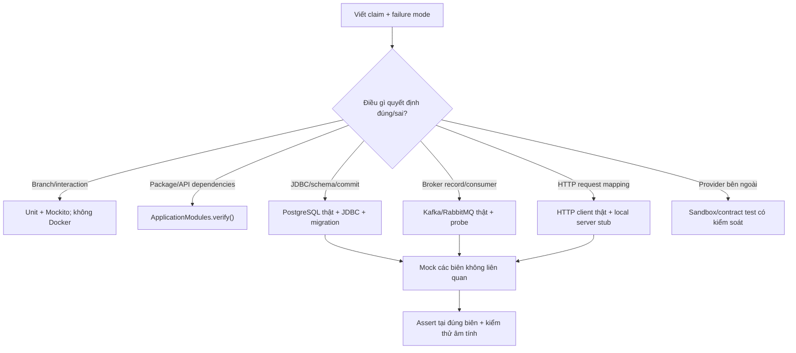
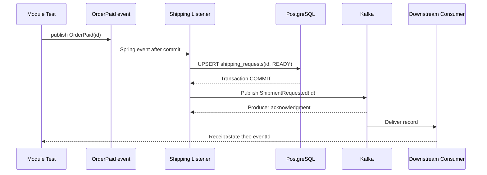

# Chọn dependency thật theo bằng chứng cần thu

## 1. Bắt đầu từ mệnh đề cần chứng minh, không bắt đầu từ Docker

Trong học phần **SPRING_MODULITH_VERIFICATION_TESTING**, chúng ta dùng `ApplicationModules` và các quy tắc phụ thuộc để kiểm chứng ranh giới kiến trúc của Spring Modulith; dùng `@ApplicationModuleTest`, kiểm thử sự kiện, database và tích hợp, cùng quality gate CI để ngăn hồi quy. Ở chương **Testcontainers**, một quyết định quan trọng là **dependency nào cần thật trong từng bài test**.

Câu hỏi “có nên dùng PostgreSQL/Kafka Testcontainer không?” chưa đủ chặt. Hãy đặt câu hỏi có thể phản chứng:

> **Khi dependency thực sự vi phạm hợp đồng đang kiểm chứng, assertion nào sẽ fail, và dữ liệu quan sát được đến từ đâu?**

Ví dụ:

- “`ShippingService` có gọi repository một lần” là mệnh đề về **interaction**. Mockito có thể đủ.
- “PostgreSQL không chấp nhận hai shipment có cùng `order_id`” là mệnh đề về **ràng buộc database**. Cần PostgreSQL/schema thật.
- “Event `ShipmentRequested` được ghi vào topic Kafka với đúng key” là mệnh đề về **broker record**. Cần Kafka thật và một consumer/probe độc lập.
- “Nhà vận chuyển ngoài hệ thống luôn trả lời thành công” là mệnh đề về **dịch vụ bên thứ ba**, mà một stub HTTP không thể chứng minh.

**Bằng chứng** trong bài này có năm thành phần:

| Thành phần | Câu hỏi cần trả lời | Ví dụ |
| --- | --- | --- |
| **Claim** | Ta khẳng định điều gì? | “`shipments.order_id` là duy nhất.” |
| **Failure mode** | Lỗi nào cần bị phát hiện? | Migration bỏ `PRIMARY KEY`. |
| **System under observation** | Thành phần thật nào quyết định claim? | PostgreSQL engine + schema. |
| **Stimulus** | Kích hoạt hành vi nào? | INSERT hai row trùng `order_id`. |
| **Oracle** | Dữ liệu độc lập nào phân định pass/fail? | INSERT thứ hai bị DB từ chối. |

Nếu không chỉ ra được failure mode và oracle, việc thêm container có thể chỉ tăng thời gian CI mà không thêm độ tin cậy.

**Giới hạn của bài:** không đề nghị luôn khởi động mọi dependency; tập trung cách chọn **ít dependency thật nhất nhưng vẫn đủ sức bác bỏ claim sai**. Phần Mockito và Testcontainers nhập môn được giả định đã nắm; ví dụ chỉ giải thích các API cần thiết.

## 2. Ma trận bằng chứng: real dependency tối thiểu theo từng rủi ro

Thay vì chia test thành hai nhãn “unit” và “integration” rồi dừng lại, hãy map từng rủi ro sang **thành phần quyết định sự thật**.

| Claim cần chứng minh | Failure mode mục tiêu | Cần thật đến mức nào? | Oracle đủ mạnh |
| --- | --- | --- | --- |
| Quy tắc chọn hãng `STANDARD` khi đơn nội địa | Nhánh `if` sai | Class/domain logic thật; gateway có thể mock | Giá trị trả về và tham số quan trọng |
| Shipping chỉ gọi carrier một lần | Gọi thừa / sai ID | Service thật; mock carrier | `verify(carrier).choose(orderId)` |
| JDBC `ON CONFLICT` chạy trên PostgreSQL | SQL dialect sai | **PostgreSQL + repository JDBC thật** | Row sau câu SQL, không exception |
| `order_id` không được trùng | Thiếu unique/primary key | **PostgreSQL + migration thật** | Insert trùng bị DB từ chối |
| Sau `OrderPaid`, shipment đạt `READY` đã commit | Listener chưa chạy/rollback | **Spring module listener + DB + transaction manager thật** | Query row `READY` theo đúng ID từ transaction khác |
| Kafka producer thực sự gửi đúng topic/key/value | Sai topic, key hoặc serializer | **Kafka broker + producer + independent consumer thật** | Consumer đọc đúng record theo correlation ID |
| Consumer xử lý message và commit DB | Deserializer/handler sai | **Kafka + consumer production + DB** | Query downstream state và offset/ack đúng contract |
| Client tạo HTTP method/path/header đúng | Mapping URL sai | HTTP client thật + local stub server đủ | Server nhận request đúng trên socket |
| TLS, proxy và certificate chain tương thích | Handshake/proxy sai | Endpoint/proxy/TLS tương ứng thật | TLS handshake, status, certificate validation |
| Provider bên ngoài tuân thủ contract đã ký | Provider triển khai lệch | Provider sandbox/contract verification ở phạm vi được cho phép | Phản hồi thật từ môi trường provider kiểm soát |
| Module shipping import `order.internal` trái luật | Phụ thuộc package sai | **Không cần container** | `ApplicationModules.verify()` fail |

**Quan trọng:** “real” là tính chất theo **biên**. Một test có **PostgreSQL thật và carrier port được mock** vẫn đủ để chứng minh primary key/SQL, nhưng **không** đủ để chứng minh API carrier. Tương tự, chạy Kafka container mà chỉ `verify(kafkaTemplate).send(...)` trên mock thì Kafka không tạo thêm bằng chứng delivery nào.

### Chọn scope với một sơ đồ quyết định



Không được nhầm số lượng container với số lượng claim đã chứng minh. **Một assertion nhìn vào kết quả nghiệp vụ thật thường giá trị hơn nhiều container chỉ được start thành công.**

## 3. Thiết kế “evidence sheet” trước khi lập trình test

Giả sử ứng dụng có module `order` và `shipping`. `order` công bố `OrderPaid(UUID orderId)`; `shipping` phải chọn carrier, lưu shipment và có thể phát một message tới broker.

Ta tách các mệnh đề:

| ID | Claim cụ thể | Dependency cần thật | Có thể giả lập | Dấu vết để assert |
| --- | --- | --- | --- | --- |
| **E1** | Nhận `OrderPaid(A)`, shipping chọn `STANDARD` khi port trả `STANDARD` | Spring listener/service | Carrier port | Row hoặc invocation với `orderId=A` |
| **E2** | Shipping lưu `READY` vào PostgreSQL, không mất khi transaction kết thúc | PostgreSQL, JDBC, transaction manager, listener | Carrier port | Query `SELECT ... WHERE order_id=A` |
| **E3** | DB từ chối `status='GARBAGE'` và khóa trùng | PostgreSQL với schema/migration | Không có ở tầng constraint | `DataIntegrityViolationException`/`DuplicateKeyException` |
| **E4** | Một record `ShipmentRequested(A)` thực sự qua Kafka | Kafka, serializer, producer, consumer probe | Downstream carrier HTTP | Consumer record topic/key/payload có `A` |
| **E5** | Consumer production ghi receipt vào DB | Kafka + consumer production + DB | Provider HTTP nếu ngoài claim | DB receipt committed theo `eventId` |
| **E6** | Module shipping không truy cập `order.internal.*` | Spring Modulith structure | Mọi external dependency | `ApplicationModules.verify()` |

**Đừng gộp E1–E6 thành một test khổng lồ.** Thử nghiệm khi fail cần trả lời được **claim nào sai**. E2 và E3 có thể dùng chung PostgreSQL test context; E4 nên có test Kafka riêng trước khi xây E5 end-to-end; E6 chạy không Docker.

### Ba nguyên tắc chọn dependency

1. **Giữ thật thành phần có hành vi mà oracle muốn đánh giá.** Muốn chứng minh SQL thì repository, datasource, migration và database phải thật.
2. **Giả lập biên không ảnh hưởng claim**, nhưng ghi rõ nó đã được giả lập. Muốn kiểm chứng DB không nhất thiết gọi provider HTTP đang ở ngoài hệ thống.
3. **Nâng mức tích hợp theo lỗ hổng bằng chứng.** Khi claim chuyển từ “producer gọi send” sang “consumer độc lập đọc record”, mới cần broker thật; khi claim chuyển tiếp sang “consumer ghi DB”, mới cần thêm consumer và DB downstream.

### Ví dụ đối chứng âm

Một `ShipmentRepository` bị thay bằng mock:

```java
@MockitoBean ShipmentRepository repository;
```

Nếu test vẫn “pass” sau khi xóa bảng `shipments`, ta vừa chứng minh rằng **nó không đo schema**. Việc thêm PostgreSQL container vào context mà repository vẫn là mock cũng không thay đổi kết luận đó.

## 4. E2 + E3: chọn PostgreSQL thật vì bằng chứng nằm ở DB

Ta triển khai một module shipping tối thiểu để kiểm chứng **đã commit** và **ràng buộc DB**. Carrier selection được mock có chủ đích; listener, repository, transaction manager và PostgreSQL đều thật.

### 4.1. Schema do Flyway/Liquibase quản lý

Migration SQL minh họa (chọn version chưa dùng trong dự án):

```sql
CREATE TABLE shipping_requests (
    order_id UUID PRIMARY KEY,
    carrier_code VARCHAR(32) NOT NULL,
    status VARCHAR(16) NOT NULL
        CHECK (status IN ('READY', 'FAILED'))
);
```

Nếu test chỉ chạy `SELECT 1`, nó **không** chứng minh bảng hay constraint ở trên tồn tại. Test E3 phải cố ý chạm vào các ràng buộc này.

### 4.2. Public event contract và carrier port

`src/main/java/com/acme/order/OrderPaid.java`:

```java
package com.acme.order;

import java.util.UUID;

public record OrderPaid(UUID orderId) {}
```

`src/main/java/com/acme/shipping/CarrierSelector.java`:

```java
package com.acme.shipping;

import java.util.UUID;

public interface CarrierSelector {
    String select(UUID orderId);
}
```

`CarrierSelector` là một port; adapter gọi carrier provider ngoài ứng dụng không nằm trong claim E2/E3. Vì thế ta sẽ mock đúng port đó trong module test, thay vì khởi động một HTTP service không liên quan.

### 4.3. Repository JDBC thật, truy vấn đúng business key

`src/main/java/com/acme/shipping/ShippingState.java`:

```java
package com.acme.shipping;

import java.util.UUID;

public record ShippingState(
        UUID orderId, String carrierCode, String status) {}
```

`src/main/java/com/acme/shipping/ShippingProjection.java`:

```java
package com.acme.shipping;

import java.util.List;
import java.util.Optional;
import java.util.UUID;

import org.springframework.jdbc.core.JdbcTemplate;
import org.springframework.stereotype.Repository;

@Repository
class ShippingProjection {

    private final JdbcTemplate jdbc;

    ShippingProjection(JdbcTemplate jdbc) {
        this.jdbc = jdbc;
    }

    void markReady(UUID orderId, String carrier) {
        jdbc.update("""
                INSERT INTO shipping_requests
                        (order_id, carrier_code, status)
                VALUES (?, ?, 'READY')
                ON CONFLICT (order_id)
                DO UPDATE SET
                    carrier_code = EXCLUDED.carrier_code,
                    status = EXCLUDED.status
                """, orderId, carrier);
    }

    Optional<ShippingState> find(UUID orderId) {
        List<ShippingState> rows = jdbc.query("""
                SELECT order_id, carrier_code, status
                  FROM shipping_requests
                 WHERE order_id = ?
                """, (rs, rowNum) -> new ShippingState(
                        rs.getObject("order_id", UUID.class),
                        rs.getString("carrier_code"),
                        rs.getString("status")),
                orderId);

        return rows.stream().findFirst();
    }

    void delete(UUID orderId) {
        jdbc.update(
                "DELETE FROM shipping_requests WHERE order_id = ?",
                orderId);
    }
}
```

**Bằng chứng mục tiêu:** `find(orderId)` đọc qua `JdbcTemplate` thật, từ một transaction quan sát riêng; `markReady(...)` thực thi `INSERT ... ON CONFLICT` của PostgreSQL. Nếu test mock `ShippingProjection`, mọi khẳng định về SQL sẽ mất giá trị.

### 4.4. Listener sau commit

`src/main/java/com/acme/shipping/ShippingReaction.java`:

```java
package com.acme.shipping;

import com.acme.order.OrderPaid;
import org.springframework.modulith.events.ApplicationModuleListener;
import org.springframework.stereotype.Component;

@Component
class ShippingReaction {

    private final ShippingProjection projection;
    private final CarrierSelector carrier;

    ShippingReaction(
            ShippingProjection projection,
            CarrierSelector carrier) {
        this.projection = projection;
        this.carrier = carrier;
    }

    @ApplicationModuleListener
    public void on(OrderPaid paid) {
        String selected = carrier.select(paid.orderId());
        projection.markReady(paid.orderId(), selected);
    }
}
```

`@ApplicationModuleListener` xử lý sự kiện **sau commit**, bất đồng bộ và trong transaction riêng. Nó cần transaction infrastructure phù hợp; một Kafka container đơn lẻ không thay thế được yêu cầu này. Vì vậy E2 dùng PostgreSQL thật, đồng thời tạo **điều kiện quan sát DB đã commit** thay vì chỉ kiểm tra event được phát.

### 4.5. PostgreSQL Testcontainer do Spring quản lý

Ví dụ dùng Spring Boot với Testcontainers Java **2.x**.

`src/test/java/com/acme/shipping/ShippingDbTestConfig.java`:

```java
package com.acme.shipping;

import org.springframework.boot.test.context.TestConfiguration;
import org.springframework.boot.testcontainers.service.connection.ServiceConnection;
import org.springframework.context.annotation.Bean;
import org.testcontainers.postgresql.PostgreSQLContainer;

@TestConfiguration(proxyBeanMethods = false)
class ShippingDbTestConfig {

    @Bean
    @ServiceConnection
    PostgreSQLContainer postgres() {
        return new PostgreSQLContainer("postgres:17-alpine")
                .withDatabaseName("shipping_test")
                .withUsername("test")
                .withPassword("test");
    }
}
```

Ở cấu hình này, Spring Boot cung cấp connection details cho `DataSource`; container sống cùng Spring `ApplicationContext` và có thể được cache qua test classes dùng cấu hình tương đương. **Không** đăng ký thêm `@Testcontainers`/`@Container` hoặc `start()/stop()` thủ công cho bean này.

Dependencies liên quan cần có: `spring-modulith-starter-test`, `spring-boot-starter-test`, `spring-boot-starter-jdbc`, PostgreSQL JDBC driver, `spring-boot-testcontainers` và `org.testcontainers:testcontainers-postgresql`, cùng Flyway/Liquibase nếu dự án dùng migration. Spring Boot/Spring Modulith/Testcontainers versions phải tương thích theo BOM. Dự án còn dùng Testcontainers 1.x phải đổi artifact và import `PostgreSQLContainer` cho đúng phiên bản.

### 4.6. `@ApplicationModuleTest`: chờ row đã commit

`src/test/java/com/acme/shipping/ShippingDbEvidenceTests.java`:

```java
package com.acme.shipping;

import static org.assertj.core.api.Assertions.assertThat;
import static org.assertj.core.api.Assertions.assertThatThrownBy;
import static org.mockito.BDDMockito.given;

import java.time.Duration;
import java.util.UUID;

import javax.sql.DataSource;

import com.acme.order.OrderPaid;
import org.junit.jupiter.api.Test;
import org.springframework.beans.factory.annotation.Autowired;
import org.springframework.context.annotation.Import;
import org.springframework.dao.DataIntegrityViolationException;
import org.springframework.jdbc.core.JdbcTemplate;
import org.springframework.modulith.test.ApplicationModuleTest;
import org.springframework.modulith.test.Scenario;
import org.springframework.test.context.bean.override.mockito.MockitoBean;
import org.springframework.transaction.support.TransactionTemplate;

@ApplicationModuleTest
@Import(ShippingDbTestConfig.class)
class ShippingDbEvidenceTests {

    @MockitoBean CarrierSelector carrier;

    @Autowired ShippingProjection projection;
    @Autowired DataSource dataSource;
    @Autowired JdbcTemplate jdbc;
    @Autowired TransactionTemplate transactions;

    @Test
    void eventCreatesCommittedReadyRow(Scenario scenario) {
        UUID id = UUID.randomUUID();
        given(carrier.select(id)).willReturn("STANDARD");

        scenario.publish(new OrderPaid(id))
                .andCleanup(() ->
                        transactions.executeWithoutResult(tx ->
                                projection.delete(id)))
                .andWaitAtMost(Duration.ofSeconds(8))
                .forStateChange(
                        () -> projection.find(id),
                        state -> state.filter(
                                row -> "READY".equals(row.status()))
                                .isPresent())
                .andVerify(state ->
                        assertThat(state).contains(
                                new ShippingState(id, "STANDARD", "READY")));

        assertThat(projection.find(id)).isEmpty();
    }

    @Test
    void invalidStatusIsRejectedByActualDatabase()
            throws Exception {
        UUID id = UUID.randomUUID();

        try (var connection = dataSource.getConnection()) {
            assertThat(connection.getMetaData()
                    .getDatabaseProductName()).isEqualTo("PostgreSQL");
        }

        try {
            assertThatThrownBy(() ->
                    jdbc.update("""
                            INSERT INTO shipping_requests
                                    (order_id, carrier_code, status)
                            VALUES (?, ?, ?)
                            """, id, "STANDARD", "GARBAGE"))
                    .isInstanceOf(DataIntegrityViolationException.class);

            assertThat(projection.find(id)).isEmpty();
        } finally {
            transactions.executeWithoutResult(tx ->
                    projection.delete(id));
        }
    }
}
```

**Đây là phép kiểm evidence-first:**

- **E2:** `Scenario.publish` kích hoạt event trong transaction phù hợp; listener ghi row trong transaction riêng; supplier poll `projection.find(id)` đến khi `READY` được **đọc từ PostgreSQL thật**. Matcher và cleanup dùng **đúng `id`**.
- **E3:** cố ý insert `status='GARBAGE'`; PostgreSQL `CHECK` constraint phải từ chối; `JdbcTemplate` dịch exception sang họ `DataIntegrityViolationException`. Nếu thiếu constraint trong migration, test thất bại vì không có exception.
- `@MockitoBean CarrierSelector` **có chủ đích** để tránh phụ thuộc carrier HTTP ở một test chỉ cần E2/E3. Không mock `ShippingProjection`.
- `DataSource` metadata xác nhận đúng DB engine. `SELECT 1` riêng lẻ không chứng minh constraint; vì thế có assertion E3.
- Dữ liệu đã commit được dọn bằng transaction riêng. Trong failure path của Scenario, callback cleanup được đăng ký trước terminal operation; tuy vậy task async/retry đến muộn vẫn cần chiến lược isolation riêng.

**Điều test chưa chứng minh:** Kafka record được gửi, HTTP provider hoạt động, không có retry từ publication registry về sau, và mọi quy tắc module boundary đều đúng. Các claim đó cần test khác.

## 5. E4: chọn Kafka thật khi bằng chứng là record do consumer nhận

Nếu claim chỉ là “adapter gọi `KafkaTemplate.send(topic, key, payload)`”, Mockito có thể kiểm tra tham số. Nếu claim nâng thành “record **đã đi qua broker** với đúng topic, key, value”, cần Kafka thật và **consumer độc lập**. Việc chỉ kiểm tra producer method gọi thành công hoặc `PublishedEvents` thấy event nội bộ chưa đủ.

### 5.1. Một phép kiểm transport độc lập với Spring

Ví dụ sau là JUnit 5 **Kafka transport smoke/contract test**. Nó **không** tự kiểm chứng Spring Modulith externalization; đó là tầng tiếp theo.

`src/test/java/com/acme/integration/KafkaTransportEvidenceTests.java`:

```java
package com.acme.integration;

import static org.assertj.core.api.Assertions.assertThat;

import java.time.Duration;
import java.util.List;
import java.util.Map;
import java.util.Properties;
import java.util.UUID;
import java.util.concurrent.TimeUnit;

import org.apache.kafka.clients.admin.AdminClient;
import org.apache.kafka.clients.admin.AdminClientConfig;
import org.apache.kafka.clients.admin.NewTopic;
import org.apache.kafka.clients.consumer.ConsumerConfig;
import org.apache.kafka.clients.consumer.ConsumerRecord;
import org.apache.kafka.clients.consumer.KafkaConsumer;
import org.apache.kafka.clients.producer.KafkaProducer;
import org.apache.kafka.clients.producer.ProducerConfig;
import org.apache.kafka.clients.producer.ProducerRecord;
import org.apache.kafka.common.serialization.StringDeserializer;
import org.apache.kafka.common.serialization.StringSerializer;
import org.junit.jupiter.api.Test;
import org.testcontainers.junit.jupiter.Container;
import org.testcontainers.junit.jupiter.Testcontainers;
import org.testcontainers.kafka.KafkaContainer;

@Testcontainers
class KafkaTransportEvidenceTests {

    @Container
    static final KafkaContainer kafka =
            new KafkaContainer("apache/kafka-native:3.8.0");

    @Test
    void independentConsumerSeesExpectedRecord()
            throws Exception {
        String suffix = UUID.randomUUID().toString().replace("-", "");
        String topic = "shipping-evidence-" + suffix;
        String id = UUID.randomUUID().toString();
        String payload = "SHIPMENT_REQUESTED|" + id;

        Properties producerProps = new Properties();
        producerProps.put(ProducerConfig.BOOTSTRAP_SERVERS_CONFIG,
                kafka.getBootstrapServers());
        producerProps.put(ProducerConfig.KEY_SERIALIZER_CLASS_CONFIG,
                StringSerializer.class);
        producerProps.put(ProducerConfig.VALUE_SERIALIZER_CLASS_CONFIG,
                StringSerializer.class);
        producerProps.put(ProducerConfig.ACKS_CONFIG, "all");

        Properties consumerProps = new Properties();
        consumerProps.put(ConsumerConfig.BOOTSTRAP_SERVERS_CONFIG,
                kafka.getBootstrapServers());
        consumerProps.put(ConsumerConfig.GROUP_ID_CONFIG,
                "probe-" + suffix);
        consumerProps.put(ConsumerConfig.KEY_DESERIALIZER_CLASS_CONFIG,
                StringDeserializer.class);
        consumerProps.put(ConsumerConfig.VALUE_DESERIALIZER_CLASS_CONFIG,
                StringDeserializer.class);
        consumerProps.put(ConsumerConfig.AUTO_OFFSET_RESET_CONFIG,
                "earliest");
        consumerProps.put(ConsumerConfig.ENABLE_AUTO_COMMIT_CONFIG, false);

        try (AdminClient admin = AdminClient.create(Map.of(
                    AdminClientConfig.BOOTSTRAP_SERVERS_CONFIG,
                    kafka.getBootstrapServers()));
             KafkaProducer<String, String> producer =
                    new KafkaProducer<>(producerProps);
             KafkaConsumer<String, String> consumer =
                    new KafkaConsumer<>(consumerProps)) {

            admin.createTopics(List.of(
                    new NewTopic(topic, 1, (short) 1)))
                    .all().get(15, TimeUnit.SECONDS);

            consumer.subscribe(List.of(topic));

            var ack = producer.send(new ProducerRecord<>(
                    topic, id, payload))
                    .get(15, TimeUnit.SECONDS);

            assertThat(ack.topic()).isEqualTo(topic);

            ConsumerRecord<String, String> observed = null;
            long deadline = System.nanoTime()
                    + Duration.ofSeconds(12).toNanos();

            while (System.nanoTime() < deadline && observed == null) {
                for (ConsumerRecord<String, String> record
                        : consumer.poll(Duration.ofMillis(200))) {
                    if (id.equals(record.key())) {
                        observed = record;
                        break;
                    }
                }
            }

            assertThat(observed).isNotNull();
            assertThat(observed.topic()).isEqualTo(topic);
            assertThat(observed.key()).isEqualTo(id);
            assertThat(observed.value()).isEqualTo(payload);
        }
    }
}
```

Dependencies: Kafka client thông qua `spring-kafka` hoặc `org.apache.kafka:kafka-clients`, `org.testcontainers:testcontainers-kafka` và `testcontainers-junit-jupiter` (Testcontainers Java 2.x), JUnit/AssertJ. Image dùng `org.testcontainers.kafka.KafkaContainer` phù hợp `apache/kafka-native`; không trộn với `ConfluentKafkaContainer` cho image Confluent.

### 5.2. Bằng chứng của phép kiểm này

1. Kafka container start thật theo JUnit extension.
2. `AdminClient` tạo **topic riêng cho test**, không phụ thuộc topic cũ.
3. Producer dùng String serializers và lấy broker bootstrap servers từ container.
4. `send(...).get(...)` chờ producer acknowledgment trong timeout.
5. Consumer với group riêng và `auto.offset.reset=earliest` đọc record qua Kafka, kể cả record xuất hiện trước assignment đầu tiên.
6. Assertion kiểm tra **topic, key, payload theo cùng ID**, không chấp nhận record còn từ test trước.

**Không có `Thread.sleep(...)`:** `poll(Duration.ofMillis(200))` là thao tác Kafka consumer thực thụ, lặp tới deadline hữu hạn. Broker record được quan sát khác với việc mock `KafkaTemplate` hoặc chỉ xem log producer.

**Giới hạn:** đây là một transport test với payload chuỗi cố định, **không gọi shipping module**, không chứng minh cấu hình `@Externalized`, serializer JSON/Avro của production, consumer production hoặc downstream DB commit. Khi muốn chứng minh *module shipping thật sự externalize event*:

- Khởi động đúng module/adapter (hoặc `spring-modulith-events-kafka` với `@Externalized` nếu ứng dụng dùng nó);
- Cấu hình Kafka client từ container qua `@ServiceConnection`;
- Phát event production đã định nghĩa, trong transaction phù hợp;
- Dùng consumer probe độc lập đọc **record do ứng dụng gửi**, không tự gọi producer trong test như ví dụ smoke;
- Assert topic/key/headers/payload/schema và correlation ID.

Lúc đó claim E4 mới thực sự bao phủ **production publication path**. Để đạt E5, giữ consumer production và DB thật, rồi kiểm tra state đã commit.

## 6. HTTP: cần request thật, chưa chắc cần container thật

Bài toán “carrier adapter dùng đúng HTTP method, path và headers” **khác** với “provider carrier production luôn hoạt động”.

Nếu chỉ muốn chứng minh **client code** tạo request đúng, có thể dùng local HTTP server stub. Nó giúp thực thi **HTTP client, serialization và socket thật** mà không phải dựng Docker container hoặc gọi dịch vụ Internet không kiểm soát.

### 6.1. JUnit với HTTP server trong JVM

Ví dụ độc lập sử dụng `jdk.httpserver` của JDK 17+ (một số môi trường module-path cần khai báo module `jdk.httpserver`):

```java
package com.acme.integration;

import static org.assertj.core.api.Assertions.assertThat;

import java.net.InetSocketAddress;
import java.net.URI;
import java.net.http.HttpClient;
import java.net.http.HttpRequest;
import java.net.http.HttpResponse;
import java.nio.charset.StandardCharsets;
import java.util.concurrent.atomic.AtomicReference;

import com.sun.net.httpserver.HttpServer;
import org.junit.jupiter.api.Test;

class CarrierHttpEvidenceTests {

    @Test
    void sendsCorrectMethodAndPathOverHttp() throws Exception {
        AtomicReference<String> observed =
                new AtomicReference<>();

        HttpServer server = HttpServer.create(
                new InetSocketAddress("127.0.0.1", 0), 0);

        server.createContext("/quotes", exchange -> {
            observed.set(exchange.getRequestMethod()
                    + " " + exchange.getRequestURI().getPath());

            byte[] body = "{\"carrier\":\"STANDARD\"}"
                    .getBytes(StandardCharsets.UTF_8);

            exchange.getResponseHeaders().set(
                    "Content-Type", "application/json");
            exchange.sendResponseHeaders(200, body.length);

            try (var output = exchange.getResponseBody()) {
                output.write(body);
            }
        });

        server.start();

        try {
            String url = "http://127.0.0.1:"
                    + server.getAddress().getPort() + "/quotes";

            var request = HttpRequest.newBuilder(
                    URI.create(url)).GET().build();

            var response = HttpClient.newHttpClient().send(
                    request, HttpResponse.BodyHandlers.ofString());

            assertThat(response.statusCode()).isEqualTo(200);
            assertThat(observed.get()).isEqualTo("GET /quotes");
            assertThat(response.body())
                    .contains("\"carrier\":\"STANDARD\"");
        } finally {
            server.stop(0);
        }
    }
}
```

**Phép kiểm chứng minh** Java `HttpClient` đã thực hiện request HTTP qua loopback socket với method/path đúng, và xử lý response từ server stub. **Nó không gọi adapter carrier thực của module shipping**, vì ví dụ tạo `HttpRequest` trực tiếp. Muốn chứng minh adapter production, hãy inject base URL của stub vào **adapter thật**, gọi method adapter, rồi quan sát request trên stub server.

**Nó cũng không chứng minh** provider carrier thật sẽ trả JSON tương thích, đáp ứng SLA hoặc xử lý lỗi theo contract. Đó là lý do cần contract tests (OpenAPI/consumer-driven contract khi phù hợp) và một số test trên provider sandbox có kiểm soát.

### 6.2. Khi nào chọn HTTP container?

Chọn một HTTP server/Testcontainer hoặc proxy tương ứng khi **chính behavior của môi trường chạy** là rủi ro:

- Reverse proxy routing, HTTP/2, TLS/certificate hoặc container networking;
- Server framework production cần được kiểm chứng, không chỉ client mapping;
- DNS/port exposure giữa nhiều containers;
- Chính image build/deployment là artifact cần test.

**Lưu ý:** đặt một stub server trong container làm HTTP transport thật hơn, nhưng **response vẫn là giả lập**. Không được ghi “provider đã được kiểm thử end-to-end” chỉ vì stub được chạy trong Docker.

## 7. Tăng độ tin cậy bằng phép kiểm âm tính có mục tiêu

Một test mạnh cần **không thể pass** khi đúng loại lỗi nó được sinh ra để bắt xuất hiện. Thay vì hỏi “test đã xanh chưa?”, hãy đặt câu hỏi “nếu tôi phá một thành phần, test nào đỏ?”.

| Thay đổi giả định trong code/schema/config | Test phải fail | Nếu vẫn pass thì nghi ngờ |
| --- | --- | --- |
| Đổi `status='READY'` thành `'PENDING'` trong handler | E2 — chờ DB `READY` | Predicate chỉ kiểm tra row tồn tại; state cũ từ test khác |
| Bỏ `CHECK (status IN (...))` | E3 — insert `'GARBAGE'` | Không chạy migration/schema thật hoặc assert quá yếu |
| Bỏ `PRIMARY KEY(order_id)` | Test duplicate-key riêng | DB chưa bị kiểm tra constraint |
| Đổi PostgreSQL thành H2 | Metadata DB engine phải fail | Test không xác nhận DB đang dùng |
| Đổi Kafka topic production thành tên sai | Integration E4 với producer production + consumer probe | Chỉ mock producer hoặc đọc mọi topic |
| Đổi Kafka key thành UUID khác | Kafka E4 theo correlation ID | Chỉ assert có “một message” bất kỳ |
| Thay carrier adapter real bằng mock | HTTP adapter integration phải fail/mất đường gọi | Test thực tế chỉ gọi client/stub giả |
| Shipping import `order.internal.*` | Architecture verification | Chỉ chạy runtime integration, bỏ `ApplicationModules.verify()` |

### Ví dụ kiểm tra ràng buộc khóa trùng

Cùng bảng `shipping_requests`, dùng `JdbcTemplate` thật trong PostgreSQL module test:

```java
@Test
void duplicateOrderIdIsRejectedByPostgres() {
    UUID id = UUID.randomUUID();

    try {
        jdbc.update("""
                INSERT INTO shipping_requests
                        (order_id, carrier_code, status)
                VALUES (?, ?, 'READY')
                """, id, "STANDARD");

        assertThatThrownBy(() -> jdbc.update("""
                INSERT INTO shipping_requests
                        (order_id, carrier_code, status)
                VALUES (?, ?, 'READY')
                """, id, "EXPRESS"))
                .isInstanceOf(
                        org.springframework.dao.DuplicateKeyException.class);
    } finally {
        transactions.executeWithoutResult(tx ->
                projection.delete(id));
    }
}
```

Đoạn là **method bổ sung** vào `ShippingDbEvidenceTests` ở mục 4, dùng các field đã inject và các static imports hiện có. Không tự bọc test này bằng transaction rollback ngoài nếu muốn chứng minh database đã commit bản ghi đầu và constraint được áp dụng cho thao tác thứ hai.

### Kiểm tra âm tính an toàn

- Phân tích những thay đổi giả định trên **branch thử nghiệm** hoặc trong bài tập riêng; luôn khôi phục sau khi kiểm thử.
- Không tắt constraint của database production hoặc phá Kafka topic đang được đồng đội dùng.
- Một test failure do **Docker unavailable** không chứng minh mutation nghiệp vụ đã bị phát hiện. Khi thử mutation, trước hết xác nhận dependency **đã thực sự chạy**.
- Với event async, một timeout cũng có thể do listener chưa được bootstrap, transaction chưa commit hoặc predicate sai; cần logs/traces để giải thích **đúng nguyên nhân**.

**Oracle độc lập:** assert response được echo từ mock mà chính test vừa stub không phải bằng chứng adapter production chạy đúng; assert một row tồn tại trong PostgreSQL sau method production thực thi là bằng chứng mạnh hơn cho persistence.

## 8. Ghép nhiều dependency thật theo chuỗi bằng chứng, không theo thói quen

Một flow thật có thể là:



**Không xem sơ đồ là lời bảo đảm tự động.** Đặc biệt nếu publish Kafka nằm trong listener khác transaction, có thể xảy ra:

- DB commit thành công nhưng Kafka send fail;
- Kafka nhận record nhưng consumer chưa đọc;
- Consumer đọc nhưng cập nhật downstream DB rollback;
- Retry/resubmission phát bản ghi trùng;
- Event publication registry đánh dấu completed theo listener semantics, **không tương đương mọi downstream đã xử lý**.

### Thang bằng chứng của cùng một flow

| Tầng | Claim hẹp | Dependency cần thật | Điều chưa chứng minh |
| --- | --- | --- | --- |
| **S1** | Shipping chọn carrier và xây payload đúng | Service, mock ports | DB/broker |
| **S2** | Shipping row `READY` commit được | Spring module + PostgreSQL | Kafka record |
| **S3** | Record do producer production gửi tới Kafka | Spring module + Kafka + producer + probe | Downstream consumer xử lý |
| **S4** | Consumer production ghi receipt sau message | Kafka + consumer + downstream DB | External carrier API thành công |
| **S5** | Retry/recovery duy trì idempotency sau lỗi | Registry/outbox DB + Kafka + consumer | Mọi failure mode toàn hệ thống |
| **S6** | Module dependency rules hợp lệ | `ApplicationModules.verify()` | Runtime integration |

**Chỉ nâng lên S4/S5 khi claim yêu cầu.** Một PR chỉ sửa SQL mapping có thể được bảo vệ tốt bằng E2/E3 + architecture gate; không cần Kafka và provider HTTP trong **mọi** test. Nhưng PR sửa event externalization, serializer hoặc consumer handler phải có S3/S4 tương ứng.

### Quy tắc chọn khi một bài test cần cả DB và broker

1. Xác định **commit boundary**: DB transaction nào commit trước publish? Có outbox/registry hay không?
2. Xác định **tín hiệu cuối**: producer ack, consumer record hay downstream DB state?
3. Chọn container thật cho **mọi thành phần nằm giữa stimulus và tín hiệu cuối đó** mà hành vi cần kiểm chứng.
4. Mock biên ngoài claim, nhưng đừng mock mất producer/consumer/repository là phần claim.
5. Dùng cùng `orderId` hoặc `eventId` ở event, Kafka key, DB row và cleanup.
6. Thêm test duplicate/retry riêng khi giao hàng **at-least-once** có thể tạo side effect lặp.

**Ví dụ:** muốn chứng minh “consumer lưu receipt `APPLIED`”, một consumer probe đọc record là chưa đủ; phải chạy consumer production và repository thật rồi query receipt đã commit. Ngược lại, muốn chứng minh key/topic/serialization của producer, việc dựng thêm database downstream có thể chỉ tăng thời gian mà không tăng bằng chứng cho claim đó.

## 9. CI quality gate: tối ưu bằng chứng trên mỗi chi phí

Trong CI, một số loại test rất nhanh, số khác cần pull image, start container, migration hoặc broker assignment. Thay vì chọn **tất cả real** hoặc **tất cả mock**, nên xây một **portfolio chứng cứ**.

| Stage / nhóm test | Claim trọng tâm | Runtime | Điều kiện PASS |
| --- | --- | --- | --- |
| **Architecture** | Module API/allowed dependencies | JVM, không Docker | `ApplicationModules.verify()` thành công |
| **Fast module/unit** | Quy tắc domain, event nội bộ, input validation | JVM/Spring, mock ports khi phù hợp | Assert trên output/side effects mong đợi |
| **DB integration** | SQL dialect, migration, constraint, transaction | PostgreSQL Testcontainer | SQL thật, row/constraint/commit đúng |
| **Broker integration** | Topic/key/payload/consumer | Kafka/RabbitMQ Testcontainer | Consumer/probe quan sát record đúng |
| **Cross-resource recovery** | Outbox/registry/retry/idempotency | DB + broker + real handlers | State cuối đúng sau failure/retry |
| **Provider contract** | API của dịch vụ ngoài | Contract stub/sandbox được kiểm soát | Request/response đúng phiên bản contract |

### Chọn test suite theo rủi ro của thay đổi

- Thay đổi pure domain logic: **fast tests và architecture** phải chạy; DB/broker suite có thể là stage dùng chung theo policy.
- Thay SQL/migration/transaction: **DB integration** là bằng chứng bắt buộc.
- Thay Kafka routing/serializer/externalization: **broker integration** là bằng chứng bắt buộc.
- Thay retry/outbox và idempotency: **cross-resource recovery** là bằng chứng bắt buộc.
- Thay HTTP adapter: **client contract** là bằng chứng bắt buộc; thêm provider sandbox nếu chính provider behavior cần kiểm chứng.

**Không tự động skip một stage bắt buộc** chỉ vì Docker không có. CI phải fail khi không thể chạy bằng chứng mà thay đổi yêu cầu. Trên local, có thể chạy fast suite không Docker và để nhóm tích hợp tùy chọn bị skip/không được chọn, nhưng báo cáo phải thể hiện rõ **chưa có bằng chứng integration**.

### Chi phí và độ ổn định

- Spring-managed `@Bean @ServiceConnection` có thể dùng lại container theo `ApplicationContext` cache; vẫn phải cleanup dữ liệu theo test ID.
- Không đặt PostgreSQL/Kafka Testcontainer vào base class của toàn bộ unit tests.
- Container image nên pin tag; runner có Docker-compatible runtime đủ CPU/RAM.
- Không bật experimental `withReuse(true)` xuyên nhiều CI jobs để “tiết kiệm” mà làm state không tái lập.
- Với async event/broker, chờ theo predicate có deadline, không `Thread.sleep` tùy ý.
- Đo số lần container start, p50/p95 job duration, flaky/retry rate **cùng** mức phủ claim, không chỉ nhìn thời gian nhanh nhất.

### Bài test kiến trúc độc lập

```java
import org.junit.jupiter.api.Test;
import org.springframework.modulith.core.ApplicationModules;

class ModuleBoundaryTests {

    @Test
    void moduleDependenciesRemainValid() {
        ApplicationModules.of(Application.class).verify();
    }
}
```

`Application.class` là Spring Boot application class thật. Test này không chứng minh database/broker chạy đúng, và database/broker tests cũng không thay thế phép kiểm cấu trúc module.

## 10. Quy trình review, bài tập và tài liệu tham khảo

### Checklist “real dependency có tạo thêm bằng chứng không?”

- [ ] Test đã viết **claim có thể phản chứng**, không chỉ “chạy tích hợp”.
- [ ] Đã chỉ ra failure mode cụ thể và oracle sẽ fail khi lỗi xảy ra.
- [ ] Dependency thật **nằm trên đường thực thi** từ stimulus tới observation.
- [ ] Nếu claim là SQL/schema/transaction, repository, datasource và database là **real**.
- [ ] Nếu claim là Kafka delivery, đã có **record qua broker** với key/topic/payload cụ thể.
- [ ] Nếu claim là consumer downstream, đã chạy consumer production và kiểm tra state cuối.
- [ ] Nếu claim là HTTP mapping, adapter/client production thực sự phát request tới server quan sát được.
- [ ] External provider được stub **không bị báo cáo thành provider thật**.
- [ ] `@MockitoBean` chỉ thay thế port ngoài claim; không che bean mà test cần đánh giá.
- [ ] `@ApplicationModuleTest` đặt đúng package module, bootstrap mode đúng.
- [ ] Assertion lọc `orderId`/`eventId` riêng, tránh đọc state của test khác.
- [ ] Với event async, chờ DB commit/consumer state phù hợp thay vì input event.
- [ ] Có cleanup dữ liệu commit và phương án xử lý retry đến muộn.
- [ ] Test kiến trúc `ApplicationModules.verify()` không bị phụ thuộc Docker.
- [ ] CI reports xác nhận **required integration tests được thực thi**, không chỉ discovered/skipped.
- [ ] Đã thử ít nhất một phép **kiểm âm tính** an toàn cho claim quan trọng.

### Bài tập thực hành

1. **Viết evidence sheet:** Với claim “`shipping_requests.order_id` duy nhất”, nêu failure mode, stimulus, real dependency và assertion.
2. **Chọn mock:** Test shipping chọn carrier từ input và không chạm SQL. Có cần PostgreSQL không? Nêu oracle nhanh nhất.
3. **Bằng chứng thiếu:** Một test `verify(repository).save(any())` pass. Tại sao nó không chứng minh migration?
4. **Real database:** Sửa query `ShippingProjection.find(id)` thành query không lọc ID. Bài E2 có thể pass giả thế nào? Làm sao phát hiện?
5. **CHECK constraint:** Xóa `CHECK(status ...)` trên migration **trong branch thử nghiệm**. Phép kiểm nào trong mục 4 phải đỏ?
6. **Kafka transport:** Vì sao `send(...).get(...)` và `consumer.poll(...)` cho bằng chứng mạnh hơn `verify(kafkaTemplate).send(...)`?
7. **Kafka module path:** Test ở mục 5 tự tạo producer record. Điều gì còn thiếu để kết luận Spring Modulith `@Externalized` đang hoạt động?
8. **HTTP:** Local `HttpServer` có chứng minh carrier provider production trả JSON đúng không? Cần loại test nào tiếp theo?
9. **Async listener:** Khi `Scenario` đã thấy `OrderPaid`, đã chắc shipping DB commit chưa? Nên chờ predicate nào?
10. **Cross-resource:** DB commit xong nhưng Kafka producer fail. Những test cấp S2/S3/S5 nào giúp phát hiện và phục hồi?
11. **Isolation:** Hai test dùng chung PostgreSQL container; một test gọi `DELETE FROM shipping_requests` toàn bảng. Vì sao bài test khác có thể timeout?
12. **Quality gate:** PR chỉ đổi Kafka serializer nhưng CI chỉ chạy Mockito và PostgreSQL tests. Claim nào chưa được bảo vệ?
13. **Negative control:** Đổi Kafka key thành một UUID khác rồi chạy consumer probe. Oracle nào phải đỏ và tại sao?
14. **Architecture:** Shipping import `order.internal.*` nhưng toàn bộ DB/Kafka tests pass. Phép kiểm nào còn thiếu?

**Định hướng:** (1) INSERT trùng/`PRIMARY KEY`; (2) domain/mock; (3) không thực thi SQL; (4) correlation ID; (5) insert `GARBAGE`; (6) producer ack + broker consumer; (7) kích hoạt production adapter/externalizer; (8) provider sandbox/contract; (9) `forStateChange` với `READY`; (10) DB/broker/recovery theo tầng; (11) cleanup vượt scope; (12) S3; (13) match key/event ID; (14) `ApplicationModules.verify()`.

### Tài liệu tham khảo chính thức

- [Spring Modulith — Integration Testing Application Modules](https://docs.spring.io/spring-modulith/reference/testing.html): module bootstrap scope, `@ApplicationModuleTest`, `Scenario` và mocking dependencies ngoài module.
- [Spring Modulith — Working with Application Events](https://docs.spring.io/spring-modulith/reference/events.html): `@ApplicationModuleListener`, event publication registry và externalization.
- [Spring Modulith — Verifying Application Module Structure](https://docs.spring.io/spring-modulith/reference/verification.html): `ApplicationModules.verify()` và dependency rules.
- [Spring Boot — Testcontainers](https://docs.spring.io/spring-boot/reference/testing/testcontainers.html): `@ServiceConnection`, Spring-managed PostgreSQL/Kafka container và lifecycle.
- [Testcontainers Java — PostgreSQL Module](https://java.testcontainers.org/modules/databases/postgres/): PostgreSQL container/JDBC và dependency tương thích.
- [Testcontainers Java — Kafka Module](https://java.testcontainers.org/modules/kafka/): Kafka container, bootstrap servers, artifact `testcontainers-kafka`.
- [Testcontainers Java — JUnit Jupiter](https://java.testcontainers.org/test_framework_integration/junit_5/): `@Testcontainers`, `@Container`, lifecycle.
- [Spring Framework — @MockitoBean](https://docs.spring.io/spring-framework/reference/testing/annotations/integration-spring/annotation-mockitobean.html): thay/cấp bean mock theo scope test.
- [Spring Framework — TestContext Cache](https://docs.spring.io/spring-framework/reference/testing/testcontext-framework/ctx-management/caching.html): reuse context và ảnh hưởng tới container lifecycle.
- [Spring Kafka — Serialization](https://docs.spring.io/spring-kafka/reference/kafka/serdes.html): serializer/deserializer của record.
- [Apache Kafka — Producer and Consumer APIs](https://kafka.apache.org/documentation/#producerapi): producer acknowledgments, consumer groups và offsets.
