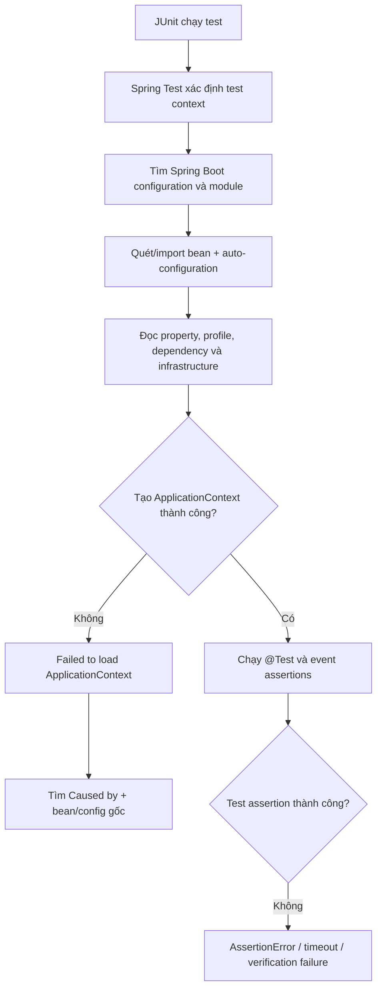
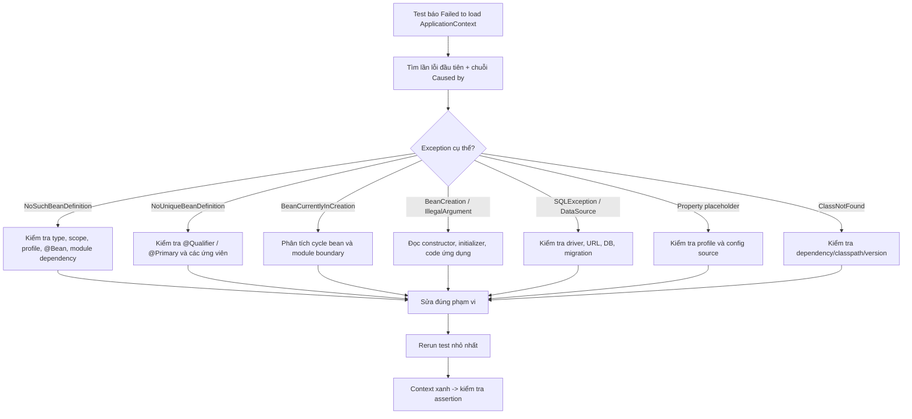

# Đọc stack trace của lỗi ApplicationContext

## Mục tiêu học tập

Trong chương **Test failure** của học phần **Spring Modulith Verification & Testing**, lỗi `Failed to load ApplicationContext` là một trong những trở ngại thường gặp khi chạy `@ApplicationModuleTest`, `@SpringBootTest` hoặc integration test có database. Thông báo này chỉ cho biết Spring không dựng được test context; nguyên nhân thực sự thường nằm sâu hơn trong chuỗi exception.

Sau bài học, bạn có thể:

- Nhận ra cấu trúc stack trace nhiều tầng: lỗi JUnit/Spring Test ở ngoài, lỗi khởi tạo bean ở giữa và **nguyên nhân có thể hành động được** ở bên trong.
- Đọc `Caused by:`, `Suppressed:`, tên bean, constructor parameter, cấu hình và class/package để khoanh vùng lỗi.
- Phân biệt các nhóm lỗi như `NoSuchBeanDefinitionException`, `UnsatisfiedDependencyException`, `BeanCreationException`, lỗi property, DataSource/JPA, migration và component scanning.
- Phân tích vì sao `@ApplicationModuleTest` chế độ `STANDALONE` có thể không tạo bean thuộc module khác dù ứng dụng đầy đủ vẫn chạy.
- Chọn cách sửa phù hợp: bổ sung test double qua `@TestConfiguration`, khởi động các module phụ thuộc có chủ đích, sửa cấu hình/profile hoặc sửa code production.
- Không nhầm lỗi tải `ApplicationContext` với lỗi `ApplicationModules.verify()`, assertion `PublishedEvents` hay timeout của `Scenario`.
- Đưa phương pháp điều tra lỗi vào quality gate CI để giảm thời gian chẩn đoán và tránh “sửa” bằng cách mở rộng context vô tội vạ.

## 1. ApplicationContext làm gì khi test bắt đầu?

Spring `ApplicationContext` là vùng chứa và điều phối các bean. Khi một bài test Spring khởi động, framework phải tìm cấu hình ứng dụng, quét hoặc import các component thuộc phạm vi cần thiết, đọc properties, áp dụng điều kiện auto-configuration, tạo dependency graph, khởi tạo các bean và chạy những callback tương ứng.

`@ApplicationModuleTest` của Spring Modulith đưa thêm một yếu tố quan trọng: **phạm vi module được bootstrap**. Một test của module `orders` không nhất thiết tải toàn bộ bean của `inventory`, `billing` hay `notifications`. Nhờ thế test nhanh và bảo vệ ranh giới, nhưng một dependency nằm ngoài module có thể thiếu bean khi test bắt đầu.



Do đó, nếu context chưa được tạo, những assertion `PublishedEvents` hay `Scenario` trong `@Test` **còn chưa có cơ hội chạy**. Không nên điều tra logic event trước khi giải quyết lỗi bootstrap.

### 1.1. Ba nhóm thông tin cần thu thập

| Thông tin | Ví dụ | Công dụng |
| --- | --- | --- |
| **Test nào lỗi?** | `OrderCheckoutModuleTests` | Xác định module và phạm vi test đang bootstrap |
| **Bean nào không tạo được?** | `orderCheckoutService`, constructor parameter `0` | Chỉ ra chỗ Spring đang cố nối dependency |
| **Nguyên nhân thấp hơn là gì?** | `NoSuchBeanDefinitionException` cho `StockAvailability` | Cho biết dependency cụ thể đang thiếu |

Thông báo `Failed to load ApplicationContext` **không phải bản chẩn đoán cuối cùng**; nó là điểm bắt đầu để đọc tiếp.

## 2. Giải phẫu một stack trace nhiều tầng

Giả sử một test trong module `orders` thất bại. Log rút gọn sau là **ví dụ minh họa**, không phải kết quả từ một lần chạy thực tế:

```text
java.lang.IllegalStateException:
  Failed to load ApplicationContext for
  [MergedContextConfiguration@... testClass =
   com.example.shop.orders.OrderCheckoutModuleTests, ...]
    at org.springframework.test.context.cache.
       DefaultCacheAwareContextLoaderDelegate.loadContext(...)

Caused by: org.springframework.beans.factory.
  UnsatisfiedDependencyException:
  Error creating bean with name 'orderCheckoutService':
  Unsatisfied dependency expressed through constructor parameter 0
    at org.springframework.beans.factory.support.
       ConstructorResolver.createArgumentArray(...)

Caused by: org.springframework.beans.factory.
  NoSuchBeanDefinitionException:
  No qualifying bean of type
  'com.example.shop.inventory.StockAvailability' available:
  expected at least 1 bean which qualifies as autowire candidate
    at org.springframework.beans.factory.support.
       DefaultListableBeanFactory.raiseNoMatchingBeanFound(...)
```

Hãy đọc theo hai chiều:

1. **Từ đầu xuống:** xác định test bị lỗi, loại context, tên bean tạo không thành công và các bước bootstrap.
2. **Từ `Caused by` sâu nhất đi ngược lên:** tìm nguyên nhân cụ thể rồi lần về component đã yêu cầu dependency đó.

Từ đoạn log ta có:

| Tầng | Đoạn cần chú ý | Ý nghĩa |
| --- | --- | --- |
| Bọc ngoài | `IllegalStateException: Failed to load ApplicationContext` | Context không khởi động được |
| Bean phụ thuộc | `UnsatisfiedDependencyException` | `orderCheckoutService` không nhận đủ dependency |
| Vị trí nối bean | `constructor parameter 0` | Tham số thứ nhất của constructor cần kiểm tra |
| Nguyên nhân cụ thể | `NoSuchBeanDefinitionException` | Context không có bean phù hợp kiểu `StockAvailability` |
| Dấu vết module | `com.example.shop.inventory.StockAvailability` | Kiểu thuộc API của module `inventory`, có thể ở ngoài bootstrap scope |

**Kết luận bước đầu:** đây là vấn đề về **bean có sẵn trong test context**, chưa có bằng chứng `OrderCheckoutService` tính sai nghiệp vụ hay `OrderPlaced` được phát sai.

### 2.1. “Lỗi sâu nhất” có luôn là lỗi cần sửa không?

Không phải lúc nào. Một chuỗi `Caused by` sâu nhất có thể chỉ là `ClassNotFoundException`, `SQLException` hoặc lỗi parsing, trong khi hành động sửa đúng phải nằm ở dependency declaration, migration hoặc property phía trên. Cần ghép:

- **Nguyên nhân kỹ thuật gần đáy**: thiếu class, không kết nối DB, sai giá trị property.
- **Bean/config đang phụ thuộc vào nguyên nhân đó**: service, datasource, entity manager, auto-configuration.
- **Ngữ cảnh module test**: bean thuộc module nào, có được bootstrap, có bị điều kiện `@Profile`/`@Conditional` loại đi không.

Nói cách khác, “đọc dòng cuối” là bước tìm manh mối, **không phải thay thế suy luận về dependency graph**.

### 2.2. Stack frame nào có giá trị?

Phần lớn các dòng `at org.springframework...` mô tả đường framework đi qua. Chúng hữu ích để biết giai đoạn bootstrap, nhưng thường không phải nơi cần sửa mã. Ưu tiên:

1. Lời nhắn chứa **tên bean cụ thể**.
2. Lời nhắn chứa **type đầy đủ gồm package**.
3. Dòng `Caused by` giải thích **lý do**.
4. Stack frame đầu tiên thuộc **package ứng dụng** nếu exception phát sinh từ chính code của bạn.
5. Cấu hình test và phạm vi Spring Modulith đã xác định từ test class.

Với `Suppressed:`, không nên bỏ qua tuyệt đối: nó có thể cho thấy lỗi khác xảy ra trong quá trình đóng resource hoặc hủy context. Tuy nhiên, nếu lỗi chính đã là `NoSuchBeanDefinitionException` trong bootstrap, đừng sửa một `Suppressed` phát sinh khi cleanup trước khi xử lý nguyên nhân khởi tạo.

## 3. Quy trình sáu bước đọc log

Một quy trình lặp lại được khi test đỏ:

### Bước 1 — Xác định lỗi xảy ra ở pha nào

Tìm tên test và đoạn đầu tiên cho biết:

- `Failed to load ApplicationContext` → **bootstrap chưa hoàn tất**.
- `AssertionFailedError` hoặc `AssertionError` sau khi test chạy → **assertion thất bại**, không nhất thiết do context.
- `Timeout` khi `Scenario` chờ listener → có thể là xử lý bất đồng bộ, transaction, điều kiện matching hoặc phạm vi listener.
- Lỗi `ApplicationModules.verify()` → có thể là **quy tắc kiến trúc**, không đồng nghĩa bean bị thiếu.

### Bước 2 — Tìm chuỗi Caused by của lần lỗi đầu tiên

Cuộn tới `Caused by:` liên quan trong lần thất bại **đầu tiên**, đọc đến nguyên nhân cụ thể nhất. Một bản log dài có thể chứa nhiều test hoặc nhiều lần framework thử dùng cùng context; không nên lấy exception sau cùng một cách máy móc.

### Bước 3 — Ghi lại tên bean, type, constructor parameter

Ví dụ:

```text
bean: orderCheckoutService
constructor parameter: 0
required type: com.example.shop.inventory.StockAvailability
test: com.example.shop.orders.OrderCheckoutModuleTests
```

Từ đây, đối chiếu constructor và package trong chính ví dụ/đoạn code bị lỗi. **Type đầy đủ quan trọng hơn tên đơn giản**, vì một dự án có thể có nhiều interface tên giống nhau.

### Bước 4 — Đối chiếu phạm vi context

Kiểm tra annotation của test: `@ApplicationModuleTest` hay `@SpringBootTest`? Với module test, có đang chạy chế độ `STANDALONE` không? Dependency bean có thuộc module khác không? Với mọi Spring test, có cấu hình `@Profile`, `@ConditionalOnProperty`, qualifier hoặc test configuration không?

### Bước 5 — Chọn thay đổi **nhỏ nhất đúng mục tiêu**

Ví dụ, test tập trung `orders` có thể bổ sung một stub `StockAvailability` trong test context; integration test cần implementation thật có thể bootstrap module phụ thuộc. Không đổi toàn bộ test thành `@SpringBootTest` chỉ vì không muốn tìm bean đang thiếu.

### Bước 6 — Chạy lại đúng test và đánh giá lỗi mới

Sau khi sửa bootstrap, chạy test cụ thể trước. Nếu context đã tải nhưng assertion nghiệp vụ fail, đó là **một tầng lỗi khác** và cần chẩn đoán riêng. Chỉ sau đó mới mở rộng sang toàn bộ suite/CI.

## 4. Case study: Thiếu bean trong @ApplicationModuleTest

Đây là tình huống trọng tâm của bài. Trong dự án ví dụ, module `orders` dùng một public interface của module `inventory` để kiểm tra hàng tồn trước khi phát event.

### 4.1. Cấu trúc module

```text
com.example.shop
├── ShopApplication.java                # @SpringBootApplication
├── orders
│   ├── OrderPlaced.java
│   ├── OrderCheckoutService.java
│   └── [test] OrderCheckoutModuleTests.java
└── inventory
    ├── StockAvailability.java           # Public API
    └── internal
        └── DatabaseStockAvailability.java
```

Trong ví dụ, `orders` **được phép** phụ thuộc vào interface công khai `inventory.StockAvailability` theo ranh giới đã thiết kế. Module `inventory` sở hữu implementation bên trong `inventory.internal`.

Tệp `src/main/java/com/example/shop/inventory/StockAvailability.java`:

```java
package com.example.shop.inventory;

import java.util.UUID;

public interface StockAvailability {

    boolean available(UUID productId);
}
```

Tệp `src/main/java/com/example/shop/orders/OrderPlaced.java`:

```java
package com.example.shop.orders;

import java.util.UUID;

public record OrderPlaced(
        UUID orderId,
        UUID productId) {
}
```

Tệp `src/main/java/com/example/shop/orders/OrderCheckoutService.java`:

```java
package com.example.shop.orders;

import com.example.shop.inventory.StockAvailability;
import java.util.UUID;
import org.springframework.context.ApplicationEventPublisher;
import org.springframework.stereotype.Service;

@Service
public class OrderCheckoutService {

    private final StockAvailability stock;
    private final ApplicationEventPublisher publisher;

    public OrderCheckoutService(
            StockAvailability stock,
            ApplicationEventPublisher publisher) {
        this.stock = stock;
        this.publisher = publisher;
    }

    public void checkout(UUID orderId, UUID productId) {
        if (!stock.available(productId)) {
            throw new IllegalStateException("Product unavailable");
        }

        publisher.publishEvent(
                new OrderPlaced(orderId, productId));
    }
}
```

Service có hai dependency được Spring inject qua constructor: `StockAvailability` ở tham số **0**, `ApplicationEventPublisher` ở tham số **1**.

### 4.2. Test ban đầu không cấp bean phụ thuộc

```java
package com.example.shop.orders;

import org.junit.jupiter.api.Test;
import org.springframework.beans.factory.annotation.Autowired;
import org.springframework.modulith.test.ApplicationModuleTest;

@ApplicationModuleTest
class OrderCheckoutModuleTests {

    @Autowired
    OrderCheckoutService service;

    @Test
    void checkoutPublishesEvent() {
        // Test chưa chạy tới đây nếu context không tạo được.
    }
}
```

Với cách bố trí module giả định ở trên, test này bootstrap module `orders` theo mặc định. Bean implementation `DatabaseStockAvailability` thuộc module `inventory` không nằm trong phạm vi bootstrap. Spring thấy `OrderCheckoutService` nhưng không tìm được bean `StockAvailability` để truyền vào constructor.

Vì vậy, log dạng `UnsatisfiedDependencyException → NoSuchBeanDefinitionException` là hợp lý. **Không phải interface bị “mất” khỏi classpath**; class tồn tại để compile nhưng **không có bean instance phù hợp trong context hiện tại**.

Đây là một khác biệt rất đáng nhớ:

| Vấn đề | Cách nhận biết | Hướng xử lý |
| --- | --- | --- |
| Class không có trên classpath | `ClassNotFoundException` / `NoClassDefFoundError` | Kiểm tra dependency/module build |
| Class có, nhưng không có Spring bean | `NoSuchBeanDefinitionException` | Kiểm tra scan, bootstrap scope, profile, configuration |
| Có nhiều bean cùng type | `NoUniqueBeanDefinitionException` | Xem `@Qualifier`, `@Primary`, thiết kế bean |
| Có bean, nhưng khởi tạo bị lỗi | `BeanCreationException` với nguyên nhân sâu hơn | Đọc lỗi constructor/config/DB cụ thể |

### 4.3. Sửa đúng mục tiêu bằng @TestConfiguration

Nếu test chỉ muốn chứng minh **module orders phát `OrderPlaced` khi hàng sẵn có**, dependency `StockAvailability` có thể là một **stub** trong phạm vi test:

```java
package com.example.shop.orders;

import static org.assertj.core.api.Assertions.assertThat;

import com.example.shop.inventory.StockAvailability;
import java.util.UUID;
import org.junit.jupiter.api.Test;
import org.springframework.beans.factory.annotation.Autowired;
import org.springframework.boot.test.context.TestConfiguration;
import org.springframework.context.annotation.Bean;
import org.springframework.context.annotation.Import;
import org.springframework.modulith.test.ApplicationModuleTest;
import org.springframework.modulith.test.PublishedEvents;

@ApplicationModuleTest
@Import(OrderCheckoutModuleTests.AvailableStock.class)
class OrderCheckoutModuleTests {

    @Autowired
    OrderCheckoutService service;

    @TestConfiguration(proxyBeanMethods = false)
    static class AvailableStock {

        @Bean
        StockAvailability stockAvailability() {
            return productId -> true;
        }
    }

    @Test
    void checkoutPublishesEvent(PublishedEvents events) {
        UUID orderId = UUID.randomUUID();
        UUID productId = UUID.randomUUID();

        service.checkout(orderId, productId);

        var placed = events.ofType(OrderPlaced.class)
                .matching(event ->
                        orderId.equals(event.orderId()));

        assertThat(placed)
                .hasSize(1)
                .allSatisfy(event ->
                        assertThat(event.productId())
                                .isEqualTo(productId));
    }
}
```

Stub đáp ứng public interface mà `OrderCheckoutService` thực sự sử dụng. Test vẫn tập trung vào `orders`; nó không cần tải database, repository và toàn bộ internal implementation của `inventory`. Sau khi context khởi động, `PublishedEvents` mới có thể xác minh event mà service phát.

**Hai lưu ý về chất lượng test:**

1. Stub luôn trả `true` chỉ phù hợp để kiểm tra nhánh “có hàng”. Cần thêm test riêng với stub trả `false` hoặc cấu hình kiểm soát được nếu muốn bảo vệ nhánh từ chối.
2. Một module test dùng stub **không** chứng minh implementation `DatabaseStockAvailability` hoạt động, không chứng minh kết nối DB và không thay thế integration test giữa `orders` với `inventory`.

### 4.4. Phương án khác: bootstrap các module phụ thuộc

Nếu mục tiêu test là kiểm tra **sự tích hợp thật** của `orders` với bean trong `inventory`, Spring Modulith cho phép chọn bootstrap mode rộng hơn. Mẫu annotation:

```java
import org.springframework.modulith.test.ApplicationModuleTest;
import org.springframework.modulith.test.ApplicationModuleTest.BootstrapMode;

@ApplicationModuleTest(
        mode = BootstrapMode.DIRECT_DEPENDENCIES)
class OrderInventoryIntegrationTests {
    // Test tích hợp với dependency module thực sự.
}
```

Các chế độ như `STANDALONE`, `DIRECT_DEPENDENCIES` và `ALL_DEPENDENCIES` có phạm vi khác nhau; cách xác định dependency thực tế tùy cấu trúc module và cấu hình dự án. Với ví dụ này, `DIRECT_DEPENDENCIES` có ý nghĩa nếu `inventory` là dependency trực tiếp được mô hình hóa hợp lệ của `orders`.

Chọn bootstrap mode là **quyết định phạm vi kiểm thử**, không phải mẹo “sửa bean thiếu” dùng trong mọi trường hợp:

- Test contract của riêng `orders`: ưu tiên stub public dependency.
- Test tích hợp `orders + inventory`: khởi động implementation thật và hạ tầng cần thiết.
- Test toàn tuyến nhiều module: một integration test rộng hơn, khi có yêu cầu rõ ràng.

Nếu chuyển sang mode rộng rồi xuất hiện lỗi DataSource/JPA, đó có thể là do bạn vừa đưa thêm module cần database vào context; hãy đọc **lỗi mới** thay vì cố đoán từ thông báo cũ.

## 5. Một lỗi trông giống nhau nhưng nguyên nhân khác nhau

`UnsatisfiedDependencyException` chỉ nói bean không nhận được dependency. Một số nguyên nhân gốc có thể hoàn toàn khác:

### 5.1. Component không nằm trong vùng quét

Ví dụ `StockAvailability` có implementation:

```java
public class DatabaseStockAvailability
        implements StockAvailability {
    // ...
}
```

Nếu class được kỳ vọng là Spring component nhưng không có `@Component`/`@Service`, không được trả về từ một phương thức `@Bean` và không được import, Spring không tạo bean.

Tuy nhiên, trong modular architecture, **không nên tự động thêm `@ComponentScan("com.example.shop")` vào mọi module test**. Làm vậy có thể khiến test tải quá nhiều bean, che đi việc phạm vi bootstrap đang sai và làm yếu giá trị của `@ApplicationModuleTest`.

### 5.2. Bean bị loại bởi profile hoặc property

```java
@Profile("prod")
@Service
class DatabaseStockAvailability
        implements StockAvailability {
    // ...
}
```

Nếu test chạy profile `test` thì implementation này **không xuất hiện**. Tương tự, bean có `@ConditionalOnProperty` chỉ được tạo khi property phù hợp. Khi log báo không có bean, cần xem **điều kiện đăng ký bean** chứ không chỉ kiểm tra package.

Hướng sửa là dùng bean phù hợp test hoặc chủ động khai báo profile/property đúng mục đích. Không bật profile production chỉ để một test pass nếu nó kéo theo credential và integration thật không cần thiết.

### 5.3. Nhiều bean cùng interface

```text
Caused by: NoUniqueBeanDefinitionException:
  No qualifying bean of type '...StockAvailability' available:
  expected single matching bean but found 2:
  databaseStockAvailability, cachedStockAvailability
```

Đây không phải “thiếu bean” mà là **có nhiều ứng viên**. Xem constructor có `@Qualifier` không, thiết kế bean nào là mặc định và có nên dùng `@Primary` hay không. Không nên bật bean-definition overriding để làm biến mất lỗi cạnh tranh bean mà chưa xác định trách nhiệm của từng implementation.

### 5.4. Phụ thuộc vòng

```text
Caused by: BeanCurrentlyInCreationException:
  Error creating bean with name 'orderService':
  Requested bean is currently in creation
```

Có thể code tạo chu trình `OrderService → PaymentService → OrderService`. Với Spring Modulith, vòng phụ thuộc bean còn có thể là dấu hiệu các module đang bị thiết kế lệch ranh giới. Hãy tách trách nhiệm hoặc dùng event/public API phù hợp, đồng thời chạy `ApplicationModules.verify()`. Đừng mặc định bật `spring.main.allow-circular-references=true` là cách sửa kiến trúc.

## 6. Lỗi ApplicationContext liên quan DataSource, JPA và migration

Một test `@ApplicationModuleTest` có thể tải bean repository/JPA nếu module thực sự cần cơ sở dữ liệu. Khi đó log `Failed to load ApplicationContext` có thể xuất phát từ infrastructure thay vì dependency business.

| Dòng log nổi bật | Nguyên nhân cần kiểm tra | Hành động chẩn đoán |
| --- | --- | --- |
| `Failed to configure a DataSource` | Thiếu URL/driver hoặc không có DB nhúng phù hợp | Xem test profile, dependency driver, cấu hình datasource |
| `Cannot load driver class` | Thiếu JDBC driver hoặc sai tên class | Kiểm tra dependency ở đúng test/runtime classpath |
| `Connection refused` / `SQLTransientConnectionException` | Database không chạy, sai host/port, network | Kiểm tra hạ tầng test, connection URL |
| `FlywayException` / `LiquibaseException` | Migration sai cú pháp, thứ tự hoặc schema state | Tìm migration và SQL cụ thể ở `Caused by` |
| `BeanCreationException: entityManagerFactory` | Mapping entity, schema, dialect hoặc datasource | Đọc tiếp `Caused by` để phân biệt |
| `Not a managed type` | Repository tham chiếu entity chưa được JPA quản lý | Kiểm tra `@Entity`, package scan và bootstrap scope |
| `Schema-validation: missing table` | Schema test khác entity mapping | Kiểm tra migration/DDL và profile test |

### 6.1. Ví dụ lỗi datasource

```text
java.lang.IllegalStateException:
  Failed to load ApplicationContext ...
Caused by: org.springframework.beans.factory.BeanCreationException:
  Error creating bean with name 'dataSource' ...
Caused by: java.lang.IllegalStateException:
  Cannot load driver class: org.postgresql.Driver
```

Đây là **ví dụ minh họa** của một lỗi liên quan classpath. Không nên bắt đầu bằng việc sửa `OrderService`; trước hết kiểm tra dependency JDBC driver và cách profile test cấu hình datasource.

Với project dùng H2 cho test, cần dependency H2 ở test runtime và schema/test data phù hợp. Nếu dùng Testcontainers, đảm bảo test thực sự được cấu hình để tạo datasource từ container và điều kiện môi trường hỗ trợ. Đừng thay một lỗi DB bằng cách mock mọi repository nếu mục tiêu test là kiểm chứng persistence.

### 6.2. “Database lỗi” không có nghĩa tất cả test cần database

Nếu bài test chỉ muốn kiểm chứng event của một service nhỏ, hãy xem liệu nó có thể chạy ở phạm vi module với một fake repository/interface thích hợp không. Ngược lại, khi học phần yêu cầu kiểm thử cơ sở dữ liệu và transaction sau commit, cần một integration test với hạ tầng thật hoặc DB test đã cấu hình đúng.

**Nguyên tắc lựa chọn:** giảm phạm vi test để đúng hợp đồng đang kiểm tra, không giảm để tránh phát hiện lỗi thuộc hợp đồng đó.

## 7. Lỗi cấu hình Spring Boot và test class

### 7.1. Không tìm thấy @SpringBootConfiguration

```text
IllegalStateException:
  Unable to find a @SpringBootConfiguration by searching
  packages upwards from the test
```

Spring Boot test thường tìm cấu hình theo thứ bậc package từ test class. Kiểm tra test có nằm dưới package gốc của ứng dụng hay không và có lớp `@SpringBootApplication` phù hợp không. Nếu test ở package khác hẳn, có thể cần khai báo cấu hình ứng dụng tường minh theo loại test.

Không thêm một `@SpringBootApplication` thứ hai trong test chỉ để dập thông báo mà chưa hiểu cách Spring Modulith nhận diện module gốc; nó có thể làm thay đổi phạm vi scan và kiểm chứng kiến trúc.

### 7.2. Không resolve được property

```text
Caused by: IllegalArgumentException:
  Could not resolve placeholder 'payment.gateway.url'
  in value "${payment.gateway.url}"
```

Nguyên nhân là **property không được cung cấp trong môi trường test** hoặc không được load đúng profile/source. Với test module không gọi gateway thật, có thể cấp giá trị giả hợp lệ hoặc test double ở boundary phù hợp. Với integration test thật, cần config môi trường/hạ tầng tương ứng.

Khi log đề cập một property cụ thể, ưu tiên kiểm tra tên property, test profile, nguồn config và điều kiện bean trước khi thay đổi toàn bộ application context.

### 7.3. Lỗi chạy mã khi khởi tạo bean

```text
Caused by: BeanCreationException:
  Error creating bean with name 'someInitializer' ...
Caused by: IllegalArgumentException:
  Invalid range: maximum must be greater than minimum
    at com.example.shop.orders.internal.SomeInitializer.initialize(...)
```

Lúc này nguyên nhân có thể nằm trong `@PostConstruct`, constructor, `@Bean` factory method hoặc callback khởi tạo. Stack frame thuộc package `com.example.shop...` là vị trí ưu tiên đọc. Việc thêm bean giả sẽ không giải quyết được một lỗi code production đang thực sự chạy trong bootstrap.

## 8. Đọc log khi context cache và failure threshold xuất hiện

Spring Test có cơ chế **cache ApplicationContext** để các test dùng cấu hình tương đương không phải dựng context lặp lại. Ở các phiên bản Spring Framework hỗ trợ *context failure threshold*, khi cùng một cấu hình context đã thất bại, những lần thử sau có thể bị bỏ qua và xuất hiện thông báo:

```text
ApplicationContext failure threshold (1) exceeded:
skipping repeated attempt to load context
```

Thông báo này **không phải nguyên nhân gốc**. Nó có nghĩa framework đã biết việc dựng cấu hình context đó thất bại trong phạm vi cache hiện tại và đang tránh thử lại vô ích. Lỗi cần sửa nằm ở **lần load context đầu tiên thất bại** phía trước trong log.

Cách điều tra:

1. Tìm lần xuất hiện đầu tiên của `Failed to load ApplicationContext` tương ứng với test context.
2. Đọc `Caused by` của lần đó thay vì chỉ dòng `failure threshold exceeded` ở cuối báo cáo.
3. Nếu CI chạy nhiều test theo suite, cô lập test đầu tiên để log ngắn và dễ nhìn.
4. Sau khi sửa vấn đề gốc, chạy lại quá trình test; không cần “vô hiệu hóa” threshold như một giải pháp lâu dài.

Khác biệt phiên bản Spring Framework có thể ảnh hưởng cú pháp và cách hiển thị thông báo; đừng mặc định mọi project Spring Boot cũ đều có chính xác dòng `failure threshold` nói trên.

## 9. Phân biệt lỗi bootstrap với lỗi kiến trúc và event assertions

Trong học phần này có ít nhất bốn nhóm thất bại thường gặp:

| Nhóm | Dấu hiệu | Đường điều tra chính |
| --- | --- | --- |
| **Context bootstrap** | `Failed to load ApplicationContext` | Bean, profile, bootstrap scope, datasource, configuration |
| **Module architecture** | `ApplicationModules.verify()` báo vi phạm dependency | Quan hệ module, public API, named interface, vòng phụ thuộc |
| **Event assertion** | AssertJ `Expected size: 1 but was: 0` hoặc payload khác | Publisher, transaction, ID, số lần phát, payload |
| **Async/transaction completion** | `Scenario` chờ hết hạn | Listener registration, executor, transaction commit, matching predicate |

### 9.1. Test kiến trúc có thể chạy độc lập

Ví dụ:

```java
import org.junit.jupiter.api.Test;
import org.springframework.modulith.core.ApplicationModules;

class ModularityTests {

    @Test
    void verifiesBoundaries() {
        ApplicationModules.of(ShopApplication.class).verify();
    }
}
```

Trong đó `ShopApplication` là lớp ứng dụng Spring Boot gốc, cần thay bằng lớp thật. Test này kiểm tra các quy tắc phụ thuộc giữa module và có thể thất bại **khi không hề tải một Spring ApplicationContext đầy đủ**. Đừng sửa lỗi `ApplicationModules.verify()` bằng cách thêm `@MockBean` hoặc profile nếu nguyên nhân là module tham chiếu package nội bộ của module khác.

### 9.2. Event test phải chạy sau khi context khởi tạo

```java
@Test
void publishesOrderPlaced(PublishedEvents events) {
    UUID orderId = UUID.randomUUID();
    UUID productId = UUID.randomUUID();

    service.checkout(orderId, productId);

    assertThat(events.ofType(OrderPlaced.class)
            .matching(e -> orderId.equals(e.orderId())))
            .hasSize(1);
}
```

Đây là **phần thân test minh họa**, cần bean `service`, import các class liên quan, `PublishedEvents` và AssertJ. Nếu lỗi xảy ra trong `hasSize(1)`, context đã tải thành công; lúc này nên kiểm tra logic phát event, điều kiện nghiệp vụ và transaction, thay vì quay về sửa bean scanning một cách mơ hồ.

### 9.3. Timeout Scenario không tự đồng nghĩa listener sai

Một listener `@ApplicationModuleListener` hoặc `@TransactionalEventListener(AFTER_COMMIT)` có thể không chạy vì transaction nguồn rollback. Listener bất đồng bộ cũng có thể nằm ngoài bootstrap scope hoặc hoàn tất sau giới hạn chờ. Khi `Scenario` timeout, hãy kiểm tra **event có được publish, transaction có commit, listener có trong context, predicate có khớp** trước khi kết luận listener implementation sai.

## 10. Cách thu thập log có ích, không bị ngập thông tin

Khi được phép chạy test trong dự án, hãy ưu tiên **một test thất bại cụ thể** và giữ nguyên stack trace đầy đủ trong báo cáo. Các lệnh dưới đây là ví dụ sử dụng về sau, **không phải kết quả đã thực thi trong bài học này**.

Với Maven Wrapper:

```bash
./mvnw -Dtest=OrderCheckoutModuleTests test
```

Với Gradle Wrapper:

```bash
./gradlew test --tests "com.example.shop.orders.OrderCheckoutModuleTests" --stacktrace
```

Trên Windows PowerShell, wrapper thường là `.\mvnw.cmd` hoặc `.\gradlew.bat`. Tham số `--stacktrace` của Gradle làm log task chi tiết hơn, nhưng lỗi quan trọng vẫn có thể nằm trong báo cáo test và phần `Caused by` của exception do Spring đưa ra.

Nếu Spring Boot auto-configuration khó giải thích, có thể bật log điều kiện trong một lần chẩn đoán có kiểm soát (ví dụ bật debug cho test context) để đọc **condition evaluation report**. Báo cáo có thể cho biết auto-configuration nào match hoặc không match; nó chỉ hỗ trợ điều tra, không thay thế đọc tên bean và nguyên nhân gốc.

Thông tin nên kèm theo khi báo lỗi cho đồng đội:

- Tên test class/method và annotation bootstrap.
- Chuỗi exception từ `Failed to load ApplicationContext` đến `Caused by` cụ thể, không chỉ dòng đầu.
- Tên bean, fully qualified type và property liên quan.
- Test profile, bootstrap mode và dependency module được mong đợi.
- Thay đổi gần nhất về cấu hình, dependency, module boundary hoặc migration.
- Sau khi sửa, kết quả chạy lại test đó và toàn bộ quality gate.

Không cần paste hàng nghìn dòng unrelated framework logs nếu một chuỗi exception ngắn đã thể hiện đầy đủ nguyên nhân và context.

## 11. Cây quyết định điều tra nhanh



Trong Spring Modulith, câu hỏi bổ sung sau khi thấy bean missing là: “Bean này thuộc **module đang test**, **public dependency của module khác**, hay một infrastructure bean của Spring Boot?” Ba trường hợp dẫn tới những cách sửa khác nhau.

## 12. Anti-pattern khi sửa lỗi ApplicationContext

### 12.1. Chỉ đọc dòng đầu

`Failed to load ApplicationContext` không cho biết thiếu bean hay lỗi migration. Phải đọc `Caused by` và bối cảnh bean.

### 12.2. Mở toàn bộ context để test pass

Đổi mọi `@ApplicationModuleTest` thành `@SpringBootTest` có thể khiến bean xuất hiện, nhưng làm test chậm, tải thêm infrastructure không cần thiết và làm mất mục tiêu kiểm thử ranh giới module. Chỉ mở rộng khi hợp đồng đang kiểm chứng thực sự cần các module đó.

### 12.3. Mock mọi dependency, kể cả thứ đang cần kiểm chứng

Nếu test nhằm xác minh kết nối repository/DB, mock repository sẽ khiến test không còn kiểm tra persistence. Dùng test double cho boundary **ngoài phạm vi mục tiêu**, không cho phần kết quả cốt lõi cần chứng minh.

### 12.4. Sửa bằng cách bỏ qua lỗi

Không nên chỉ đánh dấu `@Disabled`, bỏ assertion, bật circular references hay cho phép bean overriding để làm CI xanh mà không giải thích nguyên nhân. Những thay đổi này có thể che lỗi kiến trúc hoặc cấu hình thật.

### 12.5. Nhầm lỗi thứ cấp với lỗi đầu tiên

Sau một bootstrap failure, log cache/threshold hoặc cleanup có thể chiếm phần cuối output. Hãy tìm **lần thất bại ban đầu**; dòng cuối không nhất thiết là nguyên nhân chính.

### 12.6. Bỏ qua test package và profile

Đúng một class implementation nhưng khác profile, qualifier hoặc package scan vẫn có thể không tạo bean. Kiểm tra cả **điều kiện bean được đăng ký**, không chỉ nội dung class.

## 13. Quality gate trong CI

Mục tiêu rộng của **Spring Modulith Verification & Testing** là ngăn hai dạng hồi quy bổ sung: **ràng buộc kiến trúc sai** và **hành vi runtime sai**. Stack trace là thông tin để chẩn đoán khi quality gate thất bại, không phải thứ cần loại bỏ bằng cách nới lỏng test.

Một pipeline phù hợp nên có:

| Gate | Mục tiêu | Khi fail, đọc gì trước? |
| --- | --- | --- |
| `ApplicationModules.verify()` | Ranh giới module và quy tắc phụ thuộc | Module/đường dependency bị vi phạm |
| `@ApplicationModuleTest` nhỏ | Bean của module và hợp đồng nghiệp vụ | `Caused by`, test bootstrap scope |
| Event assertions | Đúng event, payload, số lần publish | AssertJ diff, transaction, correlation ID |
| Database/integration test | JPA, migration, commit và side effect | DataSource/JPA/migration exception |
| Listener async/`AFTER_COMMIT` | Hoàn thành xử lý và kết quả hậu commit | Timeout, executor, rollback, bean registration |

Đối với CI:

1. Giữ nguyên stack trace gốc trong artifact log của build.
2. Tách test module nhanh với một số integration test cần infrastructure thật.
3. Dùng cấu hình test có thể tái lập, tránh phụ thuộc service ngoài không ổn định nếu không phải mục tiêu.
4. Khi thay đổi module dependency hoặc component scan, chạy test architecture và module test liên quan.
5. Khi test bootstrap đỏ, sửa nguyên nhân gốc rồi chạy lại để xem có assertion lỗi khác không.

**Không “sửa” một lỗi kiến trúc bằng cách thêm bean giả vào production**. Một stub chỉ là phương tiện kiểm thử boundary, không phải bằng chứng các module đã phân tách đúng. Hãy luôn chạy `ApplicationModules.verify()` để kiểm soát thiết kế.

## 14. Bài thực hành

Với ví dụ `OrderCheckoutService` và `OrderCheckoutModuleTests`:

1. **Đọc log:** từ stack trace ở phần 2, ghi lại test class, bean không tạo được, constructor parameter, kiểu thiếu và module tương ứng.
2. **Tái tạo lỗi có chủ đích:** bỏ `@Import(AvailableStock.class)` trong bài test `@ApplicationModuleTest`. Dự đoán loại exception trước khi xem log, rồi bổ sung lại cấu hình.
3. **Phân loại phạm vi:** giải thích vì sao `StockAvailability` đã có source code mà vẫn thiếu bean trong context `orders` chế độ `STANDALONE`.
4. **Hai chiến lược sửa:** so sánh test dùng stub `StockAvailability` với integration test `DIRECT_DEPENDENCIES`. Chọn phương án phù hợp khi mục tiêu là event của `orders` và khi mục tiêu là kết nối thật với `inventory`.
5. **Nhánh nghiệp vụ sai:** thay stub thành `productId -> false`. Dự đoán liệu context có fail không và bài test `checkoutPublishesEvent` sẽ thất bại ở đâu.
6. **Property:** giả sử bean mới cần `payment.gateway.url`; mô tả chuỗi exception có thể gặp và nguồn cấu hình test phải kiểm tra.
7. **DB:** xét stack trace `entityManagerFactory` kèm lỗi SQL. Phân biệt việc sửa entity mapping với việc mock repository làm mất mục tiêu kiểm thử DB.
8. **Context cache:** giải thích vì sao `ApplicationContext failure threshold exceeded` không phải nguyên nhân gốc và cần tìm lần bootstrap lỗi đầu tiên.
9. **CI:** viết checklist chẩn đoán trước khi tạo pull request sửa một bài test đỏ, gồm log gốc, thay đổi tối thiểu, rerun test và kiến trúc gate.

**Tiêu chí hoàn thành:** người học không dừng ở dòng `Failed to load ApplicationContext`; chỉ ra được dependency/config hỏng và thay đổi tối thiểu phù hợp với mục tiêu test, đồng thời phân biệt lỗi bootstrap với lỗi assertion hoặc timeout.

## 15. Câu hỏi tự kiểm tra

**Câu 1.** Stack trace kết thúc bằng `NoSuchBeanDefinitionException` cho `inventory.StockAvailability`. Có thể kết luận interface Java không compile được không?

**Trả lời:** Không. Đây là lỗi **không có bean phù hợp trong Spring context**; class có thể vẫn tồn tại và compile bình thường. Cần kiểm tra scan, bootstrap mode, bean registration và profile.

**Câu 2.** Tại sao `@ApplicationModuleTest` ở module `orders` có thể thiếu implementation của `inventory`?

**Trả lời:** Phạm vi `STANDALONE` tập trung vào module đang test và không mặc định bootstrap implementation của module phụ thuộc. Có thể dùng stub public interface hoặc mở rộng bootstrap có chủ đích khi cần integration.

**Câu 3.** Dòng `Unsatisfied dependency expressed through constructor parameter 0` giúp gì?

**Trả lời:** Nó chỉ ra vị trí tham số constructor mà Spring không đáp ứng được. Kết hợp type trong `NoSuchBeanDefinitionException` để tìm đúng dependency.

**Câu 4.** Vì sao không nên đổi tất cả module test thành `@SpringBootTest` khi gặp context failure?

**Trả lời:** Test có thể mất tính cô lập, chậm, tải hạ tầng dư thừa và che lỗi thiết kế boundary. Chỉ mở phạm vi khi hợp đồng thật sự cần.

**Câu 5.** Test `PublishedEvents` báo sai số lượng event nhưng không có `Failed to load ApplicationContext`. Có nên tập trung sửa component scanning trước không?

**Trả lời:** Không nhất thiết. Context đã tải được và assertion mới thất bại; cần xem nghiệp vụ có phát event đúng, transaction và điều kiện lọc đúng hay không.

**Câu 6.** `ApplicationContext failure threshold (1) exceeded` là lỗi gốc không?

**Trả lời:** Không. Đây là cơ chế tránh thử lại context đã thất bại trong phạm vi cache. Tìm lỗi `Caused by` của lần context load đầu tiên.

**Câu 7.** Lỗi `BeanCreationException` có nguyên nhân sâu hơn `Cannot load driver class`. Nên sửa service đang inject repository hay dependency database trước?

**Trả lời:** Kiểm tra driver/classpath và cấu hình DataSource trước. `BeanCreationException` là lớp bọc; lỗi driver mới là nguyên nhân kỹ thuật cụ thể cần xử lý.

## Kết luận

Khi đọc stack trace của lỗi **`Failed to load ApplicationContext`**, hãy đi từ **test đang bootstrap** tới **bean không tạo được** rồi tới **`Caused by` cụ thể**, đồng thời kiểm tra phạm vi module, profile, property và infrastructure. Trong Spring Modulith, nhiều lỗi `NoSuchBeanDefinitionException` của `@ApplicationModuleTest` là hệ quả của scope được cố tình giới hạn, không nhất thiết do service sai: dùng stub public dependency khi test module độc lập hoặc mở rộng bootstrap có chủ đích khi cần integration. Chỉ khi context đã khởi động mới đánh giá `PublishedEvents`, `Scenario` và các assertion nghiệp vụ; chạy `ApplicationModules.verify()` riêng để bảo vệ ranh giới kiến trúc. Phương pháp phân loại này giúp sửa đúng nguyên nhân, giữ test ổn định và làm quality gate CI thực sự có giá trị.

## Tài liệu tham khảo

- [Spring Modulith Reference — Testing Application Modules](https://docs.spring.io/spring-modulith/reference/testing.html)
- [Spring Modulith Reference — Application Module Fundamentals](https://docs.spring.io/spring-modulith/reference/fundamentals.html)
- [Spring Boot Reference — Testing Spring Boot Applications](https://docs.spring.io/spring-boot/reference/testing/spring-boot-applications.html)
- [Spring Framework Reference — Context Caching](https://docs.spring.io/spring-framework/reference/testing/testcontext-framework/ctx-management/caching.html)
- [Spring Framework Reference — Context Failure Threshold](https://docs.spring.io/spring-framework/reference/testing/testcontext-framework/ctx-management/failure-threshold.html)
- [Spring Framework Javadoc — NoSuchBeanDefinitionException](https://docs.spring.io/spring-framework/docs/current/javadoc-api/org/springframework/beans/factory/NoSuchBeanDefinitionException.html)
- [Spring Framework Javadoc — UnsatisfiedDependencyException](https://docs.spring.io/spring-framework/docs/current/javadoc-api/org/springframework/beans/factory/UnsatisfiedDependencyException.html)
- [Spring Modulith Reference — Working with Application Events](https://docs.spring.io/spring-modulith/reference/events.html)
