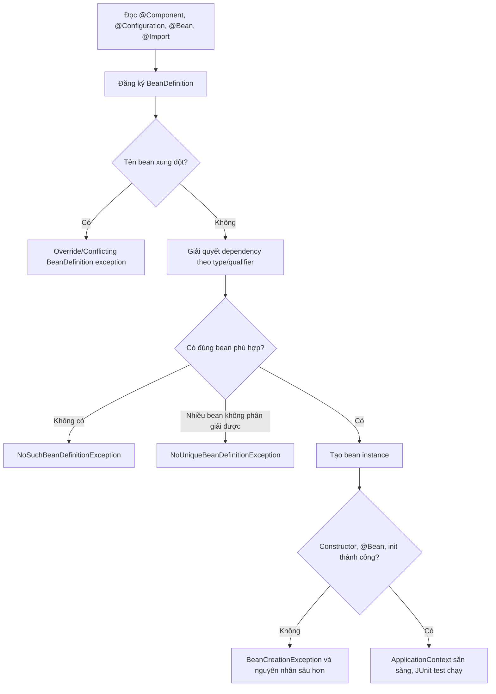
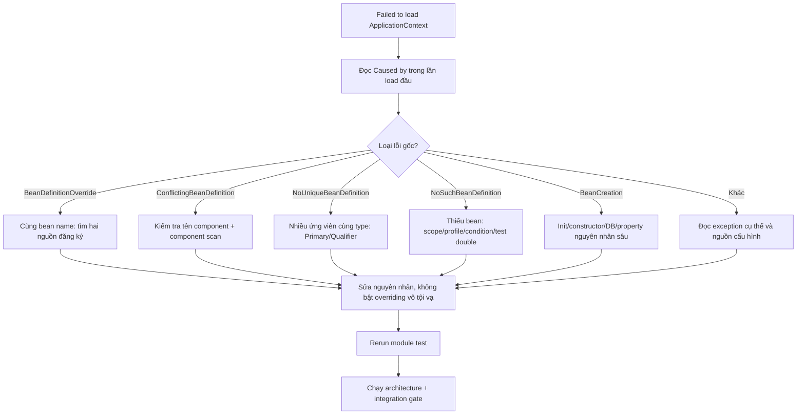

# BeanDefinitionException trong module test

## Mục tiêu học tập

Trong chương **Test failure** của học phần **Spring Modulith Verification & Testing**, test module có thể thất bại ngay khi Spring dựng `ApplicationContext` dù chưa chạy một assertion nào. Một nhóm lỗi hay gặp liên quan đến **bean definition**: định nghĩa bean bị trùng tên, xung đột trong quá trình component scanning, nhiều ứng viên cùng kiểu, thiếu bean phù hợp hoặc không tạo được instance từ định nghĩa đã đăng ký.

Sau bài học, bạn có thể:

- Hiểu **BeanDefinition** là gì và phân biệt đăng ký bean, lựa chọn dependency và khởi tạo bean.
- Nhận diện chính xác các exception như `BeanDefinitionOverrideException`, `ConflictingBeanDefinitionException`, `BeanDefinitionStoreException`, `NoSuchBeanDefinitionException`, `NoUniqueBeanDefinitionException` và `BeanCreationException`.
- Đọc stack trace `Failed to load ApplicationContext`, tìm `Caused by` và xác định bean name, kiểu, nguồn cấu hình, module và bootstrap mode.
- Tái hiện lỗi trùng bean name khi `@TestConfiguration` được import vào `@ApplicationModuleTest`, sau đó sửa bằng cách giữ tên khác nhau và xác định đúng bean được ưu tiên.
- Chọn `@Primary`, `@Qualifier`, test double hoặc `BootstrapMode.DIRECT_DEPENDENCIES` theo đúng **loại xung đột** và mục tiêu kiểm thử.
- Tránh các cách “sửa nhanh” nguy hiểm như bật bean overriding đại trà, quét toàn bộ package hoặc thay mọi module test thành `@SpringBootTest`.
- Kết hợp test bootstrap với `ApplicationModules.verify()`, `PublishedEvents` và quality gate CI để giữ đúng cả ranh giới kiến trúc lẫn hành vi.

## 1. “BeanDefinitionException” chỉ nhóm vấn đề nào?

Trong tài liệu, **BeanDefinitionException** được dùng như tên chủ đề để nói về những sự cố liên quan đến *định nghĩa bean*. Không nên giả định mọi log Spring đều ném một lớp exception duy nhất mang đúng tên `BeanDefinitionException`. Tên lớp exception **cụ thể** mới quyết định nguyên nhân và cách sửa.

Một Spring bean có hai khái niệm:

**Bean definition** là metadata cho Spring biết phải tạo bean nào: tên, kiểu/class hoặc factory method, scope, qualifier, lazy/eager initialization, profile và các điều kiện cấu hình.

**Bean instance** là đối tượng thực sự được tạo từ định nghĩa đó. Một bean definition có thể tồn tại nhưng bean instance vẫn không khởi tạo được vì constructor ném lỗi, thiếu dependency, database không kết nối hoặc property không hợp lệ.



Điểm then chốt: **trùng tên bean**, **nhiều bean cùng type** và **thiếu bean** là ba tình trạng khác nhau. Việc thêm `@Primary` có thể chọn một trong nhiều bean cùng kiểu, nhưng **không sửa được hai bean definition đang tranh cùng tên** trong registry.

## 2. Bảng phân loại exception thường gặp

| Exception hoặc dấu hiệu | Vấn đề chính | Hướng điều tra đầu tiên |
| --- | --- | --- |
| `BeanDefinitionOverrideException` | Một bean name được đăng ký thêm trong khi đã có definition và overriding bị cấm | Tên bean, nguồn definition cũ/mới, `@TestConfiguration`, auto-configuration |
| `ConflictingBeanDefinitionException` | Component scanning phát hiện các definition không tương thích có cùng bean name | Class, component scan scope và tên bean mặc định/`@Component("...")` |
| `BeanDefinitionStoreException` | Không đọc hoặc không đăng ký được bean definition theo cách framework yêu cầu | Metadata/config source, parsing, classpath và exception sâu hơn |
| `BeanDefinitionValidationException` | Bean definition không hợp lệ theo validation của Spring | Cấu hình definition/factory method được nhắc trong log |
| `NoSuchBeanDefinitionException` | Không có bean phù hợp với type/name/qualifier cần inject | Module scope, component scan, profile, conditional, test double |
| `NoUniqueBeanDefinitionException` | Có nhiều bean cùng kiểu và Spring không chọn được ứng viên duy nhất | `@Primary`, `@Qualifier`, bean names, constructor |
| `BeanCreationException` | Definition đã được nhận diện nhưng tạo instance thất bại | Đọc `Caused by`: constructor, `@Bean`, property, DB, init |
| `UnsatisfiedDependencyException` | Dependency của bean không được đáp ứng | Constructor parameter và nguyên nhân `NoSuch/NoUnique/BeanCreation` bên trong |

Các lớp trên không nhất thiết có quan hệ kế thừa trực tiếp với nhau. Một số liên quan **giai đoạn đăng ký**, một số liên quan **lookup hoặc autowiring**, và một số liên quan **khởi tạo instance**. Khi log chỉ nói “bean definition”, hãy đọc **fully qualified exception class** và thông báo cụ thể.

### 2.1. Hai kiểu “trùng” dễ bị nhầm

**Trùng tên (same name):**

```text
Bean A: name = "discountPolicy", type = StandardDiscountPolicy
Bean B: name = "discountPolicy", type = DiscountPolicy
=> Xung đột trong lúc đăng ký BeanDefinition
```

**Trùng kiểu (same interface, khác tên):**

```text
Bean A: name = "standardDiscountPolicy", type = DiscountPolicy
Bean B: name = "testDiscountPolicy",     type = DiscountPolicy
=> Hai BeanDefinition hợp lệ; lỗi chỉ xuất hiện nếu injection
   cần một DiscountPolicy nhưng không có quy tắc chọn ứng viên
```

Nếu đang gặp **trùng tên**, trước tiên đổi tên hoặc loại bỏ một definition ngoài ý muốn. Nếu đang gặp **nhiều bean cùng kiểu**, cân nhắc `@Primary` hoặc `@Qualifier`. Không đánh đồng hai thao tác.

## 3. Đọc stack trace theo giai đoạn bootstrap

Ví dụ sau là **log rút gọn minh họa**, không phải kết quả đã chạy. Bài test của module `orders` import một test configuration định nghĩa bean trùng tên với bean production:

```text
java.lang.IllegalStateException:
  Failed to load ApplicationContext for
  [MergedContextConfiguration@... testClass =
   com.example.shop.orders.OrderPricingModuleTests, ...]
    at org.springframework.test.context.cache.
       DefaultCacheAwareContextLoaderDelegate.loadContext(...)

Caused by: org.springframework.beans.factory.support.
  BeanDefinitionOverrideException:
  Invalid bean definition with name 'discountPolicy' defined in
  [com.example.shop.orders.OrderPricingModuleTests$CollisionConfig]:
  Cannot register bean definition ... for bean 'discountPolicy'
  since there is already ... bound to that name
```

Đọc log:

1. `Failed to load ApplicationContext`: Spring không dựng được context, do đó phương thức `@Test` chưa chạy.
2. `BeanDefinitionOverrideException`: lỗi xảy ra ở bước **đăng ký bean definition**, không phải trong phép tính giá hay assertion event.
3. `name 'discountPolicy'`: khóa registry đang xung đột.
4. `CollisionConfig` và definition đã đăng ký: hai nguồn tạo cùng tên. Có thể là test `@Bean` và production `@Service`.
5. Bước tiếp theo: xem cấu hình nào cần tồn tại trong module test, không vội sửa service nghiệp vụ.

### 3.1. Vì sao “Caused by” quan trọng?

Một exception ở đầu log thường là wrapper:

```text
IllegalStateException: Failed to load ApplicationContext
  Caused by: BeanDefinitionOverrideException:
      Cannot register bean definition 'discountPolicy' ...
```

Ở các trường hợp khác, wrapper có thể là `BeanCreationException` rồi `UnsatisfiedDependencyException` và cuối cùng là `NoSuchBeanDefinitionException`. Cần xác định **loại sâu nhất có thông tin cụ thể**, đồng thời đọc lại những tầng phía trên để biết bean/config nào đã dẫn tới nó.

### 3.2. Thông tin nào cần ghi lại?

| Cần ghi | Ví dụ | Tác dụng |
| --- | --- | --- |
| Test class | `OrderPricingModuleTests` | Xác định điểm bootstrap |
| Test annotation | `@ApplicationModuleTest` | Biết chỉ một phần ứng dụng được load |
| Bean name | `discountPolicy` | Xác định va chạm registry |
| Definition nguồn 1 | `@Service("discountPolicy")` | Bean production |
| Definition nguồn 2 | `@Bean("discountPolicy")` | Bean test |
| Exception cụ thể | `BeanDefinitionOverrideException` | Chọn hướng sửa “trùng tên” |
| Bootstrap mode | `STANDALONE` hoặc mode khác | Kiểm tra phạm vi bean được load |

Nếu log có `Suppressed:` hoặc thông báo failure threshold, đừng vội coi đó là nguyên nhân chính. Hãy tìm **lần context load thất bại đầu tiên** rồi đọc chuỗi `Caused by` của lần đó.

## 4. Case study: trùng bean definition trong @ApplicationModuleTest

Ta dùng một module đơn giản báo giá đơn hàng. Service nhận `DiscountPolicy`, tính số tiền sau giảm giá rồi công bố `OrderQuoted`. Mục tiêu test chỉ là kiểm chứng **payload event và ranh giới module**, không yêu cầu database thật.

Giả sử project Java 17+, Spring Boot và Spring Modulith nhận diện `com.example.shop.orders` là application module `orders`. Lớp ứng dụng Spring Boot nằm tại `com.example.shop.ShopApplication`.

Phụ thuộc test Maven minh họa; phiên bản cần được quản lý qua Spring Modulith BOM tương thích với Spring Boot:

```xml
<dependency>
    <groupId>org.springframework.modulith</groupId>
    <artifactId>spring-modulith-starter-test</artifactId>
    <scope>test</scope>
</dependency>
```

### 4.1. Public contract và implementation production

Tệp `src/main/java/com/example/shop/orders/DiscountPolicy.java`:

```java
package com.example.shop.orders;

import java.math.BigDecimal;
import java.util.UUID;

public interface DiscountPolicy {

    BigDecimal discountFor(UUID orderId);
}
```

Tệp `src/main/java/com/example/shop/orders/StandardDiscountPolicy.java`:

```java
package com.example.shop.orders;

import java.math.BigDecimal;
import java.util.UUID;
import org.springframework.stereotype.Service;

@Service("discountPolicy")
public class StandardDiscountPolicy implements DiscountPolicy {

    @Override
    public BigDecimal discountFor(UUID orderId) {
        return BigDecimal.ZERO;
    }
}
```

Annotation `@Service("discountPolicy")` đăng ký bean với tên rõ ràng `discountPolicy`. Đây là bean production mặc định, trả về mức giảm 0 trong ví dụ.

Tệp `src/main/java/com/example/shop/orders/OrderQuoted.java`:

```java
package com.example.shop.orders;

import java.math.BigDecimal;
import java.util.UUID;

public record OrderQuoted(
        UUID orderId,
        BigDecimal payableAmount) {
}
```

Tệp `src/main/java/com/example/shop/orders/OrderPricingService.java`:

```java
package com.example.shop.orders;

import java.math.BigDecimal;
import java.util.Objects;
import java.util.UUID;
import org.springframework.context.ApplicationEventPublisher;
import org.springframework.stereotype.Service;

@Service
public class OrderPricingService {

    private final DiscountPolicy discountPolicy;
    private final ApplicationEventPublisher publisher;

    public OrderPricingService(
            DiscountPolicy discountPolicy,
            ApplicationEventPublisher publisher) {
        this.discountPolicy = discountPolicy;
        this.publisher = publisher;
    }

    public void quote(UUID orderId, BigDecimal baseAmount) {
        Objects.requireNonNull(orderId, "orderId");
        Objects.requireNonNull(baseAmount, "baseAmount");

        if (baseAmount.signum() < 0) {
            throw new IllegalArgumentException(
                    "baseAmount must not be negative");
        }

        BigDecimal discount = Objects.requireNonNull(
                discountPolicy.discountFor(orderId),
                "discount");

        if (discount.signum() < 0
                || discount.compareTo(baseAmount) > 0) {
            throw new IllegalArgumentException(
                    "Invalid discount");
        }

        publisher.publishEvent(new OrderQuoted(
                orderId, baseAmount.subtract(discount)));
    }
}
```

`OrderPricingService` chỉ cần public interface `DiscountPolicy`; nó không cần biết class nào thực thi interface trong production hoặc test.

### 4.2. Cấu hình test gây xung đột tên

Giả sử người viết test muốn giả lập mức giảm cố định 10 đơn vị và tạo:

```java
package com.example.shop.orders;

import java.math.BigDecimal;
import org.junit.jupiter.api.Test;
import org.springframework.boot.test.context.TestConfiguration;
import org.springframework.context.annotation.Bean;
import org.springframework.context.annotation.Import;
import org.springframework.modulith.test.ApplicationModuleTest;

@ApplicationModuleTest
@Import(OrderPricingCollisionTests.CollisionConfig.class)
class OrderPricingCollisionTests {

    @TestConfiguration(proxyBeanMethods = false)
    static class CollisionConfig {

        @Bean("discountPolicy")  // Trùng tên với @Service production!
        DiscountPolicy fixedDiscountPolicy() {
            return orderId -> new BigDecimal("10.00");
        }
    }

    @Test
    void shouldPublishQuote() {
        // Không chạy tới đây nếu ApplicationContext fail.
    }
}
```

Trong context được minh họa:

```text
BeanDefinition 1:
  name: discountPolicy
  source: @Service("discountPolicy") StandardDiscountPolicy

BeanDefinition 2:
  name: discountPolicy
  source: @Bean("discountPolicy") CollisionConfig.fixedDiscountPolicy()

=> Cùng một bean name trong cùng registry
```

Khi bean definition overriding bị cấm, Spring có thể báo `BeanDefinitionOverrideException` trong quá trình context bootstrap. Mặc định thông thường của Spring Boot là **không cho phép overriding bean definition**, nhưng dự án có thể đổi cấu hình và phiên bản framework có thể tạo thông điệp cụ thể khác. Cốt lõi của lỗi là **hai nguồn đang cố đăng ký cùng tên**, không phải hai giá trị giảm giá cùng tồn tại.

> Đặt `@Primary` lên `@Bean("discountPolicy")` **không giải quyết trùng tên**. `@Primary` giúp chọn giữa các candidate khi autowiring, còn va chạm tên đã xảy ra **trước** bước đó.

## 5. Sửa đúng: tên bean test riêng và @Primary

Nếu mục tiêu test là áp dụng một chính sách giảm giá riêng mà không đụng bean production, hãy đặt **tên khác** cho test bean và chọn nó làm ứng viên ưu tiên.

Tệp `src/test/java/com/example/shop/orders/OrderPricingModuleTests.java`:

```java
package com.example.shop.orders;

import static org.assertj.core.api.Assertions.assertThat;

import java.math.BigDecimal;
import java.util.UUID;
import org.junit.jupiter.api.Test;
import org.springframework.beans.factory.annotation.Autowired;
import org.springframework.boot.test.context.TestConfiguration;
import org.springframework.context.annotation.Bean;
import org.springframework.context.annotation.Import;
import org.springframework.context.annotation.Primary;
import org.springframework.modulith.test.ApplicationModuleTest;
import org.springframework.modulith.test.PublishedEvents;

@ApplicationModuleTest
@Import(OrderPricingModuleTests.FixedDiscountConfig.class)
class OrderPricingModuleTests {

    @Autowired
    OrderPricingService pricing;

    @TestConfiguration(proxyBeanMethods = false)
    static class FixedDiscountConfig {

        @Bean("testDiscountPolicy")
        @Primary
        DiscountPolicy fixedDiscountPolicy() {
            return orderId -> new BigDecimal("10.00");
        }
    }

    @Test
    void publishesQuoteUsingControlledDiscount(
            PublishedEvents events) {
        UUID orderId = UUID.randomUUID();

        pricing.quote(orderId, new BigDecimal("100.00"));

        var quoted = events.ofType(OrderQuoted.class)
                .matching(event -> orderId.equals(event.orderId()));

        assertThat(quoted)
                .hasSize(1)
                .allSatisfy(event ->
                        assertThat(event.payableAmount())
                                .isEqualByComparingTo("90.00"));
    }
}
```

Sau khi sửa:

| Bean name | Type dùng để inject | Vai trò |
| --- | --- | --- |
| `discountPolicy` | `DiscountPolicy` | Implementation production trả 0 |
| `testDiscountPolicy` | `DiscountPolicy` | Implementation test trả 10, có `@Primary` |

Không còn trùng **tên**. Vì `OrderPricingService` inject theo `DiscountPolicy` mà không có qualifier, `@Primary` chọn `testDiscountPolicy` trong test context. `PublishedEvents` sau đó mới kiểm tra rằng service phát `OrderQuoted` cho đúng đơn và số tiền còn lại là 90.

### 5.1. Test này chứng minh điều gì?

Nó chứng minh:

1. Spring dựng được module test với cả bean production và test bean có **tên khác nhau**.
2. Dependency `DiscountPolicy` trong `OrderPricingService` chọn đúng bean test ưu tiên.
3. Khi áp dụng mức giảm 10, event `OrderQuoted` có `payableAmount` chính xác.

Nó **không** chứng minh `StandardDiscountPolicy` production tính đúng. Để kiểm tra implementation thật, nên có unit test riêng hoặc integration test không thay bằng test bean.

### 5.2. Khi nào nên dùng @Qualifier thay vì @Primary?

`@Qualifier` là lựa chọn phù hợp khi một consumer muốn **đích danh** một bean cụ thể. Ví dụ minh họa:

```java
public OrderPricingService(
        @Qualifier("discountPolicy") DiscountPolicy discountPolicy,
        ApplicationEventPublisher publisher) {
    this.discountPolicy = discountPolicy;
    this.publisher = publisher;
}
```

Đoạn trên chỉ minh họa constructor; cần import `org.springframework.beans.factory.annotation.Qualifier` và các class thực tế. Nếu production code có qualifier `discountPolicy`, việc thêm `@Primary` vào test bean có tên `testDiscountPolicy` không tự chuyển lựa chọn sang bean test; qualifier hẹp hơn thường quyết định candidate. Khi đó hãy thiết kế **điểm thay thế dependency có chủ đích** và kiểm tra cách framework/phiên bản hỗ trợ test bean override.

Không nên thêm qualifier vào production chỉ để test pass nếu nghiệp vụ không thật sự muốn phụ thuộc vào một tên bean cụ thể.

### 5.3. Khi cần thay thế bean thật hoàn toàn

Một số hệ thống có API test để **thay bean** trong context (ví dụ `@MockitoBean` trên các phiên bản Spring Framework tương ứng hoặc `@MockBean` ở những dự án Spring Boot cũ hơn). Các cơ chế này có ngữ nghĩa test override riêng, **không đồng nhất** với việc tùy tiện định nghĩa thêm `@Bean` cùng tên.

Trước khi sử dụng, kiểm tra Spring Boot/Spring Framework version, test dependency và mục tiêu test. Một mock phù hợp với boundary ngoài phạm vi bài test; không phù hợp nếu bạn đang cần kiểm chứng implementation thật của chính bean bị mock.

## 6. NoUniqueBeanDefinitionException: cùng type, khác tên

Giả sử hai implementation đều được đăng ký:

```java
@Component("standardDiscount")
class StandardDiscount implements DiscountPolicy {
    // ...
}

@Component("vipDiscount")
class VipDiscount implements DiscountPolicy {
    // ...
}
```

Đây là **đoạn minh họa**, cần thêm các method/interface và import nếu đưa vào project thật. Hai bean definition **không trùng tên** nên registry có thể nhận cả hai. Nhưng nếu một service inject `DiscountPolicy` mà không có `@Primary`/`@Qualifier` hoặc quy tắc phân giải khác, Spring có thể báo:

```text
Caused by: org.springframework.beans.factory.NoUniqueBeanDefinitionException:
  No qualifying bean of type
  'com.example.shop.orders.DiscountPolicy' available:
  expected single matching bean but found 2:
  standardDiscount,vipDiscount
```

Cách sửa tùy hợp đồng:

- Một implementation là mặc định cho toàn bộ module → dùng `@Primary` có chủ đích.
- Một consumer cần chính xác chính sách `vipDiscount` → dùng `@Qualifier("vipDiscount")`.
- Consumer thực sự cần cả hai chính sách → inject collection/map rồi có logic chọn rõ ràng.
- Hai bean không nên cùng tồn tại trong một profile → sửa `@Profile`/`@Conditional`/cấu hình test.

**Đừng bật `spring.main.allow-bean-definition-overriding=true` để sửa `NoUniqueBeanDefinitionException`.** Đó là cờ cho va chạm **tên definition**, không giải quyết việc nhiều bean khác tên cùng type.

## 7. ConflictingBeanDefinitionException: lỗi quét component

Một trường hợp khác là hai class ở các package khác nhau có cùng tên bean được suy ra hoặc được đặt tường minh.

```java
// Module orders
package com.example.shop.orders.internal;

@Component("orderMapper")
class OrderMapper {
    // ...
}
```

```java
// Module billing
package com.example.shop.billing.internal;

@Component("orderMapper")
class OrderMapper {
    // ...
}
```

Hai đoạn code là **mô tả component registration**, không phải ví dụ Java hoàn chỉnh cho một project cụ thể. Nếu cả hai package được component scan vào cùng một context và các definition không tương thích, Spring có thể ném `ConflictingBeanDefinitionException` hoặc một lỗi bean-definition liên quan.

Trong `@ApplicationModuleTest`, lỗi này có thể chỉ xuất hiện khi:

1. Test mở rộng từ `STANDALONE` sang `DIRECT_DEPENDENCIES`/`ALL_DEPENDENCIES`.
2. Một `@ComponentScan` mới vô tình quét quá rộng.
3. Một `@Import` nạp thêm configuration/module chứa bean trùng tên.
4. Production và test có hai cấu hình dùng cùng bean name.

**Cách sửa tốt:** đổi bean name có ngữ nghĩa rõ ràng hoặc thiết kế phạm vi component scan phù hợp. **Không mặc định** mở chế độ overriding để chọn “bean đến sau thắng”, bởi thứ tự đăng ký không phải hợp đồng đáng tin cậy cho chức năng nghiệp vụ.

### 7.1. Tên mặc định có thể gây xung đột

Với `@Component`/`@Service` không đặt tên, Spring thường suy ra bean name từ tên lớp (ví dụ `StockGateway` → `stockGateway`). Hai class cùng tên đơn giản ở hai package vẫn có thể cùng được suy ra tên bean.

Vì vậy khi đọc log, hãy tìm **fully qualified class name** của cả hai definition. Chỉ nhìn `orderMapper` sẽ không cho biết nó đến từ `orders` hay `billing`.

## 8. NoSuchBeanDefinitionException trong module test

Không phải mọi lỗi bean đều do **trùng**. Đặc biệt với `@ApplicationModuleTest`, **thiếu bean** có thể xuất hiện vì module test không khởi động dependency module.

Giả sử:

```text
orders.OrderCheckoutService
  └── cần inventory.StockAvailability (public interface)
        └── implementation ở inventory.internal.DatabaseStockAvailability
```

Nếu test của `orders` dùng `@ApplicationModuleTest` ở chế độ `STANDALONE`, bean của module `inventory` có thể không được khởi động. Log có thể là:

```text
Failed to load ApplicationContext ...
Caused by: UnsatisfiedDependencyException:
  Error creating bean with name 'orderCheckoutService':
  Unsatisfied dependency expressed through constructor parameter 0
Caused by: NoSuchBeanDefinitionException:
  No qualifying bean of type
  'com.example.shop.inventory.StockAvailability' available
```

Đây là **thiếu bean theo phạm vi bootstrap**, không phải bean definition bị override. Các hướng xử lý:

| Mục tiêu test | Lựa chọn | Lý do |
| --- | --- | --- |
| Chỉ kiểm tra `orders` gọi API phụ thuộc và phát event đúng | Dùng một stub/test double cho public `StockAvailability` | Cô lập module, test nhanh |
| Kiểm tra integration thật với `inventory` | `@ApplicationModuleTest(mode = BootstrapMode.DIRECT_DEPENDENCIES)` khi dependency được mô hình hóa hợp lệ | Bootstrap các module liên quan |
| Kiểm tra toàn tuyến nhiều module | Integration test có đủ module/hạ tầng | Bao phủ wiring, data, transaction liên module |
| Implementation đúng module nhưng vẫn thiếu | Kiểm tra `@Component`/`@Bean`/`@Profile`/`@Conditional` | Bean có thể không được đăng ký |

Không chọn `DIRECT_DEPENDENCIES` chỉ để “khỏi mock”, và không mock `inventory` nếu chính integration với inventory là đối tượng kiểm chứng.

### 8.1. Quyết định bootstrap mode đúng

Spring Modulith có các chế độ bootstrap được dùng với `@ApplicationModuleTest` như `STANDALONE`, `DIRECT_DEPENDENCIES` và `ALL_DEPENDENCIES`. Scope rộng hơn sẽ kéo theo nhiều definition hơn và do đó **có thể làm lộ lỗi trùng tên**, profile, database hoặc classpath mà test module nhỏ không gặp.

Việc mode mới làm context fail không chứng minh mode cũ “bỏ sót lỗi”: mỗi mode kiểm tra **một phạm vi khác nhau**. Chọn phạm vi theo hợp đồng, rồi sửa các xung đột thật thuộc phạm vi đó.

## 9. BeanCreationException: đăng ký được nhưng không tạo được

Bean name không trùng, dependency chọn được nhưng instance có thể vẫn tạo thất bại:

```text
Failed to load ApplicationContext ...
Caused by: BeanCreationException:
  Error creating bean with name 'entityManagerFactory' ...
Caused by: org.hibernate.tool.schema.spi.SchemaManagementException:
  Schema-validation: missing table [orders]
```

Ở đây vấn đề không phải duplicate bean definition. Spring đã đi tới bước khởi tạo infrastructure và gặp lỗi schema.

Các nguyên nhân thường gặp:

| Lỗi sâu hơn | Nguyên nhân cần kiểm tra | Tránh |
| --- | --- | --- |
| `Cannot load driver class` | JDBC driver thiếu/sai classpath | Không sửa bean name vô căn cứ |
| `Connection refused` | Datasource URL/port, DB service, Testcontainers | Không mock repository khi cần integration DB |
| `FlywayException` hoặc `LiquibaseException` | Migration sai/thứ tự bất nhất | Không tắt migration chỉ để test xanh |
| `Could not resolve placeholder` | Test profile/property chưa có | Không thay toàn bộ context thiếu chủ đích |
| `BeanCurrentlyInCreationException` | Phụ thuộc vòng bean, có thể qua module | Không bật circular references đại trà |
| `Not a managed type` | Entity không được JPA quản lý | Kiểm tra `@Entity` và phạm vi entity scan |
| `NoSuchMethodError`/`NoClassDefFoundError` | Dependency/version/classpath không tương thích | Không nhầm là lỗi @Primary |

Một lỗi `BeanCreationException` có thể bọc `IllegalArgumentException` từ constructor hoặc `@PostConstruct` của chính application. Khi đó stack frame đầu tiên thuộc package dự án và thông báo exception cụ thể thường đáng xem hơn hàng chục stack frame framework.

## 10. Cấu hình test, property và profile có thể thay đổi registry

### 10.1. @TestConfiguration và @Import

`@TestConfiguration` cho phép định nghĩa bean phục vụ test, nhưng không tự động bảo đảm bean đó không xung đột với production. Khi import cấu hình test bằng `@Import`, hãy kiểm tra:

- Bean name đã có trong context chưa?
- Có cần **bổ sung** bean hay thực sự muốn **thay thế** bean?
- Bean test có chạy ở đúng profile/scope không?
- Có nhiều test config được import qua các đường khác nhau không?
- Dự án có quy định về qualifier/primary không?

Nếu chỉ cần thêm fake implementation, tên riêng + `@Primary` thường rõ ràng hơn việc đăng ký `@Bean` cùng tên với production. Nếu cần thay thế thật sự, dùng cơ chế test override được framework/version hỗ trợ.

### 10.2. @Profile và @Conditional

Ví dụ:

```java
@Profile("prod")
@Service("discountPolicy")
class ProductionDiscountPolicy implements DiscountPolicy {
    // ...
}
```

Nếu test chạy profile `test`, bean production có thể **không được đăng ký** và vấn đề đổi thành thiếu bean, không phải xung đột. Một số bean được điều khiển bởi `@ConditionalOnProperty` hoặc `@ConditionalOnMissingBean`; thứ tự cấu hình/điều kiện và context có thể tác động tới bean cuối cùng.

Hãy ghi lại **active profiles** và property liên quan khi phân tích log. Không bật profile production chỉ để mang một bean vào test nếu điều đó vô tình kích hoạt gateway, database hoặc credential thật.

### 10.3. Vì sao bật allow-bean-definition-overriding là phương án yếu?

Một cấu hình thường được thử khi gặp xung đột:

```properties
spring.main.allow-bean-definition-overriding=true
```

Nó cho phép một số định nghĩa sau ghi đè định nghĩa cùng tên, tùy cơ chế đăng ký và phiên bản. Tuy nhiên, có ba rủi ro:

1. **Che sự trùng tên vô ý:** một module khác hoặc test configuration có thể thay bean quan trọng.
2. **Khó biết bean nào thực sự hoạt động:** hành vi có thể phụ thuộc thứ tự đăng ký và điều kiện auto-config.
3. **Tạo test pass giả:** test không còn kiểm tra đúng wiring production.

Chỉ dùng bean overriding khi dự án có một chiến lược ghi đè rõ ràng, đã kiểm chứng và được giới hạn phạm vi. Với ví dụ `CollisionConfig`, cách sửa ưu tiên là **đổi tên bean và chọn đúng implementation**, không bật cờ global.

## 11. Không nhầm BeanDefinition failure với architecture verification

Spring Modulith kiểm chứng **đồ thị phụ thuộc giữa các application module** bằng `ApplicationModules.verify()`. Một bài test kiến trúc có thể được viết:

```java
import org.junit.jupiter.api.Test;
import org.springframework.modulith.core.ApplicationModules;

class ArchitectureVerificationTests {

    @Test
    void modulesFollowDependencyRules() {
        ApplicationModules.of(ShopApplication.class).verify();
    }
}
```

`ShopApplication` là tên minh họa cho lớp Spring Boot gốc của dự án, phải dùng đúng class ứng dụng thực tế.

| Câu hỏi | Cách kiểm tra |
| --- | --- |
| Hai module có phụ thuộc vòng hoặc truy cập internal package sai không? | `ApplicationModules.verify()` |
| Context có trùng bean name không? | Spring bootstrap/bean definition registry |
| Constructor có nhận đúng dependency theo type/qualifier không? | `@ApplicationModuleTest` hoặc integration test |
| Service có phát event đúng payload không? | `PublishedEvents` sau khi context khởi tạo thành công |
| Listener có xử lý hậu commit/bất đồng bộ không? | `Scenario`, transaction/integration test phù hợp |
| Database có cập nhật thành công không? | Repository assertion sau commit |

**Không có quan hệ “kiểm chứng kiến trúc pass thì mọi bean definition chắc chắn hợp lệ”.** Đồ thị module có thể đúng nhưng hai `@Bean` được import vẫn trùng tên; ngược lại Spring context có thể khởi động nhưng module consumer vẫn truy cập implementation nội bộ của module khác và bị kiến trúc gate phát hiện.

## 12. Quy trình debug có thể áp dụng lặp lại

Khi thấy một test module báo `Failed to load ApplicationContext`, làm theo các bước:

### Bước 1 — Xác định test và bootstrap mode

Ghi test class, package, `@ApplicationModuleTest` annotation, `mode` nếu có, `@Import`, active profile và test properties. Đừng bắt đầu từ các stack frame Spring lặp đi lặp lại.

### Bước 2 — Tìm lỗi gốc trong lần bootstrap đầu tiên

Đọc mọi `Caused by` liên quan và xác định exception cụ thể nhất: `Override`, `Conflicting`, `NoSuch`, `NoUnique` hoặc `BeanCreation`. Nếu log có thông báo `ApplicationContext failure threshold (...) exceeded`, tìm **lần context load thất bại trước đó**; thông báo threshold thường chỉ là hậu quả của context cache.

### Bước 3 — Liệt kê các definition liên quan

Nếu trùng tên, ghi:

```text
bean name: discountPolicy
definition A: @Service in StandardDiscountPolicy
definition B: @Bean in CollisionConfig
test mode: STANDALONE
```

Nếu có nhiều ứng viên cùng kiểu, ghi danh sách candidate bean names, `@Primary`, `@Qualifier` và injection point. Nếu thiếu bean, ghi required type và module sở hữu implementation.

### Bước 4 — Xác định có phải test wiring cố ý hay lỗi production

Ví dụ một test config có `@Bean("discountPolicy")` trùng tên production có thể sửa trong **test source**. Nhưng nếu hai module production đều `@Component("orderMapper")` và cùng được load trong ứng dụng đầy đủ, cần sửa **production naming/scan**, không chỉ thêm annotation trong test.

### Bước 5 — Chọn đúng giải pháp theo loại lỗi

| Loại lỗi | Thay đổi ưu tiên |
| --- | --- |
| Duplicate **bean name** | Đổi tên/loại bỏ definition trùng, sửa phạm vi import/scan |
| Nhiều bean cùng type | `@Primary`, `@Qualifier` hoặc thiết kế injection |
| Thiếu bean do module scope | Stub public dependency hoặc bootstrap module liên quan |
| Thiếu bean do profile/property | Cấp cấu hình test phù hợp hoặc điều chỉnh condition |
| Không tạo được instance | Sửa nguyên nhân constructor/config/DB/JPA |
| Vòng dependency | Sửa thiết kế bean/module, không bật circular references mặc định |

### Bước 6 — Chạy lại test nhỏ nhất

Khi được phép thực thi trong dự án, chạy **đúng test class** trước. Các lệnh minh họa:

```bash
./mvnw -Dtest=OrderPricingModuleTests test
```

Hoặc:

```bash
./gradlew test --tests "com.example.shop.orders.OrderPricingModuleTests" --stacktrace
```

Các lệnh này chỉ là hướng dẫn; bài học không khẳng định đã chạy test/build. Nếu context xanh nhưng `OrderQuoted` assertion vẫn fail, hãy xem logic `DiscountPolicy` và payload — đó là **lỗi hành vi** sau bootstrap.

### Bước 7 — Mở rộng sang các gate liên quan

Sau khi sửa bean naming/selection, chạy test architecture, các module test liên quan và integration tests có cùng dependency khi pipeline hỗ trợ. Một thay đổi bean name có thể ảnh hưởng consumer dùng `@Qualifier` hoặc tên bean trong cấu hình.

### Bước 8 — Lưu nguyên nhân và cách phòng tái phát

Trong pull request hoặc CI failure note, ghi:

- Bean name/type và hai nguồn definition gây xung đột.
- Thay đổi tối thiểu đã thực hiện và lý do.
- Module bootstrap scope có thay đổi hay không.
- Lý do test double phù hợp với boundary được kiểm tra.
- Kết quả rerun test module và quality gate kiến trúc.

## 13. Cây quyết định điều tra nhanh



Đừng dùng một nhánh xử lý cho mọi lỗi. Cụ thể, `@Primary` không xóa duplicate name, `@ComponentScan` không khắc phục migration hỏng và `@SpringBootTest` không bảo đảm module dependency graph hợp lệ.

## 14. Các anti-pattern thường gặp

### 14.1. Dừng đọc ở Failed to load ApplicationContext

Thông báo bọc ngoài không phân biệt được override, thiếu bean hay lỗi database. Đọc `Caused by` và metadata bean.

### 14.2. Thêm @Primary vào hai bean trùng tên

`@Primary` chỉ được xét sau khi registry có những bean definition hợp lệ. Với lỗi `BeanDefinitionOverrideException`, phải xử lý việc **trùng tên**.

### 14.3. Bật overriding toàn ứng dụng để test xanh

Điều này có thể che lỗi naming và làm một bean khác thắng ngoài chủ đích. Nếu dùng override vì lý do đặc biệt, phải giới hạn và chứng minh bean cuối cùng đúng.

### 14.4. Mở @SpringBootTest cho mọi module test

Một context rộng hơn có thể nạp thêm bean và migration; nó có thể làm test chậm hoặc tạo va chạm mới, đồng thời làm mất tính tập trung của `@ApplicationModuleTest`.

### 14.5. Mock phần đang cần kiểm tra

Test cần xác minh logic `StandardDiscountPolicy` thì không nên thay policy bằng stub trong chính bài test đó. Test contract của `OrderPricingService` dùng một test policy là hợp lý, nhưng production policy cần test riêng.

### 14.6. Bỏ qua việc tên bean được suy ra tự động

Hai class đơn giản cùng tên ở hai module có thể sinh bean name giống nhau khi quét vào một context. Kiểm tra fully qualified package của cả hai.

### 14.7. Sửa logic event khi context còn chưa tạo được

`PublishedEvents`, `Scenario` và AssertJ assertion chưa chạy nếu ApplicationContext fail ở bootstrap. Phải đưa context đến trạng thái sẵn sàng trước, rồi mới đánh giá event contract.

## 15. Quality gate trong CI

Mục tiêu của **Spring Modulith Verification & Testing** là ngăn cả lỗi **wiring/runtime** lẫn lỗi **kiến trúc** và **hành vi sự kiện**. Vì vậy, một pipeline tốt nên có những lớp kiểm tra bổ sung:

| Gate | Chứng minh điều gì? | Dấu hiệu khi fail |
| --- | --- | --- |
| `ApplicationModules.verify()` | Phụ thuộc module và ranh giới public API hợp lệ | Báo vi phạm module dependency |
| `@ApplicationModuleTest` | Module context và dependency được dựng đúng | `BeanDefinitionOverrideException`, `NoSuchBeanDefinitionException` |
| `PublishedEvents` assertion | Event có đúng loại, số lần và payload | `AssertionError` sau khi context đã chạy |
| `Scenario` / async listener test | Event kết quả hoặc trạng thái sau xử lý được quan sát | Timeout/matching/transaction |
| Persistence integration test | JPA/migration/commit/side effect thực | `BeanCreationException`/SQL/assertion DB |

Trong CI:

1. Giữ log stack trace đủ dài để thấy **lần lỗi đầu tiên**, bean name, source definition và `Caused by`.
2. Chạy module test với scope nhỏ để lỗi bean dễ khoanh vùng; mở rộng integration test khi có lý do.
3. Đặt bean test có tên chủ đích, không dùng overriding global như một công tắc “sửa mọi lỗi”.
4. Dùng fixture và profile phù hợp; không kéo kết nối production thật vào test nếu không được yêu cầu.
5. Khi thay đổi `@Import`, `@ComponentScan` hoặc bootstrap mode, chạy lại test architecture và các context test liên quan.

Một quality gate có giá trị không chỉ báo “đỏ” mà còn giúp phân biệt **definition trùng**, **dependency thiếu**, **bean không tạo được** và **assertion nghiệp vụ thất bại**.

## 16. Bài thực hành

Hãy thử các tình huống sau dựa trên `DiscountPolicy`, `OrderPricingService` và `OrderPricingModuleTests`:

1. **Tái tạo duplicate name:** dùng `CollisionConfig` với `@Bean("discountPolicy")`. Dự đoán nguyên nhân rồi đọc log `BeanDefinitionOverrideException` khi overriding bị cấm.
2. **Sửa có chủ đích:** đổi tên thành `testDiscountPolicy` và thêm `@Primary`. Kiểm tra event `OrderQuoted` có số tiền 90.00.
3. **Sai lầm @Primary:** giữ nguyên hai definition tên `discountPolicy` nhưng chỉ thêm `@Primary` cho test bean. Giải thích vì sao vẫn không giải quyết được va chạm đăng ký.
4. **Nhiều bean cùng interface:** tạo hai bean `DiscountPolicy` có tên khác nhau và bỏ `@Primary`. Phân tích `NoUniqueBeanDefinitionException` và sửa bằng quy tắc lựa chọn phù hợp.
5. **Bean thiếu theo scope:** đưa implementation policy sang một dependency module, chạy `@ApplicationModuleTest` `STANDALONE`. Chọn giữa stub public interface và `DIRECT_DEPENDENCIES` theo mục tiêu.
6. **Component scan quá rộng:** dùng hai component khác package nhưng cùng tên bean; kiểm tra failure khi cùng được scan. Đổi tên có nghĩa thay vì bật overriding.
7. **Profile:** giới hạn production policy bằng `@Profile("prod")`; dùng profile `test` để xem tác động tới registry. Sửa cấu hình test rõ ràng, không bật production profile tùy tiện.
8. **Database:** đặt một repository vào dependency của service và mô phỏng lỗi datasource. Đọc `Caused by` để phân biệt lỗi DB với duplicate definition.
9. **Architecture gate:** viết `ApplicationModules.verify()` và giải thích vì sao việc module test bootstrap pass chưa đủ để chứng minh dependency giữa các module hợp lệ.

**Tiêu chí hoàn thành:** người học gọi đúng tên exception, xác định được bean name/type và nguồn definition, áp dụng giải pháp đúng giai đoạn, không dùng `@Primary` cho xung đột tên và không tắt cảnh báo để đánh đổi ranh giới module.

## 17. Câu hỏi tự kiểm tra

**Câu 1.** Hai `@Bean` có cùng tên `discountPolicy` trong cùng context, overriding bị cấm. Nên tìm exception nào?

**Trả lời:** Một lỗi đăng ký định nghĩa như `BeanDefinitionOverrideException`. Cần kiểm tra cả hai nguồn đăng ký cùng bean name.

**Câu 2.** Thêm `@Primary` lên bean test cùng tên có sửa được `BeanDefinitionOverrideException` không?

**Trả lời:** Không. `@Primary` chọn candidate khi autowiring, còn lỗi trùng tên xảy ra ở registration. Cần đổi tên, loại bỏ definition trùng hoặc dùng cơ chế override có chủ đích.

**Câu 3.** Có hai `DiscountPolicy` tên `standardDiscount` và `vipDiscount`, không có qualifier/primary. Đây có phải duplicate bean name không?

**Trả lời:** Không. Hai definition có tên khác nhau; nếu Spring không chọn được ứng viên cho một injection point thì đó là bài toán `NoUniqueBeanDefinitionException`.

**Câu 4.** Test `orders` dùng `@ApplicationModuleTest` thiếu bean interface công khai từ `inventory`. Có chắc cần bật `spring.main.allow-bean-definition-overriding` không?

**Trả lời:** Không. Đây là tình huống **thiếu bean**, có thể do `STANDALONE` không bootstrap module phụ thuộc. Dùng test double hoặc mode tích hợp phù hợp.

**Câu 5.** `BeanCreationException` cho `entityManagerFactory` với nguyên nhân schema thiếu bảng. Đổi tên bean có giúp không?

**Trả lời:** Không. Definition đã có nhưng khởi tạo JPA infrastructure lỗi; cần sửa schema/migration hoặc cấu hình database test.

**Câu 6.** Vì sao `ApplicationModules.verify()` pass nhưng một `@ApplicationModuleTest` vẫn có thể fail do trùng tên bean?

**Trả lời:** Kiểm tra kiến trúc tập trung vào quy tắc phụ thuộc giữa module, còn trùng tên là sự cố của registry khi context khởi tạo. Hai phép kiểm bảo vệ những khía cạnh khác nhau.

**Câu 7.** Log cuối cùng báo `ApplicationContext failure threshold exceeded`; có nên coi đó là nguyên nhân gốc?

**Trả lời:** Không. Nó thường báo framework đã bỏ qua những lần thử lại context cùng cấu hình sau thất bại. Tìm lần load đầu tiên và chuỗi `Caused by` của lần đó.

## Kết luận

Để xử lý **BeanDefinitionException trong module test**, trước hết xác định lỗi xảy ra ở **đăng ký definition**, **phân giải dependency** hay **khởi tạo instance**. `BeanDefinitionOverrideException` thường liên quan trùng **bean name**; `NoUniqueBeanDefinitionException` liên quan nhiều ứng viên cùng **type**; `NoSuchBeanDefinitionException` liên quan dependency thiếu; `BeanCreationException` cần đọc nguyên nhân constructor, configuration hoặc database. Với Spring Modulith, hãy xem kỹ phạm vi `@ApplicationModuleTest`, nguồn `@TestConfiguration` và bootstrap mode; sửa bằng tên bean rõ ràng, `@Primary`/`@Qualifier` đúng chỗ hoặc test double phù hợp, thay vì bật overriding toàn cục. Sau khi context khởi động được, dùng `PublishedEvents`, `Scenario` và `ApplicationModules.verify()` để quality gate CI bảo vệ cả hành vi và ranh giới kiến trúc.

## Tài liệu tham khảo

- [Spring Modulith Reference — Integration Testing Application Modules](https://docs.spring.io/spring-modulith/reference/testing.html)
- [Spring Modulith Reference — Application Module Fundamentals](https://docs.spring.io/spring-modulith/reference/fundamentals.html)
- [Spring Boot Reference — Testing Spring Boot Applications](https://docs.spring.io/spring-boot/reference/testing/spring-boot-applications.html)
- [Spring Framework Reference — Fine-tuning annotation-based autowiring with @Primary or @Fallback](https://docs.spring.io/spring-framework/reference/core/beans/annotation-config/autowired-primary.html)
- [Spring Framework Reference — Fine-tuning autowiring with qualifiers](https://docs.spring.io/spring-framework/reference/core/beans/annotation-config/autowired-qualifiers.html)
- [Spring Framework Javadoc — BeanDefinitionOverrideException](https://docs.spring.io/spring-framework/docs/current/javadoc-api/org/springframework/beans/factory/support/BeanDefinitionOverrideException.html)
- [Spring Framework Javadoc — ConflictingBeanDefinitionException](https://docs.spring.io/spring-framework/docs/current/javadoc-api/org/springframework/context/annotation/ConflictingBeanDefinitionException.html)
- [Spring Framework Javadoc — NoUniqueBeanDefinitionException](https://docs.spring.io/spring-framework/docs/current/javadoc-api/org/springframework/beans/factory/NoUniqueBeanDefinitionException.html)
- [Spring Framework Reference — Context Failure Threshold](https://docs.spring.io/spring-framework/reference/testing/testcontext-framework/ctx-management/failure-threshold.html)
