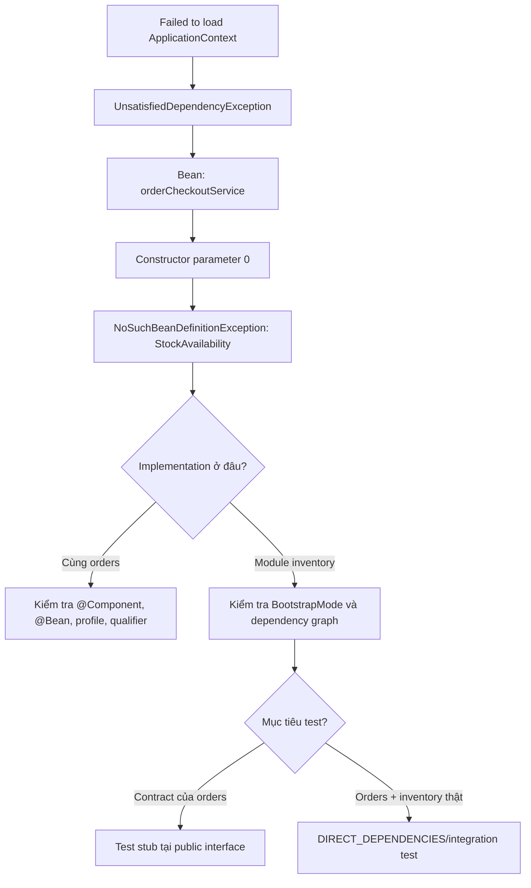

# NoSuchBeanDefinitionException do bootstrap quá hẹp

## Mục tiêu học tập

Trong chương **Test failure** của học phần **Spring Modulith Verification & Testing**, lỗi `NoSuchBeanDefinitionException` có thể xuất hiện khi chạy `@ApplicationModuleTest` dù cùng ứng dụng vẫn khởi động bình thường với `@SpringBootTest`. Một nguyên nhân đặc trưng của ứng dụng modular là **phạm vi bootstrap quá hẹp**: test chỉ khởi động module đang kiểm tra, trong khi một service của module đó cần bean triển khai nằm ở module phụ thuộc.

Sau bài học, bạn có thể:

- Giải thích vì sao **class tồn tại trên classpath** không đồng nghĩa **bean tồn tại trong ApplicationContext**.
- Đọc chuỗi `Failed to load ApplicationContext → UnsatisfiedDependencyException → NoSuchBeanDefinitionException` và xác định đúng dependency bị thiếu.
- Hiểu các chế độ `@ApplicationModuleTest`: `STANDALONE`, `DIRECT_DEPENDENCIES` và `ALL_DEPENDENCIES`, cùng hệ quả đối với component scanning và test context.
- Chọn giữa **test double cho API công khai** và **bootstrap module phụ thuộc thật** tùy mục tiêu kiểm thử.
- Viết test Spring Modulith minh họa cả cách sửa bằng `@TestConfiguration` lẫn cách sửa bằng `BootstrapMode.DIRECT_DEPENDENCIES`.
- Phân biệt lỗi bootstrap quá hẹp với bean không được đăng ký do `@Profile`, `@Conditional`, thiếu `@Component`, qualifier, classpath hay lỗi khởi tạo.
- Kết hợp `ApplicationModules.verify()`, `PublishedEvents`, kiểm thử tích hợp database và quality gate trong CI mà không làm mất giá trị kiểm tra ranh giới module.

## 1. Bài toán: ứng dụng chạy, module test lại thiếu bean

Giả sử ứng dụng Spring Boot có hai application module:

- `orders`: tiếp nhận yêu cầu đặt hàng và phát `OrderPlaced`.
- `inventory`: cung cấp API công khai `StockAvailability` để trả lời còn hàng hay không.

`OrderCheckoutService` trong `orders` nhận `StockAvailability` qua constructor. Implementation `DatabaseStockAvailability` nằm trong package nội bộ `inventory.internal`, được đăng ký làm Spring bean.

Khi chạy toàn bộ ứng dụng, Spring có thể tạo bean ở cả hai module:

```text
ApplicationContext toàn ứng dụng
  orders.OrderCheckoutService
    └─ inventory.StockAvailability (interface công khai)
         └─ inventory.internal.DatabaseStockAvailability (@Service)
```

Nhưng một test `@ApplicationModuleTest` của `orders` ở chế độ `STANDALONE` tập trung bootstrap module `orders`. Module `inventory` **không mặc nhiên được khởi động** chỉ vì `orders` có một dependency về kiểu Java tới nó.

```text
ApplicationContext của orders module test (STANDALONE)
  orders.OrderCheckoutService       [Có]
    └─ yêu cầu StockAvailability     [Không có bean phù hợp]

  inventory.internal.DatabaseStockAvailability
                                   [Ngoài phạm vi bootstrap]
```

Kết quả thường là lỗi khi Spring tạo `OrderCheckoutService`, trước khi phương thức `@Test` được thực thi.

> **“Bootstrap quá hẹp” không có nghĩa Spring Modulith bị lỗi.** `STANDALONE` cố ý cô lập module để tạo test nhanh và làm rõ API phụ thuộc. Cần chọn cách cung cấp dependency phù hợp, chứ không mặc định tải toàn ứng dụng để lỗi biến mất.

## 2. Bean trên classpath khác bean trong context như thế nào?

Để hiểu `NoSuchBeanDefinitionException`, cần phân biệt ba tầng.

| Tầng | Câu hỏi | Ví dụ |
| --- | --- | --- |
| **Classpath** | JVM có thể tải lớp/interface không? | `com.example.shop.inventory.StockAvailability` compile và import được |
| **Bean definition** | Spring context có đăng ký một bean phù hợp không? | Bean definition của `DatabaseStockAvailability` có được scan/import không? |
| **Bean instance / injection** | Spring có tạo được bean rồi inject cho service không? | `OrderCheckoutService` có nhận được một `StockAvailability` không? |

Trong trường hợp bootstrap hẹp, interface `StockAvailability` **có trên classpath**, nhưng implementation của nó không được đăng ký trong context hiện tại. Vì vậy:

- Không nhất thiết có `ClassNotFoundException`.
- Không nhất thiết có lỗi biên dịch.
- Có thể có `NoSuchBeanDefinitionException` do không có bean candidate phù hợp.
- Nếu sau khi mở phạm vi module mà implementation được đăng ký nhưng database không kết nối được, lỗi mới có thể chuyển thành `BeanCreationException` hoặc exception về datasource.

Lỗi là ở **đồ thị bean của test context**, chưa chứng minh logic đặt hàng hay event `OrderPlaced` sai.

## 3. Đọc stack trace để nhận biết lỗi bootstrap

Đây là một **stack trace giả lập đã rút gọn** cho test `OrderCheckoutModuleTests`:

```text
java.lang.IllegalStateException:
  Failed to load ApplicationContext for
  [MergedContextConfiguration@... testClass =
   com.example.shop.orders.OrderCheckoutModuleTests, ...]
    at org.springframework.test.context.cache.
       DefaultCacheAwareContextLoaderDelegate.loadContext(...)

Caused by: org.springframework.beans.factory.
  UnsatisfiedDependencyException:
  Error creating bean with name 'orderCheckoutService':
  Unsatisfied dependency expressed through constructor parameter 0
    at org.springframework.beans.factory.support.
       ConstructorResolver.createArgumentArray(...)

Caused by: org.springframework.beans.factory.
  NoSuchBeanDefinitionException:
  No qualifying bean of type
  'com.example.shop.inventory.StockAvailability' available:
  expected at least 1 bean which qualifies as autowire candidate
    at org.springframework.beans.factory.support.
       DefaultListableBeanFactory.raiseNoMatchingBeanFound(...)
```

Đọc log theo trình tự:

1. **Tên test:** `OrderCheckoutModuleTests` thuộc package `orders`.
2. **Lỗi bọc ngoài:** `Failed to load ApplicationContext` báo context không tạo được; chưa có assertion chạy.
3. **Bean không tạo được:** `orderCheckoutService`.
4. **Injection point:** `constructor parameter 0` là dependency đầu tiên.
5. **Nguyên nhân cụ thể:** không có bean candidate kiểu `com.example.shop.inventory.StockAvailability`.
6. **Giả thuyết cần kiểm chứng:** implementation thực ở module `inventory` không được đưa vào phạm vi `STANDALONE` của `orders`.

Không nên kết luận chỉ từ dòng `Failed to load ApplicationContext`; cần đọc chuỗi `Caused by` và **fully qualified type**. Cũng không nên thấy thiếu một interface rồi lập tức thêm `@ComponentScan("com.example.shop")`, vì cách này có thể phá mục tiêu của module test.

### 3.1. Đọc exception từ ngoài vào trong, rồi kiểm tra từ trong ra ngoài



**Nguyên nhân sâu nhất** thường là điểm khởi đầu tốt, nhưng không phải lúc nào cũng là kết luận cuối. Nếu `NoSuchBeanDefinitionException` xuất hiện vì `@Qualifier("primaryStock")` không khớp tên bean, mở thêm module chưa chắc giải quyết được. Cần kiểm tra injection point và quy tắc chọn bean.

## 4. STANDALONE, DIRECT_DEPENDENCIES và ALL_DEPENDENCIES

`@ApplicationModuleTest` của Spring Modulith khởi động test context theo module chứa test. Các bootstrap mode xác định phạm vi được phép khởi động:

| Bootstrap mode | Ý nghĩa | Thích hợp khi |
| --- | --- | --- |
| `STANDALONE` | Chỉ bootstrap module đang được test theo quy tắc của Spring Modulith; dependency ngoài có thể cần test double | Unit/module integration test tập trung API và hành vi của một module |
| `DIRECT_DEPENDENCIES` | Bootstrap module đang test cùng **các module mà nó phụ thuộc trực tiếp** | Kiểm tra integration của module với dependency trực tiếp |
| `ALL_DEPENDENCIES` | Bootstrap module đang test cùng **các module phụ thuộc bắc cầu** cần thiết | Luồng test cần nhiều lớp dependency thực |

`ALL_DEPENDENCIES` **không có nghĩa toàn bộ các module không liên quan cũng được khởi động**. Nó khác một bài `@SpringBootTest` toàn ứng dụng. Tùy cấu trúc project, Spring Modulith còn có cấu hình riêng về module detection, exposed API và dependency constraints; vì vậy phạm vi thực tế phải được hiểu từ module graph, không chỉ nhìn tên mode.

Mẫu khai báo:

```java
import org.springframework.modulith.test.ApplicationModuleTest;
import org.springframework.modulith.test.ApplicationModuleTest.BootstrapMode;

@ApplicationModuleTest(
        mode = BootstrapMode.STANDALONE)
class OrdersAloneTests {
    // Chỉ orders; cung cấp test double nếu cần API ngoài.
}

@ApplicationModuleTest(
        mode = BootstrapMode.DIRECT_DEPENDENCIES)
class OrdersWithInventoryTests {
    // Orders + các module dependency trực tiếp.
}

@ApplicationModuleTest(
        mode = BootstrapMode.ALL_DEPENDENCIES)
class OrdersWithTransitiveDependenciesTests {
    // Orders + các module dependency trực tiếp/bắc cầu.
}
```

Các class trên chỉ minh họa annotation/mode, chưa phải ba bài test hoàn chỉnh. Không nên đặt tất cả trong một source file với test setup thực và cho rằng chúng đều cần chạy trong project.

**Không có mode nào bảo đảm mọi bean cần thiết sẽ tạo được.** Nếu implementation thiếu `@Service`, bị vô hiệu hóa bởi profile hoặc cần DB chưa cấu hình, mở rộng bootstrap vẫn có thể thất bại vì lý do khác.

## 5. Ví dụ đầy đủ: thiếu StockAvailability ở module orders

Giả định Java 17+, Spring Boot, JUnit Jupiter, AssertJ và Spring Modulith. Lớp `ShopApplication` có `@SpringBootApplication` nằm trong package `com.example.shop`, còn `orders` và `inventory` được nhận diện là hai application module trực tiếp dưới package gốc.

Thư mục ví dụ:

```text
src/main/java/com/example/shop/
├── ShopApplication.java
├── orders/
│   ├── OrderPlaced.java
│   └── OrderCheckoutService.java
└── inventory/
    ├── StockAvailability.java
    └── internal/
        └── InMemoryStockAvailability.java

src/test/java/com/example/shop/orders/
├── OrderCheckoutBrokenTests.java
├── OrderCheckoutModuleTests.java
└── OrderInventoryIntegrationTests.java
```

Thêm `spring-modulith-starter-test` trong phạm vi test bằng dependency Maven; dùng BOM tương thích với Spring Boot để quản lý version:

```xml
<dependency>
    <groupId>org.springframework.modulith</groupId>
    <artifactId>spring-modulith-starter-test</artifactId>
    <scope>test</scope>
</dependency>
```

### 5.1. Public interface của module inventory

Tệp `src/main/java/com/example/shop/inventory/StockAvailability.java`:

```java
package com.example.shop.inventory;

import java.util.UUID;

public interface StockAvailability {

    boolean isAvailable(UUID productId);
}
```

Interface được đặt ở **package gốc của module `inventory`** để thể hiện API mà module `orders` có thể sử dụng. Nếu đặt API trong một package con, ứng dụng thực tế có thể cần định nghĩa **named interface** hoặc exposed API phù hợp với quy tắc module.

### 5.2. Bean thật nằm trong module inventory

Tệp `src/main/java/com/example/shop/inventory/internal/InMemoryStockAvailability.java`:

```java
package com.example.shop.inventory.internal;

import com.example.shop.inventory.StockAvailability;
import java.util.UUID;
import org.springframework.stereotype.Service;

@Service
public class InMemoryStockAvailability
        implements StockAvailability {

    @Override
    public boolean isAvailable(UUID productId) {
        // Demo: tồn kho luôn đủ. Production sẽ dùng repository.
        return true;
    }
}
```

Trong ứng dụng đầy đủ, `@Service` này là bean có thể inject qua `StockAvailability`. Nhưng vì nó thuộc **module inventory**, ta **không mặc định** nó có mặt trong module test `orders` ở `STANDALONE`.

Không nên di chuyển class implementation này vào `orders` chỉ để một test xanh: điều đó trộn trách nhiệm tồn kho vào module đặt hàng, làm yếu tính modular.

### 5.3. Service của module orders

Tệp `src/main/java/com/example/shop/orders/OrderPlaced.java`:

```java
package com.example.shop.orders;

import java.util.UUID;

public record OrderPlaced(
        UUID orderId,
        UUID productId) {
}
```

Tệp `src/main/java/com/example/shop/orders/OrderCheckoutService.java`:

```java
package com.example.shop.orders;

import com.example.shop.inventory.StockAvailability;
import java.util.Objects;
import java.util.UUID;
import org.springframework.context.ApplicationEventPublisher;
import org.springframework.stereotype.Service;

@Service
public class OrderCheckoutService {

    private final StockAvailability stock;
    private final ApplicationEventPublisher publisher;

    public OrderCheckoutService(
            StockAvailability stock,
            ApplicationEventPublisher publisher) {
        this.stock = stock;
        this.publisher = publisher;
    }

    public void checkout(UUID orderId, UUID productId) {
        Objects.requireNonNull(orderId, "orderId");
        Objects.requireNonNull(productId, "productId");

        if (!stock.isAvailable(productId)) {
            throw new IllegalStateException("Out of stock");
        }

        publisher.publishEvent(new OrderPlaced(
                orderId, productId));
    }
}
```

Khi Spring tạo `OrderCheckoutService`, nó cần một bean `StockAvailability` trước khi phương thức `checkout(…)` được gọi. Nếu bean không tồn tại, **lỗi bootstrap** xảy ra; `PublishedEvents` chưa có dịp ghi nhận `OrderPlaced`.

### 5.4. Test gây lỗi do bootstrap quá hẹp

Tệp demo `src/test/java/com/example/shop/orders/OrderCheckoutBrokenTests.java`:

```java
package com.example.shop.orders;

import org.junit.jupiter.api.Test;
import org.springframework.beans.factory.annotation.Autowired;
import org.springframework.modulith.test.ApplicationModuleTest;
import org.springframework.modulith.test.ApplicationModuleTest.BootstrapMode;

@ApplicationModuleTest(mode = BootstrapMode.STANDALONE)
class OrderCheckoutBrokenTests {

    @Autowired
    OrderCheckoutService service;

    @Test
    void shouldPlaceOrder() {
        // Nếu thiếu StockAvailability, test không tới dòng này.
    }
}
```

**Dự kiến lỗi:** không có bean `StockAvailability`, bean `OrderCheckoutService` tạo thất bại và Spring Test báo `Failed to load ApplicationContext`. Đây là test **cố tình sai** nhằm tái hiện vấn đề; không giữ nó trong suite CI sau khi bài thực hành kết thúc.

Chú ý: tên exception và thông báo có thể hơi khác theo phiên bản Spring Boot/Spring Framework. Điểm ổn định của chẩn đoán là **một dependency cần inject không có candidate trong context**.

## 6. Cách sửa A: test double cho dependency ngoài module

Nếu mục tiêu là kiểm thử **hợp đồng nghiệp vụ của module orders** — có hàng thì phát `OrderPlaced`, hết hàng thì không phát — ta không cần khởi động implementation thật của module `inventory`. Hãy cung cấp một bean stub cho public interface `StockAvailability` trong test context.

### 6.1. Module test với @TestConfiguration và @Import

Tệp `src/test/java/com/example/shop/orders/OrderCheckoutModuleTests.java`:

```java
package com.example.shop.orders;

import static org.assertj.core.api.Assertions.assertThat;
import static org.assertj.core.api.Assertions.assertThatThrownBy;

import com.example.shop.inventory.StockAvailability;
import java.util.UUID;
import java.util.concurrent.atomic.AtomicBoolean;
import org.junit.jupiter.api.AfterEach;
import org.junit.jupiter.api.Test;
import org.springframework.beans.factory.annotation.Autowired;
import org.springframework.boot.test.context.TestConfiguration;
import org.springframework.context.annotation.Bean;
import org.springframework.context.annotation.Import;
import org.springframework.modulith.test.ApplicationModuleTest;
import org.springframework.modulith.test.PublishedEvents;

@ApplicationModuleTest
@Import(OrderCheckoutModuleTests.TestStockConfiguration.class)
class OrderCheckoutModuleTests {

    @Autowired
    OrderCheckoutService service;

    @Autowired
    StubStockAvailability stock;

    @AfterEach
    void resetStock() {
        stock.setAvailable(true);
    }

    @Test
    void publishesOrderPlacedWhenStockIsAvailable(
            PublishedEvents events) {
        UUID orderId = UUID.randomUUID();
        UUID productId = UUID.randomUUID();

        stock.setAvailable(true);
        service.checkout(orderId, productId);

        var placed = events.ofType(OrderPlaced.class)
                .matching(event ->
                        orderId.equals(event.orderId()));

        assertThat(placed)
                .hasSize(1)
                .allSatisfy(event ->
                        assertThat(event.productId())
                                .isEqualTo(productId));
    }

    @Test
    void doesNotPublishWhenOutOfStock(
            PublishedEvents events) {
        UUID orderId = UUID.randomUUID();
        UUID productId = UUID.randomUUID();

        stock.setAvailable(false);

        assertThatThrownBy(() ->
                service.checkout(orderId, productId))
                .isInstanceOf(IllegalStateException.class)
                .hasMessage("Out of stock");

        assertThat(events.ofType(OrderPlaced.class)
                .matching(event ->
                        orderId.equals(event.orderId())))
                .isEmpty();
    }

    @TestConfiguration(proxyBeanMethods = false)
    static class TestStockConfiguration {

        @Bean
        StubStockAvailability stockAvailabilityStub() {
            return new StubStockAvailability();
        }
    }

    static class StubStockAvailability
            implements StockAvailability {

        private final AtomicBoolean available =
                new AtomicBoolean(true);

        void setAvailable(boolean value) {
            available.set(value);
        }

        @Override
        public boolean isAvailable(UUID productId) {
            return available.get();
        }
    }
}
```

**Vì sao cách này giải quyết đúng vấn đề?**

1. `@ApplicationModuleTest` vẫn chỉ bootstrap module `orders`.
2. `@Import(TestStockConfiguration.class)` đăng ký một bean test trong context.
3. `StubStockAvailability` implements public interface `StockAvailability`, nên Spring có candidate để inject vào `OrderCheckoutService`.
4. Test điều khiển kết quả phụ thuộc ngoài module theo từng tình huống; `PublishedEvents` xác minh chính service của `orders` đã phát đúng event.

Hai test xác minh **behavior contract** của `orders`, không khẳng định code tồn kho production hoạt động. Việc dùng public interface thay vì truy cập `inventory.internal` giữ ranh giới Spring Modulith rõ ràng.

### 6.2. Vì sao dùng stub thay vì mock toàn bộ service?

Nếu mock `OrderCheckoutService`, ta không còn kiểm chứng nhánh `checkout(…)` hoặc việc gọi `ApplicationEventPublisher` của chính service đó. Stub **dependency nằm ngoài phạm vi test** thì hợp lý; mock **đối tượng đang cần kiểm tra** thì dễ tạo bài test không phản ánh hành vi production.

Spring Framework/Spring Boot ở các phiên bản khác nhau cung cấp khả năng test bean override bằng `@MockitoBean` hoặc `@MockBean`. Cơ chế mock cũng có thể dùng thay stub khi phù hợp với phiên bản dự án. Nhưng ví dụ `@TestConfiguration` ở đây không phụ thuộc API mocking và làm rõ **bean được cung cấp cho đúng interface**, không cần thay đổi code production.

### 6.3. Cẩn thận với test context cache

Spring Test có thể cache context và dùng lại bean giữa các test method. `StubStockAvailability` trong ví dụ có trạng thái, nên test đặt `setAvailable(true/false)` trước hành động và reset tại `@AfterEach`.

Nếu suite cho chạy test song song trong cùng context, một stub mutable dùng chung có thể khiến test tác động lẫn nhau. Khi đó nên dùng fixture cô lập hơn, stub không trạng thái, cấu hình test riêng hoặc hạn chế chạy song song đối với bean trạng thái chung.

Không coi context cache là lỗi framework; đó là cơ chế tối ưu. Test phải kiểm soát shared state của chính mình.

## 7. Cách sửa B: bootstrap module inventory thật

Nếu mục tiêu của test là **orders dùng chính implementation của inventory** — ví dụ cần kiểm tra wiring, repository hoặc transaction thực — stub không đủ. Có thể chọn mode rộng hơn:

```java
package com.example.shop.orders;

import static org.assertj.core.api.Assertions.assertThat;

import java.util.UUID;
import org.junit.jupiter.api.Test;
import org.springframework.beans.factory.annotation.Autowired;
import org.springframework.modulith.test.ApplicationModuleTest;
import org.springframework.modulith.test.ApplicationModuleTest.BootstrapMode;
import org.springframework.modulith.test.PublishedEvents;

@ApplicationModuleTest(
        mode = BootstrapMode.DIRECT_DEPENDENCIES)
class OrderInventoryIntegrationTests {

    @Autowired
    OrderCheckoutService service;

    @Test
    void publishesWhenRealInventoryBeanSaysAvailable(
            PublishedEvents events) {
        UUID orderId = UUID.randomUUID();
        UUID productId = UUID.randomUUID();

        service.checkout(orderId, productId);

        assertThat(events.ofType(OrderPlaced.class)
                .matching(event ->
                        orderId.equals(event.orderId())))
                .hasSize(1);
    }
}
```

Trong cấu trúc mẫu, module `orders` có dependency trực tiếp tới API công khai của `inventory`. Mode `DIRECT_DEPENDENCIES` cho phép test bootstrap dependency module phù hợp, vì vậy bean `InMemoryStockAvailability` trong `inventory.internal` có thể được tạo và inject vào `orders`.

Đây là một **module integration test**, không còn cô lập `orders` như phương án A. Nếu implementation thật của inventory truy cập JPA, datasource, migration hoặc Testcontainers, test cần cung cấp hạ tầng tương ứng. Một context fail mới về DB không chứng minh `DIRECT_DEPENDENCIES` là sai; nó chỉ cho thấy phạm vi được mở rộng và cần cấu hình integration đúng.

### 7.1. Khi nào chọn ALL_DEPENDENCIES?

Giả sử `orders` phụ thuộc `inventory`, còn `inventory` phụ thuộc `catalog` thông qua một API hợp lệ. Nếu integration test cần cả chuỗi module, `ALL_DEPENDENCIES` có thể là lựa chọn phù hợp:

```java
@ApplicationModuleTest(
        mode = BootstrapMode.ALL_DEPENDENCIES)
class OrderWithInventoryAndCatalogTests {
    // Bootstrap các module phụ thuộc bắc cầu phù hợp.
}
```

Đoạn trên minh họa annotation, không phải một test hoàn chỉnh. Không chọn `ALL_DEPENDENCIES` theo thói quen nếu chỉ cần một public port stub. Phạm vi càng rộng thì thời gian khởi động, dữ liệu fixture và nguy cơ nhiễu hạ tầng càng cao.

### 7.2. So sánh hai phương án

| Tiêu chí | Stub + STANDALONE | DIRECT_DEPENDENCIES |
| --- | --- | --- |
| Mục tiêu | Hợp đồng riêng của `orders` | Tích hợp `orders` với module phụ thuộc |
| `StockAvailability` | Bean fake trong test | Bean implementation thật của `inventory` |
| Tốc độ / cô lập | Thường nhanh, dễ điều khiển | Có thể chậm hơn, nhiều infrastructure hơn |
| Phát hiện bug trong inventory | Không | Có thể, nếu test đi qua code thật |
| Database và migration | Không bắt buộc cho ví dụ | Có thể bắt buộc theo implementation |
| Kiểm chứng public dependency | Có thể dùng API công khai | Có thể dùng API công khai |
| Bảo đảm toàn ứng dụng đúng | Không | Không: chỉ phạm vi module bootstrap được chọn |

**Khuyến nghị thiết kế suite:** có nhiều test module nhỏ dùng stub đúng boundary và một số integration test chạy implementation thật ở các luồng quan trọng. Kết hợp với test kiến trúc và test database khi hợp đồng thực sự cần tính bền vững.

## 8. Checklist xác nhận đúng là “bootstrap quá hẹp”

Không phải mọi `NoSuchBeanDefinitionException` đều do `STANDALONE`. Trước khi mở rộng mode hoặc tạo stub, tự trả lời:

1. **Exception yêu cầu type nào?** Đọc fully qualified type từ `NoSuchBeanDefinitionException`.
2. **Injection point nằm ở đâu?** Tên bean/constructor parameter từ `UnsatisfiedDependencyException`.
3. **Type này thuộc module nào?** Không suy đoán theo tên đơn giản nếu package là bằng chứng rõ hơn.
4. **Có một Spring bean triển khai thật không?** Kiểm tra annotation `@Service`, `@Component` hoặc `@Bean` trong thiết kế được mô tả.
5. **Bean đó có được bootstrap không?** Kiểm tra `@ApplicationModuleTest`, bootstrap mode và module dependency graph.
6. **Bean có bị điều kiện loại không?** `@Profile`, `@ConditionalOnProperty`, qualifier hoặc test configuration có thể làm bean vắng mặt.
7. **Implementation có tạo được khi tải vào không?** Một bean có thể được đăng ký nhưng hỏng khi khởi tạo do DB/config.
8. **Test đang chứng minh điều gì?** Hợp đồng của một module hay tích hợp thật qua boundary?

Nếu vấn đề nằm ở **số 5** và mục tiêu ở **số 8** đã rõ, mới chọn stub hoặc thay bootstrap mode. Đây là cách tránh sửa sai nguyên nhân.

## 9. Các lỗi trông giống nhưng không phải bootstrap hẹp

| Dấu hiệu / exception | Ý nghĩa thường gặp | Cách xử lý đúng hướng |
| --- | --- | --- |
| `NoSuchBeanDefinitionException`, implementation ở module khác | Có thể bootstrap thiếu dependency module | Stub công khai hoặc mode tích hợp |
| `NoSuchBeanDefinitionException`, implementation ở **cùng module** | Component chưa được scan/đăng ký hoặc bị condition loại | Kiểm tra `@Service`, `@Bean`, `@Import`, profile |
| `NoSuchBeanDefinitionException` có `@Qualifier("primaryStock")` | Có thể có bean nhưng sai qualifier/name | Kiểm tra injection point và candidate qualifiers |
| `NoUniqueBeanDefinitionException` | Có nhiều candidate cùng type | Chọn `@Primary`, `@Qualifier` hoặc thiết kế lại |
| `BeanDefinitionOverrideException` | Hai definitions tranh cùng bean name | Đổi tên/loại definition trùng, không mở bootstrap vô tội vạ |
| `BeanCreationException` | Bean definition tồn tại nhưng khởi tạo thất bại | Đọc `Caused by` về constructor, property, DB |
| `ClassNotFoundException` / `NoClassDefFoundError` | Lớp không có trong runtime classpath hoặc không load được | Kiểm tra dependency build/version |
| `Not a managed type` | Entity không được JPA quản lý trong context | Kiểm tra `@Entity` và phạm vi JPA scan |
| `Cannot load driver class` / `Connection refused` | Datasource thiếu driver hoặc DB không kết nối | Cấu hình test database/infrastructure |
| `ApplicationModules.verify()` báo lỗi | Vi phạm cấu trúc module/API/chu kỳ phụ thuộc | Sửa đồ thị phụ thuộc kiến trúc |

### 9.1. @Profile hoặc @Conditional khiến bean biến mất

Giả sử inventory có:

```java
@Profile("prod")
@Service
class DatabaseStockAvailability
        implements StockAvailability {
    // ...
}
```

Nếu test dùng profile `test`, bean này **không được đăng ký ngay cả khi bootstrap inventory**. Mở `DIRECT_DEPENDENCIES` không đủ; cần cấu hình bean phù hợp profile test hoặc một implementation test chủ đích.

Với `@ConditionalOnProperty`, xem điều kiện và property có được cung cấp không. Khi thấy `NoSuchBeanDefinitionException`, đừng mặc định thiếu package scan; hãy kiểm tra cả **điều kiện tạo bean**.

### 9.2. Qualifier không được đáp ứng

Ví dụ consumer yêu cầu:

```java
public OrderCheckoutService(
        @Qualifier("primaryStock") StockAvailability stock,
        ApplicationEventPublisher publisher) {
    this.stock = stock;
    this.publisher = publisher;
}
```

Đoạn constructor minh họa cần import `org.springframework.beans.factory.annotation.Qualifier`. Nếu có một bean `StockAvailability` nhưng **không có qualifier/tên phù hợp**, Spring vẫn có thể báo thiếu candidate cho injection point này. Thêm stub theo type nhưng không đúng qualifier sẽ không giải quyết lỗi.

Điểm cần nhớ: **có bean cùng type** không có nghĩa **có bean phù hợp injection point**.

### 9.3. Vòng dependency giữa module

Nếu một thiết kế cần:

```text
orders → inventory → orders
```

thì mở rộng bootstrap có thể dẫn tới phụ thuộc vòng bean hoặc vi phạm module architecture. Đừng bật `spring.main.allow-circular-references=true` như một phương án sửa mặc định. Hãy kiểm tra lại boundary, public API, domain event và dependency rule. `ApplicationModules.verify()` giúp phát hiện quan hệ module không hợp lệ.

## 10. Tại sao không sửa bằng @SpringBootTest cho mọi trường hợp?

Đổi `@ApplicationModuleTest` sang `@SpringBootTest` có thể làm bean `inventory` xuất hiện vì test tải rộng hơn. Tuy nhiên, điều đó có thể tạo ba vấn đề:

1. **Mất tính tập trung:** test hợp đồng `orders` phải khởi động nhiều bean không liên quan.
2. **Che lỗi boundary:** một test module lẽ ra cần khai báo public dependency rõ ràng lại âm thầm sử dụng implementation của module khác.
3. **Kéo hạ tầng vào test:** JPA, migration, broker hoặc gateway của module khác có thể làm test chậm/flaky.

`@SpringBootTest` hoàn toàn hợp lý cho một **integration test toàn tuyến có chủ đích**. Nó chỉ không phải cách sửa tự động cho mọi `NoSuchBeanDefinitionException`.

Tương tự, việc thêm `@ComponentScan("com.example.shop")` để quét toàn bộ ứng dụng vào module test có thể làm mất sự cô lập; chỉ dùng mở rộng scan khi thật sự thuộc thiết kế bootstrap của test.

## 11. Cách đọc log khi context cache che lỗi đầu tiên

Spring Test có **ApplicationContext cache**. Ở các phiên bản Spring Framework hỗ trợ context failure threshold, khi một cấu hình context đã thất bại, những test sau dùng cùng key có thể nhận thông báo:

```text
ApplicationContext failure threshold (1) exceeded:
skipping repeated attempt to load context
```

Đây thường **không phải nguyên nhân gốc**. Nó nói framework đang bỏ qua nỗ lực tải lại cùng cấu hình đã thất bại.

Quy trình:

1. Tìm **lần đầu tiên** xuất hiện `Failed to load ApplicationContext` của context đó trong log build.
2. Đọc toàn bộ chuỗi `Caused by` cho lần đầu, nhất là type bean thiếu.
3. Xác định bootstrap mode, module test, active profile và `@Import`.
4. Sửa đúng nguyên nhân rồi chạy lại test nhỏ nhất.

Đừng tăng threshold chỉ để giữ build chạy lâu hơn; nó không tạo bean bị thiếu.

## 12. Module dependency hợp lệ không tự tạo bean

`ApplicationModules.verify()` kiểm tra đồ thị và ranh giới kiến trúc giữa các application module. Ví dụ:

```java
import org.junit.jupiter.api.Test;
import org.springframework.modulith.core.ApplicationModules;

class ArchitectureVerificationTests {

    @Test
    void respectsModuleBoundaries() {
        ApplicationModules.of(ShopApplication.class).verify();
    }
}
```

`ShopApplication` là lớp ứng dụng Spring Boot gốc minh họa; thay bằng class thực tế. Nếu `orders` chỉ tham chiếu `inventory.StockAvailability` là API công khai, dependency có thể **hợp lệ** trong kiến trúc. Tuy nhiên, `ApplicationModules.verify()` pass **không đồng nghĩa** Spring test context `STANDALONE` có bean triển khai interface.

Hai phép kiểm trả lời hai câu hỏi khác nhau:

| Phép kiểm | Câu hỏi được trả lời |
| --- | --- |
| `ApplicationModules.verify()` | Quan hệ phụ thuộc giữa các module và truy cập API có đúng quy tắc không? |
| `@ApplicationModuleTest` `STANDALONE` với stub | Module `orders` có thực thi hợp đồng khi dependency đáp ứng public API không? |
| `@ApplicationModuleTest` `DIRECT_DEPENDENCIES` | Các bean của module `orders` và dependency trực tiếp có tích hợp được không? |
| `PublishedEvents` | Publisher có phát event đúng type, payload và số lần không? |
| `Scenario` và test listener | Consumer async/hậu commit có tạo kết quả phù hợp không? |
| Integration test repository | Side effect dữ liệu có được lưu và commit đúng không? |

Do vậy, quality gate phải kết hợp **kiến trúc**, **bootstrap/wiring**, **event behavior** và **database/integration** khi mục tiêu khóa học yêu cầu.

## 13. Mẫu quy trình debug tại máy phát triển và trong CI

Khi một bài `@ApplicationModuleTest` bị lỗi, thực hiện các bước nhỏ:

### Bước 1 — Thu thập stack trace của test đầu tiên thất bại

Ghi tên test class/method, chuỗi `Caused by` và fully qualified type thiếu. Đừng copy mỗi dòng `Failed to load ApplicationContext`.

### Bước 2 — Viết một giả thuyết cụ thể

Ví dụ: “`OrderCheckoutService` trong `orders` inject `StockAvailability` từ `inventory`, nhưng `STANDALONE` không bootstrap `inventory` nên không có bean candidate.”

Giả thuyết tốt **có thể bị bác bỏ**: nếu kiểm tra cho thấy implementation thuộc chính `orders`, cần quay lại scan/profile, không tiếp tục hướng module dependency.

### Bước 3 — Xác định mục tiêu test

Chọn một trong hai:

- **Module contract:** chỉ kiểm tra hành vi của `orders` trước public port; cấp stub.
- **Integration dependency:** cần triển khai thật của `inventory`; dùng `DIRECT_DEPENDENCIES` nếu dependency trực tiếp hợp lệ.

### Bước 4 — Sửa thay đổi tối thiểu

Không chỉnh nhiều thứ cùng lúc: vừa đổi bootstrap mode, vừa bật component scan toàn app, vừa thêm mock và đổi profile sẽ khó biết thay đổi nào thực sự giải quyết lỗi.

### Bước 5 — Rerun đúng test

Khi bước thực thi test thuộc quyền của người làm QA, có thể chạy:

```bash
./mvnw -Dtest=OrderCheckoutModuleTests test
```

Hoặc:

```bash
./gradlew test --tests "com.example.shop.orders.OrderCheckoutModuleTests" --stacktrace
```

Đây là **lệnh minh họa**, không phải kết quả đã chạy cho bài này. Nếu context khởi động thành công nhưng assertion `PublishedEvents` fail, đó là **lỗi hành vi sau bootstrap** cần kiểm tra riêng: nhánh `checkout`, matching `orderId`, số lần publish và payload.

### Bước 6 — Chạy lại các quality gate liên quan

Kiểm tra `ApplicationModules.verify()` để ngăn vi phạm boundary khi sửa. Nếu đổi bootstrap mode hoặc thêm implementation thật, chạy thêm integration test với datasource/transaction phù hợp.

### Bước 7 — Ghi lại nguyên nhân và phòng ngừa

Một ghi chú pull request tốt nên có:

```text
Failure: NoSuchBeanDefinitionException for inventory.StockAvailability
Test: orders.OrderCheckoutModuleTests
Mode: STANDALONE
Root cause: inventory implementation outside module test bootstrap
Fix: import test stub for public StockAvailability interface
Validation: module test passes; architecture verification passes
Integration coverage: separate DIRECT_DEPENDENCIES test
```

Dòng “passes” ở trên là **mẫu ghi chú sau khi thực sự rerun thành công**; không tự ghi nó nếu chưa chạy test.

## 14. Anti-pattern và lý do không nên áp dụng

| Anti-pattern | Hệ quả | Giải pháp |
| --- | --- | --- |
| Chỉ đọc dòng `Failed to load ApplicationContext` | Không biết dependency nào thiếu | Đọc `Caused by` và injection point |
| Thêm `@ComponentScan` toàn ứng dụng | Che bootstrap scope, tải nhiều bean | Stub public port hoặc chọn mode phù hợp |
| Đổi toàn bộ module test thành `@SpringBootTest` | Test nặng, mất tính cô lập | Giữ module test nhỏ, tách integration test |
| Di chuyển `inventory.internal` sang `orders` để test xanh | Phá ownership và kiến trúc | Dùng API công khai và đúng bootstrap |
| Mock `OrderCheckoutService` trong chính test của nó | Không kiểm chứng logic checkout | Mock/stub dependency bên ngoài |
| Bật profile production để xuất hiện bean | Có thể kết nối dịch vụ thật | Cấu hình test bean/profile riêng |
| Bật circular references để che chu trình | Giữ phụ thuộc vòng thiết kế | Sửa dependency graph, verify kiến trúc |
| Sửa bằng `@Primary` dù bean bị thiếu | Không tạo ra candidate bị thiếu | Đăng ký stub hoặc bootstrap bean thật |
| Chỉ assert event nguồn sau khi test context fail | Assertion chưa chạy | Sửa wiring trước, rồi kiểm tra event |
| Bỏ qua database failure sau khi mở mode | Integration test còn thiếu hạ tầng | Cấu hình DB/test infrastructure đúng mục tiêu |

## 15. Bài thực hành

Dùng `OrderCheckoutService`, `StockAvailability` và các test ví dụ ở phần 5–7:

1. **Tái hiện lỗi:** chạy (trong môi trường thực hành) `OrderCheckoutBrokenTests` ở `STANDALONE` mà không có stub. Ghi tên bean thất bại, kiểu cần inject và tầng `Caused by`.
2. **Đọc log:** tìm `UnsatisfiedDependencyException`, `constructor parameter 0` và `NoSuchBeanDefinitionException`. Phân biệt class trên classpath với bean trong context.
3. **Sửa bằng stub:** thêm `@TestConfiguration` chứa bean `StockAvailability`. Kiểm tra `OrderPlaced` được publish đúng một lần khi có hàng.
4. **Nhánh từ chối:** đổi stub trả `false`; kiểm tra service ném `IllegalStateException` và không phát `OrderPlaced` cho đơn.
5. **Sửa bằng mode:** bỏ stub và dùng `DIRECT_DEPENDENCIES`. Giải thích tại sao implementation `inventory` được bootstrap khi dependency graph hợp lệ.
6. **Mode bắc cầu:** thêm dependency hợp lệ `inventory → catalog` rồi dùng `ALL_DEPENDENCIES`. So sánh phạm vi với `STANDALONE` và `DIRECT_DEPENDENCIES`.
7. **Lỗi khác:** thêm `@Profile("prod")` cho implementation tồn kho. Giải thích vì sao mở bootstrap chưa đủ nếu test chạy profile khác.
8. **Qualifier:** đặt qualifier cho constructor rồi cung cấp stub không đúng qualifier. Chẩn đoán sự khác biệt giữa bean tồn tại và bean phù hợp injection point.
9. **Database:** thay implementation giả bằng JPA repository cần datasource. Phân biệt lỗi thiếu bean do mode với lỗi driver/schema sau khi mở scope.
10. **Architecture gate:** dùng `ApplicationModules.of(ShopApplication.class).verify()` (theo cách gọi `ApplicationModules.of(...)` được minh họa) để kiểm tra dependency `orders → inventory` đúng API công khai và không truy cập `inventory.internal`.

**Tiêu chí đạt:** người học chỉ ra được *bean nào thiếu và vì sao bootstrap hẹp*, chọn được stub hay mode tích hợp theo hợp đồng, không phá ranh giới module để test xanh và phân biệt lỗi context với lỗi event assertion.

## 16. Câu hỏi tự kiểm tra

**Câu 1.** `StockAvailability` có source code và import Java compile được. Vì sao `@ApplicationModuleTest` vẫn có thể ném `NoSuchBeanDefinitionException`?

**Trả lời:** Class/interface trên classpath khác bean candidate trong ApplicationContext. Implementation thuộc module `inventory` có thể không được bootstrap trong test `orders` chế độ `STANDALONE`.

**Câu 2.** Khi thấy `UnsatisfiedDependencyException` cho `orderCheckoutService` với constructor parameter 0, nên làm gì tiếp?

**Trả lời:** Xem type đầy đủ cần inject trong chuỗi `Caused by`, xác định module sở hữu implementation và các điều kiện đăng ký bean. Không sửa logic event khi context chưa chạy.

**Câu 3.** Nếu test chỉ kiểm tra `OrderPlaced` của module `orders`, nên chọn stub hay `DIRECT_DEPENDENCIES`?

**Trả lời:** Stub public `StockAvailability` thường phù hợp hơn để cô lập module và điều khiển nhánh nghiệp vụ. Integration test riêng kiểm tra implementation thật.

**Câu 4.** `DIRECT_DEPENDENCIES` có tự động sửa việc implementation thiếu `@Service` hoặc bị loại bởi `@Profile` không?

**Trả lời:** Không. Mode quyết định phạm vi module, không tự sinh bean hay bỏ qua điều kiện đăng ký.

**Câu 5.** `ALL_DEPENDENCIES` có giống `@SpringBootTest` toàn ứng dụng không?

**Trả lời:** Không. `ALL_DEPENDENCIES` mở các module mà module đang test phụ thuộc trực tiếp và bắc cầu, không đồng nghĩa mọi module độc lập trong ứng dụng.

**Câu 6.** `ApplicationModules.verify()` pass có bảo đảm `@ApplicationModuleTest` sẽ tìm đủ bean không?

**Trả lời:** Không. Verification bảo vệ cấu trúc phụ thuộc module; bean availability còn phụ thuộc bootstrap scope, Spring configuration, profile và infrastructure.

**Câu 7.** Sau khi dùng `DIRECT_DEPENDENCIES`, lỗi đổi thành `Cannot load driver class`. Còn là `NoSuchBeanDefinitionException` do bootstrap hẹp không?

**Trả lời:** Không nhất thiết. Module phụ thuộc đã được đưa vào context, nhưng bean đó cần JDBC driver hoặc database chưa cấu hình; phải chẩn đoán lỗi datasource riêng.

**Câu 8.** Tại sao không nên bật `@ComponentScan("com.example.shop")` trong mọi module test?

**Trả lời:** Nó có thể kéo cả application vào context, che các dependency ngoài module, làm test nặng và giảm giá trị kiểm tra ranh giới của `@ApplicationModuleTest`.

## Kết luận

`NoSuchBeanDefinitionException` trong `@ApplicationModuleTest` đôi khi là dấu hiệu **bootstrap quá hẹp**, không phải class Java bị thiếu hay Spring Modulith không hoạt động. Hãy đọc `Caused by` để xác định injection point và type, sau đó đối chiếu module chứa bean implementation với phạm vi `STANDALONE`. Nếu test chỉ cần hợp đồng của module đang kiểm tra, cung cấp **test double qua public interface**; nếu kiểm tra tích hợp thật, dùng `DIRECT_DEPENDENCIES` hoặc `ALL_DEPENDENCIES` theo dependency graph. Đừng mở quét toàn ứng dụng hoặc di chuyển implementation sai ownership để dập lỗi. Kết hợp `ApplicationModules.verify()` với `PublishedEvents`, test database và quality gate CI để vừa giữ đúng kiến trúc vừa phát hiện hồi quy behavior.

## Tài liệu tham khảo

- [Spring Modulith Reference — Integration Testing Application Modules](https://docs.spring.io/spring-modulith/reference/testing.html)
- [Spring Modulith Reference — Application Module Fundamentals](https://docs.spring.io/spring-modulith/reference/fundamentals.html)
- [Spring Modulith Reference — Working with Application Events](https://docs.spring.io/spring-modulith/reference/events.html)
- [Spring Modulith API — ApplicationModuleTest](https://docs.spring.io/spring-modulith/docs/current/api/org/springframework/modulith/test/ApplicationModuleTest.html)
- [Spring Modulith API — PublishedEvents](https://docs.spring.io/spring-modulith/docs/current/api/org/springframework/modulith/test/PublishedEvents.html)
- [Spring Framework Javadoc — NoSuchBeanDefinitionException](https://docs.spring.io/spring-framework/docs/current/javadoc-api/org/springframework/beans/factory/NoSuchBeanDefinitionException.html)
- [Spring Framework Javadoc — UnsatisfiedDependencyException](https://docs.spring.io/spring-framework/docs/current/javadoc-api/org/springframework/beans/factory/UnsatisfiedDependencyException.html)
- [Spring Boot Reference — Testing Spring Boot Applications](https://docs.spring.io/spring-boot/reference/testing/spring-boot-applications.html)
- [Spring Framework Reference — Context Caching](https://docs.spring.io/spring-framework/reference/testing/testcontext-framework/ctx-management/caching.html)
