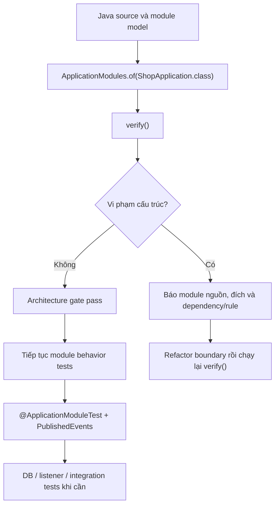

# Lỗi dependency module trong ApplicationModules.verify

## Mục tiêu học tập

Trong chương **Test failure** của học phần **Spring Modulith Verification & Testing**, không phải bài test thất bại nào cũng do Spring thiếu bean, cấu hình DataSource sai hoặc một assertion nghiệp vụ không đúng. `ApplicationModules.verify()` kiểm tra **cấu trúc phụ thuộc giữa các application module**; nó có thể phát hiện một lỗi thiết kế ngay cả khi Java vẫn biên dịch và ứng dụng Spring Boot vẫn khởi động.

Sau bài học này, bạn có thể:

- Hiểu `ApplicationModules.of(…).verify()` đang kiểm tra loại hợp đồng nào và vì sao nó khác `@ApplicationModuleTest`.
- Đọc thông báo vi phạm dependency để xác định **module nguồn**, **module đích**, **kiểu Java làm phát sinh phụ thuộc** và **quy tắc bị phá vỡ**.
- Phân biệt ba nhóm phổ biến: **truy cập kiểu không được công khai của module khác**, **chu trình phụ thuộc module** và **phụ thuộc không có trong `allowedDependencies`**.
- Sửa vi phạm bằng **public API**, `@NamedInterface` có chủ đích, điều chỉnh hướng phụ thuộc hoặc tách module điều phối; không dùng việc mở rộng component scan để che vấn đề.
- Viết một architecture test với `ApplicationModules.verify()`, một `@ApplicationModuleTest` kiểm tra hành vi và giải thích vì sao hai bài test bổ sung cho nhau.
- Đánh giá hậu quả của việc sửa package, chuyển interface, thêm module mới hoặc thay đổi dependency rule.
- Đưa kiểm chứng kiến trúc, event assertions và kiểm thử database/tích hợp vào CI quality gate để ngăn hồi quy.

## 1. Vì sao Spring context xanh mà architecture test đỏ?

Một dự án modular monolith thường đặt các application module dưới package gốc của ứng dụng:

```text
com.example.shop
├── ShopApplication.java
├── orders
│   ├── CheckoutService.java
│   ├── OrderPlaced.java
│   └── internal
│       └── OrderRepositoryAdapter.java
├── inventory
│   ├── StockAvailability.java
│   └── internal
│       ├── StockTableReader.java
│       └── StockAvailabilityAdapter.java
└── billing
    ├── BillingFacade.java
    └── internal
        └── InvoiceRepositoryAdapter.java
```

Trong cách nhận diện mặc định thường gặp của Spring Modulith, các package con trực tiếp như `orders`, `inventory` và `billing` là những application module. Các kiểu nằm ở **package gốc của module** thường là API công khai mặc định; package con như `inventory.internal` không tự trở thành API được công khai cho module khác.

Giả sử `orders.CheckoutService` import trực tiếp `inventory.internal.StockTableReader`. Type này có thể được khai báo `public` ở Java, nên:

1. Java compiler **không nhất thiết báo lỗi**.
2. Spring có thể quét được cả hai bean trong một `@SpringBootTest`.
3. Test xử lý đặt hàng và `PublishedEvents` có thể vẫn pass.
4. **Nhưng `ApplicationModules.verify()` có thể thất bại** vì module `orders` phụ thuộc một kiểu thuộc phần không được công khai của `inventory`.

Tính hợp lệ của Java visibility và tính hợp lệ của **module API boundary** là hai chuyện khác nhau.

| Câu hỏi | Công cụ kiểm tra chủ yếu |
| --- | --- |
| Java có biên dịch được import hay không? | Compiler, build |
| Spring có tạo được bean cần inject không? | `@ApplicationModuleTest`, `@SpringBootTest` |
| Module có phụ thuộc vào API công khai và đúng quy tắc không? | `ApplicationModules.verify()` |
| Service có phát đúng `OrderPlaced` sau khi xử lý không? | `PublishedEvents` |
| Listener hậu commit đã tạo dữ liệu chưa? | `Scenario` và repository/integration test |

**Không dùng kết quả của một công cụ để thay thế kết luận thuộc công cụ khác.**

## 2. Architecture verification hoạt động ở tầng nào?

Spring Modulith xây dựng mô hình application module từ mã ứng dụng, trong đó có quan hệ phụ thuộc giữa các kiểu thuộc những module khác nhau. `ApplicationModules.verify()` kiểm tra mô hình đó theo các quy tắc kiến trúc được hỗ trợ.

Những vấn đề trọng tâm cần chú ý:

- **Chu trình giữa các application module:** ví dụ `orders → inventory → orders`.
- **Truy cập kiểu không thuộc phần API được công khai:** ví dụ `orders` sử dụng `inventory.internal.StockTableReader`.
- **Vi phạm danh sách module được phép phụ thuộc:** khi tác giả thiết kế giới hạn phụ thuộc bằng `@ApplicationModule(allowedDependencies = …)`.
- **Các quy tắc bổ sung nếu dự án tích hợp kiểm tra khác:** phạm vi quy tắc phụ thuộc vào cấu hình và các dependency kiểm chứng thực tế.

### 2.1. Test kiến trúc tối thiểu

Giả sử lớp `ShopApplication` là `@SpringBootApplication` ở package `com.example.shop`. Viết:

```java
package com.example.shop;

import org.junit.jupiter.api.Test;
import org.springframework.modulith.core.ApplicationModules;

class ModularityVerificationTests {

    @Test
    void moduleDependenciesRespectArchitecture() {
        ApplicationModules.of(ShopApplication.class).verify();
    }
}
```

Đây là JUnit test **kiến trúc**, không cần `@SpringBootTest` và không cần `@ApplicationModuleTest` trên lớp này. Nó phân tích cấu trúc module dựa trên lớp ứng dụng gốc thay vì phải dựng một `ApplicationContext` đầy đủ để gọi service.

Lưu ý: dự án thật phải có Spring Modulith core/test dependency và package scanning/module detection đúng với cấu trúc của chính dự án. Nếu module được định nghĩa bằng cấu hình phát hiện tùy chỉnh, mô hình verify phải dùng cùng quy tắc dự kiến; đừng giả định mọi dự án đều nhận diện module theo package mặc định.

### 2.2. Fail có ý nghĩa gì?

Khi `verify()` ném lỗi, nó cho biết **mô hình module đã vi phạm ít nhất một quy tắc đang áp dụng**. Nó không tự nói:

- `DataSource` không kết nối được.
- `@EventListener` không nhận được event.
- `OrderPlaced` có payload sai.
- Spring bean `CheckoutService` đã hoặc chưa được tạo.

Những điều đó cần các bài test runtime riêng.



## 3. Đọc thông báo lỗi dependency thay vì sửa theo cảm tính

Tùy phiên bản Spring Modulith và thư viện kiểm chứng liên quan, cách diễn đạt thông báo có thể khác nhau. Ví dụ sau là **minh họa định dạng ý nghĩa của lỗi**, không phải trích nguyên văn từ một lần chạy:

```text
Architecture verification failed:

Module 'orders' has a dependency on
  com.example.shop.inventory.internal.StockTableReader
from
  com.example.shop.orders.CheckoutService

The referenced type is not exposed by module 'inventory'.
```

Hãy rút ra các dữ kiện:

| Thông tin | Ví dụ | Vì sao quan trọng? |
| --- | --- | --- |
| **Module nguồn** | `orders` | Nơi đang tạo phụ thuộc |
| **Kiểu nguồn** | `orders.CheckoutService` | Class cần xem và có thể refactor |
| **Module đích** | `inventory` | Module sở hữu kiểu được tham chiếu |
| **Kiểu đích** | `inventory.internal.StockTableReader` | Implementation detail bị lộ |
| **Quy tắc** | API không được expose | Đây là lỗi boundary, không phải missing bean |
| **Vị trí mã** | Import, field, constructor, method signature, annotation… | Địa điểm thực sự tạo quan hệ phụ thuộc |

**Quy trình đọc hiệu quả:**

1. Xác định `verify()` đang chạy với application root nào.
2. Xem danh sách vi phạm, không chỉ dòng thông báo bọc ngoài đầu tiên.
3. Xác định **module nguồn → module đích** theo hướng dependency.
4. Đọc tên fully qualified của kiểu bị truy cập và quyết định nó có phải public contract hay không.
5. Tìm rule tương ứng: API exposure, module cycle hay `allowedDependencies`.
6. Chọn thay đổi nhỏ nhất đáp ứng thiết kế, rồi chạy lại **cùng architecture test**.

Đừng thấy `ApplicationModules.verify()` báo lỗi rồi bắt đầu sửa `application-test.yml` hoặc thêm `@MockBean`: dependency cấu trúc thường không thay đổi chỉ nhờ Spring bean wiring.

## 4. Case study A: orders phụ thuộc package internal của inventory

### 4.1. Một public class không nhất thiết là public module API

Tệp `src/main/java/com/example/shop/inventory/internal/StockTableReader.java`:

```java
package com.example.shop.inventory.internal;

import java.util.UUID;
import org.springframework.stereotype.Component;

@Component
public class StockTableReader {

    public boolean isInStock(UUID productId) {
        // Minh họa đơn giản: ở dự án thật, class này đọc bảng tồn kho.
        return true;
    }
}
```

Class mang modifier `public` để Java code ở package khác có thể import. Tuy nhiên, nó thuộc `inventory.internal`, tức vùng implementation của module `inventory`, không phải giao diện mà `orders` nên phụ thuộc trực tiếp.

Code vi phạm, tệp `src/main/java/com/example/shop/orders/CheckoutService.java` ở phiên bản **chưa sửa**:

```java
package com.example.shop.orders;

import com.example.shop.inventory.internal.StockTableReader;
import java.util.UUID;
import org.springframework.context.ApplicationEventPublisher;
import org.springframework.stereotype.Service;

@Service
public class CheckoutService {

    private final StockTableReader stockTableReader;
    private final ApplicationEventPublisher publisher;

    public CheckoutService(
            StockTableReader stockTableReader,
            ApplicationEventPublisher publisher) {
        this.stockTableReader = stockTableReader;
        this.publisher = publisher;
    }

    public void checkout(UUID orderId, UUID productId) {
        if (!stockTableReader.isInStock(productId)) {
            throw new IllegalStateException("Out of stock");
        }

        publisher.publishEvent(new OrderPlaced(orderId, productId));
    }
}
```

Tệp event công khai thuộc `orders`:

```java
package com.example.shop.orders;

import java.util.UUID;

public record OrderPlaced(
        UUID orderId,
        UUID productId) {
}
```

Vấn đề không nằm ở `publishEvent` hay trong phép kiểm tồn kho: đó là **kiểu dependency trong signature của `CheckoutService`**.

```text
orders.CheckoutService
  └── import inventory.internal.StockTableReader
        └── kiểu nội bộ, không phải API public module inventory
```

Một code review chỉ kiểm tra Java compile sẽ không chắc phát hiện được lỗi thiết kế này. `ApplicationModules.verify()` được dùng để biến quy tắc boundary thành một phép kiểm tự động.

### 4.2. Sửa đúng: đưa hợp đồng ra public API của inventory

Tạo public port ở package gốc `inventory`.

Tệp `src/main/java/com/example/shop/inventory/StockAvailability.java`:

```java
package com.example.shop.inventory;

import java.util.UUID;

public interface StockAvailability {

    boolean isAvailable(UUID productId);
}
```

Implementation vẫn thuộc `inventory.internal`:

```java
package com.example.shop.inventory.internal;

import com.example.shop.inventory.StockAvailability;
import java.util.UUID;
import org.springframework.stereotype.Component;

@Component
class StockAvailabilityAdapter implements StockAvailability {

    private final StockTableReader reader;

    StockAvailabilityAdapter(StockTableReader reader) {
        this.reader = reader;
    }

    @Override
    public boolean isAvailable(UUID productId) {
        return reader.isInStock(productId);
    }
}
```

Giờ `orders` chỉ import public API:

```java
package com.example.shop.orders;

import com.example.shop.inventory.StockAvailability;
import java.util.UUID;
import org.springframework.context.ApplicationEventPublisher;
import org.springframework.stereotype.Service;

@Service
public class CheckoutService {

    private final StockAvailability stock;
    private final ApplicationEventPublisher publisher;

    public CheckoutService(
            StockAvailability stock,
            ApplicationEventPublisher publisher) {
        this.stock = stock;
        this.publisher = publisher;
    }

    public void checkout(UUID orderId, UUID productId) {
        if (!stock.isAvailable(productId)) {
            throw new IllegalStateException("Out of stock");
        }

        publisher.publishEvent(new OrderPlaced(orderId, productId));
    }
}
```

> Hai phiên bản `CheckoutService` phía trên là **trước và sau refactor**, không được để chúng cùng tồn tại trong một project như hai class trùng fully qualified name.

Sơ đồ mới:

```text
orders.CheckoutService
  └── inventory.StockAvailability          [API công khai]
        ↑
inventory.internal.StockAvailabilityAdapter
  └── inventory.internal.StockTableReader   [Implementation detail]
```

Module `inventory` vẫn tự quyết định sử dụng database, cache hay HTTP adapter. Module `orders` chỉ biết quy tắc “còn hàng hay không”. Refactor này thường có hai lợi ích:

- **Architecture:** dependency qua interface được expose, không qua implementation.
- **Testing:** `@ApplicationModuleTest` của `orders` có thể dễ dàng cấp stub `StockAvailability` trong test context.

Điểm thứ hai không thay thế điểm thứ nhất: một bean test mock `StockTableReader` cũ vẫn có thể làm module test pass nhưng **không làm dependency sai biến mất khỏi source code**.

### 4.3. Khi nào không nên công khai một kiểu?

Không nên sửa mọi lỗi bằng cách di chuyển nguyên một repository, entity hoặc adapter từ `inventory.internal` lên package gốc `inventory`. Nếu một kiểu chứa chi tiết bảng SQL, truy vấn JPA hoặc DTO nội bộ, việc expose nó có thể làm `orders` phụ thuộc sâu hơn vào triển khai của inventory.

Hãy hỏi: “Consumer cần **năng lực nghiệp vụ** nào?” Trong ví dụ, đáp án là `StockAvailability.isAvailable(productId)`, không phải `InventoryJpaRepository.findById(…)`. Công khai một port nhỏ thường tốt hơn công khai implementation lớn.

## 5. Case study B: phụ thuộc vòng giữa các module

Giả sử team đã sửa `orders` để gọi public port `inventory.StockAvailability`. Sau đó `inventory` thêm listener import `orders.OrderPlaced`:

```text
orders.CheckoutService
    └── inventory.StockAvailability

inventory.OrderPlacedListener
    └── orders.OrderPlaced

=> orders → inventory → orders
```

Ngay cả khi mỗi chiều chỉ sử dụng **kiểu nằm ở public API**, hai module vẫn có thể tạo thành một **chu trình phụ thuộc**. Vì vậy, “mọi import đều public” **không đủ** để suy ra kiến trúc hợp lệ.

### 5.1. Event không tự động xóa compile-time dependency

Trong thiết kế event-driven, consumer có thể cần import public event class của producer. Ví dụ, một `@EventListener` trong `inventory` nhận `orders.OrderPlaced` sẽ tạo quan hệ phụ thuộc compile-time từ `inventory` sang `orders`.

Do đó, chỉ chuyển một lời gọi đồng bộ thành event listener **không tự động** phá chu trình nếu module nhận event lại phải import kiểu của module phát. Khi `verify()` báo cycle, hãy xem **toàn bộ cạnh phụ thuộc**, không chỉ nơi code dùng `@EventListener`.

### 5.2. Các hướng refactor hợp lý

| Vấn đề thiết kế | Phương án cân nhắc | Điều cần xác minh |
| --- | --- | --- |
| `orders` cần kiểm tra tồn kho đồng bộ, `inventory` lại gọi ngược orders | Tách tác vụ gọi cả hai module sang một **checkout orchestration module** | `orders` và `inventory` không phụ thuộc vòng |
| `inventory` chỉ cần biết một sự kiện trạng thái và không cần gọi lại orders | Định nghĩa event contract ở một module có ownership/hướng phụ thuộc rõ ràng, hoặc chuyển vai trò publish/consume | Dependency graph không khép vòng |
| Hai module chia sẻ một thuật ngữ rất nhỏ, ổn định | Xem xét module API dùng chung có trách nhiệm rõ, tránh “common” chứa mọi thứ | Không tạo shared module thành nơi đổ logic nội bộ |
| Hai nhóm nghiệp vụ thực chất là một cohesive unit | Cân nhắc thay lại ranh giới module | Không tách module chỉ theo tên package |

Không có một refactor duy nhất đúng cho mọi dự án. Điều quan trọng là **hướng phụ thuộc sau refactor phải là đồ thị không có cycle theo quy tắc kiến trúc đang áp dụng** và vẫn giữ đúng nghiệp vụ.

### 5.3. Minh họa tách orchestration

Một thiết kế khác có thể là:

```text
checkout (orchestration)
  ├── orders.OrderPlacement
  └── inventory.StockAvailability

orders                         inventory
  (không import inventory)      (không import orders)
```

Module `checkout` chịu trách nhiệm phối hợp hai public API. Cách này cần xác định ownership giao dịch và event cẩn thận, nhưng loại bỏ cạnh trực tiếp `orders → inventory` nếu nghiệp vụ thật cho phép tách việc điều phối.

**Lưu ý:** Sơ đồ là phương án kiến trúc, không phải lời khuyên phải thêm một module cho mọi hệ thống nhỏ. Chỉ tăng độ phức tạp khi nó giải quyết trách nhiệm thực và vi phạm được quan sát.

## 6. Case study C: allowedDependencies hạn chế module được gọi

Spring Modulith cho phép khai báo các dependency được phép của một application module. Khi kiến trúc yêu cầu `orders` chỉ phụ thuộc vào `inventory`, có thể khai báo tại `package-info.java`.

Tệp `src/main/java/com/example/shop/orders/package-info.java`:

```java
@org.springframework.modulith.ApplicationModule(
        allowedDependencies = "inventory")
package com.example.shop.orders;
```

Ví dụ này đặt danh sách cho phép theo tên module `inventory`. Nếu `orders` sau đó import một public type của `billing`, dependency đó có thể **vi phạm danh sách cho phép** dù type của `billing` được công khai.

Ví dụ phụ thuộc chưa được cho phép:

```java
package com.example.shop.orders;

import com.example.shop.billing.BillingFacade;

// Một class trong orders dùng trực tiếp BillingFacade.
// BillingFacade có thể public nhưng orders chỉ allowedDependencies=inventory.
```

Đây là đoạn minh họa **quan hệ dependency**, không phải class Java hoàn chỉnh. Kết luận cần rút ra:

- **API public** trả lời “module đích có cho phép nhìn thấy kiểu này không?”.
- **`allowedDependencies`** trả lời “module nguồn có được phép phụ thuộc module đích không?”.
- **Kiểm tra cycle** trả lời “các module có tạo chu trình không?”.

Ba quy tắc có thể độc lập gây lỗi; sửa một quy tắc chưa chắc giải quyết các quy tắc còn lại.

### 6.1. Có nên thêm billing vào allowedDependencies?

Chỉ thêm `billing` nếu **thiết kế chính thức** cho phép `orders` gọi public API của billing trực tiếp. Nếu `orders` chỉ muốn thông báo “đơn hàng đã được đặt”, có thể tốt hơn khi giữ ownership ở `orders` và tổ chức một luồng tích hợp event hợp lệ ở tầng khác.

Đừng thay:

```java
@ApplicationModule(allowedDependencies = "inventory")
```

thành danh sách quá rộng chỉ để quality gate xanh. Danh sách cho phép có mục tiêu ngăn phụ thuộc ngẫu nhiên; nới lỏng mà không có quyết định kiến trúc sẽ xóa cơ chế bảo vệ.

### 6.2. Allowed dependencies không thay thế public API

Nếu cấu hình cho phép phụ thuộc `inventory`, điều đó **không mặc nhiên** cho phép `orders` import tất cả kiểu trong `inventory.internal`. Phải đồng thời tuân thủ quy tắc exposure. Do đó, ví dụ `orders → inventory.internal.StockTableReader` vẫn sai ngay cả khi `inventory` nằm trong danh sách `allowedDependencies`.

## 7. Named interfaces: công khai có chủ đích một package con

Không phải API nào cũng cần nằm ở package gốc của module. Khi một module có nhiều nhóm API ổn định, Spring Modulith hỗ trợ **named interface** để expose một tập kiểu trong package con một cách có chủ đích.

Giả sử thay vì `inventory.StockAvailability`, module muốn đặt API đọc tồn kho tại `inventory.api`.

Tệp `src/main/java/com/example/shop/inventory/api/package-info.java`:

```java
@org.springframework.modulith.NamedInterface("availability")
package com.example.shop.inventory.api;
```

Tệp `src/main/java/com/example/shop/inventory/api/StockAvailability.java`:

```java
package com.example.shop.inventory.api;

import java.util.UUID;

public interface StockAvailability {

    boolean isAvailable(UUID productId);
}
```

Đây là **phương án thay thế** cho API `inventory.StockAvailability` ở ví dụ trước, không phải yêu cầu giữ hai interface cùng lúc. Package con được đánh dấu named interface có thể được expose như một phần API module theo quy tắc Spring Modulith.

Nếu module `orders` muốn giới hạn dependency đến named interface cụ thể, cơ chế `allowedDependencies` hỗ trợ tham chiếu tới module và tên interface theo cú pháp dạng `inventory :: availability`; cần dùng tên module và tên named interface đúng với định nghĩa thực tế và phiên bản thư viện của dự án.

```java
@org.springframework.modulith.ApplicationModule(
        allowedDependencies = "inventory :: availability")
package com.example.shop.orders;
```

**Giá trị của named interface:** expose một capability có chủ đích mà vẫn giữ các kiểu `inventory.internal` ẩn khỏi consumer. Không gắn `@NamedInterface` lên toàn bộ package nội bộ chỉ để che lỗi; hãy đánh giá liệu những kiểu đó thật sự là hợp đồng ổn định hay không.

## 8. Sửa kiến trúc không đồng nghĩa sửa Spring bean wiring

Sau khi đổi từ `StockTableReader` sang `StockAvailability`, `ApplicationModules.verify()` có thể pass nhưng `@ApplicationModuleTest` chế độ `STANDALONE` của `orders` vẫn báo:

```text
Failed to load ApplicationContext
Caused by: UnsatisfiedDependencyException:
  Error creating bean with name 'checkoutService' ...
Caused by: NoSuchBeanDefinitionException:
  No qualifying bean of type
  'com.example.shop.inventory.StockAvailability' available
```

Đây là một **lỗi khác**:

- Trước refactor: `orders` phụ thuộc **kiểu nội bộ** của `inventory` → **architecture violation**.
- Sau refactor: `orders` phụ thuộc **public API** của `inventory` → dependency hợp lệ, nhưng test `STANDALONE` có thể không bootstrap implementation ở module kia → **missing bean trong test context**.

Giải pháp cho missing bean tùy mục tiêu:

1. **Kiểm tra hợp đồng riêng của `orders`:** thêm một stub `StockAvailability` bằng `@TestConfiguration`.
2. **Kiểm tra tích hợp với `inventory` thật:** dùng `@ApplicationModuleTest(mode = BootstrapMode.DIRECT_DEPENDENCIES)` khi dependency được mô hình hóa trực tiếp và module có hạ tầng cần thiết.
3. **Luồng rộng hơn:** dùng integration test bootstrap đủ module và datasource/transaction phù hợp.

Không dùng `DIRECT_DEPENDENCIES` để “chữa” việc import `inventory.internal.StockTableReader`; mở rộng context giúp có bean nhưng **không thay đổi cấu trúc phụ thuộc sai trong source**.

### 8.1. Module test hành vi sau khi đã sửa API

Mẫu sau kiểm tra `CheckoutService` của `orders` mà không yêu cầu bootstrap implementation thật của `inventory`:

```java
package com.example.shop.orders;

import static org.assertj.core.api.Assertions.assertThat;

import com.example.shop.inventory.StockAvailability;
import java.util.UUID;
import org.junit.jupiter.api.Test;
import org.springframework.beans.factory.annotation.Autowired;
import org.springframework.boot.test.context.TestConfiguration;
import org.springframework.context.annotation.Bean;
import org.springframework.context.annotation.Import;
import org.springframework.modulith.test.ApplicationModuleTest;
import org.springframework.modulith.test.PublishedEvents;

@ApplicationModuleTest
@Import(OrdersBehaviorTests.StubInventory.class)
class OrdersBehaviorTests {

    @Autowired
    CheckoutService checkout;

    @TestConfiguration(proxyBeanMethods = false)
    static class StubInventory {

        @Bean
        StockAvailability stockAvailability() {
            return productId -> true;
        }
    }

    @Test
    void publishesOrderPlacedForAvailableProduct(
            PublishedEvents events) {
        UUID orderId = UUID.randomUUID();
        UUID productId = UUID.randomUUID();

        checkout.checkout(orderId, productId);

        assertThat(events.ofType(OrderPlaced.class)
                .matching(e -> orderId.equals(e.orderId())))
                .hasSize(1)
                .allSatisfy(e ->
                        assertThat(e.productId())
                                .isEqualTo(productId));
    }
}
```

Test sử dụng **public interface** `StockAvailability` và `PublishedEvents` để bảo vệ hành vi tạo event. Nó không chứng minh repository tồn kho thật, transaction hoặc consistency giữa các module; các mục tiêu đó cần bài kiểm thử tích hợp riêng.

### 8.2. Kết hợp hai bài test không thay thế nhau

```text
ModularityVerificationTests
  └── ApplicationModules.of(ShopApplication.class).verify()
      => bảo vệ module dependency graph

OrdersBehaviorTests
  └── @ApplicationModuleTest + PublishedEvents
      => bảo vệ hợp đồng khi inventory trả "còn hàng"

OrdersInventoryIntegrationTests
  └── @ApplicationModuleTest(mode = DIRECT_DEPENDENCIES)
      => kiểm tra wiring/side effect thật giữa hai module
```

Nếu module test pass nhưng architecture test fail, đó là tín hiệu cần sửa **quan hệ phụ thuộc**. Nếu architecture test pass nhưng module test fail vì `NoSuchBeanDefinitionException`, đó là tín hiệu cần sửa **bootstrap/test double** theo đúng phạm vi.

## 9. Chẩn đoán ba nhóm vi phạm bằng một ma trận

| Dấu hiệu lỗi | Điểm cần kiểm tra | Cách sửa ưu tiên | Cách sửa không phù hợp |
| --- | --- | --- | --- |
| `orders` import `inventory.internal.*` | Public API của `inventory`; kiểu đang bị expose | Dùng port/public contract hoặc named interface có chủ đích | Thêm `@MockBean` rồi bỏ qua verify |
| `orders → inventory → orders` | Các cạnh phụ thuộc từ source Java, kể cả event listener | Đổi hướng phụ thuộc, orchestration, ranh giới domain | Chỉ thêm `@EventListener` mà vẫn tạo cycle |
| `orders` dùng `billing` ngoài `allowedDependencies` | Quy tắc allowlist có còn đúng theo thiết kế không? | Loại dependency không hợp lệ hoặc cập nhật rule có lý do | Cho phép mọi module mà không đánh giá |
| Architecture test pass nhưng Spring test thiếu bean | `@ApplicationModuleTest` bootstrap mode, test config | Stub public API hoặc mở dependency module | Di chuyển implementation nội bộ vào module khác |
| Spring context xanh nhưng `PublishedEvents` fail | Business branch, transaction, payload, ID | Sửa logic/assertion nghiệp vụ | Bỏ `ApplicationModules.verify()` |
| `Scenario` timeout | Listener có trong context, commit, async, matching | Kiểm tra side effect và ranh giới transaction | Coi mọi timeout là module cycle |

### 9.1. Một lỗi có thể có nhiều vi phạm đồng thời

Nếu `verify()` báo:

```text
orders -> inventory.internal.StockTableReader
orders -> billing.BillingFacade (not allowed)
inventory -> orders.OrderPlaced
```

thì phải xử lý cả ba lớp: exposure, allowlist và cycle. Chỉ sửa import `StockTableReader` sẽ không nhất thiết đưa toàn bộ architecture gate về xanh.

Khi refactor, nên chạy lại kiểm chứng để xem **danh sách vi phạm còn lại**, đồng thời kiểm tra thay đổi mới không tạo một cạnh phụ thuộc ngoài dự kiến.

## 10. Quy trình sửa lỗi ApplicationModules.verify từng bước

### Bước 1 — Giữ nguyên lỗi và xác định test

Chạy architecture test riêng khi có quyền thực thi. Ví dụ câu lệnh để sử dụng về sau:

```bash
./mvnw -Dtest=ModularityVerificationTests test
```

Hoặc:

```bash
./gradlew test --tests "com.example.shop.ModularityVerificationTests" --stacktrace
```

Các lệnh là **ví dụ**, không phải bằng chứng bài học này đã chạy test. Giữ log đủ dài để thấy danh sách module và dependency bị báo sai.

### Bước 2 — Viết lại cạnh phụ thuộc bằng ngôn ngữ kiến trúc

Ví dụ:

```text
Module nguồn: orders
Kiểu nguồn: orders.CheckoutService
Module đích: inventory
Kiểu đích: inventory.internal.StockTableReader
Rule: dependency vào type không được expose
```

Nếu không xác định được module nguồn và đích, rất dễ sửa nhầm package khác hoặc mở một bean không liên quan.

### Bước 3 — Tìm nơi tạo dependency

Các đường tạo dependency cần xem gồm:

- Constructor parameter/field mang kiểu của module khác.
- Import kiểu khác module trong method signature, return type, generic argument.
- Class inheritance hoặc implements interface thuộc module khác.
- Annotation, configuration hoặc code gọi trực tiếp module khác.
- Event listener import event type được sở hữu bởi module khác.

Không chỉ tìm một lời gọi method trong business logic. Một dependency có thể đã tồn tại chỉ từ khai báo kiểu trong source.

### Bước 4 — Chọn đúng biên API

Hỏi module đích muốn expose khả năng nào. Nếu `inventory` chỉ cho phép hỏi còn hàng, một port `StockAvailability` là đủ; không expose repository/table reader. Nếu cần nhiều nhóm API, xem `@NamedInterface`. Nếu quan hệ tạo cycle, xem lại ownership và hướng điều phối.

### Bước 5 — Kiểm tra allowedDependencies

Xác định module nguồn có `@ApplicationModule(allowedDependencies = …)` không. Một kiểu public nhưng module đích không nằm trong danh sách vẫn có thể bị từ chối. Chỉ cập nhật allowlist sau khi chấp nhận dependency về mặt kiến trúc.

### Bước 6 — Chạy lại architecture test

`ApplicationModules.verify()` phải pass trên mô hình module sau refactor. Nếu còn vi phạm, đọc danh sách mới và xử lý từng cạnh. Không chỉnh cấu hình để bỏ qua nguyên tắc chỉ vì một assert còn đỏ.

### Bước 7 — Chạy test behavior và integration liên quan

Sau khi đổi dependency type, có thể cần cập nhật constructor injection và `@TestConfiguration` của module test. Khi test module đã chạy được, dùng `PublishedEvents` để kiểm tra event. Với giao dịch hoặc database, có thể cần integration test kiểm tra kết quả sau commit.

### Bước 8 — Ghi lại quyết định trong pull request

Một ghi chú hữu ích:

```text
Violation: orders -> inventory.internal.StockTableReader
Reason: orders imported a non-exposed inventory implementation type
Refactor: introduce inventory.StockAvailability as public API
Boundary: inventory implementation remains in inventory.internal
Verification: architecture test + orders module behavior test
Remaining coverage: inventory integration/database test
```

Đừng ghi “mọi test đã pass” nếu chưa chạy xác minh thực tế. Phân biệt **đã chỉnh source** với **đã xác nhận bằng build/test**.

## 11. Những cách sửa sai thường gặp

### 11.1. Mở rộng ApplicationContext để dập lỗi kiến trúc

`@ApplicationModuleTest(mode = DIRECT_DEPENDENCIES)` có thể đưa bean từ module khác vào context, nhưng `verify()` không đánh giá bean availability. Nếu import sai internal type vẫn tồn tại, lỗi architecture vẫn còn.

### 11.2. Đưa mọi class internal lên public package

Đây là cách “làm xanh” boundary bằng cách loại bỏ ranh giới. Nó khiến consumer phụ thuộc entity/repository và tăng chi phí thay đổi implementation. Công khai **contract nhỏ, ổn định**, không công khai toàn bộ lớp lưu trữ.

### 11.3. Tạo named interface cho cả internal package

`@NamedInterface` là công cụ thiết kế API, không phải công tắc miễn trừ. Nếu expose toàn bộ `inventory.internal` chỉ để verifier pass, module không còn đóng gói implementation hiệu quả.

### 11.4. Nới allowedDependencies vô điều kiện

Nếu team đã chủ động giới hạn `orders` chỉ được phép phụ thuộc `inventory`, thêm mọi module vào allowlist sẽ làm mất kiểm soát coupling. Cần quyết định kiến trúc cụ thể cho từng dependency.

### 11.5. Cho rằng dùng event sẽ không có dependency Java

Nếu listener `inventory` import `orders.OrderPlaced`, static dependency vẫn tồn tại. Event-based communication làm giảm một số dạng coupling runtime nhưng không tự xóa cycle ở đồ thị code.

### 11.6. Bỏ architecture test vì ứng dụng chạy ổn

Mục tiêu của `ApplicationModules.verify()` là chặn coupling sai **trước khi** nó biến thành lỗi triển khai lớn. Một application context xanh không chứng minh dependency graph hợp lệ.

### 11.7. Nhầm vi phạm kiến trúc với NoSuchBeanDefinitionException

Missing bean nói Spring không có candidate trong context; architecture violation nói quan hệ giữa module hoặc exposed API sai. Hai lỗi có thể cùng tồn tại sau refactor, nhưng **không sửa bằng một thao tác duy nhất**.

## 12. Quality gate CI cho kiến trúc và hành vi

Phạm vi học phần **Spring Modulith Verification & Testing** không chỉ dừng ở verify một lần trên máy lập trình. Quy tắc dependency cần trở thành một quality gate khi thay đổi source.

| Gate | Mục tiêu | Điều kiện cần fail |
| --- | --- | --- |
| **Module architecture** | `ApplicationModules.of(…).verify()` | Thêm cycle, import internal type hoặc vi phạm allowlist |
| **Module bootstrap** | `@ApplicationModuleTest` | Thiếu bean do test config, profile hoặc scope |
| **Event contract** | `PublishedEvents` | Event thiếu/trùng, sai payload hoặc khóa tương quan |
| **Async/event handling** | `Scenario` và listener test | Consumer không xử lý hoặc hoàn tất sai |
| **Persistence/integration** | Repository, DB/migration, transaction test | Side effect không commit hoặc schema không hợp lệ |

### 12.1. Quy trình CI khuyến nghị

1. Chạy JUnit architecture test sớm để phát hiện dependency sai nhanh.
2. Chạy module tests độc lập nhằm kiểm tra hành vi của các boundary công khai.
3. Chạy một số integration tests cho những module phối hợp thực sự, nhất là database và event hậu commit.
4. Giữ báo cáo test và stack trace có thể truy xuất để biết **quy tắc và cạnh phụ thuộc** gây fail.
5. Khi refactor package, public API hoặc module ownership, chạy lại architecture gate trước khi merge.

### 12.2. Khi architecture test fail trong CI

Đừng xóa test hoặc bỏ qua exception ngay. Hãy xác định commit vừa thêm:

- Import `*.internal.*` từ module khác?
- Sử dụng một public interface mới nhưng module sở hữu nó không nằm trong `allowedDependencies`?
- Tạo cạnh ngược qua event listener, repository adapter hoặc configuration?
- Chuyển class qua package khiến nó thuộc module khác?
- Mở rộng `@NamedInterface` làm mất ownership API?

Tối thiểu, pull request sửa lỗi phải chỉ rõ **cạnh vi phạm ban đầu** và **dependency graph sau refactor**.

## 13. Bài thực hành

Thực hiện trên ứng dụng mẫu `orders`, `inventory` và `billing`:

1. **Tạo architecture test:** viết `ApplicationModules.of(ShopApplication.class).verify()` trong JUnit, không dùng `@SpringBootTest`.
2. **Tái hiện phụ thuộc internal:** cho `orders.CheckoutService` import `inventory.internal.StockTableReader`. Dự đoán vì sao Java compile được nhưng verifier phải chặn.
3. **Đọc violation:** ghi module nguồn/đích, fully qualified kiểu đích và quy tắc exposure bị phá.
4. **Refactor qua public API:** giới thiệu `inventory.StockAvailability`; giữ `StockTableReader` và adapter trong `inventory.internal`. Chạy lại architecture test.
5. **Kiểm tra hành vi:** dùng `@ApplicationModuleTest` với một stub `StockAvailability` để khẳng định `OrderPlaced` được publish đúng một lần khi còn hàng.
6. **Tạo cycle:** thêm một class trong `inventory` import public type của `orders` trong khi `orders` đã phụ thuộc inventory. Phân tích tại sao event listener import event type cũng tạo dependency.
7. **Phá cycle:** thử đưa logic phối hợp sang module điều phối hoặc đổi ownership/hướng phụ thuộc. Đánh giá lại architecture graph.
8. **Thử allowedDependencies:** đặt `allowedDependencies = "inventory"` cho `orders`, rồi tạo import public `billing.BillingFacade`. Chọn loại bỏ dependency hoặc cập nhật chính sách với lý do rõ ràng.
9. **Named interface:** chuyển public port sang `inventory.api`, khai báo `@NamedInterface("availability")` và kiểm tra rule cho phép đúng API đó.
10. **Phân biệt hai loại fail:** sau khi architecture pass, chạy test `STANDALONE` không có stub để quan sát missing bean; bổ sung stub hoặc mở rộng bootstrap với mục tiêu test rõ ràng.
11. **Đưa vào CI:** đặt architecture gate trước module behavior tests và mô tả log/bằng chứng cần lưu khi fail.

**Tiêu chí hoàn thành:** người học có thể chỉ rõ nguyên nhân của từng dependency violation, giữ implementation nội bộ không bị lộ, tránh cycle và không sửa lỗi verify bằng thay đổi bean wiring không liên quan.

## 14. Câu hỏi tự kiểm tra

**Câu 1.** `CheckoutService` import một class `public` trong `inventory.internal`. Vì sao `ApplicationModules.verify()` có thể fail?

**Trả lời:** `public` theo Java không đồng nghĩa kiểu đó nằm trong public API của application module `inventory`. Package internal không được expose theo quy tắc module mặc định.

**Câu 2.** `ApplicationModules.verify()` pass có bảo đảm `@ApplicationModuleTest` khởi động đủ bean không?

**Trả lời:** Không. Verifier kiểm tra quy tắc dependency; bean availability còn phụ thuộc bootstrap mode, Spring configuration, profile và test doubles.

**Câu 3.** Hai module chỉ import các kiểu public của nhau. Có thể vẫn sai kiến trúc không?

**Trả lời:** Có. Nếu tạo `orders → inventory → orders` thì tồn tại một chu trình module dù từng import riêng lẻ dùng API public.

**Câu 4.** `orders` được phép phụ thuộc `inventory` nhưng import `inventory.internal.StockTableReader`. Cấu hình allowlist đã đủ chưa?

**Trả lời:** Chưa. `allowedDependencies` và public API exposure là hai giới hạn khác nhau; dependency vào internal type vẫn có thể bị verifier chặn.

**Câu 5.** Chuyển `StockTableReader` lên package gốc của inventory có phải cách sửa ưu tiên không?

**Trả lời:** Thường không. Tốt hơn là expose một contract nhỏ như `StockAvailability`, giữ reader/repository thuộc implementation nội bộ.

**Câu 6.** Thêm `@EventListener` để inventory nhận `orders.OrderPlaced` có chắc phá được cycle không?

**Trả lời:** Không. Listener vẫn import kiểu event của `orders`, tạo static dependency từ inventory về orders; cần kiểm tra lại toàn đồ thị.

**Câu 7.** Khi nào dùng `@NamedInterface`?

**Trả lời:** Khi module muốn công khai có chủ đích một nhóm API ổn định nằm trong package con, không phải để expose toàn bộ internal implementation.

**Câu 8.** `PublishedEvents` kiểm tra `OrderPlaced` pass. Có thể bỏ `ApplicationModules.verify()` không?

**Trả lời:** Không. Event assertion kiểm tra hành vi runtime; architecture gate bảo vệ hướng phụ thuộc và module boundary. Cần cả hai khi chất lượng module là mục tiêu.

## Kết luận

**Lỗi dependency module trong `ApplicationModules.verify()`** là lỗi ở **thiết kế quan hệ giữa các application module**, không nhất thiết là lỗi khởi động Spring hoặc lỗi nghiệp vụ. Hãy đọc violation theo hướng **module nguồn → kiểu đích → module đích → quy tắc**, phân biệt truy cập package internal, chu trình module và `allowedDependencies`. Sửa bằng public port, named interface có chủ đích, thay đổi hướng phụ thuộc hoặc tách orchestration phù hợp; tránh công khai repository hay mở component scan để che kiến trúc sai. Sau khi verification pass, dùng `@ApplicationModuleTest`, `PublishedEvents`, `Scenario` và database integration tests để bảo vệ hành vi. Đưa các bước này vào CI giúp phát hiện coupling sai và hồi quy ngay khi mã thay đổi.

## Tài liệu tham khảo

- [Spring Modulith Reference — Application Module Fundamentals](https://docs.spring.io/spring-modulith/reference/fundamentals.html)
- [Spring Modulith Reference — Verifying Application Module Structure](https://docs.spring.io/spring-modulith/reference/verification.html)
- [Spring Modulith Reference — Testing Application Modules](https://docs.spring.io/spring-modulith/reference/testing.html)
- [Spring Modulith Reference — Working with Application Events](https://docs.spring.io/spring-modulith/reference/events.html)
- [Spring Modulith Javadoc — ApplicationModules](https://docs.spring.io/spring-modulith/docs/current/api/org/springframework/modulith/core/ApplicationModules.html)
- [Spring Modulith Javadoc — ApplicationModule](https://docs.spring.io/spring-modulith/docs/current/api/org/springframework/modulith/ApplicationModule.html)
- [Spring Modulith Javadoc — NamedInterface](https://docs.spring.io/spring-modulith/docs/current/api/org/springframework/modulith/NamedInterface.html)
- [Spring Modulith Reference — Named Interfaces and Module APIs](https://docs.spring.io/spring-modulith/reference/fundamentals.html#fundamentals.application-modules.explicitly-named-interfaces)
