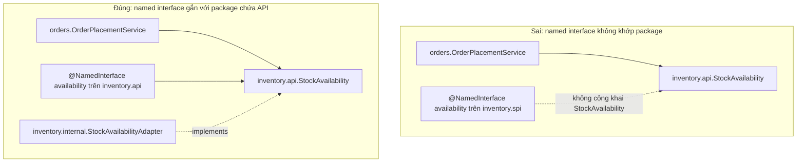

# Lỗi named interface không khớp package

## Mục tiêu học tập

Trong chương **Test failure** của học phần **Spring Modulith Verification & Testing**, lỗi cấu trúc module không chỉ đến từ phụ thuộc vòng hoặc việc truy cập một repository nội bộ. Một lỗi tinh vi hơn xuất hiện khi nhóm phát triển **đã khai báo `@NamedInterface`**, nhưng đặt annotation ở **package khác** với package chứa API mà module tiêu thụ đang import. Java vẫn có thể biên dịch, một số module test vẫn khởi động, nhưng `ApplicationModules.verify()` phải kiểm tra xem dependency có thực sự đi qua API được công khai.

Sau bài này, bạn có thể:

- Giải thích sự khác nhau giữa **application module**, **Java package**, **named interface** và **tên bean Spring**.
- Xác định vì sao `@NamedInterface("availability")` trong `inventory.spi` không tự công khai `inventory.api.StockAvailability`.
- Đọc một lỗi kiến trúc liên quan đến named interface để chỉ ra **module nguồn, module đích, kiểu bị tham chiếu và package đang được expose**.
- Đặt `package-info.java` và khai báo `package` chính xác cho API package, đồng thời cấu hình `allowedDependencies = "inventory :: availability"` nhất quán.
- Viết test `ApplicationModules.of(…).verify()` và `@ApplicationModuleTest` + `PublishedEvents` để bảo vệ lần lượt **kiến trúc** và **hành vi**.
- Phân biệt lỗi named interface với `NoSuchBeanDefinitionException` do bootstrap hẹp, lỗi classpath và lỗi Spring component scanning.
- Tránh “sửa” bằng cách public hóa `internal`, bật scan toàn ứng dụng hoặc nới `allowedDependencies` tùy tiện.
- Đưa kiến trúc gate vào CI cùng event, database và integration tests nhằm ngăn hồi quy.

## 1. Bốn khái niệm dễ bị lẫn

Giả sử ứng dụng Java 17+, Spring Boot và Spring Modulith có ba package con trực tiếp bên dưới `com.example.shop`:

```text
com.example.shop
├── ShopApplication.java
├── orders
│   └── ...
├── inventory
│   ├── api
│   │   └── StockAvailability.java
│   ├── spi
│   │   └── package-info.java
│   └── internal
│       └── StockAvailabilityAdapter.java
└── billing
    └── ...
```

Với cách nhận diện mặc định thường gặp, `orders`, `inventory` và `billing` là ba **application module**. Những package `inventory.api`, `inventory.spi` và `inventory.internal` là các **package con của cùng module inventory**, không tự động trở thành ba module độc lập.

| Khái niệm | Ví dụ | Chức năng |
| --- | --- | --- |
| **Application module** | `inventory` | Biên sở hữu năng lực nghiệp vụ; Spring Modulith phân tích dependency giữa các module |
| **Java package** | `com.example.shop.inventory.api` | Namespace chứa class và `package-info.java` |
| **Named interface** | `availability` | Tên logic của một phần API module được công khai có chủ đích |
| **Bean name** | `stockAvailabilityAdapter` | Định danh một Spring bean trong ApplicationContext |

**Named interface không phải Java interface**, dù cùng dùng từ “interface”. Nó là một **nhóm API của application module** mà module khác được phép phụ thuộc theo quy tắc kiến trúc.

Quan trọng nhất: `@NamedInterface("availability")` đặt trên một package **không tự tìm các class tên `Availability`** và **không tự tìm class trong package `api`**. Annotation được gắn với package mà `package-info.java` khai báo; tên `availability` là nhãn logic của API đó.

### 1.1. Public theo Java chưa đủ

Một interface như:

```java
package com.example.shop.inventory.api;

public interface StockAvailability {
    boolean isAvailable(String sku);
}
```

có thể được import từ `orders` vì nó là `public` theo quy tắc Java. Nhưng nếu `inventory.api` chưa được Spring Modulith nhận diện là một phần API công khai của module `inventory`, phụ thuộc từ `orders` vẫn có thể **vi phạm ranh giới module**.

Đặc biệt, một class `public` trong `inventory.internal` vẫn có thể là implementation detail và không nên được module khác dùng trực tiếp.

## 2. Trường hợp lỗi: annotation nằm ở spi, interface lại ở api

Team muốn module `orders` dùng public port `StockAvailability` của `inventory`, chỉ cho phép phụ thuộc nhóm API được gọi là `availability`.

Nhưng file được tạo như sau:

```text
src/main/java/com/example/shop/inventory/
├── api/
│   └── StockAvailability.java              ← Kiểu mà orders import
├── spi/
│   └── package-info.java                   ← Annotation nằm ở đây
└── internal/
    └── StockAvailabilityAdapter.java
```

Nội dung **sai vị trí**:

```java
// File: inventory/spi/package-info.java
@org.springframework.modulith.NamedInterface("availability")
package com.example.shop.inventory.spi;
```

Trong khi interface thực tế ở:

```java
// File: inventory/api/StockAvailability.java
package com.example.shop.inventory.api;

public interface StockAvailability {

    boolean isAvailable(String sku);
}
```

Và `orders` import:

```java
import com.example.shop.inventory.api.StockAvailability;
```

`@NamedInterface("availability")` bên trên khai báo **named interface cho package `inventory.spi`**, không phải cho `inventory.api`. Vì vậy, việc tạo named interface với tên đúng **chưa đủ** nếu nó không chứa những kiểu API cần công khai.

### 2.1. Sơ đồ sai và đúng



Hình minh họa nhấn mạnh **độ khớp giữa package được annotate và package của kiểu**. Dòng dependency `orders → inventory` có thể hợp lệ sau khi sửa nếu không còn vi phạm quy tắc khác, chẳng hạn cycle hoặc `allowedDependencies`.

## 3. Lỗi xuất hiện ở đâu và đọc như thế nào?

Một kiến trúc test có thể viết:

```java
package com.example.shop;

import org.junit.jupiter.api.Test;
import org.springframework.modulith.core.ApplicationModules;

class ArchitectureVerificationTests {

    @Test
    void applicationModuleDependenciesAreValid() {
        ApplicationModules.of(ShopApplication.class).verify();
    }
}
```

`ShopApplication` là lớp `@SpringBootApplication` tại package gốc của ứng dụng mẫu. Đoạn test này **không cần `@SpringBootTest`**: nó kiểm chứng mô hình module, không cần tạo toàn bộ Spring bean.

Khi model phát hiện `orders` phụ thuộc `inventory.api.StockAvailability` nhưng package đó chưa được expose phù hợp, test có thể fail với thông báo về **module dependency tới kiểu không được công khai**. Một log rút gọn **minh họa ý nghĩa**, không phải bản trích nguyên văn của mọi phiên bản Spring Modulith:

```text
Module dependency verification failed.

Module: orders
  depends on com.example.shop.inventory.api.StockAvailability
  from com.example.shop.orders.OrderPlacementService

The referenced type is not exposed by module inventory.

Configured named interface: inventory :: availability
Annotated package: com.example.shop.inventory.spi
Referenced package: com.example.shop.inventory.api
```

**Cảnh báo về log minh họa:** Các dòng “Annotated package” và “Referenced package” ở trên là thông tin được người điều tra **tổng hợp từ source**, không bảo đảm Spring Modulith luôn in đầy đủ từng dòng như vậy. Định dạng thông báo và thời điểm kiểm tra có thể khác giữa các phiên bản.

Khi đọc lỗi thật, hãy tự lập bảng:

| Câu hỏi | Ví dụ cần ghi |
| --- | --- |
| Module nguồn là gì? | `orders` |
| Kiểu nguồn tạo dependency là gì? | `orders.OrderPlacementService` |
| Kiểu đích là gì? | `inventory.api.StockAvailability` |
| Module sở hữu kiểu đích là gì? | `inventory` |
| Named interface được mong đợi? | `inventory :: availability` |
| `@NamedInterface` đang khai báo package nào? | `inventory.spi` — **sai** |
| Kiểu cần expose đang ở package nào? | `inventory.api` |

### 3.1. Khi nào vấn đề là sai tên, không phải sai package?

Cũng có trường hợp `package-info.java` đặt **đúng** `inventory.api` nhưng annotation là:

```java
@org.springframework.modulith.NamedInterface("stock")
package com.example.shop.inventory.api;
```

Trong khi module `orders` khai báo `allowedDependencies = "inventory :: availability"`. Khi đó **package chứa đúng kiểu**, nhưng **tên named interface trong dependency rule không trùng** với tên thực sự được khai báo.

Hai loại lỗi cần phân biệt:

1. **Sai package:** `@NamedInterface("availability")` đặt ở `inventory.spi`, type nằm ở `inventory.api`.
2. **Sai tên:** annotation tại `inventory.api` nhưng tên là `stock`, còn `allowedDependencies` tham chiếu `availability`.

Một bài test có thể gặp **cả hai** nếu vừa đổi cấu trúc package vừa đổi tên API mà chưa cập nhật rule.

## 4. Sửa đúng: đặt package-info.java cùng package chứa API

Giả sử team quyết định API công khai của tồn kho phải là `inventory.api.StockAvailability` và tên named interface là `availability`. Cấu trúc đúng:

```text
src/main/java/com/example/shop/inventory/
├── api/
│   ├── package-info.java
│   └── StockAvailability.java
└── internal/
    ├── StockReader.java
    └── StockAvailabilityAdapter.java
```

Nội dung file **đúng**:

```java
// File: src/main/java/com/example/shop/inventory/api/package-info.java
@org.springframework.modulith.NamedInterface("availability")
package com.example.shop.inventory.api;
```

Tệp `StockAvailability.java` tiếp tục thuộc **cùng package**:

```java
// File: src/main/java/com/example/shop/inventory/api/StockAvailability.java
package com.example.shop.inventory.api;

public interface StockAvailability {

    boolean isAvailable(String sku);
}
```

**Ba giá trị phải nhất quán:**

1. Đường dẫn nguồn: `inventory/api/package-info.java`.
2. Package statement: `package com.example.shop.inventory.api;`.
3. Package của kiểu muốn expose: `package com.example.shop.inventory.api;`.

Annotation `@NamedInterface("availability")` tạo **tên logic** `availability` cho API package đó; không phải đổi package Java thành `inventory.availability`.

### 4.1. Cẩn thận với tên tệp và vị trí source set

`package-info.java` là file Java đặc biệt chứa metadata cấp package. Những lỗi phổ biến:

- Đặt file ở `inventory/spi` nhưng ghi chú “API là inventory.api”.
- Đặt file trong `src/test/java` trong khi type production được phân tích từ `src/main/java`, khiến test/bộ mô hình build không nhìn nhận metadata như dự kiến.
- Copy file sang `inventory/api` nhưng để nguyên khai báo `package com.example.shop.inventory.spi;`.
- Đổi package của `StockAvailability` từ `inventory.api` sang `inventory.publicapi` mà không chuyển metadata phù hợp.
- Viết sai tên annotation hoặc import dẫn tới lỗi compile chứ chưa đến verify.

Không chỉ dựa vào vị trí thư mục được hiển thị trong IDE. **Package statement và metadata được biên dịch** mới là yếu tố Spring Modulith đọc khi dựng mô hình. Các dự án có source layout không tiêu chuẩn cần bảo đảm file được đưa vào nguồn biên dịch phù hợp.

### 4.2. Không đặt @NamedInterface trên implementation detail để “sửa nhanh”

Nếu `orders` chỉ cần hỏi còn hàng, hãy expose `StockAvailability` và giữ `StockReader`/repository trong `inventory.internal`. Không chuyển một JPA repository sang `inventory.api` chỉ vì `verify()` đang đỏ.

Mục tiêu là **phân định hợp đồng và implementation**:

```text
orders
  └── import inventory.api.StockAvailability   [public contract]

inventory.internal.StockAvailabilityAdapter
  ├── implements inventory.api.StockAvailability
  └── gọi inventory.internal.StockReader        [internal]
```

## 5. allowedDependencies phải tham chiếu đúng tên named interface

Spring Modulith cho phép giới hạn dependency của module nguồn bằng `@ApplicationModule(allowedDependencies = …)`.

Tệp `src/main/java/com/example/shop/orders/package-info.java`:

```java
@org.springframework.modulith.ApplicationModule(
        allowedDependencies = "inventory :: availability")
package com.example.shop.orders;
```

Ở đây:

- `inventory` là **tên application module đích**, không phải tên bean.
- `availability` là **tên named interface đã khai báo** qua `@NamedInterface("availability")`.
- `::` là cú pháp định danh nhóm API của một module trong rule.

### 5.1. Ba chuỗi tương tự nhưng không thay thế nhau

| Chuỗi | Nghĩa | Có phải tên để tham chiếu named interface này? |
| --- | --- | --- |
| `inventory.api` | Tên Java package chứa interface | Không |
| `availability` | Tên logic của named interface trong module | Chưa đủ nếu thiếu module đích |
| `inventory :: availability` | Tham chiếu tên module + named interface | **Có** |

Không nên viết `allowedDependencies = "inventory.api"` với kỳ vọng framework hiểu đó là tên named interface. Đó là package Java, còn định danh named interface trong rule phải khớp tên module và tên nhóm API.

### 5.2. Sửa allowlist hay sửa package?

Hãy xác định contract trước:

| Tình huống | Cách sửa ưu tiên |
| --- | --- |
| API thật nằm ở `inventory.api`, nhưng annotation nằm ở `inventory.spi` | Chuyển/sửa `package-info.java` để annotate `inventory.api` |
| Package đúng, annotation tên `stock`, còn allowlist dùng `availability` | Thống nhất tên theo quyết định thiết kế |
| Consumer cố import `inventory.internal.StockReader` | Đổi dependency sang public port, không expose `internal` tùy tiện |
| `orders` thật sự không được phụ thuộc `inventory` | Thay đổi hướng tương tác/orchestration, không nới rule vô lý |
| Có nhiều named interface và consumer chỉ được dùng một nhóm | Giữ allowlist hẹp theo đúng nhóm cần thiết |

Nếu team chủ đích đổi tên từ `availability` sang `stock`, hãy cập nhật annotation và các rule tham chiếu **cùng một lần thay đổi**. Không nên sửa tên trong `allowedDependencies` chỉ để test xanh nếu nó mở ra một API khác so với yêu cầu.

## 6. Ví dụ hoàn chỉnh: hai module orders và inventory

Để thực hành, giả sử ứng dụng Spring Boot có package gốc `com.example.shop`; Spring Modulith nhận diện `orders` và `inventory` là hai application module. Ở đây API tồn kho được tổ chức dưới **named interface** `availability`.

### 6.1. Cấu trúc đề xuất

```text
src/main/java/com/example/shop/
├── ShopApplication.java
├── orders/
│   ├── package-info.java               # allowedDependencies
│   ├── OrderPlaced.java
│   └── OrderPlacementService.java
└── inventory/
    ├── api/
    │   ├── package-info.java           # @NamedInterface("availability")
    │   └── StockAvailability.java
    └── internal/
        └── StockAvailabilityAdapter.java

src/test/java/com/example/shop/
├── ArchitectureVerificationTests.java
└── orders/
    └── OrderPlacementModuleTests.java
```

Giả sử `ShopApplication`:

```java
package com.example.shop;

import org.springframework.boot.SpringApplication;
import org.springframework.boot.autoconfigure.SpringBootApplication;

@SpringBootApplication
public class ShopApplication {

    public static void main(String[] args) {
        SpringApplication.run(ShopApplication.class, args);
    }
}
```

Phụ thuộc test Maven minh họa (version Spring Modulith được quản lý bởi BOM tương thích với Spring Boot):

```xml
<dependency>
    <groupId>org.springframework.modulith</groupId>
    <artifactId>spring-modulith-starter-test</artifactId>
    <scope>test</scope>
</dependency>
```

### 6.2. Public port và implementation của inventory

Tệp `src/main/java/com/example/shop/inventory/api/package-info.java`:

```java
@org.springframework.modulith.NamedInterface("availability")
package com.example.shop.inventory.api;
```

Tệp `src/main/java/com/example/shop/inventory/api/StockAvailability.java`:

```java
package com.example.shop.inventory.api;

public interface StockAvailability {

    boolean isAvailable(String sku);
}
```

Tệp `src/main/java/com/example/shop/inventory/internal/StockAvailabilityAdapter.java`:

```java
package com.example.shop.inventory.internal;

import com.example.shop.inventory.api.StockAvailability;
import org.springframework.stereotype.Service;

@Service
class StockAvailabilityAdapter implements StockAvailability {

    @Override
    public boolean isAvailable(String sku) {
        // Ví dụ: hàng có mã SKU hợp lệ đang có sẵn.
        return sku != null && !sku.isBlank();
    }
}
```

Adapter thuộc module `inventory`, chỉ việc implements interface trong cùng module không tạo violation xuyên module. Trong production, implementation có thể đọc JPA repository hoặc gọi kho ngoài; những chi tiết đó không nên bị `orders` import trực tiếp.

### 6.3. Module orders chỉ được dùng inventory :: availability

Tệp `src/main/java/com/example/shop/orders/package-info.java`:

```java
@org.springframework.modulith.ApplicationModule(
        allowedDependencies = "inventory :: availability")
package com.example.shop.orders;
```

Tệp `src/main/java/com/example/shop/orders/OrderPlaced.java`:

```java
package com.example.shop.orders;

import java.util.UUID;

public record OrderPlaced(
        UUID orderId,
        String sku) {
}
```

Tệp `src/main/java/com/example/shop/orders/OrderPlacementService.java`:

```java
package com.example.shop.orders;

import com.example.shop.inventory.api.StockAvailability;
import java.util.Objects;
import java.util.UUID;
import org.springframework.context.ApplicationEventPublisher;
import org.springframework.stereotype.Service;

@Service
public class OrderPlacementService {

    private final StockAvailability stockAvailability;
    private final ApplicationEventPublisher publisher;

    public OrderPlacementService(
            StockAvailability stockAvailability,
            ApplicationEventPublisher publisher) {
        this.stockAvailability = stockAvailability;
        this.publisher = publisher;
    }

    public void place(UUID orderId, String sku) {
        Objects.requireNonNull(orderId, "orderId");
        Objects.requireNonNull(sku, "sku");

        if (sku.isBlank()) {
            throw new IllegalArgumentException("Blank SKU");
        }

        if (!stockAvailability.isAvailable(sku)) {
            throw new IllegalStateException("Out of stock");
        }

        publisher.publishEvent(new OrderPlaced(orderId, sku));
    }
}
```

**Hướng phụ thuộc duy nhất giữa hai module:** `orders.OrderPlacementService → inventory.api.StockAvailability`. Nó đi qua nhóm API đã được đánh dấu named interface đúng package, phù hợp allowlist nếu không có cấu hình mâu thuẫn khác.

### 6.4. Architecture test bảo vệ ranh giới

Tệp `src/test/java/com/example/shop/ArchitectureVerificationTests.java`:

```java
package com.example.shop;

import org.junit.jupiter.api.Test;
import org.springframework.modulith.core.ApplicationModules;

class ArchitectureVerificationTests {

    @Test
    void verifiesNamedInterfaceBoundaries() {
        ApplicationModules.of(ShopApplication.class).verify();
    }
}
```

Test này bảo vệ việc `orders` chỉ sử dụng những dependency được module model cho phép. Nếu cố tình chuyển `@NamedInterface("availability")` sang `inventory.spi` trong khi type vẫn ở `inventory.api`, kiến trúc gate cần giúp phát hiện phụ thuộc không được expose, tùy các rule và cách xác định module API của dự án.

**Giới hạn:** `verify()` không phải bài test xác minh `StockAvailabilityAdapter` trả `true` cho SKU nào; nó cũng không tự dựng database để kiểm tra stock thật.

## 7. Module test: public API đúng chưa bảo đảm đủ bean

Sau khi sửa named interface, một `@ApplicationModuleTest` của `orders` có thể vẫn gặp `NoSuchBeanDefinitionException` nếu không có bean `StockAvailability` trong context của module test.

Đây không phải bằng chứng `@NamedInterface` sai. Lý do có thể là `@ApplicationModuleTest` ở chế độ `STANDALONE` **không bootstrap implementation ở module inventory**. Cần chọn một trong hai mục tiêu:

- **Test contract của orders:** cấp một test double cho public interface `inventory.api.StockAvailability`.
- **Test tích hợp orders–inventory:** mở bootstrap các module phụ thuộc theo thiết kế bằng `DIRECT_DEPENDENCIES` và cấu hình hạ tầng cần thiết.

### 7.1. Test với @TestConfiguration và PublishedEvents

Tệp `src/test/java/com/example/shop/orders/OrderPlacementModuleTests.java`:

```java
package com.example.shop.orders;

import static org.assertj.core.api.Assertions.assertThat;
import static org.assertj.core.api.Assertions.assertThatThrownBy;

import com.example.shop.inventory.api.StockAvailability;
import java.util.UUID;
import org.junit.jupiter.api.Test;
import org.springframework.beans.factory.annotation.Autowired;
import org.springframework.boot.test.context.TestConfiguration;
import org.springframework.context.annotation.Bean;
import org.springframework.context.annotation.Import;
import org.springframework.modulith.test.ApplicationModuleTest;
import org.springframework.modulith.test.PublishedEvents;

@ApplicationModuleTest
@Import(OrderPlacementModuleTests.FakeInventory.class)
class OrderPlacementModuleTests {

    @Autowired
    OrderPlacementService orders;

    @TestConfiguration(proxyBeanMethods = false)
    static class FakeInventory {

        @Bean
        StockAvailability stockAvailability() {
            return sku -> sku.startsWith("AVAILABLE-");
        }
    }

    @Test
    void publishesOneEventForAvailableSku(PublishedEvents events) {
        UUID orderId = UUID.randomUUID();
        String sku = "AVAILABLE-01";

        orders.place(orderId, sku);

        var placed = events.ofType(OrderPlaced.class)
                .matching(event -> orderId.equals(event.orderId()));

        assertThat(placed)
                .hasSize(1)
                .allSatisfy(event ->
                        assertThat(event.sku()).isEqualTo(sku));
    }

    @Test
    void doesNotPublishForUnavailableSku(PublishedEvents events) {
        UUID orderId = UUID.randomUUID();

        assertThatThrownBy(() ->
                orders.place(orderId, "MISSING-01"))
                .isInstanceOf(IllegalStateException.class)
                .hasMessage("Out of stock");

        assertThat(events.ofType(OrderPlaced.class)
                .matching(event -> orderId.equals(event.orderId())))
                .isEmpty();
    }
}
```

Test không cần tạo bean inventory thật; nó kiểm tra hợp đồng của module `orders` với một public port được cấp từ test. Trong ví dụ không dùng kho dữ liệu dùng chung, nên fixture không cần cleanup database.

**Nhưng test này không tự chứng minh `@NamedInterface` đặt đúng.** Java code có thể compile và test stub có thể giúp context chạy ngay cả khi package API chưa được expose đúng trong module model. Vì vậy **architecture test ở phần 6.4 là bắt buộc** nếu mục tiêu là ngăn lỗi named interface.

### 7.2. Test integration khi cần implementation thật

Nếu muốn dùng `StockAvailabilityAdapter` thật của module `inventory`:

```java
import org.springframework.modulith.test.ApplicationModuleTest;
import org.springframework.modulith.test.ApplicationModuleTest.BootstrapMode;

@ApplicationModuleTest(
        mode = BootstrapMode.DIRECT_DEPENDENCIES)
class OrdersInventoryIntegrationTests {
    // Inject OrderPlacementService và kiểm tra behavior với inventory thật.
}
```

Đây là **mẫu annotation**, không phải lớp test hoàn chỉnh. Việc module `inventory` được bootstrap tùy dependency graph và cách nhận diện module; nếu adapter thật cần JPA, datasource hoặc migration, integration test phải chuẩn bị hạ tầng đó. `DIRECT_DEPENDENCIES` giúp kiểm tra wiring nhiều module, không thay thế `ApplicationModules.verify()`.

## 8. Cách xác định loại lỗi qua dấu hiệu

Một số triệu chứng trông tương tự nhưng bản chất khác nhau:

| Dấu hiệu | Khả năng nguyên nhân | Nơi cần xem |
| --- | --- | --- |
| `verify()` báo phụ thuộc `orders → inventory.api.StockAvailability` không hợp lệ | `inventory.api` chưa được expose đúng named interface | `inventory/api/package-info.java`, source package, module model |
| `verify()` không nhận tên `inventory :: availability` như kỳ vọng | Tên named interface hoặc module ID không khớp | `@NamedInterface("...")`, `allowedDependencies`, module naming |
| `verify()` báo `orders → inventory.internal.StockReader` | Consumer import implementation detail, không phải lỗi đặt file API | Import từ orders, public port inventory |
| `verify()` báo cycle | Hai chiều phụ thuộc module, kể cả qua event type | Toàn bộ dependency graph |
| `Failed to load ApplicationContext` + `NoSuchBeanDefinitionException` | Bean triển khai không nằm trong test context hoặc profile/scan sai | Bootstrap mode, `@TestConfiguration`, bean registration |
| `BeanDefinitionOverrideException` | Hai definition cùng bean name | `@Bean`/`@Component`, test config |
| `ClassNotFoundException` | Dependency runtime thiếu class | Build/classpath |
| `PublishedEvents` không có `OrderPlaced` | Context chạy nhưng service không publish hoặc nhánh nghiệp vụ từ chối | Service, fixture, matching predicate |
| `Scenario` timeout | Listener async/hậu commit chưa hoàn thành, sai điều kiện hoặc scope | Transaction, listener, executor, correlation |

**Tóm tắt quy tắc phân loại:** Architecture verifier hỏi **dependency này được phép không?**; Spring Context hỏi **có bean phù hợp để inject không?**; event assertions hỏi **nghiệp vụ có tạo event mong đợi không?**

### 8.1. Trường hợp @NamedInterface có tên đúng nhưng vẫn fail

Ví dụ:

```text
inventory/api/package-info.java:
  @NamedInterface("availability")
  package com.example.shop.inventory.api;

orders/package-info.java:
  @ApplicationModule(allowedDependencies="inventory :: availability")

orders/OrderPlacementService.java:
  import com.example.shop.inventory.internal.StockReader;
```

Named interface đã đúng, allowlist đã đúng, nhưng code **vẫn phụ thuộc vào kiểu internal**. Đây là dependency khác và bị kiểm tra độc lập. Phải sửa import sang `inventory.api.StockAvailability`, không sửa lại `@NamedInterface` vốn đang hợp lệ.

### 8.2. Trường hợp sửa package nhưng chưa cập nhật import

Nếu di chuyển `StockAvailability` từ `inventory.spi` sang `inventory.api` để khớp hợp đồng, mọi import và các configuration thực sự sử dụng kiểu đó cần được cập nhật:

```java
// Cũ: import không còn đúng sau refactor
import com.example.shop.inventory.spi.StockAvailability;

// Mới: interface đã được chuyển sang api
import com.example.shop.inventory.api.StockAvailability;
```

Mã nguồn sẽ cần biên dịch lại. Một lỗi `cannot find symbol` sau khi move class là **lỗi Java compilation**, không phải lỗi `ApplicationModules.verify()`; xử lý compilation trước, rồi chạy kiến trúc gate.

## 9. Đọc package-info.java đúng cách

Một tệp `package-info.java` hợp lệ cho named interface có dạng:

```java
@org.springframework.modulith.NamedInterface("availability")
package com.example.shop.inventory.api;
```

Khi đọc file, hãy kiểm tra:

1. **Annotation type:** `org.springframework.modulith.NamedInterface`, không phải một annotation khác có tên tương tự.
2. **Tên được đặt:** `availability` chính xác, kể cả chữ hoa/thường và khoảng trắng nếu dự án có quy ước.
3. **Package statement:** phải là `com.example.shop.inventory.api` theo API muốn expose.
4. **Vị trí file:** được biên dịch từ source set phù hợp, thường là `src/main/java/com/example/shop/inventory/api/package-info.java`.
5. **Kiểu API:** `StockAvailability` cũng thuộc `com.example.shop.inventory.api`.
6. **Module root:** parent package `com.example.shop.inventory` có đúng là application module `inventory` không.
7. **Consumer restriction:** `allowedDependencies = "inventory :: availability"` dùng đúng tên module và interface.

Nếu chỉ sửa chú thích trong file mà quên `package` statement, Spring Modulith sẽ không nhận interface ở package mong muốn. **Tên thư mục là dấu hiệu để review; tên package biên dịch là dữ kiện kỹ thuật cần đối chiếu.**

### 9.1. Thư mục con có tự được công khai không?

Không nên mặc định việc đánh dấu `inventory.api` sẽ công khai mọi package con lồng sâu như `inventory.api.internal` theo ý muốn thiết kế. Phạm vi chính xác của named interface phụ thuộc cách khai báo và các quy tắc package/type của phiên bản Spring Modulith đang dùng.

Cách an toàn trong ví dụ: đặt những interface public cần expose **trực tiếp trong package `inventory.api`** đã được annotate; giữ implementation ở `inventory.internal`. Nếu có thêm nhóm API, khai báo rõ và kiểm tra bằng architecture test thay vì suy luận rằng tất cả subpackage đều tự public.

### 9.2. Có nên để @NamedInterface trên từng type?

Một số mô hình/phương án sử dụng annotation tại các điểm khác nhau tùy API Spring Modulith được hỗ trợ. Trong bài này ta chọn **annotation cấp package qua `package-info.java`**, vì nó làm rõ nhóm interface được expose bằng chính package sở hữu các type.

Khi dự án có yêu cầu expose chọn lọc từng type, cần kiểm tra API và cách khai báo được hỗ trợ ở đúng phiên bản Spring Modulith trước khi thay đổi. Không chuyển annotation tùy ý rồi giả định semantics giữ nguyên.

## 10. Checklist xử lý lỗi named interface

Một quy trình có thể áp dụng cho mọi pull request:

### Bước 1 — Lấy bằng chứng architecture violation

Xác định JUnit test chứa `ApplicationModules.of(ShopApplication.class).verify()` và đọc danh sách violation tương ứng. Không bắt đầu bằng đổi bean configuration.

### Bước 2 — Chỉ ra cạnh module nguồn → đích

Ví dụ:

```text
source module: orders
source type: orders.OrderPlacementService
target module: inventory
target type: inventory.api.StockAvailability
expected API: inventory :: availability
```

### Bước 3 — So ba vị trí

Đối chiếu:

```text
inventory/api/StockAvailability.java
  package com.example.shop.inventory.api;

inventory/api/package-info.java
  @NamedInterface("availability")
  package com.example.shop.inventory.api;

orders/package-info.java
  @ApplicationModule(allowedDependencies="inventory :: availability")
  package com.example.shop.orders;
```

Nếu khác ở một chỗ, sửa theo hợp đồng API đã được team chọn.

### Bước 4 — Kiểm tra consumer chỉ import kiểu được expose

Tìm dependency đến `inventory.internal`, repository hoặc DTO implementation. Nếu có, refactor qua public port thay vì expose cả internal package.

### Bước 5 — Kiểm tra cycle và các rule còn lại

Named interface đúng không bảo đảm module graph không có chu trình. Nếu `inventory` import ngược `orders`, verifier vẫn có thể báo cycle. Xử lý từng violation thay vì chỉ sửa một dòng annotation.

### Bước 6 — Rerun architecture test

Khi được phép thực thi trong môi trường dự án, câu lệnh minh họa cho Maven Wrapper:

```bash
./mvnw -Dtest=ArchitectureVerificationTests test
```

Hoặc với Gradle Wrapper:

```bash
./gradlew test --tests "com.example.shop.ArchitectureVerificationTests" --stacktrace
```

Đây là **các lệnh tham khảo**; bài học không khẳng định những lệnh đó đã được chạy. Nếu còn vi phạm, đọc thông tin mới và tiếp tục sửa module dependency thực sự.

### Bước 7 — Rerun module behavior test

Sau khi sửa package/import, chạy `OrderPlacementModuleTests` để kiểm tra `PublishedEvents` và hành vi từ chối SKU không có hàng. Nếu test context gặp thiếu bean, bổ sung stub hoặc bootstrap mode phù hợp thay vì nới exposure của named interface.

### Bước 8 — Chạy integration test khi có thay đổi implementation

Nếu refactor ảnh hưởng implementation inventory, repository hoặc transaction, chạy integration tests tương ứng. Một architecture test pass không chứng minh schema DB hoặc event listener sau commit hoạt động.

## 11. Các anti-pattern nên tránh

| Anti-pattern | Vì sao sai | Cách sửa |
| --- | --- | --- |
| Chỉ sửa tên annotation, không kiểm tra package | Named interface có tên đúng nhưng không chứa type | Đối chiếu `package-info.java` và package của API |
| Đổi tên Java package vì muốn nó giống tên named interface | Tên logic và package Java không bắt buộc giống nhau | Giữ cấu trúc API hợp lý, dùng `inventory :: availability` |
| Dùng `allowedDependencies = "inventory.api"` | Nhầm Java package với cú pháp module/named interface | Dùng tên module và tên named interface |
| Expose toàn bộ `inventory.internal` | Mất tính đóng gói, consumer phụ thuộc implementation | Công khai public port nhỏ |
| Mở component scan toàn ứng dụng | Không sửa dependency kiến trúc, tăng scope test | Sửa package/annotation/allowlist |
| Dùng `@MockBean` để “pass verify” | Mock bean runtime không xóa import sai khỏi source | Refactor dependency cấu trúc |
| Nới allowlist cho mọi module | Làm mất mục đích hạn chế coupling | Chỉ cho phép dependency đã được chấp nhận |
| Chuyển annotation sang `src/test/java` | Metadata production có thể không được phân tích như kỳ vọng | Giữ API metadata trong main source set |
| Chỉ chạy `@ApplicationModuleTest` | Test behavior có thể pass dù exposure sai | Chạy `ApplicationModules.verify()` riêng |
| Chỉ chạy architecture test | Không biết wiring/DB/event xử lý đúng không | Kết hợp module và integration tests |
| Bỏ qua lỗi Java compile sau move type | Không đến được bước kiểm tra kiến trúc | Sửa import/classpath trước |

## 12. Tác động tới database, event và listener

Named interface kiểm soát **API dependency**, không trực tiếp kiểm soát transaction hay thời điểm một event được xử lý.

### 12.1. Database repository

Nếu `inventory.internal.StockRepository` là repository JPA, việc thêm `@NamedInterface` cho `inventory.api` không có nghĩa repository tự công khai cho module `orders`. Module orders nên gọi public `StockAvailability`; implementation của inventory quyết định query database. Với integration test, cần datasource, migration và transaction hợp lệ.

Nếu module test `STANDALONE` dùng test stub, nó **không chứng minh** SQL/ORM hoạt động. Cần test repository hoặc module integration riêng.

### 12.2. Event public contract

Khi module `orders` phát `OrderPlaced`, module khác có thể lắng nghe event bằng `@EventListener`, `@TransactionalEventListener` hoặc `@ApplicationModuleListener` tùy thiết kế. Import kiểu event của module khác vẫn là **dependency ở cấp mã Java**; Spring Modulith vẫn có thể kiểm tra hướng phụ thuộc và cycle.

Nếu event contract nằm trong named interface của module producer, các consumer phải dùng đúng exposed API và dependency rule. Không giả định dùng event thì tự động tránh mọi vi phạm kiến trúc.

### 12.3. Async/AFTER_COMMIT

Một kiến trúc gate pass không chứng minh listener bất đồng bộ đã hoàn tất hoặc database của listener đã commit. `PublishedEvents` có thể ghi nhận event nguồn nhưng side effect downstream chưa xong. Khi hợp đồng có listener hậu commit, dùng `Scenario` hoặc điều kiện chờ repository sau transaction thực sự commit.

Tách ba phép kiểm:

1. **Dependency hợp lệ:** `ApplicationModules.verify()`.
2. **Publisher đúng event:** `@ApplicationModuleTest` + `PublishedEvents`.
3. **Consumer hoàn thành:** listener/integration test, `Scenario`, repository assertion khi cần.

## 13. Quality gate CI để chặn hồi quy package

Trong **Spring Modulith Verification & Testing**, kiến trúc module là hợp đồng cần được kiểm tra lặp lại mỗi khi source thay đổi. Một team có thể vô tình chuyển `StockAvailability` sang package khác hoặc đổi tên `@NamedInterface` mà không cập nhật consumer.

| Gate | Mục tiêu | Trường hợp nên fail |
| --- | --- | --- |
| **Compile** | Tên package, classpath và import hợp lệ | Source move làm import cũ không còn tồn tại |
| **Architecture** | `ApplicationModules.of(…).verify()` | Named interface sai package, import internal, cycle, allowedDependencies sai |
| **Module test** | `@ApplicationModuleTest` | Thiếu bean/test fixture hoặc event logic sai |
| **Event assertion** | `PublishedEvents` | Event thiếu, trùng, payload sai |
| **Listener integration** | `Scenario`, transaction assertions | Listener không hoàn tất hoặc rollback |
| **Database integration** | Repository/migration | Schema hoặc side effect không bền vững |

### 13.1. Đặt architecture gate gần đầu pipeline

Một kiến trúc test thuần như `ApplicationModules.verify()` thường dễ chạy hơn một bài integration test có database, broker và nhiều module. Vì vậy có thể chạy nhanh nó cùng unit tests ở đầu pipeline, trước khi các integration tests nặng bắt đầu.

Khi kiến trúc gate fail, thông tin cần lưu gồm:

- Module nguồn và đích, kiểu Java làm phát sinh dependency.
- `package-info.java` đã khai báo `@NamedInterface` ở đâu.
- Giá trị `allowedDependencies` của module nguồn nếu có.
- Vị trí package của kiểu API được tham chiếu.
- Cạnh dependency/cycle khác đang bị verifier báo.

Không sửa bằng cách bỏ `verify()` khỏi CI: điều đó loại bỏ hàng rào phát hiện hồi quy package sau mỗi lần refactor.

### 13.2. Checklist cho pull request thay đổi public API

Trước khi merge:

1. API package có metadata `@NamedInterface` đúng tên và đúng package không?
2. Consumer có import đúng kiểu được expose không?
3. Danh sách `allowedDependencies` còn phản ánh quyết định kiến trúc không?
4. Có module mới hoặc package move làm thay đổi ownership không?
5. Architecture test đã chạy và không còn violation chưa?
6. Module test của publisher/consumer liên quan đã chạy chưa?
7. Nếu đổi adapter DB hoặc listener, integration test tương ứng đã chạy chưa?

Tách kết quả kiểm tra **đã chạy thực tế** với các bước còn cần làm; không tự tuyên bố suite xanh chỉ vì source đã được chỉnh.

## 14. Bài thực hành

Lấy cấu trúc `orders` và `inventory` ở phần 6, thực hiện theo thứ tự:

1. **Tạo lỗi sai package:** chuyển `@NamedInterface("availability")` sang `inventory/spi/package-info.java`, giữ `StockAvailability` ở `inventory.api`. Dự đoán kiến trúc test sẽ báo dependency không được expose.
2. **Đọc violation:** ghi module nguồn `orders`, module đích `inventory`, kiểu `StockAvailability` và package mà annotation đang thuộc về.
3. **Sửa đúng package:** chuyển `package-info.java` vào `inventory/api` và dùng `package com.example.shop.inventory.api;`. Không chuyển adapter/repository ra ngoài `internal`.
4. **Lỗi sai tên:** giữ package đúng nhưng đổi annotation thành `@NamedInterface("stock")`, trong khi `orders` vẫn `allowedDependencies = "inventory :: availability"`. Giải thích khác biệt giữa lỗi tên và lỗi package.
5. **Sửa tên:** đồng bộ tên named interface và dependency rule theo một quyết định rõ ràng, sau đó chạy lại architecture test.
6. **Nhầm package Java với named interface:** thử dùng `inventory.api` trong allowlist và xác định vì sao đó không phải định danh named interface dự kiến.
7. **Internal leak:** đổi import trong `OrderPlacementService` sang một class `inventory.internal`. Giải thích vì sao annotation API đúng vẫn không hợp thức hóa import đó.
8. **Module behavior:** dùng `@ApplicationModuleTest` với stub `StockAvailability`; kiểm chứng một `OrderPlaced` cho SKU có hàng và không có event cho SKU hết hàng.
9. **Bootstrap hẹp:** bỏ stub trong test `STANDALONE` để quan sát `NoSuchBeanDefinitionException`; phân biệt lỗi Spring bean với architecture violation.
10. **Integration thật:** dùng `DIRECT_DEPENDENCIES` khi cần adapter thật và chuẩn bị DB/migration nếu implementation chuyển sang JPA.
11. **CI:** tạo một checklist review public API package và yêu cầu `ApplicationModules.verify()` chạy khi thay đổi `package-info.java` hoặc `allowedDependencies`.

**Tiêu chí đạt:** người học phân biệt được *tên interface* với *Java package*, chỉ đúng vị trí cần sửa, không expose implementation, hiểu vì sao module test dùng stub có thể pass trong khi verify fail, và biết tổ chức các quality gate bổ sung nhau.

## 15. Câu hỏi tự kiểm tra

**Câu 1.** `@NamedInterface("availability")` nằm tại `inventory.spi.package-info.java`, nhưng `StockAvailability` ở `inventory.api`. Annotation đã expose interface đó chưa?

**Trả lời:** Không theo cấu trúc bài mẫu. Annotation cấp package gắn với `inventory.spi`, không tự công khai type ở `inventory.api`. Phải đặt metadata tại package sở hữu API hoặc thiết kế lại nhóm API một cách có chủ đích.

**Câu 2.** `availability` có bắt buộc là tên Java package không?

**Trả lời:** Không. Đây là nhãn logic của named interface; Java package vẫn có thể là `com.example.shop.inventory.api`. Chuỗi rule sử dụng tên module và nhãn, ví dụ `inventory :: availability`.

**Câu 3.** Nếu named interface ở đúng package nhưng `allowedDependencies` viết `inventory :: stock`, có thể gặp lỗi gì?

**Trả lời:** Dependency rule tham chiếu một tên khác với named interface được khai báo. Phải đồng bộ tên theo contract; không sửa bằng cách công khai thêm internal type.

**Câu 4.** `@ApplicationModuleTest` với test stub `StockAvailability` pass. Có chứng minh `@NamedInterface` đúng không?

**Trả lời:** Không. Module test kiểm tra Spring wiring và behavior trong phạm vi bootstrap; test stub có thể hoạt động dù source dependency không được expose hợp lệ. Cần `ApplicationModules.verify()`.

**Câu 5.** Vì sao không nên đổi `inventory.internal.StockRepository` thành public API chỉ để verifier pass?

**Trả lời:** Repository là chi tiết lưu trữ do inventory sở hữu. Công khai nó làm consumer phụ thuộc sâu vào implementation; public port nhỏ giữ kiến trúc thay đổi được.

**Câu 6.** `ApplicationModules.verify()` pass có chứng minh listener async đã ghi dữ liệu sau commit không?

**Trả lời:** Không. Verifier kiểm tra kiến trúc module; xử lý async, transaction và database phải được kiểm chứng riêng bằng `Scenario`, repository assertions hoặc integration test.

**Câu 7.** Sau khi di chuyển `StockAvailability` giữa package, build báo `cannot find symbol`. Đây là lỗi named interface hay lỗi gì trước tiên?

**Trả lời:** Đây là lỗi compile do import hoặc classpath chưa cập nhật. Phải sửa Java compilation trước, rồi mới chạy architecture verification để phát hiện dependency rule.

**Câu 8.** Nếu có một cycle `orders → inventory → orders`, việc sửa `@NamedInterface` có bảo đảm `verify()` pass không?

**Trả lời:** Không. Named interface chỉ giải quyết exposure của API, còn cycle là quy tắc độc lập. Phải xử lý hướng dependency hoặc tách orchestration.

## Kết luận

**Lỗi named interface không khớp package** là lỗi về **ranh giới API của application module**: annotation có thể mang tên đúng nhưng gắn với package không chứa kiểu mà consumer đang dùng. Hãy đối chiếu **package của public type**, **`package-info.java` được biên dịch**, **tên `@NamedInterface`** và **`allowedDependencies`** trước khi refactor. Trong Spring Modulith, `ApplicationModules.verify()` phát hiện vấn đề dependency mà Java compiler và `@ApplicationModuleTest` không nhất thiết phát hiện; còn `PublishedEvents`, `Scenario` và test repository bảo vệ hành vi sau khi kiến trúc đã hợp lệ. Đưa tất cả vào CI để tránh package move, API exposure hoặc dependency rule sai lọt vào nhánh chính.

## Tài liệu tham khảo

- [Spring Modulith Reference — Application Module Fundamentals](https://docs.spring.io/spring-modulith/reference/fundamentals.html)
- [Spring Modulith Reference — Named Interfaces](https://docs.spring.io/spring-modulith/reference/fundamentals.html#fundamentals.application-modules.explicitly-named-interfaces)
- [Spring Modulith Reference — Verifying Application Module Structure](https://docs.spring.io/spring-modulith/reference/verification.html)
- [Spring Modulith Reference — Testing Application Modules](https://docs.spring.io/spring-modulith/reference/testing.html)
- [Spring Modulith Reference — Working with Application Events](https://docs.spring.io/spring-modulith/reference/events.html)
- [Spring Modulith Javadoc — NamedInterface](https://docs.spring.io/spring-modulith/docs/current/api/org/springframework/modulith/NamedInterface.html)
- [Spring Modulith Javadoc — ApplicationModule](https://docs.spring.io/spring-modulith/docs/current/api/org/springframework/modulith/ApplicationModule.html)
- [Spring Modulith Javadoc — ApplicationModules](https://docs.spring.io/spring-modulith/docs/current/api/org/springframework/modulith/core/ApplicationModules.html)
- [Spring Framework Reference — Annotation-based container configuration](https://docs.spring.io/spring-framework/reference/core/beans/annotation-config.html)
