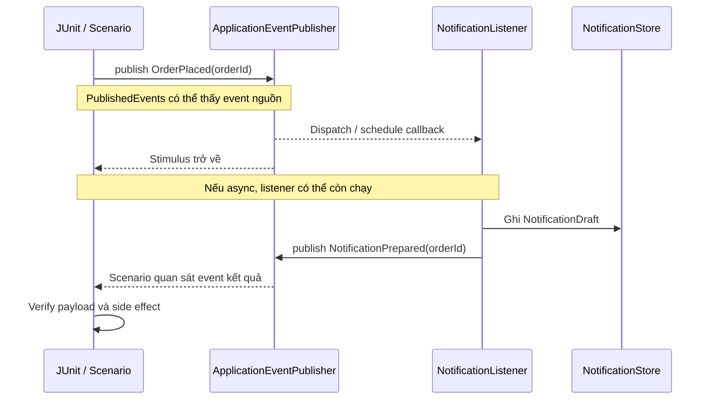

# Lỗi scenario không nhận event

## Mục tiêu học tập

Trong chương **Test failure** của học phần **Spring Modulith Verification & Testing**, một bài kiểm thử dùng `Scenario` có thể thất bại vì **không quan sát được event mong đợi trong thời gian chờ**. Điều đó chưa đủ để kết luận Spring Modulith “làm mất event”: nguyên nhân có thể nằm ở publisher, phạm vi `@ApplicationModuleTest`, listener, ranh giới transaction, điều kiện `matching(…)`, lỗi bất đồng bộ hoặc chính thời điểm test bắt đầu quan sát.

Bài học này giúp bạn:

- Phân biệt **event nguồn đã được publish**, **listener được gọi**, **event kết quả đã publish** và **side effect đã commit**.
- Đọc triệu chứng `Scenario` không nhận event để xác định **mắt xích bị đứt**, thay vì chỉ tăng timeout.
- Dùng `@ApplicationModuleTest`, `PublishedEvents` và `Scenario.stimulate(…).andWaitForEventOfType(…).matching(…).toArriveAndVerify(…)` đúng mục đích.
- Hiểu vì sao test ở module `orders` có thể không khởi động listener thuộc module `notifications`; chọn test trong module consumer hoặc integration test đủ module.
- Xử lý đúng tình huống `@Async`, `@TransactionalEventListener(phase = AFTER_COMMIT)` và `@ApplicationModuleListener`.
- Viết kiểm thử có **khóa tương quan**, điều kiện hoàn thành quan sát được và timeout hữu hạn, không dựa vào `Thread.sleep(…)`.
- Phân biệt lỗi `Scenario` với `ApplicationModules.verify()`, lỗi `ApplicationContext` và lỗi repository/JPA.
- Kết hợp test module, event assertions và quality gate trong CI để ngăn hồi quy.

## 1. Khi nào nói “Scenario không nhận event”?

Giả sử module `orders` phát `OrderPlaced` và module `notifications` lắng nghe để chuẩn bị thông báo. Khi hoàn tất, listener phát `NotificationPrepared`.

```text
Order service
    └── publish OrderPlaced              [event nguồn]
           └── NotificationListener      [consumer]
                  ├── tạo NotificationDraft
                  └── publish NotificationPrepared  [event kết quả]
```

Test muốn biết **listener đã chuẩn bị thông báo**, nên nó chờ `NotificationPrepared` chứ không chỉ đếm `OrderPlaced`:

```java
scenario.stimulate(() -> publisher.publishEvent(
                new OrderPlaced(orderId, customerId)))
        .andWaitForEventOfType(NotificationPrepared.class)
        .matching(e -> orderId.equals(e.orderId()))
        .toArriveAndVerify(e ->
                assertThat(e.customerId()).isEqualTo(customerId));
```

Mẫu này là **phần thân một test**, giả định đã có bean `publisher`, `Scenario`, các biến ID và import AssertJ. `Scenario` điều phối kích hoạt một hành động rồi chờ điều kiện event theo API Spring Modulith Test.

Nếu hết thời gian chờ mà không có `NotificationPrepared` phù hợp, có nhiều giả thuyết:

1. `OrderPlaced` chưa bao giờ được publish.
2. `OrderPlaced` đã publish nhưng listener không nằm trong test `ApplicationContext`.
3. Listener có mặt nhưng không nhận kiểu event đang được phát.
4. Listener đòi hỏi transaction commit, trong khi test rollback hoặc publish ngoài transaction.
5. Listener đã được gọi nhưng ném exception hoặc dừng trước khi phát event kết quả.
6. Event kết quả đã được publish nhưng có **`orderId` khác** nên không khớp predicate.
7. Event kết quả là kiểu khác, hoặc test chờ nhầm event nguồn.
8. Listener xử lý thành công nhưng không hề có contract “phát event kết quả”.
9. Event tới sau timeout vì executor/DB/broker chậm hoặc bế tắc.

**Timeout là triệu chứng của một điều kiện chưa được thỏa, không tự chỉ ra nguyên nhân.**

## 2. Bốn mốc cần kiểm tra riêng

| Mốc | Bằng chứng hợp lý | Điều chưa được chứng minh |
| --- | --- | --- |
| **Nguồn đã publish** | `PublishedEvents.ofType(OrderPlaced.class)` theo `orderId` | Consumer đã xử lý |
| **Listener được kích hoạt** | Log/spy tại listener hoặc trace có correlation ID | Listener hoàn thành thành công |
| **Listener đạt mốc nghiệp vụ** | `Scenario` quan sát `NotificationPrepared` | Database transaction đã commit nếu event phát trước commit |
| **Side effect bền vững** | Repository đọc được kết quả sau commit | Broker/email đã giao cho hệ thống ngoài nếu có |



Khi `Scenario` báo không có `NotificationPrepared`, đừng vội sửa logic của `OrderPlaced`. Hãy kiểm tra **từng mốc** theo thứ tự và tìm mốc đầu tiên không có bằng chứng.

### 2.1. Đừng chờ event nguồn khi mục tiêu là listener hoàn thành

```java
scenario.stimulate(() -> orders.place(orderId))
        .andWaitForEventOfType(OrderPlaced.class)
        .toArriveAndVerify(e -> { /* ... */ });
```

Nếu nghiệp vụ của `orders.place(…)` thực sự publish `OrderPlaced`, test này chỉ chứng minh **event nguồn tới cơ chế quan sát**. Nó không chứng minh một listener trong module `notifications` đã tạo thông báo. Hãy chờ event kết quả hoặc side effect của chính listener khi đó là hợp đồng cần bảo vệ.

### 2.2. PublishedEvents pass nhưng Scenario timeout có mâu thuẫn không?

Không. Ví dụ:

```java
assertThat(events.ofType(OrderPlaced.class)
        .matching(e -> orderId.equals(e.orderId())))
        .hasSize(1);
```

Assertion trên nói có đúng **một event nguồn cho một đơn**. Trong khi `Scenario` đang chờ **`NotificationPrepared`** của listener. Hai điều kiện có thể độc lập: nguồn publish đúng nhưng consumer bị thiếu, lỗi hoặc chưa đến mốc phát kết quả.

Một cách chẩn đoán tốt là tạo **test publisher contract riêng** và **test listener contract riêng**, thay vì để một timeout che khuất thông tin về tất cả các bước.

## 3. Phân biệt ba loại thất bại

| Triệu chứng nổi bật | Pha xảy ra | Cần kiểm tra |
| --- | --- | --- |
| `Failed to load ApplicationContext`, `NoSuchBeanDefinitionException` | Trước khi `@Test` chạy | Wiring, bean scope, profile, datasource, bootstrap |
| `Scenario` chờ event nhưng hết timeout | Context đã khởi tạo, stimulus đã được thực hiện | Nguồn, listener, transaction, predicate, async |
| `ApplicationModules.verify()` báo dependency violation | Kiểm chứng kiến trúc module | Public API, named interface, cycle, allowedDependencies |

Một hệ thống có thể **đồng thời** có những vấn đề trên. Nhưng một test `Scenario` timeout không nên được “sửa” bằng cách tắt `ApplicationModules.verify()`; một violation kiến trúc cũng không được giải quyết chỉ nhờ tăng timeout.

## 4. Case study: module consumer chạy async

Ví dụ chạy Java 17+, Spring Boot, Spring Modulith, JUnit Jupiter và AssertJ. Sử dụng hai module:

```text
src/main/java/com/example/shop/
├── ShopApplication.java               # @SpringBootApplication
├── orders/
│   └── OrderPlaced.java                # event public của orders
└── notifications/
    ├── NotificationDraft.java
    ├── NotificationPrepared.java
    ├── NotificationStore.java
    ├── NotificationPreparationListener.java
    └── NotificationAsyncConfiguration.java

src/test/java/com/example/shop/notifications/
    └── NotificationScenarioTests.java
```

**Điểm thiết kế quan trọng:** Test `NotificationScenarioTests` nằm trong **module consumer `notifications`**. Nó publish trực tiếp một event public `OrderPlaced` làm stimulus, kiểm tra riêng năng lực xử lý của `notifications`, không yêu cầu khởi động service nội bộ của `orders`.

Module consumer cần import một **public event type** từ module publisher; dependency này phải hợp lệ theo các quy tắc kiến trúc của ứng dụng. Bài test chỉ minh họa xử lý event, không thay thế kiểm tra kiến trúc `ApplicationModules.verify()`.

Thêm test dependency Maven theo Spring Modulith BOM tương thích với Spring Boot:

```xml
<dependency>
    <groupId>org.springframework.modulith</groupId>
    <artifactId>spring-modulith-starter-test</artifactId>
    <scope>test</scope>
</dependency>
```

### 4.1. Event nguồn từ orders

Tệp `src/main/java/com/example/shop/orders/OrderPlaced.java`:

```java
package com.example.shop.orders;

import java.util.UUID;

public record OrderPlaced(
        UUID orderId,
        UUID customerId) {
}
```

`OrderPlaced` là dữ liệu công khai, không mang JPA entity hay implementation nội bộ. `orderId` làm khóa tương quan để test không nhận nhầm event của giao dịch khác.

### 4.2. Event kết quả và trạng thái của notifications

Tệp `NotificationPrepared.java`:

```java
package com.example.shop.notifications;

import java.util.UUID;

public record NotificationPrepared(
        UUID orderId,
        UUID customerId,
        String templateCode) {
}
```

Tệp `NotificationDraft.java`:

```java
package com.example.shop.notifications;

import java.util.UUID;

public record NotificationDraft(
        UUID orderId,
        UUID customerId,
        String templateCode) {
}
```

Tệp `NotificationStore.java`:

```java
package com.example.shop.notifications;

import java.util.Optional;
import java.util.UUID;
import java.util.concurrent.ConcurrentHashMap;
import java.util.concurrent.ConcurrentMap;
import org.springframework.stereotype.Component;

@Component
public class NotificationStore {

    private final ConcurrentMap<UUID, NotificationDraft> drafts =
            new ConcurrentHashMap<>();

    public boolean saveIfAbsent(NotificationDraft draft) {
        return drafts.putIfAbsent(draft.orderId(), draft) == null;
    }

    public Optional<NotificationDraft> findByOrderId(UUID orderId) {
        return Optional.ofNullable(drafts.get(orderId));
    }

    public void remove(UUID orderId) {
        drafts.remove(orderId);
    }
}
```

Store trong bộ nhớ chỉ để minh họa một side effect có thể quan sát. `ConcurrentHashMap` phù hợp với truy cập nhiều thread trong một JVM; nó **không phải database bền vững** và không thay thế unique constraint/idempotency khi có nhiều instance.

### 4.3. Listener bất đồng bộ

Tệp `NotificationPreparationListener.java`:

```java
package com.example.shop.notifications;

import com.example.shop.orders.OrderPlaced;
import org.springframework.context.ApplicationEventPublisher;
import org.springframework.context.event.EventListener;
import org.springframework.scheduling.annotation.Async;
import org.springframework.stereotype.Component;

@Component
public class NotificationPreparationListener {

    private final NotificationStore store;
    private final ApplicationEventPublisher publisher;

    public NotificationPreparationListener(
            NotificationStore store,
            ApplicationEventPublisher publisher) {
        this.store = store;
        this.publisher = publisher;
    }

    @Async
    @EventListener
    public void on(OrderPlaced event) {
        var draft = new NotificationDraft(
                event.orderId(),
                event.customerId(),
                "ORDER_PLACED");

        if (store.saveIfAbsent(draft)) {
            // Đây là mốc kết quả sau khi store demo đã ghi.
            publisher.publishEvent(new NotificationPrepared(
                    draft.orderId(),
                    draft.customerId(),
                    draft.templateCode()));
        }
    }
}
```

Tệp `NotificationAsyncConfiguration.java`:

```java
package com.example.shop.notifications;

import org.springframework.context.annotation.Configuration;
import org.springframework.scheduling.annotation.EnableAsync;

@Configuration(proxyBeanMethods = false)
@EnableAsync
class NotificationAsyncConfiguration {
}
```

`@EnableAsync` bật cơ chế xử lý bất đồng bộ bằng `@Async`; phải đảm bảo configuration này có trong test context và listener là Spring bean. Trong production cần executor được cấu hình có chủ đích, chính sách xử lý lỗi và observability.

**Ngữ nghĩa trong ví dụ:** `NotificationPrepared` có nghĩa listener đã lưu một `NotificationDraft` vào **store bộ nhớ**. Không suy ra đã gửi email hoặc commit database. Nếu thay store bằng JPA, thời điểm publish event kết quả và thời điểm commit phải được kiểm chứng riêng.

## 5. Viết Scenario đúng cách: kích hoạt rồi chờ theo orderId

Tệp `src/test/java/com/example/shop/notifications/NotificationScenarioTests.java`:

```java
package com.example.shop.notifications;

import static org.assertj.core.api.Assertions.assertThat;

import com.example.shop.orders.OrderPlaced;
import java.util.UUID;
import org.junit.jupiter.api.Test;
import org.springframework.beans.factory.annotation.Autowired;
import org.springframework.context.ApplicationEventPublisher;
import org.springframework.modulith.test.ApplicationModuleTest;
import org.springframework.modulith.test.PublishedEvents;
import org.springframework.modulith.test.Scenario;

@ApplicationModuleTest
class NotificationScenarioTests {

    @Autowired
    ApplicationEventPublisher publisher;

    @Autowired
    NotificationStore store;

    @Test
    void receivesOrderPlacedAndPreparesNotification(
            Scenario scenario,
            PublishedEvents events) {

        UUID orderId = UUID.randomUUID();
        UUID customerId = UUID.randomUUID();

        try {
            scenario.stimulate(() ->
                            publisher.publishEvent(
                                    new OrderPlaced(orderId, customerId)))
                    .andWaitForEventOfType(NotificationPrepared.class)
                    .matching(e -> orderId.equals(e.orderId()))
                    .toArriveAndVerify(result -> {
                        assertThat(result.customerId())
                                .isEqualTo(customerId);
                        assertThat(result.templateCode())
                                .isEqualTo("ORDER_PLACED");
                    });

            assertThat(events.ofType(OrderPlaced.class)
                    .matching(e -> orderId.equals(e.orderId())))
                    .hasSize(1);

            assertThat(store.findByOrderId(orderId))
                    .contains(new NotificationDraft(
                            orderId, customerId, "ORDER_PLACED"));
        } finally {
            store.remove(orderId);
        }
    }
}
```

### 5.1. Vì sao cách này không bị race như assertion tức thì?

`Scenario` tổ chức cả **stimulus** và bước chờ kết quả theo API testing của Spring Modulith. Ta không thực hiện `publisher.publishEvent(…)` xong, đợi một khoảng tự đoán rồi mới assert event kết quả.

Ba phép kiểm có vai trò riêng:

1. `Scenario` chờ `NotificationPrepared` **đúng `orderId`** và kiểm tra nội dung.
2. `PublishedEvents` xác nhận đúng một `OrderPlaced` được publish trong bài test.
3. `NotificationStore` xác nhận side effect của listener với payload chính xác.

Ba bằng chứng không thay thế lẫn nhau. Một test chỉ thấy `OrderPlaced` không biết listener thành công; một test chỉ chờ event kết quả cũng có thể bỏ sót payload hoặc trạng thái lưu sai.

### 5.2. Vì sao matching(orderId) quan trọng?

Không lọc ID:

```java
.andWaitForEventOfType(NotificationPrepared.class)
.toArriveAndVerify(event -> {
    // Có thể nhận event của đơn khác nếu test context có
    // nhiều công việc bất đồng bộ đồng thời.
});
```

Lọc theo khóa tương quan:

```java
.andWaitForEventOfType(NotificationPrepared.class)
.matching(event -> orderId.equals(event.orderId()))
.toArriveAndVerify(event -> {
    assertThat(event.customerId()).isEqualTo(customerId);
});
```

Một predicate quá rộng có thể khiến test **pass sai** vì kết quả của giao dịch khác. Một predicate quá hẹp hoặc so nhầm `customerId` với `orderId` sẽ khiến `Scenario` **timeout** dù listener đã phát event.

### 5.3. Vì sao không dùng Thread.sleep?

```java
publisher.publishEvent(new OrderPlaced(orderId, customerId));
Thread.sleep(300);
assertThat(events.ofType(NotificationPrepared.class)).hasSize(1);
```

Ba vấn đề:

- Listener có thể hoàn thành sau 300 ms trên CI và test fail không ổn định.
- Nếu hoàn thành sau 1 ms thì vẫn phải ngủ 300 ms không cần thiết.
- Không có cơ chế đảm bảo event quan sát đúng `orderId`.

`Scenario` chờ một **điều kiện nghiệp vụ** với giới hạn thời gian thực phù hợp. Không xem việc tăng thời gian chờ như giải pháp mặc định khi event thực tế không bao giờ xuất hiện.

## 6. Case lỗi thứ nhất: test nằm sai module, listener không được bootstrap

Đây là nguyên nhân rất quan trọng trong Spring Modulith.

Giả sử bạn đặt test `OrderPlacedScenarioTests` trong package `com.example.shop.orders`:

```java
package com.example.shop.orders;

import org.springframework.modulith.test.ApplicationModuleTest;

@ApplicationModuleTest
class OrderPlacedScenarioTests {
    // Đang thử chờ NotificationPrepared của notifications.
}
```

Theo phạm vi module test mặc định, Spring bootstrap **module orders**, không tự động bootstrap các consumer `notifications` chỉ vì module đó lắng nghe `orders.OrderPlaced`.

```text
Test trong orders, mode STANDALONE:
  orders.OrderService           [có]
  notifications.NotificationPreparationListener [có thể không có]

orders.publishEvent(OrderPlaced) → đã publish
  nhưng không có listener notifications trong context
  → NotificationPrepared không xuất hiện
  → Scenario timeout
```

### 6.1. Vì sao DIRECT_DEPENDENCIES chưa chắc sửa được?

`@ApplicationModuleTest(mode = BootstrapMode.DIRECT_DEPENDENCIES)` mở rộng theo **các module mà module đang test phụ thuộc trực tiếp**. Nếu module `notifications` là **consumer** của event thuộc `orders`, hướng static dependency có thể là:

```text
notifications → orders (import OrderPlaced)
```

Chứ không phải:

```text
orders → notifications
```

Vậy khi test nằm trong `orders`, bật `DIRECT_DEPENDENCIES` **không tự bảo đảm** đưa module `notifications` vào context. Kể cả `ALL_DEPENDENCIES` cũng đi theo quan hệ phụ thuộc của module đang test, không có nghĩa toàn bộ **dependent modules** được khởi động.

### 6.2. Chọn cách sửa theo mục tiêu test

| Mục tiêu thực sự | Vị trí/cách test | Có chờ `NotificationPrepared` không? |
| --- | --- | --- |
| Chứng minh `orders` publish đúng event | `@ApplicationModuleTest` trong `orders` + `PublishedEvents` | Không bắt buộc |
| Chứng minh `notifications` xử lý `OrderPlaced` | `@ApplicationModuleTest` trong `notifications`, publish event làm stimulus | Có |
| Chứng minh toàn luồng orders → notifications | Integration test bootstrap **cả hai module thật** | Có |

Nếu dùng integration test toàn ứng dụng như `@SpringBootTest`, nó có thể bao gồm cả publisher và consumer, nhưng đánh đổi thời gian và mức cô lập. Đừng đổi mọi module test thành full context chỉ để dập một timeout; hãy rõ mục tiêu.

### 6.3. Chẩn đoán listener có thực sự tồn tại trong context

Kiểm tra:

- Class listener có `@Component`/`@Service` và nằm trong module được bootstrap không?
- `@EventListener` có đúng method signature, nhận đúng loại event không?
- Có `@Profile` hoặc `@ConditionalOnProperty` khiến listener bị loại không?
- Class có bị đặt vào package module khác, ngoài phạm vi `@ApplicationModuleTest` không?
- Nếu listener phụ thuộc database/gateway, context đã khởi tạo được bean đó chưa?

Nếu listener không được đăng ký mà không có exception khởi tạo, `Scenario` có thể timeout thay vì nhận lỗi `NoSuchBeanDefinitionException`: vì publisher không nhất thiết cần inject listener qua constructor.

## 7. Case lỗi thứ hai: predicate và event type không khớp

Một listener có thể publish `NotificationPrepared` nhưng test chờ một event hoặc ID khác.

### 7.1. Chờ nhầm loại event

```java
// Listener phát NotificationPrepared.
publisher.publishEvent(new NotificationPrepared(
        orderId, customerId, "ORDER_PLACED"));

// Test lại chờ NotificationSent: không cùng contract.
.andWaitForEventOfType(NotificationSent.class)
```

Hai dòng thuộc hai vị trí code riêng, được đặt cạnh nhau để so sánh, không phải một đoạn Java tự chứa. Nếu contract chỉ nói “chuẩn bị thông báo”, event `NotificationSent` (nếu có) có thể là mốc sau khi vận chuyển thành công; đổi listener để phát sai mốc chỉ nhằm làm test xanh là không đúng.

### 7.2. So nhầm khóa tương quan

```java
UUID orderId = UUID.randomUUID();
UUID customerId = UUID.randomUUID();

// Sai: orderId đang được so với customerId.
.matching(e -> customerId.equals(e.orderId()))
```

Predicate không match nên `Scenario` không nhận event phù hợp dù event đã publish. Với cùng loại event, ưu tiên **lọc theo ID giao dịch** và assert các field payload khác trong `toArriveAndVerify(…)`.

### 7.3. Event bị biến đổi qua wrapper hoặc hợp đồng đã đổi

Ví dụ service trước đây phát `NotificationPrepared`, nay đổi sang `NotificationQueued` để phản ánh một bước xử lý khác. Test phải được cập nhật **theo hợp đồng mới đã được chấp thuận**, không chỉ sửa tên để timeout biến mất. Một tên event mới có thể mang ngữ nghĩa khác nhau về commit/delivery.

Trong môi trường Spring event, cũng cần phân biệt event payload thật với wrapper/transport message nếu ứng dụng dùng event adapter hoặc integration bus. Test `Scenario` đang quan sát **Spring application events trong context**, không tự động bắt message được gửi trên một broker bên ngoài JVM.

## 8. Case lỗi thứ ba: transactional listener chưa được kích hoạt

`@TransactionalEventListener` chỉ xử lý event theo pha transaction đã định. Phổ biến nhất là:

```java
@TransactionalEventListener(phase = TransactionPhase.AFTER_COMMIT)
public void on(OrderPlaced event) {
    // Chỉ xử lý khi transaction nguồn commit thành công.
}
```

Đoạn trên là method minh họa; cần import `TransactionalEventListener`, `TransactionPhase` và event type. Với `fallbackExecution` mặc định là `false`, event publish **ngoài một transaction đang hoạt động** không kích hoạt listener transaction-bound theo pha đã chọn.

### 8.1. Bốn trạng thái publish/commit

| Nguồn publish event | `PublishedEvents` có thể thấy `OrderPlaced`? | Listener `AFTER_COMMIT` có chạy? |
| --- | --- | --- |
| Trong transaction đang mở | Có | Chưa, vì chưa commit |
| Trong transaction commit thành công | Có | Được kích hoạt sau commit |
| Trong transaction rollback | Có thể vẫn thấy event đã publish | Không |
| Ngoài transaction, `fallbackExecution = false` | Có thể thấy event | Không |

Vì thế, `Scenario` chờ `NotificationPrepared` có thể timeout do **không có commit** chứ không do thiếu `@EventListener`.

### 8.2. Test @Transactional tự rollback

Một anti-pattern:

```java
@Transactional
@Test
void expectsAfterCommitListener(Scenario scenario) {
    // Test transaction có thể rollback sau method,
    // nên callback AFTER_COMMIT chưa được kích hoạt khi chờ.
}
```

Trong nhiều Spring integration test, phương thức test `@Transactional` thường được rollback sau khi test kết thúc. Nếu `Scenario` đang đợi listener `AFTER_COMMIT` **ngay trong method**, transaction test chưa commit, dẫn đến timeout.

### 8.3. Chủ động commit stimulus bằng TransactionTemplate

Đối với integration test có `PlatformTransactionManager`, có thể để `Scenario` điều phối stimulus chứa một transaction được commit:

```java
TransactionTemplate tx = new TransactionTemplate(
        transactionManager);

scenario.stimulate(() ->
                tx.executeWithoutResult(status ->
                        publisher.publishEvent(
                                new OrderPlaced(orderId, customerId))))
        .andWaitForEventOfType(NotificationPrepared.class)
        .matching(e -> orderId.equals(e.orderId()))
        .toArriveAndVerify(result ->
                assertThat(result.customerId())
                        .isEqualTo(customerId));
```

Đây là **đoạn thân test** giả định `transactionManager`, `publisher`, `scenario`, `orderId` và `customerId` có sẵn. Cần import `TransactionTemplate` và bean transaction manager phù hợp. Không đặt nó dưới một test transaction bên ngoài rồi mặc định inner transaction đã commit: propagation mặc định `REQUIRED` có thể chỉ tham gia transaction hiện hữu. Khi cần kiểm soát commit độc lập, tránh test transaction bao ngoài hoặc cấu hình propagation đúng theo thiết kế.

**Đặc biệt:** listener chỉ chạy hậu commit khi event được publish trong một **transaction tương ứng**, không phải chỉ vì Spring có DataSource.

### 8.4. @ApplicationModuleListener

Spring Modulith hỗ trợ `@ApplicationModuleListener` để viết listener theo mô hình application module và xử lý sự kiện gắn với cơ chế bất đồng bộ/giao dịch. Cách thực thi và hạ tầng đi kèm cần đối chiếu với phiên bản đang dùng.

Khi test một listener dạng này, cần kiểm tra:

1. Listener có nằm trong test context không?
2. Event nguồn có được publish trong transaction và commit không?
3. Executor có thực thi callback không?
4. Listener có hoàn tất và phát event kết quả hợp đồng không?
5. Nếu có Event Publication Registry, publication target có đang chờ hoặc được đánh dấu hoàn tất không?

Không coi `@ApplicationModuleListener` và `@EventListener` đồng bộ là hoàn toàn tương đương về thời điểm callback. Càng không được dùng `Scenario` chờ kết quả hậu commit khi test chưa tạo điều kiện commit thực.

## 9. Case lỗi thứ tư: lỗi trong worker thread hoặc listener

Với `@Async`, event có thể đã được dispatch nhưng callback ném exception trong một worker thread. Test gọi `publishEvent(…)` có thể trả về bình thường; exception của một `void` async listener **không nhất thiết được ném ngược về thread của test**.

Ví dụ listener lỗi trước khi phát event kết quả:

```java
@Async
@EventListener
public void on(OrderPlaced event) {
    var template = templateRepository.findByCode("ORDER_PLACED")
            .orElseThrow(() ->
                    new IllegalStateException("Template not configured"));

    publisher.publishEvent(
            new NotificationPrepared(
                    event.orderId(), event.customerId(), template.code()));
}
```

Đoạn này minh họa một listener trong class đã có các dependency `templateRepository` và `publisher`, không phải source file tự chứa. Nếu repository không tìm thấy template:

- `OrderPlaced` vẫn có thể đã publish đúng một lần.
- Listener được gọi, nhưng lỗi trước khi publish `NotificationPrepared`.
- `Scenario` chờ kết quả timeout.
- Log/executor exception handler có thể chứa dấu vết lỗi thật.

### 9.1. Ghi log đúng correlation ID

Trong listener, hãy ghi trạng thái với `orderId` hoặc `eventId` ổn định để liên kết những log:

```text
event.source       orderId=... type=OrderPlaced
listener.started   orderId=... listener=NotificationPreparationListener
listener.failed    orderId=... reason=TemplateNotFound
event.result       orderId=... type=NotificationPrepared  (không có)
```

Đây là **định dạng log gợi ý**, không phải log thực tế đã thu thập. Không ghi PII hoặc payload nhạy cảm vào log; dùng ID tương quan và thông tin kỹ thuật đủ chẩn đoán.

### 9.2. Exception không đồng nghĩa event chưa publish

`assertThatThrownBy(() -> publisher.publishEvent(source))` có thể hữu ích với listener đồng bộ truyền lỗi ngược lên multicaster; nó **không phải** cách tổng quát để bắt lỗi ở listener `@Async`. Với async, phải quan sát kết quả hoặc trạng thái thất bại riêng; tránh dựa vào propagation exception từ thread test.

### 9.3. EventPublicationRegistry và retry

Trong hệ thống Spring Modulith có Event Publication Registry, trạng thái publication có thể giúp tìm listener target nào chưa hoàn tất theo cơ chế hỗ trợ. Cần phân biệt:

| Bằng chứng | Kết luận thích hợp |
| --- | --- |
| `PublishedEvents` có `OrderPlaced` | Event nguồn được publish trong phạm vi test |
| Registry có publication target đang chờ | Có công việc listener được theo dõi, chưa được đánh dấu hoàn tất |
| Registry đánh dấu hoàn tất | Cơ chế publication đã ghi nhận completion theo semantics tương ứng |
| `Scenario` thấy `NotificationPrepared` | Event kết quả đã đến bộ quan sát trong thời gian chờ |
| Repository sau commit có `NotificationDraft` | Side effect dữ liệu được lưu theo contract |

Một event nguồn có thể được theo dõi cho **nhiều listener target**; số publication registry không nhất thiết bằng số lần publish. Registry cũng không tự chứng minh email đã đến người nhận cuối. Không dùng việc xóa record registry để che một listener lỗi trong test.

## 10. Case lỗi thứ năm: event đã tới nhưng Scenario vẫn không pass

Một số tình huống xảy ra ngay trong **test logic**:

### 10.1. Publish trước khi tổ chức bước chờ

```java
publisher.publishEvent(new OrderPlaced(orderId, customerId));

// Không nên coi đây là cách chuẩn để chờ kết quả của stimulus ở trên:
scenario.stimulate(() -> { })
        .andWaitForEventOfType(NotificationPrepared.class)
        .matching(e -> orderId.equals(e.orderId()))
        .toArriveAndVerify(e -> { /* ... */ });
```

Mẫu này tạo khoảng thời gian giữa stimulus thật và cơ chế `Scenario` điều phối quan sát. Trong một số bối cảnh event có thể đến trước khi bước chờ được thiết lập theo cách ta mong đợi. Cách rõ ràng hơn là **đưa lệnh publish vào `scenario.stimulate(…)`**.

### 10.2. Predicate dùng dữ liệu chưa chuẩn hóa

Ví dụ `orderId` là UUID trong event, nhưng test so với chuỗi đã format hoặc dữ liệu của fixture khác. `matching(…)` không khớp thì sự kiện bị loại khỏi điều kiện chờ.

Hãy kiểm tra:

- Các bên dùng cùng kiểu ID và cùng định nghĩa correlation key?
- Event có mang ID trước/sau khi mapping?
- Test có tạo một ID mới ngoài stimulus thay vì giữ nguyên ID đã gửi không?
- Có event từ test khác đang cùng thực thi và vô tình thỏa predicate quá rộng không?

### 10.3. Timeout quá ngắn hoặc hệ thống bị chậm

Giới hạn chờ hữu hạn là cần thiết để CI không treo, nhưng đừng chọn một con số chỉ đủ trong laptop không tải. Nếu event **thực sự** xuất hiện muộn trên máy CI, cần xem executor queue, thread pool, network, database, lock và thời gian xử lý.

Chỉ **điều chỉnh timeout** sau khi có bằng chứng event có khả năng đến và độ trễ đó nằm trong SLA/test envelope. Nếu listener chưa được đăng ký hoặc transaction luôn rollback, tăng timeout chỉ làm test đợi lâu hơn trước khi fail.

### 10.4. Chờ một event không chứng minh không có duplicate

`Scenario` chờ một `NotificationPrepared` phù hợp rồi pass; một event kết quả trùng có thể xuất hiện về sau. Nếu hợp đồng yêu cầu đúng một notification cho mỗi đơn, cần thêm idempotency và assertion trạng thái bền vững hoặc kiểm tra số lần publish tại một điểm hoàn tất có kiểm soát.

Đây là giới hạn của **bằng chứng chờ đến khi điều kiện đúng**, không phải lỗi trong `Scenario`.

## 11. Khi listener không phát event kết quả

Nhiều consumer chỉ ghi database, cập nhật audit hoặc gọi external gateway. Khi đó `andWaitForEventOfType(NotificationPrepared.class)` sẽ timeout **theo thiết kế** nếu không có event `NotificationPrepared`.

Chọn một điều kiện phản ánh hợp đồng:

| Hợp đồng listener | Điều kiện chờ hợp lý |
| --- | --- |
| Listener tạo event nghiệp vụ `NotificationPrepared` | Chờ event qua `Scenario` |
| Listener ghi status `READY` trong DB | Chờ repository thấy status sau commit |
| Listener gửi message vào broker | Kiểm tra publish/ACK theo transport contract |
| Listener gửi email thật | Kiểm chứng gateway tương ứng; không suy chỉ từ event nguồn |
| Listener cập nhật cache | Quan sát cache sau thao tác với test fixture phù hợp |

Với JPA repository và Awaitility, một mẫu *đoạn thân integration test* là:

```java
await()
        .atMost(Duration.ofSeconds(5))
        .untilAsserted(() -> {
            var draft = notificationRepository.findByOrderId(orderId);
            assertThat(draft).isPresent();
            assertThat(draft.orElseThrow().getStatus())
                    .isEqualTo(NotificationStatus.READY);
        });
```

Đoạn trên giả định `notificationRepository.findByOrderId(…)` trả `Optional<NotificationEntity>`, có `NotificationStatus.READY` và cần import `org.awaitility.Awaitility.await`, `java.time.Duration`, AssertJ. Đây không phải lớp test hoàn chỉnh. Phải cấu hình transaction nguồn và bảo đảm listener thật đã được bootstrap, không chỉ chờ DB một cách vô điều kiện.

**Với database:** `NotificationPrepared` có thể được publish trong thân listener trước khi transaction ghi JPA commit. Vì vậy, khi hợp đồng là dữ liệu bền vững, chờ **record sau commit** quan trọng hơn chỉ thấy event kết quả.

## 12. Ma trận chẩn đoán: tìm mắt xích bị đứt

| Quan sát | Giả thuyết ưu tiên | Bước kiểm tra |
| --- | --- | --- |
| Không có `OrderPlaced` theo ID | Publisher không đi đúng nhánh hoặc không publish | Test publisher riêng với `PublishedEvents` |
| Có `OrderPlaced`, listener bean không có | `@ApplicationModuleTest` chỉ bootstrap module nguồn | Đặt test trong consumer hoặc bootstrap đủ module |
| Listener bean có, không nhận event | Sai `@EventListener`, type, profile, condition | Xác minh listener registration và method signature |
| Listener là `AFTER_COMMIT`, test rollback | Không có commit nên callback không chạy | Dùng transaction được commit có kiểm soát |
| Listener là `AFTER_COMMIT`, publish ngoài transaction | `fallbackExecution = false` | Đưa stimulus vào transaction nếu hợp đồng yêu cầu |
| Listener bắt đầu rồi thất bại | Exception trên worker/DB/gateway | Log theo ID, exception handler, trạng thái thất bại |
| `NotificationPrepared` đã publish với ID khác | Predicate `matching` sai hoặc payload sai | Đối chiếu ID nguồn/kết quả và event mapping |
| Result xuất hiện nhưng DB chưa commit | Event phát trước commit của listener | Chờ repository sau commit |
| Result tới sau timeout | Latency/executor/lock thật hoặc timeout thiếu phù hợp | Profile thời gian xử lý, chỉnh điều kiện chờ đúng SLA |
| Không có event kết quả theo contract | Listener chỉ tạo side effect | Chờ state thay đổi, không bịa event test-only |
| Test fail ngẫu nhiên trên CI | Race, dữ liệu chia sẻ, sleep, background jobs | ID duy nhất, cleanup, test isolation, chờ điều kiện |
| Architecture gate fail song song | Dependency module sai | Sửa module boundary bằng `ApplicationModules.verify()` |

## 13. Quy trình debug 8 bước có thể áp dụng trong CI

### Bước 1 — Xác định chính xác test đang chờ gì

Ghi tên event ở `andWaitForEventOfType(…)`, ID trong `matching(…)`, loại stimulus và timeout. Phân biệt nguồn và kết quả.

### Bước 2 — Xác minh publisher trước

Viết một test nhỏ cho publisher trong module sở hữu use case. Với `PublishedEvents`, assert event nguồn **đúng ID, đúng payload và đúng số lần**. Khi publisher không phát event, không có lý do bắt đầu từ executor của consumer.

### Bước 3 — Kiểm tra test context và module scope

Xác định `@ApplicationModuleTest` đặt trong module nào, mode gì, listener nằm ở module nào. Không suy rằng `DIRECT_DEPENDENCIES` từ producer sẽ khởi động mọi consumer downstream.

### Bước 4 — Kiểm tra registration và type của listener

Listener có được tạo dưới dạng Spring bean? Có `@EventListener`, `@TransactionalEventListener` hoặc `@ApplicationModuleListener` đúng vị trí? Có bị điều kiện `@Profile`/`@ConditionalOnProperty` loại ra không?

### Bước 5 — Kiểm tra transaction

Nếu listener phụ thuộc `AFTER_COMMIT`, phải biết event nguồn publish **bên trong transaction nào**, transaction đã commit chưa và test có rollback mặc định không.

### Bước 6 — Kiểm tra lỗi async và payload

Tra log theo `orderId`, quan sát listener bắt đầu/thất bại/kết thúc. So event kết quả với type và predicate test. Nếu có registry, kiểm tra publication target đang chờ và trạng thái xử lý.

### Bước 7 — Đặt điều kiện chờ theo đúng hợp đồng

Nếu có event kết quả, dùng `Scenario`. Nếu chỉ có repository state, dùng điều kiện chờ repository sau commit. Không chỉ tăng `Thread.sleep`.

### Bước 8 — Chạy lại test nhỏ và quality gate

Khi có quyền thực thi trong dự án, có thể chạy test cụ thể:

```bash
./mvnw -Dtest=NotificationScenarioTests test
```

Hoặc:

```bash
./gradlew test --tests "com.example.shop.notifications.NotificationScenarioTests" --stacktrace
```

Đây là lệnh **minh họa**, không phải lệnh đã chạy cho bài. Sau khi sửa, chạy thêm `ApplicationModules.verify()` và các integration tests liên quan nếu thay đổi scope, dependency, transaction hoặc JPA.

### 13.1. Mẫu ghi chú chẩn đoán

```text
Failure: Scenario did not observe NotificationPrepared
Test module: notifications
Source event: orders.OrderPlaced
Correlation: orderId = <id trong log>
Publisher event observed: yes/no
Listener present in context: yes/no
Listener type: @Async @EventListener / AFTER_COMMIT
Transaction committed: yes/no/not applicable
Listener exception: <nội dung hoặc none>
Result event observed: yes/no, payload id
Root cause: <giả thuyết đã xác minh>
Fix: <thay đổi tối thiểu>
Validation: <kết quả test thực tế, nếu đã chạy>
```

Không kết luận “listener không chạy” chỉ vì chờ timeout mà không có log hoặc dấu vết registration. Nếu chưa xác minh mốc nào, ghi rõ là **chưa biết**, tránh điền một khẳng định không có bằng chứng.

## 14. Kiểm chứng ranh giới kiến trúc bên cạnh Scenario

Trong Spring Modulith, event-driven communication vẫn tạo **static dependency** khi consumer import event type của publisher. Ví dụ:

```text
notifications.NotificationPreparationListener
  └── imports orders.OrderPlaced
```

Điều đó phải được phép theo API và quy tắc module, đặc biệt nếu có `allowedDependencies` hoặc `@NamedInterface`. Test kiến trúc:

```java
package com.example.shop;

import org.junit.jupiter.api.Test;
import org.springframework.modulith.core.ApplicationModules;

class ArchitectureVerificationTests {

    @Test
    void moduleBoundariesAreValid() {
        ApplicationModules.of(ShopApplication.class).verify();
    }
}
```

`ShopApplication` là lớp `@SpringBootApplication` gốc của ví dụ, cần thay tên phù hợp project thực tế.

**Hai lỗi không được nhầm:**

- `ApplicationModules.verify()` fail vì `notifications` import kiểu internal của `orders` hoặc tạo module cycle → lỗi **kiến trúc**.
- `Scenario` timeout vì test module không có listener hoặc chưa commit → lỗi **runtime/test orchestration**.

Một interface/event public hợp lệ không tự tạo listener bean trong context; ngược lại việc một bean được bootstrap không chứng minh module dependency graph hợp lệ.

## 15. Anti-pattern và cách thay

| Anti-pattern | Rủi ro | Cách thay |
| --- | --- | --- |
| Chờ `OrderPlaced` rồi đặt tên test `notificationCompleted` | Chỉ kiểm chứng publisher | Chờ `NotificationPrepared` hoặc state consumer |
| Dùng `Thread.sleep(1000)` | CI flaky, lãng phí thời gian | Dùng `Scenario`/Awaitility có điều kiện |
| Bỏ `matching(orderId)` | Có thể nhận nhầm event giao dịch khác | Correlation key ổn định |
| Chỉ tăng timeout | Che thiếu listener/rollback/lỗi code | Chẩn đoán các mốc trước |
| `DIRECT_DEPENDENCIES` trên producer để tải tất cả consumer | Sai hướng module dependency | Test tại consumer hoặc integration đủ module |
| `@Transactional` test rollback nhưng chờ `AFTER_COMMIT` | Listener không chạy trước commit | Stimulus commit thực sự |
| Test bắt exception của `@Async` tại `publishEvent` | Worker thread xử lý lỗi riêng | Quan sát trạng thái/log/result |
| Thấy `PublishedEvents` có event nguồn là kết luận listener thành công | Nhầm publish với completion | Kiểm tra event kết quả/side effect |
| Chờ event không nằm trong contract listener | Timeout dù hệ thống đúng | Chờ trạng thái nghiệp vụ thực tế |
| Sửa lỗi bằng cách bật component scan toàn app | Mất ý nghĩa module isolation | Cấu hình scope đúng mục tiêu |
| Dùng event kết quả phát trước DB commit để chứng minh bền vững | Kết luận vượt bằng chứng | Chờ repository sau commit |
| Bỏ qua module architecture gate | Có thể import internal type/vòng phụ thuộc | Chạy `ApplicationModules.verify()` trong CI |

## 16. Quality gate CI cho event assertions

Học phần **Spring Modulith Verification & Testing** kết hợp hai loại cam kết: **module boundary** và **behavior runtime**. Một pipeline có thể tổ chức:

| Gate | Kiểm tra | Nếu fail nên xem |
| --- | --- | --- |
| Architecture | `ApplicationModules.verify()` | Public API, named interface, cycle, dependency rule |
| Publisher module | `@ApplicationModuleTest` + `PublishedEvents` | Event nguồn, payload, số lần publish |
| Consumer module | `@ApplicationModuleTest` + `Scenario` | Listener registration, event type, matching, async |
| Transaction integration | `@TransactionalEventListener`/`@ApplicationModuleListener` | Commit/rollback, executor, publication state |
| Persistence integration | Repository/JPA và migration | Side effect sau commit, schema, transaction isolation |
| End-to-end integration | Publisher + consumer thật | Luồng fan-out, broker/external effects khi cần |

Đề xuất thứ tự:

1. Chạy kiểm chứng kiến trúc và publisher tests nhỏ để phát hiện sai ranh giới, thiếu event sớm.
2. Chạy consumer module tests với ID riêng, fixture cô lập và giới hạn chờ hữu hạn.
3. Chạy integration tests cần commit DB, event registry hoặc transport thật ở tầng thích hợp.
4. Lưu báo cáo test và logs theo correlation ID để debug timeout.
5. Khi sửa lỗi, chạy lại **đúng test thất bại** rồi toàn bộ gate liên quan.

Đừng gộp mọi thứ vào một integration test chỉ để một `Scenario` chờ nhiều bước không rõ lý do fail. Test nhỏ giúp biết lỗi ở publisher, consumer, transaction hay persistence.

## 17. Bài thực hành

Sử dụng ví dụ `OrderPlaced`, `NotificationPreparationListener` và `NotificationScenarioTests`:

1. **Happy path:** publish một `OrderPlaced`, chờ `NotificationPrepared` theo `orderId`, assert customer ID/template và một `NotificationDraft`.
2. **Thiếu listener:** tạm bỏ `@Component` khỏi listener trong môi trường thực hành; dự đoán `Scenario` sẽ timeout dù event nguồn vẫn có thể publish. Hoàn tác.
3. **Sai module test:** chuyển test sang package `orders` ở mode `STANDALONE`, không thêm consumer module. Giải thích vì sao notifications listener không được bootstrap theo mặc định.
4. **Sai ID:** đổi predicate thành `customerId.equals(e.orderId())`. Xác định đây là lỗi matching hay lỗi listener.
5. **Sai event type:** chờ một event khác `NotificationPrepared`; kiểm tra sự khác nhau giữa contract mong đợi và event thực sự phát.
6. **Lỗi async:** ném `IllegalStateException` trong listener trước khi publish event kết quả; quan sát log và lỗi timeout. Giải thích vì sao exception không nhất thiết quay về publisher thread.
7. **Sau commit:** đổi sang `@TransactionalEventListener(AFTER_COMMIT)`. Kiểm thử stimulus có commit thật, rollback và publish ngoài transaction với fallback mặc định.
8. **Không phát event kết quả:** sửa listener chỉ cập nhật store. Dùng Awaitility hoặc cơ chế chờ trạng thái phù hợp thay vì cố đợi một `NotificationPrepared` không tồn tại.
9. **Transaction DB:** thay map bằng JPA repository, kiểm tra event kết quả có thể phát trước DB commit và viết assertion vào trạng thái persisted sau commit.
10. **Hai đơn đồng thời:** publish hai event khác `orderId`; bảo đảm `matching(…)` không nhận nhầm kết quả của đơn kia.
11. **Kiến trúc:** chạy `ApplicationModules.verify()`, giải thích dependency tĩnh của listener `notifications` tới public event `orders.OrderPlaced`.
12. **CI:** lập bảng chẩn đoán sự cố theo các mốc publish → listener → outcome → DB commit, ghi cách xử lý khi từng mốc thiếu.

**Tiêu chí hoàn thành:** người học chỉ ra được vì sao `Scenario` chờ không thấy event, có bằng chứng về event nguồn và phạm vi listener, biết chọn điều kiện chờ đúng hợp đồng, xử lý `AFTER_COMMIT` với commit thực và không che lỗi bằng sleep hoặc timeout quá lớn.

## 18. Câu hỏi tự kiểm tra

**Câu 1.** `PublishedEvents` ghi nhận một `OrderPlaced` nhưng `Scenario` chờ `NotificationPrepared` timeout. Có mâu thuẫn không?

**Trả lời:** Không. Event nguồn đã publish nhưng listener có thể thiếu, chưa được kích hoạt, lỗi hoặc chưa phát kết quả. Hai phép kiểm ở hai mốc khác nhau.

**Câu 2.** Test `@ApplicationModuleTest` nằm trong `orders`. Tại sao listener `notifications` có thể vắng mặt?

**Trả lời:** Module test mặc định giới hạn phạm vi bootstrap. Một consumer module không tự được khởi động vì nó lắng nghe event của module đang test; nên test listener trong consumer module hoặc dùng integration test đủ module.

**Câu 3.** Bật `DIRECT_DEPENDENCIES` cho `orders` có chắc tải được `notifications` không?

**Trả lời:** Không. Chế độ này tải dependency của module đang test, không mặc định tải những module **phụ thuộc vào** nó. Nếu `notifications → orders`, hướng phụ thuộc ngược với điều giả định.

**Câu 4.** Listener `AFTER_COMMIT` có chạy khi event được publish ngoài transaction với `fallbackExecution = false` không?

**Trả lời:** Không theo cấu hình mặc định. Test cần stimulus có transaction commit hoặc một contract khác được thiết kế rõ ràng.

**Câu 5.** Một `@Async` listener ném exception. `assertThatThrownBy(() -> publishEvent(...))` có chắc bắt được không?

**Trả lời:** Không. Exception có thể xảy ra trong worker thread. Cần theo dõi trạng thái lỗi, log/executor handler hoặc event kết quả phù hợp.

**Câu 6.** `Scenario` chờ được `NotificationPrepared`. Có chắc email đã đến người dùng và JPA transaction đã commit không?

**Trả lời:** Không. Tùy thời điểm phát event, nó mới chứng minh mốc nghiệp vụ được công bố; delivery ngoài hệ thống và commit DB phải kiểm tra riêng.

**Câu 7.** Listener chỉ cập nhật database, không phát event kết quả. Test nên dùng gì?

**Trả lời:** Chờ trạng thái repository sau commit hoặc một tín hiệu nghiệp vụ khác thực sự tồn tại, thay vì chờ event không thuộc contract.

**Câu 8.** Vì sao `matching(e -> orderId.equals(e.orderId()))` quan trọng?

**Trả lời:** Nó gắn outcome với đúng stimulus, tránh nhận nhầm event của giao dịch khác khi có xử lý đồng thời hoặc context được tái sử dụng.

## Kết luận

**“Scenario không nhận event”** là một triệu chứng cần được phân tích theo chuỗi **publish nguồn → listener có mặt → dispatch → transaction/async → event kết quả → side effect**. Hãy bắt đầu bằng `PublishedEvents` kiểm tra event nguồn, xác định phạm vi `@ApplicationModuleTest` và vị trí module consumer, rồi kiểm tra type, `matching`, exception, commit và điều kiện hoàn thành. `Scenario` phát huy giá trị khi nó chờ **một outcome thực sự thuộc hợp đồng**, không phải một event tưởng tượng hoặc một khoảng `Thread.sleep`. Kết hợp với `ApplicationModules.verify()` và integration test database giúp CI ngăn cả sai ranh giới kiến trúc lẫn hồi quy xử lý sự kiện.

## Tài liệu tham khảo

- [Spring Modulith Reference — Testing Application Modules](https://docs.spring.io/spring-modulith/reference/testing.html)
- [Spring Modulith Reference — Working with Application Events](https://docs.spring.io/spring-modulith/reference/events.html)
- [Spring Modulith Javadoc — Scenario](https://docs.spring.io/spring-modulith/docs/current/api/org/springframework/modulith/test/Scenario.html)
- [Spring Modulith Javadoc — PublishedEvents](https://docs.spring.io/spring-modulith/docs/current/api/org/springframework/modulith/test/PublishedEvents.html)
- [Spring Modulith Javadoc — ApplicationModuleTest](https://docs.spring.io/spring-modulith/docs/current/api/org/springframework/modulith/test/ApplicationModuleTest.html)
- [Spring Framework Reference — Transaction-bound Events](https://docs.spring.io/spring-framework/reference/data-access/transaction/event.html)
- [Spring Framework Reference — Asynchronous Execution](https://docs.spring.io/spring-framework/reference/integration/scheduling.html#scheduling-annotation-support-async)
- [Spring Framework Reference — Application Events](https://docs.spring.io/spring-framework/reference/core/beans/context-introduction.html#context-functionality-events)
- [Spring Modulith Reference — Verifying Application Module Structure](https://docs.spring.io/spring-modulith/reference/verification.html)
