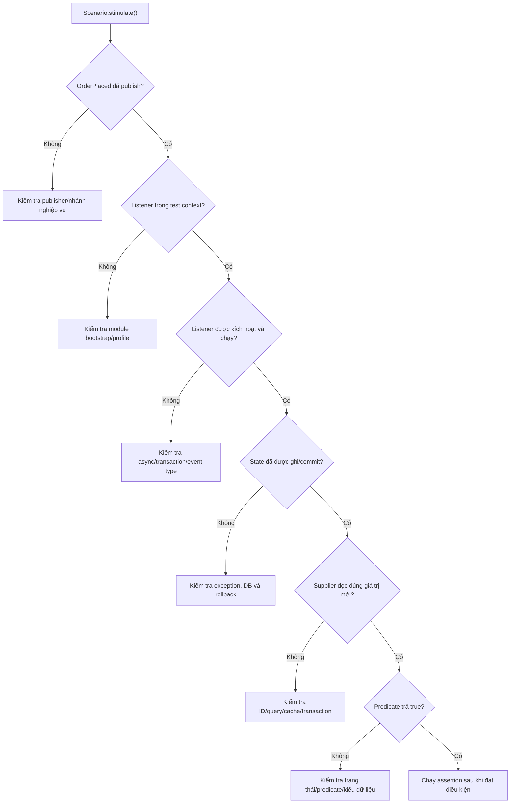

# Lỗi state change không đạt predicate

## Mục tiêu học tập

Trong chương **Test failure** của học phần **Spring Modulith Verification & Testing**, kiểm thử bất đồng bộ không phải lúc nào cũng chờ một event kết quả. Nhiều listener chỉ cập nhật trạng thái đơn hàng, ghi database hoặc đánh dấu công việc hoàn tất. Khi đó, `Scenario` có thể chờ **state change** thông qua một hàm đọc trạng thái và một **predicate** mô tả điều kiện mong đợi.

Nếu điều kiện không bao giờ trở thành `true` trước thời hạn, test thất bại. Không nên kết luận ngay rằng Spring Modulith không hoạt động: sự cố có thể do **không có thay đổi trạng thái**, **đọc sai đối tượng**, **predicate sai**, **transaction chưa commit**, **listener chưa chạy** hoặc **dữ liệu chưa hiển thị với test**.

Sau bài này, bạn có thể:

- Giải thích cơ chế `Scenario.stimulate(…).andWaitForStateChange(…)` và vai trò của **state supplier** cùng **predicate**.
- Phân biệt `null`/`Optional.empty()`, trạng thái trung gian `RECEIVED` và trạng thái đích `READY` hoặc `FAILED`.
- Viết assertion chờ trạng thái theo `orderId` thay vì `Thread.sleep(…)` hoặc kiểm tra ngay sau `publishEvent(…)`.
- Tách nguyên nhân tại publisher, listener, điều kiện truy vấn, transaction, database và chính predicate.
- Phát hiện trạng thái lỗi `FAILED` sớm, không chỉ đợi `READY` đến hết timeout.
- Phân biệt trạng thái trong bộ nhớ với trạng thái **đã commit trong database**.
- Chẩn đoán vấn đề `@ApplicationModuleTest` bootstrap thiếu consumer, `@Async`, `@TransactionalEventListener(AFTER_COMMIT)` và `@ApplicationModuleListener`.
- Kết hợp `ApplicationModules.verify()`, `PublishedEvents`, state assertions và quality gate trong CI.

## 1. “State change không đạt predicate” nghĩa là gì?

Giả sử module `orders` phát `OrderPlaced`. Module `notifications` nhận event đó rồi ghi trạng thái tạo thông báo:

```text
CHƯA CÓ BẢN GHI
      │
      ▼
  RECEIVED  ────> READY     (chuẩn bị thành công)
      │
      └─────────> FAILED    (chuẩn bị thất bại)
```

Một bài test muốn chờ đến khi trạng thái bằng `READY`:

```java
Predicate<NotificationState> isReady = state ->
        state != null
        && state.status() == PreparationStatus.READY;
```

`Predicate<T>` là một hàm nhận một giá trị kiểu `T` và trả về `boolean`. Ở đây, `isReady.test(state)` trả `true` chỉ khi bản ghi tồn tại **và** trạng thái của nó là `READY`.

Nếu listener:

- Chưa tạo bản ghi → supplier trả `null` → predicate `false`.
- Đang xử lý → trạng thái `RECEIVED` → predicate `false`.
- Hoàn tất → trạng thái `READY` → predicate `true`.
- Gặp lỗi → trạng thái `FAILED` → predicate vẫn `false`.

Nếu predicate chỉ chấp nhận `READY`, một trạng thái `FAILED` đã được ghi rõ ràng vẫn khiến test **chờ đến khi timeout**. Vì vậy khi phân tích lỗi cần biết **giá trị đang được quan sát** chứ không chỉ biết test đợi quá lâu.

### 1.1. Các thành phần của một phép chờ

| Thành phần | Ví dụ | Trách nhiệm |
| --- | --- | --- |
| **Stimulus** | Publish `OrderPlaced(orderId)` | Kích hoạt hành vi cần kiểm thử |
| **Supplier** | `() -> store.findByOrderId(orderId).orElse(null)` | Đọc trạng thái **mới** mỗi lần được gọi |
| **Predicate** | `state != null && state.status() == READY` | Định nghĩa khi nào xem là đạt mục tiêu |
| **Verification** | Assert đúng `customerId`, template, trạng thái | Kiểm tra payload và dữ liệu tại điểm đạt |
| **Timeout** | Giới hạn thời gian thực trong test | Chặn test treo nếu điều kiện không đạt |

**Điểm cần nhớ:** Đọc được một giá trị khác không đồng nghĩa giá trị đó **thỏa predicate**. Ngược lại, predicate đúng nhưng supplier luôn trả snapshot cũ thì test cũng không hoàn tất.

## 2. Phân biệt lỗi chờ event và lỗi chờ state

Trong Spring Modulith, `Scenario` hỗ trợ những cách chờ phù hợp với hợp đồng khác nhau:

| Hợp đồng của consumer | Đối tượng quan sát phù hợp |
| --- | --- |
| Listener publish `NotificationPrepared` | `andWaitForEventOfType(NotificationPrepared.class)` |
| Listener cập nhật `NotificationState` mà không publish event kết quả | `andWaitForStateChange(…)` |
| Listener ghi JPA entity sau commit | State/repository condition **đọc lại từ transaction độc lập** |
| Listener gọi email gateway | Kiểm tra tương tác với gateway hoặc kết quả delivery thuộc hợp đồng |

Không tự tạo một event `NotificationPrepared` **chỉ để khiến test dễ chờ** nếu domain không có sự kiện đó. Ngược lại, nếu contract thật sự là event kết quả, chỉ chờ một trạng thái trong bộ nhớ sẽ không chứng minh event đã được publish.

### 2.1. Sơ đồ tìm điểm đứt



Quy trình này giúp tránh việc liên tục tăng timeout khi vấn đề là sai ID, wrong enum hoặc listener chưa được bootstrap.

## 3. Ví dụ thực hành: notification state sau OrderPlaced

Ta dùng Java 17+, Spring Boot, Spring Modulith, JUnit Jupiter và AssertJ. Để tập trung vào điều kiện chờ, repository demo là một `ConcurrentHashMap`; phần sau sẽ giải thích khác biệt quan trọng khi thay bằng database.

Cấu trúc ví dụ:

```text
src/main/java/com/example/shop/
├── ShopApplication.java              # @SpringBootApplication
├── orders/
│   └── OrderPlaced.java
└── notifications/
    ├── PreparationStatus.java
    ├── NotificationState.java
    ├── NotificationStore.java
    ├── NotificationPreparationListener.java
    └── NotificationAsyncConfiguration.java

src/test/java/com/example/shop/notifications/
    └── NotificationStateScenarioTests.java
```

Ở ví dụ này, test đặt trong **module nhận event** là `notifications`. Chỉ để một test `@ApplicationModuleTest` ở module `orders` và mong listener `notifications` tự khởi động không phải giả định an toàn.

Dependency Maven minh họa:

```xml
<dependency>
    <groupId>org.springframework.modulith</groupId>
    <artifactId>spring-modulith-starter-test</artifactId>
    <scope>test</scope>
</dependency>
```

Phiên bản Spring Modulith nên được quản lý bằng BOM phù hợp với Spring Boot của ứng dụng. Các API test được minh họa theo cách dùng `Scenario` của Spring Modulith; hãy kiểm tra chữ ký phương thức cụ thể nếu dự án dùng một phiên bản khác.

### 3.1. Event nguồn thuộc orders

Tệp `src/main/java/com/example/shop/orders/OrderPlaced.java`:

```java
package com.example.shop.orders;

import java.util.UUID;

public record OrderPlaced(UUID orderId, UUID customerId) {
}
```

`OrderPlaced` là event công khai của module nguồn. Listener `notifications` import event này qua public API; tính hợp lệ của quan hệ module còn cần `ApplicationModules.verify()`.

### 3.2. Trạng thái cần quan sát

Tệp `src/main/java/com/example/shop/notifications/PreparationStatus.java`:

```java
package com.example.shop.notifications;

public enum PreparationStatus {
    RECEIVED,
    READY,
    FAILED
}
```

Tệp `src/main/java/com/example/shop/notifications/NotificationState.java`:

```java
package com.example.shop.notifications;

import java.util.UUID;

public record NotificationState(
        UUID orderId,
        UUID customerId,
        PreparationStatus status,
        String templateCode) {
}
```

Đây là một snapshot bất biến. Khi trạng thái chuyển từ `RECEIVED` sang `READY`, store thay record cũ bằng record mới. Do đó, một biến giữ record cũ **không tự đổi trạng thái**; supplier cần thực hiện truy vấn mới mỗi lần quan sát.

### 3.3. Store demo an toàn cho nhiều thread trong một JVM

Tệp `src/main/java/com/example/shop/notifications/NotificationStore.java`:

```java
package com.example.shop.notifications;

import java.util.Optional;
import java.util.UUID;
import java.util.concurrent.ConcurrentHashMap;
import java.util.concurrent.ConcurrentMap;
import org.springframework.stereotype.Component;

@Component
public class NotificationStore {

    private final ConcurrentMap<UUID, NotificationState> states =
            new ConcurrentHashMap<>();

    public void markReceived(UUID orderId, UUID customerId) {
        states.putIfAbsent(orderId, new NotificationState(
                orderId,
                customerId,
                PreparationStatus.RECEIVED,
                null));
    }

    public void markReady(UUID orderId, String templateCode) {
        states.computeIfPresent(orderId, (id, old) ->
                new NotificationState(
                        old.orderId(),
                        old.customerId(),
                        PreparationStatus.READY,
                        templateCode));
    }

    public void markFailed(UUID orderId) {
        states.computeIfPresent(orderId, (id, old) ->
                new NotificationState(
                        old.orderId(),
                        old.customerId(),
                        PreparationStatus.FAILED,
                        old.templateCode()));
    }

    public Optional<NotificationState> findByOrderId(UUID orderId) {
        return Optional.ofNullable(states.get(orderId));
    }

    public void remove(UUID orderId) {
        states.remove(orderId);
    }
}
```

Store dùng `ConcurrentHashMap` để các thread nhìn thấy bản ghi qua các thao tác map an toàn trong **cùng process**. Đây là mô hình minh họa, không đảm bảo transaction hoặc consistency giữa nhiều application instances. Production có thể cần JPA repository, unique constraint theo `orderId` và chiến lược retry/idempotency riêng.

### 3.4. Listener thay đổi state bất đồng bộ

Tệp `src/main/java/com/example/shop/notifications/NotificationPreparationListener.java`:

```java
package com.example.shop.notifications;

import com.example.shop.orders.OrderPlaced;
import org.springframework.context.event.EventListener;
import org.springframework.scheduling.annotation.Async;
import org.springframework.stereotype.Component;

@Component
public class NotificationPreparationListener {

    private final NotificationStore store;

    public NotificationPreparationListener(NotificationStore store) {
        this.store = store;
    }

    @Async
    @EventListener
    public void on(OrderPlaced event) {
        store.markReceived(event.orderId(), event.customerId());

        // Trong ứng dụng thật, bước này có thể tải template từ DB.
        store.markReady(event.orderId(), "ORDER_PLACED");
    }
}
```

Tệp `src/main/java/com/example/shop/notifications/NotificationAsyncConfiguration.java`:

```java
package com.example.shop.notifications;

import org.springframework.context.annotation.Configuration;
import org.springframework.scheduling.annotation.EnableAsync;

@Configuration(proxyBeanMethods = false)
@EnableAsync
class NotificationAsyncConfiguration {
}
```

Nhờ `@EnableAsync`, listener `@Async` có thể chạy trên executor khác thread test. `Scenario` không được giả định listener đã xong ngay sau khi gọi `publishEvent`.

**Quan trọng:** Listener này **không phát event kết quả**. Vì thế test hợp đồng của consumer phải chờ **state**, không chờ `NotificationPrepared` vốn không được khai báo.

## 4. Test chuẩn: state supplier mới và predicate rõ ràng

Tệp `src/test/java/com/example/shop/notifications/NotificationStateScenarioTests.java`:

```java
package com.example.shop.notifications;

import static org.assertj.core.api.Assertions.assertThat;

import com.example.shop.orders.OrderPlaced;
import java.util.UUID;
import org.junit.jupiter.api.Test;
import org.springframework.beans.factory.annotation.Autowired;
import org.springframework.context.ApplicationEventPublisher;
import org.springframework.modulith.test.ApplicationModuleTest;
import org.springframework.modulith.test.PublishedEvents;
import org.springframework.modulith.test.Scenario;

@ApplicationModuleTest
class NotificationStateScenarioTests {

    @Autowired
    ApplicationEventPublisher publisher;

    @Autowired
    NotificationStore store;

    @Test
    void waitsUntilNotificationIsReady(
            Scenario scenario,
            PublishedEvents events) {

        UUID orderId = UUID.randomUUID();
        UUID customerId = UUID.randomUUID();

        try {
            scenario.stimulate(() ->
                            publisher.publishEvent(
                                    new OrderPlaced(orderId, customerId)))
                    .andWaitForStateChange(
                            () -> store.findByOrderId(orderId)
                                    .orElse(null),
                            state -> state != null
                                    && state.status()
                                       == PreparationStatus.READY)
                    .andVerify(state -> {
                        assertThat(state).isNotNull();
                        assertThat(state.orderId()).isEqualTo(orderId);
                        assertThat(state.customerId())
                                .isEqualTo(customerId);
                        assertThat(state.templateCode())
                                .isEqualTo("ORDER_PLACED");
                    });

            assertThat(events.ofType(OrderPlaced.class)
                    .matching(e -> orderId.equals(e.orderId())))
                    .hasSize(1);
        } finally {
            store.remove(orderId);
        }
    }
}
```

### 4.1. Đọc từng phần của DSL

```java
scenario.stimulate(() -> publisher.publishEvent(source))
        .andWaitForStateChange(
                () -> store.findByOrderId(orderId).orElse(null),
                state -> state != null && state.status() == READY)
        .andVerify(state -> assertThat(state.orderId()).isEqualTo(orderId));
```

Đoạn trên **rút gọn để minh họa**, giả định `source` và `READY` đã được khai báo hoặc static import. Mỗi thành phần mang một ý nghĩa:

- `stimulate(…)`: đặt hành động **bên trong** cơ chế điều phối test.
- Supplier `() -> store.findByOrderId(orderId).orElse(null)`: thực hiện **một lần đọc mới** mỗi khi được đánh giá.
- Predicate: chỉ đạt khi tồn tại record và `status == READY`.
- `andVerify(…)`: kiểm tra **nội dung** khi điều kiện đã được đáp ứng.

Chữ ký API và cách cấu hình timeout có thể thay đổi giữa các phiên bản Spring Modulith; với phiên bản dùng DSL khác, hãy áp dụng đúng overload state/predicate được cung cấp. Ý nghĩa cần giữ nguyên là **chờ một điều kiện trên trạng thái được đọc lại**, không chỉ chờ supplier trả về bất cứ object nào.

### 4.2. Tại sao không đưa một Optional không lọc vào rồi assert sau?

Một đoạn dễ gây lỗi ý nghĩa:

```java
.andWaitForStateChange(() -> store.findByOrderId(orderId))
    // Không thể suy luận API coi Optional.empty() là đã đạt hay chưa,
    // nếu chưa biết predicate/semantics mà bài test dùng.
```

`Optional.empty()` vẫn là **một object khác null**. Tùy API/predicate mặc định, việc quan sát một `Optional` có thể **không tương đương** với việc chờ “bản ghi đã tồn tại”. Cách rõ ràng hơn là:

```java
.andWaitForStateChange(
        () -> store.findByOrderId(orderId).orElse(null),
        state -> state != null
                && state.status() == PreparationStatus.READY)
```

Ở đây điều kiện thành công nằm ngay trong test, không phụ thuộc suy đoán `Optional.empty()` có được xem là “state đã thay đổi” hay không.

### 4.3. Vì sao kết hợp PublishedEvents?

`Scenario` chờ state `READY` chỉ chứng minh **điều kiện state đã được quan sát**. Nếu test vô tình dùng dữ liệu tồn dư của lần trước, state có thể đã READY trước khi stimulus mới được xử lý. Sử dụng `orderId` ngẫu nhiên và `PublishedEvents` kiểm tra **event nguồn** giúp gắn test với đúng giao dịch.

Tuy vậy, `PublishedEvents` thấy `OrderPlaced` chưa chứng minh listener xử lý thành công. Chính state predicate và verification bổ sung bằng chứng về consumer.

## 5. Lỗi phổ biến: supplier giữ snapshot cũ

Đây là lỗi đặc biệt dễ mắc khi state là immutable record hoặc DTO.

**Sai:**

```java
NotificationState before =
        store.findByOrderId(orderId).orElse(null);

scenario.stimulate(() -> publisher.publishEvent(source))
        .andWaitForStateChange(
                () -> before,
                state -> state != null
                        && state.status() == PreparationStatus.READY);
```

Supplier `() -> before` **luôn trả cùng biến đã được lấy trước stimulus**, không đọc `store` lần nữa. Nếu `before == null`, điều kiện mãi sai; nếu là record `RECEIVED`, nó mãi ở RECEIVED dù map đã chứa bản ghi mới `READY`.

**Đúng:**

```java
scenario.stimulate(() -> publisher.publishEvent(source))
        .andWaitForStateChange(
                () -> store.findByOrderId(orderId).orElse(null),
                state -> state != null
                        && state.status() == PreparationStatus.READY);
```

Đoạn sai/đúng là mẫu minh họa một phần DSL; khi dùng trong test thực, nối tiếp `andVerify(…)` để xác minh giá trị. Quy tắc tổng quát:

> State supplier phải **đọc dữ liệu mới** mỗi lần polling, không đóng kín một snapshot cũ trong lambda.

### 5.1. Supplier gọi service có cache cũng có thể trả state cũ

Một supplier nhìn như đang gọi lại:

```java
() -> cachedView.getStatus(orderId)
```

nhưng `cachedView` có thể lưu snapshot không được invalidated. Khi listener cập nhật database hoặc map phía sau, supplier vẫn trả giá trị cũ. Hãy xác định **nguồn dữ liệu đang được đọc** và cách cache được refresh.

Với JPA, first-level persistence context, transaction test kéo dài hoặc cache tầng hai có thể làm đối tượng đã load không được làm mới như mong đợi. Không coi việc thêm polling là tự khắc phục caching.

## 6. Lỗi predicate luôn false dù state đã cập nhật

### 6.1. Nhầm trạng thái đích

Listener thực tế chuyển:

```text
RECEIVED -> READY
```

Nhưng predicate yêu cầu:

```java
state -> state != null
        && state.status() == PreparationStatus.FAILED
```

Đây là **lỗi expectation**. Polling nhiều lần vẫn không giải quyết được. Cần đối chiếu contract của listener trước khi đổi predicate.

### 6.2. So nhầm ID hoặc field

```java
state -> state != null
        && customerId.equals(state.orderId())
        && state.status() == PreparationStatus.READY
```

Nếu `customerId` và `orderId` là hai UUID khác nhau, predicate sai ngay cả khi đúng state đã có. Hãy lọc record theo `orderId` rồi assert `customerId` ở `andVerify(…)` để dễ xác định lỗi dữ liệu.

### 6.3. So String bằng == thay vì equals

**Sai:**

```java
state -> state != null && state.templateCode() == "ORDER_PLACED"
```

**Đúng:**

```java
state -> state != null
        && "ORDER_PLACED".equals(state.templateCode())
```

Trong Java, `==` trên `String` so **reference identity**, không so nội dung. Với `enum`, dùng `==` như trong bài mẫu là phù hợp.

### 6.4. Status ngoài ý muốn nhưng không được quan sát

Nếu listener có đường lỗi:

```java
try {
    store.markReady(orderId, templateCode);
} catch (RuntimeException ex) {
    store.markFailed(orderId);
}
```

thì predicate `status == READY` luôn sai khi trạng thái cuối là `FAILED`. Test sẽ đợi đến hết timeout, dù dữ liệu **đã thay đổi** từ RECEIVED sang FAILED.

Nên xác định rõ:

- `FAILED` có phải trạng thái cuối được nghiệp vụ công nhận không?
- Khi FAILED, cần retry hay báo lỗi sớm?
- Test đang kiểm tra “đã xử lý xong” hay “đã xử lý thành công”?

## 7. Phát hiện FAILED sớm bằng terminal-state predicate

Một chiến lược hữu ích là tách **điều kiện kết thúc quá trình chờ** và **điều kiện thành công của assertion**.

Thay vì chỉ chờ `READY`, chờ **trạng thái terminal**:

```java
scenario.stimulate(() ->
                publisher.publishEvent(
                        new OrderPlaced(orderId, customerId)))
        .andWaitForStateChange(
                () -> store.findByOrderId(orderId).orElse(null),
                state -> state != null
                        && (state.status() == PreparationStatus.READY
                            || state.status() == PreparationStatus.FAILED))
        .andVerify(state -> {
            assertThat(state.status())
                    .as("notification preparation must succeed")
                    .isEqualTo(PreparationStatus.READY);
            assertThat(state.templateCode())
                    .isEqualTo("ORDER_PLACED");
        });
```

Với cách này:

- Nếu `READY` → chờ hoàn tất, assertion pass khi payload đúng.
- Nếu `FAILED` → chờ hoàn tất **ngay khi state terminal có mặt**, assertion fail với thông báo rõ ràng.
- Nếu mãi `RECEIVED` hoặc không có record → timeout còn mang ý nghĩa “không đạt mốc terminal”.

**Đây là một lựa chọn theo contract**, không phải quy tắc áp dụng cho mọi state machine. Nếu hệ thống có trạng thái terminal khác như `CANCELLED`, `EXPIRED` hoặc `SKIPPED`, cần đưa chúng vào predicate kết thúc theo semantics nghiệp vụ.

### 7.1. Trạng thái transient có thể bị polling bỏ lỡ

Giả sử xử lý đi rất nhanh:

```text
RECEIVED -> READY -> SENT
```

Nếu test polling theo khoảng thời gian và chỉ chấp nhận chính xác `READY`, nó có thể thấy `RECEIVED` ở lần đọc trước và `SENT` ở lần sau. Predicate `status == READY` không bao giờ `true` dù hệ thống đã **đi qua** READY.

Các hướng giải quyết:

1. Nếu contract là “đạt trạng thái **ít nhất READY**”, định nghĩa transition/ordering rõ rồi chấp nhận `READY` hoặc `SENT`.
2. Nếu bắt buộc chứng minh *transition READY đã xảy ra*, dùng một event/audit record/transition history bền vững thay vì chỉ đọc trạng thái hiện tại.
3. Nếu chỉ cần kết quả cuối, chờ trạng thái cuối `SENT` theo nghiệp vụ.

Đừng tăng tần suất polling vô hạn để bắt một trạng thái cực ngắn; đó không phải bằng chứng đáng tin cậy.

## 8. Lỗi listener không nằm trong @ApplicationModuleTest context

Một bài `@ApplicationModuleTest` của `orders` thường bootstrap chính module `orders`, trong khi listener nhận `OrderPlaced` thuộc `notifications`.

```text
Test đặt tại orders:
  OrderPlaced event source       [có thể đã publish]
  NotificationPreparationListener [không chắc được bootstrap]

=> NotificationStore không có bản ghi
=> supplier trả null
=> predicate mãi false
```

Đây là **lỗi setup/scope** chứ không phải phép so status.

### 8.1. DIRECT_DEPENDENCIES không mặc định đưa consumer downstream vào context

`@ApplicationModuleTest(mode = BootstrapMode.DIRECT_DEPENDENCIES)` khởi động các module mà **module đang test phụ thuộc trực tiếp**. Nếu `notifications` import event public `orders.OrderPlaced`, static dependency có thể theo hướng:

```text
notifications -> orders
```

Khi đó `notifications` là **dependent/consumer** của `orders`, không phải dependency của `orders`. Bật `DIRECT_DEPENDENCIES` từ test nằm trong `orders` không tự bảo đảm listener `notifications` được tải. `ALL_DEPENDENCIES` cũng không đồng nghĩa tải mọi module độc lập hoặc mọi consumer.

Lựa chọn:

- Test producer `orders` riêng, dùng `PublishedEvents` xác minh `OrderPlaced`.
- Test consumer `notifications` riêng, kích hoạt public event làm stimulus rồi chờ state.
- Dùng integration test bootstrap đủ producer và consumer khi mục tiêu là toàn luồng.

Nếu muốn test `NotificationStore` nhưng không có bean `NotificationPreparationListener` trong context, phải sửa phạm vi test hoặc registration trước, không sửa predicate để nó pass giả.

### 8.2. Kiểm tra listener registration

Các câu hỏi cần trả lời:

1. Listener có annotation `@Component`/`@Service` và thuộc module đang bootstrap không?
2. Method có `@EventListener`, `@TransactionalEventListener` hoặc `@ApplicationModuleListener` đúng loại event không?
3. Bean có bị `@Profile`/`@ConditionalOnProperty` loại ra không?
4. `@EnableAsync` có được bật nếu cần `@Async` không?
5. Listener có được khởi tạo thành công với dependencies của nó không?

Không phải mọi listener vắng mặt đều gây `NoSuchBeanDefinitionException`: publisher có thể publish thành công mà không inject listener nào.

## 9. Lỗi transaction: state chưa commit nên test không nhìn thấy

Đối với production dùng JPA, điều cần quan sát thường là **trạng thái đã commit**, không phải dữ liệu đang tồn tại trong persistence context của một transaction chưa hoàn tất.

### 9.1. Bốn trường hợp thời điểm

| Tình huống | Event nguồn có thể đã publish? | Listener có chạy? | Test từ transaction khác thấy state? |
| --- | --- | --- | --- |
| Event publish trong transaction đang mở | Có | `AFTER_COMMIT` chưa chạy | Chưa thấy thay đổi chưa commit |
| Transaction nguồn commit | Có | Listener hậu commit có thể được kích hoạt | Chỉ thấy state sau khi listener commit phần ghi riêng |
| Transaction nguồn rollback | Có thể được ghi nhận bởi `PublishedEvents` | `AFTER_COMMIT` không chạy | Không có side effect hậu commit |
| Event publish ngoài transaction với `fallbackExecution = false` | Có | `@TransactionalEventListener` hậu commit không được kích hoạt | Không có ghi state từ listener đó |

`@TransactionalEventListener(phase = AFTER_COMMIT)` xử lý event khi transaction đã commit; nếu không có transaction active, cơ chế mặc định không tự thực thi callback hậu commit. `@ApplicationModuleListener` cũng cần được xem xét theo ngữ nghĩa transaction/async của phiên bản sử dụng.

### 9.2. @Transactional test với rollback mặc định

Một trường hợp dễ gây timeout:

```java
@Transactional
@Test
void waitsForAfterCommitState(Scenario scenario) {
    // Nếu stimulus tham gia transaction của test,
    // callback AFTER_COMMIT chưa có cơ hội chạy khi đang chờ.
}
```

Trong Spring Test, transaction của phương thức test thường rollback sau khi test kết thúc. Chờ một listener `AFTER_COMMIT` **bên trong** transaction còn mở thường là sai setup.

### 9.3. Tách transaction commit của stimulus

Với integration test có `PlatformTransactionManager`:

```java
TransactionTemplate tx = new TransactionTemplate(
        transactionManager);

scenario.stimulate(() ->
                tx.executeWithoutResult(status ->
                        publisher.publishEvent(
                                new OrderPlaced(orderId, customerId))))
        .andWaitForStateChange(
                () -> notificationRepository
                        .findByOrderId(orderId).orElse(null),
                state -> state != null
                        && state.getStatus() == PreparationStatus.READY)
        .andVerify(state ->
                assertThat(state.getCustomerId())
                        .isEqualTo(customerId));
```

Đoạn này minh họa **thân một integration test**; `transactionManager`, `notificationRepository`, `publisher`, `scenario`, các ID và repository entity là những thành phần ứng dụng phải cung cấp. Cần import `TransactionTemplate`, AssertJ và enum. Không bọc toàn bộ test bằng một transaction khác rồi giả định `TransactionTemplate` với propagation `REQUIRED` luôn commit độc lập; mặc định nó có thể tham gia transaction hiện hữu.

Nếu listener ghi database trong transaction riêng, điều kiện chờ phải đọc sau khi listener commit. Đối với listener hậu commit, không nên viết dữ liệu dựa vào một transaction đã hoàn tất mà không hiểu resource/propagation; cần xác định transaction mới phù hợp cho thao tác ghi.

### 9.4. Flush không đồng nghĩa commit

`entityManager.flush()` có thể đẩy câu lệnh SQL xuống database nhưng **không làm transaction commit**. Một thread test ở transaction khác có thể vẫn không thấy dữ liệu đó dưới isolation thông thường.

Nếu supplier quan sát một repository đọc từ cùng persistence context bị cache, nó cũng có thể thấy bản ghi khác với snapshot của một reader mới. Vì vậy trước khi “sửa” predicate, hãy kiểm tra:

- Transaction nào ghi dữ liệu?
- Ghi có thành công và commit chưa?
- Supplier đang dùng transaction/persistence context nào?
- Độ cô lập (isolation), caching và thời điểm refresh là gì?
- Có sử dụng ID/repository đúng hay không?

## 10. Lỗi trong worker thread: state dừng ở RECEIVED

Khi `@Async` listener ném exception sau `markReceived` nhưng trước `markReady`, store vẫn có thể giữ `RECEIVED`.

```java
@Async
@EventListener
public void on(OrderPlaced event) {
    store.markReceived(event.orderId(), event.customerId());

    // Ví dụ lỗi do template thiếu.
    String template = templateService.requiredTemplate(
            "ORDER_PLACED");

    store.markReady(event.orderId(), template);
}
```

Đây là đoạn minh họa một listener có dependency `templateService`. Nếu `requiredTemplate(…)` ném exception:

- `PublishedEvents` vẫn có thể thấy `OrderPlaced`.
- State `RECEIVED` có mặt và supplier đọc được.
- Predicate `status == READY` luôn `false`.
- Test timeout dù nguyên nhân thực là exception trong listener.

Với `void @Async` listener, exception không nhất thiết truyền về thread gọi `publishEvent`. Cần quan sát log, executor exception handler, publication registry hoặc trạng thái `FAILED` được thiết kế rõ ràng.

### 10.1. Ghi lại tiến trình theo khóa tương quan

Log tối thiểu nên cho biết:

```text
order.placed     orderId=<id> type=OrderPlaced
notification.start orderId=<id>
notification.state orderId=<id> status=RECEIVED
notification.error orderId=<id> reason=TemplateNotFound
notification.state orderId=<id> status=FAILED
```

Đây là **mẫu log gợi ý**, không phải output từ test thật. Dùng ID tương quan và thông tin kỹ thuật; không đưa dữ liệu cá nhân hoặc bí mật vào logs. Việc có log tiến trình giúp phân biệt thiếu listener với listener đã bắt đầu rồi thất bại.

### 10.2. Event Publication Registry không phải state của repository

Khi dùng cơ chế Event Publication Registry của Spring Modulith, một event có thể có publication target được theo dõi theo listener. Record registry còn pending hay được hoàn tất là một bằng chứng về **vòng đời xử lý event** theo cơ chế registry, không đồng nghĩa `NotificationState` trong repository có status READY.

Đừng kết luận “registry completed nên database chắc đã commit READY” khi chưa biết thứ tự xử lý và transaction. Ngược lại, `NotificationState` READY không tự chứng minh một message đã được broker giao đến hệ thống ngoài.

## 11. Lỗi predicate do thời gian hệ thống và dữ liệu phụ

Một predicate không chỉ kiểm tra enum có thể sai vì thời gian:

```java
state -> state != null
        && state.status() == PreparationStatus.READY
        && state.updatedAt().isAfter(Instant.now().minusSeconds(1))
```

Đây là đoạn minh họa nếu `NotificationState` thực tế có `updatedAt`. Điều kiện phụ thuộc `Instant.now()` làm test dễ flaky: kết quả phụ thuộc độ trễ thread, CI và thời điểm đọc.

Hướng sửa:

1. Chỉ kiểm tra `status == READY` nếu đó là hợp đồng cần chứng minh.
2. Nếu timestamp là một phần hợp đồng, inject `java.time.Clock` vào producer/consumer và dùng `Clock.fixed` trong test.
3. Nếu cần kiểm tra khoảng thời gian từ trạng thái nguồn tới đích, so quan hệ giữa hai timestamp **cùng ngữ nghĩa**.
4. Không dùng `Thread.sleep` để khiến timestamp “đủ cũ” hoặc “đủ mới”.

**Clock nghiệp vụ** và **timeout chờ state** là hai việc khác nhau: clock cố định không khiến scheduler hay worker thread tự chạy nhanh hơn.

## 12. Dùng Awaitility để tách lỗi predicate khỏi Scenario

Trong một số dự án, cần kiểm tra trạng thái repository không gắn trực tiếp với `Scenario`, hoặc phiên bản Spring Modulith có API state waiting khác. Có thể dùng Awaitility làm điều kiện chờ hữu hạn:

```java
import static org.assertj.core.api.Assertions.assertThat;
import static org.awaitility.Awaitility.await;

import java.time.Duration;

await()
        .atMost(Duration.ofSeconds(5))
        .untilAsserted(() -> {
            var state = store.findByOrderId(orderId);

            assertThat(state).isPresent();
            assertThat(state.orElseThrow().status())
                    .isEqualTo(PreparationStatus.READY);
        });
```

Đây là **đoạn code trong test**, yêu cầu các biến `store`, `orderId` cùng dependency Awaitility phù hợp. Nếu chưa có dependency, dùng thư viện được starter/test environment hỗ trợ hoặc khai báo rõ ràng.

Ưu điểm khi debug: assertion bị lặp lại theo thời gian và thông báo cuối thường có giá trị thực tế quan sát được (ví dụ expected READY nhưng was RECEIVED). Tuy vậy:

- Đừng publish stimulus **trước** khi setup quan sát một cách có race nếu test thực sự cần đồng bộ hóa theo kết quả.
- Đừng chờ một trạng thái mà nghiệp vụ không bao giờ tạo.
- Đừng dùng Awaitility để thay thế kiểm tra ranh giới transaction nếu repository không có dữ liệu committed.
- Phải giữ timeout hữu hạn và cô lập test data.

### 12.1. Kiểm thử riêng predicate như pure function

Để tránh đợi nhiều giây mỗi khi điều kiện sai, có thể unit-test predicate:

```java
import static org.assertj.core.api.Assertions.assertThat;

import java.util.UUID;
import java.util.function.Predicate;
import org.junit.jupiter.api.Test;

class ReadyPredicateTests {

    private final Predicate<NotificationState> ready =
            state -> state != null
                    && state.status() == PreparationStatus.READY;

    @Test
    void rejectsNullAndIntermediateStates() {
        UUID id = UUID.randomUUID();
        UUID customer = UUID.randomUUID();

        var received = new NotificationState(
                id, customer, PreparationStatus.RECEIVED, null);

        assertThat(ready.test(null)).isFalse();
        assertThat(ready.test(received)).isFalse();
    }

    @Test
    void acceptsReadyState() {
        UUID id = UUID.randomUUID();
        UUID customer = UUID.randomUUID();

        var state = new NotificationState(
                id, customer, PreparationStatus.READY, "ORDER_PLACED");

        assertThat(ready.test(state)).isTrue();
    }
}
```

Unit test không xác minh event/async/transaction; nó chỉ chứng minh predicate logic **trả đúng boolean** cho những đầu vào được chọn. Kết hợp test predicate nhanh với một integration test chờ state để biết lỗi thuộc **điều kiện** hay **dữ liệu thực tế không bao giờ đạt điều kiện**.

## 13. Ma trận chẩn đoán: supplier, predicate hay listener?

| Quan sát khi debug | Nguyên nhân ưu tiên | Hành động phù hợp |
| --- | --- | --- |
| Supplier luôn trả `null` | Không ghi record, sai ID, listener vắng mặt, rollback | Kiểm tra event nguồn, listener registration, truy vấn |
| Supplier luôn trả `RECEIVED` | Listener dừng/lỗi trước READY, snapshot/cache cũ | Xem log/executor, supplier có đọc mới không |
| Supplier thấy `FAILED` | Xử lý lỗi nghiệp vụ/technical, predicate chỉ chấp nhận READY | Chờ terminal state rồi fail rõ nguyên nhân |
| Supplier thấy `READY` nhưng chờ vẫn timeout | Predicate sai ID/field/type hoặc đọc snapshot khác | Unit-test predicate, log kết quả đánh giá |
| Có `READY` rất ngắn rồi `SENT` | Polling bỏ lỡ trạng thái transient | Chờ terminal state hoặc audit transition |
| `PublishedEvents` không có `OrderPlaced` | Publisher không phát event | Sửa stimulus/nhánh nghiệp vụ |
| Có event, listener không có trong context | Bootstrap test đặt sai module | Test consumer hoặc integration đủ module |
| Listener `AFTER_COMMIT` không chạy | Test rollback/publish ngoài transaction | Tạo transaction commit thực |
| Listener ghi DB nhưng test không nhìn thấy | Chưa commit/isolation/cache | Kiểm tra ranh giới đọc/ghi, fresh query |
| `@Async` exception, publisher vẫn return | Lỗi trong worker không propagate vào test thread | Log, handler, state FAILED, registry |
| Test pass trên laptop, fail trên CI | Race, timeout ngắn, dữ liệu shared, clock thực | ID duy nhất, điều kiện chờ, cô lập dữ liệu |
| `ApplicationModules.verify()` fail | Dependency/named interface/cycle sai | Refactor kiến trúc, không chỉnh predicate |

### 13.1. Chú ý đến dữ liệu test được chia sẻ

`@ApplicationModuleTest` thường sử dụng cơ chế cache test context. Nếu `NotificationStore` là singleton trong context, các test có thể dùng cùng map. Chọn `orderId` riêng, cleanup theo ID và tránh để test song song thay đổi bản ghi của nhau.

Trong ví dụ, `finally { store.remove(orderId); }` giúp cleanup sau khi điều kiện đã được quan sát hoặc thất bại. Tuy nhiên, nếu async listener vẫn chạy sau một timeout, nó **có thể ghi lại** trạng thái sau cleanup. Với production-grade tests, dùng scope/fixture cô lập, test database được reset phù hợp hoặc quản lý lifecycle của worker để tránh rò state giữa các test.

Không dựa vào thứ tự thực thi JUnit hoặc thời điểm scheduler chạy để làm test pass.

## 14. Quy trình xử lý lỗi trong dự án và CI

### Bước 1 — Ghi đúng predicate và đối tượng quan sát

Ví dụ:

```text
Target entity: NotificationState
Correlation key: orderId = <uuid>
Supplier: findByOrderId(orderId) -> state/null
Predicate: state != null && status == READY
Observed value: RECEIVED (nếu có bằng chứng)
```

Đừng chỉ ghi “Scenario timeout”; thông tin trên cho biết **đang chờ cái gì**.

### Bước 2 — Chứng minh publisher thực sự phát event

Trong test publisher, dùng `PublishedEvents` để kiểm tra `OrderPlaced` theo `orderId`, payload và số lần publish. Nếu không có event, sửa nhánh nghiệp vụ trước.

### Bước 3 — Kiểm tra module và listener

Xem test nằm ở module nào; `NotificationPreparationListener` có nằm trong bootstrap scope không; bean có bị `@Profile`/`@Conditional` loại không; method có đúng event type không.

### Bước 4 — Xác minh state supplier đọc dữ liệu mới

Tránh snapshot lưu ngoài lambda, query không lọc `orderId` và cache không refresh. Nếu dùng JPA, kiểm tra transaction/isolation thay vì chỉ tăng polling.

### Bước 5 — Unit-test predicate

Đưa những đầu vào `null`, `RECEIVED`, `READY`, `FAILED` và ID sai vào predicate. Nếu logic mong đợi không đúng, sửa assertion/contract trước.

### Bước 6 — Quan sát exception và transaction

Kiểm tra log theo correlation ID; `@Async` có lỗi không, `AFTER_COMMIT` có commit không, DB đã commit trạng thái chưa. Nếu trạng thái `FAILED` tồn tại, coi đó là thông tin chẩn đoán chứ không đợi timeout một cách mù quáng.

### Bước 7 — Chọn đúng điểm chờ

Nếu listener publish một event kết quả có ý nghĩa, chờ event. Nếu chỉ cập nhật state, chờ repository/store. Với trạng thái terminal `READY/FAILED`, chờ cả hai rồi assert outcome thành công.

### Bước 8 — Rerun test nhỏ nhất và quality gate

Các lệnh sau dùng để tham khảo **khi được phép chạy trong dự án**, không phải kết quả đã thực thi trong bài:

```bash
./mvnw -Dtest=NotificationStateScenarioTests test
```

```bash
./gradlew test --tests "com.example.shop.notifications.NotificationStateScenarioTests" --stacktrace
```

Sau khi sửa, chạy lại test kiến trúc `ApplicationModules.verify()` và integration test database/transaction nếu thay đổi liên quan đến chúng.

### 14.1. Mẫu báo cáo lỗi

```text
Failure: state change did not satisfy predicate
Test: NotificationStateScenarioTests
Module under test: notifications
Stimulus: orders.OrderPlaced
Correlation key: orderId = <uuid>
Source event present: yes/no
Listener present/started: yes/no/unknown
Latest observed state: null/RECEIVED/READY/FAILED
Predicate expectation: status == READY
Transaction commit: yes/no/not applicable/unknown
Root cause: <đã xác minh hoặc còn là giả thuyết>
Fix: <thay đổi tối thiểu>
Validation: <test thực tế đã rerun, nếu có>
```

Một báo cáo tốt **không khẳng định đã xác minh** điều mà mới suy đoán. Nếu không có log trạng thái, ghi `unknown` và bổ sung quan sát ở nơi phù hợp.

## 15. Phân biệt state assertion với kiến trúc module

Spring Modulith xác minh ranh giới kiến trúc bằng `ApplicationModules.verify()`:

```java
package com.example.shop;

import org.junit.jupiter.api.Test;
import org.springframework.modulith.core.ApplicationModules;

class ArchitectureVerificationTests {

    @Test
    void applicationModulesRespectBoundaries() {
        ApplicationModules.of(ShopApplication.class).verify();
    }
}
```

`ShopApplication` là lớp `@SpringBootApplication` tại package gốc trong ứng dụng mẫu. Test trên không chờ state hoặc khởi động listener; nó kiểm tra đồ thị dependency và quy tắc API của module.

Đối với ví dụ `notifications` import `orders.OrderPlaced`:

- `ApplicationModules.verify()`: kiểm tra phụ thuộc từ consumer tới public event có hợp lệ không và có tạo cycle không.
- `@ApplicationModuleTest`: kiểm tra context có listener và dependency cần thiết.
- `PublishedEvents`: kiểm tra publisher có phát event nguồn đúng không.
- `Scenario` với state predicate: kiểm tra outcome được quan sát trong thời hạn.
- Repository/integration tests: kiểm tra dữ liệu đã commit và xử lý đồng thời nếu hợp đồng cần.

Một architecture test pass **không chứng minh** state sẽ READY; một state test pass cũng không chứng minh consumer không import internal class của module khác. Hai quality gate cần được duy trì.

## 16. Những anti-pattern cần tránh

| Anti-pattern | Vì sao có hại | Thay bằng |
| --- | --- | --- |
| `Thread.sleep(1000)` rồi assert state | Phụ thuộc tốc độ CI, race | Chờ điều kiện có timeout |
| Supplier trả snapshot lấy trước stimulus | Không bao giờ thấy record mới | Query lại ở mỗi lần đánh giá |
| Chờ Optional khác null | `Optional.empty()` không đồng nghĩa dữ liệu tồn tại | Predicate rõ theo entity/status |
| Predicate dùng sai ID | State đúng vẫn bị loại | Khóa tương quan ổn định |
| So `String` bằng `==` | So reference, không so nội dung | `Objects.equals` hoặc `String.equals` |
| Chỉ chờ READY khi FAILED là terminal hợp lệ của processing | Timeout che lỗi cụ thể | Chờ READY/FAILED rồi assert READY |
| Chờ trạng thái READY thoáng qua | Polling có thể bỏ lỡ | Chờ invariant/terminal state hoặc audit |
| Tăng timeout vô hạn | Che lỗi listener/transaction | Tìm mắt xích đầu tiên thiếu |
| `DIRECT_DEPENDENCIES` trên publisher để tải mọi consumer | Sai hướng dependency graph | Test ở consumer hoặc integration đủ module |
| `@Transactional` test rollback nhưng chờ AFTER_COMMIT | Không có commit để kích hoạt callback | Commit stimulus đúng cách |
| Tin `flush()` đồng nghĩa commit | Reader khác chưa thấy data | Kiểm tra commit/isolation |
| Suy từ `PublishedEvents` rằng DB đã lưu | Publish không bảo đảm persistence | Chờ repository sau commit |
| Mock chính listener đang kiểm tra | Test bỏ qua hành vi thật | Mock boundary ngoài phạm vi |
| Bỏ `ApplicationModules.verify()` vì state test pass | Bỏ kiểm tra dependency sai | CI có cả hai gate |

## 17. Quality gate CI: từ kiến trúc tới state bền vững

Một pipeline trong học phần **Spring Modulith Verification & Testing** nên kiểm tra theo nhiều tầng:

| Gate | Điều bảo vệ | Ví dụ failure |
| --- | --- | --- |
| **Architecture** | `ApplicationModules.of(…).verify()` | Cycle, truy cập API không expose, allowedDependencies |
| **Publisher contract** | `@ApplicationModuleTest` + `PublishedEvents` | Thiếu hoặc trùng `OrderPlaced` |
| **Predicate unit test** | Predicate của trạng thái | Sai null, enum, ID, String comparison |
| **Consumer state test** | `Scenario.andWaitForStateChange(…)` | READY không đạt do listener/state |
| **Transaction integration** | `AFTER_COMMIT`, rollback, transaction reader | Chưa commit hoặc state không visible |
| **Database integration** | JPA/repository, migration, side effect | Record sai, chưa bền vững, constraint lỗi |
| **End-to-end integration** | Publisher + consumer thật, hạ tầng ngoài nếu cần | Flow không hoàn tất đúng hợp đồng |

Các thực hành hữu ích:

1. **Giữ test nhỏ:** predicate unit test chạy nhanh, consumer test chờ state có timeout hữu hạn.
2. **Dùng correlation ID riêng:** tránh test nhận dữ liệu tồn dư hoặc của worker khác.
3. **Cô lập test data:** đặc biệt khi Spring context được cache và listener chạy async.
4. **Không phụ thuộc giờ hệ thống:** dùng `Clock` có thể điều khiển cho timestamp nghiệp vụ.
5. **Chạy integration test đúng hạ tầng:** database, transaction manager và module scope tương ứng.
6. **Giữ logs và exception đầy đủ:** khi timeout, phải xem state cuối đã quan sát được và lý do predicate false.
7. **Không dập lỗi bằng cách bỏ assertion:** quality gate phải thể hiện hợp đồng nghiệp vụ thật.

## 18. Bài thực hành

Sử dụng `OrderPlaced`, `NotificationPreparationListener` và `NotificationStateScenarioTests`:

1. **Đường đi chuẩn:** publish event với `orderId` mới, chờ `NotificationState.status == READY`, verify `customerId` và template.
2. **Lỗi snapshot:** lấy một `NotificationState` trước stimulus rồi viết supplier chỉ trả biến đó. Giải thích vì sao polling không thấy map mới.
3. **Sai predicate:** thay `READY` bằng `FAILED` và dự đoán test chờ đến timeout nếu listener luôn thành công.
4. **So chuỗi sai:** tạo predicate dùng `templateCode() == "ORDER_PLACED"`. Giải thích vì sao không nên dựa vào String interning.
5. **Chờ terminal:** đổi điều kiện thành `READY || FAILED`, rồi assert `READY`; mô phỏng đường lỗi tạo `FAILED` để test fail có thông báo sớm.
6. **Trạng thái transient:** mở rộng enum với `SENT`, mô phỏng `RECEIVED → READY → SENT`; chứng minh việc chỉ polling `READY` có thể không thấy transition.
7. **Thiếu listener:** bỏ `@Component` hoặc chuyển test sang `orders` `STANDALONE`, giải thích vì sao supplier trả `null`.
8. **Listener lỗi async:** ném exception sau `markReceived`; quan sát state mắc ở `RECEIVED` và tìm exception trong worker logs.
9. **AFTER_COMMIT:** đổi listener sang transactional event listener; thử stimulus publish ngoài transaction, rollback và commit thật. Phân biệt các kết quả.
10. **Persistence:** thay `NotificationStore` bằng JPA repository; viết state predicate đọc bản ghi **sau commit**, lưu ý persistence context cache.
11. **Hai đơn đồng thời:** tạo hai `orderId` khác nhau và đảm bảo supplier không đọc nhầm status của đơn còn lại.
12. **Predicate unit test:** kiểm tra `null`, `RECEIVED`, `READY`, `FAILED` mà không khởi động Spring context.
13. **Architecture gate:** chạy `ApplicationModules.verify()` và kiểm tra `notifications` chỉ import public event API của `orders`.
14. **CI:** xây dựng ma trận chẩn đoán mỗi khi state wait timeout: publisher, listener, transaction, supplier, predicate, DB.

**Tiêu chí hoàn thành:** người học có thể nêu chính xác *supplier đang đọc gì*, *predicate đang yêu cầu gì*, *state thực tế là gì*, và chứng minh vì sao chúng chưa khớp. Test tránh sleep tùy ý, nhận biết FAILED sớm và không lẫn state trong bộ nhớ với dữ liệu database đã commit.

## 19. Câu hỏi tự kiểm tra

**Câu 1.** `Scenario` chờ `status == READY` nhưng supplier luôn trả `null`. Cần sửa predicate thành `state == null` để test pass không?

**Trả lời:** Không. Phải xác định vì sao không có state: publisher chưa phát, listener không nằm trong context, sai orderId, lỗi hoặc transaction chưa commit. Chỉ đổi predicate sẽ làm sai hợp đồng.

**Câu 2.** Lambda `() -> before` khác gì `() -> store.findByOrderId(orderId).orElse(null)`?

**Trả lời:** Lambda thứ nhất trả snapshot đã chụp, không refresh; lambda thứ hai đọc lại từ store mỗi lần đánh giá nên có thể thấy thay đổi.

**Câu 3.** Supplier trả `FAILED`, nhưng predicate chỉ nhận `READY`. Timeout có chứng minh listener không chạy không?

**Trả lời:** Không. Listener có thể đã chạy và ghi FAILED. Có thể chờ trạng thái terminal rồi assert outcome thành công để fail sớm, rõ nguyên nhân.

**Câu 4.** Vì sao `Optional.empty() != null` không đủ để kết luận repository đã có bản ghi?

**Trả lời:** `Optional.empty()` là một object không chứa giá trị. Predicate phải kiểm tra `isPresent()` và trạng thái bên trong, hoặc supplier chuyển absence thành `null` rồi kiểm tra tường minh.

**Câu 5.** Một state đi `RECEIVED → READY → SENT` rất nhanh. Test chỉ polling `READY` có thể timeout dù xử lý thành công không?

**Trả lời:** Có. Polling có thể không nhìn thấy trạng thái trung gian ngắn. Chờ invariant hoặc terminal state, hoặc ghi nhận transition bằng event/audit nếu hợp đồng yêu cầu.

**Câu 6.** `PublishedEvents` có một `OrderPlaced`, nhưng state vẫn RECEIVED. Điều đó chứng minh gì?

**Trả lời:** Chỉ chứng minh event nguồn được publish; consumer có thể dừng trước khi READY, gặp exception hoặc dữ liệu hiển thị bị trễ. Cần kiểm tra listener và nguồn state.

**Câu 7.** `entityManager.flush()` đã được gọi. Vì sao test từ transaction khác có thể vẫn không thấy READY?

**Trả lời:** Flush chưa commit transaction; visibility còn phụ thuộc isolation và caching. Test cần quan sát dữ liệu sau commit theo contract.

**Câu 8.** `ApplicationModules.verify()` pass thì state predicate có chắc đạt không?

**Trả lời:** Không. Kiểm tra kiến trúc không xác minh listener runtime, transaction hay dữ liệu. Cần module/state/integration tests riêng.

**Câu 9.** Vì sao không nên tăng timeout nếu supplier luôn truy vấn sai `orderId`?

**Trả lời:** Điều kiện không thể đạt vì test đọc nhầm bản ghi; đợi lâu hơn không thay đổi query hoặc correlation key.

## Kết luận

**Lỗi state change không đạt predicate** cần được xử lý bằng cách tìm **mốc dữ liệu đầu tiên chưa thỏa hợp đồng**. Hãy kiểm tra event nguồn với `PublishedEvents`, xác nhận listener thuộc đúng `@ApplicationModuleTest` context và được kích hoạt, rồi tách hai câu hỏi: **supplier có đọc state mới không?** và **predicate có chấp nhận đúng state đích không?**. Với `@Async` và `AFTER_COMMIT`, phải xem exception, commit và visibility của database; khi state có kết quả `READY/FAILED`, nên chờ terminal rồi assert outcome để giảm timeout mơ hồ. Kết hợp `Scenario`, kiểm thử predicate độc lập, `ApplicationModules.verify()` và integration tests trong CI giúp phát hiện hồi quy xử lý sự kiện mà vẫn giữ đúng ranh giới kiến trúc Spring Modulith.

## Tài liệu tham khảo

- [Spring Modulith Reference — Testing Application Modules](https://docs.spring.io/spring-modulith/reference/testing.html)
- [Spring Modulith Reference — Working with Application Events](https://docs.spring.io/spring-modulith/reference/events.html)
- [Spring Modulith Javadoc — Scenario](https://docs.spring.io/spring-modulith/docs/current/api/org/springframework/modulith/test/Scenario.html)
- [Spring Modulith Javadoc — PublishedEvents](https://docs.spring.io/spring-modulith/docs/current/api/org/springframework/modulith/test/PublishedEvents.html)
- [Spring Modulith Javadoc — ApplicationModuleTest](https://docs.spring.io/spring-modulith/docs/current/api/org/springframework/modulith/test/ApplicationModuleTest.html)
- [Spring Framework Reference — Transaction-bound Events](https://docs.spring.io/spring-framework/reference/data-access/transaction/event.html)
- [Spring Framework Reference — Asynchronous Execution](https://docs.spring.io/spring-framework/reference/integration/scheduling.html#scheduling-annotation-support-async)
- [Spring Framework Reference — Test-managed Transactions](https://docs.spring.io/spring-framework/reference/testing/testcontext-framework/tx.html)
- [Spring Modulith Reference — Verifying Application Module Structure](https://docs.spring.io/spring-modulith/reference/verification.html)
- [Awaitility — Usage](https://github.com/awaitility/awaitility/wiki/Usage)
