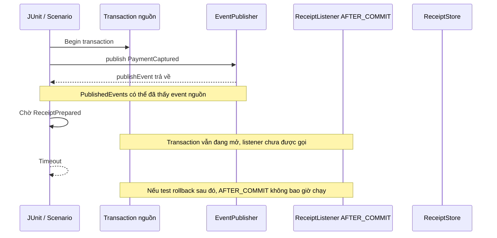
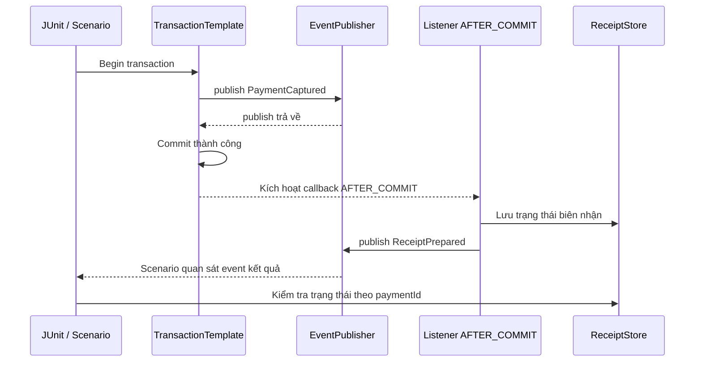
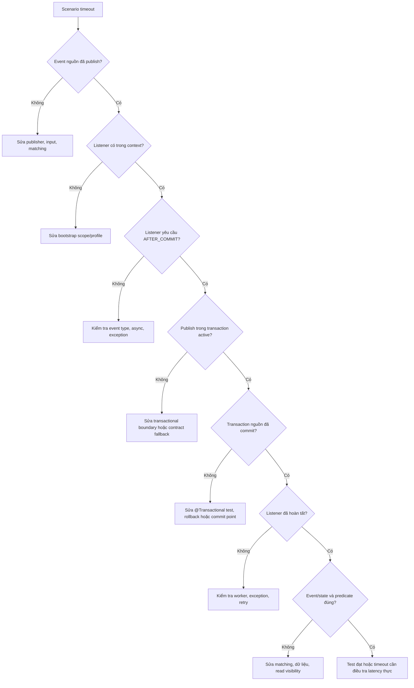

# Timeout do transaction chưa commit

## Mục tiêu học tập

Trong chương **Test failure** của học phần **Spring Modulith Verification & Testing**, một lỗi dễ gây hiểu lầm là `Scenario` chờ event hoặc trạng thái sau khi listener xử lý, nhưng hết thời gian chờ mặc dù `PublishedEvents` đã ghi nhận event nguồn. Nếu listener dùng `@TransactionalEventListener(phase = AFTER_COMMIT)`, nguyên nhân có thể đơn giản là **transaction chứa lời gọi publish chưa commit**. Listener chưa được phép chạy; tăng timeout sẽ không tạo ra commit.

Sau bài này, bạn có thể:

- Phân biệt **publish event**, **commit transaction nguồn**, **listener hậu commit được kích hoạt**, **transaction ghi kết quả của listener** và **đọc được side effect từ test**.
- Đọc tình huống `Scenario` timeout khi test `@Transactional` còn mở transaction hoặc tự rollback.
- Giải thích vì sao `PublishedEvents` có event nguồn **không chứng minh** listener `AFTER_COMMIT` đã chạy.
- Biết điều kiện để `@TransactionalEventListener(AFTER_COMMIT)` hoạt động, kể cả `fallbackExecution` mặc định và việc publish ngoài transaction.
- Sử dụng `TransactionTemplate` tạo **ranh giới commit thực sự** trong test; tránh transaction bao ngoài khiến propagation `REQUIRED` chỉ tham gia transaction chưa kết thúc.
- Viết `@ApplicationModuleTest` và `Scenario` chờ event kết quả bằng khóa tương quan, hoặc chờ state sau commit khi listener chỉ ghi database.
- Phân biệt lỗi chưa commit với listener nằm ngoài bootstrap scope, sai predicate, lỗi `@Async` và sai kiểu event.
- Hiểu vì sao callback hậu commit muốn ghi database thường cần **transaction mới**, đặc biệt khi cập nhật dữ liệu trong callback đồng bộ.
- Kết hợp event assertions, kiểm thử database/tích hợp và `ApplicationModules.verify()` trong quality gate CI.

## 1. Triệu chứng: event nguồn có rồi nhưng Scenario vẫn chờ

Xét luồng nghiệp vụ đơn giản:

1. Module `payments` xác nhận thanh toán và publish `PaymentCaptured`.
2. Sau khi transaction xác nhận thanh toán **commit thành công**, module `receipts` chuẩn bị biên nhận.
3. Listener của `receipts` phát event kết quả `ReceiptPrepared`.
4. Test chờ `ReceiptPrepared` bằng `Scenario`.

```text
PaymentCaptured đã publish?                 CÓ
Transaction xác nhận thanh toán đã commit?  CHƯA
ReceiptListener AFTER_COMMIT được chạy?     CHƯA
ReceiptPrepared đã publish?                 CHƯA
Scenario chờ ReceiptPrepared?               TIMEOUT
```

Điểm cần phân biệt: **`publishEvent(…)` không đồng nghĩa với transaction đã commit**. Spring có thể thông báo event cho các cơ chế quan sát ngay tại thời điểm publish, trong khi callback `AFTER_COMMIT` chỉ được kích hoạt khi transaction đồng bộ với event đi tới pha commit thành công.

### 1.1. Sơ đồ các mốc thời gian



Luồng đúng cần được điều phối theo hướng:



Trong sơ đồ thứ hai, listener có thể chạy bất đồng bộ nên thời điểm thực tế của `R` có thể sau khi `TransactionTemplate` trả về. `Scenario` giúp chờ kết quả có điều kiện và timeout hữu hạn; **commit** vẫn là điều kiện phải có trước khi listener hậu commit được phép hoàn thành.

## 2. Những trạng thái phải kiểm tra riêng

| Mốc | Bằng chứng | Không tự chứng minh |
| --- | --- | --- |
| **Event nguồn đã publish** | `PublishedEvents.ofType(PaymentCaptured.class)` theo `paymentId` | Transaction nguồn đã commit |
| **Transaction nguồn đã commit** | Ranh giới `TransactionTemplate` kết thúc thành công / dữ liệu nguồn đọc được sau commit | Listener đã hoàn tất |
| **Listener hậu commit được kích hoạt** | Log/spy ở callback, registry theo cơ chế hỗ trợ | Side effect của listener đã commit |
| **Event kết quả đã xuất hiện** | `Scenario.andWaitForEventOfType(ReceiptPrepared.class)` | Email/broker/DB ngoài được giao dịch bền vững |
| **Trạng thái kết quả đã bền vững** | Repository đọc được state từ transaction mới sau commit | Không còn retry hoặc event trùng ở tương lai |

Một `PublishedEvents` pass và một `Scenario` timeout không mâu thuẫn: chúng quan sát **hai giai đoạn khác nhau**.

### 2.1. Ba tình huống gần giống nhau

| Tình huống | `PaymentCaptured` đã publish? | Callback `AFTER_COMMIT` |
| --- | --- | --- |
| Publish **trong transaction đang mở** | Có thể đã được ghi nhận | Chờ commit |
| Publish trong transaction rồi **rollback** | Có thể đã được ghi nhận | Không kích hoạt |
| Publish **ngoài transaction** với `fallbackExecution = false` | Có thể đã được ghi nhận | Không kích hoạt theo cấu hình mặc định |
| Publish trong transaction **commit thành công** | Đã publish | Được kích hoạt sau commit |

Chú ý: `PublishedEvents` là phép quan sát việc publish event trong test, không phải bản ghi đảm bảo giao event sau commit và không phải bằng chứng database transaction thành công.

## 3. @TransactionalEventListener(AFTER_COMMIT) hoạt động thế nào?

Spring Framework hỗ trợ listener gắn với các pha của transaction. Ví dụ:

```java
@TransactionalEventListener(phase = TransactionPhase.AFTER_COMMIT)
public void on(PaymentCaptured event) {
    // Chỉ thực thi sau khi transaction nguồn commit thành công.
}
```

Đoạn trên cần các import:

```java
import org.springframework.transaction.event.TransactionPhase;
import org.springframework.transaction.event.TransactionalEventListener;
```

**Ý nghĩa quan trọng:**

- `AFTER_COMMIT` là pha sau khi **transaction nguồn** commit; không phải “ngay lập tức khi publish”.
- Nếu transaction **rollback**, callback pha `AFTER_COMMIT` không chạy.
- Nếu **không có transaction hiện hành** và `fallbackExecution` giữ giá trị mặc định `false`, listener transaction-bound **không được gọi**.
- Nếu thiết lập `fallbackExecution = true`, callback có thể được thực thi cả khi publish ngoài transaction; đây là **thay đổi ngữ nghĩa nghiệp vụ**, không phải cách sửa timeout mặc định.
- Các pha khác như `BEFORE_COMMIT`, `AFTER_ROLLBACK`, `AFTER_COMPLETION` có ý nghĩa khác và không nên dùng thay thế tùy tiện.

### 3.1. Vì sao publish ngoài transaction cũng làm test chờ mãi?

```java
// Không có transaction active:
publisher.publishEvent(new PaymentCaptured(
        paymentId, orderId, amount));

// Listener AFTER_COMMIT với fallbackExecution=false sẽ không xử lý.
```

Hãy kiểm tra **transaction đang tồn tại tại thời điểm publish**. Một ứng dụng có DataSource hoặc `@EnableTransactionManagement` không có nghĩa mọi lời gọi `publishEvent(…)` đều nằm trong transaction.

Đặc biệt, method `@Transactional` bị gọi bằng **self-invocation** trong cùng bean có thể không đi qua Spring proxy, nên transaction dự kiến không được mở. Nếu listener không chạy dù tưởng đã dùng `@Transactional`, cần xem cả call path.

### 3.2. @ApplicationModuleListener có liên quan thế nào?

Trong Spring Modulith, `@ApplicationModuleListener` là cách thuận tiện để khai báo listener theo mô hình giao tiếp application module; cơ chế của nó gắn với xử lý sự kiện bất đồng bộ/transaction theo phiên bản thư viện và hạ tầng được cấu hình.

Khi test listener thuộc cơ chế này, cũng phải xác nhận **event nguồn và transaction** thỏa điều kiện kích hoạt thực tế, cũng như listener có nằm trong test context. Không giả định rằng mọi `@EventListener` đồng bộ, `@TransactionalEventListener` và `@ApplicationModuleListener` có thời điểm xử lý giống nhau.

## 4. Case lỗi điển hình: test @Transactional tự giữ transaction mở

Xét một bài test viết theo kiểu:

```java
@ApplicationModuleTest
class ReceiptScenarioTests {

    @Test
    @Transactional
    void waitsForReceiptPrepared(Scenario scenario) {
        UUID paymentId = UUID.randomUUID();
        UUID orderId = UUID.randomUUID();

        scenario.stimulate(() ->
                        publisher.publishEvent(
                                new PaymentCaptured(
                                        paymentId, orderId,
                                        new BigDecimal("100000.00"))))
                .andWaitForEventOfType(ReceiptPrepared.class)
                .matching(e -> paymentId.equals(e.paymentId()))
                .toArriveAndVerify(e ->
                        assertThat(e.orderId()).isEqualTo(orderId));
    }
}
```

Đây là **mẫu test cố ý sai**, chưa bao gồm các field/inject/import cần thiết để tạo class hoàn chỉnh. Giả sử test đang chạy dưới **test-managed transaction** do `@Transactional` trên method:

1. Spring Test mở transaction khi method bắt đầu.
2. `Scenario.stimulate(…)` publish `PaymentCaptured` trong transaction đó.
3. Method đi vào bước chờ `ReceiptPrepared` **trước khi transaction của test kết thúc**.
4. Listener `AFTER_COMMIT` chưa được kích hoạt vì chưa có commit.
5. `Scenario` timeout; sau khi method kết thúc với lỗi, Spring Test thường **rollback** transaction.

Test tự tạo một **vòng chờ không thể hoàn thành**:

```text
Scenario chờ listener hoàn thành
  ↳ listener chờ transaction commit
       ↳ transaction chỉ kết thúc khi method test kết thúc
            ↳ method test đang bị chặn ở Scenario
```

### 4.1. @Commit có đủ để sửa không?

Không nhất thiết. `@Commit` trên test transaction đổi hành vi kết thúc transaction của Spring Test từ rollback sang commit ở **cuối method test**. Nhưng nếu `Scenario` vẫn đợi listener `AFTER_COMMIT` **ngay trong method**, commit cuối method chưa xảy ra khi bước chờ đang chạy.

Muốn kiểm tra callback hậu commit, cần tạo **điểm commit xảy ra trước bước chờ** hoặc chủ động kết thúc test-managed transaction đúng thời điểm, ví dụ dùng `TestTransaction.flagForCommit()` / `TestTransaction.end()` trong trường hợp thực sự sử dụng test-managed transaction và hiểu rõ lifecycle tương ứng.

Thông thường, đối với bài test cụ thể này, cách đơn giản hơn là **không đặt `@Transactional` lên method test**, rồi tạo transaction rõ ràng bên trong stimulus bằng `TransactionTemplate`.

### 4.2. TransactionTemplate bên trong test @Transactional vẫn có thể không commit

`TransactionTemplate` mặc định dùng propagation `REQUIRED`. Nếu một transaction đã mở sẵn:

```text
@Transactional test mở transaction T1
    └── TransactionTemplate(REQUIRED) tham gia T1
           └── publish PaymentCaptured
       TransactionTemplate trả về nhưng T1 vẫn mở
           └── AFTER_COMMIT vẫn chưa chạy
```

Do đó, **chỉ thêm `TransactionTemplate` không đủ** nếu bạn vẫn giữ transaction bao ngoài không kết thúc. Phải xem propagation và ranh giới sở hữu transaction. Không đổi sang `REQUIRES_NEW` một cách máy móc nếu nghiệp vụ thật đòi event phải commit cùng transaction nguồn; quyết định test transaction phải phản ánh hợp đồng.

## 5. Ví dụ Spring Modulith: listener chỉ chạy sau commit

Ví dụ sau minh họa một mô hình có thể tái hiện và sửa timeout. Dùng Java 17+, Spring Boot, Spring Modulith, JUnit Jupiter, AssertJ, Spring JDBC và H2 cho **transaction test**.

### 5.1. Cấu trúc module

```text
com.example.shop
├── ShopApplication.java             # @SpringBootApplication
├── payments
│   └── PaymentCaptured.java         # Public event contract
└── receipts
    ├── ReceiptStatus.java
    ├── ReceiptState.java
    ├── ReceiptStateStore.java
    ├── ReceiptPrepared.java
    ├── ReceiptAfterCommitListener.java
    └── ReceiptAsyncConfiguration.java

src/test/java/com/example/shop/receipts/
    └── ReceiptAfterCommitScenarioTests.java
```

Test đặt ở **module consumer `receipts`** và publish trực tiếp public event `PaymentCaptured` làm stimulus. Như vậy, `@ApplicationModuleTest` có thể bootstrap listener trong module đang test mà không buộc phải khởi động toàn bộ service của `payments`.

Một số dependency Maven minh họa:

```xml
<!-- Trong dependencies của Maven project -->
<dependency>
    <groupId>org.springframework.boot</groupId>
    <artifactId>spring-boot-starter-jdbc</artifactId>
</dependency>
<dependency>
    <groupId>com.h2database</groupId>
    <artifactId>h2</artifactId>
    <scope>test</scope>
</dependency>
<dependency>
    <groupId>org.springframework.modulith</groupId>
    <artifactId>spring-modulith-starter-test</artifactId>
    <scope>test</scope>
</dependency>
```

Cần có Spring Boot test/JUnit/AssertJ dependencies phù hợp với nền tảng kiểm thử của dự án. Version Spring Modulith nên được quản lý qua BOM tương thích với Spring Boot. H2 trong ví dụ chỉ dùng làm **transaction manager có commit/rollback thật trong test**, chưa phải persistence store của biên nhận.

### 5.2. Public event từ payments

Tệp `src/main/java/com/example/shop/payments/PaymentCaptured.java`:

```java
package com.example.shop.payments;

import java.math.BigDecimal;
import java.util.UUID;

public record PaymentCaptured(
        UUID paymentId,
        UUID orderId,
        BigDecimal amount) {
}
```

`paymentId` là correlation key ổn định. Test dùng ID này để chỉ quan sát event và trạng thái thuộc **đúng lần thanh toán**, không nhận nhầm kết quả của test khác.

### 5.3. Event kết quả, state và store

Tệp `src/main/java/com/example/shop/receipts/ReceiptPrepared.java`:

```java
package com.example.shop.receipts;

import java.util.UUID;

public record ReceiptPrepared(
        UUID paymentId,
        UUID orderId,
        String templateCode) {
}
```

Tệp `src/main/java/com/example/shop/receipts/ReceiptStatus.java`:

```java
package com.example.shop.receipts;

public enum ReceiptStatus {
    READY,
    FAILED
}
```

Tệp `src/main/java/com/example/shop/receipts/ReceiptState.java`:

```java
package com.example.shop.receipts;

import java.util.UUID;

public record ReceiptState(
        UUID paymentId,
        UUID orderId,
        ReceiptStatus status,
        String templateCode) {
}
```

Tệp `src/main/java/com/example/shop/receipts/ReceiptStateStore.java`:

```java
package com.example.shop.receipts;

import java.util.Optional;
import java.util.UUID;
import java.util.concurrent.ConcurrentHashMap;
import java.util.concurrent.ConcurrentMap;
import org.springframework.stereotype.Component;

@Component
public class ReceiptStateStore {

    private final ConcurrentMap<UUID, ReceiptState> receipts =
            new ConcurrentHashMap<>();

    public void markReady(
            UUID paymentId, UUID orderId, String templateCode) {
        receipts.put(paymentId, new ReceiptState(
                paymentId, orderId, ReceiptStatus.READY, templateCode));
    }

    public Optional<ReceiptState> findByPaymentId(UUID paymentId) {
        return Optional.ofNullable(receipts.get(paymentId));
    }

    public void remove(UUID paymentId) {
        receipts.remove(paymentId);
    }
}
```

`ConcurrentHashMap` cho phép listener worker thread và JUnit thread trao đổi state trong cùng JVM mà không dùng sleep. Store là **demo in-memory**, không có transaction riêng và không chứng minh dữ liệu bền vững. Phần 10 sẽ mô tả kiểm thử với database.

### 5.4. Listener hậu commit và async

Tệp `src/main/java/com/example/shop/receipts/ReceiptAfterCommitListener.java`:

```java
package com.example.shop.receipts;

import com.example.shop.payments.PaymentCaptured;
import org.springframework.context.ApplicationEventPublisher;
import org.springframework.scheduling.annotation.Async;
import org.springframework.stereotype.Component;
import org.springframework.transaction.event.TransactionPhase;
import org.springframework.transaction.event.TransactionalEventListener;

@Component
public class ReceiptAfterCommitListener {

    private final ReceiptStateStore store;
    private final ApplicationEventPublisher publisher;

    public ReceiptAfterCommitListener(
            ReceiptStateStore store,
            ApplicationEventPublisher publisher) {
        this.store = store;
        this.publisher = publisher;
    }

    @Async
    @TransactionalEventListener(phase = TransactionPhase.AFTER_COMMIT)
    public void on(PaymentCaptured event) {
        String templateCode = "PAYMENT_CAPTURED";

        store.markReady(
                event.paymentId(),
                event.orderId(),
                templateCode);

        publisher.publishEvent(new ReceiptPrepared(
                event.paymentId(),
                event.orderId(),
                templateCode));
    }
}
```

Tệp `src/main/java/com/example/shop/receipts/ReceiptAsyncConfiguration.java`:

```java
package com.example.shop.receipts;

import org.springframework.context.annotation.Configuration;
import org.springframework.scheduling.annotation.EnableAsync;

@Configuration(proxyBeanMethods = false)
@EnableAsync
class ReceiptAsyncConfiguration {
}
```

Điều kiện để listener chạy như ví dụ:

1. `ReceiptAfterCommitListener` là Spring bean thuộc context đang kiểm thử.
2. `@EnableAsync` được bootstrap, để `@Async` hoạt động theo cấu hình.
3. `PaymentCaptured` được publish **khi transaction nguồn active**.
4. Transaction nguồn **commit thành công**.
5. Listener worker xử lý và publish `ReceiptPrepared`.

Trong ví dụ, event kết quả chỉ chứng minh **store bộ nhớ** đã ghi READY, không chứng minh commit JPA, email đã gửi hay broker đã ACK.

## 6. Test đúng: TransactionTemplate commit trước khi chờ outcome

Tệp `src/test/java/com/example/shop/receipts/ReceiptAfterCommitScenarioTests.java`:

```java
package com.example.shop.receipts;

import static org.assertj.core.api.Assertions.assertThat;

import com.example.shop.payments.PaymentCaptured;
import java.math.BigDecimal;
import java.util.UUID;
import javax.sql.DataSource;
import org.junit.jupiter.api.Test;
import org.springframework.beans.factory.annotation.Autowired;
import org.springframework.boot.test.context.TestConfiguration;
import org.springframework.context.ApplicationEventPublisher;
import org.springframework.context.annotation.Bean;
import org.springframework.context.annotation.Import;
import org.springframework.jdbc.datasource.DataSourceTransactionManager;
import org.springframework.jdbc.datasource.embedded.EmbeddedDatabaseBuilder;
import org.springframework.jdbc.datasource.embedded.EmbeddedDatabaseType;
import org.springframework.modulith.test.ApplicationModuleTest;
import org.springframework.modulith.test.PublishedEvents;
import org.springframework.modulith.test.Scenario;
import org.springframework.transaction.PlatformTransactionManager;
import org.springframework.transaction.support.TransactionTemplate;

@ApplicationModuleTest
@Import(ReceiptAfterCommitScenarioTests.TestTransactions.class)
class ReceiptAfterCommitScenarioTests {

    @Autowired
    ApplicationEventPublisher publisher;

    @Autowired
    PlatformTransactionManager transactionManager;

    @Autowired
    ReceiptStateStore store;

    @TestConfiguration(proxyBeanMethods = false)
    static class TestTransactions {

        @Bean
        DataSource testDataSource() {
            // JDBC/H2 chỉ tạo transaction nguồn cho test.
            return new EmbeddedDatabaseBuilder()
                    .generateUniqueName(true)
                    .setType(EmbeddedDatabaseType.H2)
                    .build();
        }

        @Bean
        PlatformTransactionManager testTransactionManager(
                DataSource dataSource) {
            return new DataSourceTransactionManager(dataSource);
        }
    }

    @Test
    void preparesReceiptOnlyAfterSourceCommit(
            Scenario scenario,
            PublishedEvents events) {

        UUID paymentId = UUID.randomUUID();
        UUID orderId = UUID.randomUUID();
        BigDecimal amount = new BigDecimal("125000.00");
        var captured = new PaymentCaptured(
                paymentId, orderId, amount);

        TransactionTemplate tx =
                new TransactionTemplate(transactionManager);

        try {
            // Không đặt @Transactional trên method test:
            // TransactionTemplate sở hữu và commit transaction này.
            scenario.stimulate(() ->
                            tx.executeWithoutResult(status ->
                                    publisher.publishEvent(captured)))
                    .andWaitForEventOfType(ReceiptPrepared.class)
                    .matching(result ->
                            paymentId.equals(result.paymentId()))
                    .toArriveAndVerify(result -> {
                        assertThat(result.orderId()).isEqualTo(orderId);
                        assertThat(result.templateCode())
                                .isEqualTo("PAYMENT_CAPTURED");
                    });

            assertThat(events.ofType(PaymentCaptured.class)
                    .matching(event ->
                            paymentId.equals(event.paymentId())))
                    .hasSize(1)
                    .allSatisfy(event -> {
                        assertThat(event.orderId()).isEqualTo(orderId);
                        assertThat(event.amount())
                                .isEqualByComparingTo(amount);
                    });

            assertThat(store.findByPaymentId(paymentId))
                    .contains(new ReceiptState(
                            paymentId,
                            orderId,
                            ReceiptStatus.READY,
                            "PAYMENT_CAPTURED"));
        } finally {
            store.remove(paymentId);
        }
    }
}
```

### 6.1. Vì sao ví dụ này giải quyết timeout?

**Đúng nguồn transaction:** `TransactionTemplate` được tạo từ `PlatformTransactionManager` của JDBC/H2. `publishEvent(captured)` xảy ra trong transaction thực được quản lý bởi Spring.

**Có commit trước kết quả:** `executeWithoutResult(…)` trở về sau khi transaction do template sở hữu kết thúc theo cơ chế commit. Không có `@Transactional` trên test bao ngoài khiến transaction đó bị giữ mở.

**Chờ đúng event:** `Scenario` chờ `ReceiptPrepared` phát bởi consumer, không nhầm với `PaymentCaptured` đã publish.

**Khóa tương quan:** `matching(result -> paymentId.equals(result.paymentId()))` bảo đảm outcome thuộc đúng thanh toán.

**Assertion tách bạch:** `PublishedEvents` kiểm tra event nguồn; `Scenario` kiểm tra event kết quả; `ReceiptStateStore` kiểm tra side effect đã được tạo trong demo.

**Giới hạn:** Mẫu giả định ứng dụng không còn một bean `DataSource`/transaction manager khác gây trùng ứng viên. Nếu dự án đã cấu hình hạ tầng JDBC/JPA, **dùng transaction manager thực của dự án** thay vì import một `EmbeddedDatabaseBuilder` thứ hai. Test dùng H2 trong ví dụ để cung cấp **transaction**, chứ chưa kiểm chứng việc lưu receipt vào SQL.

### 6.2. Test có nhất thiết dùng Scenario không?

Nếu listener `@TransactionalEventListener(AFTER_COMMIT)` chạy **đồng bộ**, transaction template có thể kích hoạt callback hậu commit trước khi nó trả về. Trong trường hợp đó, một assertion trực tiếp sau `tx.executeWithoutResult(…)` có thể phù hợp.

Nhưng listener ví dụ có `@Async`, nên callback được giao cho executor và có thể tiếp tục xử lý **sau** khi transaction template trả về. `Scenario` là cách có ý nghĩa để chờ một **kết quả nghiệp vụ**, không dựa vào thời gian ngủ tùy ý.

## 7. Test state sau commit khi không có event kết quả

Một số listener chỉ ghi trạng thái `READY` mà **không publish `ReceiptPrepared`**. Trong trường hợp đó, `Scenario` chờ event kết quả sẽ timeout **đúng theo thiết kế**; hãy chờ state mà nghiệp vụ thật sự tạo.

Trong cùng test class có `store`, `publisher` và `transactionManager`, mẫu:

```java
@Test
void waitsForReadyStateAfterCommit(Scenario scenario) {
    UUID paymentId = UUID.randomUUID();
    UUID orderId = UUID.randomUUID();
    var captured = new PaymentCaptured(
            paymentId, orderId, new BigDecimal("300000.00"));
    TransactionTemplate tx =
            new TransactionTemplate(transactionManager);

    try {
        scenario.stimulate(() ->
                        tx.executeWithoutResult(status ->
                                publisher.publishEvent(captured)))
                .andWaitForStateChange(
                        () -> store.findByPaymentId(paymentId)
                                .orElse(null),
                        state -> state != null
                                && state.status() == ReceiptStatus.READY)
                .andVerify(state -> {
                    assertThat(state.paymentId()).isEqualTo(paymentId);
                    assertThat(state.orderId()).isEqualTo(orderId);
                });
    } finally {
        store.remove(paymentId);
    }
}
```

Đoạn trên dùng store demo nhưng có thể thích nghi cho repository thật. Nó nhấn mạnh **supplier phải đọc trạng thái mới mỗi lần**, không trả snapshot cũ:

```java
// Sai: before được đọc trước stimulus.
ReceiptState before = store.findByPaymentId(paymentId).orElse(null);

// Supplier luôn trả cùng snapshot cũ.
() -> before

// Đúng: đọc lại state theo ID ở mỗi lần đánh giá.
() -> store.findByPaymentId(paymentId).orElse(null)
```

Chú ý khi chuyển sang JPA: cần tránh đọc bằng persistence context bị giữ lâu hoặc transaction còn mở khiến supplier không thấy state đã commit từ listener.

## 8. Đối chứng: rollback và publish ngoài transaction

Hai đường đi âm giúp người học hiểu **vì sao commit là điều kiện của listener**, nhưng assertion “không có event” với worker async cần thiết kế cẩn thận.

### 8.1. Transaction bị rollback

Ví dụ trong test với `TransactionTemplate`:

```java
UUID paymentId = UUID.randomUUID();
UUID orderId = UUID.randomUUID();
var captured = new PaymentCaptured(
        paymentId, orderId, new BigDecimal("50000.00"));
TransactionTemplate tx = new TransactionTemplate(transactionManager);

tx.executeWithoutResult(status -> {
    publisher.publishEvent(captured);
    status.setRollbackOnly();
});

// Rollback không kích hoạt callback AFTER_COMMIT.
// Một phép đọc tức thì chỉ phản ánh thời điểm đọc;
// để chứng minh không có callback cần kiểm thử được đồng bộ hóa.
assertThat(store.findByPaymentId(paymentId)).isEmpty();
```

Đây là **đoạn test minh họa**, cần các biến/import và cleanup phù hợp. Nó thể hiện quy tắc rollback của `AFTER_COMMIT`, nhưng vì listener có thể dùng async trong những setup khác, **một phép `isEmpty()` ngay lập tức không tự chứng minh sẽ không bao giờ có side effect**. Với negative test chặt chẽ, dùng một listener đồng bộ có thể quan sát lời gọi, hoặc kiểm thử callback đăng ký transaction bằng cơ chế kiểm soát được, đồng thời gắn ID riêng để tránh nhiễu.

### 8.2. Publish ngoài transaction

```java
// Không có test-managed transaction và không dùng TransactionTemplate.
publisher.publishEvent(new PaymentCaptured(
        paymentId, orderId, new BigDecimal("50000.00")));

// Listener TransactionalEventListener AFTER_COMMIT mặc định
// fallbackExecution=false nên không được kích hoạt.
```

Nếu bài test ban đầu publish trực tiếp như trên rồi chờ `ReceiptPrepared`, `Scenario` có thể timeout mặc dù event nguồn đã được ghi nhận.

### 8.3. Không “sửa” bằng fallbackExecution=true tùy tiện

Ví dụ:

```java
@TransactionalEventListener(
        phase = TransactionPhase.AFTER_COMMIT,
        fallbackExecution = true)
public void on(PaymentCaptured event) {
    // ...
}
```

Cấu hình `fallbackExecution = true` cho phép listener xử lý event trong trường hợp không có transaction theo semantics của Spring, nhưng nó cũng **thay đổi contract**: listener không còn yêu cầu nguồn đã commit ở tất cả đường đi. Đối với nghiệp vụ phát biên nhận chỉ sau khi thanh toán commit, đây có thể là lỗi thiết kế nghiêm trọng.

Tương tự, đổi annotation thành `@EventListener` đồng bộ để test xanh có thể làm side effect xảy ra **trước commit**, kể cả khi transaction nguồn sau đó rollback. Cần chọn listener phase theo quy tắc nghiệp vụ, không theo thời gian test muốn pass.

## 9. Khi TransactionTemplate vẫn không đủ: kiểm tra ranh giới thật

### 9.1. Bị transaction test bao ngoài

Nếu method test có `@Transactional`:

```java
@Test
@Transactional
void problematic(Scenario scenario) {
    TransactionTemplate tx =
            new TransactionTemplate(transactionManager);

    scenario.stimulate(() ->
                    tx.executeWithoutResult(status ->
                            publisher.publishEvent(captured)))
            .andWaitForEventOfType(ReceiptPrepared.class)
            .matching(e -> paymentId.equals(e.paymentId()))
            .toArriveAndVerify(e -> { /* ... */ });
}
```

`TransactionTemplate` mặc định là `PROPAGATION_REQUIRED`: có thể tham gia transaction do Spring Test mở sẵn. Việc `tx.executeWithoutResult(…)` trả về **không có nghĩa** transaction ngoài đã commit. Cách sửa là loại bỏ `@Transactional` khỏi method test nếu không cần, hoặc chủ động điều phối việc kết thúc test-managed transaction trước khi chờ.

### 9.2. Method @Transactional không đi qua proxy

Trong Spring proxy-based transaction management:

```java
@Service
class PaymentService {

    public void accept() {
        // Self-invocation có thể không mở transaction của confirm().
        confirm();
    }

    @Transactional
    public void confirm() {
        publisher.publishEvent(captured);
    }
}
```

Đây là đoạn minh họa cơ chế self-invocation, không phải class hoàn chỉnh. Nếu lời gọi `confirm()` không đi qua transactional proxy, transaction dự kiến có thể không tồn tại. Cách sửa là thiết kế service boundary đúng để invocation đi qua bean proxy, hoặc dùng transaction template theo hợp đồng; không thêm annotation vào mọi method và mặc định nó hoạt động.

### 9.3. Nhiều transaction manager

Dự án có cả JPA và JDBC, hoặc nhiều datasource, có thể có nhiều bean `PlatformTransactionManager`. Khi test inject không đúng manager hoặc manager không gắn với nơi dữ liệu nguồn được ghi, **“commit” đang kiểm tra chưa chắc là commit cần thiết**.

Hãy xác định:

- Giao dịch nguồn dùng transaction manager nào?
- Listener `AFTER_COMMIT` được đăng ký trong transaction nào?
- Repository đọc từ datasource/schema nào?
- Có `@Qualifier`/`transactionManager` trong `@Transactional` không?
- Test dùng một transaction manager test tạo riêng có làm lệch so với production không?

Ví dụ H2 ở phần 6 chỉ nhằm minh họa transaction boundary; với hệ thống đa datasource, cần test tích hợp phản ánh transaction thực tế.

## 10. Listener hậu commit muốn ghi database: cần transaction riêng

Một điều rất quan trọng: callback `AFTER_COMMIT` có thể chạy khi transaction nguồn đã commit nhưng **resource giao dịch vẫn chưa dọn dẹp hoàn toàn**. Nếu trong callback đồng bộ bạn gọi một repository để ghi dữ liệu mà không mở transaction mới phù hợp, các thao tác có thể dính vào transaction đã hoàn tất và không có commit mới như mong đợi.

### 10.1. Mẫu thiết kế tách listener và persistence service

Đoạn minh họa dưới đây dùng JPA repository được triển khai trong dự án:

```java
@Service
public class ReceiptPersistenceService {

    private final ReceiptRepository receipts;

    public ReceiptPersistenceService(ReceiptRepository receipts) {
        this.receipts = receipts;
    }

    @Transactional(propagation = Propagation.REQUIRES_NEW)
    public void storeReceipt(PaymentCaptured event) {
        receipts.save(ReceiptEntity.from(event));
    }
}
```

Listener:

```java
@Component
public class ReceiptDatabaseListener {

    private final ReceiptPersistenceService persistence;
    private final ApplicationEventPublisher publisher;

    public ReceiptDatabaseListener(
            ReceiptPersistenceService persistence,
            ApplicationEventPublisher publisher) {
        this.persistence = persistence;
        this.publisher = publisher;
    }

    @TransactionalEventListener(phase = TransactionPhase.AFTER_COMMIT)
    public void on(PaymentCaptured event) {
        // REQUIRES_NEW được gọi qua bean/proxy riêng.
        persistence.storeReceipt(event);

        publisher.publishEvent(new ReceiptPrepared(
                event.paymentId(),
                event.orderId(),
                "PAYMENT_CAPTURED"));
    }
}
```

Đây là **mẫu thiết kế**, chưa phải project hoàn chỉnh: `ReceiptRepository`, `ReceiptEntity`, import JPA và transaction annotations phải được định nghĩa tương ứng. Không dùng mẫu đồng thời với `ReceiptAfterCommitListener` phần 5 mà không kiểm soát hai listener cùng xử lý; hai đoạn là **hai phương án triển khai khác nhau**.

Tại sao tách bean?

1. `ReceiptPersistenceService` có `@Transactional(propagation = REQUIRES_NEW)`.
2. Listener gọi method qua **Spring proxy** của bean khác, tránh lỗi self-invocation.
3. Khi `storeReceipt(…)` trở về thành công, transaction mới đã có cơ hội commit trước khi listener phát event kết quả.
4. Test database có thể đọc lại dữ liệu từ transaction độc lập và kiểm chứng trạng thái bền vững.

Nếu listener bất đồng bộ chạy trên thread riêng, transaction của publisher không được tự động kế thừa; vẫn cần xác định ranh giới giao dịch ghi kết quả thay vì suy luận “đã có `@Async` là DB sẽ commit”.

### 10.2. Không suy event kết quả đồng nghĩa DB đã commit nếu publish sớm

So sánh:

```text
Sai hợp đồng durability:
listener bắt đầu transaction ghi
  → save entity
  → publish ReceiptPrepared
  → transaction sau đó rollback

Đúng hơn nếu contract đòi kết quả bền vững:
listener gọi persistence service trong transaction mới
  → commit thành công
  → publish ReceiptPrepared
```

Ngay cả cách thứ hai còn một khoảng rủi ro: process có thể lỗi **sau khi database commit nhưng trước khi publish event kết quả**. Production cần xem xét **transactional outbox** hoặc cơ chế publication/retry phù hợp. Test chỉ có thể chứng minh contract ở những mốc được mô phỏng, không bảo đảm exactly-once delivery chỉ từ một assertion.

### 10.3. Khi test repository phải đọc từ transaction mới

Một cách chờ trạng thái sau commit với Awaitility (trong integration test có repository thật):

```java
await()
        .atMost(Duration.ofSeconds(5))
        .untilAsserted(() -> {
            var receipt = receiptRepository.findByPaymentId(paymentId);

            assertThat(receipt).isPresent();
            assertThat(receipt.orElseThrow().getStatus())
                    .isEqualTo(ReceiptStatus.READY);
        });
```

Đoạn trên giả định đã có `receiptRepository`, `ReceiptStatus`, import `org.awaitility.Awaitility.await`, `java.time.Duration` và AssertJ. Repository đọc cần thực sự quan sát dữ liệu **đã commit**, tránh test transaction dài giữ một persistence context cũ hoặc isolation khiến snapshot không được cập nhật.

`flush()` chỉ đồng bộ SQL xuống database trong transaction, **không thay thế commit**. Đừng sửa timeout bằng cách gọi `entityManager.flush()` rồi mong callback `AFTER_COMMIT` đã được kích hoạt.

## 11. Lỗi khác cũng khiến Scenario timeout

Sau khi đã có commit thật, nếu test vẫn timeout, quay lại kiểm tra event flow:

| Triệu chứng | Khả năng nguyên nhân | Điều cần xác minh |
| --- | --- | --- |
| `PublishedEvents` không có `PaymentCaptured` | Publisher không chạy nhánh phát event | Input, validation, matching ID |
| Event nguồn có nhưng không có transaction | Publish ở ngoài transactional boundary | Self-invocation, gọi trực tiếp publisher, transaction manager |
| Transaction nguồn rollback | Exception hoặc rollback-only | Log lỗi, rollback flag, behavior của test |
| Transaction commit nhưng listener không có | `@ApplicationModuleTest` bootstrap sai module | Listener registration, package, profile |
| Listener có, chờ sai event class | Test chờ `ReceiptSent` nhưng listener phát `ReceiptPrepared` | Contract event, type |
| Event kết quả có `paymentId` khác | `matching(…)` loại kết quả đúng | Correlation IDs, mapping |
| Listener `@Async` lỗi | Worker ném exception không truyền về test thread | Log, exception handler, registry |
| Listener callback có nhưng state DB chưa thấy | Write transaction chưa commit hoặc read transaction cũ | `REQUIRES_NEW`, isolation, persistence context |
| Test chờ event không có trong contract | Listener chỉ cập nhật state | Chờ repository state thay vì event |
| Timeout ngắn trong CI | Worker/DB bị chậm thật | Điều kiện chờ hữu hạn, executor, performance |
| `ApplicationModules.verify()` fail | Dependency giữa module vi phạm | Refactor API, named interface, cycle |

### 11.1. Phạm vi @ApplicationModuleTest có thể là nguyên nhân

Giả sử `receipts` lắng nghe `payments.PaymentCaptured`. Về dependency tĩnh, module consumer `receipts` import public event của module producer `payments`:

```text
receipts → payments
```

Nếu test đặt trong `payments` ở chế độ `STANDALONE`, listener `receipts` thường không thuộc test context. Bật `DIRECT_DEPENDENCIES` trên `payments` **không tự đưa những module phụ thuộc vào payments** vào context.

Nên:

- Test publisher riêng trong `payments` với `PublishedEvents`.
- Test consumer trong `receipts` bằng cách publish public event làm stimulus và chờ kết quả.
- Dùng integration test bootstrap cả publisher/consumer khi cần kiểm tra luồng thật từ service đầu đến kết quả cuối.

Không mở toàn bộ component scanning chỉ để “tìm được listener” mà bỏ qua ranh giới kiến trúc của Spring Modulith.

### 11.2. Sai predicate chờ

```java
.andWaitForEventOfType(ReceiptPrepared.class)
.matching(e -> orderId.equals(e.paymentId())) // Sai trường ID.
```

Ngay cả khi listener publish đúng `ReceiptPrepared`, predicate này có thể luôn `false`. Hãy so `paymentId` với `paymentId`, rồi assert `orderId` trong bước verification.

Với state waiting:

```java
.andWaitForStateChange(
        () -> store.findByPaymentId(paymentId).orElse(null),
        state -> state != null
                && state.status() == ReceiptStatus.READY)
```

Supplier phải **đọc dữ liệu mới mỗi lần**, không đóng kín một snapshot đã lấy trước khi stimulate.

## 12. Quy trình debug timeout theo từng bằng chứng

### Bước 1 — Xác định sự kiện và điều kiện chờ

Ghi `Scenario` đang đợi `ReceiptPrepared` hay state `READY`, với correlation key nào. Không dừng ở dòng thông báo “timeout”.

### Bước 2 — Xác minh event nguồn

Trong test publisher, assert bằng `PublishedEvents` rằng có đúng một `PaymentCaptured` cho `paymentId`, payload chính xác. Nếu không có event nguồn, chưa cần điều tra `AFTER_COMMIT`.

### Bước 3 — Kiểm tra transaction **tại lúc publish**

Các câu hỏi:

- Publisher được gọi bên trong transaction nào?
- `@Transactional` có đi qua proxy không?
- Method test có `@Transactional` làm transaction bao ngoài không?
- `TransactionTemplate` có tạo transaction độc lập hay chỉ tham gia transaction đang mở?
- Transaction đã commit, rollback hay còn pending?

Ở bước chẩn đoán có thể xem trạng thái transaction với `TransactionSynchronizationManager.isActualTransactionActive()` tại đúng thời điểm publish, nhưng đây chỉ là **thông tin kỹ thuật**: transaction active **không** chứng minh commit sau đó thành công.

### Bước 4 — Kiểm tra listener nằm trong context

Xác định `@ApplicationModuleTest` đặt ở module producer hay consumer, bootstrap mode, `@Component`/`@Profile` và cấu hình `@EnableAsync`. Một event được publish không đòi Spring phải có listener; vì vậy thiếu listener đôi khi gây timeout chứ không báo lỗi bean.

### Bước 5 — Kiểm tra pha và fallbackExecution

`@TransactionalEventListener(AFTER_COMMIT)` sẽ không chạy trước commit. Nếu publish ngoài transaction, `fallbackExecution` mặc định `false`. Đừng tự sửa thành `@EventListener` khi contract bắt buộc hậu commit.

### Bước 6 — Xem lỗi worker và event/result

Theo dõi listener đã bắt đầu, có exception, đã publish outcome hay chưa. Với `@Async`, lỗi có thể nằm trong worker thread. Dùng log theo `paymentId` để liên kết source và outcome.

### Bước 7 — Kiểm tra state DB sau commit

Nếu listener ghi JPA, xác minh transaction của listener và đọc từ persistence context mới/transaction độc lập. Phân biệt database commit với event result đã xuất hiện.

### Bước 8 — Chạy lại test nhỏ nhất

Khi được phép thực thi trong dự án, câu lệnh minh họa:

```bash
./mvnw -Dtest=ReceiptAfterCommitScenarioTests test
```

Hoặc:

```bash
./gradlew test --tests "com.example.shop.receipts.ReceiptAfterCommitScenarioTests" --stacktrace
```

Đây là **lệnh tham khảo**, không phải lệnh đã chạy trong bài. Chỉ sau khi xác định nguyên nhân và sửa có chủ đích mới chạy lại toàn suite/CI; không tăng timeout vô hạn hoặc dùng `Thread.sleep` như giải pháp cho transaction chưa commit.

## 13. Một bảng quyết định khi thấy Scenario timeout



Nếu phía dưới có database, nên thêm bước kiểm tra **transaction ghi của listener đã commit chưa** trước khi cho rằng state cuối đã bền vững.

## 14. Anti-pattern và cách sửa

| Anti-pattern | Rủi ro | Thay bằng |
| --- | --- | --- |
| `@Transactional` trên test rồi chờ callback `AFTER_COMMIT` ngay trong method | Commit chỉ tới sau khi method kết thúc | Không mở test transaction bao ngoài; commit stimulus trước khi chờ |
| Thêm `@Commit` nhưng vẫn chờ trong method | Commit cuối test vẫn chưa xảy ra | Điều phối điểm commit tường minh |
| `TransactionTemplate(REQUIRED)` trong test transaction rồi tưởng đã commit | Template tham gia transaction đang mở | Xác định ownership và propagation |
| Publish ngoài transaction rồi đợi `AFTER_COMMIT` | Callback mặc định không chạy | Publish trong transaction phù hợp |
| Bật `fallbackExecution=true` chỉ để test xanh | Đổi semantics hậu commit | Giữ contract; sửa stimulus/transaction |
| Đổi `@TransactionalEventListener` thành `@EventListener` | Consumer có thể chạy trước rollback | Giữ listener phase theo nghiệp vụ |
| `Thread.sleep(1000)` hoặc tăng timeout rất lớn | Không tạo commit; CI chậm/flaky | Tạo commit thật và chờ condition |
| Chỉ assert `PublishedEvents` có event nguồn | Không chứng minh callback chạy | Chờ outcome hoặc state sau commit |
| Tin `flush()` là commit | Dữ liệu chưa visible ngoài transaction | Kiểm tra transaction commit và isolation |
| Ghi JPA trong AFTER_COMMIT mà không xác định transaction mới | Side effect có thể không được commit mới | Dùng transaction boundary phù hợp, ví dụ REQUIRES_NEW |
| Gọi method `@Transactional` bằng self-invocation | Proxy có thể không mở transaction | Thiết kế bean call path đúng |
| Mở tất cả module để tìm consumer | Mất isolation, che dependency sai | Test consumer hoặc integration đúng scope |
| Xóa architecture gate khi event test lỗi | Mất kiểm chứng module boundaries | Giữ `ApplicationModules.verify()` độc lập |

## 15. Quality gate trong CI

Để **SPRING_MODULITH_VERIFICATION_TESTING** bảo vệ cả kiến trúc và hành vi, hãy tách các phép kiểm thành nhiều tầng:

| Gate | Hợp đồng | Lỗi được bắt |
| --- | --- | --- |
| **Architecture** | `ApplicationModules.of(…).verify()` | Phụ thuộc vòng, truy cập implementation detail, vi phạm allowedDependencies |
| **Publisher module test** | `@ApplicationModuleTest` + `PublishedEvents` | Thiếu/sai/trùng event nguồn |
| **Listener transaction test** | Event publish trong transaction commit thật | `AFTER_COMMIT` không được kích hoạt do transaction chưa commit |
| **Scenario outcome test** | `andWaitForEventOfType` hoặc `andWaitForStateChange` | Listener không đạt mốc nghiệp vụ |
| **Database integration test** | Repository đọc được side effect sau commit | Mapping/DDL/transaction/visibility sai |
| **Retry/idempotency test** | Không có side effect trùng khi redelivery | Duplicate processing và race |

### 15.1. Nguyên tắc CI ổn định

1. **Cô lập test:** tạo `paymentId` duy nhất, không phụ thuộc state từ test trước.
2. **Kiểm soát transaction:** đặt commit tại điểm rõ ràng trước khi chờ callback hậu commit.
3. **Không giữ test transaction quá lâu:** tránh visibility/caching sai và callback không được kích hoạt.
4. **Giới hạn thời gian chờ:** timeout hữu hạn, có ý nghĩa với async/DB; không biến thành cách sửa lỗi chưa commit.
5. **Quan sát đúng outcome:** chờ event kết quả hoặc repository state theo contract.
6. **Lưu log theo correlation ID:** ghi source publish, transaction commit/rollback, listener start/fail/finish, outcome.
7. **Chạy cả kiến trúc gate:** runtime xanh chưa chứng minh API dependency hợp lệ.

### 15.2. Phân biệt lỗi architecture và lỗi transaction

Test kiến trúc minh họa:

```java
package com.example.shop;

import org.junit.jupiter.api.Test;
import org.springframework.modulith.core.ApplicationModules;

class ArchitectureVerificationTests {

    @Test
    void respectsModuleBoundaries() {
        ApplicationModules.of(ShopApplication.class).verify();
    }
}
```

`ShopApplication` là lớp `@SpringBootApplication` của ví dụ. `receipts` import `payments.PaymentCaptured` theo public API của module `payments`; `verify()` kiểm tra phụ thuộc đó và các rule khác có hợp lệ không.

**Lỗi transaction chưa commit** là lỗi **runtime/test orchestration**. Architecture gate pass không có nghĩa listener sẽ được gọi; ngược lại một context đầy đủ với `@Async` hoạt động không cho phép module tiêu thụ truy cập internal package của module khác.

## 16. Bài thực hành

Hãy sử dụng `PaymentCaptured`, `ReceiptAfterCommitListener` và `ReceiptAfterCommitScenarioTests`:

1. **Happy path:** dùng `TransactionTemplate` publish event trong transaction thật, để commit rồi chờ `ReceiptPrepared` theo `paymentId`. Assert `ReceiptState.READY`.
2. **Tái hiện timeout:** thêm `@Transactional` lên method test và dùng template `REQUIRED` bên trong. Giải thích vì sao callback `AFTER_COMMIT` chưa chạy khi `Scenario` đang đợi.
3. **Kiểm tra @Commit:** thử thêm `@Commit` nhưng vẫn chờ trong method, mô tả thời điểm commit thực và lý do nó không tự giải quyết vòng chờ.
4. **Publish ngoài transaction:** gọi trực tiếp `publisher.publishEvent(…)` không qua template. Dự đoán listener `fallbackExecution=false` có xử lý không.
5. **Rollback:** trong template publish event rồi đánh dấu rollback-only. Xác minh bằng một test điều khiển được rằng callback `AFTER_COMMIT` không chạy.
6. **Sai transaction boundary:** tạo một method `@Transactional` bị gọi nội bộ cùng bean; tìm hiểu proxy/self-invocation và ảnh hưởng đến callback.
7. **Bỏ @EnableAsync:** thay đổi config async rồi phân tích sự khác biệt giữa callback đồng bộ và bất đồng bộ sau commit.
8. **Sai predicate:** đổi matching từ `paymentId` sang `orderId` để thấy timeout có thể xuất hiện dù listener hoàn tất.
9. **Trạng thái thay event:** không publish `ReceiptPrepared` nữa; dùng `andWaitForStateChange` chờ READY. Nêu giới hạn của store bộ nhớ.
10. **Repository thật:** thay map bằng JPA repository và transaction mới ở persistence service. Đọc state sau commit bằng một transaction độc lập.
11. **Crash window:** giả định process sập sau commit DB nhưng trước khi publish event kết quả. Đề xuất outbox/retry/idempotency thay vì tin một test đơn lẻ chứng minh exactly-once.
12. **Kiến trúc:** chạy `ApplicationModules.verify()` để kiểm tra dependency `receipts → payments` qua public event.
13. **CI:** ghi nhận khi fail: event nguồn có không, transaction active không, commit đã xảy ra không, listener có trong context không, event/state kết quả ra sao.

**Tiêu chí hoàn thành:** người học có thể tái hiện timeout do transaction test còn mở, sửa bằng commit thật trước bước chờ, phân biệt nguồn publish với callback hậu commit và kiểm chứng side effect đã commit khi dùng database.

## 17. Câu hỏi tự kiểm tra

**Câu 1.** `PublishedEvents` thấy `PaymentCaptured`. Đã đủ kết luận listener `AFTER_COMMIT` chạy chưa?

**Trả lời:** Chưa. Event nguồn có thể publish khi transaction còn mở, rollback hoặc thậm chí ngoài transaction; listener hậu commit có điều kiện kích hoạt riêng.

**Câu 2.** Vì sao test method `@Transactional` chờ `Scenario` có thể timeout dù code production đúng?

**Trả lời:** Transaction của test vẫn mở khi bước chờ chạy. Callback `AFTER_COMMIT` chỉ được kích hoạt sau commit, thường không xảy ra cho đến khi method test kết thúc; nếu rollback thì callback không chạy.

**Câu 3.** Chỉ thêm `@Commit` vào test có làm callback chạy trong lúc `Scenario` đang chờ không?

**Trả lời:** Không tự động. `@Commit` áp dụng cho điểm kết thúc test-managed transaction; method có thể vẫn đang chờ trước thời điểm đó.

**Câu 4.** `TransactionTemplate` trả về có chắc transaction đã commit không?

**Trả lời:** Chỉ khi template **sở hữu transaction** và commit thành công. Với propagation `REQUIRED` dưới một transaction bao ngoài, template có thể chỉ tham gia transaction đó và trả về trong khi transaction ngoài vẫn mở.

**Câu 5.** Publish ngoài transaction, listener `@TransactionalEventListener(AFTER_COMMIT)` có `fallbackExecution=false`. Nó sẽ chạy không?

**Trả lời:** Không. Đó là semantics mặc định của listener transaction-bound. Test cần kích hoạt transaction đúng contract thay vì tăng timeout.

**Câu 6.** Một listener hậu commit đã publish `ReceiptPrepared`. Đã chứng minh database ghi biên nhận commit chưa?

**Trả lời:** Chưa chắc. Cần xem thời điểm publish outcome so với transaction ghi kết quả và kiểm tra repository từ transaction độc lập sau commit.

**Câu 7.** `entityManager.flush()` có thay thế commit không?

**Trả lời:** Không. Flush đồng bộ thay đổi trong transaction, nhưng không kết thúc transaction và không làm callback `AFTER_COMMIT` của transaction nguồn chạy.

**Câu 8.** Bật `fallbackExecution=true` để test xanh có luôn đúng không?

**Trả lời:** Không. Nó thay đổi quy tắc xử lý khi không có transaction, có thể khiến side effect xuất hiện dù nguồn chưa được commit theo hợp đồng nghiệp vụ.

**Câu 9.** Test trong `payments` chế độ `STANDALONE` không có `receipts` listener. Có nên kết luận transaction chưa commit không?

**Trả lời:** Không. Phải xác minh listener có trong context trước. Timeout do thiếu consumer và timeout do chưa commit là hai nguyên nhân độc lập.

**Câu 10.** Vì sao `ApplicationModules.verify()` cần chạy dù integration test hậu commit đã pass?

**Trả lời:** Verify bảo vệ cấu trúc dependency giữa module, còn test hậu commit bảo vệ tiến trình xử lý runtime. Một bài test không thay thế vai trò của bài kia.

## Kết luận

**Timeout do transaction chưa commit** thường xuất hiện khi test đã publish event nguồn nhưng lại **chờ một listener chỉ được kích hoạt sau commit**, trong khi transaction vẫn mở hoặc sẽ bị rollback. Để chẩn đoán, hãy kiểm tra theo thứ tự: **event nguồn → transaction tại lúc publish → commit/rollback → listener có trong context → kết quả async → state đã commit**. Trong `@ApplicationModuleTest`, dùng `TransactionTemplate` để tạo ranh giới commit thực sự **trước khi chờ `Scenario`**, tránh test-managed transaction bao ngoài vô tình chặn callback. Khi listener ghi database, kiểm tra transaction mới và visibility sau commit; khi dùng event, lọc theo correlation ID. Duy trì `ApplicationModules.verify()` cùng event và database quality gates trong CI để bảo vệ cả ranh giới kiến trúc lẫn vòng đời giao dịch.

## Tài liệu tham khảo

- [Spring Modulith Reference — Testing Application Modules](https://docs.spring.io/spring-modulith/reference/testing.html)
- [Spring Modulith Reference — Working with Application Events](https://docs.spring.io/spring-modulith/reference/events.html)
- [Spring Modulith Reference — Verifying Application Module Structure](https://docs.spring.io/spring-modulith/reference/verification.html)
- [Spring Modulith Javadoc — Scenario](https://docs.spring.io/spring-modulith/docs/current/api/org/springframework/modulith/test/Scenario.html)
- [Spring Modulith Javadoc — PublishedEvents](https://docs.spring.io/spring-modulith/docs/current/api/org/springframework/modulith/test/PublishedEvents.html)
- [Spring Framework Reference — Transaction-bound Events](https://docs.spring.io/spring-framework/reference/data-access/transaction/event.html)
- [Spring Framework Reference — Programmatic Transaction Management](https://docs.spring.io/spring-framework/reference/data-access/transaction/programmatic.html)
- [Spring Framework Reference — Test-managed Transactions](https://docs.spring.io/spring-framework/reference/testing/testcontext-framework/tx.html)
- [Spring Framework Reference — Annotation-driven Transaction Management](https://docs.spring.io/spring-framework/reference/data-access/transaction/declarative/annotations.html)
- [Spring Framework Reference — Asynchronous Execution](https://docs.spring.io/spring-framework/reference/integration/scheduling.html#scheduling-annotation-support-async)
- [Awaitility — Usage](https://github.com/awaitility/awaitility/wiki/Usage)
