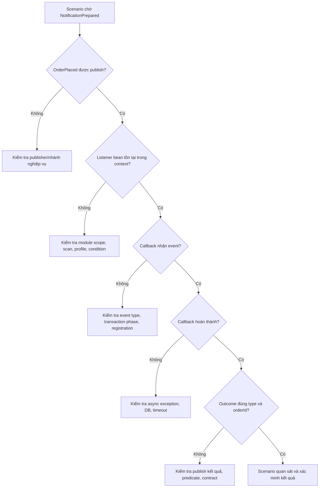
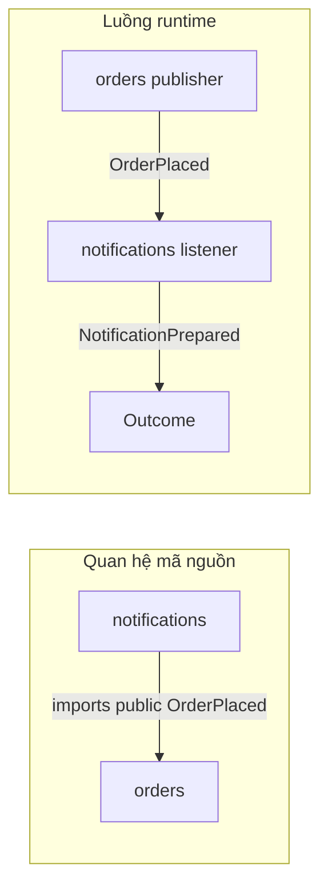

# Timeout do listener không được tạo

## Mục tiêu học tập

Trong chương **Test failure** thuộc học phần **Spring Modulith Verification & Testing**, một bài kiểm thử `Scenario` có thể chờ mãi event kết quả dù event nguồn đã được publish. Một nguyên nhân thường bị bỏ qua là **listener không được tạo thành Spring bean trong `ApplicationContext` của bài test**. Không có listener nào đăng ký xử lý event, nên không có consumer để tạo ra kết quả mong đợi.

Bài học này tập trung vào **lỗi thiếu listener trong context**, đồng thời phân biệt nó với trường hợp listener **có tồn tại nhưng không được gọi** hoặc **được gọi nhưng thất bại**. Đây là những tình huống có triệu chứng timeout tương tự nhưng cách sửa khác nhau.

Sau bài này, bạn có thể:

- Giải thích vì sao một lời gọi `ApplicationEventPublisher.publishEvent(…)` thành công **không chứng minh** có listener nhận event.
- Kiểm tra bean listener bằng `ApplicationContext.getBeanNamesForType(…)` và phân loại **không đăng ký**, **khởi tạo thất bại**, **đã đăng ký nhưng không được kích hoạt**.
- Hiểu phạm vi `@ApplicationModuleTest` `STANDALONE`, `DIRECT_DEPENDENCIES` và `ALL_DEPENDENCIES`, nhất là chiều phụ thuộc từ module **consumer** sang module **producer**.
- Chẩn đoán `@Component`/`@Service` bị thiếu, `@Profile`, `@ConditionalOnProperty`, component scanning, `@Import` và test configuration.
- Viết test trong module consumer bằng `Scenario`, `PublishedEvents`, event kết quả và khóa tương quan để bảo vệ hợp đồng listener.
- Phân biệt việc listener không được tạo với `@TransactionalEventListener(AFTER_COMMIT)` chưa được kích hoạt do transaction chưa commit hoặc với `@Async` ném lỗi trong worker thread.
- Không mở rộng toàn bộ Spring context, thêm mock hoặc tăng timeout chỉ nhằm làm test tạm thời xanh.
- Giữ `ApplicationModules.verify()` và integration tests trong quality gate CI để ngăn hồi quy cả kiến trúc lẫn hành vi.

## 1. Triệu chứng: event nguồn có nhưng không có kết quả

Giả sử module `orders` publish `OrderPlaced`, còn module `notifications` có listener chuẩn bị thông báo và publish `NotificationPrepared`.

```text
orders.OrderService
  └── publish OrderPlaced
         └── notifications.internal.OrderNotificationListener
                ├── lưu NotificationDraft
                └── publish NotificationPrepared
```

Test mong đợi:

```java
scenario.stimulate(() ->
                publisher.publishEvent(
                        new OrderPlaced(orderId, customerId)))
        .andWaitForEventOfType(NotificationPrepared.class)
        .matching(result -> orderId.equals(result.orderId()))
        .toArriveAndVerify(result ->
                assertThat(result.customerId()).isEqualTo(customerId));
```

Đây là **phần thân test minh họa**, giả định các ID, bean `publisher`, `scenario` và import đã tồn tại. Nếu listener không có trong `ApplicationContext`, câu lệnh publish có thể vẫn hoàn tất, nhưng `NotificationPrepared` không được tạo và bước chờ kết thúc bằng timeout.

**Vấn đề:** `ApplicationEventPublisher` không bắt buộc phải có listener. Một event hoàn toàn có thể được phát vào context mà không bean nào đăng ký tiêu thụ nó.

### 1.1. Bốn mốc phải được tách riêng

| Mốc | Câu hỏi | Bằng chứng có thể thu thập |
| --- | --- | --- |
| **Publish** | `OrderPlaced` đã được phát chưa? | `PublishedEvents` theo `orderId` |
| **Registration** | Listener có là bean trong test context không? | `getBeanNamesForType(OrderNotificationListener.class)` |
| **Invocation** | Callback thực sự được gọi chưa? | Log/spy với cùng `orderId`, dấu vết listener |
| **Outcome** | Listener hoàn thành và tạo kết quả chưa? | `Scenario` chờ `NotificationPrepared` hoặc state sau commit |

Không có **registration** thì không thể dựa vào listener ấy để tạo **outcome**. Nhưng có registration cũng **chưa đủ**: một callback `AFTER_COMMIT` còn phải chờ commit; một `@Async` callback có thể lỗi; predicate trong test có thể so sai ID.

### 1.2. Timeout không tự chỉ ra nguyên nhân



Cây quyết định này giúp xác định **mắt xích đầu tiên thiếu bằng chứng**, thay vì sửa ngẫu nhiên nhiều annotation hoặc kéo dài thời gian chờ.

## 2. “Listener không được tạo” chính xác là gì?

Trong Spring, để một method xử lý event hoạt động, **class chứa method** thường phải được tạo thành **Spring bean**. Sau đó cơ chế xử lý event của framework nhận diện các method có `@EventListener`, `@TransactionalEventListener` hoặc annotation kết hợp như `@ApplicationModuleListener`.

Có ba tình trạng khác nhau:

**Tình trạng A — Không có bean definition:**

- Class listener không được scan/import trong test context.
- Một annotation `@Profile` hoặc `@Conditional…` loại bean ra trước khi đăng ký.
- `@ApplicationModuleTest` chỉ bootstrap module producer, trong khi listener ở module consumer khác.
- Bean không được tạo theo một `@Bean` factory method nào và class cũng không là component.

**Tình trạng B — Bean definition có, khởi tạo thất bại:**

- Constructor cần repository nhưng thiếu DataSource.
- Property bắt buộc không được resolve.
- Dependency khác thiếu hoặc có nhiều ứng viên.
- Constructor/`@PostConstruct` ném exception.

Trường hợp B thường khiến **`Failed to load ApplicationContext`** xuất hiện ngay từ bootstrap. Nếu test method còn chưa chạy, không nên gọi đây là lỗi `Scenario` timeout.

**Tình trạng C — Bean có và context khởi động được nhưng callback không chạy hoặc không hoàn tất:**

- Method nhận sai event type.
- `@TransactionalEventListener(AFTER_COMMIT)` đợi transaction chưa commit hoặc publish ngoài transaction với `fallbackExecution = false`.
- Listener `@Async` chạy trên worker thread và ném lỗi.
- Listener có điều kiện lọc event hoặc bỏ qua nhánh nghiệp vụ.
- Event kết quả được publish nhưng `matching(…)` sai.

Tình trạng C **không được sửa** bằng việc tạo thêm một bean listener khác nếu bean thật đã có.

| Dấu hiệu | Phân loại | Hướng điều tra ưu tiên |
| --- | --- | --- |
| Context chạy, `getBeanNamesForType` trả mảng rỗng | Listener không có trong context | Module scope, scan, profile, condition |
| `Failed to load ApplicationContext` + `UnsatisfiedDependencyException` | Bean được yêu cầu nhưng không khởi tạo được | Đọc `Caused by`, dependency/DB |
| Context chạy, listener bean có, callback không vào | Dispatch/transaction | Event type, phase, event condition |
| Callback vào rồi exception | Runtime failure | Lỗi worker, repository, gateway, logging |
| Callback phát result nhưng test vẫn chờ | Observation/predicate | Type, correlation key, thời điểm đăng ký chờ |

## 3. Spring Modulith: producer và consumer có chiều phụ thuộc ngược nhau

Đây là nguyên nhân trọng tâm của bài.

Giả sử `notifications` lắng nghe event `orders.OrderPlaced`. Để khai báo method handler, mã của `notifications` phải **import** public event type của `orders`:

```java
import com.example.shop.orders.OrderPlaced;
```

Vì vậy dependency tĩnh trong source thường là:

```text
notifications ──(import OrderPlaced)──> orders
```

Không phải:

```text
orders ──(compile-time dependency)──> notifications
```

Đây là điểm rất dễ nhầm khi test ở **module producer `orders`** rồi kỳ vọng listener của **consumer `notifications`** tự xuất hiện.

### 3.1. Bootstrap mode tác động thế nào?

| Test đặt tại | Bootstrap mode | Module thường được khởi động | Listener `notifications` có được bảo đảm không? |
| --- | --- | --- | --- |
| `orders` | `STANDALONE` | `orders` | **Không** |
| `orders` | `DIRECT_DEPENDENCIES` | `orders` và những module **orders phụ thuộc trực tiếp** | **Không**, chỉ vì `notifications` phụ thuộc `orders` |
| `orders` | `ALL_DEPENDENCIES` | `orders` và những dependency trực tiếp/bắc cầu | **Không**, không có nghĩa tải mọi module phụ thuộc ngược |
| `notifications` | `STANDALONE` | `notifications` | **Có thể có**, nếu listener là bean hợp lệ và các điều kiện đăng ký thỏa |
| `notifications` | `DIRECT_DEPENDENCIES` | `notifications` và dependency trực tiếp như `orders` | **Có thể có**, nhưng thêm bean của producer |
| Integration toàn tuyến | Phạm vi chứa cả `orders` và `notifications` | Cả publisher và consumer | Cần kiểm tra bean thực tế sau bootstrap |

`@ApplicationModuleTest` không có nhiệm vụ tự tải mọi consumer theo runtime subscription. Nó bootstrap **module đang được test**, tùy chọn thêm **các module mà module đó phụ thuộc**.

### 3.2. Sơ đồ phân biệt dependency và event flow



Hướng **event flow** không nhất thiết là hướng **compile-time dependency**. Do đó, việc dùng `DIRECT_DEPENDENCIES` trên module `orders` để tải `notifications` có thể không có tác dụng.

### 3.3. Nên đặt test ở module nào?

Nếu muốn kiểm tra `orders` đã publish `OrderPlaced`, đặt `@ApplicationModuleTest` trong `orders` và dùng `PublishedEvents`.

Nếu muốn kiểm tra `notifications` xử lý `OrderPlaced` và tạo `NotificationPrepared`, đặt `@ApplicationModuleTest` trong `notifications`, kích hoạt public event như stimulus.

Nếu cần chứng minh **toàn tuyến** từ `OrderService.place(…)` đến một notification persisted qua các module, viết integration test bootstrap đủ module và hạ tầng.

Một bài test có mục tiêu rõ sẽ phát hiện lỗi rõ hơn một bài test quá rộng, nơi timeout có thể đến từ nhiều module hoặc nhiều subsystem.

## 4. Ví dụ hoàn chỉnh: event orders, listener notifications

Ví dụ dùng Java 17+, Spring Boot, Spring Modulith, JUnit Jupiter và AssertJ. Để tập trung vào lỗi listener không có trong context, outcome được ghi trong **in-memory store**; phần sau sẽ bàn đến transaction/database.

### 4.1. Cấu trúc project

```text
src/main/java/com/example/shop/
├── ShopApplication.java
├── orders/
│   ├── OrderPlaced.java
│   └── OrderService.java
└── notifications/
    ├── NotificationDraft.java
    ├── NotificationPrepared.java
    ├── NotificationStore.java
    ├── NotificationAsyncConfiguration.java
    └── internal/
        └── OrderNotificationListener.java

src/test/java/com/example/shop/
├── ArchitectureVerificationTests.java
├── orders/
│   └── OrderPublisherModuleTests.java
└── notifications/
    └── NotificationListenerScenarioTests.java
```

Ở cách tổ chức này, các package `orders` và `notifications` là application module mặc định theo cấu trúc một cấp dưới package ứng dụng gốc. `notifications.internal` chỉ chứa implementation listener và không phải API public của module notifications.

Ví dụ dependency Maven dành cho test, với version được quản lý qua BOM tương thích:

```xml
<dependency>
    <groupId>org.springframework.modulith</groupId>
    <artifactId>spring-modulith-starter-test</artifactId>
    <scope>test</scope>
</dependency>
```

Lớp ứng dụng:

```java
package com.example.shop;

import org.springframework.boot.SpringApplication;
import org.springframework.boot.autoconfigure.SpringBootApplication;

@SpringBootApplication
public class ShopApplication {

    public static void main(String[] args) {
        SpringApplication.run(ShopApplication.class, args);
    }
}
```

### 4.2. Public event và publisher của orders

Tệp `src/main/java/com/example/shop/orders/OrderPlaced.java`:

```java
package com.example.shop.orders;

import java.util.UUID;

public record OrderPlaced(
        UUID orderId,
        UUID customerId) {
}
```

Tệp `src/main/java/com/example/shop/orders/OrderService.java`:

```java
package com.example.shop.orders;

import java.util.Objects;
import java.util.UUID;
import org.springframework.context.ApplicationEventPublisher;
import org.springframework.stereotype.Service;

@Service
public class OrderService {

    private final ApplicationEventPublisher publisher;

    public OrderService(ApplicationEventPublisher publisher) {
        this.publisher = publisher;
    }

    public void place(UUID orderId, UUID customerId) {
        Objects.requireNonNull(orderId, "orderId");
        Objects.requireNonNull(customerId, "customerId");

        publisher.publishEvent(new OrderPlaced(orderId, customerId));
    }
}
```

`OrderService` **không import `notifications`**. Module `orders` chỉ chịu trách nhiệm phát event có hợp đồng public rõ ràng.

### 4.3. Event kết quả và store của notifications

Tệp `src/main/java/com/example/shop/notifications/NotificationPrepared.java`:

```java
package com.example.shop.notifications;

import java.util.UUID;

public record NotificationPrepared(
        UUID orderId,
        UUID customerId,
        String templateCode) {
}
```

Tệp `src/main/java/com/example/shop/notifications/NotificationDraft.java`:

```java
package com.example.shop.notifications;

import java.util.UUID;

public record NotificationDraft(
        UUID orderId,
        UUID customerId,
        String templateCode) {
}
```

Tệp `src/main/java/com/example/shop/notifications/NotificationStore.java`:

```java
package com.example.shop.notifications;

import java.util.Optional;
import java.util.UUID;
import java.util.concurrent.ConcurrentHashMap;
import java.util.concurrent.ConcurrentMap;
import org.springframework.stereotype.Component;

@Component
public class NotificationStore {

    private final ConcurrentMap<UUID, NotificationDraft> drafts =
            new ConcurrentHashMap<>();

    public boolean saveIfAbsent(NotificationDraft draft) {
        return drafts.putIfAbsent(draft.orderId(), draft) == null;
    }

    public Optional<NotificationDraft> findByOrderId(UUID orderId) {
        return Optional.ofNullable(drafts.get(orderId));
    }

    public void remove(UUID orderId) {
        drafts.remove(orderId);
    }
}
```

Store này là **mô hình trong bộ nhớ**, không thực hiện JPA transaction và không chứng minh tính bền vững sau restart. Việc `putIfAbsent` hạn chế duplicate trong một JVM, nhưng production cần xem xét unique constraint, nhiều instance và cơ chế retry nếu có.

### 4.4. Listener có @Component, @EventListener và @Async

Tệp `src/main/java/com/example/shop/notifications/internal/OrderNotificationListener.java`:

```java
package com.example.shop.notifications.internal;

import com.example.shop.notifications.NotificationDraft;
import com.example.shop.notifications.NotificationPrepared;
import com.example.shop.notifications.NotificationStore;
import com.example.shop.orders.OrderPlaced;
import org.springframework.context.ApplicationEventPublisher;
import org.springframework.context.event.EventListener;
import org.springframework.scheduling.annotation.Async;
import org.springframework.stereotype.Component;

@Component
public class OrderNotificationListener {

    private final NotificationStore store;
    private final ApplicationEventPublisher publisher;

    public OrderNotificationListener(
            NotificationStore store,
            ApplicationEventPublisher publisher) {
        this.store = store;
        this.publisher = publisher;
    }

    @Async
    @EventListener
    public void on(OrderPlaced event) {
        var draft = new NotificationDraft(
                event.orderId(),
                event.customerId(),
                "ORDER_PLACED");

        if (store.saveIfAbsent(draft)) {
            publisher.publishEvent(new NotificationPrepared(
                    draft.orderId(),
                    draft.customerId(),
                    draft.templateCode()));
        }
    }
}
```

`@Component` làm class trở thành ứng viên bean khi package thuộc vùng bootstrap/component scan. `@EventListener` đăng ký method lắng nghe `OrderPlaced`. `@Async` điều phối callback bất đồng bộ khi cơ chế asynchronous execution được kích hoạt.

Lưu ý **`@Async` không tự tạo bean**. Nếu class không được đăng ký, bật executor nhanh hơn cũng không giúp. Ngược lại, một listener có bean nhưng thiếu `@EnableAsync` có thể chạy đồng bộ thay vì bất đồng bộ; nó không đương nhiên biến mất khỏi context.

Tệp `src/main/java/com/example/shop/notifications/NotificationAsyncConfiguration.java`:

```java
package com.example.shop.notifications;

import org.springframework.context.annotation.Configuration;
import org.springframework.scheduling.annotation.EnableAsync;

@Configuration(proxyBeanMethods = false)
@EnableAsync
class NotificationAsyncConfiguration {
}
```

Trong ứng dụng thật, nên có cấu hình executor/uncaught-exception handler và theo dõi latency. Ở ví dụ này, `NotificationPrepared` được phát **sau khi store demo đã ghi draft**, nhưng chưa chứng minh email đã được gửi hoặc database đã commit.

## 5. Test publisher đúng phạm vi: chỉ xác nhận OrderPlaced

Tệp `src/test/java/com/example/shop/orders/OrderPublisherModuleTests.java`:

```java
package com.example.shop.orders;

import static org.assertj.core.api.Assertions.assertThat;

import java.util.UUID;
import org.junit.jupiter.api.Test;
import org.springframework.beans.factory.annotation.Autowired;
import org.springframework.modulith.test.ApplicationModuleTest;
import org.springframework.modulith.test.PublishedEvents;

@ApplicationModuleTest
class OrderPublisherModuleTests {

    @Autowired
    OrderService orders;

    @Test
    void publishesOneOrderPlaced(PublishedEvents events) {
        UUID orderId = UUID.randomUUID();
        UUID customerId = UUID.randomUUID();

        orders.place(orderId, customerId);

        assertThat(events.ofType(OrderPlaced.class)
                .matching(e -> orderId.equals(e.orderId())))
                .hasSize(1)
                .allSatisfy(e ->
                        assertThat(e.customerId())
                                .isEqualTo(customerId));
    }
}
```

Test có mục tiêu rõ: chứng minh `OrderService` publish đúng một `OrderPlaced` cho đơn đang kiểm tra. Nó **không khẳng định** `OrderNotificationListener` tồn tại trong test context và cũng không cố chờ `NotificationPrepared`.

Nếu sửa test này để chờ event thuộc module `notifications` trong `STANDALONE`, việc timeout là điều có thể dự đoán, vì listener của module consumer không được bootstrap. Đó là **lỗi thiết kế phạm vi test** chứ chưa phải lỗi logic của listener.

## 6. Test consumer đúng phạm vi: xác nhận bean rồi chờ kết quả

Tệp `src/test/java/com/example/shop/notifications/NotificationListenerScenarioTests.java`:

```java
package com.example.shop.notifications;

import static org.assertj.core.api.Assertions.assertThat;

import com.example.shop.notifications.internal.OrderNotificationListener;
import com.example.shop.orders.OrderPlaced;
import java.util.UUID;
import org.junit.jupiter.api.Test;
import org.springframework.beans.factory.annotation.Autowired;
import org.springframework.context.ApplicationContext;
import org.springframework.context.ApplicationEventPublisher;
import org.springframework.modulith.test.ApplicationModuleTest;
import org.springframework.modulith.test.PublishedEvents;
import org.springframework.modulith.test.Scenario;

@ApplicationModuleTest
class NotificationListenerScenarioTests {

    @Autowired
    ApplicationContext context;

    @Autowired
    ApplicationEventPublisher publisher;

    @Autowired
    NotificationStore store;

    @Test
    void listenerBeanIsRegistered() {
        assertThat(context.getBeanNamesForType(
                OrderNotificationListener.class))
                .as("listener must belong to notifications test context")
                .hasSize(1);
    }

    @Test
    void receivesOrderPlacedAndPublishesOutcome(
            Scenario scenario,
            PublishedEvents events) {

        UUID orderId = UUID.randomUUID();
        UUID customerId = UUID.randomUUID();

        // Nếu test context không có listener, fail sớm
        // thay vì chỉ thấy timeout mơ hồ.
        assertThat(context.getBeanNamesForType(
                OrderNotificationListener.class))
                .hasSize(1);

        try {
            scenario.stimulate(() ->
                            publisher.publishEvent(
                                    new OrderPlaced(orderId, customerId)))
                    .andWaitForEventOfType(NotificationPrepared.class)
                    .matching(result ->
                            orderId.equals(result.orderId()))
                    .toArriveAndVerify(result -> {
                        assertThat(result.customerId())
                                .isEqualTo(customerId);
                        assertThat(result.templateCode())
                                .isEqualTo("ORDER_PLACED");
                    });

            assertThat(events.ofType(OrderPlaced.class)
                    .matching(event ->
                            orderId.equals(event.orderId())))
                    .hasSize(1);

            assertThat(store.findByOrderId(orderId))
                    .contains(new NotificationDraft(
                            orderId,
                            customerId,
                            "ORDER_PLACED"));
        } finally {
            store.remove(orderId);
        }
    }
}
```

### 6.1. Vì sao test này giúp chẩn đoán nhanh hơn?

Nếu không có listener, assertion `getBeanNamesForType(…)` fail **ngay tại chỗ**, với thông báo về bean trong context. Người phát triển không cần đợi `Scenario` timeout rồi đoán transaction hoặc executor.

Khi bean có mặt, `Scenario` mới kiểm chứng luồng:

1. Publish public event `OrderPlaced` với `orderId` riêng.
2. Chờ **event kết quả** `NotificationPrepared` chứ không nhầm với event nguồn.
3. Lọc `orderId` để không nhận nhầm kết quả của giao dịch khác.
4. Assert payload event kết quả.
5. Assert `PublishedEvents` có event nguồn.
6. Kiểm tra `NotificationDraft` đã được lưu trong store demo.

Phép `getBeanNamesForType` là **một bằng chứng về registration**, không chứng minh method `on(…)` đã được gọi. Chính `Scenario` và store assertion mới kiểm chứng hành vi.

### 6.2. Những giới hạn của test trong bộ nhớ

- `ConcurrentHashMap` chỉ bảo đảm thao tác thread-safe trong **cùng process**, không thay database.
- `saveIfAbsent` khiến việc gửi lại `OrderPlaced` cùng ID có thể không tạo `NotificationPrepared` lần thứ hai; test duplicate phải thiết kế outcome riêng thay vì đợi event thứ hai một cách vô điều kiện.
- `finally` dọn state theo `orderId`, nhưng listener async vẫn có thể chạy **sau khi test timeout**. Nếu có khả năng đó, phải quản lý lifecycle worker/test data tốt hơn để không rò dữ liệu sang test sau.
- Kết quả `NotificationPrepared` trong ví dụ không chứng minh transaction commit, email delivery hoặc broker acknowledgement.

## 7. Xác minh listener có trong context như thế nào?

Có ba phép quan sát hữu ích, tùy bạn muốn biết gì.

### 7.1. Bean candidate theo type

```java
String[] names = context.getBeanNamesForType(
        OrderNotificationListener.class);

assertThat(names).hasSize(1);
```

Đây là cách rõ ràng khi listener là component bean có type đã biết. Một số ứng dụng dùng proxy, factory bean hoặc interface-based proxy có thể làm cách tra theo **concrete class** không phản ánh hết các bean mong muốn; khi đó xem tên bean, interface, annotation metadata hoặc loại bean thực tế. Không biến một assertion cụ thể thành giả định tuyệt đối cho mọi proxy strategy.

### 7.2. Tìm theo bean name

Với mặc định đặt tên bean của component `OrderNotificationListener`, Spring thường suy ra tên dạng `orderNotificationListener`. Có thể hỏi:

```java
assertThat(context.containsBean("orderNotificationListener"))
        .isTrue();
```

**Nhược điểm:** Bean name có thể được đặt tường minh, thay đổi do `BeanNameGenerator` hoặc khai báo bằng `@Bean`. Vì vậy, nếu mục tiêu là phụ thuộc theo type, việc tìm bằng **type** thường thể hiện ý định tốt hơn.

### 7.3. Không lạm dụng @Autowired(required = false)

Ví dụ:

```java
@Autowired(required = false)
OrderNotificationListener listener;
```

Nếu không có bean, field có thể `null` mà test vẫn bootstrap. Nó hữu ích cho **chẩn đoán có kiểm soát**, nhưng trong một bài test đòi listener phải tồn tại, nên có assertion rõ ràng ngay sau đó. Không để test im lặng bỏ qua khi listener bị thiếu.

Ngược lại, `@Autowired OrderNotificationListener listener` với dependency **bắt buộc** sẽ khiến context/test injection báo lỗi sớm nếu bean không có. Đó là lựa chọn tốt khi yêu cầu registration là điều kiện tiên quyết, nhưng cần hiểu kết quả sẽ là lỗi inject thay vì một `Scenario` timeout.

## 8. Nguyên nhân 1: class không được đăng ký làm component

Một class có method `@EventListener` không đủ nếu Spring không quản lý instance chứa method ấy.

**Sai:**

```java
public class OrderNotificationListener {

    @EventListener
    public void on(OrderPlaced event) {
        // ...
    }
}
```

Nếu class không được đăng ký qua `@Component`, `@Bean`, `@Import` hay một cơ chế khác, method `on(…)` không tự trở thành listener toàn cục.

**Đúng với component scanning:**

```java
@Component
public class OrderNotificationListener {

    @EventListener
    public void on(OrderPlaced event) {
        // ...
    }
}
```

Các đoạn trên là mẫu tối giản, cần đặt trong class source đầy đủ với import tương ứng. `@Component` chỉ có tác dụng khi **package chứa class thực sự nằm trong vùng được scan/bootstrap**.

### 8.1. Dùng @Bean thay @Component được không?

Được, nếu muốn tạo listener qua cấu hình:

```java
@Configuration(proxyBeanMethods = false)
class NotificationConfiguration {

    @Bean
    OrderNotificationListener orderNotificationListener(
            NotificationStore store,
            ApplicationEventPublisher publisher) {
        return new OrderNotificationListener(store, publisher);
    }
}
```

Đây là **phương án thay thế** việc đặt `@Component` lên class; không nên đăng ký **cả hai** nếu điều đó tạo hai instance lắng nghe cùng một event và side effect trùng.

Điều kiện tương tự vẫn áp dụng: `NotificationConfiguration` phải được nạp vào context. Một `@Bean` method nằm trong configuration **không được bootstrap** thì không tạo ra listener.

## 9. Nguyên nhân 2: component scanning và package placement

Spring Boot thường tìm `@SpringBootApplication` ở package gốc và scan các package con theo cấu hình ứng dụng. Spring Modulith `@ApplicationModuleTest` lại áp dụng **phạm vi module test** để tránh khởi động cả hệ thống.

Giả sử listener đặt nhầm:

```text
com.example.shop.orders.OrderService
com.example.shop.notifications.internal.OrderNotificationListener

Test class:
com.example.shop.orders.OrderPublisherModuleTests
  @ApplicationModuleTest
```

Mặc dù `@Component` nằm trên listener, module test `orders` ở `STANDALONE` không được kỳ vọng tạo bean ở `notifications.internal`.

**Không sửa mặc định bằng:**

```java
@ComponentScan("com.example.shop")
```

trong mọi bài module test. Scan quá rộng có thể:

- Kéo thêm database, gateway, event listeners và configuration không liên quan.
- Tăng thời gian khởi động.
- Gây trùng bean name hoặc thiếu infrastructure ở các module khác.
- Che việc một test đã được đặt ở sai module.
- Làm yếu lợi ích của `@ApplicationModuleTest` trong việc kiểm tra ranh giới.

**Cách sửa đúng mục tiêu:** đặt test contract listener tại `notifications`; nếu cần test end-to-end, tạo integration test với phạm vi bootstrap **thật sự chứa cả hai module**.

### 9.1. Kiểm tra test package và module discovery

`@ApplicationModuleTest` xác định module được test dựa trên package của test class và mô hình module của ứng dụng. Nếu test vô tình đặt trong package `com.example.shop.orders` khi mục tiêu là listener của `notifications`, nó bootstrap **sai module**.

Với project có cấu hình module detection tùy chỉnh hoặc named interfaces, cần hiểu module ownership của từng package thay vì suy từ tên thư mục trong IDE.

Một lỗi Java package, ví dụ khai báo `package com.example.shop.orders;` bên trong file đặt tại đường dẫn test `notifications`, có thể làm test được gắn với module khác so với ý định. Hãy kiểm tra **package statement**, không chỉ vị trí file trên đĩa.

## 10. Nguyên nhân 3: bean bị loại bởi @Profile

Giả sử listener chỉ được tạo khi profile `prod` hoạt động:

```java
@Profile("prod")
@Component
public class OrderNotificationListener {

    @EventListener
    public void on(OrderPlaced event) {
        // ...
    }
}
```

Khi test dùng `@ActiveProfiles("test")`, bean production này **không được đăng ký**. `ApplicationContext` vẫn có thể khởi động, publisher vẫn publish event, nhưng `Scenario` chờ kết quả timeout.

### 10.1. Phải kiểm tra active profiles thật

Trong một test chẩn đoán:

```java
@Autowired
Environment environment;

@Test
void printsActiveProfiles() {
    assertThat(environment.getActiveProfiles())
            .contains("test");
}
```

Đoạn này giả định test **đã có profile test** và `Environment` được import từ `org.springframework.core.env.Environment`. Nó là một assertion về cấu hình test, không phải cách trực tiếp khiến listener được tạo.

Những câu hỏi cần hỏi:

1. Listener thật có cần chạy trong profile `test` không?
2. Có cần test integration với configuration giống production không?
3. Một test double ở boundary ngoài module có phù hợp hơn không?
4. Bật profile `prod` trong test có vô tình kết nối email gateway, DB hoặc credential thật không?

Không bật profile production **chỉ** để listener xuất hiện nếu bài test không được phép tác động hạ tầng thật.

### 10.2. Một thiết kế thay thế: tách core listener khỏi gateway

Nếu listener là logic quan trọng cần test ở mọi môi trường nhưng adapter email thật chỉ tồn tại ở production, có thể đặt listener trong module `notifications` không bị `@Profile("prod")`, inject một public gateway interface, rồi cung cấp gateway giả trong test.

Ví dụ:

```text
notifications.internal.OrderNotificationListener [luôn thuộc module]
    └── NotificationGateway interface
           ├── production SMTP adapter (@Profile("prod"))
           └── test fake adapter (@TestConfiguration)
```

Điều này cho phép kiểm tra **code listener thật** mà không gửi email thật. Không nên mock chính listener khi mục tiêu bài test là chứng minh listener đăng ký và chạy.

## 11. Nguyên nhân 4: @ConditionalOnProperty không thỏa

Một listener có thể được điều khiển bằng tính năng bật/tắt:

```java
@Component
@ConditionalOnProperty(
        prefix = "notifications",
        name = "listener-enabled",
        havingValue = "true")
public class OrderNotificationListener {

    @EventListener
    public void on(OrderPlaced event) {
        // ...
    }
}
```

Nếu test không cung cấp `notifications.listener-enabled=true`, điều kiện có thể **không match** và Spring bỏ qua bean definition. Không có exception khởi tạo vì việc bỏ qua này là **hành vi có chủ đích của cấu hình**.

Để bật listener trong một bài test có chủ đích, có thể cấu hình:

```java
@ApplicationModuleTest
@TestPropertySource(
        properties = "notifications.listener-enabled=true")
class NotificationListenerEnabledTests {
    // Test listener được tạo và xử lý OrderPlaced.
}
```

Đoạn trên là class minh họa; cần import `org.springframework.test.context.TestPropertySource`. Nếu condition theo một property khác, phải sử dụng **đúng tên property được khai báo**.

### 11.1. Đừng đoán condition chỉ qua tên bean

Khi có nhiều auto-configuration và `@Conditional…`, có thể bật báo cáo điều kiện (*condition evaluation report*) trong môi trường debug phù hợp để xem **vì sao một bean/config không được kích hoạt**.

Phân biệt:

- `@ConditionalOnProperty` không match → bean **cố ý không đăng ký**.
- Bean đã đăng ký nhưng constructor cần dependency thiếu → context thường **fail khi khởi tạo**.
- Listener đã đăng ký nhưng `@EventListener` không nhận event đúng type → **lỗi invocation**, không phải condition.

Chỉ bật báo cáo debug theo nhu cầu; không cần giữ log auto-configuration quá dài trong mọi lần chạy CI.

### 11.2. @ConditionalOnBean hoặc @ConditionalOnClass

Một listener/configuration còn có thể phụ thuộc điều kiện có bean/class khác. Khi `@ApplicationModuleTest` bootstrap hẹp, điều kiện `@ConditionalOnBean(SomeGateway.class)` có thể không match vì bean `SomeGateway` không nằm trong context.

Lúc đó việc thêm `@Component` trực tiếp hoặc mở scan toàn app chưa chắc đúng. Cần xác định **condition thuộc production contract hay chỉ là biến thể integration test**, rồi cấu hình scope/test double phù hợp.

## 12. Nguyên nhân 5: @Import hoặc @TestConfiguration không được nạp

Không phải listener nào cũng được scan tự động. Một số được đăng ký qua:

```java
@Configuration(proxyBeanMethods = false)
class NotificationListenerConfiguration {

    @Bean
    OrderNotificationListener listener(
            NotificationStore store,
            ApplicationEventPublisher publisher) {
        return new OrderNotificationListener(store, publisher);
    }
}
```

Nếu `NotificationListenerConfiguration` không nằm trong bootstrap scope hoặc không được import, bean `listener` sẽ không tồn tại.

Trong một test phù hợp, có thể dùng:

```java
@ApplicationModuleTest
@Import(NotificationListenerConfiguration.class)
class NotificationConfigurationTests {
    // Đánh giá integration với listener được tạo bởi configuration này.
}
```

**Cẩn thận:** Chỉ `@Import` một configuration test-specific khi nó phản ánh **mục tiêu kiểm thử**. Nếu production kỳ vọng listener tự được scan, việc phải import thủ công vào test có thể **che lỗi đăng ký production**. Một integration test bootstrap tương tự production cần bảo đảm bean được tạo qua đường wiring thật.

Nếu listener đã có `@Component`, thêm `@Bean` cùng loại có thể tạo **hai listener** hoặc `BeanDefinitionOverrideException`. Hãy chọn **một cơ chế đăng ký** rõ ràng trong mỗi context.

## 13. Bean không tạo được khác với listener không được đăng ký

Giả sử listener có constructor:

```java
public OrderNotificationListener(
        NotificationStore store,
        EmailGateway emailGateway,
        ApplicationEventPublisher publisher) {
    // ...
}
```

Nếu `EmailGateway` không có bean candidate, Spring có thể báo:

```text
java.lang.IllegalStateException:
  Failed to load ApplicationContext
Caused by: UnsatisfiedDependencyException:
  Error creating bean with name 'orderNotificationListener'
Caused by: NoSuchBeanDefinitionException:
  No qualifying bean of type
  'com.example.shop.notifications.EmailGateway' available
```

Đây là **stack trace rút gọn minh họa**, không phải output đã chạy. Khác với trường hợp listener hoàn toàn bị scan/condition loại, lần này Spring **đang cố tạo listener** nhưng thiếu dependency.

Nếu context không khởi động, code `Scenario` trong `@Test` chưa thực thi; hãy sửa bootstrap:

- Kiểm tra `EmailGateway` thuộc module nào.
- Có public interface để cung cấp test double không?
- Có cần `DIRECT_DEPENDENCIES` hoặc integration context chứa gateway thật không?
- Có thiếu bean vì `@Profile` hoặc config không match?
- Nếu lỗi là DataSource/JPA/driver, có phải mục tiêu test đang cần database không?

**Không khắc phục `NoSuchBeanDefinitionException` bằng cách tăng thời gian chờ `Scenario`**.

### 13.1. Dấu hiệu nhận biết trong một phút

| Log đầu tiên | Lỗi ở đâu? | Ví dụ hành động |
| --- | --- | --- |
| `Failed to load ApplicationContext` | Bootstrap | Đọc `Caused by`, sửa dependency/config |
| `Scenario` timeout, context khởi động thành công | Runtime/observation | Kiểm tra listener bean registration và các mốc event |
| `ApplicationModules.verify()` báo vi phạm | Kiến trúc | Sửa public API, named interface, cycle |
| `AssertionError` từ `hasSize(1)` sau khi publish | Event assertion | Kiểm tra publisher, matching, duplicate |

## 14. Listener tồn tại nhưng không chạy: AFTER_COMMIT

Một nguyên nhân timeout **khác** là listener có bean nhưng chờ transaction:

```java
@Component
public class TransactionalNotificationListener {

    @TransactionalEventListener(
            phase = TransactionPhase.AFTER_COMMIT)
    public void on(OrderPlaced event) {
        // Xử lý sau khi transaction nguồn commit.
    }
}
```

Đoạn minh họa cần các import:

```java
import org.springframework.transaction.event.TransactionPhase;
import org.springframework.transaction.event.TransactionalEventListener;
```

Với `fallbackExecution = false` mặc định:

- Publish trong transaction **chưa commit** → callback chưa chạy.
- Transaction **rollback** → callback `AFTER_COMMIT` không chạy.
- Publish **ngoài transaction** → callback hậu commit không chạy.
- Transaction **commit thành công** → callback được kích hoạt sau commit.

Trong các trường hợp đầu, `getBeanNamesForType(TransactionalNotificationListener.class)` vẫn có thể trả về bean. Vì vậy, **đừng kết luận thiếu listener chỉ từ việc callback không xuất hiện**.

### 14.1. Test @Transactional giữ transaction mở

```java
@Test
@Transactional
void incorrectAfterCommitTest(Scenario scenario) {
    // Publish event trong test-managed transaction,
    // rồi chờ listener AFTER_COMMIT ngay trong method.
    // Commit chưa xảy ra, có thể timeout.
}
```

Spring Test thường rollback test-managed transaction khi method kết thúc. Nếu `Scenario` chờ callback `AFTER_COMMIT` **trước khi method kết thúc**, callback không thể chạy cho đến commit, nhưng commit lại chưa xảy ra.

`@Commit` áp dụng ở cuối test-managed transaction không tự giải quyết việc chờ **trong method**. Cần một ranh giới commit thực sự trước bước chờ.

### 14.2. TransactionTemplate tạo commit có kiểm soát

Một ví dụ phần thân integration test:

```java
TransactionTemplate tx =
        new TransactionTemplate(transactionManager);

scenario.stimulate(() ->
                tx.executeWithoutResult(status ->
                        publisher.publishEvent(
                                new OrderPlaced(orderId, customerId))))
        .andWaitForEventOfType(NotificationPrepared.class)
        .matching(e -> orderId.equals(e.orderId()))
        .toArriveAndVerify(e ->
                assertThat(e.customerId()).isEqualTo(customerId));
```

Các biến `transactionManager`, `publisher`, `scenario` và IDs cần được cấp trong test. `TransactionTemplate` phải dùng transaction manager phù hợp với dữ liệu nguồn, và test **không được có transaction bao ngoài chưa kết thúc** nếu propagation mặc định `REQUIRED` chỉ tham gia transaction đó.

Không bật `fallbackExecution = true` chỉ để test pass nếu hợp đồng nghiệp vụ yêu cầu **xử lý sau commit thật**.

### 14.3. @ApplicationModuleListener

Với `@ApplicationModuleListener` của Spring Modulith, cần xác minh semantics bất đồng bộ/transaction của phiên bản được dùng. Không giả định rằng annotation này tương đương listener `@EventListener` đồng bộ về điều kiện kích hoạt hoặc thời điểm hoàn thành.

Trong mọi trường hợp, hãy xác minh **bean có trong context trước**, rồi mới phân tích transaction commit, scheduling và trạng thái publication.

## 15. Listener tồn tại nhưng không hoàn tất: @Async

Trong ví dụ chính, listener được đánh dấu:

```java
@Async
@EventListener
public void on(OrderPlaced event) {
    // Listener chạy trên executor khi async được bật.
}
```

Nếu listener ném exception trong worker thread:

```java
@Async
@EventListener
public void on(OrderPlaced event) {
    NotificationTemplate template =
            templates.required("ORDER_PLACED");

    publisher.publishEvent(new NotificationPrepared(
            event.orderId(), event.customerId(), template.code()));
}
```

Đoạn sau là minh họa class có dependencies `templates` và `publisher`; không phải source file tự chứa. Nếu `required(…)` thất bại, event nguồn vẫn có thể publish thành công, listener bean vẫn có mặt, nhưng không có outcome.

### 15.1. Vì sao không bắt được lỗi tại publisher?

`void @Async` listener được thực thi trên thread khác. Exception không nhất thiết truyền ngược về lời gọi:

```java
publisher.publishEvent(new OrderPlaced(orderId, customerId));
```

Vì vậy, đừng suy `publishEvent` trả về bình thường nghĩa listener đã xử lý xong. Cần kiểm tra:

- Log/trace theo `orderId`.
- Async executor và uncaught exception handler.
- Trạng thái side effect hoặc event outcome.
- Event Publication Registry nếu ứng dụng đã cấu hình và cơ chế listener tương ứng được theo dõi.

Nếu không bật `@EnableAsync` trong context, `@Async` có thể không được áp dụng và callback chạy đồng bộ; đó **không tự chứng minh thiếu bean**. Hãy quan sát registration, execution thread và outcome thực tế.

### 15.2. Chờ kết quả đúng cách

Không sử dụng:

```java
publisher.publishEvent(new OrderPlaced(orderId, customerId));
Thread.sleep(300);
assertThat(store.findByOrderId(orderId)).isPresent();
```

Khoảng ngủ cố định khiến test chậm không cần thiết trên máy nhanh và flaky trên CI chậm. Hãy dùng `Scenario` hoặc một điều kiện chờ hữu hạn như Awaitility khi contract chỉ có repository state.

Đồng thời, timeout chờ **không sửa được** lỗi listener vắng mặt hoặc exception worker; nó chỉ ngăn bài test treo vô hạn.

## 16. Event type và matching predicate cũng có thể gây timeout

Giả sử listener thật nhận `OrderPlaced` và phát `NotificationPrepared`. Bài test có thể vẫn timeout do **quan sát sai**.

### 16.1. Chờ sai loại event

```java
// Listener phát NotificationPrepared.
publisher.publishEvent(
        new NotificationPrepared(orderId, customerId, "ORDER_PLACED"));

// Test lại đợi NotificationSent.
.andWaitForEventOfType(NotificationSent.class)
```

Hai đoạn trên chỉ dùng để so sánh hai vị trí code riêng. Nếu contract hiện tại là “đã chuẩn bị thông báo”, việc sửa listener để phát `NotificationSent` chỉ nhằm làm test pass có thể tạo sai lệch nghiệp vụ.

### 16.2. So nhầm ID

**Sai:**

```java
.matching(event -> customerId.equals(event.orderId()))
```

**Đúng:**

```java
.matching(event -> orderId.equals(event.orderId()))
```

Predicate quá hẹp hoặc so nhầm field khiến event thực sự có mặt nhưng `Scenario` không nhận nó là kết quả cần chờ. Predicate quá rộng lại có thể nhận nhầm outcome của giao dịch khác.

Khóa tương quan nên ổn định từ source event tới result event và được tạo riêng cho từng bài test.

### 16.3. Listener có condition loại event

`@EventListener` có thể có điều kiện, hoặc code listener có lệnh `return` sớm:

```java
@EventListener
public void on(OrderPlaced event) {
    if (isNotEligible(event)) {
        return;
    }
    // ...
}
```

Listener có bean và method có thể đã được gọi, nhưng event bị bỏ qua **theo nghiệp vụ**. Khi đó test cần chọn input đáp ứng điều kiện hoặc assert kết quả “không xử lý” nếu đó là hợp đồng, thay vì gọi là lỗi listener không được tạo.

## 17. Nếu listener chỉ thay đổi state mà không phát event?

Một số listener chỉ lưu entity hoặc cập nhật trạng thái `READY`, không hề publish `NotificationPrepared`. Khi đó:

```java
.andWaitForEventOfType(NotificationPrepared.class)
```

sẽ chờ một event **không thuộc contract**, dù listener xử lý thành công.

Cần thay bằng chờ trạng thái:

```java
scenario.stimulate(() ->
                publisher.publishEvent(
                        new OrderPlaced(orderId, customerId)))
        .andWaitForStateChange(
                () -> notificationRepository
                        .findByOrderId(orderId).orElse(null),
                state -> state != null
                        && state.getStatus() == NotificationStatus.READY)
        .andVerify(state ->
                assertThat(state.getCustomerId())
                        .isEqualTo(customerId));
```

Đây là đoạn integration test minh họa, giả định repository trả entity có `getStatus()`/`getCustomerId()` và có enum `NotificationStatus` phù hợp. Trong thực tế, phải kiểm chứng:

- Repository đang đọc đúng `orderId`.
- Listener đã thực sự commit state.
- Supplier đọc **giá trị mới** mỗi lần, không giữ snapshot trước stimulus.
- Persistence context/caching không khiến query trả state cũ.
- Nếu listener `AFTER_COMMIT`, transaction nguồn đã commit.

Không tự thêm event nhân tạo vào production chỉ vì muốn dùng `andWaitForEventOfType`. Hãy chờ mốc **nghiệp vụ thực sự tồn tại**.

## 18. Event Publication Registry có thay thế kiểm tra bean không?

Spring Modulith có cơ chế Event Publication Registry để theo dõi publication tới các listener target phù hợp khi được cấu hình. Nó có thể hữu ích trong chẩn đoán event processing, nhưng cần hiểu giới hạn:

| Quan sát | Điều có thể suy ra | Điều không được tự suy ra |
| --- | --- | --- |
| `PublishedEvents` có `OrderPlaced` | Source event đã được publish trong phạm vi test | Listener có tồn tại |
| `getBeanNamesForType` tìm thấy listener | Bean listener có trong context | Callback đã chạy |
| Registry có publication đang chờ cho target | Cơ chế theo dõi ghi nhận công việc chưa hoàn tất theo semantics của registry | Listener đã xử lý thành công |
| Registry hoàn tất publication | Cơ chế ghi nhận completion của listener target | Email đã đến người nhận hoặc mọi DB đã commit |
| `Scenario` thấy `NotificationPrepared` | Outcome được publish và quan sát đúng điều kiện | Mọi external side effect hoàn tất |
| Repository có draft sau commit | State dữ liệu tồn tại theo transaction đã quan sát | Không có duplicate/redelivery về sau |

Nếu listener **không được đăng ký**, cơ chế registry cũng có thể **không có target publication tương ứng**; việc “không thấy bản ghi” không phải bằng chứng duy nhất đủ mạnh để kết luận nguyên nhân. Hãy kiểm tra bean registration và loại listener trước.

Không dùng số lượng publication trong registry để suy số lần publish event nguồn: một event có thể đi tới nhiều listener target.

## 19. Quy trình debug lỗi listener không được tạo

### Bước 1 — Xác định chính xác outcome cần chờ

Ghi event kết quả hoặc state được `Scenario` chờ, correlation ID và nguồn stimulus. Tránh chỉ báo “event không đến”.

### Bước 2 — Chứng minh event nguồn đã publish

Dùng `PublishedEvents` trong publisher test để assert `OrderPlaced` theo `orderId`. Nếu nguồn không được publish, chưa cần điều tra bean listener.

### Bước 3 — Xác định module chứa test và listener

Đọc package của test class, `@ApplicationModuleTest` bootstrap mode và package của listener. Đặc biệt phân biệt **producer → consumer theo runtime** với **consumer → producer theo static dependency**.

### Bước 4 — Assert bean registration

Trong consumer test:

```java
assertThat(context.getBeanNamesForType(
        OrderNotificationListener.class))
        .hasSize(1);
```

Nếu rỗng, xem component scan, package/module scope, `@Profile`, `@Conditional`, configuration và `@Import`. Nếu có nhiều listener cùng loại, kiểm tra có bị tạo trùng và gây duplicate handling hay không.

### Bước 5 — Nếu bootstrap fail, đọc Caused by

Một `UnsatisfiedDependencyException` hoặc `BeanCreationException` nghĩa là test có thể chưa tới `Scenario`. Chẩn đoán constructor, property, DataSource/JPA và test double theo đúng loại lỗi.

### Bước 6 — Nếu bean tồn tại, xem invocation

Kiểm tra `@EventListener` method signature, event type, điều kiện xử lý và đặc biệt `@TransactionalEventListener(AFTER_COMMIT)`. Nếu dùng async, tìm exception trong worker.

### Bước 7 — Kiểm tra outcome và thời gian

Xác định result event có được publish không; `matching` có dùng đúng `orderId` không; event tới trước/sau điểm chờ không; listener chỉ ghi DB hay có kết quả event; timeout có phù hợp với độ trễ hợp đồng không.

### Bước 8 — Rerun đúng bài test rồi mở rộng quality gate

Lệnh tham khảo khi được phép chạy trong dự án:

```bash
./mvnw -Dtest=NotificationListenerScenarioTests test
```

Hoặc:

```bash
./gradlew test --tests "com.example.shop.notifications.NotificationListenerScenarioTests" --stacktrace
```

Các lệnh này **chưa được thực thi trong bài học**; đây là hướng dẫn cho môi trường thực hành. Sau khi sửa, chạy thêm architecture verification và các integration tests liên quan nếu có thay đổi module scope, transaction hoặc persistence.

### 19.1. Mẫu ghi chú chẩn đoán

```text
Failure: Scenario timed out waiting for NotificationPrepared
Test class: notifications.NotificationListenerScenarioTests
Producer module: orders
Consumer module: notifications
Correlation key: orderId = <uuid>
OrderPlaced published: yes/no
Listener bean present in context: yes/no
Listener registered via: @Component + @EventListener / other
Active profile: test/default/...
Conditional property matched: yes/no/not applicable
Listener invoked: yes/no/unknown
Transaction phase: ordinary / AFTER_COMMIT / ...
Listener exception: <details / none / unknown>
Outcome produced: yes/no
Root cause: <confirmed explanation>
Fix: <minimal targeted change>
Validation: <actual rerun results, if executed>
```

Thông tin `unknown` phải được giữ là **chưa xác minh**, không điền thành `no` chỉ vì `Scenario` timeout. Điều này giúp phân biệt nguyên nhân gốc với giả thuyết.

## 20. Anti-pattern khiến lỗi bị che giấu

| Anti-pattern | Vấn đề | Cách thay |
| --- | --- | --- |
| Tăng timeout từ 5 lên 60 giây khi không có listener | Đợi lâu hơn mà không tạo bean | Assert registration rồi sửa scope |
| `Thread.sleep(1000)` sau khi publish | Flaky trên CI, không có điều kiện hoàn thành | Dùng `Scenario`/state condition |
| Bật `DIRECT_DEPENDENCIES` ở producer để tải mọi consumer | Nhầm chiều dependency | Đặt test ở consumer hoặc integration context |
| Thêm `@ComponentScan` toàn ứng dụng | Mất isolation, kéo hạ tầng không liên quan | Giữ bootstrap đúng module |
| Mock chính listener rồi assert mock được gọi | Không kiểm chứng code listener thật | Mock gateway ngoài, giữ listener thật |
| Bật `prod` profile trong test vô điều kiện | Có thể chạm email gateway/DB thật | Cấu hình test an toàn, đúng hợp đồng |
| Bỏ `@ConditionalOnProperty` để test xanh | Thay production feature toggle | Cấp property test đúng, giữ logic |
| Định nghĩa cả `@Component` và `@Bean` cho cùng listener | Có thể trùng handler/bean | Chọn một đường registration |
| Coi `NoSuchBeanDefinitionException` là Scenario timeout | Context chưa tạo được | Đọc `Caused by` và sửa bootstrap |
| Coi `PublishedEvents` là bằng chứng listener hoàn thành | Chỉ biết event nguồn được publish | Chờ outcome/state |
| Coi mọi timeout là AFTER_COMMIT chưa commit | Có thể đơn giản là listener không có | Kiểm tra bean trước transaction |
| Tắt `ApplicationModules.verify()` để test runtime xanh | Mất kiểm tra kiến trúc | Duy trì architecture gate riêng |

## 21. Kiểm chứng kiến trúc và quality gate CI

Học phần **SPRING_MODULITH_VERIFICATION_TESTING** rèn kỹ năng **kiểm chứng ranh giới ứng dụng**, **kiểm thử event/database/integration** và **đưa các kiểm tra vào CI**. Listener registration là một phần runtime; nó không thay thế quy tắc phụ thuộc module.

### 21.1. Architecture verification

Tệp `src/test/java/com/example/shop/ArchitectureVerificationTests.java`:

```java
package com.example.shop;

import org.junit.jupiter.api.Test;
import org.springframework.modulith.core.ApplicationModules;

class ArchitectureVerificationTests {

    @Test
    void moduleBoundariesAreValid() {
        ApplicationModules.of(ShopApplication.class).verify();
    }
}
```

`ApplicationModules.verify()` kiểm tra các quy tắc cấu trúc mà Spring Modulith hỗ trợ, chẳng hạn dependency không hợp lệ tới implementation detail của module khác, chu trình và giới hạn `allowedDependencies`.

Trong ví dụ, `notifications.internal.OrderNotificationListener` import **public event** `orders.OrderPlaced`. Đây là một dependency tĩnh từ `notifications` tới `orders`. Kiểm chứng kiến trúc giúp bảo đảm nó hợp lệ và không tạo cycle.

**Quan trọng:** Architecture test có thể pass nhưng listener không được tạo do `@Profile` trong test. Ngược lại, listener có bean và xử lý event thành công nhưng module dependency vẫn có thể sai. Hai gate bảo vệ hai loại hợp đồng khác nhau.

### 21.2. Phân tầng quality gate

| Gate | Nội dung | Lỗi được phát hiện |
| --- | --- | --- |
| **Architecture** | `ApplicationModules.of(…).verify()` | Truy cập internal API, cycle, allowed dependency sai |
| **Publisher module** | `@ApplicationModuleTest` + `PublishedEvents` | Event nguồn thiếu/sai/trùng |
| **Listener registration** | Context introspection trong consumer test | Listener không được scan/import, profile/condition sai |
| **Consumer behavior** | `Scenario` chờ event kết quả hoặc state | Callback không xử lý, sai payload/predicate |
| **Transactional integration** | Commit/rollback, `AFTER_COMMIT`, executor | Callback chưa được kích hoạt hoặc ghi sai transaction |
| **Database integration** | JPA/repository/migration/unique constraint | Side effect không bền vững hoặc dữ liệu trùng |
| **End-to-end** | Publisher + consumer + hạ tầng ngoài khi cần | Flow xuyên module không đạt contract |

### 21.3. Quy tắc CI ổn định

1. Dùng **một test publisher nhỏ** xác minh event nguồn, tránh phụ thuộc listener ngoài module.
2. Dùng **consumer module test** có assertion listener registration rõ ràng và outcome theo ID.
3. Cung cấp profile và conditional properties test theo thiết kế, không vô tình bật hạ tầng production.
4. Khi listener dùng transaction/DB, tạo commit thật và kiểm tra persistence sau commit.
5. Cô lập test data bằng `orderId` riêng; dọn state đúng thời điểm.
6. Giữ timeout hữu hạn; không dùng `sleep` để che lỗi wiring.
7. Lưu stack trace và logs theo correlation ID để phân biệt “missing bean” với “listener exception”.
8. Chạy `ApplicationModules.verify()` trước các integration tests nặng khi có thể, để phát hiện coupling sai sớm.

## 22. Bài thực hành

Sử dụng các lớp `OrderService`, `OrderPlaced`, `OrderNotificationListener` và `NotificationListenerScenarioTests`:

1. **Happy path:** xác nhận listener bean có trong consumer context; publish `OrderPlaced`, chờ `NotificationPrepared` đúng `orderId` và assert `NotificationDraft`.
2. **Bỏ @Component:** tạm bỏ annotation `@Component` trên listener, chạy consumer test và giải thích vì sao `getBeanNamesForType(…)` trở thành rỗng.
3. **Sai package test:** chuyển test chờ listener sang module `orders` `STANDALONE`, quan sát listener consumer không được bootstrap; sau đó đưa test về `notifications`.
4. **Thử DIRECT_DEPENDENCIES:** dùng mode đó tại test producer; vẽ chiều dependency `notifications → orders` và giải thích vì sao không bảo đảm tải listener notifications.
5. **Thử @Profile:** đặt `@Profile("prod")` cho listener, chạy test với `@ActiveProfiles("test")`; phân biệt bean bị loại do profile với thiếu annotation.
6. **Thử @ConditionalOnProperty:** thêm điều kiện `notifications.listener-enabled=true`, chạy không có property rồi thêm `@TestPropertySource`; xem lúc nào bean xuất hiện.
7. **Đăng ký qua @Bean:** thay `@Component` bằng một `@Bean` trong configuration được bootstrap. Tránh giữ cả hai đường đăng ký.
8. **Sai dependency constructor:** thêm `EmailGateway` không có bean vào listener; xác định lỗi chuyển từ timeout sang `Failed to load ApplicationContext` nếu listener được đăng ký.
9. **Sai event type:** cho method nhận một event khác `OrderPlaced`; kiểm tra bean vẫn tồn tại nhưng callback không được kích hoạt.
10. **Sai matching:** cho test so `customerId` với `orderId`; tìm vì sao `Scenario` timeout dù outcome đã publish.
11. **AFTER_COMMIT:** đổi listener sang `@TransactionalEventListener`, publish ngoài transaction rồi trong transaction được commit; phân biệt registration với phase.
12. **Async failure:** ném exception trong listener trước khi publish `NotificationPrepared`; quan sát log worker và giải thích vì sao publisher vẫn có thể trả về bình thường.
13. **DB outcome:** thay store demo bằng JPA repository, kiểm chứng record thực sự commit trước khi kết luận notification đã chuẩn bị.
14. **Architecture gate:** chạy `ApplicationModules.of(ShopApplication.class).verify()` và xác nhận listener import public event API thay vì một kiểu internal của orders.
15. **CI checklist:** lập báo cáo gồm context/module, bean presence, source publish, callback invocation, result event/state và dữ liệu sau commit.

**Tiêu chí hoàn thành:** người học chứng minh được một listener có **tồn tại hay không** trong test context, không nhầm mất bean với thiếu commit hoặc callback lỗi, đặt test ở đúng module và dùng outcome có correlation ID thay cho tăng timeout.

## 23. Câu hỏi tự kiểm tra

**Câu 1.** Vì sao `publishEvent(…)` có thể thành công dù không có listener?

**Trả lời:** Spring application event publisher không bắt buộc phải có subscriber. Nó có thể dispatch event trong context nhưng không bean nào đăng ký xử lý; vì thế không có outcome được tạo bởi listener vắng mặt.

**Câu 2.** `@ApplicationModuleTest` ở module `orders` có tự load `notifications` khi notifications import `orders.OrderPlaced` không?

**Trả lời:** Không. `notifications` phụ thuộc `orders` ở cấp mã nguồn, nhưng `orders` không vì vậy phụ thuộc ngược `notifications`. Bootstrap theo dependency của module đang test không mặc định tải mọi dependent/consumer.

**Câu 3.** Dùng `getBeanNamesForType(OrderNotificationListener.class)` có thể kết luận listener đã xử lý event chưa?

**Trả lời:** Không. Nó kiểm tra bean registration/availability theo type trong context, không xác minh invocation hay completion. Cần thêm `Scenario` hoặc state assertion.

**Câu 4.** `@EventListener` trên method của một object được tạo bằng `new` bên ngoài Spring có tự đăng ký listener không?

**Trả lời:** Không. Object cần được quản lý qua Spring bean registration phù hợp để framework nhận diện method listener.

**Câu 5.** Listener có `@Component` nhưng dùng `@Profile("prod")`. Test profile `test` có chắc thấy bean không?

**Trả lời:** Không. Profile có thể loại bean khỏi context. Phải thiết kế profile/test configuration theo mục tiêu, không bật production profile thiếu kiểm soát.

**Câu 6.** Listener được đăng ký nhưng constructor cần một `EmailGateway` không có bean. Có còn là `Scenario` timeout không?

**Trả lời:** Thường không: Spring có thể fail ngay khi load `ApplicationContext` với `UnsatisfiedDependencyException`/`NoSuchBeanDefinitionException`. Test method chưa chạy.

**Câu 7.** `@TransactionalEventListener(AFTER_COMMIT)` có bean trong context nhưng không nhận event publish ngoài transaction. Vì sao?

**Trả lời:** Listener transaction-bound cần pha transaction phù hợp; với `fallbackExecution = false` mặc định, publish ngoài transaction không kích hoạt callback hậu commit.

**Câu 8.** Bỏ `@EnableAsync` có đồng nghĩa listener bị Spring xóa khỏi context không?

**Trả lời:** Không. Bean vẫn có thể tồn tại; `@Async` không được áp dụng như mong đợi và listener có thể thực thi đồng bộ. Cần phân biệt **registration** với **execution mode**.

**Câu 9.** `PublishedEvents` có `OrderPlaced` nhưng `Scenario` không thấy `NotificationPrepared`. Bước đầu nên kiểm tra gì?

**Trả lời:** Kiểm tra `OrderNotificationListener` có mặt trong test context không, rồi mới tới type/transaction/async/exception/matching. Không kết luận ngay transaction chưa commit.

**Câu 10.** Vì sao `ApplicationModules.verify()` vẫn cần thiết khi consumer Scenario đã pass?

**Trả lời:** Scenario kiểm chứng hành vi event trong một context; verification bảo vệ API boundary và dependency graph. Một listener có thể chạy được dù module import implementation detail sai kiến trúc.

## Kết luận

**Timeout do listener không được tạo** không nên được xử lý bằng cách tăng thời gian chờ. Hãy bắt đầu từ **event nguồn**, xác định **module và bootstrap mode của test**, rồi kiểm tra **bean listener có tồn tại trong `ApplicationContext` hay không**. Với Spring Modulith, consumer `notifications` thường phụ thuộc public event của producer `orders`, nên `@ApplicationModuleTest` ở producer không tự bootstrap consumer theo `DIRECT_DEPENDENCIES`. Khi listener vắng mặt, xem `@Component`/`@Bean`, package, `@Profile` và `@Conditional`; nếu listener có mặt, chuyển sang kiểm tra event type, `AFTER_COMMIT`, `@Async`, lỗi worker và predicate. Sau khi runtime đúng, giữ `ApplicationModules.verify()`, `PublishedEvents`, `Scenario` và database/integration gates trong CI để bảo vệ cả ranh giới kiến trúc lẫn hành vi xử lý sự kiện.

## Tài liệu tham khảo

- [Spring Modulith Reference — Testing Application Modules](https://docs.spring.io/spring-modulith/reference/testing.html)
- [Spring Modulith Reference — Working with Application Events](https://docs.spring.io/spring-modulith/reference/events.html)
- [Spring Modulith Reference — Application Module Fundamentals](https://docs.spring.io/spring-modulith/reference/fundamentals.html)
- [Spring Modulith Reference — Verifying Application Module Structure](https://docs.spring.io/spring-modulith/reference/verification.html)
- [Spring Modulith Javadoc — Scenario](https://docs.spring.io/spring-modulith/docs/current/api/org/springframework/modulith/test/Scenario.html)
- [Spring Modulith Javadoc — PublishedEvents](https://docs.spring.io/spring-modulith/docs/current/api/org/springframework/modulith/test/PublishedEvents.html)
- [Spring Modulith Javadoc — ApplicationModuleTest](https://docs.spring.io/spring-modulith/docs/current/api/org/springframework/modulith/test/ApplicationModuleTest.html)
- [Spring Framework Reference — Application Events](https://docs.spring.io/spring-framework/reference/core/beans/context-introduction.html#context-functionality-events)
- [Spring Framework Reference — Component Scanning](https://docs.spring.io/spring-framework/reference/core/beans/classpath-scanning.html)
- [Spring Boot Reference — Testing Spring Boot Applications](https://docs.spring.io/spring-boot/reference/testing/spring-boot-applications.html)
- [Spring Framework Reference — Transaction-bound Events](https://docs.spring.io/spring-framework/reference/data-access/transaction/event.html)
- [Spring Framework Reference — Asynchronous Execution](https://docs.spring.io/spring-framework/reference/integration/scheduling.html#scheduling-annotation-support-async)
