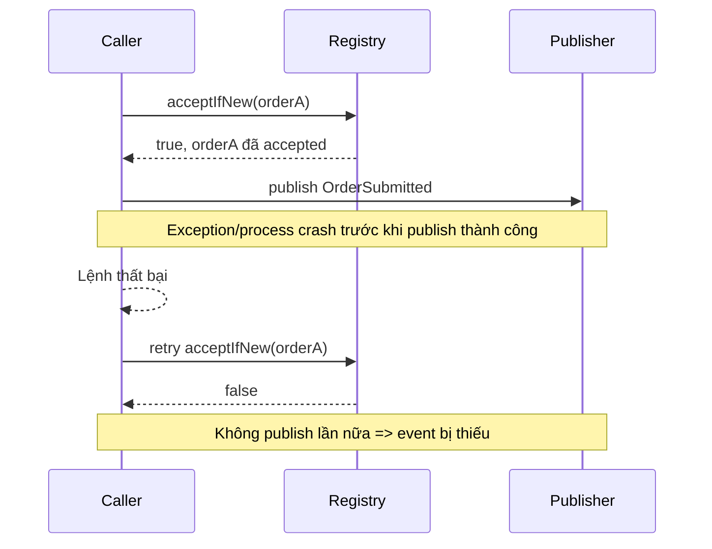
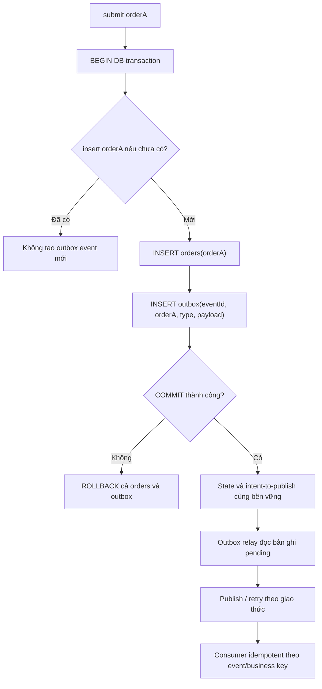
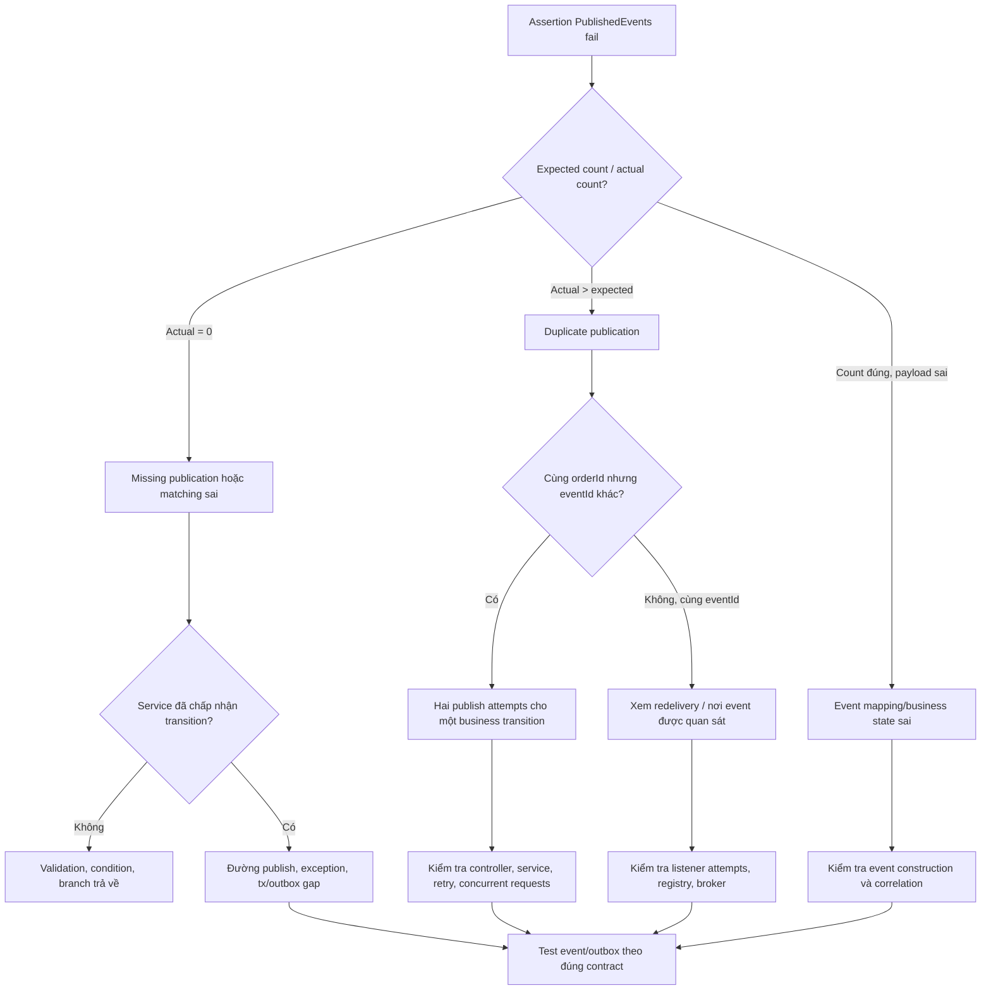

# Lỗi duplicate event hoặc event bị phát thiếu

## Mục tiêu học tập

Trong chương **Test failure** của học phần **Spring Modulith Verification & Testing**, lỗi sự kiện không chỉ là “không thấy event”. Hai hồi quy đặc biệt nguy hiểm là **event được publish nhiều hơn hợp đồng cho phép** và **event đáng lẽ phải được publish nhưng lại thiếu**. Nếu không kiểm tra chính xác **số lần**, **định danh nghiệp vụ**, **payload** và **ranh giới transaction**, một bài test có thể xanh mặc dù downstream xử lý trùng hóa đơn, thông báo hoặc bỏ sót tác vụ.

Bài học tập trung trực tiếp vào hai lỗi trên, với các mục tiêu:

- Viết rõ hợp đồng “một event cho một chuyển trạng thái được chấp nhận”, không nhầm với “một event cho một lời gọi method”.
- Phân biệt **duplicate command**, **duplicate source publication**, **fan-out tới nhiều listener**, **retry/redelivery** và **duplicate side effect**.
- Dùng `@ApplicationModuleTest` + `PublishedEvents` kiểm tra **0/1/N event** theo `orderId`, `eventId` và payload; tránh chỉ dùng `contains` khi hợp đồng yêu cầu đúng một lần.
- Tái hiện và sửa một đường publish trùng, một đường publish thiếu, gồm lỗi xảy ra **giữa ghi trạng thái và publish event**.
- Kiểm thử nhiều lệnh đồng thời một cách có điểm đồng bộ, không dựa vào `Thread.sleep`.
- Hiểu giới hạn của in-memory idempotency và lý do cần **unique constraint**, **transactional outbox** hoặc cơ chế giao event đáng tin cậy trong hệ thống bền vững.
- Phân biệt sự kiện đã publish với listener `AFTER_COMMIT` đã chạy, kết quả `Scenario` đã đến và DB side effect đã commit.
- Đưa kiểm tra số lượng event, kiểm chứng kiến trúc `ApplicationModules.verify()` và integration tests vào CI quality gate.

## 1. Đầu tiên phải định nghĩa “thiếu” và “trùng” so với hợp đồng nào

Hãy xét use case **đăng ký đơn hàng** trong module `orders`. Tên event là `OrderSubmitted`; nó diễn tả một đơn hàng được **chấp nhận lần đầu**.

Quy ước của ví dụ:

1. `submit(orderId, customerId)` lần đầu với dữ liệu hợp lệ → trả `true` và publish **đúng một** `OrderSubmitted` cho `orderId`.
2. Gửi lại lệnh với **cùng `orderId`** → trả `false`, **không publish event thứ hai**.
3. Hai `orderId` khác nhau cùng được chấp nhận → **hai event**, mỗi ID một event.
4. Input thiếu `orderId` hoặc `customerId` → bị từ chối **trước khi thay đổi state** và **không publish event**.
5. `OrderSubmitted.eventId` định danh **một publication/event instance có ý nghĩa**, còn `orderId` định danh **đơn hàng nghiệp vụ**.

Đây là **hợp đồng cụ thể của ví dụ**, không phải luật phổ quát cho mọi domain event. Trong một số nghiệp vụ, mỗi retry hợp lệ cần một event attempt; trong những nghiệp vụ khác, nhiều chuyển trạng thái của cùng entity có thể phát nhiều event với type khác nhau. Phải định nghĩa **đơn vị đếm** trước khi assert.

| Tình huống | Lệnh gửi đến | Event `OrderSubmitted` kỳ vọng | Giải thích |
| --- | --- | --- | --- |
| Đơn mới A | `submit(A, C1)` | 1 cho A | Chuyển trạng thái lần đầu |
| Retry A | `submit(A, C1)` lần nữa | 0 mới; tổng vẫn 1 cho A | Duplicate command bị chặn |
| Đơn mới B | `submit(B, C2)` | 1 cho B | B là entity độc lập |
| Thiếu customer ID | `submit(C, null)` | 0 cho C | Input không hợp lệ |
| Hai lời gọi đồng thời cùng A | `submit(A, C1)` song song | Tổng 1 cho A | Cần chốt “ai thắng” một cách nguyên tử |

### 1.1. Đừng đếm tất cả event của context khi chỉ cần một order

Assertion:

```java
assertThat(events.ofType(OrderSubmitted.class)).hasSize(1);
```

có thể sai ý nếu cùng test phát nhiều đơn hợp lệ hoặc có stimulus không liên quan. Đếm theo **khóa tương quan**:

```java
assertThat(events.ofType(OrderSubmitted.class)
        .matching(e -> orderId.equals(e.orderId())))
        .hasSize(1);
```

Nếu bài test kiểm tra **cả batch** và hợp đồng là đúng hai đơn được chấp nhận, có thể assert **tổng số event** cùng với **mỗi ID một event**. Chỉ đếm tổng 2 vẫn có thể che trường hợp A được publish hai lần còn B bị thiếu.

### 1.2. Một event được giao cho nhiều listener không phải hai lần publish

```text
OrderSubmissionService
  └── publish OrderSubmitted [1 lần]
       ├── InventoryListener.on(...)  [1 callback]
       └── AnalyticsListener.on(...)  [1 callback]
```

Đây là **một publication** có **hai consumer**. Một hệ thống publication registry có thể tạo hai **target publication records** (tùy cơ chế theo dõi); điều đó không có nghĩa publisher đã gọi `publishEvent` hai lần.

Ngược lại, một listener xử lý lại do retry có thể gây hai **callback attempts** cho cùng một event nguồn. Đó là vấn đề **delivery/idempotency**, không nhất thiết là duplicate source publication.

## 2. Ma trận phân biệt các loại duplicate

| Loại | Bằng chứng tiêu biểu | Cần sửa ở đâu? |
| --- | --- | --- |
| **Duplicate command** | Cùng `orderId` được gửi hai lần từ API/queue | Idempotency ở use case; lưu decision theo business key |
| **Duplicate publication** | `PublishedEvents` ghi 2 `OrderSubmitted` cho cùng `orderId` khi contract chỉ cần 1 | Publisher: hai nhánh publish, retry, event listener đệ quy |
| **Fan-out đúng thiết kế** | Một `OrderSubmitted`, hai listener khác nhau được gọi | Không sửa publisher; test từng listener contract |
| **Redelivery/retry** | Cùng `eventId` được xử lý nhiều lượt | Consumer idempotency/retry policy |
| **Duplicate business transition** | Hai transaction cùng tạo bản ghi đơn A | Unique constraint/transaction locking/atomic insert |
| **Duplicate side effect** | Một invoice/email được tạo hai lần dù một event nguồn | Idempotency ở listener và gateway, DB uniqueness |
| **Missing publication** | Đơn A accepted nhưng không có `OrderSubmitted` | Missing branch, ngoại lệ, khoảng trống state→publish |
| **Missing consumption** | Event nguồn có nhưng listener không hoàn tất | Bootstrap scope, transaction commit, async/retry |

**Điểm định hướng:** nếu `PublishedEvents` cho đúng **một** event nguồn nhưng downstream tạo hai hóa đơn, không cần sửa publisher để “phát ít hơn”. Hãy kiểm tra listener, redelivery và idempotency của hóa đơn.

## 3. Đường sai điển hình: phát hai lần từ cùng use case

Ví dụ rút gọn:

```java
public void submit(UUID orderId, UUID customerId) {
    publisher.publishEvent(new OrderSubmitted(
            UUID.randomUUID(), orderId, customerId));

    if (auditEnabled) {
        // Sai: nhánh audit lại phát cùng loại domain event.
        publisher.publishEvent(new OrderSubmitted(
                UUID.randomUUID(), orderId, customerId));
    }
}
```

Nếu hợp đồng là **một event khi đơn được chấp nhận**, nhánh audit trên tạo thêm publication; cả hai có thể mang `eventId` khác nhau nhưng **cùng `orderId`**. Assertion chỉ kiểm tra “có một `OrderSubmitted` bất kỳ” sẽ không chặn được lỗi này.

Một lỗi tương tự có thể xảy ra khi:

- Controller và service **đều** publish event cho một chuyển trạng thái.
- Service gọi publish trong `try` rồi publish lại trong `finally`.
- Hai lớp decorator/audit cùng gọi `publisher.publishEvent(…)`.
- Retry code bao luôn lệnh publish dù transaction nghiệp vụ đã thành công.
- Hai request đồng thời đều kiểm tra `exists == false` trước khi ghi mà không có unique constraint.

**Quy tắc sửa:** chọn **một nơi sở hữu việc phát domain event** và gắn nó với **một chuyển trạng thái được chấp nhận**, không phải mỗi lần đi qua một nhánh thực thi.

## 4. Ví dụ Java 17: publisher có kiểm soát duplicate command

Mục tiêu ví dụ là quan sát **publication contract trong một `ApplicationContext` nhỏ**, chưa mô phỏng database hoặc broker. Thư mục:

```text
src/main/java/com/example/shop/
├── ShopApplication.java                # @SpringBootApplication
└── orders/
    ├── OrderSubmitted.java
    ├── AcceptedOrderRegistry.java
    └── OrderSubmissionService.java

src/test/java/com/example/shop/orders/
    ├── OrderSubmissionModuleTests.java
    └── OrderSubmissionConcurrencyTests.java
```

Ứng dụng giả định Spring Modulith nhận `orders` là một application module bên dưới package gốc `com.example.shop`. `@ApplicationModuleTest` nằm trong cùng package module.

Test dependency Maven (dùng BOM Spring Modulith tương thích với Spring Boot):

```xml
<dependency>
    <groupId>org.springframework.modulith</groupId>
    <artifactId>spring-modulith-starter-test</artifactId>
    <scope>test</scope>
</dependency>
```

### 4.1. Event chứa cả eventId và business key

Tệp `src/main/java/com/example/shop/orders/OrderSubmitted.java`:

```java
package com.example.shop.orders;

import java.util.UUID;

public record OrderSubmitted(
        UUID eventId,
        UUID orderId,
        UUID customerId) {
}
```

Để phân tích lỗi:

- `eventId` giúp nhận diện **cùng một event được giao lại**.
- `orderId` giúp nhận diện **nhiều event khác nhau cùng nói về một đơn**.
- `customerId` là một phần payload phải kiểm chứng, không dùng thay `orderId` khi lọc.

Hai event có `eventId` khác nhau nhưng cùng `orderId` **vẫn là duplicate publication theo hợp đồng của bài**. Hai callback có cùng `eventId` có thể là **redelivery**, không phải hai nguồn publish.

### 4.2. Registry chấp nhận mỗi orderId một lần trong JVM

Tệp `src/main/java/com/example/shop/orders/AcceptedOrderRegistry.java`:

```java
package com.example.shop.orders;

import java.util.Set;
import java.util.UUID;
import java.util.concurrent.ConcurrentHashMap;
import org.springframework.stereotype.Component;

@Component
public class AcceptedOrderRegistry {

    private final Set<UUID> accepted =
            ConcurrentHashMap.newKeySet();

    public boolean acceptIfNew(UUID orderId) {
        return accepted.add(orderId);
    }

    public void remove(UUID orderId) {
        accepted.remove(orderId);
    }
}
```

`ConcurrentHashMap.newKeySet().add(…)` là thao tác nguyên tử cho **một JVM**: hai thread cùng thêm một `orderId` thì chỉ một thread nhận kết quả `true`. Đây là fixture để minh họa idempotency trong bộ nhớ, **không thay thế** unique constraint hoặc transaction trong database nhiều instance.

### 4.3. Service publish đúng một lần cho một lần accept

Tệp `src/main/java/com/example/shop/orders/OrderSubmissionService.java`:

```java
package com.example.shop.orders;

import java.util.Objects;
import java.util.UUID;
import org.springframework.context.ApplicationEventPublisher;
import org.springframework.stereotype.Service;

@Service
public class OrderSubmissionService {

    private final AcceptedOrderRegistry acceptedOrders;
    private final ApplicationEventPublisher publisher;

    public OrderSubmissionService(
            AcceptedOrderRegistry acceptedOrders,
            ApplicationEventPublisher publisher) {
        this.acceptedOrders = acceptedOrders;
        this.publisher = publisher;
    }

    public boolean submit(UUID orderId, UUID customerId) {
        // Validate TRƯỚC khi thay đổi trạng thái hoặc publish.
        Objects.requireNonNull(orderId, "orderId");
        Objects.requireNonNull(customerId, "customerId");

        if (!acceptedOrders.acceptIfNew(orderId)) {
            return false; // Duplicate command: không phát thêm event.
        }

        publisher.publishEvent(new OrderSubmitted(
                UUID.randomUUID(), orderId, customerId));

        return true;
    }
}
```

Trong ví dụ này, **nhánh duy nhất gọi `publishEvent(…)`** là nhánh vừa được registry chấp nhận. Không có publish trong controller/decorator khác. Với các lời gọi đồng thời trong **một JVM**, registry giúp hạn chế duplicate source publication theo `orderId`.

**Cảnh báo rất quan trọng:** `acceptIfNew` xảy ra **trước** `publishEvent`. Nếu JVM lỗi hoặc publisher ném exception ở giữa, registry đã đánh dấu accepted nhưng event có thể bị thiếu; retry cùng `orderId` sẽ bị từ chối và không bù lại event. Ví dụ này minh họa **at-most-once attempt**, **không bảo đảm exactly-once hay không mất event**. Phần 9 sẽ xử lý khoảng trống này bằng transaction/outbox.

## 5. JUnit @ApplicationModuleTest: bắt lỗi duplicate/missing theo ID

Tệp `src/test/java/com/example/shop/orders/OrderSubmissionModuleTests.java`:

```java
package com.example.shop.orders;

import static org.assertj.core.api.Assertions.assertThat;
import static org.assertj.core.api.Assertions.assertThatThrownBy;

import java.util.UUID;
import org.junit.jupiter.api.Test;
import org.springframework.beans.factory.annotation.Autowired;
import org.springframework.modulith.test.ApplicationModuleTest;
import org.springframework.modulith.test.PublishedEvents;

@ApplicationModuleTest
class OrderSubmissionModuleTests {

    @Autowired
    OrderSubmissionService submissions;

    @Autowired
    AcceptedOrderRegistry acceptedOrders;

    @Test
    void firstSubmissionPublishesExactlyOneEvent(
            PublishedEvents events) {

        UUID orderId = UUID.randomUUID();
        UUID customerId = UUID.randomUUID();

        try {
            assertThat(submissions.submit(orderId, customerId))
                    .isTrue();

            var published = events.ofType(OrderSubmitted.class)
                    .matching(event ->
                            orderId.equals(event.orderId()));

            assertThat(published)
                    .hasSize(1)
                    .allSatisfy(event -> {
                        assertThat(event.eventId()).isNotNull();
                        assertThat(event.orderId()).isEqualTo(orderId);
                        assertThat(event.customerId()).isEqualTo(customerId);
                    });
        } finally {
            acceptedOrders.remove(orderId);
        }
    }

    @Test
    void repeatedCommandDoesNotPublishAgain(
            PublishedEvents events) {

        UUID orderId = UUID.randomUUID();
        UUID customerId = UUID.randomUUID();

        try {
            assertThat(submissions.submit(orderId, customerId))
                    .isTrue();
            assertThat(submissions.submit(orderId, customerId))
                    .isFalse();
            assertThat(submissions.submit(orderId, customerId))
                    .isFalse();

            assertThat(events.ofType(OrderSubmitted.class)
                    .matching(event ->
                            orderId.equals(event.orderId())))
                    .hasSize(1); // 3 commands, 1 accepted transition.
        } finally {
            acceptedOrders.remove(orderId);
        }
    }

    @Test
    void distinctOrdersEachHaveOneEvent(
            PublishedEvents events) {

        UUID orderA = UUID.randomUUID();
        UUID orderB = UUID.randomUUID();
        UUID customerId = UUID.randomUUID();

        try {
            assertThat(submissions.submit(orderA, customerId))
                    .isTrue();
            assertThat(submissions.submit(orderB, customerId))
                    .isTrue();

            var all = events.ofType(OrderSubmitted.class);
            var forA = all.matching(event ->
                    orderA.equals(event.orderId()));
            var forB = all.matching(event ->
                    orderB.equals(event.orderId()));

            assertThat(forA).hasSize(1);
            assertThat(forB).hasSize(1);

            // Với đúng hai stimulus trong test độc lập:
            assertThat(all).hasSize(2);
        } finally {
            acceptedOrders.remove(orderA);
            acceptedOrders.remove(orderB);
        }
    }

    @Test
    void invalidCommandPublishesNothing(
            PublishedEvents events) {

        UUID orderId = UUID.randomUUID();

        assertThatThrownBy(() ->
                submissions.submit(orderId, null))
                .isInstanceOf(NullPointerException.class)
                .hasMessage("customerId");

        assertThat(events.ofType(OrderSubmitted.class)
                .matching(event ->
                        orderId.equals(event.orderId())))
                .isEmpty();
    }
}
```

### 5.1. Test nào bắt được lỗi nào?

| Test | Hợp đồng | Hồi quy được phát hiện |
| --- | --- | --- |
| `firstSubmissionPublishesExactlyOneEvent` | Một đơn mới → đúng một event với payload đúng | Event thiếu, phát hai lần, sai order/customer ID |
| `repeatedCommandDoesNotPublishAgain` | Retry cùng order → tổng vẫn một event | Publish lại khi nhận duplicate command |
| `distinctOrdersEachHaveOneEvent` | Hai đơn khác nhau → mỗi đơn một event | A phát hai lần/B không phát, hoặc tổng thiếu/trùng |
| `invalidCommandPublishesNothing` | Input không hợp lệ → zero event | Publish trước validation hoặc nhánh lỗi phát sai |

Một assertion như `isNotEmpty()` hoặc `anySatisfy(…)` **không thay thế** `hasSize(1)` khi nghiệp vụ yêu cầu số lần chính xác. Nó có thể pass khi có hai event giống nhau.

### 5.2. Vì sao dùng cả eventId và orderId?

Đếm theo `orderId` để áp hợp đồng “một event cho một đơn”. Kiểm tra `eventId` khác `null` để downstream có khóa định danh event. Ở các test kiểm tra retry/redelivery, có thể so sánh **cùng `eventId`**; khi kiểm tra duplicate business publication, hãy đặc biệt xem **hai eventId khác nhau cùng orderId**.

Không nên dùng `eventId` làm khóa duy nhất cho mọi hợp đồng. Ví dụ nếu bug publish `OrderSubmitted(eventId1, orderA, ...)` và `OrderSubmitted(eventId2, orderA, ...)`, assertion “mỗi eventId là duy nhất” vẫn xanh, trong khi business contract đã bị vi phạm.

### 5.3. Vì sao không assert event toàn context ở mọi test?

`PublishedEvents` được Spring Modulith cung cấp cho phạm vi kiểm thử để quan sát event đã publish. Khi có async callback hoặc test context được tái sử dụng, event từ background work của bài test khác có thể gây nhiễu nếu suite không cô lập đúng. **Lọc theo ID** là hàng rào quan trọng, nhưng vẫn cần cleanup và quản lý worker lifecycle.

Ở test `distinctOrdersEachHaveOneEvent`, phép `hasSize(2)` trên toàn bộ `OrderSubmitted` có ý nghĩa vì test thiết kế **chỉ tạo hai stimulus đồng bộ** và không có consumer phát thêm `OrderSubmitted`. Với suite tích hợp có nhiều nguồn phát event cùng type, nên kiểm tra theo tập khóa và xác định rõ thời điểm mọi publisher liên quan đã hoàn tất.

## 6. Test đồng thời: hai command trùng ID chỉ một publisher thắng

Một lỗi duplicate thường không xuất hiện với hai lời gọi tuần tự nhưng xảy ra khi hai request chạy cùng lúc:

```java
if (!repository.existsByOrderId(orderId)) {
    repository.save(newOrder);
    publisher.publishEvent(event);
}
```

Đây là đoạn **code có race**, không phải hướng triển khai được khuyến nghị. Cả hai thread có thể cùng thấy `exists == false` rồi cùng save/publish. Nếu DB có unique constraint, một transaction có thể fail, nhưng cần kiểm soát thời điểm publish: event có thể đã được publish trước khi transaction còn lại rollback.

Với `AcceptedOrderRegistry` dùng phép thêm nguyên tử trong JVM, ta có thể viết JUnit test điều phối các thread cùng bắt đầu, không dùng `Thread.sleep`.

Tệp `src/test/java/com/example/shop/orders/OrderSubmissionConcurrencyTests.java`:

```java
package com.example.shop.orders;

import static org.assertj.core.api.Assertions.assertThat;

import java.util.ArrayList;
import java.util.List;
import java.util.UUID;
import java.util.concurrent.CopyOnWriteArrayList;
import java.util.concurrent.CountDownLatch;
import java.util.concurrent.Executors;
import java.util.concurrent.Future;
import java.util.concurrent.TimeUnit;
import org.junit.jupiter.api.Test;
import org.springframework.context.ApplicationEventPublisher;

class OrderSubmissionConcurrencyTests {

    @Test
    void concurrentCommandsForSameOrderPublishOnce()
            throws Exception {

        var accepted = new AcceptedOrderRegistry();
        var observed = new CopyOnWriteArrayList<Object>();
        ApplicationEventPublisher publisher = observed::add;
        var submissions =
                new OrderSubmissionService(accepted, publisher);

        UUID orderId = UUID.randomUUID();
        UUID customerId = UUID.randomUUID();
        int callers = 8;
        var start = new CountDownLatch(1);
        var pool = Executors.newFixedThreadPool(callers);

        try {
            List<Future<Boolean>> results = new ArrayList<>();

            for (int i = 0; i < callers; i++) {
                results.add(pool.submit(() -> {
                    start.await();
                    return submissions.submit(orderId, customerId);
                }));
            }

            start.countDown();

            int acceptedCount = 0;

            for (Future<Boolean> result : results) {
                if (result.get(5, TimeUnit.SECONDS)) {
                    acceptedCount++;
                }
            }

            assertThat(acceptedCount).isEqualTo(1);
            assertThat(observed)
                    .hasSize(1)
                    .allSatisfy(event -> {
                        assertThat(event)
                                .isInstanceOf(OrderSubmitted.class);
                        var submitted = (OrderSubmitted) event;
                        assertThat(submitted.orderId())
                                .isEqualTo(orderId);
                    });
        } finally {
            start.countDown(); // Bảo đảm không giữ thread nếu assert fail.
            pool.shutdownNow();
        }
    }
}
```

**Chứng minh được:** với một instance `OrderSubmissionService` và registry trong bộ nhớ chung, tám lời gọi cùng `orderId` chỉ có **một acceptance** và **một lời gọi publisher** nếu không có lỗi bất thường.

**Không chứng minh được:** hai application instances khác nhau dùng các map khác nhau, transaction database hoặc message broker sẽ có tính “exactly once”. Để có tính duy nhất bền vững qua nhiều instance, quyết định accepted cần được bảo vệ bởi database unique constraint/transaction hoặc một cơ chế đồng bộ hóa phân tán phù hợp.

### 6.1. Tránh test “song song” bằng sleep

Hai thread được tạo nhưng gọi tuần tự trên thực tế không chắc tạo race. Dùng `CountDownLatch` giúp chúng có điểm bắt đầu chung và `Future.get(…, TimeUnit.SECONDS)` giúp test có timeout hữu hạn. Dù vậy, đây là **test cho chiến lược đồng bộ trong bộ nhớ**, không thay thế stress test hoặc integration test với unique constraint thật.

## 7. Vì sao event có thể bị phát thiếu dù đã chống duplicate?

Nhìn lại service:

```java
if (!acceptedOrders.acceptIfNew(orderId)) {
    return false;
}

publisher.publishEvent(new OrderSubmitted(
        UUID.randomUUID(), orderId, customerId));
```

Có một **khoảng trống** giữa hai thao tác:



Đây là mẫu lỗi rất quan trọng: **đã ghi trạng thái nghiệp vụ, nhưng event cần phát chưa được lưu/đưa đi bền vững**. Chỉ có in-memory idempotency không giải quyết được.

### 7.1. JUnit tái hiện failure window một cách xác định

Ví dụ unit test dưới đây **cố ý chứng minh điểm yếu** của service demo; nó không phải một bài test mong đợi luôn pass cho production-grade delivery:

```java
package com.example.shop.orders;

import static org.assertj.core.api.Assertions.assertThat;
import static org.assertj.core.api.Assertions.assertThatThrownBy;

import java.util.ArrayList;
import java.util.UUID;
import org.junit.jupiter.api.Test;
import org.springframework.context.ApplicationEventPublisher;

class OrderPublicationGapTests {

    @Test
    void acceptedOrderCanLoseItsEventWhenPublishThrows() {
        UUID orderId = UUID.randomUUID();
        UUID customerId = UUID.randomUUID();
        var accepted = new AcceptedOrderRegistry();

        ApplicationEventPublisher failingPublisher = event -> {
            throw new IllegalStateException("Publishing failed");
        };
        var firstAttempt =
                new OrderSubmissionService(accepted, failingPublisher);

        assertThatThrownBy(() ->
                firstAttempt.submit(orderId, customerId))
                .isInstanceOf(IllegalStateException.class)
                .hasMessage("Publishing failed");

        var observed = new ArrayList<Object>();
        ApplicationEventPublisher recoveredPublisher = observed::add;
        var retry =
                new OrderSubmissionService(accepted, recoveredPublisher);

        // Order vẫn bị registry coi là đã accepted.
        assertThat(retry.submit(orderId, customerId)).isFalse();

        // Không có event nào tới recovered publisher.
        assertThat(observed).isEmpty();
    }
}
```

Test có giá trị vì nó làm **failure window có thể quan sát và tái hiện**, không dùng timing ngẫu nhiên. Nó cũng nhắc rằng `PublishedEvents` trong một module test thường xác minh **in-process publication attempts** chứ không chứng minh publication đã được ghi bền vững hay đã chuyển thành message bên ngoài process.

**Hướng sửa không phải** xóa idempotency hoặc publish bất kể duplicate command. Hướng sửa phù hợp với hệ thống bền vững là đưa **state transition** và **outbox event record** vào cùng một transaction cơ sở dữ liệu, rồi cho một relay xử lý việc giao event có retry.

## 8. Khi thiếu event do nhánh code chứ không do transaction

Ngoài failure window, các lỗi logic làm thiếu event phổ biến gồm:

- Nhánh `return` sớm nhưng đã chấp nhận business transition.
- Exception được bắt và nuốt, không publish event sau khi thay đổi state.
- `if` dùng điều kiện đảo ngược, chỉ publish cho lệnh bị từ chối.
- Event chỉ được publish ở một endpoint; luồng batch/import cập nhật cùng entity nhưng bỏ qua event.
- Test dùng customer ID khác, kết quả `matching` không khớp và bị tưởng là thiếu.
- Event type đã đổi tên nhưng consumer/test vẫn chờ type cũ.
- `@TransactionalEventListener(AFTER_COMMIT)` không chạy vì transaction rollback, mặc dù event nguồn đã được publish.

### 8.1. Đường code sai: return trước khi publish

```java
public boolean submit(UUID orderId, UUID customerId) {
    Objects.requireNonNull(orderId);
    Objects.requireNonNull(customerId);

    if (acceptedOrders.acceptIfNew(orderId)) {
        return true; // Bug: accepted nhưng chưa publish OrderSubmitted.
    }

    return false;
}
```

Đoạn trên là **phiên bản lỗi minh họa**, không được giữ song song với service đúng trong project. `firstSubmissionPublishesExactlyOneEvent` ở phần 5 sẽ fail vì `PublishedEvents` có **0 event** cho `orderId`.

### 8.2. Sai predicate khiến “thiếu giả”

```java
// Sai: so customerId với field orderId.
events.ofType(OrderSubmitted.class)
        .matching(event ->
                customerId.equals(event.orderId()));
```

Nếu record vẫn được publish đúng nhưng `customerId != orderId`, query trên trả rỗng. Kiểm tra đầu tiên phải là:

1. **Loại event** đúng không?
2. **Khóa tương quan** đúng field không?
3. Test đang tìm event **nguồn** hay event **kết quả listener**?
4. Có lọc thêm một điều kiện timestamp/payload quá hẹp không?

Không sửa publisher khi vấn đề thật sự nằm trong assertion.

## 9. Transactional outbox: chống thiếu event giữa DB và publication

Với nghiệp vụ bền vững, cần một hợp đồng mạnh hơn ví dụ in-memory:

> Một giao dịch đăng ký đơn chỉ được xem là chấp nhận khi **bản ghi đơn và bản ghi outbox của `OrderSubmitted` cùng commit thành công**, hoặc cả hai cùng rollback.

Sơ đồ:



### 9.1. Mẫu service dùng transaction của database

Đoạn dưới đây **minh họa hợp đồng adapter/repository**; `insertIfAbsent` phải được triển khai bằng thao tác **nguyên tử tại database**, có unique constraint cho `orderId` (ví dụ vendor-specific insert-on-conflict hoặc transactional insert bắt unique violation đúng cách). Không dùng `existsById` rồi `save` như một cặp thao tác độc lập để đảm bảo concurrency.

```java
@Service
public class TransactionalOrderSubmissionService {

    private final OrderWritePort orders;
    private final OutboxWritePort outbox;

    public TransactionalOrderSubmissionService(
            OrderWritePort orders,
            OutboxWritePort outbox) {
        this.orders = orders;
        this.outbox = outbox;
    }

    @Transactional
    public boolean submit(UUID orderId, UUID customerId) {
        Objects.requireNonNull(orderId);
        Objects.requireNonNull(customerId);

        if (!orders.insertIfAbsent(orderId, customerId)) {
            return false;
        }

        outbox.append(new OutboxRecord(
                UUID.randomUUID(),
                orderId,
                "OrderSubmitted",
                customerId));

        return true;
    }
}
```

Đoạn trên **không được coi là class chạy độc lập** nếu chưa có `OrderWritePort`, `OutboxWritePort`, `OutboxRecord`, import và transaction manager đúng dự án. Khi triển khai, hãy bảo đảm **cả hai port dùng chung datasource và transaction thực**, outbox insert throw thì transaction rollback toàn bộ, không có `@Transactional` self-invocation bỏ qua proxy.

Với lựa chọn này, event có thể chưa xuất hiện trong `PublishedEvents` ngay khi gọi `submit`: service chỉ lưu **outbox intent**, còn relay publish sau commit. Vì vậy test hợp đồng phải đổi:

- Assert một order row và **một outbox row** cùng `orderId` sau commit.
- Retry cùng `orderId` không tạo outbox row thứ hai.
- Lỗi ghi outbox làm rollback order insert.
- Relay với retry/redelivery giữ `eventId` ổn định qua các lần gửi lại.
- Consumer xử lý idempotent vì delivery bên ngoài có thể **at-least-once**.

**Đừng vừa refactor sang outbox rồi vẫn assert `PublishedEvents` luôn có `OrderSubmitted` ngay trong transaction** nếu code không còn gọi Spring `publishEvent` tại thời điểm đó.

### 9.2. Outbox không đồng nghĩa exactly-once delivery

Relay có thể:

1. Publish message lên broker thành công.
2. Crash trước khi đánh dấu outbox record là sent.
3. Restart và publish lại **cùng message/eventId**.

Đây là **redelivery**. Transactional outbox giúp giảm khoảng trống mất event giữa DB và gửi message, nhưng thông thường vẫn cần **consumer idempotency** và chỉ tiêu chí “ít nhất một lần/không trùng side effect” được chứng minh theo hạ tầng đã chọn. Không tuyên bố exactly-once end-to-end chỉ vì publisher có outbox.

## 10. Consumer idempotency: một event có thể được nhận nhiều lần

Giả sử module `billing` tạo một hóa đơn cho mỗi `orderId`. Consumer nhận lại cùng `OrderSubmitted` do retry; hoặc nhận **hai eventId khác nhau cùng orderId** vì publisher có bug. Nếu contract là **một invoice cho một order**, khóa chống trùng side effect phải dựa vào **orderId**, không chỉ eventId.

### 10.1. Ví dụ unit test với projection trong bộ nhớ

```java
package com.example.shop.billing;

import com.example.shop.orders.OrderSubmitted;
import java.util.UUID;
import java.util.concurrent.ConcurrentHashMap;
import java.util.concurrent.ConcurrentMap;

public class InvoiceProjection {

    private final ConcurrentMap<UUID, String> invoiceNumbers =
            new ConcurrentHashMap<>();

    public String process(OrderSubmitted event) {
        return invoiceNumbers.computeIfAbsent(
                event.orderId(), id -> "INV-" + id);
    }

    public int invoiceCount() {
        return invoiceNumbers.size();
    }
}
```

JUnit test:

```java
package com.example.shop.billing;

import static org.assertj.core.api.Assertions.assertThat;

import com.example.shop.orders.OrderSubmitted;
import java.util.UUID;
import org.junit.jupiter.api.Test;

class InvoiceProjectionTests {

    @Test
    void duplicateDeliveryAndDuplicatePublicationCreateOneInvoice() {
        var projection = new InvoiceProjection();
        UUID orderId = UUID.randomUUID();
        UUID customerId = UUID.randomUUID();

        var source = new OrderSubmitted(
                UUID.randomUUID(), orderId, customerId);

        // Giao lại cùng một eventId (redelivery).
        projection.process(source);
        projection.process(source);

        // Publication khác eventId nhưng cùng business orderId.
        var accidentallyPublishedAgain = new OrderSubmitted(
                UUID.randomUUID(), orderId, customerId);
        projection.process(accidentallyPublishedAgain);

        assertThat(projection.invoiceCount()).isEqualTo(1);
    }
}
```

**Giới hạn:** `ConcurrentHashMap` chỉ cho một JVM và phép tạo số hóa đơn trong ví dụ là thuần hàm, không gọi gateway bên ngoài. Trong production:

- Database cần unique constraint cho business key `orderId` của invoice.
- Nếu cần dedup **đúng một lần xử lý từng event**, có thể thêm bảng `processed_events(eventId, consumerName)`.
- Với external side effect như email hoặc charge, cần idempotency key tại gateway và/hoặc một quy trình ghi kết quả bền vững.
- Không chỉ dùng `Set<eventId>` trong bộ nhớ rồi gọi là exactly-once.

### 10.2. Vì sao “đã nhận event” khác “đã tạo một hóa đơn”?

Một event nguồn có thể tới hai listener; một listener có thể được gọi lại sau crash; một callback có thể lỗi sau khi insert invoice nhưng trước khi ACK. Vì vậy:

- **Source publication count** → kiểm ở publisher với `PublishedEvents` hoặc outbox.
- **Invocation attempts** → quan sát listener/registry/tracing.
- **Business side-effect count** → kiểm ở DB/gateway theo `orderId` và unique constraint.

Không dùng một con số ở tầng này để suy ra tất cả tầng còn lại.

## 11. Transaction và rollback làm ý nghĩa “đã publish” phức tạp hơn

Nếu use case có:

```java
@Transactional
public void placeOrder(...) {
    orders.save(entity);
    publisher.publishEvent(new OrderSubmitted(...));
    // Sau đó transaction có thể rollback.
}
```

thì event đã được phát vào Spring event infrastructure **trước khi transaction nguồn commit**. `PublishedEvents` có thể quan sát việc publish, nhưng điều đó không đảm bảo business state trong DB đã commit.

### 11.1. AFTER_COMMIT không làm event nguồn “biến mất”

Listener:

```java
@TransactionalEventListener(
        phase = TransactionPhase.AFTER_COMMIT)
public void on(OrderSubmitted event) {
    // Xử lý sau khi transaction nguồn commit.
}
```

Cần import `TransactionalEventListener` và `TransactionPhase` của Spring Framework. Các khả năng:

| Transaction lúc publish | Event nguồn đã gọi `publishEvent`? | Listener `AFTER_COMMIT` |
| --- | --- | --- |
| Transaction chưa commit | Có | Chưa chạy |
| Transaction rollback | Có thể đã được ghi nhận ở publisher test | Không chạy |
| Transaction commit thành công | Có | Được kích hoạt hậu commit |
| Ngoài transaction, `fallbackExecution = false` | Có | Không chạy |

Nếu `PublishedEvents` có đúng một `OrderSubmitted` nhưng `Scenario` chờ `InvoicePrepared` timeout, hãy kiểm tra **commit và listener scope**, không kết luận publisher thiếu event.

### 11.2. Test-managed @Transactional có thể giữ callback mãi chưa chạy

```java
@Test
@Transactional
void problematic(Scenario scenario) {
    // Publish trong transaction của test rồi ngay lập tức
    // chờ listener AFTER_COMMIT bên trong cùng method.
}
```

Spring Test thường rollback test-managed transaction **sau khi method kết thúc**. Nếu test đang chờ hậu commit trong method, callback không được kích hoạt; tăng timeout không giải quyết vòng chờ này.

Khi cần kiểm chứng callback hậu commit, dùng một transaction **commit thực sự trước bước chờ**, ví dụ `TransactionTemplate` trong một test method không bị transaction bao ngoài giữ mở.

### 11.3. Ví dụ stimulus được commit trước khi chờ result

```java
TransactionTemplate tx =
        new TransactionTemplate(transactionManager);

scenario.stimulate(() ->
                tx.executeWithoutResult(status ->
                        publisher.publishEvent(orderSubmitted)))
        .andWaitForEventOfType(InvoicePrepared.class)
        .matching(e -> orderId.equals(e.orderId()))
        .toArriveAndVerify(e ->
                assertThat(e.orderId()).isEqualTo(orderId));
```

Đây là **đoạn thân test minh họa**, không phải source file độc lập. `transactionManager` phải phù hợp hạ tầng, `InvoicePrepared` phải là event **thực sự được listener publish**, và `TransactionTemplate` phải sở hữu transaction hoặc được điều phối propagation đúng. Nếu `TransactionTemplate(REQUIRED)` chỉ tham gia transaction test còn mở, callback vẫn chưa chạy.

## 12. Async và Scenario: chờ một event không chứng minh không có duplicate sau đó

`Scenario` hữu ích để chờ **một outcome** của listener bất đồng bộ:

```java
scenario.stimulate(() -> orderService.submit(orderId, customerId))
        .andWaitForEventOfType(InvoicePrepared.class)
        .matching(e -> orderId.equals(e.orderId()))
        .toArriveAndVerify(e ->
                assertThat(e.orderId()).isEqualTo(orderId));
```

Nhưng việc `Scenario` nhìn thấy **một** `InvoicePrepared` đúng ID chỉ chứng minh **ít nhất một kết quả đã đến**. Nếu callback thứ hai tới muộn, test có thể đã kết thúc và bỏ sót duplicate.

### 12.1. Hai tầng assert cho async

1. **Publisher contract:** test đồng bộ `PublishedEvents` cho source event theo `orderId`, đúng 1 khi accepted.
2. **Consumer contract:** chờ listener đạt mốc hoàn thành được xác nhận, rồi kiểm tra **business side effect** có unique key (`orderId`) trong repository/gateway.

Nếu cần khẳng định **đúng số lần callback**, phải có một điểm đồng bộ chứng minh **mọi công việc liên quan đã hoàn tất** (ví dụ tất cả `Future` được `join`, queue đã drain theo test fixture, hay barrier nhận đủ acks). Chỉ chờ callback đầu tiên không đủ.

### 12.2. Vì sao negative assertion ngay sau publish dễ flaky?

```java
publisher.publishEvent(source);
assertThat(events.ofType(InvoicePrepared.class)).isEmpty();
```

Với listener `@Async`, phép `isEmpty()` ngay lập tức có thể pass **trước khi listener thực sự chạy**. Nó không chứng minh sự kiện kết quả sẽ **không bao giờ** được phát.

Negative event assertion hợp lý khi contract và scope cho phép biết **không còn công việc phát event** (ví dụ service đồng bộ không publish ở nhánh input invalid, hoặc worker đã được đồng bộ hóa xong). Nếu không có bằng chứng quiescence, hãy test invariant của **state** hoặc dùng một harness kiểm soát callback thay vì kết luận từ absence tức thì.

### 12.3. Multiple listeners không làm tăng số event nguồn

Một `OrderSubmitted` có thể kích hoạt `InventoryListener` và `BillingListener`. Nếu cả hai phát event kết quả `InventoryReserved` và `InvoicePrepared`, tổng event **mọi type** là 3, nhưng `PublishedEvents.ofType(OrderSubmitted.class)` vẫn chỉ ghi **một source publication**.

Không dùng “tổng số Spring events trong context” làm số lần publish của một domain event. Hãy đếm **đúng type** và **đúng correlation key**.

## 13. Cây chẩn đoán khi test báo thiếu hoặc thừa event



### 13.1. Ma trận symptom → nguyên nhân → kiểm chứng

| Quan sát | Nguyên nhân ưu tiên | Bằng chứng cần lấy |
| --- | --- | --- |
| 0 `OrderSubmitted`, service trả `true` | Nhánh publish bị bỏ qua, lỗi sau accepted, outbox chưa relay | Source code branch, outbox row, exception |
| 0 `OrderSubmitted`, service từ chối duplicate | Có thể đúng contract | Xem đã có lần accept trước chưa |
| 0 event sau rollback | Tùy test đang đo publish attempt hay event sau commit | Transaction/outbox/phase semantics |
| 2 `OrderSubmitted` cùng `orderId` khác `eventId` | Duplicate source publication | Hai chỗ publish, retry, concurrent accepted |
| 1 `OrderSubmitted` nhưng hai invoice | Duplicate consumer side effect | DB unique key, listener redelivery, gateway |
| 2 callbacks nhưng 1 source event | Nhiều listeners hoặc retry | Target listener identities và eventId |
| `PublishedEvents` có source, `Scenario` timeout | Listener thiếu/sai scope, chưa commit, predicate sai | Bean registration, transaction, async logs |
| Event có nhưng matching trả rỗng | So sai ID/type/payload | In/inspect event contract, correlation |
| Event count đúng sau một lần chạy, thỉnh thoảng fail CI | Async race, shared data, timeout, test pollution | Quiescence, per-test IDs, context isolation |
| Hai request cùng ID tạo hai order rows | Race trong DB | Unique constraint, transaction tests |
| Event bị gửi lại từ outbox | Relay at-least-once, mark-sent sau publish | Same eventId, retry/ACK log |

## 14. Quy trình debug có thể lặp lại

### Bước 1 — Viết hợp đồng theo “business key + transition”

Ví dụ: “Mỗi `orderId` được chấp nhận lần đầu phát đúng một `OrderSubmitted`”. Ghi rõ nhánh invalid, duplicate command và các trạng thái được phép retry.

### Bước 2 — Xác định event type và correlation key

`OrderSubmitted` hay `InvoicePrepared`? `orderId` hay `customerId`? `eventId` là định danh publication hay định danh business? Việc này quyết định predicate chính xác.

### Bước 3 — Tái hiện bằng test publisher nhỏ

Chạy `@ApplicationModuleTest` của `orders` với một lệnh hợp lệ, retry cùng ID, hai ID khác và input invalid. Dùng `hasSize(1)`/`isEmpty()` trên đúng type/ID.

### Bước 4 — Nếu thừa event, kiểm tra ownership của publish

Tìm mọi nơi gọi `publisher.publishEvent(new OrderSubmitted(…))` trong flow được kiểm tra, retry path và duplicate concurrent requests. Phân biệt source publish 2 lần với hai listener nhận cùng event.

### Bước 5 — Nếu thiếu event, kiểm tra state và failure window

Service có thật sự accepted? Có return trước publish? Exception có bị nuốt? Nếu đã ghi DB, có outbox row trong cùng transaction không? Có commit hay rollback? Relay đã xử lý pending record chưa?

### Bước 6 — Nếu listener không hoàn tất, tách khỏi nguồn publish

Kiểm tra bean listener có trong `@ApplicationModuleTest` context không; `@TransactionalEventListener(AFTER_COMMIT)` đã có commit chưa; `@Async` có exception không; `Scenario.matching` có đúng ID không.

### Bước 7 — Kiểm chứng concurrency và idempotency tại hạ tầng phù hợp

In-memory registry → unit/concurrency test. Database → unique constraint và transaction test với nhiều connection. Outbox → test atomic write, relay retry, consumer idempotency. Không dùng một test một JVM để tuyên bố tính đúng đắn của distributed delivery.

### Bước 8 — Chạy lại gate liên quan

Khi được phép chạy trong dự án, lệnh ví dụ:

```bash
./mvnw -Dtest=OrderSubmissionModuleTests test
```

Hoặc:

```bash
./gradlew test --tests "com.example.shop.orders.OrderSubmissionModuleTests" --stacktrace
```

Đây là **lệnh minh họa**, chưa được thực thi cho bài viết. Sau khi sửa, mở rộng sang concurrency, DB/outbox integration, consumer tests và architecture gate.

## 15. Spring Modulith architecture verification có vai trò gì?

`ApplicationModules.verify()` bảo vệ **đồ thị phụ thuộc giữa các module**, không đếm số lần event được publish.

```java
package com.example.shop;

import org.junit.jupiter.api.Test;
import org.springframework.modulith.core.ApplicationModules;

class ArchitectureVerificationTests {

    @Test
    void verifiesModuleBoundaries() {
        ApplicationModules.of(ShopApplication.class).verify();
    }
}
```

`ShopApplication` là lớp ứng dụng gốc minh họa. `billing` có thể import public event `orders.OrderSubmitted` để xử lý hóa đơn; Spring Modulith kiểm tra dependency đó có hợp lệ theo API/named interface/allowedDependencies và không tạo cycle hay không.

**Phân biệt vai trò:**

| Gate | Kiểm chứng |
| --- | --- |
| `ApplicationModules.verify()` | Ranh giới module, dependency rules, cycle |
| `@ApplicationModuleTest` + `PublishedEvents` | Nguồn publish đúng type, payload, số lần theo business key |
| `Scenario` | Outcome bất đồng bộ của listener đã đến |
| Repository integration test | DB state/unique constraint/commit đúng |
| Outbox integration test | State và intent-to-publish atomically persisted, retry |
| Consumer idempotency test | Redelivery không tạo thêm side effect nghiệp vụ |

Một architecture gate pass không chứng minh publisher chỉ publish một lần; ngược lại event assertions xanh không chứng minh consumer chỉ truy cập public API của module khác. Cần cả hai theo phạm vi chất lượng.

## 16. Anti-pattern cần tránh

| Anti-pattern | Hậu quả | Cách thay |
| --- | --- | --- |
| `contains(OrderSubmitted)` là assertion duy nhất | Không phát hiện publish hai lần | `hasSize(1)` theo `orderId` |
| Chỉ `hasSize(2)` cho hai đơn | A trùng hai lần, B thiếu vẫn pass | Assert riêng từng business key |
| Đếm mọi `PublishedEvents` bất kể type | Fan-out/event kết quả làm số đếm nhiễu | Lọc type và ID |
| Coi hai listener callbacks là hai event nguồn | Chẩn đoán sai publisher | Phân biệt publication và delivery |
| Dùng eventId duy nhất để bảo vệ một invoice cho một order | Hai eventId cho cùng order vẫn tạo duplicate invoice | Unique business key `orderId` |
| Dùng `existsById` rồi `save` không có unique constraint | Race khi hai request đồng thời | Atomic insert và DB constraint |
| Đánh dấu accepted trước publish rồi tin không mất event | Crash window làm thiếu event | Transactional outbox |
| Outbox relay retry nhưng đổi eventId ở mỗi retry | Consumer không nhận ra cùng event | Giữ eventId ổn định qua redelivery |
| Negative assertion ngay sau async stimulus | Pass trước khi callback chạy | Synchronization/quiescence hoặc state invariant |
| Tăng `Thread.sleep` để kiểm tra duplicate | Flaky, không chứng minh không có event muộn | Join worker/barrier, durable uniqueness |
| Từ `PublishedEvents` suy DB đã commit | Publication attempt khác transaction commit | Repository assertion sau commit |
| Đổi listener `AFTER_COMMIT` sang `@EventListener` cho test xanh | Side effect có thể xảy ra rồi nguồn rollback | Test transaction đúng và giữ contract |
| Tắt `ApplicationModules.verify()` vì event test đỏ | Mất kiến trúc gate mà không sửa runtime | Chẩn đoán hai tầng độc lập |

## 17. Quality gate CI cho lỗi duplicate/missing

Học phần **SPRING_MODULITH_VERIFICATION_TESTING** hướng tới phát hiện hồi quy kiến trúc và hành vi qua module, event, database và integration tests. Một pipeline có thể chia thành những lớp kiểm tra trực tiếp phục vụ hợp đồng event:

| Tầng CI | Test nên có | Điều kiện đỏ |
| --- | --- | --- |
| **Architecture** | `ApplicationModules.of(…).verify()` | Dependency sai public API/cycle |
| **Publisher contract** | `OrderSubmissionModuleTests` | Đơn mới không phát đúng 1 event |
| **Duplicate command** | Submit cùng ID nhiều lần | Event thứ hai hoặc state thứ hai |
| **Concurrent acceptance** | Nhiều submit cùng ID | Accepted >1 hoặc event >1 trong phạm vi fixture |
| **Validation/negative** | Input invalid | Có event dù command bị từ chối |
| **Transaction/outbox** | Commit, rollback, outbox row count | Order commit nhưng thiếu outbox; retry tạo row trùng |
| **Consumer idempotency** | Same eventId và same orderId redelivery | Invoice/email/side effect bị nhân đôi |
| **Async/integration** | `Scenario` chờ outcome đúng ID | Consumer không hoàn tất, wrong payload |
| **Persistence** | Unique constraint và post-commit query | Dữ liệu sai, trùng, không bền vững |

### 17.1. Dùng kết quả test làm thông tin chẩn đoán

Log hoặc báo cáo test nên ghi:

```text
Contract: one OrderSubmitted per accepted orderId
OrderId: <uuid>
Expected count: 1
Actual source event count: 2
EventIds seen: [<uuid1>, <uuid2>]
Accepted transitions: 1
Consumer invocations: <nếu quan sát được>
Business side-effect count: <nếu kiểm tra>
Transaction committed: yes/no/unknown
Outbox rows for orderId: <nếu dùng outbox>
Root cause: <đã xác minh>
```

Không ghi payload chứa bí mật hoặc dữ liệu cá nhân lên CI log. Hãy dùng ID tương quan và số lượng kỹ thuật đủ để phân biệt nguồn publish trùng, consumer nhận trùng hoặc event thiếu.

### 17.2. Chú ý context cache và test isolation

`@ApplicationModuleTest` có thể dùng Spring Test context cache. Fixture singleton như `AcceptedOrderRegistry` phải được dọn theo **ID của test**, và nên tạo ID mới cho mỗi test. Nếu để async worker còn chạy sau khi test kết thúc, cleanup có thể xảy ra trước khi worker ghi, làm nhiễu bài tiếp theo.

Với integration suite lớn, cân nhắc dữ liệu/transaction độc lập, tiêu chí hoàn thành của worker rõ ràng và không chạy song song những test dùng chung state mutable không an toàn.

## 18. Bài thực hành

1. **Một đơn hợp lệ:** dùng `PublishedEvents` khẳng định chính xác một `OrderSubmitted`, đúng `orderId/customerId` và có `eventId`.
2. **Retry cùng ID:** gọi `submit` ba lần, chỉ lần đầu trả `true` và tổng số event theo ID vẫn là 1.
3. **Hai ID:** tạo order A và B; assert mỗi ID có 1 event, tổng type là 2.
4. **Input invalid:** gửi `customerId = null`, assert không có event và state không được accept.
5. **Bug publish hai lần:** thêm một `publishEvent` trong nhánh audit. Giải thích test nào ở phần 5 sẽ đỏ.
6. **Bug return sớm:** đặt `return true` trước `publishEvent`; giải thích vì sao test đơn đầu sẽ thấy 0 event.
7. **Đồng thời:** chạy nhiều submit cùng `orderId` qua `CountDownLatch`; đo accepted và publisher invocation count.
8. **Crash window:** dùng publisher ném exception sau `acceptIfNew`; thử lại cùng `orderId` và giải thích vì sao event bị thiếu.
9. **Outbox:** thay in-memory registry bằng DB transaction lưu order và outbox; dùng unique constraint để chặn duplicate acceptance.
10. **Outbox rollback:** làm outbox append thất bại và chứng minh transaction rollback cả order row.
11. **Relay retry:** publish cùng `eventId` hai lần từ outbox, kiểm tra consumer không tạo side effect thứ hai.
12. **Hai eventId cùng business ID:** tạo hai `OrderSubmitted` khác `eventId` nhưng cùng `orderId`, xác minh invoice vẫn chỉ một.
13. **Sau commit:** viết `@TransactionalEventListener(AFTER_COMMIT)` và test stimulus có commit/rollback thật; phân biệt source publication count với listener invocation.
14. **Async:** dùng `Scenario` chờ một outcome, sau đó giải thích tại sao cần checkpoint khác nếu muốn chứng minh không có duplicate muộn.
15. **Architecture:** dùng `ApplicationModules.verify()` để bảo đảm consumer không import implementation detail của module producer.
16. **CI:** tạo báo cáo tách source count, delivery attempts, outbox rows và business side effects.

**Tiêu chí đạt:** người học xác định được **đơn vị đếm** phù hợp cho từng hợp đồng, viết assertion 0/1/N chính xác, giải thích được duplicate command khác duplicate publication và thiết kế chống thiếu event bền vững qua transaction/outbox.

## 19. Câu hỏi tự kiểm tra

**Câu 1.** Một `OrderSubmitted` được gửi tới ba listener. `PublishedEvents.ofType(OrderSubmitted.class)` có nên đếm 3 không?

**Trả lời:** Không. Đó là một publication nguồn với nhiều consumer; callback/target publication count không đồng nghĩa source event count.

**Câu 2.** Hai event cùng `orderId` nhưng `eventId` khác nhau có phải duplicate không?

**Trả lời:** Với hợp đồng “một `OrderSubmitted` cho mỗi đơn được chấp nhận”, có. Đếm theo business key `orderId` để phát hiện.

**Câu 3.** Vì sao chỉ assert `hasSize(2)` khi tạo hai đơn không đủ?

**Trả lời:** Có thể A được publish hai lần, B không có event. Phải assert riêng cho từng `orderId` và tổng khi phù hợp.

**Câu 4.** `PublishedEvents` có một source event. Đã chứng minh event đi qua broker đúng một lần và hóa đơn chỉ tạo một lần chưa?

**Trả lời:** Chưa. Cần test transport/outbox và consumer idempotency riêng; `PublishedEvents` không tự chứng minh DB commit hoặc external delivery.

**Câu 5.** Vì sao `acceptIfNew` trước `publishEvent` vẫn có nguy cơ event bị thiếu?

**Trả lời:** Nếu process hoặc publisher lỗi sau khi registry chấp nhận nhưng trước khi event được phát thành công, retry bị từ chối. State và publication intent cần được lưu nguyên tử để giảm khoảng trống này.

**Câu 6.** Transactional outbox có bảo đảm broker không giao lặp lại event không?

**Trả lời:** Không mặc nhiên. Relay có thể gửi thành công rồi crash trước khi đánh dấu sent; consumer cần idempotency và định danh event ổn định qua retry.

**Câu 7.** `Scenario` chờ được `InvoicePrepared` lần đầu. Có thể kết luận sẽ không có event thứ hai không?

**Trả lời:** Không. Một outcome đến trước không chứng minh mọi callback đã hoàn tất; cần đồng bộ hóa worker hoặc kiểm tra invariant side effect bền vững theo nghiệp vụ.

**Câu 8.** Một `@TransactionalEventListener(AFTER_COMMIT)` không chạy khi test transaction rollback. Có phải chắc chắn publisher thiếu event?

**Trả lời:** Không. Event nguồn có thể đã publish nhưng callback hậu commit không được kích hoạt; kiểm tra transaction và listener riêng.

**Câu 9.** Có thể dùng in-memory `Set<eventId>` làm duy nhất cho invoice ở nhiều application instances không?

**Trả lời:** Không. Map/set mỗi instance không chia sẻ state và có thể mất khi restart; DB unique business key hoặc idempotent gateway phù hợp hơn.

**Câu 10.** Khi nào cần `ApplicationModules.verify()` nếu event count assertions đã xanh?

**Trả lời:** Vẫn cần khi muốn bảo vệ quan hệ phụ thuộc module, exposed APIs và cycle. Event assertions bảo vệ behavior; architecture gate kiểm tra cấu trúc.

## Kết luận

**Lỗi duplicate event hoặc event bị phát thiếu** chỉ được chẩn đoán đúng khi nêu rõ **business transition nào**, **event type nào**, **khóa tương quan nào** và **số publication kỳ vọng bao nhiêu**. Với Spring Modulith, `@ApplicationModuleTest` kết hợp `PublishedEvents` giúp chặn ngay những hồi quy như cùng `orderId` phát hai `OrderSubmitted`, nhánh accepted không phát event hoặc input invalid lại phát event. Tuy nhiên, phải phân biệt **source publication**, **listener retry/fan-out** và **business side effect**. In-memory idempotency có thể hạn chế duplicate nhưng chưa bảo vệ khoảng trống mất event giữa cập nhật state và publish; hệ thống bền vững cần transaction, outbox, unique constraint và consumer idempotency theo contract. Kết hợp `Scenario`, kiểm thử sau commit và `ApplicationModules.verify()` trong CI để vừa giữ đúng ranh giới module, vừa kiểm soát event duplicate/missing trên các đường đi quan trọng.

## Tài liệu tham khảo

- [Spring Modulith Reference — Testing Application Modules](https://docs.spring.io/spring-modulith/reference/testing.html)
- [Spring Modulith Reference — Working with Application Events](https://docs.spring.io/spring-modulith/reference/events.html)
- [Spring Modulith Reference — Verifying Application Module Structure](https://docs.spring.io/spring-modulith/reference/verification.html)
- [Spring Modulith Javadoc — PublishedEvents](https://docs.spring.io/spring-modulith/docs/current/api/org/springframework/modulith/test/PublishedEvents.html)
- [Spring Modulith Javadoc — Scenario](https://docs.spring.io/spring-modulith/docs/current/api/org/springframework/modulith/test/Scenario.html)
- [Spring Modulith Javadoc — ApplicationModuleTest](https://docs.spring.io/spring-modulith/docs/current/api/org/springframework/modulith/test/ApplicationModuleTest.html)
- [Spring Framework Reference — Transaction-bound Events](https://docs.spring.io/spring-framework/reference/data-access/transaction/event.html)
- [Spring Framework Reference — Application Events](https://docs.spring.io/spring-framework/reference/core/beans/context-introduction.html#context-functionality-events)
- [Spring Framework Reference — Transaction Management](https://docs.spring.io/spring-framework/reference/data-access/transaction.html)
- [Spring Framework Reference — Test-managed Transactions](https://docs.spring.io/spring-framework/reference/testing/testcontext-framework/tx.html)
