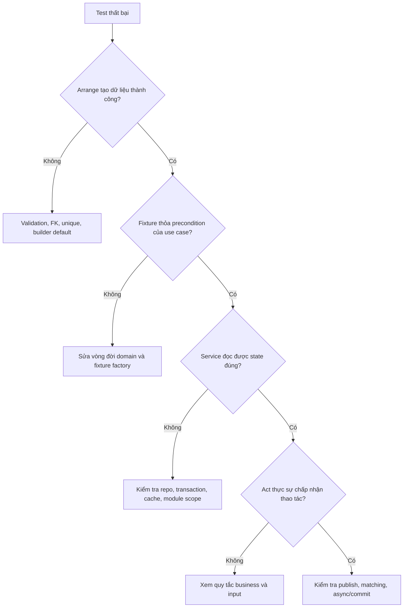

# Lỗi fixture không tạo được trạng thái hợp lệ

## Mục tiêu bài học

Trong chương **Test failure** của **SPRING_MODULITH_VERIFICATION_TESTING**, một bài `@ApplicationModuleTest` có thể khởi động thành công nhưng vẫn thất bại dù logic đang kiểm tra không sai. Nguyên nhân thường nằm ở bước **Arrange**: fixture đã tạo ra một object hoặc bản ghi database nhưng **chưa tạo được trạng thái nghiệp vụ mà use case yêu cầu**.

Ví dụ: test mong `OrderPaid` được phát khi thanh toán, nhưng đơn được chuẩn bị bằng fixture vẫn ở trạng thái `DRAFT`, chưa có dòng hàng hợp lệ hoặc chưa được xác nhận. `PaymentService` từ chối thao tác theo đúng quy tắc, nên không có event nào xuất hiện. Nếu chỉ nhìn assertion `PublishedEvents`, ta rất dễ chẩn đoán nhầm thành “publisher phát thiếu event”.

Sau bài này, bạn có thể:

- Xác định **tiền điều kiện của use case** và kiểm tra chúng ngay tại ranh giới fixture.
- Phân biệt **fixture tạo object**, **fixture tạo trạng thái nghiệp vụ hợp lệ**, và **fixture đã được lưu/commit để code under test đọc thấy**.
- Tái hiện lỗi fixture ở ba thời điểm: *khi tạo dữ liệu*, *khi gọi use case*, *khi quan sát kết quả*.
- Xây fixture factory rõ ý định như `confirmedOrder(…)`, thay vì builder có mặc định thiếu hợp đồng.
- Viết Java/JUnit 5 test dùng `@ApplicationModuleTest`, `PublishedEvents` và AssertJ để chứng minh fixture hợp lệ trước khi kiểm tra `OrderPaid`.
- Chẩn đoán lỗi từ JPA constraints, quan hệ parent–child, test transaction, `flush()`, `clear()`, visibility và dữ liệu bị chia sẻ.
- Chọn đúng cách seed dữ liệu khi phụ thuộc thuộc module khác mà không import implementation nội bộ sai ranh giới.
- Thiết kế quality gate CI phát hiện fixture sai sớm, có thông báo hữu ích và không phụ thuộc giờ hệ thống.

**Phạm vi:** Tập trung vào độ đúng và tính tái lập của fixture, không lặp lại kiến thức Spring Boot nhập môn. Các phần về event, database và kiểm chứng kiến trúc chỉ nhằm giúp **xác định fixture nào phục vụ được hợp đồng test**.

## 1. Mẫu lỗi: test kỳ vọng PAID nhưng fixture chỉ tạo DRAFT

Quy tắc nghiệp vụ mẫu của module `orders`:

```text
      Tạo đơn
         │
         ▼
       DRAFT
         │ addLine(sku, quantity, unitPrice)
         │ confirm(): phải có ít nhất một dòng hợp lệ
         ▼
     CONFIRMED
         │ pay(paymentId)
         │ → publish OrderPaid
         ▼
        PAID
```

**Hợp đồng của `pay(…)`**: đơn phải ở `CONFIRMED`, có ít nhất một dòng hàng hợp lệ và thanh toán chưa được ghi nhận. Khi thành công, nó đổi trạng thái thành `PAID` và phát đúng một `OrderPaid` cho `orderId`.

Một fixture sai điển hình:

```java
// Arrange bị thiếu một bước quan trọng.
Order order = Order.draft(orderId, customerId);
order.addLine(new OrderLine(
        "SKU-BOOK", 2, new BigDecimal("75.00")));
orders.save(order);

// Act: use case đúng khi từ chối vì order vẫn là DRAFT.
paymentService.pay(orderId, paymentId);
```

Nếu test sau đó viết:

```java
assertThat(events.ofType(OrderPaid.class)
        .matching(e -> orderId.equals(e.orderId())))
        .hasSize(1);
```

thì assertion có thể fail với **actual = 0**. Nhưng dữ liệu mẫu đã sai trước khi tới publisher: fixture chưa gọi `order.confirm()`.

### 1.1. “Hợp lệ” có nhiều cấp độ

| Cấp độ | Ví dụ | Đủ để test thanh toán chưa? |
| --- | --- | --- |
| **Hợp lệ theo Java type** | `Order` được khởi tạo, có `UUID` | Chưa |
| **Hợp lệ theo validation field** | SKU không rỗng, quantity dương | Chưa |
| **Hợp lệ theo invariant aggregate** | Có dòng hàng, tổng tiền dương | Chưa, nếu status còn DRAFT |
| **Hợp lệ theo state machine** | `status == CONFIRMED` | Có thể, nếu các tiền điều kiện khác đúng |
| **Hợp lệ theo persistence** | `Order` đã được lưu và truy vấn lại | Cần nếu service đọc repository |
| **Hợp lệ theo transaction visibility** | Reader của service nhìn thấy bản ghi đã commit | Cần với test có transaction/thread độc lập |
| **Hợp lệ theo module scope** | Bean/repository/fixture dependency được bootstrap phù hợp | Cần nếu test chạy trong module context |

Một object non-null hoặc một row tồn tại chưa đủ để gọi là **valid fixture**. Hãy xuất phát từ điều kiện của use case đang test.

## 2. Ba vị trí test có thể thất bại vì fixture

### A. Lỗi ngay trong Arrange

```java
var line = new OrderLine(
        "SKU-BOOK", 0, new BigDecimal("75.00"));
```

Nếu `OrderLine` quy định `quantity > 0`, constructor ném `IllegalArgumentException` **trước khi use case chạy**. Đây là fixture fail, không phải regression của service thanh toán.

Trong test JPA, lỗi dạng này có thể xuất hiện khi `persistAndFlush` vì `@NotNull`, foreign key hoặc unique constraint chưa được thỏa.

### B. Arrange thành công nhưng Act bị từ chối

```java
Order draft = Order.draft(orderId, customerId);
draft.addLine(validLine);
repository.save(draft);

paymentService.pay(orderId, paymentId); // Fail: expected CONFIRMED.
```

Lỗi như `IllegalStateException("Only CONFIRMED orders can be paid")` xuất hiện **tại use case**, nhưng nguyên nhân trực tiếp là dữ liệu test không đáp ứng tiền điều kiện.

### C. Act chạy nhưng assertion không thấy outcome

Có những mô hình service trả `false` hoặc business result `REJECTED` thay vì ném exception. Khi đó test có thể đi đến `PublishedEvents` hoặc `Scenario` và thấy không có event/state mong đợi. Cần xem **kết quả của Act và trạng thái nguồn**, không chỉ event count.



**Quy tắc chẩn đoán:** ưu tiên xác minh đúng **tiền điều kiện trước Act**; đừng thay đổi expectation của event để bù cho dữ liệu Arrange sai.

## 3. Ví dụ Java: domain model có invariant rõ ràng

Ví dụ dùng Java 17+, Spring Boot, Spring Modulith, JUnit Jupiter và AssertJ. Để test fixture một cách tập trung, repository mẫu là **in-memory**, không có JPA/transaction; các lỗi persistence thật được trình bày riêng ở phần sau.

```text
src/main/java/com/example/shop/
├── ShopApplication.java                 # @SpringBootApplication
└── orders/
    ├── OrderStatus.java
    ├── OrderLine.java
    ├── Order.java
    ├── OrderRepository.java
    ├── InMemoryOrderRepository.java
    ├── OrderPaid.java
    └── OrderPaymentService.java

src/test/java/com/example/shop/orders/
├── OrderFixtures.java
├── OrderFixtureContractTests.java
└── OrderPaymentModuleTests.java
```

Các class ví dụ nằm cùng package `orders` để tập trung vào fixture và state machine. Trong dự án thật, có thể chuyển aggregate/repository implementation vào package nội bộ của module trong khi giữ public event/API cần thiết ở ranh giới phù hợp.

### 3.1. Status và line item

Tệp `OrderStatus.java`:

```java
package com.example.shop.orders;

public enum OrderStatus {
    DRAFT, CONFIRMED, PAID
}
```

Tệp `OrderLine.java`:

```java
package com.example.shop.orders;

import java.math.BigDecimal;
import java.util.Objects;

public record OrderLine(
        String sku,
        int quantity,
        BigDecimal unitPrice) {

    public OrderLine {
        if (sku == null || sku.isBlank()) {
            throw new IllegalArgumentException("sku is required");
        }
        if (quantity <= 0) {
            throw new IllegalArgumentException(
                    "quantity must be positive");
        }
        Objects.requireNonNull(unitPrice, "unitPrice");
        if (unitPrice.signum() <= 0) {
            throw new IllegalArgumentException(
                    "unitPrice must be positive");
        }
    }

    public BigDecimal subtotal() {
        return unitPrice.multiply(
                BigDecimal.valueOf(quantity));
    }
}
```

Constructor bảo vệ **invariant cấp dòng hàng**: một fixture có quantity bằng 0 bị từ chối ngay ở Arrange. Với số tiền, dùng `BigDecimal(String)` thay vì `new BigDecimal(double)` để tránh sai số do biểu diễn `double`.

### 3.2. Aggregate kiểm soát chuyển trạng thái

Tệp `Order.java`:

```java
package com.example.shop.orders;

import java.math.BigDecimal;
import java.util.ArrayList;
import java.util.List;
import java.util.Objects;
import java.util.UUID;

public class Order {

    private final UUID id;
    private final UUID customerId;
    private final List<OrderLine> lines = new ArrayList<>();
    private OrderStatus status = OrderStatus.DRAFT;
    private UUID paymentId;

    private Order(UUID id, UUID customerId) {
        this.id = Objects.requireNonNull(id, "id");
        this.customerId =
                Objects.requireNonNull(customerId, "customerId");
    }

    public static Order draft(UUID id, UUID customerId) {
        return new Order(id, customerId);
    }

    public void addLine(OrderLine line) {
        if (status != OrderStatus.DRAFT) {
            throw new IllegalStateException(
                    "Lines can only be added in DRAFT");
        }
        lines.add(Objects.requireNonNull(line, "line"));
    }

    public void confirm() {
        if (status != OrderStatus.DRAFT) {
            throw new IllegalStateException(
                    "Only DRAFT orders can be confirmed");
        }
        if (lines.isEmpty()) {
            throw new IllegalStateException(
                    "Cannot confirm an empty order");
        }
        status = OrderStatus.CONFIRMED;
    }

    public void markPaid(UUID newPaymentId) {
        Objects.requireNonNull(newPaymentId, "paymentId");
        if (status != OrderStatus.CONFIRMED) {
            throw new IllegalStateException(
                    "Only CONFIRMED orders can be paid");
        }
        paymentId = newPaymentId;
        status = OrderStatus.PAID;
    }

    public BigDecimal total() {
        return lines.stream()
                .map(OrderLine::subtotal)
                .reduce(BigDecimal.ZERO, BigDecimal::add);
    }

    public UUID id() {
        return id;
    }

    public UUID customerId() {
        return customerId;
    }

    public OrderStatus status() {
        return status;
    }

    public UUID paymentId() {
        return paymentId;
    }

    public List<OrderLine> lines() {
        return List.copyOf(lines);
    }
}
```

**Điểm quan trọng cho fixture:** Không có setter công khai `setStatus(CONFIRMED)`. Muốn có đơn hợp lệ ở trạng thái `CONFIRMED`, fixture phải đi qua **`addLine(…)` và `confirm()`**. Điều này khiến test tuân thủ invariant thay vì trực tiếp ép một enum rồi bỏ sót những điều kiện khác.

### 3.3. Repository in-memory

Tệp `OrderRepository.java`:

```java
package com.example.shop.orders;

import java.util.Optional;
import java.util.UUID;

public interface OrderRepository {

    Optional<Order> findById(UUID id);

    void save(Order order);

    void deleteById(UUID id);
}
```

Tệp `InMemoryOrderRepository.java`:

```java
package com.example.shop.orders;

import java.util.Optional;
import java.util.UUID;
import java.util.concurrent.ConcurrentHashMap;
import java.util.concurrent.ConcurrentMap;
import org.springframework.stereotype.Repository;

@Repository
class InMemoryOrderRepository implements OrderRepository {

    private final ConcurrentMap<UUID, Order> data =
            new ConcurrentHashMap<>();

    @Override
    public Optional<Order> findById(UUID id) {
        return Optional.ofNullable(data.get(id));
    }

    @Override
    public void save(Order order) {
        data.put(order.id(), order);
    }

    @Override
    public void deleteById(UUID id) {
        data.remove(id);
    }
}
```

Repository demo giữ **tham chiếu tới object mutable**, vì vậy nó không mô phỏng JPA dirty checking, transaction isolation hay rollback. Điều này giúp test phản ánh trực tiếp invariant của fixture; test persistence thật phải chứng minh riêng rằng bản ghi thực sự đã flush/commit và có thể đọc lại.

### 3.4. Use case thanh toán và domain event

Tệp `OrderPaid.java`:

```java
package com.example.shop.orders;

import java.math.BigDecimal;
import java.util.UUID;

public record OrderPaid(
        UUID orderId,
        UUID paymentId,
        BigDecimal amount) {
}
```

Tệp `OrderPaymentService.java`:

```java
package com.example.shop.orders;

import java.util.Objects;
import java.util.UUID;
import org.springframework.context.ApplicationEventPublisher;
import org.springframework.stereotype.Service;

@Service
public class OrderPaymentService {

    private final OrderRepository orders;
    private final ApplicationEventPublisher publisher;

    public OrderPaymentService(
            OrderRepository orders,
            ApplicationEventPublisher publisher) {
        this.orders = orders;
        this.publisher = publisher;
    }

    public void pay(UUID orderId, UUID paymentId) {
        Objects.requireNonNull(orderId, "orderId");
        Objects.requireNonNull(paymentId, "paymentId");

        Order order = orders.findById(orderId)
                .orElseThrow(() ->
                        new IllegalArgumentException(
                                "Order not found: " + orderId));

        order.markPaid(paymentId);
        orders.save(order);

        publisher.publishEvent(new OrderPaid(
                order.id(), paymentId, order.total()));
    }
}
```

Đây là service demo cho một **module behavior test đồng bộ**. Trong ứng dụng dùng database, việc cập nhật trạng thái và publication cần transaction/outbox hoặc cơ chế event phù hợp; phương thức này **chưa đảm bảo atomicity giữa database và event**. Bài đang kiểm chứng **fixture tạo đúng tiền điều kiện** để use case chạy.

## 4. Fixture factory: tên thể hiện trạng thái bảo đảm

Thay vì viết một `OrderBuilder` với `status = DRAFT` rồi để từng test nhớ gọi `confirm()`, tạo test factory có **tên diễn tả trạng thái kết quả**.

Tệp `src/test/java/com/example/shop/orders/OrderFixtures.java`:

```java
package com.example.shop.orders;

import java.math.BigDecimal;
import java.util.UUID;

final class OrderFixtures {

    private OrderFixtures() {
    }

    static Order draftWithOneLine(
            UUID orderId, UUID customerId) {

        Order order = Order.draft(orderId, customerId);
        order.addLine(new OrderLine(
                "SKU-BOOK", 2, new BigDecimal("75.00")));
        return order;
    }

    static Order confirmedOrder(
            UUID orderId, UUID customerId) {

        Order order = draftWithOneLine(orderId, customerId);
        order.confirm();
        return order;
    }
}
```

Hai phương thức được đặt tên **cố tình khác nhau**:

- `draftWithOneLine(…)` tạo đơn **DRAFT có dòng hàng**, phù hợp khi test chức năng xác nhận đơn.
- `confirmedOrder(…)` tạo đơn **CONFIRMED có dòng hàng hợp lệ**, phù hợp khi test thanh toán.

Không thêm một tham số tùy tiện như `boolean valid` hoặc `int stateCode` khiến người đọc phải đoán. Fixture nên diễn tả **ngôn ngữ nghiệp vụ**, không chỉ trạng thái kỹ thuật.

### 4.1. Kiểm chứng bản thân fixture trước khi dùng

Tệp `src/test/java/com/example/shop/orders/OrderFixtureContractTests.java`:

```java
package com.example.shop.orders;

import static org.assertj.core.api.Assertions.assertThat;
import static org.assertj.core.api.Assertions.assertThatThrownBy;

import java.math.BigDecimal;
import java.util.UUID;
import org.junit.jupiter.api.Test;

class OrderFixtureContractTests {

    @Test
    void confirmedFixtureHasPaymentPreconditions() {
        UUID orderId = UUID.randomUUID();
        UUID customerId = UUID.randomUUID();
        Order order = OrderFixtures.confirmedOrder(
                orderId, customerId);

        assertThat(order.id()).isEqualTo(orderId);
        assertThat(order.customerId()).isEqualTo(customerId);
        assertThat(order.status()).isEqualTo(OrderStatus.CONFIRMED);
        assertThat(order.lines()).hasSize(1);
        assertThat(order.total())
                .isEqualByComparingTo(new BigDecimal("150.00"));
        assertThat(order.paymentId()).isNull();
    }

    @Test
    void draftFixtureDoesNotPretendToBeConfirmed() {
        Order order = OrderFixtures.draftWithOneLine(
                UUID.randomUUID(), UUID.randomUUID());

        assertThat(order.status()).isEqualTo(OrderStatus.DRAFT);
        assertThat(order.total()).isPositive();
    }

    @Test
    void invalidLineFailsDuringArrange() {
        assertThatThrownBy(() ->
                new OrderLine(
                        "SKU-BOOK", 0, new BigDecimal("75.00")))
                .isInstanceOf(IllegalArgumentException.class)
                .hasMessage("quantity must be positive");
    }

    @Test
    void emptyOrderCannotBeConfirmed() {
        Order order = Order.draft(
                UUID.randomUUID(), UUID.randomUUID());

        assertThatThrownBy(order::confirm)
                .isInstanceOf(IllegalStateException.class)
                .hasMessage("Cannot confirm an empty order");
    }
}
```

Những test này không cần Spring context: chúng xác nhận **fixture contract** và invariant của aggregate bằng JUnit thuần. Nếu một người sửa `OrderFixtures.confirmedOrder(…)` rồi vô tình bỏ `confirm()`, lỗi được chỉ ra ngay ở tên test fixture thay vì biểu hiện gián tiếp thành một `PublishedEvents` assertion fail.

## 5. Module test: xác minh fixture trước Act, rồi mới assert event

Tệp `src/test/java/com/example/shop/orders/OrderPaymentModuleTests.java`:

```java
package com.example.shop.orders;

import static org.assertj.core.api.Assertions.assertThat;
import static org.assertj.core.api.Assertions.assertThatThrownBy;

import java.math.BigDecimal;
import java.util.UUID;
import org.junit.jupiter.api.Test;
import org.springframework.beans.factory.annotation.Autowired;
import org.springframework.modulith.test.ApplicationModuleTest;
import org.springframework.modulith.test.PublishedEvents;

@ApplicationModuleTest
class OrderPaymentModuleTests {

    @Autowired
    OrderRepository orders;

    @Autowired
    OrderPaymentService paymentService;

    @Test
    void validConfirmedFixtureCanBePaidAndPublishesOneEvent(
            PublishedEvents events) {

        UUID orderId = UUID.randomUUID();
        UUID customerId = UUID.randomUUID();
        UUID paymentId = UUID.randomUUID();

        Order fixture =
                OrderFixtures.confirmedOrder(orderId, customerId);

        try {
            orders.save(fixture);

            // Assertion của Arrange: chặn lỗi fixture trước Act.
            Order stored = orders.findById(orderId).orElseThrow();
            assertThat(stored.status())
                    .as("payment prerequisite")
                    .isEqualTo(OrderStatus.CONFIRMED);
            assertThat(stored.lines()).isNotEmpty();
            assertThat(stored.total())
                    .isEqualByComparingTo(new BigDecimal("150.00"));

            // Act
            paymentService.pay(orderId, paymentId);

            // Assert trạng thái thật của use case.
            Order after = orders.findById(orderId).orElseThrow();
            assertThat(after.status()).isEqualTo(OrderStatus.PAID);
            assertThat(after.paymentId()).isEqualTo(paymentId);

            // Assert số lần, khóa tương quan và payload event.
            var paid = events.ofType(OrderPaid.class)
                    .matching(event ->
                            orderId.equals(event.orderId()));

            assertThat(paid)
                    .hasSize(1)
                    .allSatisfy(event -> {
                        assertThat(event.paymentId())
                                .isEqualTo(paymentId);
                        assertThat(event.amount())
                                .isEqualByComparingTo(
                                        new BigDecimal("150.00"));
                    });
        } finally {
            orders.deleteById(orderId);
        }
    }

    @Test
    void draftFixtureIsRejectedBeforePublishing(
            PublishedEvents events) {

        UUID orderId = UUID.randomUUID();
        UUID customerId = UUID.randomUUID();
        UUID paymentId = UUID.randomUUID();

        try {
            orders.save(OrderFixtures.draftWithOneLine(
                    orderId, customerId));

            assertThat(orders.findById(orderId)
                    .orElseThrow().status())
                    .isEqualTo(OrderStatus.DRAFT);

            assertThatThrownBy(() ->
                    paymentService.pay(orderId, paymentId))
                    .isInstanceOf(IllegalStateException.class)
                    .hasMessage(
                            "Only CONFIRMED orders can be paid");

            assertThat(events.ofType(OrderPaid.class)
                    .matching(event ->
                            orderId.equals(event.orderId())))
                    .isEmpty();
        } finally {
            orders.deleteById(orderId);
        }
    }

    @Test
    void missingOrderDoesNotPublishPaymentEvent(
            PublishedEvents events) {

        UUID orderId = UUID.randomUUID();
        UUID paymentId = UUID.randomUUID();

        assertThatThrownBy(() ->
                paymentService.pay(orderId, paymentId))
                .isInstanceOf(IllegalArgumentException.class)
                .hasMessage("Order not found: " + orderId);

        assertThat(events.ofType(OrderPaid.class)
                .matching(event ->
                        orderId.equals(event.orderId())))
                .isEmpty();
    }
}
```

### 5.1. Diễn giải ba test

| Test | Fixture | Điều cần chứng minh | Khi lỗi, nghi ngờ đầu tiên |
| --- | --- | --- | --- |
| `validConfirmedFixtureCanBePaidAndPublishesOneEvent` | `confirmedOrder` | CONFIRMED → PAID và một `OrderPaid` | Invariant Arrange, persist/readback, rồi service/publisher |
| `draftFixtureIsRejectedBeforePublishing` | `draftWithOneLine` | DRAFT bị từ chối, không có `OrderPaid` | Nếu service chấp nhận sai, mới là bug nghiệp vụ |
| `missingOrderDoesNotPublishPaymentEvent` | Không seed order | Không được pay đơn không tồn tại | Repository lookup hoặc error handling |

**Không nên** giữ một bài happy-path test dùng `draftWithOneLine` nhưng vẫn mong service pay thành công. Nếu dùng fixture sai rồi “sửa” test bằng cách bỏ assertion status, bài test chỉ che nguyên nhân.

### 5.2. Tại sao test negative phải cố ý tạo trạng thái invalid?

Trạng thái `DRAFT` **không sai trong toàn hệ thống**; nó chỉ **không hợp lệ cho use case thanh toán**. Do đó:

- Happy path dùng fixture `confirmedOrder`.
- Negative path có chủ đích dùng fixture `draftWithOneLine` để kiểm tra service từ chối.

“Fixture không hợp lệ” luôn phải được hiểu **so với hành động đang kiểm tra**. Một đơn DRAFT là hợp lệ cho màn hình chỉnh sửa giỏ hàng nhưng không hợp lệ để tạo `OrderPaid`.

### 5.3. Assertion ở Arrange có đang kiểm thử lại implementation?

Đừng chép toàn bộ business validation vào test fixture. Assertion ngắn về **trạng thái đầu vào của use case** giúp thông báo lỗi chính xác hơn:

```java
assertThat(stored.status())
        .as("payment prerequisite")
        .isEqualTo(OrderStatus.CONFIRMED);
```

Nó không yêu cầu test kiểm tra từng dòng code của `Order.confirm()`. Các unit tests cho invariant và các module tests cho hành vi vẫn có trách nhiệm riêng.

## 6. Bảng kiểm invariant trước khi gọi use case

Với use case `pay(…)` ở ví dụ, checklist:

| Precondition | Phép kiểm ngay sau fixture | Lỗi thường gặp |
| --- | --- | --- |
| Có bản ghi order | `orders.findById(id).isPresent()` | Seed chưa save, sai ID |
| Đúng khách hàng | `stored.customerId().equals(customerId)` | Builder gán customer khác |
| Có ít nhất một line | `!stored.lines().isEmpty()` | Quên add line hoặc cascade không lưu |
| Số lượng từng line dương | Được `OrderLine` constructor kiểm tra | Builder mặc định quantity = 0 |
| Đơn đã xác nhận | `status == CONFIRMED` | Quên gọi `confirm()` |
| Tổng tiền khớp | `total == 150.00` theo `BigDecimal.compareTo` | Dùng `double`, sai quantity/unitPrice |
| Chưa có payment trước | `paymentId == null` | Fixture tái sử dụng state PAID |
| Service đọc đúng ID | Lookup với `orderId` seed | Truy vấn nhầm UUID, test data khác |
| Dữ liệu thấy được trong transaction | Readback sau commit khi cần | Seed trong transaction chưa commit |

**Cách giảm lỗi:** Đặt trạng thái phải thỏa vào **tên fixture**, và biến các bất biến quan trọng thành unit test tự chạy. Không dùng một builder “đầy đủ mọi field” rồi luôn mặc định trạng thái ngẫu nhiên.

## 7. Builder mặc định sai: lỗi khó phát hiện hơn constructor ném exception

Một test data builder có vẻ tiện:

```java
class OrderTestBuilder {
    UUID orderId = UUID.randomUUID();
    UUID customerId = UUID.randomUUID();
    String sku = "SKU-BOOK";
    int quantity = 0; // Sai: mặc định invalid.
    BigDecimal unitPrice = new BigDecimal("75.00");
}
```

Nếu `build()` gọi `new OrderLine(sku, quantity, unitPrice)`, test fail ở Arrange. Nếu builder bypass validation và lưu entity trực tiếp, lỗi có thể chỉ xuất hiện tại `flush()` hoặc tận lúc service tính total. Mỗi kiểu thất bại đòi đọc log ở bước khác.

### 7.1. Đặt default hợp lệ, biến thể lỗi phải tường minh

```java
final class OrderLineFixtures {

    static OrderLine validBookLine() {
        return new OrderLine(
                "SKU-BOOK", 2, new BigDecimal("75.00"));
    }

    static OrderLine oneBook() {
        return new OrderLine(
                "SKU-BOOK", 1, new BigDecimal("75.00"));
    }
}
```

Nếu test cần quantity invalid, tạo trực tiếp trong một **negative test** với `assertThatThrownBy`. Không tạo một fixture chung mặc định quantity = 0, vì mọi happy-path test sẽ phụ thuộc một giá trị sai mà không rõ nguyên nhân.

### 7.2. Tránh “bật cờ valid” không gắn với transition

Ví dụ:

```java
Order order = builder.valid(true).build();
```

Không rõ `valid(true)` có nghĩa gì: đủ dòng, status CONFIRMED, payment đã tạo, hay database FK tồn tại? Hãy thay bằng tên theo nghiệp vụ:

```java
Order order = OrderFixtures.confirmedOrder(orderId, customerId);
```

Nếu cần một trạng thái tương lai phức tạp, thêm factory `paidOrder(…)` đi qua **transition hợp lệ** (hoặc seed một snapshot có contract rõ cho test read model), không cho mọi test set các field bất biến tùy tiện.

### 7.3. Không chia sẻ một mutable fixture cho nhiều test

```java
static final Order SHARED_ORDER = ...; // Không khuyến khích.
```

Nếu test A gọi `markPaid()`, test B dùng lại cùng object sẽ thấy `PAID` thay vì `CONFIRMED`. Test có thể fail phụ thuộc thứ tự hoặc chạy song song.

Tạo một fixture **mới cho từng test**, với ID riêng, và cleanup state được lưu ở repository. Spring Test context cache có thể giữ singleton repository; điều đó làm việc cô lập dữ liệu càng quan trọng.

## 8. JPA: fixture hợp lệ trong Java nhưng chưa hợp lệ trong database

Phần Java ở trên dùng repository in-memory. Trong project có JPA, fixture còn phải thỏa:

- `@NotNull` và cột `NOT NULL`.
- Foreign key tới `customer`/`product`.
- Unique constraints như `order_number` hoặc `payment_id`.
- Relationship ownership, cascade và lifecycle của entity.
- Enum/status mapping và mọi check constraint ở database.
- Dữ liệu cần thiết cho query join hoặc domain rule.
- Transaction commit/rollback và khả năng đọc lại từ context của use case.

### 8.1. Vì sao save() chưa đủ?

Ví dụ JPA giả định:

```java
OrderEntity order = new OrderEntity();
order.setCustomer(customer); // customer phải managed/persisted.
order.setStatus(OrderStatus.CONFIRMED);
orderRepository.save(order);
```

Đây là đoạn minh họa với entity/repository của **dự án thực tế**, không phải các class `Order` in-memory ở phần 3. Lời gọi `save(…)` không chứng minh mọi constraint đã được database xác nhận tại thời điểm đó. SQL có thể được thực thi khi `flush()` hoặc commit, và lỗi có thể xuất hiện muộn hơn.

Khi debug fixture JPA:

1. Lưu các parent rows cần thiết.
2. Liên kết child rows đúng **owning side** và cascade configuration.
3. `flush()` để ép một số constraint lỗi xuất hiện trong Arrange.
4. `clear()` nếu cần loại dữ liệu còn nằm trong first-level cache.
5. Truy vấn lại bằng repository để kiểm tra trạng thái mà use case sẽ đọc.

### 8.2. Mẫu @DataJpaTest xác minh fixture persistence

Đây là **mẫu tích hợp vào dự án có entity/repository riêng**; các class `CustomerEntity`, `OrderEntity` và `OrderJpaRepository` được giả định đã tồn tại với constructor/field phù hợp:

```java
@DataJpaTest
class OrderJpaFixtureTests {

    @Autowired
    TestEntityManager entityManager;

    @Autowired
    OrderJpaRepository orders;

    @Test
    void confirmedOrderFixtureCanBePersistedAndReadBack() {
        var customer = new CustomerEntity("customer-001");
        entityManager.persistAndFlush(customer);

        var order = OrderEntity.confirmedFor(customer);
        order.addLine("SKU-BOOK", 2, new BigDecimal("75.00"));
        entityManager.persistAndFlush(order);
        entityManager.clear();

        OrderEntity stored = orders.findById(order.getId())
                .orElseThrow();

        assertThat(stored.getStatus())
                .isEqualTo(OrderStatus.CONFIRMED);
        assertThat(stored.getLines()).hasSize(1);
    }
}
```

Đoạn trên dùng `org.springframework.boot.test.autoconfigure.orm.jpa.DataJpaTest`, `org.springframework.boot.test.autoconfigure.orm.jpa.TestEntityManager` ở các version Spring Boot hỗ trợ các package này, JUnit/AssertJ. Vì entity/repository là **phụ thuộc theo thiết kế ứng dụng**, cần thay bằng API thật của dự án; không tự mang đoạn này vào project chưa có các kiểu ấy và kỳ vọng compile.

**Điểm cần học:** Readback sau `persistAndFlush` và `clear` kiểm tra **fixture có tồn tại ở tầng persistence**, thay vì chỉ assert field trên object vừa new. Tuy nhiên, `flush()` không đồng nghĩa **commit**; test `@DataJpaTest` thường chạy transaction và rollback, nên đây **chưa phải** kiểm tra visibility từ transaction khác.

### 8.3. Các exception giúp định vị fixture

| Exception / dấu hiệu | Điều cần kiểm tra trước |
| --- | --- |
| `jakarta.validation.ConstraintViolationException` | Field Bean Validation thiếu/invalid, validation group |
| `org.hibernate.PropertyValueException` | Thuộc tính bắt buộc null hoặc transient reference |
| `org.hibernate.TransientPropertyValueException` | Child tham chiếu parent chưa persisted và không cascade phù hợp |
| `org.springframework.dao.DataIntegrityViolationException` | FK, NOT NULL, unique/check constraint, SQL constraint |
| `org.hibernate.exception.ConstraintViolationException` | Constraint SQL/Hibernate; khác loại Jakarta Bean Validation |
| `org.springframework.orm.jpa.JpaObjectRetrievalFailureException` | Quan hệ tham chiếu row không tồn tại trong DB |
| `jakarta.persistence.EntityNotFoundException` | Entity được tham chiếu không tồn tại khi truy cập |
| `org.hibernate.LazyInitializationException` | Quan hệ lazy được đọc ngoài persistence context còn hoạt động |
| `NoSuchBeanDefinitionException` trước test | Test context không có bean/repository, **chưa** phải fixture state invalid |

Tên exception, tầng wrap và thời điểm xuất hiện thay đổi theo Spring/Hibernate/driver. Khi thấy `DataIntegrityViolationException`, đọc **root cause SQL constraint** và đối chiếu trường trong fixture; không mặc định lỗi nằm ở repository production.

## 9. Parent–child và @Sql: dữ liệu có thể sai thứ tự tạo

Giả sử test database có ba bảng:

```text
customers(id)
    │
    └── orders(id, customer_id, status)
             │
             └── order_lines(id, order_id, sku, quantity, unit_price)
```

Một fixture SQL chỉ insert `orders` mà không có `customers` sẽ có thể vi phạm foreign key:

```sql
-- Sai: customer 'C1' chưa tồn tại.
INSERT INTO orders(id, customer_id, status)
VALUES ('O1', 'C1', 'CONFIRMED');
```

Mẫu **thứ tự seed** đúng hơn (giả định schema/test DB cho phép các ID dạng text):

```sql
INSERT INTO customers(id) VALUES ('C1');

INSERT INTO orders(id, customer_id, status)
VALUES ('O1', 'C1', 'CONFIRMED');

INSERT INTO order_lines(
    id, order_id, sku, quantity, unit_price
) VALUES (
    'L1', 'O1', 'SKU-BOOK', 2, 75.00
);
```

**Đây là schema minh họa**, không phải file SQL tồn tại trong dự án. Nếu ID thực là UUID, dùng UUID hợp lệ và kiểu dữ liệu đúng; các cột khác có `NOT NULL` cũng phải được seed. Không copy raw SQL trước khi đối chiếu DDL của test database.

### 9.1. Dùng @Sql trong test có hợp đồng fixture rõ

```java
@Sql(
        scripts = "/fixtures/confirmed-order.sql",
        executionPhase = Sql.ExecutionPhase.BEFORE_TEST_METHOD)
@Test
void testWithSeededConfirmedOrder() {
    // Kiểm tra readback CONFIRMED trước khi pay.
}
```

Đây là snippet nếu dự án thực sự có tệp SQL được đặt trong classpath test, và cần import `org.springframework.test.context.jdbc.Sql`. Trong bài viết này **không tạo tệp SQL** vì phạm vi chỉ có một Markdown và một YAML được giao. Đừng giả định tệp SQL tham chiếu đã tồn tại.

Điều quan trọng:

- Fixture SQL phải **idempotent hoặc được dọn sạch có kiểm soát**.
- Nếu test chạy song song, ID cố định `O1` có thể va chạm.
- Nếu script chạy trong transaction riêng chưa commit, use case ở thread khác có thể không đọc thấy.
- `@Sql` được chạy trước test không đồng nghĩa entity đã đúng vòng đời theo các domain methods; cần xác định có đang intentionally seed một **read model snapshot** hay không.

## 10. Trạng thái đã save nhưng use case vẫn không thấy: transaction visibility

Đây là lỗi fixture thường bị chẩn đoán nhầm thành “repository không tìm thấy order”.

### 10.1. @Transactional trên test có thể giữ dữ liệu chưa commit

Ví dụ:

```java
@Test
@Transactional
void paymentFixtureNotVisibleToAsyncListener() {
    // Arrange: insert confirmed order trong test-managed transaction.
    // Act: publish event để async listener ở thread khác load order.
    // Listener có transaction/thread riêng và có thể không thấy row
    // chưa commit của test.
}
```

Spring Test thường rollback transaction của test sau khi method kết thúc. Nếu một async listener ở thread khác dùng một DB connection khác, nó có thể **không thấy dữ liệu seed chưa commit** theo isolation thông thường. Một listener `AFTER_COMMIT` còn có thể **không chạy** vì test transaction không commit.

Điểm mấu chốt: fixture đúng về field/status nhưng **chưa visible theo contract transaction**, nên test vẫn fail.

### 10.2. Tạo seed đã commit bằng TransactionTemplate khi cần

Với một integration test dùng transaction manager thật và **không có transaction bao ngoài**:

```java
TransactionTemplate tx =
        new TransactionTemplate(transactionManager);

tx.executeWithoutResult(status -> {
    // Dùng repository JPA thật của dự án.
    customerRepository.save(customer);
    orderRepository.save(confirmedOrderEntity);
});

// Sau khi transaction do template sở hữu commit thành công,
// test/async listener ở transaction khác có thể truy vấn lại.
var actual = orderRepository.findById(orderId).orElseThrow();
assertThat(actual.getStatus()).isEqualTo(OrderStatus.CONFIRMED);
```

Các tên `customerRepository`, `orderRepository`, `confirmedOrderEntity`, `transactionManager` là những thành phần cần có trong **integration test thực tế**; snippet không phải code độc lập. Nếu test đã có `@Transactional` bao ngoài, `TransactionTemplate` mặc định `REQUIRED` có thể chỉ **tham gia** transaction đó và **không commit độc lập**.

Không dùng `REQUIRES_NEW` như một mẹo mặc định mà bỏ qua dữ liệu nguồn: nếu transaction mới cần nhìn parent rows của transaction chưa commit, nó vẫn có thể không thấy. Hãy xác định **ai sở hữu transaction và thời điểm commit** theo luồng được kiểm tra.

### 10.3. Flush không phải commit, clear không phải reload qua transaction khác

- `entityManager.flush()`: đẩy thao tác SQL đang pending; **không kết thúc transaction**.
- `entityManager.clear()`: bỏ entity khỏi persistence context hiện tại; **không commit**.
- `repository.findById(…)` trong cùng transaction: có thể thấy dữ liệu chưa commit do chính transaction đó ghi.
- Reader ở một transaction/connection khác: chịu transaction isolation và thời điểm commit.

Vì vậy, một fixture `assertThat(repo.findById(id)).isPresent()` trong transaction test **không chứng minh** listener async sẽ thấy row ấy. Muốn chứng minh visibility, cần kiểm thử bằng transaction reader phù hợp sau commit.

## 11. Fixture ở module khác: seed đúng boundary

Trong ứng dụng modular, `orders` có thể cần một **customer active** hoặc **stock reserved** từ các module `customers`/`inventory`. Lỗi fixture xảy ra khi test cố gọi một public use case nhưng dependency state ở module khác chưa được chuẩn bị.

Ví dụ:

```text
orders.OrderPaymentService
  └── customers.CustomerEligibility (public API)
         └── kiểm tra customer ACTIVE

Fixture chỉ tạo order CONFIRMED,
nhưng customer chưa ACTIVE → pay bị từ chối
→ không có OrderPaid.
```

### 11.1. Module contract test: dùng test double cho public API

Nếu mục tiêu là **logic payment trong orders** và eligibility của customer là dependency ngoài module, test có thể cung cấp một stub qua `@TestConfiguration`.

Mẫu:

```java
@ApplicationModuleTest
@Import(PaymentModuleTests.CustomerTestConfiguration.class)
class PaymentModuleTests {

    @TestConfiguration(proxyBeanMethods = false)
    static class CustomerTestConfiguration {

        @Bean
        CustomerEligibility eligibleCustomer() {
            return customerId -> true;
        }
    }
}
```

Đây là **ví dụ minh họa cấu hình**: `CustomerEligibility` là public interface giả định của module `customers`, không phải type được định nghĩa ở ví dụ orders trước đó. Khi áp dụng, service under test phải thật sự inject port này, và cần chọn test double đúng contract.

Khi dùng stub, đừng khẳng định fixture đã chứng minh **database customer thực** có trạng thái ACTIVE. Nó chỉ xác lập tiền điều kiện của orders module test.

### 11.2. Integration test: bootstrap dependency và seed state thật

Nếu mục tiêu là kiểm tra **orders + customers** với database, cần một integration test chứa dependency thật, ví dụ `@ApplicationModuleTest(mode = BootstrapMode.DIRECT_DEPENDENCIES)` khi `orders` phụ thuộc trực tiếp `customers` theo module graph.

Seed customer thông qua **public API hoặc test-support adapter được thiết kế có chủ đích**, không import thẳng `customers.internal.CustomerJpaRepository` trong code production để làm test xanh. Đồng thời phải kiểm tra `customers` có database/schema/bean được bootstrap hợp lệ.

**Đừng nhầm hai lỗi:**

- `ApplicationModules.verify()` fail vì `orders` import implementation internal của `customers` → lỗi kiến trúc.
- `@ApplicationModuleTest` chạy nhưng payment bị từ chối vì customer fixture chưa ACTIVE → lỗi state setup của test.

Việc mở rộng bootstrap có thể khiến cần thêm fixture/DB infrastructure; nó không tự tạo ra **đúng dữ liệu nghiệp vụ**.

## 12. Fixture dựa vào thời gian hệ thống có thể lúc hợp lệ lúc không

Một số trạng thái hợp lệ phụ thuộc vào thời gian:

- Đơn chỉ được thanh toán trước `expiresAt`.
- Khuyến mãi chỉ active trong khoảng cho phép.
- Token phải còn hạn.
- Payment window mở theo timezone của khách hàng.

Một fixture như:

```java
Instant expiresAt = Instant.now().plusMillis(100);
```

có thể hợp lệ lúc Arrange nhưng đã hết hạn khi CI chạy đến Act. Đây là **fixture mất hiệu lực theo thời gian**, không nhất thiết service sai.

### 12.1. Dùng Clock có thể điều khiển

Nếu domain service thật sự cần kiểm tra expiry, inject `java.time.Clock` (hoặc một port thời gian) vào service:

```java
public class PaymentWindow {

    private final Clock clock;

    public PaymentWindow(Clock clock) {
        this.clock = clock;
    }

    public boolean isOpen(Instant expiresAt) {
        return Instant.now(clock).isBefore(expiresAt);
    }
}
```

Test:

```java
@Test
void fixtureHasStablePaymentWindow() {
    Instant now = Instant.parse("2026-01-15T10:00:00Z");
    Clock fixed = Clock.fixed(now, ZoneOffset.UTC);
    PaymentWindow window = new PaymentWindow(fixed);

    Instant expiresAt =
            now.plus(Duration.ofHours(2));

    assertThat(window.isOpen(expiresAt)).isTrue();
}
```

Hai snippet cần import `Clock`, `Instant`, `ZoneOffset` và `Duration` từ `java.time` cùng JUnit/AssertJ. Cố định đồng hồ giúp **invariant phụ thuộc thời gian** không biến đổi trong lúc test; nó **không** tự khiến listener async chạy hay transaction commit.

Không hardcode `LocalDateTime` rồi giả định timezone của CI bằng máy phát triển. Với business contract sử dụng instant tuyệt đối, ưu tiên `Instant` và timezone được nêu rõ.

## 13. Trường hợp fixture “không sạch” sau test trước

Spring Test có thể cache `ApplicationContext` để tăng tốc. Nếu repository/fixture bean là singleton (như `InMemoryOrderRepository`), dữ liệu của test trước có thể còn lại.

Các triệu chứng:

- Test A tạo `orderId = CONSTANT_ID` rồi để lại order PAID.
- Test B mong seed CONFIRMED với cùng ID, nhưng repository vẫn có PAID hoặc unique constraint từ lần trước.
- Test B báo sai precondition, dù chạy riêng lại xanh.
- Test song song thao tác cùng business key và làm data thay đổi ngoài ý muốn.

### 13.1. Cô lập bằng ID riêng và cleanup

Ví dụ chính sử dụng `UUID.randomUUID()` cho mỗi test và cleanup:

```java
try {
    orders.save(fixture);
    paymentService.pay(orderId, paymentId);
    // assertions...
} finally {
    orders.deleteById(orderId);
}
```

Nếu dùng database, cleanup cần tôn trọng **foreign key order** và transaction semantics; không chỉ delete parent row khi còn child rows. Có thể dùng rollback mặc định cho repository tests thuần đồng bộ, test schema riêng, data reset, `@Sql` teardown hoặc container/db isolation theo mục tiêu.

**Với async:** cleanup trong `finally` có thể chạy trước khi worker thật sự hoàn tất khi test đã timeout. Cần có checkpoint/chờ completion hoặc test fixture isolation để công việc còn sót không tác động test kế tiếp.

### 13.2. Không dựa vào thứ tự chạy JUnit

Một fixture không nên cần “test A đã chạy trước để tạo customer/order”. Mỗi test phải tự tạo tiền điều kiện của nó hoặc dùng một setup được kiểm soát, độc lập với thứ tự. Đây là cách CI phát hiện lỗi thật thay vì dependency ngầm giữa tests.

## 14. Khi fixture fail vì DB nhưng lỗi trông giống bug event

Ví dụ một test `@ApplicationModuleTest` kỳ vọng `OrderPaid`, nhưng database setup không lưu được line item. Khi `paymentService.pay(…)` truy vấn lại:

```text
Arrange:
  order row: CONFIRMED
  order_lines rows: 0  ← thiếu do cascade/owning side

Act:
  service validate lines/total
  -> từ chối pay

Assert:
  events.ofType(OrderPaid).hasSize(1)
  -> actual 0
```

Nếu chỉ xem assertion cuối, ta sẽ đi tìm lỗi publisher. **Kỹ thuật chẩn đoán tối thiểu**:

1. Kiểm tra có row nguồn.
2. Kiểm tra status và parent relations.
3. Kiểm tra số dòng hàng **từ query/readback**, không chỉ trên object lúc tạo.
4. Kiểm tra total/quantity/price.
5. Chỉ sau đó gọi use case và kiểm tra event.

### 14.1. Không ép sửa test bằng mock publisher

Mock `ApplicationEventPublisher` rồi tự verify một lời gọi không tạo được dữ liệu hợp lệ nếu service đã từ chối trước khi gọi publisher. Việc mock càng không giải quyết thiếu child records hoặc chưa commit.

Hãy đưa sự chú ý về **fixture contract**: service chỉ nên phát event khi transition thành công.

## 15. Phân biệt lỗi fixture với @ApplicationModuleTest, Scenario và kiến trúc

| Triệu chứng | Khả năng nguyên nhân đầu tiên | Cách khoanh vùng |
| --- | --- | --- |
| `OrderLine` constructor ném `IllegalArgumentException` | Fixture field không hợp lệ | Sửa builder/default hoặc negative test |
| `pay` ném “Only CONFIRMED…” | Fixture vẫn DRAFT | Assert status sau Arrange |
| `pay` ném “Order not found” | Chưa save, sai ID hoặc transaction visibility | Find/readback theo đúng ID |
| `DataIntegrityViolationException` trong `flush` | FK/NOT NULL/unique/check | Xem constraint và seed order |
| `PublishedEvents` không có `OrderPaid` | Có thể use case chưa accepted | Xem precondition, Act result trước publisher |
| `PublishedEvents` có event nhưng `Scenario` timeout | Listener thiếu/chưa commit/sai predicate | Kiểm tra consumer, transaction, async |
| `Failed to load ApplicationContext` | Bean/bootstrap failure | Đọc `Caused by`; test có thể chưa Arrange |
| `ApplicationModules.verify()` fail | Dependency module sai | Refactor API, cycle, allowedDependencies |
| Chạy đơn lẻ xanh, chạy suite đỏ | Shared fixture/ID, context cache, race | Data isolation và cleanup |

### 15.1. Event có nhưng side effect thiếu cũng có thể do fixture downstream

Ví dụ event `OrderPaid` được publish nhưng listener module `billing` cần một `InvoiceTemplate` ACTIVE. Nếu fixture chỉ seed order mà không seed template, `Scenario` chờ `InvoiceCreated` có thể timeout. Khi đó publisher không thiếu event; **fixture phục vụ consumer** chưa đủ điều kiện.

Đặt test consumer ở đúng module, seed hoặc stub public dependency theo mục tiêu, xác định listener đang đợi/tra cứu dữ liệu nào và xem exception/log theo correlation ID.

### 15.2. Event hậu commit cần fixture đã commit

Nếu consumer dùng `@TransactionalEventListener(phase = AFTER_COMMIT)`, việc publish event trong test-managed transaction còn mở sẽ không kích hoạt callback đúng pha. Fixture cũng có thể chưa visible với thread listener.

Vì vậy, với integration test thực, định nghĩa đầy đủ:

```text
Fixture state hợp lệ ở domain
    +
Fixture đã persist đúng quan hệ
    +
Transaction nguồn đã commit
    +
Listener được bootstrap và được kích hoạt
    =
Điều kiện để kiểm tra outcome hậu commit
```

Không suy rằng `@ApplicationModuleTest` tự commit fixture hoặc mở rộng mọi dependency module. Cần căn cứ bootstrap mode và transaction thực của test.

## 16. Một mẫu chẩn đoán có thể copy vào pull request

```text
Test: OrderPaymentModuleTests.validConfirmedFixture...
Module under test: orders
Expected transition: CONFIRMED -> PAID
Expected event: OrderPaid(orderId=<uuid>, paymentId=<uuid>, amount=150.00)
Fixture source: OrderFixtures.confirmedOrder(...)

Arrange verification:
  order exists: yes/no
  status: DRAFT/CONFIRMED/PAID
  line count: <n>
  total: <amount>
  customer relation valid: yes/no/not applicable
  DB flush: pass/fail/not applicable
  committed for separate reader: yes/no/not applicable

Act:
  return/exception: <result>
  post-status: <status>

Assert:
  OrderPaid count by orderId: <n>
  event payload: <details>

Root cause: <confirmed evidence, not a guess>
Fix: <fixture factory/seed/transaction change>
Validation: <actual tests rerun, if any>
```

Một báo cáo tốt không ghi “service bug” khi Arrange chưa thỏa điều kiện. Nếu kết quả chưa được quan sát, để là **unknown** thay vì tự điền “no”.

## 17. Quy trình sửa lỗi fixture trong 8 bước

### Bước 1 — Đọc quy tắc nghiệp vụ của Act

Xác định trạng thái tiền đề, dữ liệu phụ thuộc và các quan hệ cần có. Ví dụ `pay` cần CONFIRMED, ít nhất một line, chưa có payment.

### Bước 2 — Đọc chính xác test fixture đang dùng

`draftWithOneLine` hay `confirmedOrder`? Có constructor/builder mặc định invalid không? Những ID nào được tạo và lưu? Không suy từ tên biến `validOrder`.

### Bước 3 — Kiểm chứng Arrange trước Act

Dùng AssertJ kiểm tra status, lines, total và readback từ repository. Nếu lỗi ngay khi tạo entity, ưu tiên exception ở Arrange thay vì event assertion cuối.

### Bước 4 — Với JPA, buộc lỗi persistence xuất hiện sớm

`persistAndFlush` hoặc `saveAndFlush` khi hợp đồng/schema phù hợp, rồi query lại nếu cần. Đọc SQL constraint/association mapping. Nhớ `flush` không phải commit.

### Bước 5 — Kiểm tra transaction và độ nhìn thấy

Test service đọc state bằng transaction nào? Fixture đã commit chưa? Listener async có thể thấy row không? Có cần seed trong một transaction riêng đã commit không?

### Bước 6 — Sửa factory thay vì vá từng test

Nếu nhiều test đều thiếu `confirm()`, sửa hoặc bổ sung `OrderFixtures.confirmedOrder` và unit-test fixture contract. Không đổi logic production để chấp nhận dữ liệu không hợp lệ chỉ vì test setup sai.

### Bước 7 — Chạy lại test nhỏ nhất, rồi test liên quan

Câu lệnh ví dụ **khi được phép thực thi tại dự án**:

```bash
./mvnw -Dtest=OrderFixtureContractTests,OrderPaymentModuleTests test
```

Hoặc Gradle:

```bash
./gradlew test --tests "com.example.shop.orders.OrderFixtureContractTests" --tests "com.example.shop.orders.OrderPaymentModuleTests" --stacktrace
```

Đây là **lệnh tham khảo**, không phải lệnh đã chạy trong quá trình tạo bài. Sau khi sửa fixture logic, cần chạy test module, persistence/integration và architecture gate liên quan.

### Bước 8 — Ghi regression test cho lỗi setup

Giữ unit test của fixture factory hoặc helper kiểm tra precondition. Nó phát hiện việc ai đó vô tình đổi default trạng thái/quantity/relationship trước khi một test nghiệp vụ khác bắt đầu thất bại khó hiểu.

## 18. Anti-pattern và cách thay

| Anti-pattern | Vì sao nguy hiểm | Thay bằng |
| --- | --- | --- |
| Fixture tên `validOrder` nhưng status DRAFT | Gây hiểu nhầm use case nào hợp lệ | `confirmedOrder`, `draftWithOneLine` tách rõ |
| Dùng setter ép status CONFIRMED | Bỏ qua transition/invariant | Gọi `addLine` rồi `confirm()` |
| Builder mặc định quantity = 0 | Happy path fail ngay Arrange | Default hợp lệ, variant invalid tường minh |
| Chỉ assert object mới tạo, không readback | Không biết data có được persist đúng không | `flush`/`clear`/repository query phù hợp |
| Tin `save`/`flush` là commit | Reader khác có thể không thấy | Xác nhận transaction commit |
| Seed parent và child sai thứ tự | FK hoặc transient reference lỗi | Seed parent trước, kiểm tra cascade/owning side |
| Dùng một UUID cố định cho mọi test | Unique collision, state leak | ID riêng và cleanup có kiểm soát |
| Dựa vào test A tạo fixture cho test B | Fail theo thứ tự/CI | Mỗi test tự sắp xếp tiền điều kiện |
| `Instant.now().plusMillis(100)` trong fixture | Hết hạn bất ngờ | Inject `Clock` và dùng thời gian cố định |
| Mock service đang test để qua precondition | Không còn kiểm tra use case thật | Stub dependency ngoài boundary, giữ service thật |
| Event count fail thì sửa publisher trước | Có thể fixture bị từ chối hợp lệ | Kiểm tra Arrange/Act trước Assert |
| Mở `DIRECT_DEPENDENCIES` để tự tạo dữ liệu | Bootstrap bean không đồng nghĩa seed state | Seed/stub đúng business contract |
| Xóa `ApplicationModules.verify()` để test xanh | Mất kiến trúc gate, không sửa fixture | Giữ gate độc lập |

## 19. Quality gate CI cho fixture

Để một hệ thống Spring Modulith không chỉ kiểm tra kiến trúc mà còn chống hồi quy về event, database và integration, có thể tổ chức các lớp test sau:

| Gate | Mục tiêu | Khi nào nên fail |
| --- | --- | --- |
| **Fixture contract (JUnit thuần)** | `confirmedOrder` luôn có trạng thái và invariant đúng | Builder bỏ `confirm()`, line invalid, total sai |
| **Module behavior** | `@ApplicationModuleTest` thực thi `pay` với fixture hợp lệ | Transition bị từ chối ngoài ý muốn, thiếu `OrderPaid` |
| **Negative business path** | DRAFT/không tồn tại không phát event | Service chấp nhận trạng thái sai |
| **JPA fixture integration** | Quan hệ FK, NOT NULL, cascade, persisted readback | Fixture không thể lưu/truy vấn đúng |
| **Transaction visibility** | Reader/consumer thấy fixture sau commit | Dữ liệu còn uncommitted/rollback |
| **Event/async integration** | `PublishedEvents` và `Scenario` đúng mốc | Consumer không thấy event/state, sai correlation |
| **Architecture verification** | `ApplicationModules.of(…).verify()` | Cross-module internal access, cycle, rule violation |

### 19.1. Test kiến trúc tối thiểu

```java
package com.example.shop;

import org.junit.jupiter.api.Test;
import org.springframework.modulith.core.ApplicationModules;

class ArchitectureVerificationTests {

    @Test
    void verifiesModuleDependencies() {
        ApplicationModules.of(ShopApplication.class).verify();
    }
}
```

`ShopApplication` là lớp `@SpringBootApplication` gốc của ứng dụng mẫu. Kiểm tra này **không chứng minh fixture hợp lệ**. Nó bảo vệ **hướng phụ thuộc và API giữa module**: khi test fixture cần data của module khác, không nên vì tiện seed mà thay production code để import repository internal của module đó.

### 19.2. Thiết kế test suite ít flaky

- Factory tạo **object mới** mỗi lần, không dùng mutable singleton fixture.
- Fixture tên theo **trạng thái nghiệp vụ**; mỗi fixture có unit test tối thiểu.
- Sử dụng khóa ID riêng hoặc data isolation ở DB cho các test chạy song song.
- Mọi readback/assertion dùng cùng business key với Act.
- Transaction scope rõ ràng; không lấy kết quả từ first-level cache làm bằng chứng committed.
- Kiểm thử timestamp bằng `Clock`, không đợi bằng `Thread.sleep`.
- Listener async phải có checkpoint khi outcome là điều cần assert.
- Lưu log ngoại lệ trong Arrange, không chỉ log failure của assertion cuối.

## 20. Bài thực hành

1. **Tái hiện fixture sai:** dùng `draftWithOneLine` làm đầu vào `pay` rồi kỳ vọng `OrderPaid`; xác định exception phát sinh ở đâu.
2. **Sửa trạng thái:** thay bằng `confirmedOrder`, kiểm tra CONFIRMED và total trước Act; khẳng định đúng một `OrderPaid`.
3. **Constructor validation:** tạo line quantity = 0 và unitPrice âm; xác minh fail sớm bằng `assertThatThrownBy`.
4. **Fixture contract:** bỏ `confirm()` trong `confirmedOrder`; xác định bài test nào chỉ ra lỗi nhanh nhất.
5. **Âm tính đúng mục tiêu:** cố ý seed DRAFT và xác minh service từ chối + không publish event.
6. **Thiếu row:** gọi `pay` với `orderId` không tồn tại; phân biệt missing data với sai status.
7. **Dữ liệu sai tổng:** đổi quantity hoặc unitPrice trong fixture, xác minh event amount và tổng tiền thực tế.
8. **State leak:** dùng một `orderId` cố định cho hai test, chạy suite nhiều lần; phân tích việc dữ liệu singleton còn lại.
9. **JPA constraints:** seed order trước customer, sửa lại FK/order và kiểm tra lúc `flush()` ném exception.
10. **Cascade:** lưu parent order nhưng thiếu child rows; chứng minh bằng readback thay vì nhìn object trong bộ nhớ.
11. **Commit:** dùng test transaction chưa commit, cho async listener truy vấn order; so sánh với fixture đã commit thật.
12. **Đồng hồ cố định:** tạo order có `expiresAt`, inject `Clock.fixed` rồi kiểm tra boundary trước/sau hạn.
13. **Module dependency:** giả lập eligibility ở module `customers` bằng public port stub trong test module; phân biệt với integration test có customer thật.
14. **Event assertion:** khi không có `OrderPaid`, ghi ra preconditions, Act exception/result, rồi mới kết luận publish bug hay fixture bug.
15. **CI:** đưa fixture contract tests chạy trước module/database integration tests và giải thích lợi ích fail sớm.

**Tiêu chí hoàn thành:** người học có thể nêu **trạng thái nào dùng được cho Act**, tạo fixture bằng transition hợp lệ, kiểm tra persisted/read-visible state và phân biệt lỗi dữ liệu trước Act với lỗi event/transaction sau Act.

## 21. Câu hỏi tự kiểm tra

**Câu 1.** Một order có UUID và một line hợp lệ nhưng vẫn ở DRAFT. Nó có phải fixture hợp lệ cho `pay` không?

**Trả lời:** Không. Hợp lệ về field không đủ; `pay` yêu cầu trạng thái CONFIRMED. Đây là lỗi fixture so với use case.

**Câu 2.** `PublishedEvents` không có `OrderPaid` khi service ném “Only CONFIRMED orders can be paid”. Có nên sửa publisher?

**Trả lời:** Chưa. Service từ chối do precondition, nên không publish là đúng contract. Phải sửa Arrange hoặc thay kỳ vọng nếu đó là negative test.

**Câu 3.** Vì sao fixture factory `confirmedOrder(…)` nên có unit test riêng?

**Trả lời:** Khi helper bị sửa sai (ví dụ quên confirm), test fixture fail trực tiếp với thông báo rõ, thay vì nhiều module tests cùng fail gián tiếp ở event assertions.

**Câu 4.** `repository.save(order)` trả về bình thường. Đã chứng minh dữ liệu hợp lệ và committed chưa?

**Trả lời:** Chưa. Với JPA, constraint có thể phát hiện khi flush/commit; transaction chưa commit có thể chưa visible cho reader khác. Cần readback và kiểm tra ranh giới transaction phù hợp.

**Câu 5.** Fixture trong `@DataJpaTest` có `entityManager.flush()`. Listener async ở connection khác có chắc thấy row không?

**Trả lời:** Không. Flush chưa commit và `@DataJpaTest` thường rollback transaction, nên reader khác có thể không thấy dữ liệu.

**Câu 6.** Một test thuộc `orders` cần customer ACTIVE từ module `customers`. Có nên import `customers.internal.CustomerJpaRepository` không?

**Trả lời:** Không nên. Module contract test dùng public API/test double có chủ đích; integration test seed data thật qua boundary phù hợp. Giữ `ApplicationModules.verify()`.

**Câu 7.** Vì sao fixture có `Instant.now().plusMillis(100)` dễ khiến CI flaky?

**Trả lời:** Thời hạn có thể hết giữa Arrange và Act do scheduler/CI chậm. Dùng `Clock` có thể điều khiển và chọn thời gian test theo hợp đồng.

**Câu 8.** Nếu test chỉ pass khi chạy riêng nhưng fail khi chạy cả suite, cần điều tra gì?

**Trả lời:** Test data chia sẻ, ID cố định, singleton repository/context cache, transaction cleanup, async worker chạy muộn và phụ thuộc thứ tự test.

**Câu 9.** Một `OrderPaid` đã publish nhưng listener billing không tạo invoice vì thiếu template ACTIVE. Đây là lỗi fixture ở đâu?

**Trả lời:** Fixture phục vụ **consumer** chưa đủ state. Không kết luận publisher thiếu event; kiểm tra tiền điều kiện của listener trong module billing và transaction tương ứng.

## Kết luận

**Lỗi fixture không tạo được trạng thái hợp lệ** là lỗi ở **điều kiện đầu vào của bài test**, không nhất thiết ở code nghiệp vụ đang kiểm tra. Với ví dụ `orders`, một đơn DRAFT có dòng hàng vẫn **không phải** một đơn CONFIRMED đủ điều kiện thanh toán; `OrderPaymentService` từ chối và không publish `OrderPaid` là đúng. Cách xử lý đáng tin cậy là: **đặt tên fixture theo trạng thái**, **đi qua transition hợp lệ**, **assert tiền điều kiện trước Act**, và với JPA **flush/readback/commit đúng ranh giới**. Đừng dùng mock hay mở rộng component scan để che thiếu dữ liệu. Kết hợp fixture contract tests, `@ApplicationModuleTest` + `PublishedEvents`, integration tests và `ApplicationModules.verify()` trong CI để phân biệt lỗi Arrange với hồi quy behavior hoặc kiến trúc.

## Tài liệu tham khảo

- [Spring Modulith Reference — Testing Application Modules](https://docs.spring.io/spring-modulith/reference/testing.html)
- [Spring Modulith Reference — Verifying Application Module Structure](https://docs.spring.io/spring-modulith/reference/verification.html)
- [Spring Modulith Reference — Working with Application Events](https://docs.spring.io/spring-modulith/reference/events.html)
- [Spring Modulith Javadoc — ApplicationModuleTest](https://docs.spring.io/spring-modulith/docs/current/api/org/springframework/modulith/test/ApplicationModuleTest.html)
- [Spring Modulith Javadoc — PublishedEvents](https://docs.spring.io/spring-modulith/docs/current/api/org/springframework/modulith/test/PublishedEvents.html)
- [Spring Boot Reference — Testing Spring Boot Applications](https://docs.spring.io/spring-boot/reference/testing/spring-boot-applications.html)
- [Spring Framework Reference — Test-managed Transactions](https://docs.spring.io/spring-framework/reference/testing/testcontext-framework/tx.html)
- [Spring Framework Reference — Transaction-bound Events](https://docs.spring.io/spring-framework/reference/data-access/transaction/event.html)
- [Spring Data JPA Reference — Transactionality](https://docs.spring.io/spring-data/jpa/reference/jpa/transactions.html)
- [Hibernate ORM Documentation — Flush](https://docs.jboss.org/hibernate/orm/current/userguide/html_single/Hibernate_User_Guide.html#flushing)
