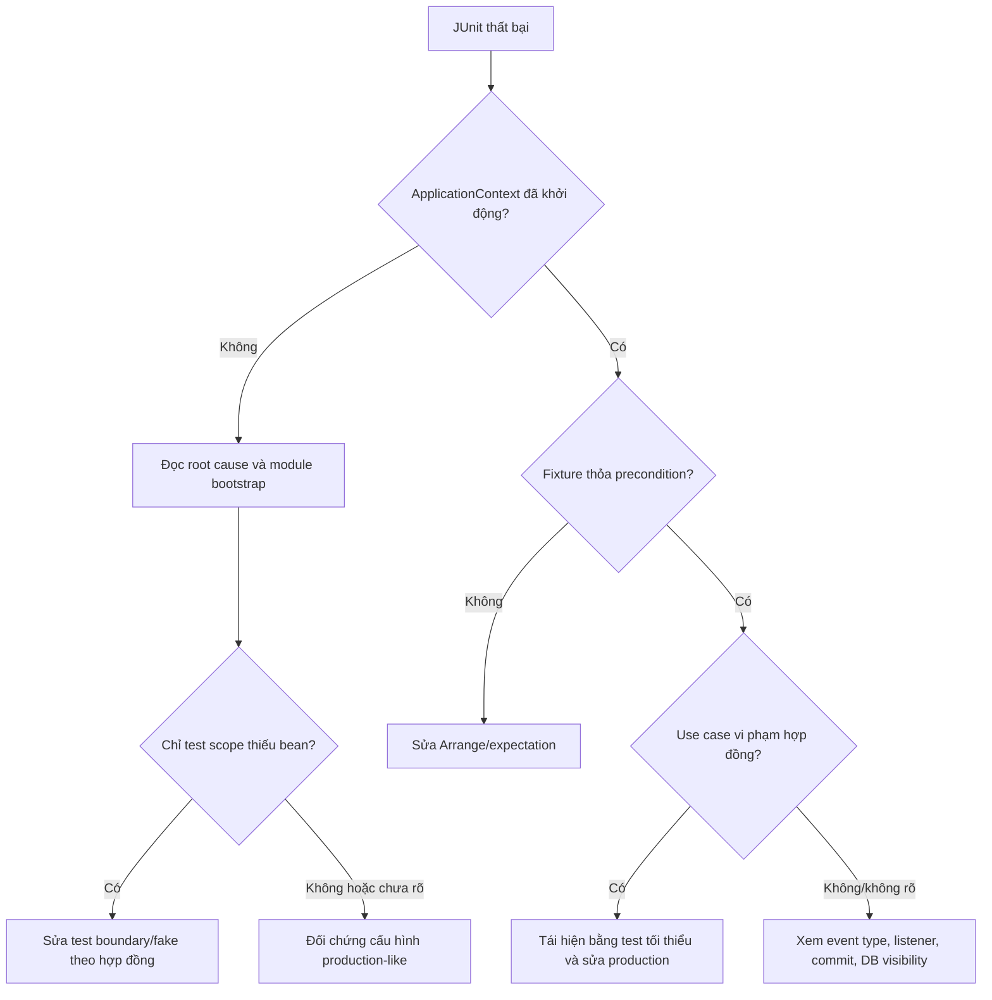

# Phân biệt lỗi cấu hình test với lỗi production code

Trong chương **Test failure** của học phần **SPRING_MODULITH_VERIFICATION_TESTING**, một bài kiểm thử Spring Modulith thất bại không đồng nghĩa ngay với việc nghiệp vụ trong production bị lỗi. `@ApplicationModuleTest` cố ý tạo một `ApplicationContext` hẹp, trong khi production có thể khởi động nhiều module và các cấu hình khác nhau. Một bean thiếu trong module test, một profile không được bật, một test transaction chưa commit hoặc một test double sai hợp đồng đều có thể khiến test đỏ dù đường chạy production đúng.

Chiều ngược lại cũng quan trọng: **test pass sau khi thêm mock không chứng minh production đúng**. Nếu implementation thật hoặc nhánh business thực sự có lỗi, mock có thể che khuất nó. Mục tiêu là tìm **nguyên nhân gốc đã được chứng minh**, không gắn nhãn lỗi chỉ dựa trên dòng exception cuối.

Sau bài học, bạn sẽ biết cách nhận diện pha lỗi; tạo các phép đối chứng ở đúng ranh giới module; viết Java/JUnit xác nhận một lỗi setup và một lỗi production độc lập; kiểm tra test double, profile, transaction, event, dữ liệu và quality gate trong CI. Những ví dụ dưới đây dựa trên Spring Boot, Spring Modulith, Java 17+, JUnit Jupiter và AssertJ.

## 1. Định nghĩa theo nguyên nhân, không theo màu đỏ của test

Để phân loại đúng, trước tiên hãy tách **môi trường kiểm thử** khỏi **hợp đồng mà production phải giữ**.

**Lỗi cấu hình/thiết kế test** là lỗi do cách dựng hoặc quan sát hệ thống trong test: thiếu một test dependency có chủ đích, mở sai module, dùng sai profile, test double trả dữ liệu vô lý, giữ transaction chưa commit, hoặc assertion chờ thứ không thuộc hợp đồng. Nếu chỉnh **chỉ test setup** theo thiết kế hợp lệ mà vẫn giữ nguyên production code và test xác nhận được hành vi mong đợi, đó là bằng chứng mạnh về lỗi test.

**Lỗi production code hoặc production configuration** là lỗi ở hành vi/cấu hình hệ thống thực tế: service publish sai payload, bỏ sót validation, adapter thực truy vấn nhầm kho, listener không được đăng ký trong cấu hình triển khai, migration sai hoặc transaction ở đường chạy production không được mở. Nếu một test có tiền điều kiện hợp lệ và mô hình production phù hợp vẫn chứng minh vi phạm hợp đồng, đó là bằng chứng về lỗi phía production.

**Lỗi trong chính đặc tả/assertion** là trường hợp test mong sai. Ví dụ: đơn bị từ chối hợp lệ nhưng test vẫn mong `OrderSubmitted`; hoặc test đồng nhất “event nguồn đã publish” với “listener AFTER_COMMIT đã chạy”. Đây không phải lỗi production chỉ vì assertion fail.

| Tiêu chí | Nghiêng về lỗi test | Nghiêng về lỗi production |
| --- | --- | --- |
| Chỉ xảy ra khi bootstrap module cô lập | Thiếu bean ngoài module, test import/fixture sai | Vẫn có thể là production nếu module bắt buộc tự đủ dependency nhưng không đáp ứng |
| Xảy ra trong integration context gần production | Có thể do test secrets/DB/clock giả | Tăng xác suất lỗi wiring, query, validation, listener thực |
| `@TestConfiguration` cấp fake đúng hợp đồng và test chuyển xanh | Có bằng chứng setup thiếu | Chưa loại trừ lỗi adapter thật |
| Context hợp lệ; Act chấp nhận; payload event sai | Ít phù hợp với lỗi setup | Service tạo event sai |
| `PublishedEvents` có nguồn, `Scenario` chờ outcome timeout | Có thể sai bootstrap/transaction của test | Có thể listener production lỗi; cần thêm bằng chứng |
| `ApplicationModules.verify()` fail | Test invocation đơn giản thường không phải nguyên nhân | Source dependency/module metadata vi phạm kiến trúc |

**Không dùng quy tắc tuyệt đối** như “`Failed to load ApplicationContext` = lỗi test”. Production thật cũng có thể không khởi động vì thiếu bean/cấu hình. Tương tự, một `AssertionError` có thể do fixture sai hoặc bug nghiệp vụ. Phải xác nhận nơi gây khác biệt.

## 2. Đọc lỗi theo pha: compile → bootstrap → Arrange → Act → Assert

Nên phân loại sự cố theo **bước đầu tiên không đạt**, không theo exception cuối cùng trong log dài.

| Pha | Triệu chứng điển hình | Câu hỏi đầu tiên | Phép kiểm phù hợp |
| --- | --- | --- | --- |
| **Compile/test discovery** | `cannot find symbol`, test không được tìm thấy | Import/package/version test có đúng không? | Kiểm tra Java source và dependency phiên bản |
| **Bootstrap** | `Failed to load ApplicationContext` + `NoSuchBeanDefinitionException` | Bean không tồn tại trong context nào? | Xem `@ApplicationModuleTest` mode, module, bean definitions |
| **Arrange** | `DataIntegrityViolationException`; fixture thiếu trạng thái | Dữ liệu có thỏa precondition không? | Validate fixture, `flush`/readback khi cần |
| **Act** | `IllegalStateException` do nhánh nghiệp vụ | Service từ chối đúng hay sai? | Ghi input, state trước/sau Act, business rule |
| **Event assertion** | Expected one `OrderSubmitted`, actual zero/two | Có publish, type và ID đúng không? | `PublishedEvents` lọc type/correlation ID |
| **Async/transaction wait** | `Scenario` timeout | Listener có trong context? Commit đã xảy ra? | Bean introspection, transaction boundary, callback logs |
| **Architecture** | `ApplicationModules.verify()` báo violation | Import API nội bộ hoặc cycle nào? | Source dependency graph và exposed interfaces |

Một stack trace bootstrap **minh họa**, không phải log được chạy từ bài:

```text
java.lang.IllegalStateException: Failed to load ApplicationContext
Caused by: org.springframework.beans.factory.UnsatisfiedDependencyException:
  Error creating bean with name 'orderSubmissionService'
Caused by: org.springframework.beans.factory.NoSuchBeanDefinitionException:
  No qualifying bean of type
  'com.example.shop.inventory.api.StockAvailability' available
```

Kết luận hợp lệ duy nhất từ đoạn log trên: **`OrderSubmissionService` không được inject `StockAvailability` trong context hiện tại**. Chưa đủ chứng minh production thiếu implementation. Phải biết test đang chạy `STANDALONE`, có fake bean không, và ứng dụng thật có adapter phù hợp không.

### Dùng một cây quyết định ngắn



Điểm quan trọng là **từng phép đối chứng chỉ thay một biến**. Nếu đồng thời đổi bootstrap mode, sửa production service, bật mọi profile và tăng timeout, một test xanh trở lại không cho biết sửa đổi nào đã giải quyết nguyên nhân.

## 3. Kịch bản Java xuyên module để làm đối chứng

Ta dùng hai module mặc định dưới package gốc `com.example.shop`:

```text
src/main/java/com/example/shop/
├── ShopApplication.java
├── orders/
│   ├── package-info.java
│   ├── OrderSubmitted.java
│   └── OrderSubmissionService.java
└── inventory/
    ├── api/
    │   ├── package-info.java
    │   └── StockAvailability.java
    └── internal/
        └── InventoryStockAdapter.java

src/test/java/com/example/shop/
├── ArchitectureVerificationTests.java
└── orders/
    └── OrderSubmissionModuleTests.java
```

Module `orders` cần hỏi tồn kho qua **public port** `StockAvailability`. Nó không được import repository nội bộ của `inventory`. Trong ví dụ, một đơn được chấp nhận khi SKU hợp lệ, quantity dương và tồn kho xác nhận đủ hàng; sau đó phải publish **đúng một** `OrderSubmitted` với quantity gốc.

### 3.1. API của inventory và module dependency rule

Tệp `inventory/api/StockAvailability.java`:

```java
package com.example.shop.inventory.api;

public interface StockAvailability {
    boolean available(String sku, int quantity);
}
```

Tệp `inventory/api/package-info.java`:

```java
@org.springframework.modulith.NamedInterface("availability")
package com.example.shop.inventory.api;
```

Tệp `orders/package-info.java`:

```java
@org.springframework.modulith.ApplicationModule(
        allowedDependencies = "inventory :: availability")
package com.example.shop.orders;
```

Các annotation ở `package-info.java` mô tả API exposure và giới hạn phụ thuộc. Chúng **không tự tạo Spring bean** cho `StockAvailability`. Đây là khác biệt cốt lõi giữa **hợp lệ về kiến trúc** và **đầy đủ về runtime wiring**.

Một adapter mẫu thuộc module `inventory`:

```java
package com.example.shop.inventory.internal;

import com.example.shop.inventory.api.StockAvailability;
import org.springframework.stereotype.Service;

@Service
class InventoryStockAdapter implements StockAvailability {

    @Override
    public boolean available(String sku, int quantity) {
        // Adapter tối giản cho ví dụ; production thật có thể đọc DB.
        return sku.startsWith("SKU-")
                && quantity > 0
                && quantity <= 10;
    }
}
```

Adapter này có thể được tạo trong application context đầy đủ. Nhưng một test `@ApplicationModuleTest` của **orders** ở chế độ mặc định `STANDALONE` không được giả định sẽ bootstrap bean thuộc module **inventory**.

### 3.2. Service và event production đúng hợp đồng

Tệp `orders/OrderSubmitted.java`:

```java
package com.example.shop.orders;

import java.util.UUID;

public record OrderSubmitted(
        UUID orderId,
        String sku,
        int quantity) {
}
```

Tệp `orders/OrderSubmissionService.java`:

```java
package com.example.shop.orders;

import com.example.shop.inventory.api.StockAvailability;
import java.util.Objects;
import java.util.UUID;
import org.springframework.context.ApplicationEventPublisher;
import org.springframework.stereotype.Service;

@Service
public class OrderSubmissionService {

    private final StockAvailability stock;
    private final ApplicationEventPublisher publisher;

    public OrderSubmissionService(
            StockAvailability stock,
            ApplicationEventPublisher publisher) {
        this.stock = stock;
        this.publisher = publisher;
    }

    public void submit(UUID orderId, String sku, int quantity) {
        Objects.requireNonNull(orderId, "orderId");
        if (sku == null || sku.isBlank()) {
            throw new IllegalArgumentException("SKU is required");
        }
        if (quantity <= 0) {
            throw new IllegalArgumentException(
                    "Quantity must be positive");
        }
        if (!stock.available(sku, quantity)) {
            throw new IllegalStateException("Not enough stock");
        }

        publisher.publishEvent(new OrderSubmitted(
                orderId, sku, quantity));
    }
}
```

Tệp `ShopApplication.java` có `@SpringBootApplication` tại `com.example.shop`. Phần tiếp theo chỉ sử dụng **một lớp service này** và một public port để cho thấy: *cùng một production code đúng* có thể fail khi test setup thiếu; *cùng test setup đúng* có thể phát hiện một bug production thật.

## 4. Đối chứng A — production đúng, @ApplicationModuleTest thiếu bean

Một module test không import test double:

```java
package com.example.shop.orders;

import org.junit.jupiter.api.Test;
import org.springframework.beans.factory.annotation.Autowired;
import org.springframework.modulith.test.ApplicationModuleTest;

@ApplicationModuleTest
class BrokenOrderModuleTests {

    @Autowired
    OrderSubmissionService service;

    @Test
    void submitsOrder() {
        // Không chạy được nếu StockAvailability bean vắng mặt.
    }
}
```

Giả sử `orders` được bootstrap ở `STANDALONE` và không có bean `StockAvailability` từ test setup. Context không thể tạo `OrderSubmissionService` vì thiếu constructor dependency. **Bài test chưa tới phần Act**. Đây là bằng chứng mạnh về **thiếu test wiring**, không phải bằng chứng `submit(…)` có bug.

### 4.1. Sửa bằng một fake đúng hợp đồng

Tệp test hoàn chỉnh:

```java
package com.example.shop.orders;

import static org.assertj.core.api.Assertions.assertThat;
import static org.assertj.core.api.Assertions.assertThatThrownBy;

import com.example.shop.inventory.api.StockAvailability;
import java.util.UUID;
import org.junit.jupiter.api.Test;
import org.springframework.beans.factory.annotation.Autowired;
import org.springframework.boot.test.context.TestConfiguration;
import org.springframework.context.ApplicationContext;
import org.springframework.context.annotation.Bean;
import org.springframework.context.annotation.Import;
import org.springframework.modulith.test.ApplicationModuleTest;
import org.springframework.modulith.test.PublishedEvents;

@ApplicationModuleTest
@Import(OrderSubmissionModuleTests.StockFixture.class)
class OrderSubmissionModuleTests {

    @Autowired
    OrderSubmissionService service;

    @Autowired
    ApplicationContext context;

    @TestConfiguration(proxyBeanMethods = false)
    static class StockFixture {

        @Bean
        StockAvailability stockAvailability() {
            // Quy tắc fake có chủ đích và có thể dự đoán.
            return (sku, quantity) ->
                    sku.startsWith("SKU-")
                    && quantity > 0
                    && quantity <= 10;
        }
    }

    @Test
    void contextContainsOneStockPort() {
        assertThat(context.getBeanNamesForType(
                StockAvailability.class)).hasSize(1);
    }

    @Test
    void acceptedOrderPublishesCorrectPayload(
            PublishedEvents events) {

        UUID orderId = UUID.randomUUID();
        String sku = "SKU-BOOK";
        int quantity = 3;

        service.submit(orderId, sku, quantity);

        var submitted = events.ofType(OrderSubmitted.class)
                .matching(e -> orderId.equals(e.orderId()));

        assertThat(submitted)
                .hasSize(1)
                .allSatisfy(event -> {
                    assertThat(event.sku()).isEqualTo(sku);
                    assertThat(event.quantity())
                            .isEqualTo(quantity);
                });
    }

    @Test
    void unavailableStockIsRejectedWithoutEvent(
            PublishedEvents events) {

        UUID orderId = UUID.randomUUID();

        assertThatThrownBy(() ->
                service.submit(orderId, "SKU-BOOK", 11))
                .isInstanceOf(IllegalStateException.class)
                .hasMessage("Not enough stock");

        assertThat(events.ofType(OrderSubmitted.class)
                .matching(e -> orderId.equals(e.orderId())))
                .isEmpty();
    }
}
```

Lý do bài test này đáng tin hơn cách “mở scan toàn ứng dụng”:

1. Giữ **service production thật** và public `StockAvailability` port; chỉ thay thế phần **ngoài module đang test** bằng fake.
2. Sửa **chính xác một thiếu sót** của `STANDALONE`: có bean đáp ứng constructor dependency.
3. Assertion `getBeanNamesForType(…)` đưa ra bằng chứng rằng context đã có đúng một ứng viên theo type.
4. `PublishedEvents` kiểm chứng event nguồn theo `orderId`, payload và số lần; không chỉ xác nhận service không ném exception.
5. Negative test kiểm chứng nhánh từ chối, tránh fake “luôn true” làm mọi input được chấp nhận.

**Giới hạn:** Bài test này **không kiểm chứng `InventoryStockAdapter` thật** hoặc SQL tồn kho. Nó kiểm chứng hợp đồng của **orders module với một port được mô phỏng**. Nếu production adapter sai, module test này vẫn có thể pass. Một integration test dùng adapter thật phải bảo vệ phần đó.

### 4.2. Khi nào thay fake bằng DIRECT_DEPENDENCIES?

Nếu mục tiêu là kiểm tra wiring **orders ↔ inventory** thật, có thể dùng:

```java
import org.springframework.modulith.test.ApplicationModuleTest;
import org.springframework.modulith.test.ApplicationModuleTest.BootstrapMode;

@ApplicationModuleTest(mode = BootstrapMode.DIRECT_DEPENDENCIES)
class OrdersInventoryIntegrationTests {
    // Inject OrderSubmissionService và kiểm tra với inventory thật.
}
```

Đây là **mẫu định nghĩa lớp integration test**, không phải bài test hoàn chỉnh. `DIRECT_DEPENDENCIES` mở các module mà **orders trực tiếp phụ thuộc**, có thể bao gồm `inventory` theo module graph. Nếu adapter inventory cần JPA, datasource hoặc migration, integration test phải chuẩn bị những thứ ấy. Không dùng mode rộng hơn chỉ để làm một unit-level module test khởi động.

## 5. Đối chứng B — test setup đúng nhưng production code publish sai

Giữ nguyên fake và ba test ở phần 4.1. Giả sử trong `OrderSubmissionService` có một lỗi do refactor: khi tạo event, developer tăng quantity thêm một:

```java
// Đoạn LỖI được đưa vào trong OrderSubmissionService.submit(...).
// Các validation và lời gọi stock.available(...) vẫn đúng.
publisher.publishEvent(new OrderSubmitted(
        orderId, sku, quantity + 1)); // Bug production.
```

Với stimulus `submit(orderId, "SKU-BOOK", 3)`:

```text
Input:           quantity = 3
Fake port:       accepts 3, returns true
Service event:   quantity = 4  <-- violation
Test expected:   quantity = 3
```

Test `acceptedOrderPublishesCorrectPayload` **khởi động context thành công**, lời gọi `submit` đi hết nhánh hợp lệ, và `PublishedEvents` ghi nhận event. Nhưng assertion `event.quantity() == quantity` fail. Đây là một **production behavior defect** được test setup hợp lệ phát hiện.

Không nên “sửa” bằng cách đổi expectation thành 4 hoặc cho fake trả một giá trị làm nhánh code bị bỏ qua. Hãy sửa đúng dòng trong production:

```java
publisher.publishEvent(new OrderSubmitted(
        orderId, sku, quantity));
```

### 5.1. Thử nghiệm có kiểm soát

| Lần chạy | Production code | Test configuration | Kết quả kỳ vọng | Suy luận |
| --- | --- | --- | --- | --- |
| A | Đúng | Không có fake `StockAvailability` | Bootstrap fail | Setup của module test thiếu dependency |
| B | Đúng | Có fake hợp đồng rõ ràng | Event đúng payload, test pass | Cấu hình module test đã đủ cho hợp đồng này |
| C | `quantity + 1` | Giữ y nguyên fake | Test assertion payload fail | Bug nằm trong behavior production |
| D | Sửa lại `quantity` | Giữ nguyên fake | Test pass | Thay đổi production code giải quyết violation |

Chính việc **chỉ thay một biến ở mỗi lần** khiến kết luận có căn cứ. Nếu bạn vừa thêm fake vừa sửa service, việc test xanh lại không phân biệt nguyên nhân.

### 5.2. Không để test double che lỗi của chính dependency

Giả sử `InventoryStockAdapter` trong production có bug:

```java
// Ví dụ sai trong adapter thật:
return quantity <= 100; // Đáng lẽ chỉ đủ tối đa 10.
```

Test `orders` dùng fake vẫn pass vì **adapter thật không được chạy**. Vì thế cần một kiểm thử khác:

- Unit/contract test trực tiếp `InventoryStockAdapter` với `quantity = 11` phải từ chối.
- Integration test bootstrap inventory thật với dữ liệu kho và assertion theo contract.
- Test xuyên module khi behavior phụ thuộc đồng thời đơn hàng và tồn kho thật.

**Test pass chỉ có ý nghĩa trong boundary mà test đã thật sự khởi động và quan sát.** Đây là nguyên tắc quan trọng để tránh kết luận sai rằng “production đúng vì mọi module test đều xanh”.

## 6. Listener không có trong test khác với listener production bị lỗi

Sự nhầm lẫn thường gặp thứ hai là `Scenario` timeout. Khi module `orders` publish `OrderSubmitted` và module `notifications` nhận event, dependency tĩnh đi theo chiều:

```text
notifications -- imports orders.OrderSubmitted --> orders

Runtime event:
orders -- publish OrderSubmitted --> notifications listener
```

Một `@ApplicationModuleTest` đặt ở **orders** mặc định bootstrap orders, không tự nạp consumer `notifications`. Kể cả `DIRECT_DEPENDENCIES` từ orders cũng **không đảm bảo** nạp module **phụ thuộc vào** orders. Nếu test trong orders cố chờ `NotificationPrepared`, timeout có thể là **lỗi thiết kế phạm vi test**, không phải listener production sai.

### 6.1. Kiểm chứng listener trong chính module consumer

Giả sử production có:

```java
package com.example.shop.notifications;

import java.util.UUID;

public record NotificationPrepared(UUID orderId) {
}
```

Listener thuộc module notifications:

```java
package com.example.shop.notifications.internal;

import com.example.shop.notifications.NotificationPrepared;
import com.example.shop.orders.OrderSubmitted;
import org.springframework.context.ApplicationEventPublisher;
import org.springframework.context.event.EventListener;
import org.springframework.stereotype.Component;

@Component
public class OrderNotificationListener {

    private final ApplicationEventPublisher publisher;

    public OrderNotificationListener(
            ApplicationEventPublisher publisher) {
        this.publisher = publisher;
    }

    @EventListener
    public void on(OrderSubmitted event) {
        publisher.publishEvent(
                new NotificationPrepared(event.orderId()));
    }
}
```

Đặt test tại `com.example.shop.notifications`:

```java
package com.example.shop.notifications;

import static org.assertj.core.api.Assertions.assertThat;

import com.example.shop.notifications.internal.OrderNotificationListener;
import com.example.shop.orders.OrderSubmitted;
import java.util.UUID;
import org.junit.jupiter.api.Test;
import org.springframework.beans.factory.annotation.Autowired;
import org.springframework.context.ApplicationContext;
import org.springframework.context.ApplicationEventPublisher;
import org.springframework.modulith.test.ApplicationModuleTest;
import org.springframework.modulith.test.Scenario;

@ApplicationModuleTest
class NotificationListenerModuleTests {

    @Autowired
    ApplicationContext context;

    @Autowired
    ApplicationEventPublisher publisher;

    @Test
    void listenerIsPresentAndProducesOutcome(
            Scenario scenario) {

        assertThat(context.getBeanNamesForType(
                OrderNotificationListener.class))
                .hasSize(1);

        UUID orderId = UUID.randomUUID();

        scenario.stimulate(() ->
                        publisher.publishEvent(
                                new OrderSubmitted(
                                        orderId, "SKU-BOOK", 2)))
                .andWaitForEventOfType(NotificationPrepared.class)
                .matching(result ->
                        orderId.equals(result.orderId()))
                .toArriveAndVerify(result ->
                        assertThat(result.orderId())
                                .isEqualTo(orderId));
    }
}
```

Test này xác minh **listener bean có mặt** và consumer phản ứng với event public đúng hợp đồng. Nó không cần gọi service bên trong orders vì trọng tâm là **hành vi của notifications**. Kết hợp với publisher module test ở phần 4 để tách hai contract.

### 6.2. Listener bean có nhưng callback không chạy?

Khi `getBeanNamesForType(…)` đã tìm thấy listener, hãy xem:

- `@EventListener` method có nhận đúng event type không?
- Có `@TransactionalEventListener(AFTER_COMMIT)` nhưng transaction chưa commit không?
- Bean có condition/SpEL lọc event không?
- Listener `@Async` có exception trong worker thread không?
- Result event có đúng type và `matching(orderId)` không?
- Listener chỉ thay đổi database state mà **không hề phát outcome event** theo contract không?

Một bean tồn tại không đồng nghĩa invocation thành công, nhưng **không có bean** là bằng chứng tốt để dừng điều tra logic callback và sửa test bootstrap/registration trước.

## 7. Test profile, conditional configuration và test double làm sai kết luận

Ngay cả khi module scope đúng, cấu hình test khác production vẫn có thể tạo false negative hoặc false positive.

### 7.1. @Profile / @ConditionalOnProperty loại listener

Ví dụ một listener được bật theo property:

```java
@Component
@ConditionalOnProperty(
        prefix = "notifications",
        name = "enabled",
        havingValue = "true")
public class OrderNotificationListener {
    // @EventListener on(OrderSubmitted ...)
}
```

Nếu test không cấp `notifications.enabled=true`, bean có thể **không được đăng ký**. Trong bài test chẩn đoán cụ thể, có thể dùng:

```java
@ApplicationModuleTest
@TestPropertySource(properties = "notifications.enabled=true")
class NotificationsEnabledModuleTests {
    // Assert listener bean exists, then test behavior.
}
```

Đây là các đoạn minh họa **biến thể có điều kiện**, không phải phiên bản mới để chạy song song với listener không điều kiện ở phần 6. Cần import `org.springframework.boot.autoconfigure.condition.ConditionalOnProperty` và `org.springframework.test.context.TestPropertySource`.

Phân loại chính xác:

- Nếu **chỉ test** thiếu property mà cấu hình production chủ đích bật listener: lỗi test configuration.
- Nếu **production deployment** cũng thiếu property bắt buộc và listener cần thiết không hoạt động: lỗi cấu hình production, không phải “chỉ là test”.
- Nếu listener **phải mặc định tắt** theo contract, test chờ outcome dù không bật feature có thể đang **kỳ vọng sai**.

Với `@Profile("notifications")`, dùng cùng cách đối chiếu active profiles của test với contract triển khai. Không bật profile production thật trong CI chỉ để đạt test nếu profile đó kết nối gateway, credentials hoặc dữ liệu bên ngoài.

### 7.2. Test double phải chứng minh được contract, không chỉ khiến context xanh

Một fake như:

```java
@Bean
StockAvailability stockAvailability() {
    return (sku, quantity) -> true;
}
```

làm mọi đơn có thể vượt qua kiểm tra tồn kho. Nếu test cần kiểm tra nhánh không đủ hàng, fake này **không có khả năng tạo tình huống đó**. Kết quả fail từ negative test có thể là **test fixture sai**, không phải `OrderSubmissionService` bỏ qua stock.

Tối thiểu hãy kiểm tra giả định của fake:

```java
@Test
void stockFakeSupportsBothBranches() {
    StockAvailability fake = (sku, quantity) ->
            sku.startsWith("SKU-")
            && quantity > 0
            && quantity <= 10;

    assertThat(fake.available("SKU-BOOK", 3)).isTrue();
    assertThat(fake.available("SKU-BOOK", 11)).isFalse();
    assertThat(fake.available("INVALID", 2)).isFalse();
}
```

Đây là đoạn method dùng các import JUnit, AssertJ và `StockAvailability` đã giới thiệu; trong dự án có thể đặt vào một test riêng. Fake không nhất thiết phải mô phỏng mọi quy tắc tồn kho, nhưng những nhánh mà module test phụ thuộc phải **được thiết kế có chủ đích**.

### 7.3. Khi nào mocking làm test “quá xanh”?

Nếu mục tiêu là kiểm tra `OrderSubmissionService`, có thể fake **external port `StockAvailability`**. Nhưng không nên mock chính `OrderSubmissionService` rồi kết luận use case production đã publish đúng `OrderSubmitted`; khi ấy không còn chạy logic cần kiểm tra.

Tương tự, mock `ApplicationEventPublisher` để verify một lời gọi có thể hữu ích ở unit test, nhưng không thay `PublishedEvents` khi mục tiêu là kiểm tra event thực sự được phát trong module test. Hãy nói rõ **đối tượng thật và đối tượng giả** trong mỗi test.

### 7.4. Bean overriding và duplicate test configuration

Nếu chuyển từ `STANDALONE` sang `DIRECT_DEPENDENCIES` nhưng vẫn `@Import` cùng một fake, context có thể có cả fake và adapter thật cùng type, gây `NoUniqueBeanDefinitionException`; nếu trùng **bean name**, có thể gây `BeanDefinitionOverrideException`. Hai lỗi này là **wiring setup** ở context hiện tại, không chứng minh thuật toán của service sai.

`@Primary` hoặc `@Qualifier` có thể chọn **một trong nhiều bean khác tên**, nhưng không giải quyết được collision của **hai bean definition cùng tên**. Chọn một phạm vi kiểm thử rõ ràng: test contract với fake, hoặc integration với adapter thật.

## 8. Transaction và database: test có thể tạo lỗi mà production không có

Một khác biệt lớn giữa test và runtime là **điểm commit**. `@TransactionalEventListener(phase = AFTER_COMMIT)` không nhận event theo pha hậu commit cho đến khi transaction nguồn **commit thành công**.

### 8.1. Test-managed transaction gây vòng chờ

Ví dụ anti-pattern:

```java
@Test
@Transactional
void waitsForAfterCommitInsideOpenTestTransaction(
        Scenario scenario) {
    // Stimulate publish event trong transaction của test.
    // Ngay sau đó đợi listener AFTER_COMMIT.
    // Commit thường chưa xảy ra trước khi method kết thúc.
}
```

Spring Test thường rollback test-managed transaction sau method. Trong trường hợp này:

1. `PublishedEvents` có thể thấy event **đã publish**.
2. Listener `AFTER_COMMIT` chưa được kích hoạt vì transaction chưa commit.
3. `Scenario` chờ result và timeout.
4. Việc sửa `@Commit` trên method không tự giải quyết điểm chờ **ngay trong method**, vì commit vẫn ở cuối vòng đời test.

Đây là lỗi **điều phối transaction của test** nếu đường chạy production thực sự commit đúng như thiết kế.

### 8.2. Tạo transaction thực sự được commit trước bước chờ

Trong integration test có `PlatformTransactionManager`:

```java
TransactionTemplate tx =
        new TransactionTemplate(transactionManager);

scenario.stimulate(() ->
                tx.executeWithoutResult(status ->
                        publisher.publishEvent(
                                new OrderSubmitted(
                                        orderId, "SKU-BOOK", 2))))
        .andWaitForEventOfType(NotificationPrepared.class)
        .matching(result ->
                orderId.equals(result.orderId()))
        .toArriveAndVerify(result ->
                assertThat(result.orderId())
                        .isEqualTo(orderId));
```

**Điều kiện của snippet:** đây là **phần thân test tích hợp**, cần `transactionManager`, `publisher`, `scenario`, `orderId` và import `TransactionTemplate`. Listener phải thực sự dùng `@TransactionalEventListener(AFTER_COMMIT)` và publish `NotificationPrepared`. Không được để một `@Transactional` của test bao ngoài giữ transaction mở: `TransactionTemplate` mặc định dùng propagation `REQUIRED` nên có thể **chỉ tham gia**, không tạo commit độc lập.

Nếu transaction nguồn đã commit mà listener thực vẫn lỗi, hoặc code production publish event **ngoài transaction** trong khi listener mặc định `fallbackExecution = false`, đó có thể là bug production transaction boundary. Cần đối chứng trên đường gọi thực (bao gồm lỗi self-invocation `@Transactional` không đi qua proxy), không chỉ chỉnh test.

### 8.3. H2/test slice khác production database

Một test `@DataJpaTest` dùng H2 có thể xanh nhưng production PostgreSQL vẫn gặp lỗi do SQL dialect, migration, enum mapping, collation, JSON type hoặc transaction isolation. Ngược lại, một test slice thiếu schema/seed đúng có thể đỏ trong khi truy vấn production hợp lệ.

Để phân loại:

| Hiện tượng | Bước đối chứng |
| --- | --- |
| Test JPA fail `DataIntegrityViolationException` | Đọc constraint gốc; kiểm tra fixture và migration test |
| H2 xanh, database tương thích production đỏ | Chạy integration DB đúng dialect/migration, xem SQL/DDL |
| Repository đọc được row trong cùng transaction nhưng listener không thấy | Kiểm tra commit, connection/isolation và async thread |
| `saveAndFlush` xanh nhưng dữ liệu không bền vững | Nhớ **flush không phải commit**; đọc lại sau commit độc lập |
| Test slice thiếu bean ngoài JPA | Xem scope của slice; không vội sửa service production |

Một test hạ tầng gần production, chẳng hạn Spring Boot integration test dùng database container và migration giống deployment, cung cấp bằng chứng mạnh hơn về behavior adapter thật. Nhưng nếu test chạy nhầm profile, secret hoặc schema khác, kết luận vẫn phải ghi rõ giới hạn.

## 9. Quy trình đối chứng thực tế: chỉ thay một biến mỗi lần

Khi lỗi chưa rõ, dùng một quy trình hữu hạn thay vì thử nhiều annotation ngẫu nhiên.

### Bước 1 — Ghi giả thuyết theo bằng chứng hiện có

Ví dụ:

```text
Failure: Failed to load ApplicationContext
Module under test: orders
Bootstrap mode: STANDALONE
Missing type: inventory.api.StockAvailability
Production service: OrderSubmissionService
Hypothesis: inventory adapter absent because only orders bootstrapped
Confidence: hypothesis, not confirmed
```

Không ghi “production service broken” nếu body của `@Test` chưa được thực hiện.

### Bước 2 — Kiểm tra contract của module đang test

Xác định một case có input/fixture và output rõ ràng. Với ví dụ: `submit(orderId, "SKU-BOOK", 3)` phải publish một `OrderSubmitted` cùng quantity 3. Phân biệt đường hợp lệ và nhánh từ chối quantity 11.

### Bước 3 — Phép thử setup tối thiểu

Trong context `STANDALONE`, thêm **một** fake `StockAvailability` qua `@TestConfiguration` và assert bean count. Nếu context khởi động và event test bắt đầu chạy, giả thuyết thiếu dependency trong test có bằng chứng hỗ trợ.

### Bước 4 — Phép thử behavior với setup cố định

Giữ nguyên fake và stimulus, assert event type, count, payload và trạng thái. Nếu assertion fail như `quantity = 4` thay vì 3, test đã đưa ra bằng chứng về behavior lỗi **trên code thật đang chạy**.

### Bước 5 — Phép thử adapter thật

Đổi **phạm vi kiểm thử** có chủ đích sang integration với `inventory` thật, tránh vừa import fake vừa thêm adapter. Nếu test chỉ fail khi adapter thật hoạt động, điều tra implementation/data/config của adapter, không mặc định service orders sai.

### Bước 6 — Kiểm tra khác biệt runtime

Đối chiếu profiles, `@ConditionalOnProperty`, transaction manager, datasource, schema, clock, timezone, feature flags và listener bean registration. Chỉ tập trung vào những yếu tố **có thể giải thích đúng failure đã quan sát**.

### Bước 7 — Ghi điều gì đã chứng minh và điều gì chưa

Ví dụ handoff:

```text
Observed:
  - STANDALONE test cannot create OrderSubmissionService:
    missing StockAvailability
  - @Import test fake -> context starts
  - acceptedOrderPublishesCorrectPayload passes

Conclusion:
  - Confirmed: isolated test lacked a required external port bean
  - Not proven: InventoryStockAdapter production SQL is correct

Next validation:
  - Inventory adapter contract test
  - Orders-inventory integration test
  - ApplicationModules.verify()
```

### Bước 8 — Rerun đúng gate, tránh làm xanh giả

Sau khi sửa setup, chạy lại **test vừa fail**, rồi đến adapter/integration tests có liên quan. Nếu production code thật được sửa, thêm regression test vào bộ nhỏ nhất có thể bắt lại lỗi. Không sửa assertion/timeout/feature flag chỉ để bỏ triệu chứng mà không có giải thích nhân quả.

**Hai phép kiểm bổ trợ có ích:**

- **Positive control:** một input hợp lệ phải tạo outcome mong đợi.
- **Negative control:** một input bị từ chối không được tạo outcome. Nếu fake luôn trả `true`, negative control báo setup chưa đủ.

Không cần khởi động full application cho mọi phép thử. Mục tiêu là **một thử nghiệm có thể quy kết nguyên nhân**, không phải độ lớn của context.

## 10. Chặn kết luận sai bằng quality gate CI và bài thực hành

### 10.1. Architecture verification không phải runtime wiring test

Test kiểm chứng ranh giới:

```java
package com.example.shop;

import org.junit.jupiter.api.Test;
import org.springframework.modulith.core.ApplicationModules;

class ArchitectureVerificationTests {

    @Test
    void dependenciesRespectModuleApis() {
        ApplicationModules.of(ShopApplication.class).verify();
    }
}
```

Nếu `orders` import `inventory.internal.InventoryRepository` hoặc tạo cycle không hợp lệ, `verify()` có thể fail dù test với fake `StockAvailability` chạy được. Nếu `verify()` pass, nó **không chứng minh** một bean `StockAvailability` đã được đăng ký trong `STANDALONE` context.

**Ba câu hỏi độc lập:**

1. `ApplicationModules.verify()`: *Dependency giữa module có hợp lệ không?*
2. `@ApplicationModuleTest`: *Trong phạm vi context này, use case có hành vi đúng không?*
3. Integration test: *Adapter, transaction, DB và listener thật có hoạt động đúng trong cấu hình cần triển khai không?*

### 10.2. Gate CI theo loại lỗi cần bắt

| Gate | Điều cần chứng minh | Gợi ý failure |
| --- | --- | --- |
| Compile + test discovery | Source/test dependency và API tương thích | Không biên dịch, test không chạy |
| Architecture | `ApplicationModules.verify()` | Import internal package, cycle, allowlist sai |
| Module context smoke | Một bean port phù hợp, fixture hợp lệ | Test fake/profile/condition thiếu |
| Module behavior | `PublishedEvents` đúng count, ID, payload | Bug service, test expectation sai |
| Adapter contract | Implementation inventory thật trả đúng theo dữ liệu | Fake che lỗi adapter |
| Consumer contract | Listener bean có mặt, `Scenario` outcome đúng | Sai bootstrap, event type, transaction |
| Persistence integration | Schema/migration và dữ liệu sau commit | SQL dialect, constraint, isolation |
| Production-like smoke | Cấu hình triển khai không thiếu dependency/feature | Production configuration thực sự sai |

**Không mở profile production với secrets hoặc gateway thật trong CI không được cô lập**. “Production-like” nghĩa là **cấu trúc cấu hình/hạ tầng tương đương và an toàn**, không phải kết nối bừa tới dịch vụ sống.

### 10.3. Bài thực hành chẩn đoán

1. **Thiếu bean có chủ đích:** chạy `BrokenOrderModuleTests` trong `STANDALONE`. Viết kết luận chỉ từ `NoSuchBeanDefinitionException`; chưa đổ lỗi cho `submit`.
2. **Sửa setup tối thiểu:** thêm `StockFixture`. Kiểm tra `getBeanNamesForType(StockAvailability.class)` trả đúng một ứng viên và positive/negative paths đều chạy.
3. **Tạo bug production:** sửa production `quantity` thành `quantity + 1` trong event. Giữ nguyên test setup; chỉ ra assertion nào phát hiện bug.
4. **Fake sai contract:** đổi fake thành `return true` cho mọi SKU/quantity. Chỉ ra vì sao `unavailableStockIsRejectedWithoutEvent` fail dù validation và publish code không đổi.
5. **Đổi bootstrap mode:** dùng `DIRECT_DEPENDENCIES` với adapter inventory thật. Bỏ fake để không có hai bean cùng type. Phân biệt lỗi SQL của adapter với lỗi service orders.
6. **Consumer đặt sai module:** ở test `orders` `STANDALONE` chờ `NotificationPrepared`; giải thích vì sao listener thuộc `notifications` không tự xuất hiện.
7. **Property condition:** bật/tắt `notifications.enabled` và đo bean registration; phân biệt feature flag test với cấu hình production thiếu.
8. **AFTER_COMMIT:** dùng test-managed transaction rollback rồi chờ listener hậu commit. Tạo một integration test commit thật trước khi chờ, không chỉ tăng timeout.
9. **Database lệch dialect:** so kết quả một repository test trên H2 và database cùng dialect với deployment; không khẳng định production sai khi chưa tái hiện bằng schema/config phù hợp.
10. **Architecture:** giữ test `ApplicationModules.verify()` và cố tình import một internal type để thấy lỗi kiến trúc không được giải quyết bằng `@MockBean` hoặc `@TestConfiguration`.

**Tiêu chí đạt:** với mỗi failure, người học viết được **bằng chứng hiện có**, **giả thuyết gốc**, **một phép đối chứng chỉ thay một yếu tố**, **kết luận có giới hạn** và **test hồi quy tối thiểu**.

### 10.4. Kết luận

Không có phép thử duy nhất để kết luận một failure là “chỉ do test” hay “chắc chắn do production”. Cách hiệu quả là phân loại theo pha, dựng một **test setup hợp lệ nhưng cô lập**, kiểm tra cả positive/negative contract rồi **giữ setup cố định** khi kiểm chứng behavior thật. Với Spring Modulith, `@ApplicationModuleTest(STANDALONE)` thiếu external port có thể là lỗi test wiring; còn service tạo `OrderSubmitted` sai quantity vẫn là lỗi production dù context đã được sửa. Ngược lại, một test dùng fake xanh chưa chứng minh adapter, transaction, listener hay database production đúng. Duy trì architecture, module, adapter và integration quality gates riêng trong CI để tránh cả **false negative** và **false confidence**.

## Tài liệu tham khảo

- [Spring Modulith Reference — Testing Application Modules](https://docs.spring.io/spring-modulith/reference/testing.html)
- [Spring Modulith Reference — Application Module Fundamentals](https://docs.spring.io/spring-modulith/reference/fundamentals.html)
- [Spring Modulith Reference — Verifying Application Module Structure](https://docs.spring.io/spring-modulith/reference/verification.html)
- [Spring Modulith Reference — Working with Application Events](https://docs.spring.io/spring-modulith/reference/events.html)
- [Spring Modulith Javadoc — ApplicationModuleTest](https://docs.spring.io/spring-modulith/docs/current/api/org/springframework/modulith/test/ApplicationModuleTest.html)
- [Spring Modulith Javadoc — PublishedEvents](https://docs.spring.io/spring-modulith/docs/current/api/org/springframework/modulith/test/PublishedEvents.html)
- [Spring Modulith Javadoc — Scenario](https://docs.spring.io/spring-modulith/docs/current/api/org/springframework/modulith/test/Scenario.html)
- [Spring Framework Reference — TestContext Framework](https://docs.spring.io/spring-framework/reference/testing/testcontext-framework.html)
- [Spring Framework Reference — Transaction-bound Events](https://docs.spring.io/spring-framework/reference/data-access/transaction/event.html)
- [Spring Framework Reference — Test-managed Transactions](https://docs.spring.io/spring-framework/reference/testing/testcontext-framework/tx.html)
- [Spring Boot Reference — Testing Spring Boot Applications](https://docs.spring.io/spring-boot/reference/testing/spring-boot-applications.html)
