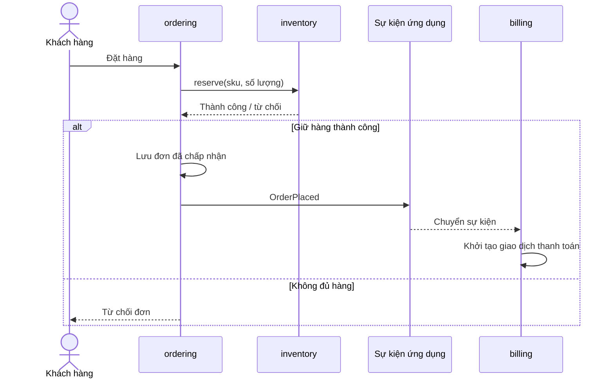

# Xác định ranh giới nghiệp vụ trước khi đặt package

Trong một ứng dụng Spring Boot dùng **Spring Modulith**, mỗi module ứng dụng nên đại diện cho một năng lực nghiệp vụ có trách nhiệm rõ ràng. Việc tạo trước các package như `order`, `payment`, `repository` rồi mới tìm cách phân chia phụ thuộc thường dẫn đến module chỉ có tên gọi, còn quy tắc nghiệp vụ và dữ liệu vẫn đan xen. Cách làm hiệu quả hơn là xác định **ai chịu trách nhiệm về điều gì, ai được phép yêu cầu điều gì và thay đổi nào phải nhất quán** trước khi viết cấu trúc package Java.

Bài này thuộc chương **Thiết kế module** của nội dung **SPRING_MODULITH_VERIFICATION_TESTING**. Ta sẽ thiết kế ranh giới nghiệp vụ, chuyển chúng thành hợp đồng giữa các module rồi dùng cơ chế kiểm chứng của Spring Modulith để phát hiện phụ thuộc sai ngay từ đầu. Đây là tiền đề cho `ApplicationModules`, `@ApplicationModuleTest`, kiểm thử sự kiện, dữ liệu và quality gate trong CI.

## 1. Kết quả cần đạt

Sau bài học, bạn có thể:

1. Phân biệt ranh giới nghiệp vụ với package, tầng kỹ thuật và bảng cơ sở dữ liệu.
2. Xác định module dựa trên use case, quy tắc bất biến (*invariant*), quyền sở hữu dữ liệu và nhu cầu nhất quán giao dịch.
3. Chọn hợp đồng đồng bộ hoặc sự kiện để các module hợp tác mà không truy cập nội bộ của nhau.
4. Vẽ đồ thị phụ thuộc không có chu trình rồi ánh xạ sang quy ước package của Spring Modulith.
5. Tạo kiểm thử kiến trúc giúp phát hiện khi code phá vỡ ranh giới đã thống nhất.

## 2. Ranh giới nghiệp vụ là gì?

**Ranh giới nghiệp vụ** phân định phạm vi trách nhiệm và quyền quyết định của một phần ứng dụng. Ví dụ, trong hệ thống bán hàng, module **Tồn kho** quyết định có thể giữ bao nhiêu sản phẩm, còn module **Đặt hàng** quyết định một đơn hàng được tạo và chuyển trạng thái thế nào. Dù cả hai đều biết `sku`, điều đó không có nghĩa chúng cùng sở hữu bảng tồn kho hoặc được sửa dữ liệu của nhau.

Ba khái niệm cần tách bạch:

| Khái niệm | Trả lời câu hỏi | Ví dụ |
| --- | --- | --- |
| **Năng lực nghiệp vụ / module** | Phần này chịu trách nhiệm về quyết định nào? | `ordering` nhận và quản lý đơn hàng |
| **Hợp đồng công khai** | Phần khác được phép gọi hoặc biết điều gì? | `InventoryOperations.reserve(...)`, sự kiện `OrderPlaced` |
| **Package Java** | Mã nguồn được bố trí ở đâu để thể hiện và kiểm chứng thiết kế? | `com.example.shop.ordering`, `inventory.api` |

Một ranh giới tốt thường có **mức gắn kết cao ở bên trong** (mã liên quan cùng một quyết định nghiệp vụ được đặt gần nhau) và **mức phụ thuộc thấp ở bên ngoài** (module khác chỉ biết một số hành vi hoặc dữ kiện cần thiết).

**Đừng đồng nhất module với một entity hay một bảng.** `Order`, `OrderLine` và quy tắc chuyển trạng thái đơn hàng có thể thuộc cùng `ordering`. Ngược lại, `Order` và `StockReservation` có thể cùng xuất hiện trong quy trình mua hàng nhưng có chủ sở hữu nghiệp vụ khác nhau. Cũng không nên xem mỗi module trong monolith là một microservice tương lai: module là ranh giới logic trong **cùng một ứng dụng đang triển khai**; quyết định tách dịch vụ cần thêm cân nhắc về vận hành và giao tiếp phân tán.

## 3. Bắt đầu từ nghiệp vụ: ví dụ cửa hàng trực tuyến

Giả sử hệ thống có các yêu cầu:

- Khách gửi yêu cầu đặt hàng gồm mã sản phẩm và số lượng.
- Hệ thống chỉ chấp nhận đơn khi giữ đủ hàng; không được để hai đơn đồng thời giữ vượt số lượng có sẵn.
- Sau khi đơn được chấp nhận, hệ thống khởi tạo bước thu tiền.
- Nhân viên kho có thể nhập hàng và điều chỉnh tồn kho theo quy tắc riêng.
- Nhân viên chăm sóc khách hàng tra cứu trạng thái đơn hàng và thanh toán.

Lúc này, câu hỏi đầu tiên **không phải** là có nên tạo `controller`, `service`, `repository` ở package nào. Trước tiên hãy liệt kê những *quyết định nghiệp vụ* và người chịu trách nhiệm về chúng:

| Module ứng viên | Chịu trách nhiệm | Dữ liệu/quy tắc sở hữu | Hợp đồng dự kiến |
| --- | --- | --- | --- |
| `ordering` — Đặt hàng | Tạo, hủy và quản lý vòng đời đơn hàng | Đơn hàng, dòng hàng, trạng thái hợp lệ, tổng tiền được chốt khi đặt | `PlaceOrder`, sự kiện `OrderPlaced` |
| `inventory` — Tồn kho | Ghi nhận, phân bổ và giữ số lượng tồn | Tồn khả dụng, phiếu giữ hàng, quy tắc không giữ vượt tồn | `InventoryOperations.reserve(...)` |
| `billing` — Thanh toán | Khởi tạo và theo dõi việc thu tiền | Giao dịch thanh toán, trạng thái thu tiền, xử lý trùng thông báo | Tiếp nhận `OrderPlaced`, cung cấp thông tin thanh toán có kiểm soát |

Đây là **giả thuyết thiết kế**, cần được kiểm tra bằng những kịch bản thực tế. Nếu quy trình kinh doanh quy định “thanh toán thành công rồi mới tạo đơn”, thứ tự giao tiếp và chủ thể điều phối sẽ khác. Không nên chọn ranh giới chỉ vì sơ đồ trên trông cân đối.

### 3.1. Đặt câu hỏi để tìm đúng chủ sở hữu

Với mỗi luật hoặc trường dữ liệu, hãy hỏi:

1. **Ai có quyền thay đổi?** Chẳng hạn số lượng hàng khả dụng do `inventory` tính, không do `ordering` tự trừ.
2. **Luật nào phải luôn đúng?** Ví dụ lượng hàng đã giữ không vượt lượng còn có thể bán.
3. **Thao tác nào cần nhất quán ngay?** Nếu đặt hàng chỉ được xác nhận khi giữ được hàng, kết quả giữ hàng phải có trước quyết định xác nhận.
4. **Ai cần biết kết quả, nhưng không cần tham gia quyết định?** `billing` cần biết đơn đã được đặt để tạo giao dịch; nó không cần trực tiếp sửa đơn hàng.
5. **Phần nào thường thay đổi cùng nhau vì một lý do nghiệp vụ?** Các luật hoàn tiền có thể thay đổi cùng xử lý thanh toán, khác nhịp với luật giữ hàng.

Một *bounded context* theo Domain-Driven Design (DDD) cũng giúp làm rõ ngôn ngữ và mô hình, nhưng **không có quy tắc bắt buộc một bounded context phải tương ứng đúng một Spring Modulith application module**. Độ chi tiết module phụ thuộc độ phức tạp, tính độc lập của trách nhiệm và chi phí giao tiếp.

### 3.2. Phân biệt dữ liệu tham chiếu và quyền ghi dữ liệu

Một module có thể lưu bản chụp thông tin từ module khác để phục vụ nghiệp vụ của nó. Ví dụ, `ordering` lưu **đơn giá tại thời điểm đặt** dù giá hiện tại được quản lý ở nơi khác. Bản chụp này là dữ liệu của đơn hàng vì đơn đã chốt không được đổi theo giá niêm yết hôm nay.

Nhưng `ordering` không nên tự cập nhật `inventory.stock_quantity`, gọi `InventoryJpaRepository` hay phụ thuộc trực tiếp vào `inventory.internal.StockEntity`. Những cách đó biến chi tiết nội bộ của tồn kho thành hợp đồng ngầm, khiến thay đổi lược đồ hay luật giữ hàng làm hỏng module đặt hàng.

## 4. Chọn cách phối hợp: gọi đồng bộ hay phát sự kiện?

Ranh giới chỉ rõ khi ta quyết định **module nào phải chờ module nào**.

| Tình huống | Cách phối hợp thích hợp | Lý do |
| --- | --- | --- |
| Phải biết còn đủ hàng mới chấp nhận đơn | Gọi hợp đồng đồng bộ `inventory.reserve(...)` | Kết quả giữ hàng là điều kiện để quyết định ngay |
| Đơn đã đặt và bộ phận thanh toán cần bắt đầu xử lý | Phát sự kiện `OrderPlaced` | Thanh toán có thể bắt đầu sau, không cần chen vào quyết định tạo đơn |
| Màn hình cần hiển thị cả trạng thái đơn và thanh toán | Tổng hợp qua API/read model chuyên dụng | Nhu cầu đọc không cấp quyền ghi chéo dữ liệu |

Sơ đồ luồng nghiệp vụ minh họa:



**Lưu ý về giao dịch:** Đây là sơ đồ trách nhiệm, không mặc định rằng mọi bước nằm trong một transaction hoặc việc gửi sự kiện đã chắc chắn được xử lý. Nếu `ordering` và `inventory` dùng cùng cơ sở dữ liệu và cùng transaction, có thể thiết kế việc giữ hàng và lưu đơn nhất quán. Khi tham gia giao dịch khác nhau, cần thiết kế bù trừ hoặc quy trình saga. Với xử lý sự kiện bất đồng bộ, cần tính tới lặp sự kiện, lỗi handler và khả năng phát lại. Cơ chế quản lý bản ghi phát hành sự kiện của Spring Modulith hỗ trợ kiểm soát việc gửi tới listener; vẫn cần xác định rõ semantics và kiểm thử tình huống lỗi.

Sự kiện nên mang **sự thật nghiệp vụ đã xảy ra** (`OrderPlaced`) thay vì mệnh lệnh chi tiết triển khai (`RunBillingJpaInsert`). Payload chỉ chứa dữ kiện cần thiết và ổn định; không truyền JPA entity của module phát sự kiện sang module nhận.

## 5. Quy trình sáu bước trước khi tạo package

### Bước 1 — Vẽ luồng use case và ghi lại động từ nghiệp vụ

Ví dụ: *đặt hàng → giữ hàng → chấp nhận đơn → yêu cầu thu tiền*. Ghi nhận cả đường đi thất bại: *không đủ hàng → từ chối đơn*. Tránh bắt đầu bằng danh sách class vì dễ bỏ qua hành vi và điều kiện nghiệp vụ.

### Bước 2 — Gom quyết định có chung luật và vòng đời

Nhóm quy tắc “giữ, nhả, cộng tồn” vào `inventory`; nhóm “tạo, hủy, chuyển trạng thái đơn” vào `ordering`. Nếu hai nhóm phải cùng thay đổi mỗi khi một luật kinh doanh được sửa, cần xem lại việc phân tách. Nếu chúng thay đổi độc lập, đó là tín hiệu có ranh giới tốt.

### Bước 3 — Chỉ định một chủ sở hữu cho mỗi invariant quan trọng

Ghi rõ ai bảo vệ bất biến, không chỉ ai lưu trường dữ liệu:

- **Không giữ vượt tồn** → `inventory`, kể cả khi có nhiều yêu cầu đồng thời.
- **Đơn đã hủy không được chuyển thẳng thành đã giao** → `ordering`.
- **Một thông báo thanh toán lặp không được thu tiền hai lần** → `billing`.

Invariant được bảo vệ bằng logic và kỹ thuật phù hợp (khóa, ràng buộc dữ liệu, xử lý đồng thời, idempotency...). Chỉ tạo package hoặc viết kiểm thử kiến trúc **không tự đảm bảo** các invariant này.

### Bước 4 — Liệt kê hợp đồng cần công khai

Với mỗi lần tương tác, viết một câu: “Module A cần hỏi hoặc yêu cầu module B điều gì?”. Chỉ công khai hành vi hoặc DTO tối thiểu cho câu trả lời. Một `InventoryOperations.reserve(...)` ổn định thường tốt hơn việc công khai toàn bộ `StockEntity`, `StockRepository`, `InventoryService` và mọi phương thức CRUD.

### Bước 5 — Vẽ đồ thị phụ thuộc ở mức mã nguồn

Mũi tên dưới đây nghĩa là **module bên trái tham chiếu kiểu/API do module bên phải định nghĩa**, không nhất thiết là hướng chạy của request:

```text
billing ────────> ordering ────────> inventory::api
   dùng kiểu         gọi hợp đồng
   OrderPlaced       InventoryOperations
```

`ordering` phát sự kiện tới hệ thống; `billing` đăng ký nhận `OrderPlaced`, nên mã của `billing` có thể phụ thuộc vào **kiểu sự kiện công khai** do `ordering` định nghĩa. Luồng sự kiện chạy từ `ordering` sang `billing`, nhưng phụ thuộc mã nguồn theo hướng ngược lại. Hai góc nhìn này cần được phân biệt khi đánh giá chu trình.

Không thiết kế kiểu `ordering → billing → ordering`, vì phụ thuộc vòng khiến hai module khó thay đổi và Spring Modulith có thể báo lỗi khi xác minh kiến trúc. Nếu phát sinh vòng, xem lại ai nên điều phối quy trình, hợp đồng nào nằm ở đâu và đâu mới là sự thật nghiệp vụ thuộc mỗi module; không chữa bằng cách mở toàn bộ các package thành API.

### Bước 6 — Chốt bảng cam kết ranh giới

Trước khi viết Java, mỗi module nên có bản mô tả ngắn:

| Mục | Câu trả lời mẫu cho `inventory` |
| --- | --- |
| Mục đích | Quản lý lượng hàng và giữ hàng để phục vụ bán |
| Sở hữu | `Stock`, `Reservation`, luật kiểm tra tồn khả dụng |
| API được phép dùng | `reserve(...)`, `release(...)` qua `inventory::api` |
| Chỉ nội bộ | Entity JPA, repository, thuật toán khóa và phân bổ |
| Sự kiện phát ra (nếu cần) | `StockReservationExpired` hoặc `InventoryAdjusted` |
| Phụ thuộc được phép | Liệt kê chính xác sau khi kiểm tra use case |
| Kiểm thử cần có | Giữ quá tồn bị từ chối; nhiều yêu cầu đồng thời không gây oversell |

Đây là tài liệu thiết kế ngắn gọn, có thể đối chiếu khi code review. Nếu không thể nói rõ một module **sở hữu quyết định gì**, có lẽ ranh giới đó chưa đủ trưởng thành để tách.

## 6. Ánh xạ thiết kế vào Spring Modulith

Theo quy ước phát hiện module thông dụng của Spring Modulith, các package con **trực tiếp** của package chứa lớp ứng dụng Spring Boot trở thành ứng viên application module. Một cấu trúc gợi ý:

```text
src/main/java/com/example/shop/
├── ShopApplication.java
├── ordering/
│   ├── package-info.java
│   ├── PlaceOrder.java             # hợp đồng công khai
│   ├── OrderPlaced.java            # sự kiện công khai
│   └── internal/
│       ├── OrderingService.java
│       ├── Order.java
│       └── OrderRepository.java
├── inventory/
│   ├── package-info.java
│   ├── api/
│   │   ├── package-info.java
│   │   ├── InventoryOperations.java
│   │   └── ReservationRequest.java
│   └── internal/
│       ├── InventoryReservationService.java
│       └── StockRepository.java
└── billing/
    ├── package-info.java
    └── internal/
        └── OrderPlacedListener.java
```

`ordering`, `inventory`, `billing` là module ứng dụng; `inventory.api` và `ordering.internal` là **package bên trong** module tương ứng. Việc có package `internal` chỉ giúp thể hiện ý định; mức đóng gói thực tế còn phụ thuộc access modifier Java và kiểm chứng của Spring Modulith.

### 6.1. Khai báo phụ thuộc được phép

Ở `ordering/package-info.java`:

```java
@org.springframework.modulith.ApplicationModule(
    allowedDependencies = "inventory::api"
)
package com.example.shop.ordering;
```

Ở `inventory/api/package-info.java`:

```java
@org.springframework.modulith.NamedInterface("api")
package com.example.shop.inventory.api;
```

`inventory::api` là cú pháp tham chiếu **named interface** `api` của module `inventory`. Module `ordering` được phép dùng hợp đồng này; nó không vì thế được phép import trực tiếp `inventory.internal.StockRepository`. Ví dụ hợp đồng:

```java
package com.example.shop.inventory.api;

import java.util.List;
import java.util.UUID;

public interface InventoryOperations {
    UUID reserve(List<ReservationRequest> items);
}
```

```java
package com.example.shop.inventory.api;

public record ReservationRequest(String sku, int quantity) { }
```

Trong ứng dụng thật, hãy xác định rõ ý nghĩa `UUID` trả về, các lỗi nghiệp vụ (ví dụ `InsufficientStock`) và hành vi khi gọi lặp; ví dụ chỉ minh họa **hướng của hợp đồng**. `InventoryReservationService` có thể implement interface ở package `internal`, nhưng không cần công khai entity hoặc repository để module khác giữ hàng.

Để `billing` sử dụng sự kiện công khai ở package gốc `ordering`, có thể khai báo ở `billing/package-info.java`:

```java
@org.springframework.modulith.ApplicationModule(
    allowedDependencies = "ordering"
)
package com.example.shop.billing;
```

Và sự kiện được định nghĩa ở `ordering/OrderPlaced.java`:

```java
package com.example.shop.ordering;

import java.math.BigDecimal;
import java.util.UUID;

public record OrderPlaced(UUID orderId, BigDecimal totalAmount) { }
```

Đây là **giá trị chuyển giao giữa module**, không phải entity quản lý persistence. Ví dụ listener trong `billing` có thể đăng ký sự kiện bằng `@ApplicationModuleListener` khi cần xử lý bất đồng bộ sau commit; cách triển khai thanh toán phải bổ sung xử lý lặp, lỗi và kiểm thử phù hợp.

### 6.2. Khi nào dùng package gốc và named interface?

Mặc định, các kiểu công khai ở package gốc module tạo thành giao diện mà module khác có thể tham chiếu; các kiểu ở package con không tự động trở thành API công khai của module. Named interface cho phép xuất một **nhóm kiểu ở package con được chỉ định**. Chỉ tạo named interface khi có lý do thiết kế rõ ràng, như tách hợp đồng giữ hàng khỏi các thành phần nội bộ của `inventory`.

Đừng biến mọi package con thành named interface để làm bài kiểm thử qua. Nếu cần mở hàng loạt thành phần nội bộ chỉ để module khác chạy được, hãy xem lại hợp đồng và chủ sở hữu nghiệp vụ.

## 7. Kiểm chứng ranh giới bằng `ApplicationModules`

Spring Modulith cung cấp mô hình kiến trúc để kiểm tra các module được phát hiện và luật phụ thuộc giữa chúng. Thêm một bài kiểm thử JUnit 5 vào dự án có các dependency Spring Modulith cần thiết:

```java
package com.example.shop;

import org.junit.jupiter.api.Test;
import org.springframework.modulith.core.ApplicationModules;

class ModularityTests {

    @Test
    void applicationModulesRespectTheirBoundaries() {
        ApplicationModules.of(ShopApplication.class).verify();
    }
}
```

Lệnh `verify()` có thể phát hiện các vi phạm như **phụ thuộc vòng**, truy cập vào kiểu thuộc phần nội bộ của module khác hoặc phụ thuộc không nằm trong `allowedDependencies`. Ví dụ:

```java
// Sai: ordering phụ thuộc chi tiết nội bộ của inventory.
import com.example.shop.inventory.internal.StockRepository;

// Hợp lý: ordering gọi hợp đồng được công khai qua named interface.
import com.example.shop.inventory.api.InventoryOperations;
```

Từ kết quả xác minh, hãy sửa ranh giới thực sự bị phá vỡ: đưa hành vi cần thiết vào API sở hữu bởi đúng module, thay phụ thuộc vào entity bằng DTO hoặc xem lại chiều điều phối. **Không** đổi `allowedDependencies` thành danh sách rộng chỉ để bài kiểm thử xanh mà không giải thích được lý do nghiệp vụ.

`verify()` kiểm chứng **cấu trúc phụ thuộc**, không xác minh rằng thuật toán giữ hàng có chống race condition, sự kiện được xử lý đúng một lần hoặc dữ liệu nhất quán trong mọi trường hợp. Các mục tiêu đó đòi hỏi kiểm thử hành vi và tích hợp.

### Liên hệ với `@ApplicationModuleTest` và CI

Sau khi ranh giới rõ, dùng `@ApplicationModuleTest` để khởi chạy module trong phạm vi phù hợp. Tùy tình huống có thể chọn kiểm thử module độc lập, kèm các phụ thuộc trực tiếp hoặc kèm toàn bộ phụ thuộc bắc cầu thông qua các chế độ bootstrap của Spring Modulith. Ví dụ, kiểm thử `ordering` cần xem xét cách cung cấp hợp đồng `InventoryOperations` (mock trong trường hợp kiểm thử tách biệt hoặc triển khai thật khi kiểm thử tương tác).

Chia trách nhiệm kiểm chứng thành các lớp:

| Loại kiểm thử | Câu hỏi cần trả lời |
| --- | --- |
| `ApplicationModules.of(...).verify()` | Có chu trình hoặc tham chiếu qua ranh giới không được phép không? |
| `@ApplicationModuleTest` | Module có thực hiện đúng use case với các phụ thuộc đã chọn không? |
| Kiểm thử database/đồng thời | Hai yêu cầu giữ hàng có phá invariant tồn kho không? Transaction rollback có đúng không? |
| Kiểm thử sự kiện/tích hợp | Listener nhận đúng dữ kiện, xử lý trùng, xử lý lỗi và cập nhật trạng thái đúng không? |
| Quality gate CI | Mỗi thay đổi code có chạy các bài kiểm thử phù hợp trước khi merge không? |

Nên đưa ít nhất bài kiểm thử `ModularityTests` vào pipeline CI. Khi một lập trình viên vô tình import `inventory.internal.StockRepository` từ `ordering`, pipeline sẽ phát hiện phụ thuộc sai trước khi thay đổi được hợp nhất. Những kiểm thử hành vi/DB/sự kiện tiếp tục chặn hồi quy mà kiểm chứng kiến trúc không quan sát được.

## 8. Các dấu hiệu ranh giới cần xem lại

| Dấu hiệu | Vấn đề có thể gặp | Hướng xử lý |
| --- | --- | --- |
| Module `common` chứa hầu hết logic nghiệp vụ | Không xác định được ai sở hữu luật | Đưa luật về module chịu trách nhiệm quyết định; chỉ chia sẻ thật sự khi cần |
| Package chia theo `controller/service/repository` ở cấp ứng dụng | Mọi use case trải qua cùng tầng kỹ thuật | Gom code theo năng lực nghiệp vụ, rồi tổ chức tầng bên trong từng module |
| Hai module cùng cập nhật một bảng và cùng thực thi luật | Trách nhiệm ghi chồng chéo | Chỉ định một chủ sở hữu, tạo API hoặc quy trình tích hợp |
| Phụ thuộc vòng xuất hiện khi thêm luồng mới | Hai module biết quá nhiều về nhau | Vẽ lại luồng quyết định, chủ thể điều phối và hợp đồng công khai |
| Mọi tương tác đều dùng sự kiện | Luồng cần kết quả ngay trở nên khó kiểm soát | Dùng lệnh đồng bộ khi quyết định bắt buộc dựa trên kết quả tức thì |
| Module A phải đọc entity JPA nội bộ module B | Hợp đồng rò rỉ cấu trúc lưu trữ | Dùng API đọc chuyên biệt, DTO hoặc read model phù hợp |
| Một module chỉ có một lớp mỏng và luôn sửa chung với module khác | Có thể chia nhỏ quá mức | Xem xét gộp trách nhiệm cho tới khi xuất hiện khác biệt nghiệp vụ rõ |

**Ví dụ phản biện:** Nếu tách `order-validation`, `order-pricing`, `order-status` thành ba module dù cả ba cùng duy trì một vòng đời đơn hàng và luôn thay đổi cùng nhau, bạn có thể đã tạo ba ranh giới nhân tạo. Mục tiêu của module không phải tối đa hóa số package mà là làm rõ trách nhiệm và kiểm soát phụ thuộc.

## 9. Bài thực hành thiết kế trước khi code

Một nhóm muốn bổ sung chức năng “hủy đơn đã đặt”. Yêu cầu gồm: đơn không thể hủy sau khi giao; hàng đã giữ phải được nhả; nếu đã thanh toán thì bắt đầu hoàn tiền; yêu cầu hủy từ người dùng có thể bị gửi lặp.

Hãy tự trả lời bốn câu trước khi xem gợi ý:

1. Module nào quyết định **đơn có được hủy**?
2. Module nào quyết định **cách nhả hàng** và bảo đảm không nhả trùng?
3. Hoàn tiền nên được quyết định trong `ordering` hay `billing`?
4. Đường phụ thuộc nào cần được kiểm chứng để tránh vòng và truy cập `internal`?

**Một phương án hợp lý:** `ordering` kiểm tra trạng thái và quyết định hủy đơn; `inventory` sở hữu hành vi nhả giữ hàng; `billing` sở hữu trạng thái thu tiền và xử lý hoàn tiền. Nếu việc hủy đơn chỉ được xác nhận sau khi nhả hàng thành công, thiết kế một hợp đồng đồng bộ và làm rõ transaction hoặc cơ chế khôi phục khi thất bại. Nếu hoàn tiền có thể được thực hiện sau khi đơn đã chuyển sang trạng thái “đang xử lý hủy”, dùng sự kiện nghiệp vụ và lưu trạng thái trung gian phù hợp; listener phải idempotent. Về mã nguồn, API nhả hàng phải được `inventory` công khai có kiểm soát; `ordering` không gọi repository của kho, còn việc `billing` lắng nghe sự kiện từ `ordering` không buộc `ordering` import lớp triển khai từ `billing`.

Không có một đáp án duy nhất cho thứ tự giao dịch: lựa chọn đúng phụ thuộc cam kết nghiệp vụ về thời điểm hủy, hoàn tiền, mức nhất quán và cách phục hồi lỗi. Điều cần bảo vệ là **mỗi quyết định có một chủ sở hữu rõ ràng và hợp đồng giữa các bên diễn đạt đúng cam kết ấy**.

## 10. Checklist trước khi chốt package

- [ ] Có thể mô tả mỗi module bằng một câu nêu rõ năng lực và quyết định nó sở hữu.
- [ ] Mỗi invariant quan trọng có một chủ sở hữu và một nơi bảo vệ.
- [ ] Phân biệt yêu cầu cần kết quả ngay với phản ứng có thể xử lý qua sự kiện.
- [ ] Mỗi lần tương tác xuyên module đều có API hoặc sự kiện công khai với dữ liệu tối thiểu.
- [ ] Không cần import entity, repository hay service `internal` của module khác.
- [ ] Đồ thị phụ thuộc mã nguồn không chứa chu trình; hướng phụ thuộc được giải thích bằng nghiệp vụ.
- [ ] Cấu trúc package, `@ApplicationModule` và `@NamedInterface` khớp bảng trách nhiệm.
- [ ] Có bài kiểm thử `ApplicationModules.verify()` trong CI và kế hoạch kiểm thử hành vi, database, sự kiện.

**Điểm cốt lõi:** Package là hình thức biểu diễn cuối cùng của một quyết định kiến trúc. Hãy chốt trách nhiệm, dữ liệu, invariant và giao tiếp trước; sau đó dùng quy ước của Spring Modulith và kiểm thử kiến trúc để bảo vệ ranh giới đã thiết kế trong suốt quá trình phát triển.
