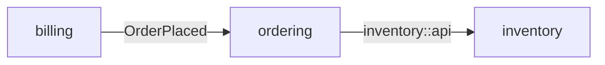

# Module kiểu closed và quy tắc truy cập

Trong **Spring Modulith**, chia ứng dụng thành nhiều package chưa đủ để bảo vệ kiến trúc. Một lớp `public` ở package nội bộ vẫn có thể bị code từ module khác `import`; dự án tiếp tục biên dịch và phụ thuộc sai dần trở thành thói quen. **Module kiểu closed** giúp diễn đạt một cam kết rõ hơn: các module khác chỉ được phụ thuộc vào **giao diện được công bố**, còn phần triển khai bên trong được xem là chi tiết riêng của module.

Bài học thuộc chương **Thiết kế module** của **SPRING_MODULITH_VERIFICATION_TESTING**. Mục tiêu là hiểu chính xác phạm vi đóng gói của closed module, thiết kế các quy tắc truy cập và dùng `ApplicationModules` để kiểm chứng, làm nền tảng cho `@ApplicationModuleTest`, kiểm thử sự kiện, cơ sở dữ liệu, tích hợp và quality gate trong CI.

## 1. Mục tiêu học tập

Sau bài này, bạn sẽ có thể:

1. Phân biệt **closed module** với **open module**, với `public`/`private` trong Java và với Java Platform Module System (JPMS).
2. Chỉ ra kiểu nào nằm trong API công khai, named interface và phần nội bộ của một application module.
3. Khai báo `@ApplicationModule`, `@NamedInterface`, `allowedDependencies` để mô tả hướng phụ thuộc hợp lệ.
4. Phát hiện truy cập trái phép vào package nội bộ bằng `ApplicationModules.verify()`.
5. Chọn trường hợp sử dụng open module có kiểm soát và lập lộ trình thu hẹp về closed module.
6. Phân biệt kiểm chứng ranh giới kiến trúc với kiểm thử hành vi, sự kiện, database và tích hợp.

## 2. Closed module thực sự đóng điều gì?

Một application module là đơn vị kiến trúc logic bên trong ứng dụng Spring Boot. Theo cách phát hiện module thông dụng, Spring Modulith lấy các package con trực tiếp dưới package ứng dụng làm các module. **Closed** là mô hình mặc định của application module: mã từ module khác chỉ được phụ thuộc vào những phần mà module công bố qua API của nó.

Ví dụ trong ứng dụng bán hàng:

```text
com.example.shop
├── ShopApplication.java
├── ordering/                       ← application module: Đặt hàng
│   ├── package-info.java
│   ├── OrderingOperations.java      ← API ở package gốc
│   ├── OrderPlaced.java             ← sự kiện công khai
│   └── internal/
│       ├── OrderService.java        ← triển khai nội bộ
│       └── OrderRepository.java     ← lưu trữ nội bộ
├── inventory/                      ← application module: Tồn kho
│   ├── package-info.java
│   ├── api/
│   │   ├── package-info.java        ← khai báo named interface
│   │   ├── InventoryOperations.java
│   │   └── ReservationRequest.java
│   └── internal/
│       ├── StockReservationService.java
│       └── StockRepository.java
└── billing/                        ← application module: Thanh toán
    ├── package-info.java
    └── internal/
        └── OrderPlacedListener.java
```

Với module `inventory` kiểu closed:

- `inventory.api.InventoryOperations` có thể được module khác dùng **khi** `api` được khai báo là named interface và hướng phụ thuộc được cho phép.
- `inventory.internal.StockRepository` là chi tiết triển khai; việc nó có modifier `public` **không biến nó thành API kiến trúc**.
- `ordering` không nên tự cập nhật entity tồn kho, gọi thẳng `StockRepository` hoặc lấy thông tin quan trọng bằng cách truy cập dữ liệu nội bộ của `inventory`.

Giới hạn này được **mô hình kiến trúc và bài kiểm thử Spring Modulith** thực thi. Nó không tự chặn mọi lệnh import ở bước biên dịch Java: nếu cả hai lớp `public` và cùng nằm trên classpath, Java vẫn có thể biên dịch tham chiếu đó. Vì vậy cần chạy kiểm chứng kiến trúc thường xuyên.

### 2.1. Phân biệt ba loại giới hạn truy cập

| Cấp độ | Cơ chế | Ví dụ | Phạm vi bảo vệ |
| --- | --- | --- | --- |
| **Ngôn ngữ Java** | `private`, package-private, `protected`, `public` | `StockRepository` không khai báo `public` | Trình biên dịch kiểm tra quyền truy cập ở cấp kiểu/thành viên |
| **Spring Modulith** | Closed module, API công khai, named interface, luật phụ thuộc | `ordering` bị báo lỗi khi tham chiếu `inventory.internal.StockRepository` | Kiểm chứng quan hệ giữa các **application module** |
| **JPMS (Java Platform Module System)** | `module-info.java`, `exports`, `requires` | Java module chỉ `exports` một package | Giới hạn ở mức **Java module**; không đồng nghĩa application module của Spring Modulith |

Tên `module` xuất hiện ở cả ba cấp nhưng chúng giải quyết các bài toán khác nhau. Closed module trong Spring Modulith **không yêu cầu** tạo `module-info.java` của JPMS, cũng không tự cô lập ứng dụng thành các tiến trình riêng.

## 3. Bề mặt API của một closed module

Muốn áp dụng quy tắc truy cập, trước hết phải biết **kiểu nào được xuất bản**. Spring Modulith phân biệt package gốc của module với các package con.

| Vị trí khai báo kiểu | Mặc định được xem là API của closed module? | Cách công bố hợp lệ |
| --- | --- | --- |
| `inventory.SomePublicType` (package gốc) | Có, là phần giao diện công khai mặc định nếu kiểu có thể được truy cập từ ngoài package | Đặt các hợp đồng ổn định tại package gốc |
| `inventory.api.InventoryOperations` (package con) | Không tự động | Đánh dấu package `inventory.api` bằng `@NamedInterface` |
| `inventory.internal.StockRepository` (package con) | Không | Không công bố; chỉ để module `inventory` sử dụng |
| `inventory.internal.jpa.StockEntity` (package con sâu hơn) | Không | Giữ chi tiết persistence bên trong module |

Vì vậy, **`public` không tương đương với “public API của module”**. Một class `public` cần thiết cho Spring, thư viện hoặc proxy có thể vẫn thuộc phần nội bộ của module. Ngược lại, đưa hàng chục class vào package gốc có thể vô tình làm bề mặt API trở nên quá rộng.

### 3.1. API ở package gốc

API mặc định là các kiểu được truy cập hợp lệ ở package gốc của module, ví dụ:

```java
// src/main/java/com/example/shop/ordering/OrderingOperations.java
package com.example.shop.ordering;

import java.util.UUID;

public interface OrderingOperations {
    UUID placeOrder(PlaceOrderCommand command);
}
```

Nếu `PlaceOrderCommand` được dùng trong chữ ký công khai, kiểu đó cũng phải sẵn có qua hợp đồng mà module khác được phép truy cập. Tránh công bố API với tham số/trả về là JPA entity thuộc `internal`: như vậy chữ ký có vẻ công khai nhưng người dùng API lại phải biết chi tiết nội bộ.

### 3.2. Named interface: công bố có chủ đích một package con

Để công bố nhóm hợp đồng tồn kho mà vẫn giấu repository, tạo file `inventory/api/package-info.java`:

```java
@org.springframework.modulith.NamedInterface("api")
package com.example.shop.inventory.api;
```

Hợp đồng và kiểu dữ liệu chuyển giao nằm cùng package:

```java
// inventory/api/ReservationRequest.java
package com.example.shop.inventory.api;

public record ReservationRequest(String sku, int quantity) { }
```

```java
// inventory/api/InventoryOperations.java
package com.example.shop.inventory.api;

import java.util.List;
import java.util.UUID;

public interface InventoryOperations {
    UUID reserve(List<ReservationRequest> requests);
}
```

Hợp đồng này nêu **ý định nghiệp vụ “giữ hàng”**; không cần để module đặt hàng biết thuật toán khóa tồn kho hay loại database được sử dụng. Trong hệ thống thật, cần định nghĩa thêm điều kiện `quantity > 0`, cách trả lỗi khi thiếu hàng, ý nghĩa `UUID` đặt giữ và khả năng xử lý lệnh lặp.

**Named interface là hợp đồng công khai**, nên hãy dùng tên theo vai trò (`api`, `spi`, `events`...) và chỉ đưa vào những kiểu cần chia sẻ. Đánh dấu cả package nội bộ thành named interface chỉ để kiểm thử kiến trúc qua được là dấu hiệu cần xem lại thiết kế.

## 4. `allowedDependencies`: giới hạn nơi một module được đi tới

Hai câu hỏi cần được kiểm tra **đồng thời**:

1. **Bề mặt được phép truy cập:** kiểu của module đích có nằm trong API công khai hoặc named interface hợp lệ không?
2. **Hướng phụ thuộc được phép:** module nguồn có được phép phụ thuộc vào module đích/giao diện đó không?

Với `ordering`, ta chỉ muốn sử dụng hợp đồng `inventory::api`:

```java
// ordering/package-info.java
@org.springframework.modulith.ApplicationModule(
    allowedDependencies = "inventory::api"
)
package com.example.shop.ordering;
```

Ký hiệu `inventory::api` gồm **tên module** `inventory` và **tên named interface** `api`. Không phải tên Java package `com.example.shop.inventory.api`; nó là tham chiếu trong mô hình module của Spring Modulith.

Ví dụ, ở `billing/package-info.java` ta có thể cho phép module thanh toán tham chiếu tới API tại package gốc của `ordering`, chẳng hạn sự kiện `OrderPlaced`:

```java
@org.springframework.modulith.ApplicationModule(
    allowedDependencies = "ordering"
)
package com.example.shop.billing;
```

Khi thiết kế, hãy tránh nhầm `allowedDependencies` với việc “xuất bản” một kiểu. Khai báo hướng phụ thuộc **không tự biến** `inventory.internal.StockRepository` thành API. Chiều ngược lại cũng đúng: `@NamedInterface("api")` **không tự cấp** cho mọi module quyền sử dụng nếu module nguồn còn có giới hạn `allowedDependencies`.

### 4.1. Ma trận truy cập minh họa

Giả sử các module dùng thiết kế và khai báo như trên:

| Tham chiếu từ module | Đích được tham chiếu | Kết quả mong muốn | Giải thích |
| --- | --- | --- | --- |
| `ordering` | `inventory.api.InventoryOperations` | **Hợp lệ** | Named interface `api` đã công bố, `ordering` cho phép `inventory::api` |
| `ordering` | `inventory.internal.StockRepository` | **Vi phạm** | Truy cập phần nội bộ của closed module |
| `ordering` | `billing.internal.OrderPlacedListener` | **Vi phạm** | Không phải API, đồng thời sai hướng phụ thuộc |
| `billing` | `ordering.OrderPlaced` | **Hợp lệ** | Kiểu ở API package gốc, `billing` cho phép `ordering` |
| `inventory` | Kiểu nội bộ của chính `inventory` | **Hợp lệ** | Bên trong một application module có quyền phối hợp các phần triển khai của nó |

Ma trận này nêu **quy tắc kiến trúc** để kiểm bằng Spring Modulith; để mã Java biên dịch và ứng dụng chạy còn cần các điều kiện Java access, bean configuration và thư viện phù hợp.

### 4.2. Tránh phụ thuộc vòng

Một thiết kế có thể chỉ dùng API công khai mà vẫn hình thành chu trình phụ thuộc. Ví dụ `ordering → inventory → billing → ordering` làm các module khó kiểm thử và thay đổi độc lập. `ApplicationModules.verify()` có kiểm tra phụ thuộc vòng trong mô hình module.



Đồ thị trên hợp lý nếu `inventory` không tham chiếu lại `ordering` hoặc `billing`. **Hướng phụ thuộc mã nguồn** cũng cần phân biệt với **hướng gửi dữ liệu khi chạy**: `billing` có thể đăng ký nhận `OrderPlaced` do `ordering` phát, nghĩa là mã listener tham chiếu đến kiểu sự kiện của `ordering`, trong khi luồng sự kiện thực tế đi từ đặt hàng sang thanh toán.

## 5. Đóng kín triển khai, mở đúng hành vi

Ví dụ đặt hàng cần giữ hàng. Module tồn kho cung cấp bean implement hợp đồng công khai, nhưng class implement vẫn ở package `internal`:

```java
// inventory/internal/StockReservationService.java
package com.example.shop.inventory.internal;

import com.example.shop.inventory.api.InventoryOperations;
import com.example.shop.inventory.api.ReservationRequest;
import java.util.List;
import java.util.UUID;
import org.springframework.stereotype.Service;

@Service
public class StockReservationService implements InventoryOperations {

    @Override
    public UUID reserve(List<ReservationRequest> requests) {
        // Triển khai thật: kiểm tra tồn kho, khóa và ghi nhận phiếu giữ hàng.
        throw new UnsupportedOperationException("Minh họa ranh giới, chưa triển khai");
    }
}
```

Module đặt hàng chỉ inject interface:

```java
// ordering/internal/OrderService.java
package com.example.shop.ordering.internal;

import com.example.shop.inventory.api.InventoryOperations;
import com.example.shop.inventory.api.ReservationRequest;
import java.util.List;
import java.util.UUID;
import org.springframework.stereotype.Service;

@Service
public class OrderService {

    private final InventoryOperations inventory;

    public OrderService(InventoryOperations inventory) {
        this.inventory = inventory;
    }

    public UUID reserveForOrder(String sku, int quantity) {
        return inventory.reserve(List.of(new ReservationRequest(sku, quantity)));
    }
}
```

Đây là ví dụ **biên giới biên dịch và dependency injection**, không phải use case sản xuất hoàn chỉnh: phương thức `reserve(...)` đang cố ý ném ngoại lệ để không tạo cảm giác đã có thuật toán chống oversell. Trong code thật, `inventory` phải tự bảo vệ invariant giữ hàng, xử lý giao dịch/cạnh tranh và xác định thông điệp lỗi nghiệp vụ.

Nếu sau này `inventory` chuyển từ JPA sang một hệ thống lưu trữ khác, `ordering` chỉ phụ thuộc vào `InventoryOperations` và `ReservationRequest` nên không cần sửa theo tên repository hoặc entity bên trong.

### 5.1. Sự kiện cũng phải theo quy tắc truy cập

Để `billing` xử lý đơn vừa đặt, có thể công bố kiểu sự kiện ở package gốc `ordering`:

```java
// ordering/OrderPlaced.java
package com.example.shop.ordering;

import java.math.BigDecimal;
import java.util.UUID;

public record OrderPlaced(UUID orderId, BigDecimal amount) { }
```

Module thanh toán tham chiếu **kiểu sự kiện công khai**, không tham chiếu `ordering.internal.OrderService` hoặc `OrderRepository`:

```java
// billing/internal/OrderPlacedListener.java
package com.example.shop.billing.internal;

import com.example.shop.ordering.OrderPlaced;
import org.springframework.modulith.events.ApplicationModuleListener;

class OrderPlacedListener {

    @ApplicationModuleListener
    void on(OrderPlaced event) {
        // Khởi tạo giao dịch thanh toán theo chính sách của billing.
    }
}
```

Đoạn listener trên minh họa **mối phụ thuộc vào kiểu sự kiện**; để chạy thật, listener cần là bean Spring được quản lý và phải có triển khai xử lý thanh toán. Với `@ApplicationModuleListener`, cần hiểu semantics giao dịch, thực thi sau commit, bất đồng bộ và xử lý lỗi/phát lại theo phiên bản Spring Modulith đang sử dụng. Bảo vệ **idempotency** vì một sự kiện có thể được xử lý lại. Closed module chỉ bảo vệ quyền truy cập mã, không thay cho kiểm thử giao nhận sự kiện.

## 6. Open module dùng để làm gì?

Spring Modulith hỗ trợ **open module** khi cần nới lỏng đóng gói nội bộ, thường hữu ích cho ứng dụng cũ đang chuyển dần sang thiết kế theo module. Với một open module, các package bên trong không bị ràng buộc bởi quy tắc chỉ được truy cập qua bề mặt API của **closed module** theo cùng cách. Đây là mức nới lỏng **có chủ đích**, không phải lựa chọn mặc định cho thiết kế mới.

Ví dụ khai báo ở `legacy/package-info.java`:

```java
@org.springframework.modulith.ApplicationModule(
    type = org.springframework.modulith.ApplicationModule.Type.OPEN
)
package com.example.shop.legacy;
```

So sánh:

| Tiêu chí | `CLOSED` (mặc định) | `OPEN` |
| --- | --- | --- |
| Phạm vi mà module khác được truy cập | API package gốc và các named interface công bố | Nới lỏng giới hạn truy cập vào các package bên trong module |
| Phù hợp | Thiết kế mới hoặc module đã có hợp đồng rõ | Quá trình chuyển đổi hệ thống đang có nhiều phụ thuộc chéo |
| Rủi ro chính | Cần thiết kế hợp đồng; có thể phát hiện các phụ thuộc trước đây bị giấu | Chi tiết triển khai có thể bị module khác sử dụng rồi trở thành phụ thuộc khó gỡ |
| Mục tiêu dài hạn | Hợp đồng nhỏ, thay đổi độc lập | Thu hẹp điểm truy cập, hướng tới closed khi khả thi |

**Open không có nghĩa là bỏ toàn bộ kiểm chứng kiến trúc.** Hãy tiếp tục chạy `ApplicationModules.verify()` để kiểm tra những quy tắc còn áp dụng, chẳng hạn phụ thuộc vòng hoặc giới hạn phụ thuộc được khai báo tường minh. Chính xác quy tắc nào được kiểm tra phụ thuộc cấu hình và phiên bản thư viện; không suy rằng `OPEN` làm mọi quan hệ đều hợp lệ.

### 6.1. Một lộ trình từ open sang closed

Giả sử module `legacy` từng cho `ordering` import `legacy.internal.CustomerEntity`:

1. **Liệt kê tham chiếu chéo đang có:** dùng kết quả kiểm chứng và tìm kiếm mã để biết module nào dùng `CustomerEntity`, repository hay service nội bộ.
2. **Phân loại theo ý định:** `ordering` chỉ cần kiểm tra khách hàng có được đặt hàng hay không, chứ không cần toàn bộ thông tin và cách lưu `CustomerEntity`.
3. **Tạo hợp đồng nhỏ:** ví dụ `CustomerEligibility` và `CustomerEligibilityResult` trong package gốc hoặc named interface của `legacy`.
4. **Thay từng caller:** cho `ordering` gọi hợp đồng mới, bỏ import kiểu nội bộ, bổ sung `allowedDependencies` hẹp.
5. **Chuyển sang closed, chạy `verify()`:** chỉ thực hiện khi mọi caller đã dùng API phù hợp. Giữ bài kiểm thử trong CI để phụ thuộc cũ không xuất hiện lại.

Giữ open lâu dài có thể phù hợp với một quyết định kiến trúc được đánh giá rõ, nhưng lý do cần được ghi lại. Không nên dùng `OPEN` như cách sửa nhanh mỗi khi `verify()` báo một import sai.

## 7. Kiểm chứng bằng `ApplicationModules.verify()`

Tạo bài kiểm thử cấu trúc trong `src/test/java/com/example/shop/ModularityTests.java`:

```java
package com.example.shop;

import org.junit.jupiter.api.Test;
import org.springframework.modulith.core.ApplicationModules;

class ModularityTests {

    @Test
    void modulesFollowDeclaredBoundaries() {
        ApplicationModules.of(ShopApplication.class).verify();
    }
}
```

Bài kiểm thử cần các dependency Spring Modulith phục vụ kiến trúc/kiểm thử trong cấu hình build. `ApplicationModules.of(...)` xây dựng mô hình application module dựa trên ứng dụng; `verify()` kiểm tra các quy tắc kiến trúc mà Spring Modulith hỗ trợ, điển hình gồm **phụ thuộc vòng**, **truy cập phần nội bộ** của closed module và **phụ thuộc không được phép** theo `allowedDependencies`.

Thử cố ý thêm import sau vào `ordering`:

```java
// Sai về kiến trúc: StockRepository thuộc phần nội bộ của inventory.
import com.example.shop.inventory.internal.StockRepository;
```

Ngay cả khi `StockRepository` là `public` và trình biên dịch Java chấp nhận import, bài kiểm thử kiến trúc phải cảnh báo quan hệ xuyên ranh giới đó. Cách sửa là đi qua `InventoryOperations` hoặc thiết kế thêm một hành vi API thích hợp **do module tồn kho sở hữu**.

Không xử lý lỗi bằng cách chuyển toàn bộ `inventory` thành `OPEN` hoặc biến `inventory.internal` thành named interface nếu nhu cầu nghiệp vụ chỉ là “kiểm tra/giữ hàng”. Làm vậy giảm giá trị bảo vệ kiến trúc.

### 7.1. `verify()` không kiểm tra điều gì?

Một kiểm thử kiến trúc xanh **không chứng minh** các đặc tính sau:

- Không xảy ra giữ hàng vượt tồn khi hai request chạy đồng thời.
- Giao dịch cập nhật tồn kho và đơn hàng rollback đúng khi có lỗi.
- Sự kiện `OrderPlaced` chắc chắn được xử lý thành công và không gây tác dụng phụ trùng khi phát lại.
- Bean wiring, security, serialization và kết nối hệ thống ngoài hoạt động như kỳ vọng.

Đó là trách nhiệm của kiểm thử đơn vị, module, tích hợp, database và sự kiện. Bảo vệ kiến trúc là lớp quality gate đầu tiên, không phải toàn bộ chiến lược chất lượng.

### 7.2. Liên hệ với `@ApplicationModuleTest`

Sau khi kiểm chứng cấu trúc, cần kiểm thử use case **trong phạm vi module**. Ví dụ lớp test đặt trong package của `ordering`:

```java
package com.example.shop.ordering;

import org.junit.jupiter.api.Test;
import org.springframework.modulith.test.ApplicationModuleTest;
import org.springframework.modulith.test.ApplicationModuleTest.BootstrapMode;

@ApplicationModuleTest(mode = BootstrapMode.DIRECT_DEPENDENCIES)
class OrderingModuleTests {

    @Test
    void startsWithDirectDependencies() {
        // Bổ sung kiểm thử hành vi đặt hàng, giữ hàng và kiểm tra trạng thái.
    }
}
```

Với `DIRECT_DEPENDENCIES`, ngữ cảnh kiểm thử bao gồm module được kiểm thử và các module phụ thuộc trực tiếp của nó. Chế độ `STANDALONE` giúp kiểm thử cô lập hơn nhưng cần cung cấp test double cho các collaborator bên ngoài khi cần; chế độ `ALL_DEPENDENCIES` rộng hơn và có thể khởi động các phụ thuộc bắc cầu. Việc chọn chế độ phải phản ánh **mục tiêu bài kiểm thử** và khả năng khởi động hạ tầng. Đoạn test trên chỉ minh họa cấu hình bootstrap; một `@Test` rỗng chưa chứng minh hành vi nghiệp vụ đúng.

Với workflow dùng sự kiện, kết hợp kiểm thử phát/nhận sự kiện; với quy tắc tồn kho, kiểm thử database và các kịch bản đồng thời; với tương tác hạ tầng ngoài, bổ sung integration test thực tế. Không mở rộng API module chỉ để tránh thiết lập test double hợp lệ.

### 7.3. Quality gate trong CI

Một pipeline tối thiểu cần chạy bộ test bao gồm `ModularityTests` trước khi cho phép merge. Kết quả kỳ vọng:

```text
Thay đổi mã nguồn
      ↓
Biên dịch và kiểm thử
      ↓
ApplicationModules.verify() ── vi phạm phụ thuộc ──> CI thất bại
      ↓ hợp lệ
@ApplicationModuleTest + kiểm thử hành vi/sự kiện/database
      ↓ đạt
Đủ điều kiện qua quality gate
```

Nếu một thay đổi làm `ordering` import `inventory.internal.StockRepository`, CI phải báo lỗi dù việc đặt hàng trên môi trường phát triển vẫn “chạy được”. Tên lệnh thực tế (`./mvnw test`, `./gradlew test`, ...), cách phân nhóm test và điều kiện chặn merge phụ thuộc cấu hình dự án; điều thiết yếu là **bài kiểm thử kiến trúc thực sự được thực thi**.

## 8. Các sai lầm thường gặp

| Sai lầm | Hậu quả | Hướng xử lý |
| --- | --- | --- |
| Thấy class `public` thì coi là API module | Các caller phụ thuộc vào repository/entity nội bộ | Dùng API package gốc hoặc named interface |
| Đặt mọi class vào package gốc của module | Vô tình công bố quá nhiều kiểu | Giữ package gốc nhỏ, chuyển triển khai xuống `internal` |
| Đặt `@NamedInterface` trên `internal` chỉ để test qua | Mở rộng hợp đồng sai mục đích | Tạo API thể hiện hành vi nghiệp vụ thật sự cần |
| Cấu hình `allowedDependencies` quá rộng | Khó kiểm soát module nào được gọi module nào | Chỉ cho phép hướng phụ thuộc và named interface cần thiết |
| Chuyển sang `OPEN` khi vi phạm xuất hiện | Phụ thuộc nội bộ tiếp tục tích tụ | Ưu tiên sửa hướng phụ thuộc, dùng `OPEN` có kế hoạch chuyển đổi |
| Cho module khác gọi thẳng JPA repository | Rò rỉ quyết định lưu trữ và invariant | Đưa thao tác về module sở hữu và công bố lệnh/API |
| Xem `verify()` là kiểm thử tích hợp | Không phát hiện lỗi transaction, event, concurrency | Bổ sung các lớp kiểm thử nghiệp vụ phù hợp |

### Tình huống đáng suy nghĩ: một module có cần public API không?

Không phải mọi module đều cần cung cấp lệnh đồng bộ. Một module chỉ phản ứng với sự kiện có thể không có interface nghiệp vụ để module khác gọi vào. Tuy nhiên, nếu listener phụ thuộc vào kiểu sự kiện thuộc module khác, phụ thuộc **mã nguồn** vẫn cần hợp lệ. Ngược lại, việc module phát sự kiện không tham chiếu listener là dấu hiệu giúp tránh phụ thuộc ngược.

## 9. Bài thực hành: phát hiện và sửa ranh giới bị phá vỡ

Giả sử ứng dụng đã có ba module `ordering`, `inventory`, `billing` và tất cả đều là closed. Một lập trình viên thêm các dòng sau trong module `ordering`:

```java
import com.example.shop.inventory.internal.StockEntity;
import com.example.shop.inventory.internal.StockRepository;

// Mục tiêu: trừ tồn kho ngay trong use case đặt hàng.
```

Hãy trả lời:

1. Vì sao mã này có thể hợp lệ với trình biên dịch Java nhưng sai với closed module?
2. `@NamedInterface("api")` ở `inventory.api` có làm hai import trên hợp lệ không?
3. Cần đưa hành vi nào vào hợp đồng `InventoryOperations` để `ordering` không phải trực tiếp sửa tồn kho?
4. Cấu hình `allowedDependencies` của `ordering` nên trỏ đến đâu?
5. Bộ kiểm thử nào cần chạy để bảo vệ cả **kiến trúc** lẫn bất biến “không giữ vượt tồn”?

**Gợi ý đối chiếu:**

- Hai import vào `inventory.internal` vượt qua bề mặt API của closed module; `public` chỉ giải quyết quyền truy cập ở mức ngôn ngữ Java.
- `@NamedInterface("api")` chỉ công bố package `inventory.api`; không cấp quyền truy cập `inventory.internal`.
- `inventory` giữ luật kiểm tra và ghi nhận tồn kho, ví dụ thông qua `reserve(List<ReservationRequest>)`, kèm xử lý lỗi và đồng thời tại chính module này.
- `ordering` khai báo `allowedDependencies = "inventory::api"` và chỉ import những kiểu cần thiết trong giao diện đó.
- Chạy `ApplicationModules.verify()` để kiểm tra ranh giới, `@ApplicationModuleTest` cho use case, kiểm thử giao dịch/database/đồng thời cho invariant, kiểm thử sự kiện và tích hợp khi có phụ thuộc liên quan.

**Thử nghiệm mở rộng:** Tạm thời chuyển `inventory` thành `OPEN` và quan sát sự khác biệt của kết quả kiểm chứng ranh giới trên cùng một import sai, sau đó quay về `CLOSED`, thay bằng API phù hợp và chạy lại. Hoạt động này giúp thấy rõ `OPEN` làm thay đổi chính sách kiến trúc, nhưng không biến một phụ thuộc vào repository thành quyết định thiết kế tốt.

## 10. Checklist trước khi đóng module

- [ ] Đã xác định quyết định, invariant và dữ liệu thuộc sở hữu của module.
- [ ] Package gốc chỉ chứa hợp đồng công khai cần thiết; kiểu triển khai nằm ở package con phù hợp.
- [ ] Package con cần công bố có `@NamedInterface` với tên dễ hiểu và phạm vi hợp lý.
- [ ] Không có chữ ký API làm rò rỉ entity hoặc repository nội bộ.
- [ ] `allowedDependencies` phản ánh đúng **hướng và phạm vi** phụ thuộc được chấp thuận.
- [ ] Không có phụ thuộc vòng giữa các application module.
- [ ] `ApplicationModules.verify()` phát hiện được import trái phép vào phần nội bộ.
- [ ] `@ApplicationModuleTest` và các kiểm thử database, sự kiện, tích hợp bao phủ hành vi quan trọng.
- [ ] CI chạy các kiểm thử bảo vệ kiến trúc và nghiệp vụ trước khi merge.
- [ ] Mọi module `OPEN` đều có lý do và kế hoạch quản lý phụ thuộc rõ ràng.

Một **closed module** tốt không phải module có ít file `public` nhất, mà là module chỉ công bố **đúng các hợp đồng mà nghiệp vụ cho phép sử dụng**. Định nghĩa bề mặt API, giới hạn hướng phụ thuộc và kiểm chứng chúng tự động bằng Spring Modulith giúp giữ thiết kế rõ ràng ngay cả khi số lượng tính năng và người đóng góp tăng lên.
