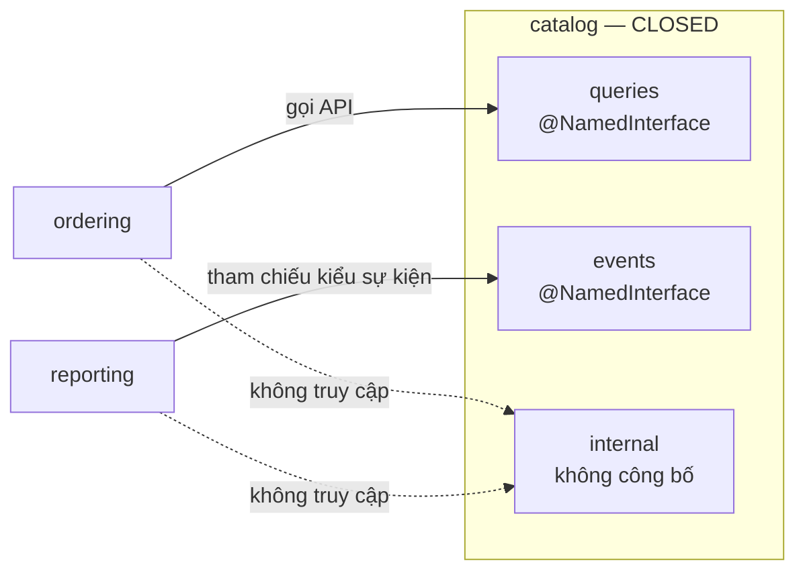
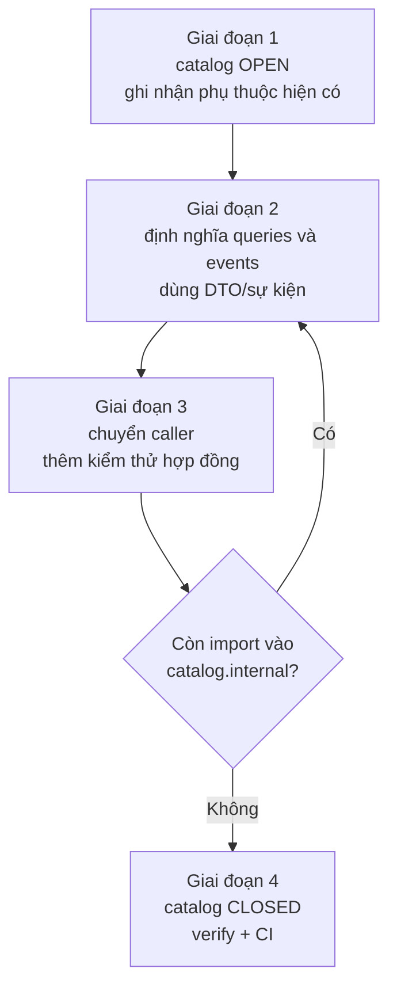

# Open module và trường hợp cần công khai package

Trong ứng dụng Spring Modulith, một module có thể chứa hàng chục package Java nhưng chỉ muốn module khác nhìn thấy vài hợp đồng ổn định. Khi đang chuyển đổi ứng dụng cũ sang kiến trúc module, việc đóng kín toàn bộ ngay lập tức đôi khi làm xuất hiện nhiều phụ thuộc chưa thể sửa trong một lần. Spring Modulith có hai cơ chế quan trọng để giải quyết tình huống này: **module kiểu `OPEN`** để nới giới hạn truy cập vào nội bộ module, và **`@NamedInterface`** để chủ động công bố một hoặc vài package của module vẫn giữ kiểu `CLOSED`.

Đây là bài học thuộc chương **Thiết kế module** của **SPRING_MODULITH_VERIFICATION_TESTING**. Trọng tâm là quyết định **khi nào cần cho phép truy cập, cho phép tới đâu và làm thế nào kiểm chứng được quyết định đó**. Các quy tắc này sẽ được bảo vệ bằng `ApplicationModules.verify()`, kiểm thử `@ApplicationModuleTest`, kiểm thử sự kiện/cơ sở dữ liệu/tích hợp và quality gate trong CI nhằm ngăn phụ thuộc sai quay trở lại.

## 1. Mục tiêu học tập

Sau bài học, bạn có thể:

1. Giải thích `OPEN` làm thay đổi chính sách đóng gói của application module như thế nào.
2. Phân biệt mở **toàn bộ nội bộ module** bằng `OPEN` với công bố **package có chọn lọc** bằng `@NamedInterface`.
3. Đánh giá khi nào thật sự cần công khai một nhóm kiểu dữ liệu hoặc API xuyên module.
4. Sử dụng `allowedDependencies` để kiểm soát **chiều và phạm vi phụ thuộc** từ module gọi.
5. Lập kế hoạch chuyển đổi một module `OPEN` sang `CLOSED` mà vẫn bảo toàn hành vi nghiệp vụ.
6. Kiểm chứng cấu trúc bằng `ApplicationModules` và kiểm thử hợp đồng, sự kiện, dữ liệu trong CI.

## 2. Vấn đề thực tế: `public` trong Java chưa phải API kiến trúc

Giả sử hệ thống thương mại có ba năng lực:

- `catalog` quản lý dữ liệu sản phẩm, giá niêm yết và trạng thái kinh doanh.
- `ordering` tạo đơn và cần tra cứu thông tin sản phẩm để chốt đơn giá.
- `reporting` cần theo dõi thay đổi giá để tạo báo cáo.

Một cấu trúc package dự kiến:

```text
com.example.shop/
├── ShopApplication.java
├── catalog/
│   ├── package-info.java
│   ├── queries/
│   │   ├── package-info.java
│   │   ├── ProductQueries.java
│   │   └── ProductView.java
│   ├── events/
│   │   ├── package-info.java
│   │   └── ProductPriceChanged.java
│   └── internal/
│       ├── ProductEntity.java
│       ├── ProductRepository.java
│       └── CatalogService.java
├── ordering/
│   ├── package-info.java
│   └── internal/PlaceOrderService.java
└── reporting/
    ├── package-info.java
    └── internal/PriceReportListener.java
```

`ProductRepository` có thể phải được khai báo `public` vì nhu cầu của framework hoặc của các package Java bên trong module `catalog`. Nhưng `ordering` **không được mặc nhiên sử dụng** repository đó. Quyền truy cập của Java và quyền truy cập được phép trong kiến trúc là hai lớp khác nhau:

| Lớp kiểm soát | Câu hỏi | Ai thực thi? |
| --- | --- | --- |
| Quyền truy cập Java | Kiểu và phương thức có thể được tham chiếu từ package khác không? | Trình biên dịch Java |
| Giao diện của application module | Kiểu thuộc phần công khai hay nội bộ của module đích? | Quy tắc của Spring Modulith khi xác minh |
| Chiều phụ thuộc | Module nguồn có được phụ thuộc vào module đích/giao diện đó không? | `allowedDependencies` và `ApplicationModules.verify()` |
| Hành vi nghiệp vụ | Gọi API đó có bảo vệ invariant, transaction và dữ liệu không? | Logic nghiệp vụ cùng các bài kiểm thử hành vi/tích hợp |

**Spring Modulith không dùng `OPEN` để thay thế modifier của Java.** Chuyển module thành `OPEN` không làm một lớp package-private trở thành `public`, cũng không tự công khai phương thức `private`. Ngược lại, class Java `public` trong package `internal` vẫn có thể bị quy tắc kiến trúc của closed module từ chối.

## 3. Ba lựa chọn để công bố khả năng của module

Theo quy ước phát hiện thường dùng của Spring Modulith, các package con trực tiếp của package chứa lớp ứng dụng Spring Boot được xem là application module. Cách một module công bố kiểu của mình phụ thuộc cấu hình và vị trí package.

| Lựa chọn | Phần module khác có thể tham chiếu theo quy tắc đóng gói | Khi nên dùng |
| --- | --- | --- |
| **`CLOSED` mặc định, API ở package gốc** | Kiểu truy cập được trong package gốc, ví dụ `catalog.ProductCatalog` | Hợp đồng nhỏ, ổn định, ít nhóm API |
| **`CLOSED` + `@NamedInterface`** | API ở package gốc và các package con được đánh dấu làm named interface, ví dụ `catalog.queries` | Cần công bố một nhóm truy vấn, sự kiện hay SPI có ranh giới rõ |
| **`OPEN`** | Nới hạn chế truy cập vào các package con của module, kể cả các package không khai báo named interface | Chuyển đổi ứng dụng cũ, tạm duy trì phụ thuộc có sẵn hoặc ngoại lệ được kiểm soát |

Hai lựa chọn đầu thường thích hợp cho thiết kế mới vì chúng buộc nhóm phát triển xác định hợp đồng thật sự cần chia sẻ. `OPEN` hữu ích khi chi phí đóng kín ngay vượt khả năng refactor hiện tại, nhưng cần có lý do, phạm vi và kế hoạch quản lý.

### 3.1. `CLOSED` mặc định và API ở package gốc

Với application module `catalog` kiểu `CLOSED`, các kiểu công khai ở package gốc `com.example.shop.catalog` là API mặc định. Các kiểu nằm ở package con như `catalog.internal`, `catalog.queries` **không tự trở thành API** chỉ vì được khai báo Java `public`.

Ví dụ API nhỏ đặt ở package gốc:

```java
package com.example.shop.catalog;

public interface CatalogAvailability {
    boolean isActive(String sku);
}
```

Thiết kế này phù hợp nếu module chỉ có một vài hợp đồng. Nhưng khi nhiều nhóm tiêu thụ có nhu cầu khác nhau, nhồi hết các kiểu vào package gốc sẽ làm bề mặt API khó kiểm soát. Lúc đó có thể công bố package con có chủ đích.

### 3.2. Công khai một package con bằng `@NamedInterface`

Nếu `ordering` cần tra cứu sản phẩm, module `catalog` có thể công bố riêng nhóm truy vấn bằng file `catalog/queries/package-info.java`:

```java
@org.springframework.modulith.NamedInterface("queries")
package com.example.shop.catalog.queries;
```

Định nghĩa hợp đồng chỉ gồm dữ liệu `ordering` cần biết:

```java
// catalog/queries/ProductView.java
package com.example.shop.catalog.queries;

import java.math.BigDecimal;

public record ProductView(
    String sku,
    String displayName,
    BigDecimal listPrice,
    boolean active
) {}
```

```java
// catalog/queries/ProductQueries.java
package com.example.shop.catalog.queries;

import java.util.Optional;

public interface ProductQueries {
    Optional<ProductView> findBySku(String sku);
}
```

Việc cung cấp `ProductView` tránh đẩy `ProductEntity` hoặc `ProductRepository` sang module đặt hàng. `catalog` tiếp tục chịu trách nhiệm tính giá niêm yết và trạng thái kinh doanh; `ordering` có thể lưu **bản chụp đơn giá đã chốt** theo quy tắc của đơn hàng.

Nếu `reporting` cần nghe sự kiện thay đổi giá, công bố một package thứ hai:

```java
// catalog/events/package-info.java
@org.springframework.modulith.NamedInterface("events")
package com.example.shop.catalog.events;
```

```java
// catalog/events/ProductPriceChanged.java
package com.example.shop.catalog.events;

import java.math.BigDecimal;

public record ProductPriceChanged(
    String sku,
    BigDecimal previousPrice,
    BigDecimal newPrice
) {}
```

Lưu ý: đây là kiểu sự kiện **mang sự thật nghiệp vụ**, không phải JPA entity hay chi tiết của event dispatcher. Cách sử dụng sự kiện cần được kiểm thử riêng; việc gắn `@NamedInterface` không bảo đảm sự kiện được xử lý thành công.

Ta có thể mô tả quyền công bố:



**Một named interface là danh sách cho phép có chủ đích.** Khai báo nó trên `catalog.queries` không có nghĩa `catalog.internal` hoặc mọi package con khác được công bố. Khi tổ chức package nhiều tầng, không nên tự giả định rằng một annotation ở package cha sẽ tự động biến toàn bộ cây package thành API; hãy khai báo và kiểm chứng đúng các package chứa hợp đồng cần xuất bản.

### 3.3. Giới hạn module gọi bằng `allowedDependencies`

Việc module đích công bố hợp đồng mới giải quyết **một nửa** chính sách: bên gọi còn cần được phép phụ thuộc vào hợp đồng đó.

Ở `ordering/package-info.java`:

```java
@org.springframework.modulith.ApplicationModule(
    allowedDependencies = "catalog::queries"
)
package com.example.shop.ordering;
```

Ở `reporting/package-info.java`:

```java
@org.springframework.modulith.ApplicationModule(
    allowedDependencies = "catalog::events"
)
package com.example.shop.reporting;
```

`catalog::queries` và `catalog::events` là tên **module + named interface**, không phải tên package Java đầy đủ. Một module nguồn không có `allowedDependencies` tường minh thường không bị giới hạn danh sách module đích theo chính cơ chế này; điều đó **không** có nghĩa được tự do truy cập package nội bộ của một closed module.

Thiết kế này thể hiện các quyền cụ thể: `ordering` đọc catalog qua `queries`, `reporting` biết kiểu sự kiện qua `events`. Phát sự kiện từ `catalog` tới `reporting` là hướng thông tin lúc chạy; việc listener trong `reporting` import `ProductPriceChanged` khiến **hướng phụ thuộc mã nguồn** là `reporting → catalog`.

## 4. `OPEN` thay đổi điều gì?

Trong hệ thống đã tồn tại nhiều import chéo vào package con, có thể khai báo module `catalog` là `OPEN` ở `catalog/package-info.java`:

```java
@org.springframework.modulith.ApplicationModule(
    type = org.springframework.modulith.ApplicationModule.Type.OPEN
)
package com.example.shop.catalog;
```

Khi đó, Spring Modulith nới kiểm tra đóng gói vốn ngăn module khác tham chiếu vào các package con chưa được công bố. Về mặt **quy tắc bề mặt module**, `ordering` có thể tham chiếu tới kiểu Java truy cập được trong `catalog.internal` mà không gặp cùng lỗi “truy cập nội bộ closed module” như trước.

Điều **không thay đổi**:

- Quyền truy cập của Java vẫn áp dụng. `OPEN` không thể biến lớp/thành viên Java không truy cập được thành truy cập được.
- `allowedDependencies` khai báo ở module nguồn vẫn là một quy tắc độc lập phải được xem xét và kiểm chứng.
- Kiểm tra phụ thuộc vòng và các luật kiến trúc khác mà Spring Modulith áp dụng vẫn có ý nghĩa; `OPEN` không phải lệnh bỏ qua mọi xác minh.
- `OPEN` không cung cấp transaction, cơ chế khóa, idempotency, quản lý version hợp đồng hay cơ chế triển khai phân tán.
- Quyền truy cập được nới về mặt kiến trúc **không chứng minh** việc sửa dữ liệu nội bộ của module khác là an toàn.

Đặc biệt, **mở module đích** và **giới hạn module nguồn bằng `allowedDependencies`** là hai quyết định riêng. Khi thử nghiệm `OPEN`, cần đọc kết quả `verify()` với cấu hình thực tế: một import có thể không còn vi phạm giới hạn đóng gói nhưng vẫn sai danh sách phụ thuộc được phép, hoặc tạo chu trình module.

### 4.1. So sánh tình huống truy cập

Giả sử `ordering` có thể tham chiếu tới `catalog` theo chính sách phụ thuộc của nó và `ProductRepository` là kiểu Java truy cập được:

| Tham chiếu | `catalog` là `CLOSED` | `catalog` là `OPEN` |
| --- | --- | --- |
| `catalog.queries.ProductQueries`, package có `@NamedInterface` | Được phép về bề mặt API | Được phép về bề mặt API |
| `catalog.internal.ProductRepository`, package không công bố | Bị từ chối vì truy cập nội bộ module | Không bị từ chối bởi **riêng** quy tắc đóng gói closed module |
| `catalog.internal.ProductEntity`, package không công bố | Bị từ chối vì truy cập nội bộ module | Không bị từ chối bởi **riêng** quy tắc đóng gói closed module |
| Tham chiếu gây chu trình giữa các application module | Vi phạm kiểm chứng chu trình | Vẫn cần kiểm tra chu trình |
| Tham chiếu không có trong `allowedDependencies` của bên gọi | Vi phạm ràng buộc phụ thuộc | Vẫn phải đáp ứng ràng buộc phụ thuộc |

Các dòng trên tách riêng khía cạnh **đóng gói**; kết quả `verify()` thực tế là tổng hợp các quy tắc có hiệu lực. Vì thế không nên coi một lần `verify()` xanh khi module `OPEN` là bằng chứng mọi import vào nội bộ đều là hợp đồng nên duy trì.

## 5. Khi nào nên dùng `OPEN`?

### 5.1. Chuyển đổi ứng dụng cũ (brownfield)

Đây là trường hợp thường có lý do rõ nhất. Ví dụ một ứng dụng monolith lâu năm đặt controller, service và repository ở nhiều package; sau khi nhóm thành `catalog`, `ordering` và `reporting`, hàng chục nơi vẫn dùng thẳng `catalog.internal.ProductEntity`.

Nếu chuyển tất cả sang `CLOSED` ngay lập tức, lượng thay đổi lớn có thể gây hồi quy nghiệp vụ và làm chậm lộ trình phân module. Chọn `OPEN` **tạm thời** cho `catalog` có thể cho phép tiếp tục phân ranh giới và viết kiểm thử, trong khi chuyển dần các caller sang hợp đồng ổn định.

Điều kiện nên có trước khi chấp nhận:

1. Đã biết **ai đang dùng** các kiểu nội bộ và vì sao.
2. Đã xác định kiểu phụ thuộc nào cần loại bỏ trước vì rủi ro lớn, đặc biệt là ghi trực tiếp vào repository hoặc entity của module khác.
3. Có người chịu trách nhiệm và tiêu chí để đánh giá khi nào chuyển về `CLOSED`.
4. Có `ApplicationModules.verify()` và các bài kiểm thử hành vi để tránh tạo thêm phụ thuộc vòng/hồi quy trong giai đoạn chuyển đổi.

### 5.2. Ngoại lệ kiến trúc được đánh giá có chủ đích

Một số hệ thống có code được sinh tự động hoặc tích hợp cũ với nhiều lớp công khai khó thay đổi đồng loạt. `OPEN` có thể giúp duy trì khả năng tương thích **trong thời gian cụ thể** khi nhóm đã cân nhắc chi phí thay đổi. Tuy nhiên, lý do phải dựa trên **phụ thuộc mã nguồn thực sự**, chứ không phải giả định rằng Spring cần quét được mọi bean mới chạy.

Spring component scanning, JPA mapping hoặc việc framework tạo proxy **không tự động là lý do** mở cả application module: framework có thể sử dụng các lớp nội bộ phục vụ chạy ứng dụng mà không cần một application module khác import chúng. Nếu vấn đề chỉ là một bean khởi tạo không được, cần điều tra cấu hình Spring và phạm vi bean trước khi thay chính sách kiến trúc.

### 5.3. Những lý do không đủ để mở cả module

| Yêu cầu phát sinh | Giải pháp thường phù hợp hơn `OPEN` |
| --- | --- |
| `ordering` cần xem giá và tình trạng sản phẩm | Công bố `catalog::queries` với DTO tối thiểu |
| `reporting` cần biết giá vừa thay đổi | Công bố `catalog::events` và phát sự kiện nghiệp vụ |
| Module khác cần thực hiện lệnh cập nhật do `catalog` sở hữu | Công bố một interface thực hiện **hành vi nghiệp vụ**, giữ repository nội bộ |
| Hệ thống test cần tạo dữ liệu | Dùng fixture, test builder hoặc API hỗ trợ test trong phạm vi thích hợp; không mặc nhiên mở nội bộ cho production |
| Cần dùng một enum/value object chung | Xác định chủ sở hữu; công bố chính kiểu chung qua API/named interface thích hợp |
| `verify()` báo import sai, nhưng build Java vẫn thành công | Sửa quan hệ phụ thuộc, không dùng `OPEN` như cách tắt cảnh báo |

Một quyết định tốt cần cân nhắc **bán kính ảnh hưởng của thay đổi**. Nếu hôm nay `ordering` được quyền truy cập trực tiếp `ProductEntity`, ngày mai thay đổi mapping JPA tại `catalog` có thể buộc cả `ordering` sửa theo, dù hợp đồng nghiệp vụ tra cứu sản phẩm không đổi.

## 6. Trường hợp cần công khai package: chọn đúng loại hợp đồng

Một package con chỉ nên được công bố khi nhóm phát triển có thể viết thành câu: **“Module bên ngoài cần sử dụng khả năng nào, với dữ liệu nào, theo cam kết nào?”**

| Loại hợp đồng | Package gợi ý | Dữ liệu/hành vi nên công bố | Điều cần giữ nội bộ |
| --- | --- | --- | --- |
| Truy vấn phục vụ use case | `catalog.queries` | `ProductQueries`, `ProductView` | JPA entity, repository, chiến lược cache |
| Sự kiện nghiệp vụ | `catalog.events` | `ProductPriceChanged` và dữ liệu sự kiện ổn định | Event publisher implementation, chi tiết persistence |
| Lệnh nghiệp vụ | `inventory.api` | `reserve(...)`, `release(...)` với kết quả/lỗi rõ ràng | Cơ chế khóa và transaction tồn kho |
| Điểm mở rộng có chủ đích | `pricing.spi` | Interface plugin/callback được tài liệu hóa | Lớp điều phối, trạng thái nhạy cảm của pricing |
| Tham chiếu dữ liệu dùng chung có chủ sở hữu | `customer.api` | `CustomerId`, `CustomerStatusView` | Entity khách hàng và dữ liệu cá nhân không cần chia sẻ |

`api`, `queries`, `events`, `spi` chỉ là **tên có ý nghĩa thiết kế**; Spring Modulith không bắt buộc mọi module phải có đúng những tên đó. Định nghĩa named interface là lời hứa bảo trì: thay đổi hoặc xóa kiểu bên trong có thể ảnh hưởng caller.

### 6.1. Công bố dữ liệu, không đưa quyền sở hữu dữ liệu ra ngoài

Giả sử `ordering` cần lấy giá hiện tại của sản phẩm:

```java
package com.example.shop.ordering.internal;

import com.example.shop.catalog.queries.ProductQueries;
import com.example.shop.catalog.queries.ProductView;

class OrderPricing {
    private final ProductQueries products;

    OrderPricing(ProductQueries products) {
        this.products = products;
    }

    ProductView requireActiveProduct(String sku) {
        ProductView product = products.findBySku(sku)
            .orElseThrow(() -> new IllegalArgumentException("SKU không tồn tại"));
        if (!product.active()) {
            throw new IllegalStateException("Sản phẩm ngừng kinh doanh");
        }
        return product;
    }
}
```

Đây là **đoạn minh họa tra cứu**, chưa phải toàn bộ use case đặt hàng hay chính sách định giá. Trường hợp cần giữ giá ổn định trong đơn phải có quy tắc chốt giá và xử lý thay đổi đồng thời phù hợp. Điều quan trọng là `ordering` không cần import `ProductEntity`, không phải biết bảng dữ liệu `catalog` và không tự sửa giá.

### 6.2. Công bố event type để giảm phụ thuộc vào triển khai

Nếu `catalog` phát `ProductPriceChanged`, listener trong `reporting` chỉ cần biết kiểu sự kiện nằm ở `catalog::events`. Trong khi **sự kiện đi từ `catalog` sang `reporting` khi chạy**, mã nguồn listener lại **phụ thuộc vào kiểu do `catalog` công bố**. Đây là hướng phụ thuộc hợp lệ nếu đã khai báo tương ứng.

Không nên đưa `ProductEntity` nguyên vẹn vào sự kiện chỉ vì nó sẵn có trong `catalog`. Entity thường mang quan hệ persistence, trạng thái lazy loading và chi tiết nội bộ không phù hợp làm hợp đồng. Nên truyền các trường có ý nghĩa nghiệp vụ, có thể serialize và có chính sách tương thích phù hợp.

Sự kiện có thể được nhận lặp, đến muộn hoặc thất bại khi xử lý tùy cơ chế. `@NamedInterface` chỉ xác định quyền tham chiếu kiểu; bài kiểm thử sự kiện và tích hợp phải chứng minh listener có idempotency, transaction và xử lý lỗi đáp ứng yêu cầu.

### 6.3. Công bố SPI khi có điểm mở rộng thật

Một named interface dạng `pricing::spi` có thể hợp lý nếu module khác được **chủ động cho phép** cài đặt một chiến lược tính toán mà `pricing` sẽ gọi. Đây là quan hệ plugin/extension: cần xác định rõ vòng đời, phiên bản hợp đồng, xử lý lỗi và tránh để SPI chứa những lớp nội bộ của `pricing`.

Không biến mọi service thành SPI chỉ để cho module khác kế thừa hay can thiệp vào nội bộ. Khả năng mở rộng là một use case có hợp đồng cụ thể, không đồng nghĩa trao quyền truy cập toàn bộ module.

## 7. Lộ trình chuyển từ `OPEN` sang `CLOSED`

Xét một ứng dụng cũ mà `ordering` truy cập `catalog.internal.ProductRepository` để lấy giá, còn `reporting` đọc trực tiếp `catalog.internal.ProductEntity` để thống kê.



### Giai đoạn 1 — Lập bản đồ phụ thuộc và rủi ro

Ghi lại các tham chiếu giữa module ở mức **kiểu và hành vi**, ví dụ:

| Caller | Đang dùng nội bộ | Mục đích thật | Rủi ro |
| --- | --- | --- | --- |
| `ordering` | `ProductRepository.findBySku(...)` | Lấy thông tin giá, trạng thái | Phụ thuộc cấu trúc JPA; có thể dùng sai quy tắc giá |
| `reporting` | `ProductEntity` | Biết giá đã thay đổi | Trộn đọc dữ liệu với lifecycle cập nhật sản phẩm |
| `promotion` | `CatalogService.adjustPrice(...)` | Yêu cầu cập nhật giá | Có thể bỏ qua quyền thay đổi hoặc kiểm tra nghiệp vụ |

Phân loại phụ thuộc **đọc**, **ra lệnh** và **phản ứng với sự kiện**. Ưu tiên loại bỏ việc ghi thẳng entity/repository trước vì nguy cơ làm mất invariant cao hơn.

### Giai đoạn 2 — Thiết kế hợp đồng đích

- Với `ordering`: `ProductQueries.findBySku(...)` trả về `ProductView`.
- Với `reporting`: sự kiện `ProductPriceChanged` hoặc read model có chủ sở hữu.
- Với `promotion`: một lệnh nghiệp vụ `requestPriceChange(...)` có kiểm tra quyền và quy tắc; quyết định thay đổi giá vẫn do `catalog` sở hữu.

Mỗi hợp đồng cần có ngữ nghĩa lỗi, null/empty, giao dịch và version rõ ràng. Đừng chỉ chuyển nguyên `JpaRepository` sang package `api` rồi gọi đó là “refactor module”.

### Giai đoạn 3 — Chuyển caller và kiểm thử hành vi

Thay các import `catalog.internal.*` trong từng caller bằng kiểu thuộc giao diện đã công bố. Với nhánh vừa sửa, kiểm tra:

1. Giá/sản phẩm trả về có cùng ý nghĩa nghiệp vụ trước và sau thay đổi.
2. Không có đường ghi dữ liệu catalog từ module khác bỏ qua kiểm tra của catalog.
3. Các sự kiện cần thiết được phát/nhận chính xác và listener xử lý được trường hợp lặp.
4. Transaction, ràng buộc database và các kịch bản đồng thời quan trọng vẫn đúng.

Không nên xóa hạ tầng cũ trước khi các caller quan trọng đã được chuyển và kiểm thử. Có thể chuyển từng use case, giữ ứng dụng chạy trong giai đoạn module vẫn `OPEN`.

### Giai đoạn 4 — Đóng module và khóa quy tắc trong CI

Khi không còn phụ thuộc vào các package nội bộ, đổi `catalog` về mặc định `CLOSED`:

```java
// catalog/package-info.java
@org.springframework.modulith.ApplicationModule
package com.example.shop.catalog;
```

Giữ `catalog/queries/package-info.java`, `catalog/events/package-info.java` và các quy tắc `allowedDependencies` ở caller. Chạy kiểm thử kiến trúc và hành vi. Nếu phát sinh phụ thuộc sai, sửa caller hoặc hợp đồng thay vì mở lại module một cách tự động.

**Tiêu chí hoàn thành migration:** module đóng kín; chỉ các API có chủ đích được dùng xuyên ranh giới; `ApplicationModules.verify()` thành công; kiểm thử hợp đồng, nghiệp vụ và tích hợp liên quan đều đạt; CI ngăn việc đưa import nội bộ trở lại.

## 8. Kiểm chứng chính sách truy cập bằng `ApplicationModules`

Spring Modulith cung cấp mô hình application module và cơ chế kiểm tra cấu trúc:

```java
// src/test/java/com/example/shop/ModularityTests.java
package com.example.shop;

import org.junit.jupiter.api.Test;
import org.springframework.modulith.core.ApplicationModules;

class ModularityTests {

    @Test
    void modulesRespectDependenciesAndVisibility() {
        ApplicationModules.of(ShopApplication.class).verify();
    }
}
```

Trong thiết kế có module `CLOSED`, kiểm tra này giúp phát hiện các vấn đề điển hình:

- Module ngoài tham chiếu kiểu thuộc package con nội bộ chưa được công bố.
- Phụ thuộc không được phép bởi `allowedDependencies`.
- Phụ thuộc vòng giữa application module.

Khi `catalog` ở trạng thái `OPEN`, lớp kiểm tra truy cập vào package con được nới lỏng đối với `catalog`; các luật khác có thể vẫn phát hiện lỗi. Vì vậy khi đánh giá kết quả test, cần ghi nhận **module đích hiện là `OPEN` hay `CLOSED`** và ràng buộc module nguồn đang có.

### 8.1. Thí nghiệm có kiểm soát

Để hiểu đúng khác biệt giữa ba lựa chọn, có thể tiến hành thí nghiệm trên nhánh học tập với `catalog`, `ordering`, `reporting`:

| Thao tác | Dự đoán theo chính sách | Điều cần quan sát |
| --- | --- | --- |
| `catalog CLOSED`; `ordering` import `catalog.internal.ProductRepository` | Vi phạm đóng gói | `verify()` báo tham chiếu vào nội bộ |
| `catalog CLOSED`; `queries` có `@NamedInterface`; `ordering` dùng `ProductQueries` | Hợp lệ nếu chiều phụ thuộc được cho phép | `verify()` qua khi không có vi phạm khác |
| `catalog OPEN`; thử import nội bộ trong caller **không bị ràng buộc bởi `allowedDependencies` hẹp** | Không vi phạm riêng quy tắc đóng gói closed | Kiểm tra các lỗi còn lại, nhất là chu trình |
| `catalog CLOSED`; `ordering` chỉ được `catalog::queries` nhưng import `catalog.events` | Sai ràng buộc phụ thuộc của caller | `verify()` báo phụ thuộc ngoài danh sách được phép |

Không cần mở quyền trên dự án thật chỉ để thử. Đây là bài thực hành để nhìn **quy tắc nào gây lỗi**, từ đó sửa đúng nguyên nhân.

### 8.2. `@ApplicationModuleTest` kiểm tra hợp đồng có chạy được

Một `verify()` xanh không chứng minh Spring đã tạo bean đúng hoặc use case trả kết quả đúng. Hãy thêm kiểm thử module bằng `@ApplicationModuleTest` theo nhu cầu:

```java
package com.example.shop.ordering;

import org.junit.jupiter.api.Test;
import org.springframework.modulith.test.ApplicationModuleTest;
import org.springframework.modulith.test.ApplicationModuleTest.BootstrapMode;

@ApplicationModuleTest(mode = BootstrapMode.DIRECT_DEPENDENCIES)
class OrderingModuleTests {

    @Test
    void orderUsesCatalogQueriesContract() {
        // Bổ sung fixture, gọi use case và assertion về giá đã chốt.
        // Cấu hình môi trường test phù hợp để các bean phụ thuộc khởi động.
    }
}
```

Đoạn trên **chỉ minh họa cấu hình phạm vi bootstrap**; thân test cần được triển khai assertion thực tế mới có giá trị xác minh. `DIRECT_DEPENDENCIES` khởi động module được kiểm thử cùng các phụ thuộc trực tiếp; có thể dùng `STANDALONE` với test double thích hợp hoặc mở rộng sang `ALL_DEPENDENCIES` cho mục tiêu tích hợp cụ thể. Một module giữ `CLOSED` ở mức kiến trúc vẫn có thể được kiểm thử với những thành phần nội bộ của chính nó.

### 8.3. Ghép các lớp quality gate

| Lớp kiểm thử | Bảo vệ điều gì? | Ví dụ thất bại muốn bắt |
| --- | --- | --- |
| Kiến trúc `ApplicationModules.verify()` | Ranh giới, hướng phụ thuộc, chu trình | `ordering` import `catalog.internal.ProductRepository` khi `catalog CLOSED` |
| Kiểm thử module | Use case và hợp đồng ở ranh giới được tiêm bean và gọi đúng | Giá đã chốt không đúng với `ProductView` |
| Kiểm thử sự kiện | Payload, đăng ký listener, lỗi và xử lý trùng | Cùng một sự kiện giá tạo hai bản ghi báo cáo |
| Kiểm thử database/giao dịch | Invariant, rollback, đồng thời và isolation thích hợp | Hai thay đổi giá đồng thời làm mất cập nhật |
| Kiểm thử tích hợp | Thành phần thực kết nối đúng trong môi trường liên quan | Mapper DTO từ persistence trả thiếu trường cần thiết |
| CI quality gate | Chạy tự động các kiểm tra trước khi merge | Import nội bộ mới bị phát hiện ở pull request |

CI tối thiểu cần thực sự chạy bài `ModularityTests` bên cạnh các test hành vi liên quan. Cấu hình cụ thể tùy Maven/Gradle, pipeline và tốc độ suite của dự án. Các kiểm thử tốn tài nguyên có thể tách stage, nhưng phải có chính sách rõ điều kiện nào bắt buộc trước khi hợp nhất code. Không xem nhãn “module đã `OPEN`” là giấy miễn trừ cho các lỗi transaction hoặc event.

## 9. Các lỗi thiết kế thường gặp

| Lỗi | Vì sao có hại | Giải pháp |
| --- | --- | --- |
| Đặt toàn bộ module `OPEN` vì một caller cần đọc dữ liệu | Mở rộng phạm vi phụ thuộc không cần thiết | Công bố một giao diện `queries` và DTO |
| Gắn `@NamedInterface` lên package `internal` | Biến chi tiết triển khai thành hợp đồng chính thức | Tạo package API độc lập, diễn tả hành vi nghiệp vụ |
| Chuyển JPA entity vào `events` | Rò rỉ mô hình persistence, khó version và serialize | Dùng event record chuyên dụng |
| Viết `allowedDependencies` rộng để test qua | Mất khả năng phát hiện phụ thuộc mới ngoài ý định | Chỉ khai báo interface/module thật sự cần |
| Cho hai module cùng ghi một bảng | Không còn một nơi bảo vệ invariant | Chọn chủ sở hữu, giao tiếp qua API/sự kiện |
| Nhầm truy cập Java `public` với API Modulith | Import nội bộ có thể biên dịch nhưng sai kiến trúc | Dùng `verify()` và review hợp đồng |
| Đổi sang `OPEN` để sửa lỗi wiring Spring | Che vấn đề bean/component scan thực sự | Điều tra phạm vi scan, dependency injection, configuration |
| Đóng module nhưng bỏ qua kiểm thử tích hợp | Cấu trúc đúng, hành vi vẫn có thể sai | Kiểm thử API, event, transaction và database |

## 10. Bài thực hành ra quyết định

Nhóm của bạn đang tách hệ thống cũ thành `catalog`, `ordering`, `reporting`. Hiện tại:

- `ordering` dùng `catalog.internal.ProductRepository` để lấy đơn giá.
- `reporting` đọc `catalog.internal.ProductEntity` hàng đêm để tổng hợp báo cáo.
- `catalog` muốn thay JPA bằng một cách lưu dữ liệu khác trong tương lai.
- Lộ trình chỉ cho phép sửa một nhóm use case mỗi tuần; các phần còn lại phải tiếp tục chạy.

**Yêu cầu:** chọn chính sách truy cập cho từng giai đoạn, đề xuất các package cần công bố, mô tả khi nào có thể chuyển `catalog` sang `CLOSED` và cách chứng minh không hồi quy.

### Gợi ý lời giải

**Giai đoạn chuyển đổi:** Có thể giữ `catalog` `OPEN` trong thời gian còn phụ thuộc nội bộ và ghi lại số caller phải chuyển. Không xem đây là trạng thái đích. Các module nguồn vẫn phải được kiểm tra phụ thuộc vòng và quy tắc cho phép tương ứng.

**Thiết kế hợp đồng đích:** Tạo `catalog.queries` chứa `ProductQueries`, `ProductView`, gắn `@NamedInterface("queries")`; chuyển `ordering` sang gọi API đó. Với `reporting`, cân nhắc `catalog.events`/`ProductPriceChanged` nếu báo cáo cần phản ứng với **thay đổi giá**, hoặc read API/read model chuyên biệt nếu thực sự cần bản chụp thống kê định kỳ. Không bắt buộc dùng sự kiện cho mọi nhu cầu đọc.

**Giới hạn bên gọi:** `ordering` khai báo `allowedDependencies = "catalog::queries"`; `reporting` khai báo tương ứng `catalog::events` hoặc named interface đọc theo thiết kế được chọn. Mỗi hợp đồng chỉ chứa những dữ liệu mà module đó được quyền biết.

**Điều kiện đóng:** Không còn import vào `catalog.internal` từ các module khác; các use case đọc giá/báo cáo chạy đúng; quyền ghi dữ liệu thuộc `catalog`; `ApplicationModules.verify()` đạt khi chuyển sang `CLOSED`. Kiểm thử module, dữ liệu, sự kiện và tích hợp chứng minh việc thay repository không làm thay đổi cam kết nghiệp vụ.

### Câu hỏi tự kiểm tra

1. Nếu module `catalog` là `OPEN`, `ordering` được phép import một class `private` hoặc package-private trong `catalog.internal` không? **Không**; quy tắc Java vẫn áp dụng.
2. Nếu `catalog` là `CLOSED`, thêm `@NamedInterface("queries")` có đồng thời công bố `catalog.internal` không? **Không**.
3. Nếu dùng `@NamedInterface` đúng nhưng `allowedDependencies` của bên gọi không cho phép giao diện đó, phụ thuộc có hợp lệ không? **Không**; còn phải thỏa ràng buộc của caller.
4. Nếu `verify()` xanh với `catalog OPEN`, có thể kết luận mọi transaction truy cập vào catalog an toàn không? **Không**; cần kiểm thử hành vi và dữ liệu.
5. Nếu `reporting` chỉ cần biết giá đã đổi, có cần `catalog` phụ thuộc vào `reporting` không? **Không nhất thiết**; `catalog` có thể phát sự kiện công khai, `reporting` phụ thuộc kiểu sự kiện và xử lý nó.

## 11. Checklist trước khi chấp nhận `OPEN` hoặc công bố package

- [ ] Có lý do nghiệp vụ rõ ràng để module khác sử dụng mỗi hợp đồng.
- [ ] Biết chính xác package/kiểu nào là API, named interface hoặc nội bộ.
- [ ] Chỉ công bố DTO, lệnh, truy vấn, sự kiện hoặc SPI thật sự cần thiết; không làm rò rỉ repository/entity.
- [ ] `allowedDependencies` ở caller thể hiện phạm vi được phép, không bị mở rộng tùy tiện.
- [ ] Có một module sở hữu invariant và thao tác ghi đối với mỗi dữ liệu quan trọng.
- [ ] Nếu module `OPEN`, đã ghi lý do, các phụ thuộc đang tồn tại và tiêu chí xem xét chuyển sang `CLOSED`.
- [ ] Phân biệt lỗi đóng gói với lỗi chu trình và lỗi giới hạn phụ thuộc khi đọc kết quả `verify()`.
- [ ] Có `ApplicationModules.verify()` trong CI để chặn phụ thuộc sai.
- [ ] Có kiểm thử module, sự kiện, cơ sở dữ liệu và tích hợp cho các cam kết nghiệp vụ bị ảnh hưởng.
- [ ] Việc chuyển về `CLOSED` được xác nhận bằng loại bỏ import nội bộ, kiểm thử và review hợp đồng.

**Kết luận:** `OPEN` là công cụ nới giới hạn đóng gói có cân nhắc, đặc biệt hữu ích trong giai đoạn chuyển đổi. Khi nhu cầu thực sự chỉ là cho module khác sử dụng một nhóm khả năng ổn định, **công bố package bằng `@NamedInterface` và thu hẹp `allowedDependencies`** giúp bảo vệ module tốt hơn. Đặt quyết định truy cập cạnh quy tắc nghiệp vụ và đưa chúng vào kiểm thử tự động sẽ giúp thiết kế Spring Modulith giữ được ranh giới khi ứng dụng phát triển.
