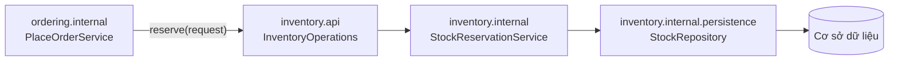
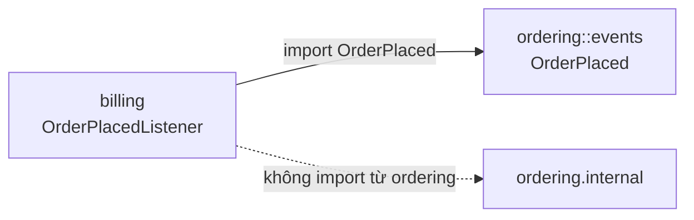

# API package và package nội bộ

Khi thiết kế một ứng dụng **Spring Modulith**, tên package cho biết một lớp nằm ở đâu, nhưng **hợp đồng kiến trúc** mới cho biết module khác có được phép sử dụng lớp đó hay không. Hai phần cần phân biệt rõ là **API** — những kiểu và hành vi mà module chủ động công bố — và **nội bộ** — mô hình dữ liệu, thuật toán, repository, adapter và các quyết định triển khai thuộc quyền kiểm soát của module.

Bài học thuộc chương **Thiết kế module** trong **SPRING_MODULITH_VERIFICATION_TESTING**. Ta sẽ tổ chức package công khai/nội bộ, thiết kế hợp đồng Java không làm rò rỉ dữ liệu, khai báo quy tắc phụ thuộc và kiểm chứng bằng `ApplicationModules`. Các ví dụ còn kết nối với `@ApplicationModuleTest`, kiểm thử sự kiện, cơ sở dữ liệu, tích hợp và quality gate CI để những ranh giới đã thiết kế không bị phá vỡ khi ứng dụng thay đổi.

## 1. Kết quả cần đạt

Sau bài này, bạn có thể:

1. Phân biệt **package gốc của application module**, **package được công bố qua named interface** và **package nội bộ**.
2. Hiểu vì sao `public` trong Java không đồng nghĩa với “API công khai” của Spring Modulith.
3. Thiết kế interface, request/response DTO, lỗi và sự kiện dùng để giao tiếp giữa các module.
4. Khai báo `@NamedInterface` và `allowedDependencies` để giới hạn bề mặt API và chiều phụ thuộc.
5. Dùng `ApplicationModules.verify()` phát hiện import trực tiếp vào phần nội bộ hoặc phụ thuộc vượt quá hợp đồng.
6. Xác định các bài kiểm thử module, database, sự kiện và tích hợp cần bổ sung để bảo vệ hành vi đằng sau API.

## 2. Bản đồ package: phần được phép thấy và phần cần giấu

Giả sử hệ thống bán hàng có ba năng lực:

- **`ordering`** nhận đơn và quản lý vòng đời đơn hàng.
- **`inventory`** sở hữu lượng hàng khả dụng, luật giữ hàng và phiếu giữ hàng.
- **`billing`** quản lý giao dịch thanh toán sau khi có đơn hợp lệ.

Trong cấu hình phát hiện module thông dụng, package chứa lớp `@SpringBootApplication` là gốc ứng dụng; các package con **trực tiếp** của nó được Spring Modulith xem là những application module:

```text
src/main/java/com/example/shop/
├── ShopApplication.java               # @SpringBootApplication
├── inventory/                         # Application module: inventory
│   ├── package-info.java
│   ├── InventoryHealth.java           # API ở package gốc, nếu public
│   ├── api/                            # Package con công bố có chủ đích
│   │   ├── package-info.java          # @NamedInterface("api")
│   │   ├── InventoryOperations.java
│   │   ├── ReserveStock.java
│   │   ├── ReservationReceipt.java
│   │   └── InsufficientStockException.java
│   └── internal/                       # Chi tiết triển khai
│       ├── StockReservationService.java
│       ├── domain/
│       │   └── Stock.java
│       └── persistence/
│           ├── StockRepository.java
│           └── StockEntity.java
├── ordering/                          # Application module: ordering
│   ├── package-info.java
│   ├── events/
│   │   ├── package-info.java
│   │   └── OrderPlaced.java
│   └── internal/
│       ├── PlaceOrderService.java
│       └── OrderRepository.java
└── billing/                           # Application module: billing
    ├── package-info.java
    └── internal/
        └── OrderPlacedListener.java
```

Những đường dẫn trên thể hiện **ý định kiến trúc**, không phải một cách đặt tên bắt buộc. Chẳng hạn, `inventory.internal.domain.Stock` là class nghiệp vụ; tên `internal` giúp lập trình viên hiểu rằng module khác không được dùng trực tiếp. Spring Modulith còn có quy tắc đóng gói để kiểm chứng ý định đó.

### 2.1. API mặc định ở package gốc

Đối với application module kiểu **`CLOSED`** (mặc định), package gốc của module là bề mặt API mặc định. Ví dụ, kiểu Java truy cập được tại `com.example.shop.inventory.InventoryHealth` có thể là một phần giao diện module `inventory`.

Vì thế không nên chuyển tất cả class vào package gốc chỉ để dễ import. Nếu package gốc chứa cả `StockEntity`, `StockRepository` và `StockReservationService`, thiết kế có thể vô tình quảng bá các chi tiết đó thành hợp đồng mà module khác được phép tham chiếu.

### 2.2. Package con thông thường là nội bộ

Các package con như `inventory.internal`, `inventory.internal.persistence` hoặc `inventory.api` **không tự động được công bố** chỉ vì class bên trong là `public`. Theo quy tắc đóng gói của closed module, muốn xuất bản có chủ đích một package con thì dùng **named interface**, như phần sau trình bày.

Không cần đặt tên chính xác là `internal` để Spring Modulith nhận ra nội bộ: một package con **chưa được công bố** đã là phần nội bộ trong mô hình closed module. Tuy vậy, đặt tên `internal` vẫn hữu ích cho người đọc mã. Có thể chia nhỏ `internal` thành `domain`, `application`, `persistence`, `integration` tùy độ phức tạp.

### 2.3. Quy tắc Modulith khác quy tắc Java

| Trường hợp | Java có thể biên dịch? | Có hợp lệ với closed module? |
| --- | --- | --- |
| `ordering` import interface `public` ở `inventory.api` đã công bố qua named interface | Có | Có, nếu chiều phụ thuộc cũng được phép |
| `ordering` import class `public` ở `inventory.internal` | Có thể | Không: vượt API đã công bố của module |
| `ordering` import class package-private ở `inventory.internal` | Không | Đồng thời không thể coi là API xuyên package |
| Một class thuộc `inventory.internal` dùng `StockEntity` thuộc chính `inventory` | Tùy Java access modifier | Có về ranh giới giữa các application module |

**`public` là quyền truy cập của ngôn ngữ Java; API module là quyền truy cập do kiến trúc quy định.** Spring Modulith thường thực thi quy tắc kiến trúc qua kiểm chứng như `ApplicationModules.verify()`, không làm thay đổi cách trình biên dịch Java hiểu `public`, `private`, `protected` hay package-private. Nó cũng không đồng nhất với hệ thống `exports` của JPMS (`module-info.java`).

## 3. Thiết kế API theo nhu cầu nghiệp vụ

Hãy bắt đầu bằng một câu hỏi cụ thể: **“Module Đặt hàng cần yêu cầu module Tồn kho làm điều gì?”** Câu trả lời là “giữ một lượng hàng”, không phải “cho phép sửa entity `StockEntity`”.

Mô hình hợp đồng nên truyền yêu cầu và kết quả nghiệp vụ:



Sơ đồ mô tả **luồng gọi lúc chạy**. Trong mã nguồn, `ordering` chỉ import kiểu thuộc `inventory.api`; `inventory.internal` implement interface đó và tự quản lý chi tiết lưu trữ. Nét phân chia quan trọng nằm giữa `ordering` và `inventory`, không phải giữa hai package của cùng một module.

### 3.1. Hợp đồng ở `inventory.api`

Đặt những kiểu mà caller cần biết vào cùng một package công khai:

```java
// inventory/api/InventoryOperations.java
package com.example.shop.inventory.api;

public interface InventoryOperations {
    ReservationReceipt reserve(ReserveStock command);
}
```

```java
// inventory/api/ReserveStock.java
package com.example.shop.inventory.api;

public record ReserveStock(String sku, int quantity) {
    public ReserveStock {
        if (sku == null || sku.isBlank()) {
            throw new IllegalArgumentException("sku không được rỗng");
        }
        if (quantity <= 0) {
            throw new IllegalArgumentException("quantity phải dương");
        }
    }
}
```

```java
// inventory/api/ReservationReceipt.java
package com.example.shop.inventory.api;

import java.util.UUID;

public record ReservationReceipt(
    UUID reservationId,
    String sku,
    int quantity
) {}
```

```java
// inventory/api/InsufficientStockException.java
package com.example.shop.inventory.api;

public class InsufficientStockException extends RuntimeException {
    public InsufficientStockException(String sku) {
        super("Không đủ hàng cho SKU: " + sku);
    }
}
```

Các kiểu trên diễn tả hợp đồng **giữ hàng**, không làm lộ tên bảng dữ liệu, khóa JPA hay phương thức repository. `ReserveStock` có kiểm tra dữ liệu đầu vào, nhưng kiểm tra số lượng khả dụng thực tế vẫn phải nằm trong `inventory`: caller không có quyền tự quyết định “còn đủ hàng” qua phép trừ đơn giản.

Trong dự án thật, cần thỏa thuận rõ thêm ngữ nghĩa của `reservationId`, mã lỗi, trạng thái giữ hàng, tính idempotent khi gọi lại và thời điểm hết hạn phiếu giữ hàng. Một hợp đồng API tốt không chỉ có chữ ký Java hợp lệ mà phải có **hành vi được cam kết**.

### 3.2. Bản triển khai ở `inventory.internal`

Class implement có thể là bean của Spring mà vẫn được xem là **nội bộ** trong Spring Modulith:

```java
// inventory/internal/StockReservationService.java
package com.example.shop.inventory.internal;

import com.example.shop.inventory.api.InsufficientStockException;
import com.example.shop.inventory.api.InventoryOperations;
import com.example.shop.inventory.api.ReservationReceipt;
import com.example.shop.inventory.api.ReserveStock;
import java.util.UUID;
import org.springframework.stereotype.Service;
import org.springframework.transaction.annotation.Transactional;

@Service
public class StockReservationService implements InventoryOperations {

    private final StockRepository stocks;
    private final ReservationRepository reservations;

    public StockReservationService(
        StockRepository stocks,
        ReservationRepository reservations
    ) {
        this.stocks = stocks;
        this.reservations = reservations;
    }

    @Override
    @Transactional
    public ReservationReceipt reserve(ReserveStock command) {
        boolean reserved = stocks.tryReserve(command.sku(), command.quantity());
        if (!reserved) {
            throw new InsufficientStockException(command.sku());
        }

        ReservationReceipt result = new ReservationReceipt(
            UUID.randomUUID(), command.sku(), command.quantity()
        );
        reservations.save(result);
        return result;
    }
}
```

Trong ví dụ, `StockRepository` và `ReservationRepository` là các hợp đồng **nội bộ** do module `inventory` triển khai; có thể được đặt ở `inventory.internal` hoặc dưới `inventory.internal.persistence`. Ví dụ chỉ diễn tả ranh giới và orchestration; các repository chưa được triển khai nên đây **không phải một ứng dụng độc lập có thể chạy ngay**.

Đặc biệt, `tryReserve(...)` ở cơ sở dữ liệu phải bảo đảm cập nhật có điều kiện và an toàn khi có nhiều yêu cầu đồng thời. Chẳng hạn, một triển khai SQL có thể dùng:

```sql
UPDATE stock
SET available = available - :quantity
WHERE sku = :sku AND available >= :quantity;
```

Chỉ khi số dòng bị cập nhật là `1` thì thao tác giữ hàng thành công. Cần áp dụng transaction và ràng buộc dữ liệu phù hợp để việc giảm tồn và lưu phiếu giữ hàng hoặc **cùng thành công hoặc cùng rollback** khi chúng thuộc cùng một giao dịch. Nếu yêu cầu được gửi lại, phải thiết kế idempotency riêng; đoạn `UUID.randomUUID()` phía trên chưa giải quyết bài toán đó.

### 3.3. Caller chỉ gọi API

Ở `ordering/internal/PlaceOrderService.java`:

```java
package com.example.shop.ordering.internal;

import com.example.shop.inventory.api.InventoryOperations;
import com.example.shop.inventory.api.ReservationReceipt;
import com.example.shop.inventory.api.ReserveStock;
import org.springframework.stereotype.Service;

@Service
public class PlaceOrderService {

    private final InventoryOperations inventory;

    public PlaceOrderService(InventoryOperations inventory) {
        this.inventory = inventory;
    }

    public ReservationReceipt reserveForOrder(String sku, int quantity) {
        return inventory.reserve(new ReserveStock(sku, quantity));
    }
}
```

Đây là ví dụ tối giản cho việc **inject hợp đồng công khai**. Use case đặt hàng thực tế còn có giá, thông tin khách hàng, lưu đơn, điều kiện giao dịch và khả năng khôi phục nếu một bước thất bại. Khi `inventory` thay đổi JPA repository, cách khóa bản ghi hoặc thuật toán phân bổ, `ordering` không cần biết nếu API `InventoryOperations` và hành vi đã cam kết vẫn giữ nguyên.

**Một quy tắc thiết kế hữu ích:** Module khác **được yêu cầu một hành vi** qua API, nhưng **không được điều khiển các bước triển khai** của hành vi đó.

## 4. Công bố package con bằng `@NamedInterface`

Ở cấu trúc ví dụ, `InventoryOperations` không nằm trong package gốc `inventory` mà nằm ở `inventory.api`. Muốn `ordering` tham chiếu hợp lệ tới package con này khi `inventory` là closed module, ta đánh dấu package `api` thành **named interface**.

Trong `src/main/java/com/example/shop/inventory/api/package-info.java`:

```java
@org.springframework.modulith.NamedInterface("api")
package com.example.shop.inventory.api;
```

File `package-info.java` đặt annotation ở **cấp package**. Tên `api` là tên giao diện được khai báo cho Spring Modulith, còn `com.example.shop.inventory.api` là tên package Java.

Một module có thể công bố nhiều nhóm hợp đồng nếu có nhu cầu khác nhau. Ví dụ, `ordering` có thể công bố package `ordering.events` cho listener của `billing` mà không công bố `ordering.internal`:

```java
// ordering/events/package-info.java
@org.springframework.modulith.NamedInterface("events")
package com.example.shop.ordering.events;
```

```java
// ordering/events/OrderPlaced.java
package com.example.shop.ordering.events;

import java.util.UUID;

public record OrderPlaced(UUID orderId) {}
```

`billing` chỉ cần tham chiếu đến **kiểu sự kiện công khai**. Listener không cần phụ thuộc vào `PlaceOrderService` hoặc `OrderRepository` thuộc nội bộ của `ordering`.

### 4.1. Named interface có ý nghĩa chính xác gì?

| Khái niệm | Ví dụ | Ý nghĩa |
| --- | --- | --- |
| Application module | `inventory` | Đơn vị kiến trúc nghiệp vụ |
| Java package | `com.example.shop.inventory.api` | Nơi khai báo các kiểu |
| Named interface | `inventory::api` | Nhóm kiểu được module `inventory` công bố dưới tên `api` |
| Package nội bộ | `com.example.shop.inventory.internal` | Chi tiết không công bố cho module khác |
| API mặc định | `com.example.shop.inventory` | Bề mặt API ở package gốc, không cần `@NamedInterface` |

`@NamedInterface` không tự động tạo REST endpoint, bean, schema JSON, RPC hay bảo đảm tương thích phiên bản. Annotation này **công bố bề mặt truy cập ở mức kiến trúc**. Hành vi chạy thực tế vẫn do Spring, Java và logic ứng dụng thực hiện.

Không nên gắn `@NamedInterface` vào `internal` chỉ vì caller cần gọi một class trong đó. Hãy xác định hành vi thật sự cần công bố rồi tạo một API nhỏ với tên phản ánh nghiệp vụ. Các package con sâu hơn cần được xem xét theo cách Spring Modulith diễn giải phạm vi named interface trong phiên bản đang dùng; không dựa vào giả định rằng annotation trên một package sẽ tự công bố mọi package con cháu.

## 5. Giới hạn chiều phụ thuộc bằng `allowedDependencies`

Module đích công bố API chỉ mới giải quyết câu hỏi **“kiểu nào được nhìn thấy?”**. Một câu hỏi khác là **“module nào được phép phụ thuộc vào giao diện đó?”**.

Để `ordering` chỉ phụ thuộc vào nhóm API công khai của `inventory`, khai báo tại `ordering/package-info.java`:

```java
@org.springframework.modulith.ApplicationModule(
    allowedDependencies = "inventory::api"
)
package com.example.shop.ordering;
```

Để `billing` nhận kiểu sự kiện từ `ordering.events`:

```java
@org.springframework.modulith.ApplicationModule(
    allowedDependencies = "ordering::events"
)
package com.example.shop.billing;
```

Các chuỗi `inventory::api` và `ordering::events` gồm **tên application module** và **tên named interface** đã khai báo, không phải FQCN của package Java. Nếu cần thêm nhiều hợp đồng độc lập, hãy liệt kê chính xác những hợp đồng được phép:

```java
@org.springframework.modulith.ApplicationModule(
    allowedDependencies = {"inventory::api", "catalog::queries"}
)
package com.example.shop.ordering;
```

Đoạn trên giả định module `catalog` có named interface `queries` phù hợp. Chỉ dùng tên đó khi module thực sự tồn tại và đã công bố giao diện tương ứng.

### 5.1. Ma trận truy cập

Giả sử `inventory` và `ordering` đều là closed module, `ordering` chỉ cho phép `inventory::api`, `billing` chỉ cho phép `ordering::events`:

| Mã nguồn tham chiếu | Kiểu đích | Kỳ vọng khi kiểm chứng | Lý do |
| --- | --- | --- | --- |
| `ordering` | `inventory.api.InventoryOperations` | **Hợp lệ** | API được công bố; caller cho phép `inventory::api` |
| `ordering` | `inventory.internal.StockReservationService` | **Sai** | Mã triển khai nội bộ, dù class có modifier `public` |
| `ordering` | `inventory.internal.persistence.StockEntity` | **Sai** | Rò rỉ entity thuộc nội bộ |
| `billing` | `ordering.events.OrderPlaced` | **Hợp lệ** | Named interface `ordering::events` được công bố và cho phép |
| `billing` | `ordering.internal.PlaceOrderService` | **Sai** | Listener không được gọi nội bộ của `ordering` |
| `inventory.internal` | Các lớp nội bộ khác của chính `inventory` | **Hợp lệ về ranh giới module** | Phụ thuộc nằm bên trong một application module |

Ma trận này áp dụng cho **mô hình kiến trúc**. Java access modifiers, dependency injection, bean scope và quy tắc nghiệp vụ còn có thể đặt các ràng buộc bổ sung.

### 5.2. Không được suy diễn phụ thuộc chỉ từ hướng sự kiện

Khi `ordering` phát `OrderPlaced` và `billing` đăng ký xử lý, sự kiện **chạy từ `ordering` sang `billing`**. Nhưng listener trong `billing` import `ordering.events.OrderPlaced`, nên **phụ thuộc mã nguồn là `billing → ordering`**. Vì vậy `billing` cần quyền dùng `ordering::events`; không có lý do để `ordering` import lớp listener nội bộ của `billing`.



Mũi tên của sơ đồ là cách biểu diễn **tham chiếu kiểu** để phục vụ đánh giá phụ thuộc; hướng thông điệp lúc chạy được giải thích riêng ở trên. Tránh xây dựng chu trình `ordering → billing → ordering` chỉ để hai bên gọi nhau khi xử lý sự kiện.

## 6. Thiết kế ranh giới API: công khai bao nhiêu là đủ?

Không có quy tắc “càng ít class public càng tốt” bất kể yêu cầu. Mục tiêu là **ít và đủ**: mỗi kiểu công khai cần giải thích được use case, dữ liệu và ngữ nghĩa mà caller được phép dựa vào.

| Nên công bố khi có nhu cầu | Thường nên để nội bộ | Lý do |
| --- | --- | --- |
| Interface lệnh nghiệp vụ như `InventoryOperations` | `StockReservationService` | Caller cần yêu cầu *giữ hàng*, không cần điều khiển triển khai |
| DTO/record như `ReserveStock`, `ReservationReceipt` | `StockEntity` | Tránh ràng buộc vào ORM, quan hệ database và lazy loading |
| Exception hoặc mã lỗi nghiệp vụ ổn định | Exception driver/JDBC cụ thể | Caller cần xử lý lỗi theo ý nghĩa nghiệp vụ |
| Sự kiện như `OrderPlaced` | Entity phát sự kiện, event publisher implementation | Module khác biết điều đã xảy ra, không cần biết cách lưu |
| Giá trị dùng chung có chủ sở hữu, ví dụ `OrderId` | Mọi enum, helper, util tùy tiện | Giảm coupling và tránh tạo gói “common” không rõ trách nhiệm |
| SPI có quy tắc mở rộng rõ ràng | Internal service hook không có hợp đồng | Chỉ mở điểm mở rộng mà module chủ động hỗ trợ |

### 6.1. Không dùng entity persistence làm DTO xuyên module

Thiết kế sau có nguy cơ làm rò rỉ nội bộ:

```java
// Sai về ý định kiến trúc: chữ ký API lộ lớp persistence.
package com.example.shop.inventory.api;

import com.example.shop.inventory.internal.persistence.StockEntity;

public interface StockQueries {
    StockEntity findStock(String sku);
}
```

Ngay cả khi Java cho phép biên dịch, caller cần biết `StockEntity`, dẫn đến phụ thuộc trực tiếp vào phần nội bộ của closed module. `ApplicationModules.verify()` có thể phát hiện quan hệ từ module khác tới kiểu nội bộ khi kiểu đó được sử dụng. Nên thay bằng DTO độc lập:

```java
// inventory/api/StockAvailability.java
package com.example.shop.inventory.api;

public record StockAvailability(String sku, int availableQuantity) {}
```

```java
// inventory/api/StockQueries.java
package com.example.shop.inventory.api;

import java.util.Optional;

public interface StockQueries {
    Optional<StockAvailability> findAvailability(String sku);
}
```

`StockAvailability` là ảnh chụp phục vụ truy vấn, không cấp quyền “tự trừ tồn kho” cho caller. Nếu yêu cầu nghiệp vụ là giữ hàng, phải dùng lệnh như `reserve(...)` để invariant được bảo vệ tại `inventory`.

### 6.2. Quy ước kết quả và lỗi rõ ràng

Tài liệu API cần trả lời:

- Khi SKU không tồn tại, `findAvailability` trả `Optional.empty()` hay một mã lỗi?
- `reserve` từ chối thiếu hàng bằng exception, kết quả `sealed interface`, hay mã trạng thái?
- Gọi lại cùng yêu cầu có tạo thêm phiếu giữ hàng không? Có cần `requestId` làm idempotency key?
- Khi đơn bị hủy, ai có quyền yêu cầu nhả hàng và làm sao tránh nhả trùng?
- Transaction nào bao quanh thao tác, và sự kiện nào chỉ được phát khi thay đổi đã commit?

Đây là **ngữ nghĩa hợp đồng** có tác động trực tiếp tới module khác. Trong khi đó, cách dùng JPA locking, SQL có điều kiện, Redis hay cache là quyết định triển khai nên ở nội bộ.

### 6.3. Vấn đề tương thích khi thay đổi API

Một số thay đổi có bán kính ảnh hưởng khác nhau:

| Thay đổi trong `inventory` | `ordering` có cần sửa? | Gợi ý kiểm chứng |
| --- | --- | --- |
| Đổi class triển khai `StockReservationService` | Không, nếu API và hành vi giữ nguyên | Module test, database test |
| Thay JPA bằng JDBC trong `internal.persistence` | Không, nếu API và ngữ nghĩa giữ nguyên | Integration và transaction test |
| Đổi `ReserveStock.quantity` từ `int` sang kiểu khác | Có thể có | Compile, consumer contract test |
| Bỏ trường `reservationId` khỏi `ReservationReceipt` | Có thể có | Compile và kiểm thử caller |
| Thay xử lý thiếu hàng từ exception sang `null` | Có nguy cơ hồi quy | Kiểm thử hợp đồng và use case |
| Chuyển DTO công khai sang package `internal` | Có: phá bề mặt API | `ApplicationModules.verify()` |

API có chi phí bảo trì. Đừng công bố mọi entity và helper “phòng khi module khác cần”; khi cần mới bổ sung một hợp đồng có mục đích rõ.

## 7. Đặt code vào đúng package và giữ luồng phụ thuộc một chiều

Quy trình ra quyết định khi thêm một class mới:

1. **Ai sở hữu hành vi/dữ liệu?** Nếu class áp dụng luật giữ hàng, module `inventory` sở hữu.
2. **Module khác có cần import kiểu này không?** Nếu không, đặt trong package con nội bộ.
3. **Nếu cần, đó là hợp đồng nào?** Interface lệnh, truy vấn, sự kiện, DTO hay SPI?
4. **Hợp đồng ở package gốc hay named interface?** Chọn vị trí ổn định, theo nhóm consumer.
5. **Caller nào được sử dụng?** Khai báo `allowedDependencies` tương ứng.
6. **Những invariant nào phải kiểm thử?** Chọn kiểm thử kiến trúc và hành vi phù hợp.

Ví dụ thường gặp:

| Thành phần mới | Nên đặt tại | Vì sao |
| --- | --- | --- |
| `InventoryOperations` | `inventory.api` | Module khác cần gọi lệnh giữ hàng |
| `ReserveStock` | `inventory.api` | Kiểu request nằm trong chữ ký công khai |
| `StockReservationService` | `inventory.internal` | Là cách triển khai, không phải hợp đồng |
| `StockRepository` | `inventory.internal.persistence` | Chi tiết truy cập dữ liệu của inventory |
| `OrderPlaced` | `ordering.events` nếu công bố named interface | Listener module khác cần tham chiếu kiểu sự kiện |
| `OrderRepository` | `ordering.internal.persistence` | Chỉ ordering được quyền quản lý lưu trữ đơn |

Đặt class vào `internal` **không bắt buộc** dùng từ `internal` trong tên kiểu. Tránh xây “package chung” bao gồm class của nhiều năng lực mà không còn ai chịu trách nhiệm về luật và vòng đời dữ liệu. Nếu hai module thật sự cần dùng chung một kiểu, xác định module sở hữu rồi công bố qua API hợp lý; không vội chuyển mọi kiểu dùng chung vào `shared`.

## 8. Kiểm chứng bằng `ApplicationModules`

Kiểm thử kiến trúc là nơi quy tắc “không được import nội bộ” trở thành **quality gate có thể chạy lại**.

Tạo một bài kiểm thử JUnit 5 với các dependency Spring Modulith phù hợp:

```java
// src/test/java/com/example/shop/ModularityTests.java
package com.example.shop;

import org.junit.jupiter.api.Test;
import org.springframework.modulith.core.ApplicationModules;

class ModularityTests {

    @Test
    void modulesFollowApiBoundaries() {
        ApplicationModules.of(ShopApplication.class).verify();
    }
}
```

`ApplicationModules.of(...)` dựng mô hình application module từ lớp gốc ứng dụng. Với cấu hình nêu trên, `verify()` kiểm tra các quy tắc kiến trúc mà Spring Modulith hỗ trợ, điển hình gồm:

- **Đóng gói:** module ngoài không được dùng các kiểu chỉ thuộc nội bộ của closed module.
- **Phụ thuộc được phép:** caller không tham chiếu module/named interface nằm ngoài `allowedDependencies`.
- **Chu trình phụ thuộc:** đồ thị phụ thuộc giữa các application module không tạo vòng.

Để tự quan sát lỗi, có thể **cố ý** thêm một import ở `ordering`:

```java
// SAI: tham chiếu tới class public nhưng thuộc nội bộ inventory.
import com.example.shop.inventory.internal.StockReservationService;
```

Class triển khai minh họa ở trên là `public`, vì vậy câu import có thể qua trình biên dịch Java. Tuy nhiên, nó vẫn nằm trong phần nội bộ của `inventory`, và `ordering` chỉ được phép dùng `inventory::api`; khi có một quan hệ phụ thuộc thực sự trong mã nguồn, bài `verify()` sẽ báo vi phạm kiến trúc. **Chỉ một import không được sử dụng có thể bị trình biên dịch tối ưu/loại bỏ khỏi bytecode hoặc không tạo phụ thuộc kiểu để công cụ kiểm tra phát hiện**. Khi tự thực hành, hãy dùng kiểu nội bộ ở tham số, field hoặc lời gọi thực sự để kiểm chứng chắc chắn.

Ví dụ vi phạm rõ ràng:

```java
package com.example.shop.ordering.internal;

import com.example.shop.inventory.internal.StockReservationService;

class WrongOrderingDependency {
    private final StockReservationService implementation;

    WrongOrderingDependency(StockReservationService implementation) {
        this.implementation = implementation;
    }
}
```

Sửa bằng cách thay field `StockReservationService` bằng `InventoryOperations`. Không mở `inventory.internal` thành named interface và không sửa `allowedDependencies` rộng hơn chỉ để lỗi biến mất.

### 8.1. Khi `verify()` xanh vẫn chưa đủ

Kiểm chứng **đường phụ thuộc** khác kiểm chứng **hành vi**. `verify()` không chứng minh:

- Hai request đồng thời có giữ vượt lượng hàng còn lại không.
- Giao dịch cập nhật tồn và lưu phiếu giữ hàng có rollback nhất quán không.
- API có trả đúng lỗi khi SKU không tồn tại hoặc số lượng không hợp lệ không.
- Sự kiện có bị xử lý lặp, xử lý chậm hay mất khi listener gặp lỗi không.
- Kết nối cơ sở dữ liệu, mapping và bean wiring có phù hợp môi trường thực tế không.

Vì vậy ranh giới công khai vừa cần bài test kiến trúc, vừa cần các bài test mô tả hợp đồng của module.

## 9. Kiểm thử module, dữ liệu và sự kiện qua ranh giới API

### 9.1. `@ApplicationModuleTest` kiểm tra hành vi tại module sở hữu

Đặt test trong package thuộc `inventory` để Spring Modulith xác định module được kiểm thử:

```java
// src/test/java/com/example/shop/inventory/InventoryModuleTests.java
package com.example.shop.inventory;

import com.example.shop.inventory.api.InventoryOperations;
import com.example.shop.inventory.api.ReservationReceipt;
import com.example.shop.inventory.api.ReserveStock;
import org.junit.jupiter.api.Test;
import org.springframework.beans.factory.annotation.Autowired;
import org.springframework.modulith.test.ApplicationModuleTest;

import static org.assertj.core.api.Assertions.assertThat;

@ApplicationModuleTest
class InventoryModuleTests {

    @Autowired InventoryOperations inventory;

    @Test
    void reservesAvailableStockThroughPublicContract() {
        // Arrange: thêm dữ liệu tồn kho ban đầu bằng fixture của test.
        ReservationReceipt receipt = inventory.reserve(
            new ReserveStock("SKU-42", 2)
        );
        assertThat(receipt.sku()).isEqualTo("SKU-42");
        assertThat(receipt.quantity()).isEqualTo(2);
    }
}
```

Đây là **khung kiểm thử có assertion**; muốn chạy thành công phải có triển khai repository và fixture tạo tồn kho `SKU-42`. Khi cần kiểm thử module độc lập, `@ApplicationModuleTest` có thể khởi động module với phạm vi mặc định; khi cần phụ thuộc trực tiếp hoặc bắc cầu, dùng `BootstrapMode.DIRECT_DEPENDENCIES` hoặc `BootstrapMode.ALL_DEPENDENCIES` tùy mục tiêu và thiết lập môi trường kiểm thử.

Đối với module `ordering` cần gọi `InventoryOperations`, có thể dùng test double khi muốn cô lập hoặc bootstrap phần phụ thuộc thực khi cần kiểm tra tích hợp. Không sửa API production chỉ để cho bài test dễ lấy bean nội bộ từ module khác.

### 9.2. Kiểm thử database và cạnh tranh

`inventory` sở hữu invariant **không được giữ vượt tồn**. Bên cạnh test API thành công, cần kiểm thử:

1. Tồn khả dụng bằng `1`, hai request `reserve(..., 1)` chạy đồng thời: **tối đa một request thành công**.
2. Tồn khả dụng bằng `0`: thao tác giữ hàng bị từ chối và số lượng không âm.
3. Sau khi giảm tồn, ghi phiếu giữ hàng lỗi: transaction rollback đúng.
4. Gọi cùng yêu cầu nhiều lần: hành vi idempotency tuân theo hợp đồng đã định nghĩa.

Không thể thay các test này bằng `ApplicationModules.verify()`. Chúng nên chạy với cách lưu trữ và cơ chế đồng thời đủ giống môi trường production để chứng minh invariant thực sự được bảo vệ.

### 9.3. Kiểm thử sự kiện giữa `ordering` và `billing`

Giả sử `ordering` phát `OrderPlaced` sau khi chấp nhận đơn. `billing` được phép import kiểu sự kiện từ `ordering::events`, nhưng không cần gọi service nội bộ `ordering`.

Kiểm thử cần chứng minh nội dung sự kiện đúng, handler chỉ thực thi hành động được phép, và xử lý trùng không tạo giao dịch thu tiền hai lần. Có thể dùng các công cụ kiểm thử sự kiện do Spring Modulith cung cấp, kết hợp integration test cho persistence và xử lý sau commit theo cơ chế thực tế. **Việc công bố `events` chỉ kiểm soát quyền tham chiếu kiểu**, không tự bảo đảm thứ tự, giao hàng đúng một lần hoặc giao dịch xuyên module.

### 9.4. Đưa vào CI

Bộ kiểm thử tối thiểu trước khi merge nên có:

| Quality gate | Điều kiện đạt | Lỗi cần chặn |
| --- | --- | --- |
| `ApplicationModules.verify()` | Không phụ thuộc sai ranh giới | `ordering` import `inventory.internal` |
| `@ApplicationModuleTest` | Use case chạy đúng qua hợp đồng công khai | Giữ hàng trả sai kết quả |
| Database/transaction tests | Invariant và rollback đúng | Giữ hàng quá tồn hoặc mất cập nhật |
| Event/integration tests | Payload và tác dụng phụ phù hợp | Thanh toán trùng vì event phát lại |

Ví dụ, nếu dự án dùng Maven và test kiến trúc nằm trong bộ JUnit thông thường, stage CI có thể chạy `./mvnw -B test`. Nếu dự án dùng Gradle thì dùng lệnh test tương ứng. Cần bảo đảm chính bài `ModularityTests` được thực thi và kết quả thất bại làm quality gate thất bại; tên stage hay build tool chỉ là chi tiết của dự án.

## 10. Các dấu hiệu API và nội bộ đang bị trộn lẫn

| Dấu hiệu | Vấn đề thiết kế | Hướng xử lý |
| --- | --- | --- |
| Package gốc chứa nhiều entity/repository | Công bố quá nhiều chi tiết | Chuyển triển khai vào package con nội bộ |
| Interface công khai trả về JPA entity | Caller bị trói với persistence | Tạo DTO hoặc value object độc lập |
| Module ngoài gọi class `internal` vì nó `public` | Nhầm quyền Java với quyền kiến trúc | Truy cập qua interface/named interface |
| Hàng chục `@NamedInterface` không có consumer rõ | API phân mảnh và khó duy trì | Gom theo nhóm use case/hợp đồng có ý nghĩa |
| Hai module cùng sửa một bảng | Luật và quyền sở hữu bị chia đôi | Chỉ định một module sở hữu và công bố lệnh phù hợp |
| Đưa tất cả thành phần sang `shared` | Không ai còn sở hữu luật nghiệp vụ | Giữ chủ sở hữu rõ, chia sẻ qua API |
| `verify()` thất bại rồi thêm `allowedDependencies` tùy ý | Chấp nhận phụ thuộc sai để test qua | Xem lại caller, API và chiều phụ thuộc |
| Test chỉ kiểm tra context load | Thiếu đảm bảo về invariant và lỗi nghiệp vụ | Thêm assertion có ý nghĩa, concurrency/transaction test |

**Cân nhắc đặc biệt:** Không phải module nào cũng cần công bố lệnh đồng bộ. Một module chỉ phản ứng với sự kiện có thể có rất ít API cho module khác gọi. Hãy công bố **những kiểu thực sự cần được module ngoài tham chiếu**, không cố tạo một interface chỉ để mọi module trông giống nhau.

## 11. Bài thực hành: sửa API bị rò rỉ

Bạn được giao review thiết kế của module `inventory`. Nhóm phát triển đã tạo:

```text
inventory/
├── StockEntity.java
├── StockRepository.java
├── InventoryService.java
└── internal/
    └── ReservationCalculator.java
```

Ở `ordering`, lập trình viên gọi trực tiếp `StockRepository.findBySku(...)`, lấy `StockEntity`, tự trừ số lượng rồi `save(...)`. Code có thể chạy thành công ở môi trường phát triển, nhưng đã gây lỗi giữ vượt tồn khi có nhiều đơn cùng lúc.

**Yêu cầu tự làm:**

1. Chỉ ra **ai sở hữu invariant** “không giữ vượt tồn” và vì sao `ordering` không được tự sửa `StockEntity`.
2. Đề xuất cấu trúc package gốc, `api`, `internal` và `internal.persistence` phù hợp.
3. Tạo một interface công khai để `ordering` yêu cầu giữ hàng; xác định request, response và lỗi cần có.
4. Cho biết vị trí đặt `@NamedInterface("api")` và cú pháp `allowedDependencies` của `ordering`.
5. Viết một bài `ApplicationModules.verify()` và nêu ít nhất ba kiểm thử hành vi cần có.

### Lời giải tham khảo

`inventory` là chủ sở hữu lượng hàng khả dụng, luật giữ hàng và cách cập nhật database. API nên có `InventoryOperations.reserve(ReserveStock)` trả về `ReservationReceipt` hoặc lỗi nghiệp vụ `InsufficientStockException`. Đặt các hợp đồng này trong `inventory.api` và đánh dấu `@NamedInterface("api")` ở `inventory/api/package-info.java`. Chuyển `StockEntity`, `StockRepository` và class triển khai nghiệp vụ xuống package con `inventory.internal` phù hợp. Ở `ordering/package-info.java` khai báo `allowedDependencies = "inventory::api"`.

Sau khi chuyển caller, `ordering` chỉ import các kiểu API, còn `inventory` chịu trách nhiệm cập nhật tồn kho an toàn trong transaction. Kiểm tra bằng `ApplicationModules.of(ShopApplication.class).verify()` để chặn phụ thuộc vào nội bộ, cùng `@ApplicationModuleTest` cho thao tác giữ hàng, test database/concurrency cho hai yêu cầu cùng SKU và test rollback khi lưu phiếu giữ hàng lỗi. Nếu workflow đặt hàng phát sự kiện, thêm test kiểm tra payload, listener và tác dụng phụ khi phát lại.

Phương án này giải quyết đồng thời **trách nhiệm nghiệp vụ**, **bề mặt API** và **cơ chế phát hiện phụ thuộc sai**. Việc chuyển class khỏi package gốc chỉ là một phần của giải pháp; invariant vẫn cần được kiểm chứng bằng test chạy thật.

## 12. Checklist trước khi chốt ranh giới package

- [ ] Mỗi module có trách nhiệm và dữ liệu sở hữu được nêu rõ.
- [ ] API ở package gốc hoặc named interface được công bố có chủ đích.
- [ ] Repository, entity, adapter và thuật toán triển khai ở package nội bộ.
- [ ] Chữ ký API chỉ sử dụng những kiểu mà caller được phép tham chiếu.
- [ ] DTO, event và lỗi nghiệp vụ có ngữ nghĩa và cam kết rõ ràng.
- [ ] Không có module khác import trực tiếp lớp thuộc `internal`.
- [ ] `allowedDependencies` giới hạn đúng chiều và named interface cần thiết.
- [ ] Không có phụ thuộc vòng hoặc package công khai được mở rộng chỉ để test qua.
- [ ] Kiểm thử `ApplicationModules.verify()` chạy trong CI.
- [ ] Kiểm thử module, dữ liệu, đồng thời, sự kiện và tích hợp bao phủ các cam kết nghiệp vụ quan trọng.

**Điểm cần ghi nhớ:** Trong Spring Modulith, package là cách biểu diễn một hợp đồng giữa các nhóm năng lực. Đưa **hành vi cần chia sẻ** vào API, giữ **cách thực hiện hành vi** ở nội bộ, rồi kiểm chứng phụ thuộc và hành vi bằng những bài kiểm thử phù hợp. Nhờ vậy việc thay đổi triển khai bên trong không bắt buộc toàn bộ ứng dụng thay đổi theo.
