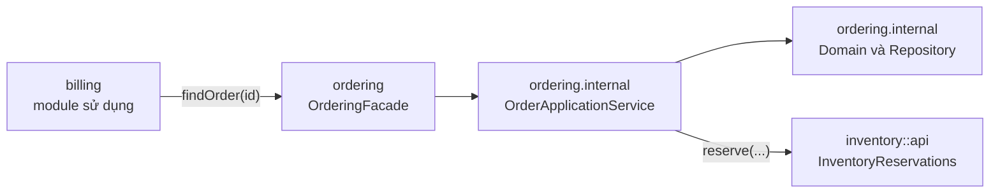
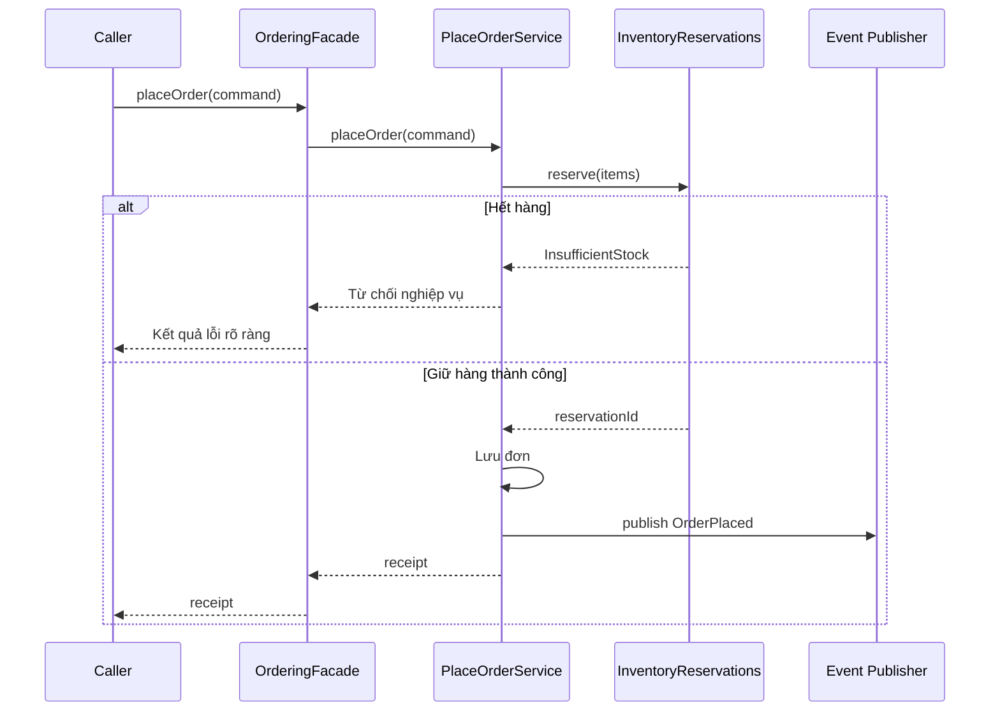

# Đặt lớp facade ở ranh giới module

Một module nghiệp vụ có thể chứa hàng chục class xử lý use case, entity, repository và adapter. Nếu mỗi module khác được gọi trực tiếp vào bất kỳ service nào trong số đó, một thay đổi nhỏ của triển khai sẽ lan khắp ứng dụng. **Facade** giúp đặt một điểm giao tiếp có chủ đích tại ranh giới: bên ngoài chỉ biết **hợp đồng nghiệp vụ ổn định**, còn cách phối hợp những thành phần bên trong do chính module quyết định.

Bài thuộc chương **Thiết kế module** trong **SPRING_MODULITH_VERIFICATION_TESTING**. Ngoài việc đặt facade đúng vị trí, ta sẽ kiểm chứng ranh giới bằng `ApplicationModules` và quy tắc phụ thuộc, thực hành `@ApplicationModuleTest`, kiểm thử sự kiện, cơ sở dữ liệu, tích hợp và quality gate trong CI để phát hiện sớm phụ thuộc sai hoặc hồi quy.

## 1. Mục tiêu học tập

Hoàn thành bài này, bạn có thể:

1. Giải thích facade tại ranh giới application module khác gì controller, application service, domain service hoặc repository.
2. Chọn vị trí cho facade, request/response và phần triển khai trong cấu trúc package của Spring Modulith.
3. Công bố API đồng bộ đủ dùng, tránh làm lộ entity, ORM, class nội bộ hoặc trình tự xử lý bên trong.
4. Định nghĩa hướng phụ thuộc bằng `@ApplicationModule`, `@NamedInterface` và `allowedDependencies`.
5. Xác định trách nhiệm transaction, quy tắc bất biến, lỗi và sự kiện phía sau facade.
6. Viết kiểm thử kiến trúc và chọn đúng các bài kiểm thử module, database, event, integration cho hợp đồng công khai.

## 2. Facade là gì trong kiến trúc module?

**Facade** là giao diện đơn giản, được thiết kế cho người sử dụng, đứng trước một tập hợp chức năng phức tạp. Tại ranh giới module, nó cho phép module A **yêu cầu module B thực hiện một khả năng nghiệp vụ** mà không cần biết module B tổ chức domain model, persistence hay workflow ra sao.

Ví dụ ứng dụng bán hàng có ba module:

- `ordering`: tiếp nhận và quản lý đơn hàng;
- `inventory`: bảo vệ lượng hàng khả dụng và phiếu giữ hàng;
- `billing`: theo dõi thanh toán.

Module `billing` chỉ cần một số thao tác như `findOrder(...)` hoặc nghe sự kiện `OrderPlaced`. Nó không nên gọi `ordering.internal.OrderRepository` để tự diễn giải trạng thái đơn. Ngược lại, `ordering` cần nhờ `inventory.reserve(...)` khi đặt hàng nhưng không được tự chỉnh `inventory.internal.StockEntity`.



Mũi tên ở đây biểu diễn **luồng gọi**. Theo phụ thuộc mã nguồn, `billing` chỉ import hợp đồng facade của `ordering`, `ordering` import API cần thiết của `inventory`, còn các lớp `internal` không bị phụ thuộc xuyên ranh giới.

### 2.1. Facade không phải lớp trung gian rỗng được thêm bằng mọi giá

Một facade chỉ có giá trị khi nó giúp làm rõ hợp đồng, bảo vệ quyền sở hữu và giảm số kiểu mà các module khác phải biết. Nếu module có một service công khai nhỏ, ổn định và đúng trách nhiệm, có thể dùng service đó làm API; không cần tự động tạo một wrapper chỉ để tăng số lớp.

Ngược lại, nếu các module khác đang gọi năm service và ba repository của `ordering`, một hợp đồng `OrderingFacade` được thiết kế theo use case có thể giảm đáng kể mức kết dính giữa các module.

### 2.2. So sánh các loại thành phần

| Thành phần | Trách nhiệm chính | Có nên là giao diện module ngoài sử dụng? |
| --- | --- | --- |
| **Facade của module** | Công bố các thao tác nghiệp vụ được cho phép và kết quả ổn định | **Có**, nếu được đặt trong API module |
| **Application service/use-case handler** | Điều phối các bước xử lý, transaction và cộng tác bên trong một use case | Thường nằm nội bộ; facade có thể ủy quyền cho nó |
| **Domain service/aggregate** | Bảo vệ quy tắc và quyết định nghiệp vụ | Thường nội bộ module sở hữu quy tắc |
| **Repository/adapter** | Đọc, ghi dữ liệu hoặc gọi hạ tầng | Nội bộ; không biến CRUD của persistence thành hợp đồng module |
| **REST controller** | Chuyển HTTP thành lệnh, trả response/status HTTP | Là adapter giao tiếp bên ngoài ứng dụng; có thể gọi facade |
| **Event listener** | Phản ứng với sự kiện đã xảy ra | Thường nội bộ; chỉ cần tham chiếu kiểu sự kiện được công bố |

Facade không nhất thiết là endpoint HTTP. Cùng một facade có thể được gọi bởi controller, scheduled job hoặc module khác **trong cùng ứng dụng**. Hợp đồng không nên chứa `HttpServletRequest`, `ResponseEntity` hay chi tiết SQL chỉ vì một consumer sử dụng HTTP hoặc database.

## 3. Đặt facade ở đâu?

Với cách phát hiện module mặc định của Spring Modulith, các package con trực tiếp của package gốc ứng dụng là application module. Ở module kiểu **`CLOSED`**, các kiểu truy cập được trong **package gốc của module** thuộc API mặc định; các package con chỉ được công bố khi được khai báo thành **named interface**.

Cấu trúc gợi ý:

```text
com/example/shop/
├── ShopApplication.java
├── ordering/                           ← module ordering
│   ├── package-info.java
│   ├── OrderingFacade.java             ← hợp đồng công khai tại package gốc
│   ├── PlaceOrderCommand.java          ← dữ liệu vào công khai
│   ├── OrderLineRequest.java
│   ├── PlaceOrderReceipt.java          ← dữ liệu ra công khai
│   ├── OrderSummary.java               ← view công khai
│   ├── events/
│   │   ├── package-info.java           ← @NamedInterface("events")
│   │   └── OrderPlaced.java
│   └── internal/
│       ├── DefaultOrderingFacade.java  ← implementation của facade
│       ├── PlaceOrderService.java      ← điều phối use case
│       ├── Order.java                   ← aggregate nghiệp vụ
│       ├── OrderRepository.java        ← persistence contract nội bộ
│       └── OrderStateMachine.java
├── inventory/
│   ├── package-info.java
│   ├── api/
│   │   ├── package-info.java           ← @NamedInterface("api")
│   │   ├── InventoryReservations.java
│   │   ├── ReserveItem.java
│   │   └── InsufficientStockException.java
│   └── internal/
│       ├── StockReservationService.java
│       └── StockRepository.java
└── billing/
    ├── package-info.java
    └── internal/
        └── BillingProcess.java
```

Mô hình này có hai lớp đáng chú ý:

1. **Hợp đồng** `OrderingFacade` và DTO nằm ở package gốc `ordering`, nơi module khác được phép import theo chính sách của closed module.
2. **Bean triển khai** `DefaultOrderingFacade` cùng use-case handler, repository nằm dưới `ordering.internal`. Kể cả khi bean implementation phải có modifier Java `public` vì kỹ thuật, nó vẫn là chi tiết nội bộ trong mô hình Spring Modulith.

Đặt interface facade ở ranh giới và class implement ở trong giúp module khác chỉ phụ thuộc vào **kiểu interface**, không phụ thuộc vào constructor, framework annotation hoặc các collaborator triển khai.

### 3.1. Trường hợp muốn dùng package `api` riêng

Khi API công khai có nhiều nhóm độc lập, có thể chuyển hợp đồng vào `ordering.api` và khai báo:

```java
// ordering/api/package-info.java
@org.springframework.modulith.NamedInterface("api")
package com.example.shop.ordering.api;
```

Lúc đó caller phải tham chiếu đến `ordering::api` trong giới hạn phụ thuộc. Các class bên trong `ordering.internal` **không tự động** được công bố. Chọn **một** cách đặt hợp đồng nhất quán; không cần vừa tạo bản sao ở package gốc vừa tạo bản sao trong `api`.

## 4. Thiết kế hợp đồng facade theo use case

Facade cần nói bằng **ngôn ngữ nghiệp vụ**. Ví dụ `placeOrder`, `findOrder`, `cancelOrder` thể hiện hành vi có ý nghĩa; `saveOrderEntity`, `getJpaRepository`, `setStatusDirectly` thường làm lộ cơ chế triển khai.

### 4.1. Interface công khai

Ở `ordering/OrderingFacade.java`:

```java
package com.example.shop.ordering;

import java.util.Optional;
import java.util.UUID;

public interface OrderingFacade {

    PlaceOrderReceipt placeOrder(PlaceOrderCommand command);

    Optional<OrderSummary> findOrder(UUID orderId);
}
```

Đây là **hợp đồng đồng bộ**. `placeOrder` trả về kết quả sau khi use case đã đạt trạng thái được hứa trong API; `findOrder` cho caller biết thông tin cần thiết mà không trả JPA entity `Order`.

### 4.2. DTO độc lập với persistence

Trong cùng package `ordering`:

```java
// ordering/OrderLineRequest.java
package com.example.shop.ordering;

public record OrderLineRequest(String sku, int quantity) {
    public OrderLineRequest {
        if (sku == null || sku.isBlank()) {
            throw new IllegalArgumentException("SKU không được rỗng");
        }
        if (quantity <= 0) {
            throw new IllegalArgumentException("Số lượng phải dương");
        }
    }
}
```

```java
// ordering/PlaceOrderCommand.java
package com.example.shop.ordering;

import java.util.List;
import java.util.Objects;

public record PlaceOrderCommand(String customerId, List<OrderLineRequest> lines) {
    public PlaceOrderCommand {
        if (customerId == null || customerId.isBlank()) {
            throw new IllegalArgumentException("Thiếu mã khách hàng");
        }
        Objects.requireNonNull(lines, "lines");
        lines = List.copyOf(lines);
        if (lines.isEmpty()) {
            throw new IllegalArgumentException("Đơn phải có sản phẩm");
        }
    }
}
```

```java
// ordering/PlaceOrderReceipt.java
package com.example.shop.ordering;

import java.util.UUID;

public record PlaceOrderReceipt(UUID orderId, String status) {}
```

```java
// ordering/OrderSummary.java
package com.example.shop.ordering;

import java.util.UUID;

public record OrderSummary(UUID id, String customerId, String status) {}
```

**Lưu ý:** Ví dụ chọn `String status` cho ngắn gọn; trong hệ thống thực, một enum/value object công khai có ngữ nghĩa rõ và được quản lý tương thích phiên bản có thể thích hợp hơn. `List.copyOf` giúp tránh caller thay đổi danh sách sau khi tạo command. Việc kiểm tra tính hợp lệ của SKU, số lượng là kiểm tra đầu vào; kiểm tra quyền đặt hàng, giá và tồn kho vẫn thuộc logic nghiệp vụ.

Facade **không nên trả** `OrderEntity`, `Page<OrderEntity>` hoặc `JpaRepository<OrderEntity, ...>`. Những kiểu đó khiến caller phụ thuộc vào cơ chế persistence và cấu trúc bên trong thay vì vào kết quả nghiệp vụ.

### 4.3. Định nghĩa lỗi thuộc hợp đồng

Caller cần phân biệt các trường hợp:

- Lệnh sai định dạng: thiếu khách hàng, số lượng không hợp lệ.
- Từ chối nghiệp vụ: hết hàng, khách hàng không đủ điều kiện hoặc đơn không được hủy.
- Lỗi hạ tầng/tạm thời: database hoặc hệ thống ngoài không khả dụng.

Có thể chọn exception nghiệp vụ công khai, kết quả dạng `sealed interface` hoặc error code ổn định tùy chính sách dự án. Đừng trả trực tiếp `DataIntegrityViolationException` hay SQL error cho caller rồi buộc caller hiểu schema. Ghi tài liệu rõ **lỗi nào có thể thử lại** và liệu gọi lặp có gây hiệu ứng phụ trùng hay không.

## 5. Triển khai facade: ủy quyền vào service nội bộ

Facade là cửa vào được công bố, không nhất thiết phải tự thực hiện mọi thuật toán. Đặt implementation ở `ordering.internal`:

```java
// ordering/internal/DefaultOrderingFacade.java
package com.example.shop.ordering.internal;

import com.example.shop.ordering.OrderSummary;
import com.example.shop.ordering.OrderingFacade;
import com.example.shop.ordering.PlaceOrderCommand;
import com.example.shop.ordering.PlaceOrderReceipt;
import java.util.Optional;
import java.util.UUID;
import org.springframework.stereotype.Service;

@Service
public class DefaultOrderingFacade implements OrderingFacade {

    private final PlaceOrderService orders;

    public DefaultOrderingFacade(PlaceOrderService orders) {
        this.orders = orders;
    }

    @Override
    public PlaceOrderReceipt placeOrder(PlaceOrderCommand command) {
        return orders.placeOrder(command);
    }

    @Override
    public Optional<OrderSummary> findOrder(UUID id) {
        return orders.findSummary(id);
    }
}
```

`PlaceOrderService` là class **nội bộ** dùng để điều phối nghiệp vụ; nó có thể được thay, chia tách hoặc tối ưu mà không làm thay đổi interface facade. Bean `DefaultOrderingFacade` là cách Spring cung cấp implement cho những caller inject `OrderingFacade`.

Đoạn dưới minh họa **ý định điều phối** của service nội bộ; các kiểu `Order`, `OrderRepository`, mapper và phương thức persistence cần được triển khai theo mô hình thật của dự án:

```java
// ordering/internal/PlaceOrderService.java
package com.example.shop.ordering.internal;

import com.example.shop.inventory.api.InventoryReservations;
import com.example.shop.inventory.api.ReserveItem;
import com.example.shop.ordering.OrderSummary;
import com.example.shop.ordering.PlaceOrderCommand;
import com.example.shop.ordering.PlaceOrderReceipt;
import com.example.shop.ordering.events.OrderPlaced;
import java.util.Optional;
import java.util.UUID;
import org.springframework.context.ApplicationEventPublisher;
import org.springframework.stereotype.Service;
import org.springframework.transaction.annotation.Transactional;

@Service
public class PlaceOrderService {

    private final InventoryReservations inventory;
    private final OrderRepository orders;
    private final ApplicationEventPublisher events;

    public PlaceOrderService(
        InventoryReservations inventory,
        OrderRepository orders,
        ApplicationEventPublisher events
    ) {
        this.inventory = inventory;
        this.orders = orders;
        this.events = events;
    }

    @Transactional
    public PlaceOrderReceipt placeOrder(PlaceOrderCommand command) {
        var requested = command.lines().stream()
            .map(line -> new ReserveItem(line.sku(), line.quantity()))
            .toList();

        UUID reservationId = inventory.reserve(requested);
        Order order = Order.from(command, reservationId);
        orders.save(order);
        events.publishEvent(new OrderPlaced(order.id()));

        return new PlaceOrderReceipt(order.id(), "PLACED");
    }

    @Transactional(readOnly = true)
    public Optional<OrderSummary> findSummary(UUID orderId) {
        return orders.findById(orderId)
            .map(order -> new OrderSummary(
                order.id(), order.customerId(), order.status()
            ));
    }
}
```

Các đoạn code là **bản phác thảo để học ranh giới module**, không phải ví dụ tự chạy độc lập: `InventoryReservations`, `OrderRepository`, `Order` và hạ tầng lưu trữ cần có triển khai, fixture và cấu hình test. `Order.from(...)` ở đây là phương thức factory minh họa của aggregate. `reserve(...)` cần xác định ngữ nghĩa lỗi và khóa đồng thời, không được tự suy rằng luôn thành công.

Điểm chính: `PlaceOrderService` được phép làm việc với entity/repository của **chính module `ordering`**, nhưng chỉ gọi `InventoryReservations` thuộc **API được công bố** bởi `inventory`.

### 5.1. Hợp đồng của module được gọi

Module `inventory` cung cấp một API nhỏ ở `inventory.api`:

```java
// inventory/api/package-info.java
@org.springframework.modulith.NamedInterface("api")
package com.example.shop.inventory.api;
```

```java
// inventory/api/ReserveItem.java
package com.example.shop.inventory.api;

public record ReserveItem(String sku, int quantity) {}
```

```java
// inventory/api/InventoryReservations.java
package com.example.shop.inventory.api;

import java.util.List;
import java.util.UUID;

public interface InventoryReservations {
    UUID reserve(List<ReserveItem> items);
}
```

Implementation có thể nằm ở `inventory.internal.StockReservationService`, còn logic kiểm soát tồn kho và JPA repository nằm hoàn toàn trong `inventory`. `ordering` không cần biết tồn kho dùng optimistic locking, SQL update có điều kiện hay một cơ chế khác.

## 6. Đường biên facade phải khớp quy tắc phụ thuộc

Facade chỉ bảo vệ thiết kế nếu Spring Modulith **biết phần nào được công bố và chiều phụ thuộc nào được phép**.

### 6.1. `ordering` chỉ được gọi `inventory::api`

Trong `ordering/package-info.java`:

```java
@org.springframework.modulith.ApplicationModule(
    allowedDependencies = "inventory::api"
)
package com.example.shop.ordering;
```

Lúc này, facade tại package gốc `ordering` là API mặc định của module đóng (`CLOSED`); bên trong `ordering` chỉ được tham chiếu tới named interface `inventory::api` thuộc module `inventory` và những phần được cho phép khác theo cấu hình thực tế.

### 6.2. `billing` chỉ được đọc hợp đồng facade hoặc sự kiện đã công bố

Để `billing` tham chiếu `OrderingFacade` ở **package gốc** của `ordering`, một khai báo ví dụ:

```java
// billing/package-info.java
@org.springframework.modulith.ApplicationModule(
    allowedDependencies = "ordering"
)
package com.example.shop.billing;
```

Nếu chỉ cần xử lý sự kiện, có thể đặt kiểu `OrderPlaced` ở `ordering.events` và công bố named interface:

```java
// ordering/events/package-info.java
@org.springframework.modulith.NamedInterface("events")
package com.example.shop.ordering.events;
```

```java
// ordering/events/OrderPlaced.java
package com.example.shop.ordering.events;

import java.util.UUID;

public record OrderPlaced(UUID orderId) {}
```

Khi `billing` chỉ cần sự kiện, có thể **thu hẹp** `allowedDependencies` của `billing` thành `"ordering::events"`, với điều kiện mã bên `billing` không cần kiểu ở API gốc của `ordering`. Đừng để `billing` vừa gọi repository nội bộ vừa xử lý sự kiện chỉ vì các lớp đó có modifier `public`.

### 6.3. Ma trận phụ thuộc ví dụ

| Bên gọi | Kiểu/bean muốn sử dụng | Hợp lệ về ranh giới? | Lý do |
| --- | --- | --- | --- |
| `billing` | `ordering.OrderingFacade` | Có, nếu khai báo cho phép `ordering` | Interface tại API gốc |
| `billing` | `ordering.internal.DefaultOrderingFacade` | Không | Implementation nằm ở package nội bộ |
| `billing` | `ordering.internal.OrderRepository` | Không | Tiết lộ persistence của module khác |
| `ordering` | `inventory.api.InventoryReservations` | Có | `inventory::api` được công bố và được cho phép |
| `ordering` | `inventory.internal.StockRepository` | Không | Vượt ranh giới closed module và giới hạn caller |
| `billing` | `ordering.events.OrderPlaced` | Có, nếu `ordering::events` được cho phép | Hợp đồng sự kiện được công bố |

Một lưu ý quan trọng: `allowedDependencies` giới hạn **quan hệ module**, không tạo bean hay endpoint mới; `@NamedInterface` công bố **tập kiểu**, không tự áp quyền bảo mật người dùng. Xác thực, phân quyền và bảo vệ dữ liệu cần được thiết kế riêng ở những điểm thực thi thích hợp.

## 7. Transaction và sự kiện: facade cam kết điều gì?

Lời hứa của một facade phải khớp thời điểm giao dịch và việc phối hợp giữa module. Nếu `placeOrder(...)` trả `"PLACED"`, cần xác định **điều kiện nào đã được đáp ứng** trước khi trả.

### 7.1. Gọi đồng bộ khi kết quả là điều kiện quyết định

Nếu `ordering` chỉ chấp nhận đơn sau khi `inventory.reserve(...)` xác nhận giữ đủ hàng, facade đồng bộ là lựa chọn dễ hiểu:



Sơ đồ là **luồng trách nhiệm**, không mặc định tất cả thao tác được bảo đảm trong một transaction vật lý. Nếu hai module dùng cùng datasource và cùng giao dịch, có thể thiết kế cập nhật nhất quán; nếu gọi mạng hoặc dùng hai kho dữ liệu độc lập, cần phương án khôi phục/bù trừ tương ứng. Annotation `@Transactional` trên service nội bộ **không tự tạo atomicity** qua hai hệ thống độc lập.

Vì vậy, trước khi chốt facade hãy hỏi:

1. Kết quả trả về có nghĩa “đơn đã lưu bền vững” hay chỉ “yêu cầu đã được nhận”?
2. Nếu giữ hàng thành công nhưng lưu đơn thất bại, ai nhả hàng và khi nào?
3. Nếu client gọi lại do timeout, idempotency key được quản lý ở đâu?
4. Nếu giao dịch rollback, thông báo hoặc listener có được chạy không?

Nếu workflow được xử lý bất đồng bộ, facade có thể trả trạng thái `"ACCEPTED"` cùng `requestId` rồi cung cấp API truy vấn tiến độ. Không nên trả `"PLACED"` khi nghiệp vụ mới vào hàng đợi mà chưa đạt điều kiện đã hứa.

### 7.2. Phát sự kiện sau thay đổi và kiểm soát tác dụng phụ

Sau khi đơn được chấp nhận, `ordering` công bố `OrderPlaced` để `billing` khởi tạo bước thanh toán. Một listener trong `billing` tham chiếu **kiểu sự kiện công khai**, không cần `ordering.internal.PlaceOrderService`.

`ApplicationEventPublisher.publishEvent(...)` và cách listener được kích hoạt phụ thuộc cấu hình/annotation. Chẳng hạn, với `@ApplicationModuleListener`, Spring Modulith hỗ trợ xử lý listener theo mô hình giao dịch/bất đồng bộ phù hợp. Trong thực tế phải hiểu thời điểm sau commit, khả năng retry, lỗi handler và khả năng một sự kiện được xử lý lại; không nên hứa xử lý **exactly once** chỉ vì facade đã phát một event.

Facade có thể giúp xác lập **thời điểm phát sự kiện nghiệp vụ**, nhưng nó không thay thế cơ chế event publication registry, outbox hoặc các đảm bảo phát/giao nhận được chọn cho hệ thống. `billing` cần idempotency khi nhận `OrderPlaced` lặp.

### 7.3. Transaction nên nằm ở đâu?

Trong ví dụ, `@Transactional` nằm trên `PlaceOrderService.placeOrder(...)` — nơi điều phối use case. Đặt ranh giới giao dịch trực tiếp tại facade cũng có thể phù hợp với mô hình khác, miễn là transaction bao trùm đúng đơn vị công việc và lời gọi đi **qua bean Spring được quản lý** để AOP hoạt động. Tránh dựa vào lời gọi nội bộ `this.method()` để kỳ vọng proxy transaction bắt đầu mới.

Phân biệt trách nhiệm:

| Ranh giới | Cần quyết định |
| --- | --- |
| **Facade/API** | Lệnh được phép gọi, kết quả, lỗi và cam kết đồng bộ/bất đồng bộ |
| **Use-case service** | Thứ tự phối hợp, transaction, kiểm tra điều kiện nghiệp vụ |
| **Domain và persistence** | Bất biến dữ liệu, khóa/đồng thời, trạng thái hợp lệ |
| **Sự kiện/tích hợp** | Phát và nhận sau thay đổi, lặp thông báo, retry, bù trừ |

## 8. Tránh biến facade thành "god object"

Facade không phải nơi gom toàn bộ logic của mọi module vào một class khổng lồ. Một `ApplicationFacade` có hàng trăm phương thức `createOrder`, `updateCustomer`, `reserveStock`, `refundPayment` không thể đại diện rõ cho ranh giới nghiệp vụ vì nó sở hữu quá nhiều quyết định.

### Các dấu hiệu facade đang sai trách nhiệm

| Dấu hiệu | Vì sao có hại | Hướng sửa |
| --- | --- | --- |
| Facade nhận `OrderEntity` và trả `StockEntity` | Làm rò rỉ persistence xuyên module | Dùng command, DTO và kết quả nghiệp vụ |
| Facade nhận `EntityManager`/`JpaRepository` từ caller | Caller điều khiển chi tiết lưu trữ | Giữ repository trong module sở hữu dữ liệu |
| Facade trả `Object`, `Map<String, Object>` cho mọi use case | Hợp đồng mơ hồ, khó kiểm chứng | Định nghĩa kiểu yêu cầu và kết quả có tên rõ |
| Facade gọi ngược service nội bộ của module caller | Tạo vòng phụ thuộc và coupling | Dùng sự kiện/hợp đồng phân công chủ sở hữu đúng |
| Một facade chứa mọi thao tác của ứng dụng | Trách nhiệm không rõ, thay đổi lan rộng | Đặt facade theo module hoặc nhóm năng lực/use case |
| Facade tự xử lý kiểm tra tồn kho bằng cách đọc bảng | Phá invariant của module inventory | Gọi `InventoryReservations` |
| Facade trả HTTP status hoặc `ResponseEntity` | Ghép hợp đồng module với transport | Để controller ánh xạ kết quả nghiệp vụ sang HTTP |
| Facade chỉ có `create`, `update`, `delete` trên entity | Thiếu ngữ nghĩa nghiệp vụ | Xem lại hành vi như `placeOrder`, `cancelOrder`, `reserve` |

**Phân tách khi hợp lý:** Module có thể công bố nhiều facade nhỏ, ví dụ `OrderCommands` và `OrderQueries`, nếu hai nhóm use case có nhịp thay đổi hoặc quyền truy cập khác nhau. Không bắt buộc mỗi module chỉ có đúng một interface; mục tiêu là **bề mặt API dễ hiểu và ổn định**.

### 8.1. Facade và security không phải cùng một lớp

Facade thường là điểm thuận lợi để kiểm tra chính sách truy cập ứng dụng, nhưng nó không mặc định nhận biết principal hay vai trò người dùng. Nếu nhiều caller khác nhau (HTTP, batch, sự kiện) dùng cùng facade, cần xác định **ai có quyền** thực hiện lệnh, kiểm tra ở tầng nào và cách truyền context bảo mật một cách nhất quán. Đừng chỉ bảo vệ REST controller nếu facade có thể được caller nội bộ dùng để bỏ qua quy tắc quan trọng.

### 8.2. Kiểm soát thay đổi hợp đồng

Chuyển class triển khai từ `PlaceOrderService` sang `OrderWorkflow` thường không ảnh hưởng caller nếu interface `OrderingFacade` giữ nguyên. Nhưng xóa `placeOrder`, đổi kiểu `PlaceOrderReceipt`, hoặc thay ngữ nghĩa lỗi có thể phá consumer. Vì thế cần xem facade như **hợp đồng được duy trì**:

- Chỉ công bố loại dữ liệu mà caller cần.
- Thêm trường hoặc hành vi mới có kế hoạch tương thích.
- Kiểm thử đường sử dụng của consumer, nhất là trường hợp lỗi.
- Phân biệt thay đổi nội bộ không ảnh hưởng contract với thay đổi API cần phối hợp cập nhật.

## 9. Kiểm chứng ranh giới bằng `ApplicationModules`

Thiết kế facade chỉ có tác dụng bền vững khi các module khác không thể âm thầm bỏ qua nó. Với Spring Modulith, có thể tạo kiểm thử:

```java
// src/test/java/com/example/shop/ModularityTests.java
package com.example.shop;

import org.junit.jupiter.api.Test;
import org.springframework.modulith.core.ApplicationModules;

class ModularityTests {

    @Test
    void dependenciesRespectModuleFacades() {
        ApplicationModules.of(ShopApplication.class).verify();
    }
}
```

`ApplicationModules.verify()` kiểm tra các quy tắc kiến trúc được Spring Modulith áp dụng, thông thường gồm **chu trình giữa module**, **truy cập vào package nội bộ của closed module** và **phụ thuộc vi phạm `allowedDependencies`**.

Thử một class sai ở `billing`:

```java
package com.example.shop.billing.internal;

import com.example.shop.ordering.internal.PlaceOrderService;

class WrongBillingService {
    private final PlaceOrderService orders; // phụ thuộc triển khai nội bộ

    WrongBillingService(PlaceOrderService orders) {
        this.orders = orders;
    }
}
```

Việc `PlaceOrderService` là `public` trong ví dụ **không biến nó thành API module**. Java có thể biên dịch quan hệ này, nhưng khi `ordering` là closed module, kiểm thử kiến trúc cần báo việc `billing` tham chiếu trực tiếp vào kiểu nội bộ. Cách sửa là inject `OrderingFacade` và dùng hành vi đã công bố, hoặc xem lại nhu cầu thật của `billing`.

Đừng khắc phục bằng cách chuyển toàn bộ `ordering` thành `OPEN` hoặc công bố `ordering.internal` thành named interface chỉ để bài kiểm thử đạt. Điều đó cho phép caller tiếp tục phụ thuộc vào chi tiết triển khai.

**Giới hạn:** `verify()` phân tích phụ thuộc mã nguồn/bytecode ở mức module; nó không chứng minh `OrderingFacade` áp dụng đúng transaction, xử lý thành công hay sử dụng database an toàn. Kiểm thử kiến trúc cần đi cùng các lớp kiểm thử hành vi.

## 10. Kiểm thử facade bằng `@ApplicationModuleTest`

Facade là điểm phù hợp để kiểm thử một module **qua hợp đồng mà consumer thấy được**. Với `@ApplicationModuleTest`, có thể khởi động phần ứng dụng thuộc module cần kiểm thử với chế độ bootstrap phù hợp.

Ví dụ lớp kiểm thử đặt trong package `ordering`:

```java
package com.example.shop.ordering;

import static org.assertj.core.api.Assertions.assertThat;

import java.util.UUID;
import org.junit.jupiter.api.Test;
import org.springframework.beans.factory.annotation.Autowired;
import org.springframework.modulith.test.ApplicationModuleTest;
import org.springframework.modulith.test.ApplicationModuleTest.BootstrapMode;

@ApplicationModuleTest(mode = BootstrapMode.DIRECT_DEPENDENCIES)
class OrderingFacadeTests {

    @Autowired OrderingFacade facade;

    @Test
    void unknownOrderDoesNotLeakInternalEntity() {
        UUID missingId = UUID.fromString(
            "00000000-0000-0000-0000-000000000042"
        );
        assertThat(facade.findOrder(missingId)).isEmpty();
    }
}
```

Ví dụ này kiểm tra một phần hợp đồng **truy vấn đơn không tồn tại**. Vì use-case service của `ordering` đang phụ thuộc trực tiếp vào `inventory`, test dùng `DIRECT_DEPENDENCIES` để cung cấp module đó khi khởi tạo context. Để chạy thật, dự án vẫn cần bean implementation, repository, datasource/test infrastructure phù hợp và dữ liệu kiểm thử không chứa `missingId`. Đây chưa phải toàn bộ suite facade.

### 10.1. Chọn bootstrap mode theo mục đích

| Phạm vi test | Khi sử dụng | Điểm cần lưu ý |
| --- | --- | --- |
| `STANDALONE` | Muốn kiểm tra module `ordering` với collaborator bên ngoài được thay bằng test double | Cần cung cấp các bean phụ thuộc như `InventoryReservations` khi use case cần |
| `DIRECT_DEPENDENCIES` | Muốn kiểm tra `ordering` cùng module phụ thuộc trực tiếp `inventory` | Hạ tầng của inventory cần sẵn sàng nếu test thực |
| `ALL_DEPENDENCIES` | Muốn kiểm tra tổ hợp module có phụ thuộc bắc cầu | Phạm vi lớn hơn, test chậm và khó cô lập nguyên nhân hơn |

Sử dụng `@ApplicationModuleTest(mode = BootstrapMode.DIRECT_DEPENDENCIES)` nếu muốn gọi facade thật và kiểm tra tương tác thực với module tồn kho. Nếu mục tiêu là riêng logic đặt hàng, chế độ mặc định với mock/test double phù hợp sẽ giúp test tập trung hơn. Không nên dùng thay đổi package API production để né việc thiết lập môi trường test.

### 10.2. Test gì qua facade?

Một suite có ý nghĩa nên kiểm tra cả đường thành công lẫn thất bại:

1. **Đặt hàng thành công:** tồn đủ, `placeOrder` trả `orderId` và trạng thái đã cam kết; repository lưu dữ liệu đúng.
2. **Không đủ hàng:** facade trả/tung lỗi nghiệp vụ đã tài liệu hóa, không lưu đơn sai và không phát sự kiện xác nhận.
3. **Dữ liệu sai:** command có SKU rỗng hoặc số lượng `<= 0` bị từ chối theo chính sách.
4. **Đơn không tồn tại:** `findOrder` trả `Optional.empty()`, không làm lộ ngoại lệ JPA.
5. **Gọi lặp:** nếu có idempotency key, đặt lại cùng yêu cầu không tạo hai đơn ngoài ý muốn.
6. **Thất bại giữa quy trình:** nếu lưu đơn lỗi sau khi giữ hàng, transaction/bù trừ đảm bảo trạng thái theo cam kết.

Với yêu cầu tích hợp thực, nên dùng test database phù hợp, kiểm thử đồng thời và kiểm thử sự kiện thay vì chỉ assert kiểu trả về.

### 10.3. Kiểm thử sự kiện tại ranh giới

Nếu `ordering` phát `OrderPlaced`, một bài test kiểm tra:

- Event chứa đúng `orderId` của đơn vừa được chấp nhận.
- Event không được coi là thành công nghiệp vụ nếu giao dịch tương ứng rollback.
- Listener phía `billing` chỉ nhận dữ liệu công khai và xử lý thông báo lặp an toàn.
- Nếu listener thất bại, cơ chế retry/phát lại và quản lý publication đáp ứng yêu cầu tích hợp.

Spring Modulith có hỗ trợ xây dựng các kịch bản kiểm thử sự kiện; chọn API tương thích phiên bản dependency dự án. Không kết luận giao nhận “chính xác một lần” chỉ vì bài test phát sự kiện đơn lẻ đạt.

### 10.4. Kiểm thử database giữ invariant

`inventory` phải bảo vệ invariant **không giữ vượt tồn**, kể cả khi nhiều order gọi facade đồng thời. Ví dụ bài test cần giả lập tồn kho `1`, thực hiện hai yêu cầu `reserve(1)` đồng thời rồi xác nhận **tối đa một** yêu cầu thành công và tồn kho không âm.

Đây là kiểm thử thuộc module sở hữu dữ liệu, dù được kích hoạt qua facade `ordering`. Facade không nên tự thực hiện phép trừ tồn kho để làm bài test ở tầng cao dễ viết hơn.

## 11. Quality gate CI và kiểm soát thay đổi

Với một thay đổi trong ranh giới module, pipeline nên kiểm tra cả **kiến trúc** và **hành vi**:

```text
Pull request
   |
   +-- Compile / JUnit
   |      |
   |      +-- ApplicationModules.verify()
   |               -> Không import ordering.internal từ billing
   |
   +-- @ApplicationModuleTest
   |      -> Facade xử lý use case theo hợp đồng
   |
   +-- Database / transaction / concurrency tests
   |      -> Không giữ vượt tồn; rollback đúng
   |
   +-- Event / integration tests
          -> Payload đúng, idempotency, xử lý lỗi
   |
   +-- Điều kiện merge: các gate bắt buộc đều đạt
```

Nếu sử dụng Maven, bài kiểm thử JUnit thông thường có thể nằm trong stage chạy `./mvnw test`; với Gradle là lệnh test tương ứng. Cách chia test nhanh/chậm phụ thuộc yêu cầu dự án. Điểm cốt lõi là **`ModularityTests` phải thực sự chạy và có quyền làm CI thất bại** khi xuất hiện import nội bộ hoặc phụ thuộc vòng.

### 11.1. Review checklist cho thay đổi facade

| Câu hỏi review | Dấu hiệu cần sửa |
| --- | --- |
| Tên phương thức mô tả hành vi nghiệp vụ? | `saveEntity`, `executeSql` xuất hiện trong facade |
| Kiểu input/output có ổn định, độc lập persistence? | Trả entity JPA hoặc framework type không cần thiết |
| Module khác chỉ import API đã công bố? | Import `ordering.internal.*` |
| Lỗi, retry và idempotency được mô tả? | Caller không biết lệnh timeout có an toàn để gọi lại |
| Transaction/điểm phát event khớp cam kết? | Receipt báo thành công dù workflow mới xếp hàng |
| Có kiểm thử sau thay đổi? | Chỉ sửa interface mà không test consumer |

## 12. Khi nào không nên thêm facade mới?

Không cần tự động tạo facade cho mọi class. Nếu một module nhỏ chỉ công bố một interface `InventoryReservations` ổn định, interface đó đã là **cửa vào nghiệp vụ**. Thêm `InventoryFacade` gọi lại `InventoryReservations` mà không cải thiện chính sách truy cập, ngữ nghĩa hợp đồng hoặc khả năng thay đổi là một lớp dư thừa.

Facade đặc biệt hữu ích khi:

- Module có nhiều service nội bộ nhưng bên ngoài chỉ nên thấy một số use case.
- Cần thay đổi implementation mà không phá caller.
- Cần tập trung tài liệu về hợp đồng, lỗi và hiệu ứng của lệnh.
- Cần chuyển ứng dụng cũ đang gọi nội bộ sang kiến trúc có kiểm soát.
- Nhiều adapter bên ngoài (HTTP, batch, event) cần đi qua cùng chính sách nghiệp vụ.

Ngược lại, nếu facade bắt đầu chứa mọi nghiệp vụ của toàn ứng dụng, cần xem lại ranh giới module trước khi thêm phương thức.

## 13. Bài thực hành: chuyển từ gọi service nội bộ sang facade

Giả sử `billing.internal.InvoiceService` đang import `ordering.internal.OrderRepository` để kiểm tra một đơn có tồn tại hay không trước khi lập hóa đơn. Lập trình viên giải thích rằng repository đã có sẵn, gọi trực tiếp nhanh hơn.

**Yêu cầu:**

1. Giải thích tại sao cách gọi repository từ `billing` phá ranh giới module dù code Java có thể biên dịch.
2. Thiết kế một phương thức facade cho `billing` tra cứu trạng thái đơn theo `orderId`.
3. Quyết định DTO nào nên công khai, và thông tin nào cần giữ trong `ordering.internal`.
4. Khai báo `allowedDependencies` thích hợp cho `billing`.
5. Đề xuất một kiểm thử kiến trúc, hai kiểm thử facade và một kiểm thử tích hợp liên quan.

### Lời giải tham khảo

`OrderRepository` thuộc quyền sở hữu của `ordering`: chỉ `ordering` hiểu cách lưu đơn và luật chuyển trạng thái. `billing` không nên phụ thuộc vào entity/database của module khác. Hãy công bố `OrderingFacade.findOrder(UUID orderId)` trả `Optional<OrderSummary>` tại package gốc `ordering`, còn implementation và repository ở `ordering.internal`.

Vì caller cần kiểu API ở package gốc, `billing/package-info.java` có thể dùng `allowedDependencies = "ordering"`. Nếu sau này facade được chuyển sang named interface riêng `ordering::queries`, thu hẹp phụ thuộc thành `ordering::queries` khi mã `billing` chỉ cần nhóm đó.

Kiểm thử kiến trúc: `ApplicationModules.of(ShopApplication.class).verify()` phải phát hiện một field hoặc lời gọi từ `billing` tới `ordering.internal.OrderRepository`. Kiểm thử facade: `findOrder` trả empty khi thiếu đơn và trả summary đúng khi đơn tồn tại. Kiểm thử tích hợp: dữ liệu đơn được cập nhật trong `ordering` thì `billing` quan sát đúng trạng thái đã cam kết qua facade mà không cần truy cập bảng/order entity trực tiếp. Nếu có sự kiện, thêm kiểm thử nhận thông báo lặp hoặc thất bại listener theo chính sách.

**Thử mở rộng:** Quy trình lập hóa đơn cần chốt khoản tiền. Có nên đưa `OrderEntity` vào `OrderSummary` để billing tự tính tiền? Không. Hãy xác định module nào sở hữu giá trị đã chốt và công bố dữ kiện hoặc hành vi đúng nghiệp vụ; billing không được diễn giải entity nội bộ chỉ để “tiện”.

## 14. Checklist hoàn thiện facade tại ranh giới module

- [ ] Facade đại diện cho use case rõ ràng do một module sở hữu.
- [ ] Interface/kiểu công khai nằm tại package gốc hoặc named interface đã khai báo.
- [ ] Implementation, application service, domain entity, repository nằm ở package nội bộ thích hợp.
- [ ] Request/response và lỗi đủ ngữ nghĩa; không lộ JPA entity hoặc framework detail không cần thiết.
- [ ] Caller chỉ phụ thuộc vào facade và API khác được cho phép; `allowedDependencies` thể hiện đúng hướng.
- [ ] Không có chu trình hoặc yêu cầu facade gọi lại service nội bộ của module tiêu thụ.
- [ ] Cam kết kết quả đồng bộ/bất đồng bộ, transaction, rollback và idempotency được định nghĩa.
- [ ] Event type được công bố có chủ đích; listener không cần import service/repository nội bộ.
- [ ] Có `ApplicationModules.verify()` trong CI để phát hiện phụ thuộc sai.
- [ ] Có `@ApplicationModuleTest` và bài kiểm thử database, cạnh tranh, sự kiện, tích hợp cho các hành vi quan trọng.
- [ ] API được review về mức ổn định và tác động tới consumer khi thay đổi.

**Ghi nhớ:** Facade là **lời hứa nghiệp vụ tại ranh giới module**. Khi chỉ công bố thao tác và dữ liệu cần thiết, để mọi chi tiết thực thi phía sau hợp đồng và kiểm chứng ranh giới bằng Spring Modulith, mỗi module có thể tiến hóa độc lập hơn mà vẫn duy trì sự hợp tác đúng giữa các năng lực của ứng dụng.
