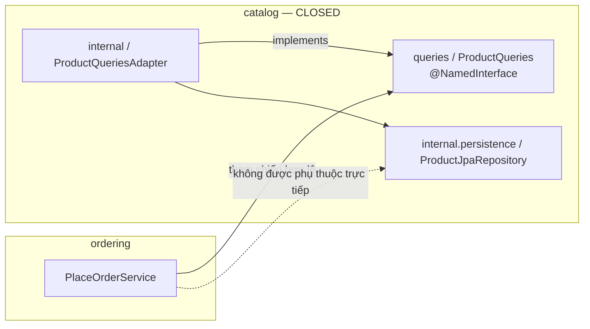

# Đưa implementation detail ra khỏi public API

Trong ứng dụng Spring Modulith, việc chia mã thành các package `catalog`, `ordering`, `billing` chưa bảo đảm các module có thể thay đổi độc lập. Nếu `ordering` gọi thẳng `catalog.internal.ProductJpaRepository` hoặc một API của `catalog` trả về `ProductEntity`, chi tiết triển khai vẫn bị truyền qua ranh giới. Hậu quả là thay đổi bảng dữ liệu, ORM, thuật toán định giá hoặc trạng thái nội bộ ở `catalog` có thể buộc các module tiêu thụ phải sửa theo.

**Đưa implementation detail ra khỏi public API** nghĩa là chỉ công bố **hợp đồng nghiệp vụ có ý nghĩa với bên sử dụng**, còn entity lưu trữ, repository, framework, adapter, thuật toán và cấu trúc điều phối nằm phía sau ranh giới. Bài học thuộc chương **Thiết kế module** của **SPRING_MODULITH_VERIFICATION_TESTING**. Sau khi cải thiện hợp đồng, ta sẽ dùng `ApplicationModules.verify()`, `@ApplicationModuleTest`, kiểm thử sự kiện, cơ sở dữ liệu và tích hợp cùng quality gate CI để ngăn phụ thuộc sai và hồi quy.

## 1. Kết quả học tập

Hoàn thành bài này, bạn có thể:

1. Nhận diện các đường rò rỉ triển khai qua tham số, kiểu trả về, generic, exception, event và hành vi của API.
2. Thiết kế request/response DTO, value object và interface thể hiện năng lực nghiệp vụ mà không xuất bản JPA entity hoặc repository.
3. Đặt đúng API ở package gốc hoặc `@NamedInterface`, giữ triển khai trong package nội bộ của closed module.
4. Refactor một API đã bị tiêu thụ ở nhiều nơi bằng lộ trình có kiểm chứng, hạn chế thay đổi hành vi.
5. Phân biệt lỗi mà `ApplicationModules.verify()` phát hiện với lỗi về contract, transaction, đồng thời, sự kiện và dữ liệu phải kiểm thử bổ sung.

## 2. Khi nào một chi tiết triển khai đã bị lộ?

Một kiểu, công nghệ hoặc quyết định nội bộ bị **rò rỉ khỏi module** khi bên tiêu thụ phải biết hoặc phải tuân theo nó mới sử dụng được chức năng công khai. Có hai kiểu rò rỉ:

- **Rò rỉ cấu trúc:** chữ ký API hoặc code của caller chứa các lớp như `ProductEntity`, `JpaRepository`, `EntityManager`, `Pageable`, `ResponseEntity`, DTO nội bộ hoặc package `internal`.
- **Rò rỉ hành vi:** API bắt caller tự thực hiện quy trình nội bộ, chẳng hạn gọi `findStock()` rồi `saveStock()` để trừ tồn, hoặc tự suy trạng thái từ những cột persistence.

Một method nhìn bề ngoài có thể rất đơn giản nhưng vẫn làm rò rỉ:

```java
// catalog/CatalogApi.java — thiết kế có vấn đề
package com.example.shop.catalog;

import com.example.shop.catalog.internal.persistence.ProductEntity;
import org.springframework.data.jpa.repository.JpaRepository;
import org.springframework.data.domain.Page;
import org.springframework.data.domain.Pageable;

public interface CatalogApi {
    ProductEntity load(String sku);
    Page<ProductEntity> search(Pageable pageable);
    JpaRepository<ProductEntity, Long> repository();
}
```

API nằm ở **package gốc**, tức vị trí có thể được xem là giao diện công khai của application module kiểu `CLOSED`. Tuy nhiên, các chữ ký khiến caller biết cấu trúc JPA và cơ chế phân trang của Spring Data. Trả `JpaRepository` còn giao quyền truy cập dữ liệu quá rộng cho caller: người dùng API có thể bỏ qua kiểm tra nghiệp vụ của `catalog`.

Đổi `ProductEntity` thành tên `ProductDto` mà vẫn gắn trực tiếp annotation ORM, cho phép caller sửa và gọi `save()` không giải quyết được bản chất vấn đề. Cần nhìn vào **dữ liệu, quyền quyết định và hành vi** đang vượt qua ranh giới.

### 2.1. Bảng nhận diện dấu hiệu rò rỉ

| Dấu hiệu | Phụ thuộc bị tạo ra | Thay bằng gì? |
| --- | --- | --- |
| API trả `ProductEntity` hoặc `List<ProductEntity>` | Caller biết mapping và vòng đời entity | DTO/record chứa dữ liệu nghiệp vụ cần thiết |
| API trả `JpaRepository`/`EntityManager` | Caller được quyết định cách đọc/ghi dữ liệu | Lệnh/truy vấn theo use case |
| API trả `Page<ProductEntity>` | Caller biết entity và kiểu phân trang của hạ tầng | Kết quả phân trang do hợp đồng sở hữu, nếu thực sự cần |
| Lệnh nhận `Specification<ProductEntity>` | Caller phải hiểu mô hình persistence | Bộ lọc nghiệp vụ được mô tả rõ |
| API ném exception JDBC/JPA như một phần lỗi dự kiến | Caller phải hiểu driver/schema | Lỗi nghiệp vụ ổn định; lỗi hạ tầng bất ngờ được xử lý riêng |
| Sự kiện chứa `ProductEntity` | Listener phụ thuộc persistence và lazy loading | Sự kiện bất biến mang dữ kiện đã xảy ra |
| API trả service hoặc factory class ở `internal` | Caller biết đồ thị triển khai | Interface công khai và DTO độc lập |
| Caller phải `load → mutate → save` | Caller nắm quy tắc thay đổi trạng thái | Lệnh nguyên tử theo nghiệp vụ, ví dụ `reserveStock(...)` |

**Không phải mọi kiểu đến từ thư viện đều là sai.** `UUID`, `BigDecimal`, `Instant` hoặc `Optional` có thể là lựa chọn hợp đồng hợp lý. Một framework type như `Page` cũng có thể được chấp nhận nếu nhóm **chủ động** chọn nó làm phụ thuộc công khai có kiểm soát. Vấn đề là chi phí ràng buộc và trách nhiệm: API cần ổn định ở mức nào, ai được sửa nó và liệu consumer có cần biết chi tiết đó hay không.

### 2.2. Kiểm tra cả đường rò rỉ gián tiếp

Khi review API, đừng chỉ nhìn kiểu trả về ngoài cùng:

```java
// Các chữ ký dưới đây vẫn có thể làm rò rỉ triển khai.
Optional<ProductEntity> find(String sku);
List<Map<String, StockRow>> lookup(List<String> skus);
Result<ProductJpaModel, RepositoryException> query(QuerySpec spec);
void registerListener(Consumer<InternalOrderEvent> listener);
```

Generic type argument, phần tử collection, checked exception, callback và superclass/interface mà kiểu công khai kế thừa cũng có thể kéo các kiểu nội bộ vào hợp đồng. Việc một entity không xuất hiện trực tiếp trong tên method không có nghĩa nó đã được che giấu.

Đối với dữ liệu trả về JSON hoặc sự kiện, còn phải xét **schema được serialize**, tên trường, ý nghĩa trạng thái và khả năng tương thích. Một DTO độc lập với JPA vẫn có thể là hợp đồng tồi nếu nó công bố mọi trường nội bộ không cần thiết.

## 3. Ví dụ xuyên suốt: module Catalog và Ordering

Giả sử `catalog` quản lý sản phẩm và giá niêm yết. Khi đặt hàng, `ordering` cần biết sản phẩm có được bán hay không và giá cần chốt tại thời điểm đặt. `ordering` **không cần biết** `catalog` lưu dữ liệu bằng JPA, JDBC hay gọi hệ thống sản phẩm bên ngoài.

Trước khi sửa, code trong `ordering` làm việc trực tiếp với entity:

```java
// ordering/internal/PlaceOrderService.java — phụ thuộc sai
package com.example.shop.ordering.internal;

import com.example.shop.catalog.internal.persistence.ProductEntity;
import com.example.shop.catalog.internal.persistence.ProductJpaRepository;

class PlaceOrderService {

    private final ProductJpaRepository products;

    PlaceOrderService(ProductJpaRepository products) {
        this.products = products;
    }

    void place(String sku) {
        ProductEntity product = products.findBySku(sku)
            .orElseThrow();
        if (!product.isActive()) {
            throw new IllegalStateException("Không được bán");
        }
        // ordering lấy dữ liệu từ entity persistence để chốt đơn.
    }
}
```

Đoạn code có thể biên dịch nếu các lớp Java đủ quyền truy cập. Nhưng ở mức kiến trúc, `ordering` đang đi vào package nội bộ của một `catalog` closed module; khi kiểm chứng Spring Modulith có thể phát hiện vi phạm. Về nghiệp vụ, `ordering` còn có nguy cơ tự diễn giải sai ý nghĩa của trường `active`, quy tắc giá hoặc trạng thái sản phẩm.

### 3.1. Chọn thông tin mà consumer thực sự cần

Trao đổi với người sở hữu `ordering` và `catalog` trước khi đặt tên DTO:

| Câu hỏi | Quyết định minh họa |
| --- | --- |
| `ordering` muốn quyết định điều gì? | Có thể chấp nhận dòng hàng với SKU và số lượng này không? |
| `catalog` sở hữu điều gì? | Sản phẩm còn được bán không; giá niêm yết hiện tại có ý nghĩa gì |
| `ordering` sở hữu điều gì? | Giá chốt của dòng đơn, trạng thái đơn và tổng tiền tại lúc đặt |
| Phải trả dữ liệu nào? | SKU, tên hiển thị, giá, tiền tệ và trạng thái có thể bán |
| Không nên trả gì? | JPA ID nội bộ, version ORM, quan hệ lazy, entity lifecycle, repository |
| Khi nào cần lệnh thay vì truy vấn? | Nếu phải giữ hàng, `inventory` cần API giữ hàng nguyên tử; `ordering` không tự trừ tồn |

Với yêu cầu đọc thông tin sản phẩm, ta sẽ xây dựng **truy vấn theo nghiệp vụ** `ProductQueries` và bản chụp `ProductSnapshot`. Nếu quy tắc giá yêu cầu tính ưu đãi theo người mua, API thực tế có thể cần thêm ngữ cảnh khách hàng và một khái niệm như `PriceQuote`; ví dụ sau giả định giá niêm yết đủ để minh họa việc loại rò rỉ ORM.

## 4. Thiết kế hợp đồng công khai độc lập với triển khai

Cấu trúc mục tiêu:

```text
com/example/shop/
├── ShopApplication.java
├── catalog/                                # application module
│   ├── package-info.java                  # CLOSED (mặc định)
│   ├── queries/
│   │   ├── package-info.java              # @NamedInterface("queries")
│   │   ├── ProductQueries.java            # hợp đồng công khai
│   │   └── ProductSnapshot.java           # DTO công khai
│   ├── events/
│   │   ├── package-info.java              # @NamedInterface("events")
│   │   └── ProductPriceChanged.java
│   └── internal/
│       ├── ProductQueriesAdapter.java     # triển khai hợp đồng
│       ├── CatalogDomainService.java
│       └── persistence/
│           ├── ProductEntity.java
│           └── ProductJpaRepository.java
└── ordering/
    ├── package-info.java
    └── internal/
        ├── PlaceOrderService.java
        └── OrderRepository.java
```

Theo quy ước phát hiện module mặc định, `catalog` và `ordering` là các application module trực tiếp dưới package ứng dụng. `catalog.internal` không cần đặt ở đúng package tên `internal` để được coi là nội bộ, nhưng tên này làm ý định rõ ràng.

### 4.1. Công bố một named interface cho truy vấn sản phẩm

Tạo `catalog/queries/package-info.java`:

```java
@org.springframework.modulith.NamedInterface("queries")
package com.example.shop.catalog.queries;
```

DTO chỉ chứa những trường consumer cần:

```java
// catalog/queries/ProductSnapshot.java
package com.example.shop.catalog.queries;

import java.math.BigDecimal;
import java.util.Currency;
import java.util.Objects;

public record ProductSnapshot(
    String sku,
    String displayName,
    BigDecimal price,
    Currency currency,
    boolean sellable
) {
    public ProductSnapshot {
        Objects.requireNonNull(sku, "sku");
        Objects.requireNonNull(displayName, "displayName");
        Objects.requireNonNull(price, "price");
        Objects.requireNonNull(currency, "currency");
    }
}
```

Đặt tên là `ProductSnapshot` nhấn mạnh giá trị **tại thời điểm đọc**, không phải entity được theo dõi bởi persistence context. Nó bất biến ở mức các trường record; các loại field được chọn (`String`, `BigDecimal`, `Currency`) cũng không cung cấp thao tác sửa trực tiếp vào ORM.

Hợp đồng truy vấn:

```java
// catalog/queries/ProductQueries.java
package com.example.shop.catalog.queries;

import java.util.Optional;

public interface ProductQueries {
    Optional<ProductSnapshot> findForSale(String sku);
}
```

Hãy tài liệu hóa rõ `Optional.empty()` có nghĩa SKU không tồn tại, SKU bị ẩn hay không được bán. Trong ví dụ này, `findForSale` được hiểu là **trả bản chụp có thông tin `sellable` khi SKU tồn tại; trả empty khi SKU không tồn tại**. Nếu sản phẩm tồn tại nhưng không bán được, caller nhận `sellable = false`; không suy diễn từ việc không tìm thấy.

Tên và ngữ nghĩa cần được chọn nhất quán với nghiệp vụ thực tế. Nếu không muốn caller tự quyết định chính sách “có được bán hay không”, nên đổi API thành hành vi `checkOrderability(...)` hoặc `quoteProduct(...)` có kết quả nghiệp vụ cụ thể.

### 4.2. Đưa việc ánh xạ entity vào adapter nội bộ

Ở `catalog.internal`, một bean implement hợp đồng:

```java
// catalog/internal/ProductQueriesAdapter.java
package com.example.shop.catalog.internal;

import com.example.shop.catalog.internal.persistence.ProductJpaRepository;
import com.example.shop.catalog.queries.ProductQueries;
import com.example.shop.catalog.queries.ProductSnapshot;
import java.util.Optional;
import org.springframework.stereotype.Service;
import org.springframework.transaction.annotation.Transactional;

@Service
class ProductQueriesAdapter implements ProductQueries {

    private final ProductJpaRepository products;

    ProductQueriesAdapter(ProductJpaRepository products) {
        this.products = products;
    }

    @Override
    @Transactional(readOnly = true)
    public Optional<ProductSnapshot> findForSale(String sku) {
        return products.findBySku(sku)
            .map(entity -> new ProductSnapshot(
                entity.getSku(),
                entity.getDisplayName(),
                entity.getListPrice(),
                entity.getCurrency(),
                entity.isActive()
            ));
    }
}
```

`ProductJpaRepository` và `ProductEntity` là thành phần của **chính module `catalog`**, nên adapter được phép biết chúng. Đoạn code giả định entity có các getter tương ứng và repository có `findBySku(...)`; chúng cần được triển khai/cấu hình trong dự án thật. Nếu có quy tắc `sellable` phức tạp, việc tính nó phải do domain service nội bộ của `catalog` đảm nhận, thay vì chỉ đọc `isActive()`.

Adapter là điểm dịch giữa **mô hình nội bộ** và **hợp đồng công khai**. Khi chuyển từ JPA sang JDBC, nhóm có thể thay `ProductQueriesAdapter` và persistence mà không làm consumer thay đổi nếu ngữ nghĩa API được giữ nguyên.

### 4.3. Caller chỉ phụ thuộc vào hợp đồng

Trong `ordering/internal/PlaceOrderService.java`:

```java
package com.example.shop.ordering.internal;

import com.example.shop.catalog.queries.ProductQueries;
import com.example.shop.catalog.queries.ProductSnapshot;
import java.math.BigDecimal;

class PlaceOrderService {

    private final ProductQueries catalog;

    PlaceOrderService(ProductQueries catalog) {
        this.catalog = catalog;
    }

    BigDecimal priceForOrderLine(String sku) {
        ProductSnapshot product = catalog.findForSale(sku)
            .orElseThrow(() -> new IllegalArgumentException("SKU không tồn tại"));

        if (!product.sellable()) {
            throw new IllegalStateException("Sản phẩm không còn được bán");
        }

        // Giá sẽ được chốt vào dữ liệu đơn hàng do ordering sở hữu.
        return product.price();
    }
}
```

Đoạn ví dụ tập trung vào ranh giới đọc giá, chưa xử lý tỷ giá, chiết khấu, số lượng, quy tắc nhất quán giá hoặc giữ hàng. Đặc biệt, `ProductSnapshot` không cấp quyền cho `ordering` sửa sản phẩm; lệnh thay đổi sản phẩm phải đi qua hành vi do `catalog` sở hữu.

**Điểm thay đổi quyết định:** `ordering` import `catalog.queries.ProductQueries` và `ProductSnapshot`, không import `catalog.internal.persistence.ProductEntity` hay `ProductJpaRepository`.

## 5. Giới hạn ranh giới bằng Spring Modulith

Một API được thiết kế tốt cần **được công bố rõ** và **được giới hạn người sử dụng đúng**.

### 5.1. `@NamedInterface` là bề mặt được công bố

Ở module kiểu `CLOSED` mặc định:

- Các kiểu truy cập được trong **package gốc** của application module thuộc API mặc định.
- Package con như `catalog.queries` chỉ là API khi được công bố bằng named interface thích hợp.
- Package con `catalog.internal` hoặc `catalog.internal.persistence` vẫn là phần nội bộ, kể cả khi class Java được khai báo `public`.

`@NamedInterface("queries")` đánh dấu **nhóm kiểu tại package** `catalog.queries`, không công bố mặc định tất cả package con còn lại. `OPEN` nới kiểm tra đóng gói; không nên chuyển `catalog` thành `OPEN` chỉ vì một caller cần hai trường dữ liệu sản phẩm.

### 5.2. `allowedDependencies` khống chế hướng phụ thuộc

Trong `ordering/package-info.java`:

```java
@org.springframework.modulith.ApplicationModule(
    allowedDependencies = "catalog::queries"
)
package com.example.shop.ordering;
```

`catalog::queries` là **tên module + named interface**, khác với FQCN Java. Quy tắc này thể hiện rằng `ordering` chỉ được phép tham chiếu vào phần `queries` đã công bố của `catalog` theo cấu hình ví dụ.



Mũi tên ở đây minh họa các **tham chiếu mã nguồn**. Mặc dù `ProductQueriesAdapter` implement `ProductQueries` nằm ở package con khác, hai package đều thuộc **cùng module `catalog`**, nên không tạo phụ thuộc xuyên application module.

### 5.3. `public` trong Java không có nghĩa là public API của module

Giả sử `ProductJpaRepository` là interface Java `public` để các lớp ở package khác có thể sử dụng. Việc này **không** tự công bố repository cho `ordering` khi `catalog` là closed application module.

Thực tế Java có thể biên dịch các tham chiếu xuyên module vì chúng cùng nằm trên classpath. Spring Modulith bảo vệ giới hạn thông qua mô hình module và kiểm chứng kiến trúc, ví dụ `ApplicationModules.verify()`. Nó không tạo rào cản giống JPMS `module-info.java` hoặc tách tiến trình như microservice.

## 6. Refactor API rò rỉ: đi từ nhu cầu người dùng tới hợp đồng mới

Không nên chỉ kéo các class từ package gốc xuống `internal` rồi sửa import hàng loạt. Nếu nhiều consumer đang phụ thuộc vào cấu trúc cũ, việc làm đó có thể gây lỗi build hoặc thay đổi ngữ nghĩa nghiệp vụ. Lộ trình sau giúp tách quyết định API khỏi chi tiết triển khai.

### Bước 1 — Kiểm kê toàn bộ surface đang bị dùng

Với từng phương thức công khai, liệt kê:

- Ai gọi? Module nào, use case nào?
- Caller thực sự cần kết quả gì?
- Chữ ký hoặc exception nào đang kéo kiểu nội bộ/framework ra ngoài?
- Caller có quyền **đọc dữ liệu**, **ra lệnh thay đổi** hay **lắng nghe sự kiện**?
- Những phần nào phải giữ tương thích trong thời gian chuyển đổi?

Ví dụ bản ghi kiểm kê:

| Consumer | Phụ thuộc hiện tại | Nhu cầu thật | API đề xuất |
| --- | --- | --- | --- |
| `ordering` | `ProductJpaRepository.findBySku(...)` | Giá, tiền tệ, điều kiện bán | `ProductQueries.findForSale(sku)` |
| `promotion` | `ProductEntity.setPrice(...)` | Yêu cầu thay đổi giá hợp lệ | `ProductPricing.changePrice(...)` |
| `reporting` | `ProductEntity` trong sự kiện | Biết sản phẩm đã đổi giá | `ProductPriceChanged` có payload ổn định |
| `admin` | `Page<ProductEntity>` | Lọc và phân trang sản phẩm | `ProductSearch.search(Filter, PageRequest)` với DTO/contract chủ đích |

### Bước 2 — Tách hợp đồng khỏi persistence

Tạo interface và DTO phù hợp ở package gốc hoặc named interface. Kiểm tra **toàn bộ chữ ký**, gồm tham số, kiểu generic, field của DTO, exception, event payload và type inheritance. Một `ProductSnapshot` có field `ProductEntity entity` vẫn làm rò rỉ nội bộ dù tên ngoài cùng đã được đổi.

### Bước 3 — Dịch dữ liệu bên trong module sở hữu

Việc ánh xạ entity → DTO diễn ra ở adapter/service **nội bộ** của `catalog`. Nếu có nhiều nguồn dữ liệu, `catalog` quyết định cách phối hợp và tính giá trị nghiệp vụ. Consumer không được tự nối dữ liệu từ các repository để suy ra quyết định do `catalog` sở hữu.

### Bước 4 — Chuyển consumer theo từng use case

Trong ứng dụng đang chạy, có thể giữ tạm API cũ khi cần tương thích và chuyển từng caller sang API mới. Đánh dấu phần cũ là deprecated **kèm kế hoạch loại bỏ**, không coi nó là hợp đồng dài hạn. Nếu import nội bộ cũ gây `verify()` thất bại, cần quản lý giai đoạn chuyển đổi có kiểm soát; không nới tất cả `allowedDependencies` hoặc bật `OPEN` vĩnh viễn chỉ để pipeline xanh.

Nếu việc chặn vi phạm phải được trì hoãn trong hệ thống brownfield, hãy lập rõ phạm vi nợ kiến trúc và tiêu chí kết thúc. Có thể dùng chiến lược quản lý ngoại lệ hoặc chuyển đổi module theo kế hoạch đã thống nhất; điều quan trọng là không để chính sách kiểm chứng âm thầm chấp nhận thêm phụ thuộc mới.

### Bước 5 — Thu hẹp API và khóa quy tắc

Khi không còn consumer của đường cũ, loại bỏ phương thức lộ repository/entity, chuyển mọi thành phần triển khai xuống package nội bộ và chỉ giữ các named interface thực sự được dùng. Chạy `ApplicationModules.verify()` để khẳng định bề mặt module và hướng phụ thuộc đã đúng. Tiếp tục kiểm thử hành vi và dữ liệu để chứng minh refactor không làm đổi kết quả nghiệp vụ.

## 7. Thiết kế hợp đồng lỗi, phân trang và trạng thái

Sau khi thay entity bằng DTO, vẫn còn nguy cơ chuyển **implementation detail ở dạng khác** ra ngoài.

### 7.1. Đừng chuyển nguyên exception của hạ tầng thành lỗi nghiệp vụ

Ví dụ không nên buộc consumer bắt `SQLIntegrityConstraintViolationException` để biết SKU trùng hay `DataAccessException` để biết sản phẩm không tồn tại. Hợp đồng có thể chọn:

```java
public sealed interface ProductLookupResult
    permits ProductLookupResult.Found, ProductLookupResult.Missing {

    record Found(ProductSnapshot product) implements ProductLookupResult {}

    record Missing(String sku) implements ProductLookupResult {}
}
```

Ví dụ có thể đặt trong `ProductLookupResult.java` thuộc package `catalog.queries`: hai record lồng trong interface đều là kiểu công khai của hợp đồng. Có thể dùng `Optional<ProductSnapshot>` nếu chỉ cần phân biệt có/không; không nhất thiết xây result hierarchy cho mọi truy vấn.

Lỗi database bất ngờ **khác** sản phẩm không tồn tại: không nên tùy tiện bắt mọi lỗi rồi trả `ProductMissing`, vì như vậy sẽ giấu mất lỗi hạ tầng cần được quan sát và xử lý. Phân biệt rõ lỗi nghiệp vụ dự kiến, lỗi input và lỗi kỹ thuật/khả năng thử lại.

### 7.2. Thiết kế phân trang ở mức ý nghĩa của API

Một API đọc danh sách không nhất thiết phải trả `Page<ProductEntity>`. Có thể công bố kiểu riêng:

```java
// catalog/queries/ProductSearchRequest.java
package com.example.shop.catalog.queries;

public record ProductSearchRequest(
    String searchText,
    int pageNumber,
    int pageSize
) {}
```

```java
// catalog/queries/ProductPage.java
package com.example.shop.catalog.queries;

import java.util.List;

public record ProductPage(
    List<ProductSnapshot> items,
    int pageNumber,
    boolean hasNext
) {
    public ProductPage {
        items = List.copyOf(items);
    }
}
```

Nếu caller cần tổng số kết quả hoặc cursor, bổ sung theo nhu cầu thật và công bố semantics của thứ tự sắp xếp, kích thước trang, nhất quán dữ liệu. Việc tách khỏi `Pageable`/`Page` giúp API bớt bị buộc với Spring Data, nhưng không có nghĩa mọi hệ thống đều phải tự viết pagination abstraction. Đó là lựa chọn thiết kế có chi phí; hãy cân nhắc bối cảnh trước khi đổi.

### 7.3. Chỉ công bố trạng thái nghiệp vụ có ý nghĩa

Không nên bắt consumer diễn giải `databaseStatus = 7` hoặc `deletedFlag = 0` để quyết định có được bán hay không. Nên công bố `sellable` hoặc trạng thái nghiệp vụ như `ProductSaleStatus` nếu consumer thực sự cần phân biệt nhiều lý do. **Trạng thái nội bộ** có thể thay đổi cách biểu diễn; **quy tắc được công bố** phải giữ ngữ nghĩa hợp đồng đã thống nhất.

## 8. Sự kiện cũng là một public API

Khi module phát sự kiện cho module khác, kiểu và payload sự kiện cũng là **hợp đồng**, dù không có lời gọi đồng bộ. Một event kiểu:

```java
// Sai: event chứa JPA entity của catalog.
public record ProductUpdated(ProductEntity product) {}
```

buộc listener nhận biết entity và có thể vướng persistence context, lazy loading, serialization hoặc dữ liệu nội bộ ngoài nhu cầu.

Thay bằng sự kiện có ý nghĩa nghiệp vụ rõ:

```java
// catalog/events/ProductPriceChanged.java
package com.example.shop.catalog.events;

import java.math.BigDecimal;
import java.util.Currency;

public record ProductPriceChanged(
    String sku,
    BigDecimal previousPrice,
    BigDecimal currentPrice,
    Currency currency
) {}
```

Và công bố đúng package:

```java
// catalog/events/package-info.java
@org.springframework.modulith.NamedInterface("events")
package com.example.shop.catalog.events;
```

Module `reporting` có thể đăng ký listener bằng kiểu sự kiện `ProductPriceChanged` và khai báo `allowedDependencies = "catalog::events"` nếu chỉ cần sự kiện. **Hướng luồng event** từ `catalog` sang `reporting` khác với **hướng phụ thuộc kiểu trong mã nguồn** từ `reporting` tới API event của `catalog`.

Đừng đưa `ProductSnapshot` của API truy vấn vào sự kiện một cách máy móc: hai hợp đồng có vòng đời, thời điểm và đối tượng tiêu thụ khác nhau. Event phản ánh **điều đã xảy ra**; DTO truy vấn phản ánh **ảnh chụp dữ liệu tại lúc hỏi**. Khi sửa schema sự kiện, cần kiểm tra khả năng tương thích của listener và cơ chế lưu/phát lại sự kiện.

**Lưu ý về độ tin cậy:** Việc dùng `@NamedInterface` không bảo đảm phát đúng một lần. Các listener bất đồng bộ cần xem xét transaction sau commit, lỗi handler, phát lại và idempotency. Kiểm thử sự kiện/tích hợp cần chứng minh các cam kết đó theo cách ứng dụng triển khai Spring Modulith.

## 9. Kiểm chứng cấu trúc bằng `ApplicationModules`

Tạo kiểm thử JUnit 5:

```java
// src/test/java/com/example/shop/ModularityTests.java
package com.example.shop;

import org.junit.jupiter.api.Test;
import org.springframework.modulith.core.ApplicationModules;

class ModularityTests {

    @Test
    void modulesRespectPublishedContracts() {
        ApplicationModules.of(ShopApplication.class).verify();
    }
}
```

Với module `CLOSED`, `verify()` kiểm chứng những quy tắc kiến trúc của Spring Modulith, điển hình gồm:

- Phụ thuộc vòng giữa các application module.
- Tham chiếu vào phần nội bộ chưa công bố của module khác.
- Phụ thuộc vượt ra ngoài `allowedDependencies` nếu có khai báo.

### 9.1. Ví dụ thất bại và cách sửa

Giả sử `ordering` lại tham chiếu trực tiếp kiểu nội bộ:

```java
package com.example.shop.ordering.internal;

import com.example.shop.catalog.internal.persistence.ProductJpaRepository;

class WrongDependency {
    private final ProductJpaRepository catalogRepository;

    WrongDependency(ProductJpaRepository catalogRepository) {
        this.catalogRepository = catalogRepository;
    }
}
```

Đây là một quan hệ phụ thuộc **thật** trong chữ ký field/constructor, nên công cụ kiến trúc có thể phân tích được. Nếu `ProductJpaRepository` có quyền truy cập Java phù hợp, đoạn mã vẫn có thể biên dịch, nhưng phải bị xem là sai ranh giới khi `catalog` đóng và caller bị giới hạn vào `catalog::queries`.

Sửa field thành `ProductQueries`, chuyển việc mapping và persistence về `catalog`, đồng thời giữ API công khai là `ProductSnapshot`.

### 9.2. `verify()` không tự động chứng minh API không rò rỉ

Đây là giới hạn quan trọng: một API nằm đúng package công khai **vẫn có thể có thiết kế tồi**. Ví dụ `catalog` công khai `JpaRepository` ở package gốc, và caller chỉ sử dụng nó qua API được cho phép; một số quan hệ phụ thuộc cấu trúc có thể thỏa quy tắc Modulith nhưng vẫn làm lộ persistence.

`ApplicationModules.verify()` **không phải** công cụ bảo đảm mọi method signature đều thuần domain hoặc mọi field DTO đều có ý nghĩa. Vì vậy cần **review bề mặt API** và, khi có nhu cầu, bổ sung quy tắc kiến trúc riêng bằng ArchUnit/kiểm tra source hay test phản chiếu để cấm kiểu `EntityManager`, `JpaRepository`, các kiểu `internal` trong API công khai. Chỉ thêm quy tắc nào phục vụ một chính sách cụ thể và bảo trì được.

## 10. Kiểm thử hành vi sau refactor

Chuyển consumer từ entity sang DTO là một thay đổi dễ gây lỗi **ngữ nghĩa** dù kiến trúc mới đã đúng. Chẳng hạn, giá niêm yết trả về đúng kiểu `BigDecimal` nhưng sai tiền tệ, sản phẩm hết kinh doanh vẫn cho đặt, hoặc dữ liệu đọc sau transaction có giá trị khác thời điểm chốt đơn.

### 10.1. `@ApplicationModuleTest` tại module sở hữu

Kiểm thử hợp đồng truy vấn ngay trong `catalog`:

```java
// src/test/java/com/example/shop/catalog/CatalogModuleTests.java
package com.example.shop.catalog;

import static org.assertj.core.api.Assertions.assertThat;

import com.example.shop.catalog.queries.ProductQueries;
import org.junit.jupiter.api.Test;
import org.springframework.beans.factory.annotation.Autowired;
import org.springframework.modulith.test.ApplicationModuleTest;

@ApplicationModuleTest
class CatalogModuleTests {

    @Autowired ProductQueries queries;

    @Test
    void unknownSkuProducesNoSnapshot() {
        assertThat(queries.findForSale("SKU-NOT-PRESENT")).isEmpty();
    }
}
```

Test giả định fixture/database không chứa SKU đó và hạ tầng Spring cho `catalog` được cấu hình. Bài test đầy đủ còn phải nạp sản phẩm hợp lệ, xác minh tất cả trường DTO và trường hợp `sellable = false`. `@ApplicationModuleTest` chọn phạm vi context theo module; khi module đang kiểm thử cần collaborator ngoài, lựa chọn chế độ bootstrap (`STANDALONE`, `DIRECT_DEPENDENCIES`, `ALL_DEPENDENCIES`) và test double tùy mục tiêu.

### 10.2. Kiểm thử consumer không còn hiểu entity

Ở `ordering`, test use case đặt hàng thông qua `ProductQueries`. Ví dụ, khi API trả `ProductSnapshot("A-1", "Áo", 100000 VND, true)`, hệ thống chốt đơn với giá và tiền tệ tương ứng; khi `sellable = false`, không tạo đơn. Một test cô lập có thể giả lập `ProductQueries`, còn test tích hợp kiểm tra dữ liệu catalog thật. Những điều này **khác** bài test chỉ kiểm tra constructor nhận đúng interface.

### 10.3. Kiểm thử database, transaction, đồng thời

Nếu module `inventory` cung cấp API giữ hàng, invariant “không giữ vượt tồn” phải được kiểm tra tại module sở hữu với database/hạ tầng thích hợp. Ví dụ tồn `1` và hai yêu cầu giữ `1` chạy đồng thời: tối đa một yêu cầu thành công, dữ liệu không âm và việc ghi phiếu giữ hàng phải nhất quán. Không nên đổi thao tác này thành `getStock → setStock` trong API vì tưởng DTO đã giải quyết mọi rò rỉ.

Với refactor truy vấn catalog, test tích hợp phải kiểm tra mapping entity → snapshot, kiểu tiền, trạng thái bán và tình huống cập nhật dữ liệu khi đồng thời đọc. Transaction `readOnly = true` không tự đảm bảo snapshot giá được chốt nhất quán với một thao tác nghiệp vụ rộng hơn; cần quy tắc cụ thể về thời điểm chốt và độ nhất quán.

### 10.4. Kiểm thử sự kiện

Khi `catalog` phát `ProductPriceChanged`, kiểm tra payload chỉ chứa dữ liệu được công bố; listener `reporting` xử lý đúng thay đổi; sự kiện bị phát lại không tạo kết quả trùng ngoài ý muốn; các trường hợp rollback hoặc lỗi handler được giải quyết theo cơ chế đã lựa chọn.

### 10.5. Ma trận quality gate

| Kiểm thử | Điều bảo vệ | Hồi quy cần chặn |
| --- | --- | --- |
| `ApplicationModules.verify()` | Phụ thuộc hợp lệ, không truy cập nội bộ hoặc tạo chu trình | `ordering` lại inject `ProductJpaRepository` |
| Review/test bề mặt API | Signature không xuất bản persistence/framework ngoài chủ đích | `ProductQueries` trả `ProductEntity` |
| `@ApplicationModuleTest` | DTO có dữ liệu và ý nghĩa chính xác | `sellable` sai hoặc thiếu tiền tệ |
| Consumer/module contract test | Consumer hiểu đúng kết quả API mới | Đơn hàng lấy sai giá chốt |
| Database/transaction/concurrency test | Bất biến dữ liệu, isolation, rollback | Thao tác giữ hàng bị race condition |
| Event/integration test | Payload, listener, retry và idempotency | Báo cáo bị cập nhật hai lần bởi event lặp |
| CI quality gate | Các bài kiểm thử bắt buộc được chạy trước merge | Code mới đưa phụ thuộc nội bộ trở lại |

Một pipeline Maven có thể chạy `./mvnw test` nếu các test nằm trong bộ unit/integration phù hợp của dự án; Gradle dùng lệnh tương ứng. Cần xác nhận `ModularityTests` không bị loại khỏi test discovery và lỗi `verify()` thực sự làm pipeline thất bại. Việc tách test nhanh/chậm được quyết định theo khả năng CI, nhưng các quy tắc cần bảo vệ phải có vị trí thực thi rõ ràng.

## 11. Những lựa chọn sai khi cố che implementation detail

| Cách làm | Vì sao chưa giải quyết vấn đề | Hướng phù hợp hơn |
| --- | --- | --- |
| Đổi `ProductEntity` thành `ProductDto` nhưng vẫn cho caller gọi `save()` | Caller tiếp tục sở hữu quy trình ghi và invariant | Cung cấp lệnh nghiệp vụ có transaction |
| Chuyển repository vào một package tên `api` | Tên package mới không thay đổi trách nhiệm | Công bố truy vấn/lệnh theo nhu cầu |
| Tạo facade chỉ gọi `repository.findAll()` rồi trả entity | Facade trở thành wrapper mỏng mà vẫn lộ ORM | Mapper nội bộ trả DTO chuyên biệt |
| Công bố toàn bộ `internal` bằng `@NamedInterface` | Giữ nguyên coupling, chỉ hợp thức hóa phụ thuộc | Tạo nhóm API nhỏ và dịch dữ liệu |
| Đổi module thành `OPEN` vì `verify()` thất bại | Mở rộng quyền truy cập vào chi tiết triển khai | Sửa hợp đồng hoặc dùng OPEN tạm khi có kế hoạch migration |
| Gom mọi kiểu chia sẻ vào module `common` | Mất chủ sở hữu nghiệp vụ và vòng đời hợp đồng | Đặt kiểu tại module sở hữu và công bố có kiểm soát |
| Trả lỗi SQL/JPA để caller tự diễn giải | Ràng buộc vào schema/driver | Chuẩn hóa lỗi nghiệp vụ, xử lý lỗi kỹ thuật riêng |
| Dùng event mang entity JPA | Rò rỉ lazy loading, persistence, dữ liệu thừa | Event immutable với payload nghiệp vụ |
| Chỉ chạy `verify()` rồi bỏ qua tests khác | Không bảo đảm DTO đúng, không có race, không lỗi event | Bổ sung module, DB, sự kiện và integration tests |

## 12. Bài thực hành: bỏ rò rỉ từ module Inventory

Một nhóm có module `inventory` chứa `StockEntity`, `StockJpaRepository` và `StockService`. Họ công bố:

```java
package com.example.shop.inventory;

import com.example.shop.inventory.internal.StockEntity;
import java.util.Optional;

public interface InventoryApi {
    Optional<StockEntity> findStock(String sku);
    void saveStock(StockEntity entity);
}
```

`ordering` dùng `findStock()`, tự trừ `available` rồi gọi `saveStock()`. Khi có hai yêu cầu đặt hàng đồng thời, tồn kho có thể bị cập nhật sai. Hãy giải các nhiệm vụ sau:

1. Xác định rò rỉ **cấu trúc** và rò rỉ **hành vi** ở `InventoryApi`.
2. Thiết kế một API mới cho thao tác “giữ hàng” với command, result và lỗi nghiệp vụ; không trả entity.
3. Xác định module nào chịu trách nhiệm kiểm tra và cập nhật tồn kho đồng thời.
4. Đặt interface/DTO ở package gốc hoặc named interface và đưa implementation vào package nội bộ.
5. Khai báo `allowedDependencies` cho `ordering` và viết một test kiến trúc kiểm tra ranh giới.
6. Liệt kê các test database, transaction, event và integration cần để chứng minh refactor không gây hồi quy.

### Gợi ý đáp án

Rò rỉ cấu trúc là `StockEntity` xuất hiện trong `Optional<StockEntity>` và tham số `saveStock(...)`. Rò rỉ hành vi là `ordering` tự thực hiện chuỗi *đọc, tính, ghi* thuộc trách nhiệm `inventory`, khiến invariant “không giữ vượt tồn” không được bảo vệ tập trung.

Tạo hợp đồng như:

```java
// inventory/api/InventoryReservations.java
package com.example.shop.inventory.api;

import java.util.UUID;

public interface InventoryReservations {
    UUID reserve(ReserveStock command);
}
```

```java
// inventory/api/ReserveStock.java
package com.example.shop.inventory.api;

public record ReserveStock(String sku, int quantity) {}
```

Trong dự án thật, cần bổ sung kiểm tra đầu vào, ngữ nghĩa `reservationId`, lỗi hết hàng, thời hạn giữ hàng và xử lý request lặp; những phần này quyết định chất lượng hợp đồng. Module `inventory` implement `reserve(...)` ở `internal`, sử dụng cập nhật dữ liệu an toàn đồng thời cùng transaction khi ghi phiếu giữ hàng.

Khai báo:

```java
// inventory/api/package-info.java
@org.springframework.modulith.NamedInterface("api")
package com.example.shop.inventory.api;
```

```java
// ordering/package-info.java
@org.springframework.modulith.ApplicationModule(
    allowedDependencies = "inventory::api"
)
package com.example.shop.ordering;
```

`ordering` chỉ import `InventoryReservations` và `ReserveStock`. Chạy `ApplicationModules.of(ShopApplication.class).verify()` để phát hiện import trở lại `inventory.internal`, sau đó kiểm thử hai lệnh giữ hàng cạnh tranh cùng SKU, rollback khi ghi phiếu lỗi và trường hợp giữ hàng bị từ chối. Nếu có sự kiện giữ hàng thành công, kiểm thử payload, phát sau commit và xử lý lặp theo chính sách hệ thống.

**Câu hỏi mở rộng:** Nếu `ordering` chỉ cần **xem** còn bao nhiêu hàng để hiển thị trước khi đặt, có thể tạo API `StockAvailabilityQuery` với DTO đọc. Tuy nhiên, giá trị đọc có thể thay đổi ngay sau khi trả về; nó **không thay thế** lời gọi `reserve(...)` khi xác nhận đơn.

## 13. Checklist trước khi coi API đã độc lập với triển khai

- [ ] Mỗi phương thức API thể hiện nhu cầu nghiệp vụ cụ thể của consumer.
- [ ] Chữ ký, generic, DTO, exception, event payload không rò rỉ kiểu nội bộ ngoài chủ đích.
- [ ] Không công bố `EntityManager`, repository hoặc entity persistence như quyền thao tác xuyên module.
- [ ] Việc mapping dữ liệu và bảo vệ invariant ở bên trong module sở hữu.
- [ ] DTO công khai có ngữ nghĩa, đơn vị, trạng thái và lỗi được tài liệu hóa.
- [ ] API nằm ở package gốc hoặc named interface; class triển khai ở package nội bộ.
- [ ] `allowedDependencies` chỉ cho phép hướng phụ thuộc và giao diện cần thiết.
- [ ] Đã loại bỏ hoặc có kế hoạch rõ cho các consumer còn phụ thuộc API cũ.
- [ ] `ApplicationModules.verify()` chạy trong CI và phát hiện import vào nội bộ.
- [ ] Kiểm thử module và consumer bảo đảm dữ liệu/kết quả không đổi ý nghĩa sau refactor.
- [ ] Kiểm thử database, transaction, đồng thời và sự kiện bảo vệ các invariant/tác dụng phụ quan trọng.
- [ ] Review API kiểm tra cả **rò rỉ cấu trúc** lẫn **rò rỉ hành vi**; không chỉ xét tên class/package.

**Điểm cốt lõi:** Một public API tốt cho Spring Modulith công bố **điều module cam kết làm và dữ liệu cần trao đổi**, đồng thời che giấu **cách module thực hiện lời hứa đó**. Tách hợp đồng khỏi implementation detail giúp giảm ảnh hưởng lan truyền khi thay đổi công nghệ hoặc mô hình nội bộ; kiểm chứng kiến trúc và kiểm thử hành vi giúp bảo vệ sự tách biệt ấy lâu dài.
