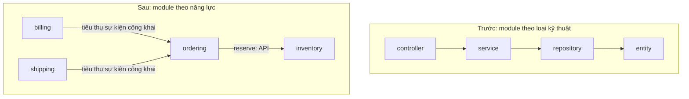

# Tránh module chỉ là nhóm thư mục kỹ thuật

Một ứng dụng Spring Boot có thể trông rất “modular” vì đã tách thành nhiều package, nhưng các package đó chưa chắc đã là **module nghiệp vụ**. Nếu cấu trúc ở cấp cao nhất gồm `controller`, `service`, `repository`, `entity`, tất cả chức năng vẫn chạy xuyên qua những thư mục kỹ thuật chung. Khi đội ngũ muốn thay đổi quy trình đặt hàng, họ phải sửa đồng thời nhiều thư mục; khi muốn kiểm thử một phần ứng dụng, rất khó xác định phần nào thật sự thuộc về nó.

Trong **Spring Modulith**, điều quan trọng không phải có bao nhiêu thư mục mà là **ranh giới trách nhiệm, dữ liệu và phụ thuộc**. Bài học thuộc chương **Thiết kế module** của **SPRING_MODULITH_VERIFICATION_TESTING**: nhận diện module bị chia theo tầng kỹ thuật, thiết kế lại theo năng lực nghiệp vụ, sau đó dùng `ApplicationModules`, `@ApplicationModuleTest`, kiểm thử sự kiện, cơ sở dữ liệu, tích hợp và quality gate trong CI để bảo vệ kiến trúc mới trước phụ thuộc sai và hồi quy.

## 1. Mục tiêu học tập

Sau bài học, bạn có thể:

1. Phân biệt **phân lớp kỹ thuật** (*layering*) với **phân chia application module** theo năng lực nghiệp vụ.
2. Nhận biết package hoặc module “có tên nhưng không có trách nhiệm” qua cách thay đổi mã, quyền sở hữu dữ liệu và đồ thị phụ thuộc.
3. Tìm ranh giới module từ use case, từ vựng nghiệp vụ, invariant, transaction và vòng đời dữ liệu.
4. Tổ chức controller, application service, domain model và repository **bên trong** module nghiệp vụ thay vì biến chúng thành module ngang hàng.
5. Chuyển dần ứng dụng đã phân theo tầng kỹ thuật sang các module có API công khai và nội bộ rõ ràng.
6. Kiểm chứng phụ thuộc bằng Spring Modulith, đồng thời hiểu giới hạn của kiểm thử kiến trúc đối với chất lượng thiết kế nghiệp vụ.

## 2. Vì sao “có nhiều package” chưa có nghĩa là modular?

Xét một ứng dụng bán hàng:

```text
com.example.shop/
├── ShopApplication.java
├── controller/
│   ├── OrderController.java
│   ├── StockController.java
│   └── PaymentController.java
├── service/
│   ├── OrderService.java
│   ├── StockService.java
│   └── PaymentService.java
├── repository/
│   ├── OrderRepository.java
│   ├── StockRepository.java
│   └── PaymentRepository.java
├── entity/
│   ├── OrderEntity.java
│   ├── StockEntity.java
│   └── PaymentEntity.java
└── dto/
    ├── OrderDto.java
    └── PaymentDto.java
```

Đây là cách tổ chức theo **loại thành phần kỹ thuật**. Khi thêm chức năng “hủy đơn và trả lại hàng”, lập trình viên có thể phải mở `controller`, `service`, `repository`, `entity`, `dto` để tìm và chỉnh các mảnh liên quan. Tệ hơn, một `OrderService` có thể gọi `StockRepository` trực tiếp, còn `PaymentService` sửa `OrderEntity` vì các kiểu cùng nằm trên classpath.

Một số vấn đề chỉ lộ rõ khi ứng dụng phát triển:

- **Quyền sở hữu mờ:** Ai chịu trách nhiệm bảo đảm tồn khả dụng không âm? Nếu `OrderService` và `StockService` cùng cập nhật `StockEntity`, không có một nơi duy nhất kiểm soát luật.
- **Thay đổi lan rộng:** Sửa cách lưu dữ liệu tồn kho có thể buộc sửa code đặt hàng vì code đặt hàng import trực tiếp repository của kho.
- **Kiểm thử khó cô lập:** Muốn kiểm thử quy trình đặt hàng phải khởi tạo nhiều service và repository không rõ thuộc nhóm nghiệp vụ nào.
- **Kiến trúc không nói được luật phụ thuộc:** “Controller được gọi service” không giải thích module nào được phép quyết định hoàn tiền, giữ hàng hay hủy đơn.
- **Tên module phản ánh kỹ thuật thay vì sản phẩm:** Một nhóm `repository` không đại diện cho năng lực mà người sử dụng hoặc nghiệp vụ nhận biết.

### 2.1. Phân lớp kỹ thuật vẫn hữu ích

Không cần loại bỏ các khái niệm `controller`, `application`, `domain`, `persistence`. Chúng giúp tổ chức mã **bên trong** một module nghiệp vụ, nhất là khi module lớn. Sai lầm là dùng chúng làm **trục phân chia application module ở cấp cao nhất**, khiến mỗi thay đổi nghiệp vụ phải chạy qua nhiều “module” không tự có ý nghĩa.

| Cách tổ chức | Đơn vị ở cấp cao nhất | Có thể hợp lý khi |
| --- | --- | --- |
| **Package theo tầng** | `controller`, `service`, `repository` | Bài tập nhỏ, ứng dụng rất đơn giản, hoặc cấu trúc nội bộ của một module |
| **Module theo năng lực nghiệp vụ** | `ordering`, `inventory`, `billing` | Cần giới hạn phụ thuộc, tách trách nhiệm và kiểm thử từng năng lực |
| **Tầng kỹ thuật trong module nghiệp vụ** | `ordering.web`, `ordering.application`, `ordering.domain`, `ordering.persistence` | Module lớn cần phân biệt vai trò thành phần nhưng vẫn giữ cùng một chủ sở hữu |

Mục tiêu không phải tuyên bố mọi ứng dụng nhỏ tổ chức theo tầng đều sai. Khi cần kiến trúc module có thể kiểm chứng bằng **Spring Modulith**, hãy để **năng lực nghiệp vụ** dẫn dắt cách chia module; kỹ thuật là cách triển khai ở bên trong.

## 3. “Module nghiệp vụ” phải trả lời được điều gì?

Một application module tốt có thể được mô tả bằng câu: **“Nó chịu trách nhiệm đưa ra và bảo vệ những quyết định nghiệp vụ nào?”**

Ví dụ:

| Module | Trách nhiệm sở hữu | Luật bất biến cần bảo vệ | Hợp đồng có thể công bố |
| --- | --- | --- | --- |
| `ordering` | Tạo, hủy, theo dõi trạng thái đơn | Đơn đã giao không thể hủy như đơn mới | `placeOrder`, `cancelOrder`, sự kiện `OrderPlaced` |
| `inventory` | Nhập, xuất, giữ và nhả hàng | Không giữ hàng vượt mức khả dụng | `reserve`, `release`, truy vấn khả dụng có kiểm soát |
| `billing` | Yêu cầu thu tiền, ghi nhận và hoàn tiền | Một yêu cầu thanh toán lặp không tạo hai lần thu | `initiatePayment`, sự kiện `PaymentCompleted` |
| `shipping` | Điều phối đóng gói và bàn giao vận chuyển | Không xác nhận giao khi đơn chưa đủ điều kiện | `requestShipment`, sự kiện `ShipmentDelivered` |

Các module trên có thể cần trao đổi với nhau, nhưng **mỗi quyết định có một chủ sở hữu**. `ordering` không tự sửa số lượng kho; `shipping` không tự đổi trạng thái thanh toán; `billing` không truy cập bảng đơn chỉ để tạo hóa đơn.

### 3.1. Bốn câu hỏi để tìm ranh giới

1. **Luật nằm ở đâu?** Phần nào có quyền xác nhận, từ chối hoặc thay đổi một trạng thái nghiệp vụ?
2. **Dữ liệu thuộc về ai?** Ai được ghi và chịu trách nhiệm đảm bảo dữ liệu hợp lệ, đặc biệt khi có giao dịch đồng thời?
3. **Thay đổi vì lý do nào?** Quy tắc tồn kho và quy tắc thanh toán có thường phải sửa cùng nhau không? Nếu thay đổi độc lập, chúng có thể thuộc hai module.
4. **Cộng tác qua hợp đồng nào?** Module khác cần thực hiện lệnh, nhận kết quả ngay, hoặc chỉ cần biết một sự kiện đã xảy ra?

Các câu hỏi này quan trọng hơn kích thước package hay số lượng class. Một module có thể có hàng trăm class nhưng vẫn cohesive nếu tất cả cùng phục vụ một năng lực được xác định rõ. Ngược lại, một module chỉ ba class cũng có thể có ranh giới sai nếu các class cùng quản lý trạng thái của module khác.

### 3.2. “Dùng cùng dữ liệu” không có nghĩa “cùng một module”

Trong quy trình bán hàng, cả `ordering`, `inventory` và `billing` đều biết `orderId` hoặc `sku`. Việc cùng biết một mã định danh không tạo quyền sở hữu chung đối với bảng dữ liệu. Một module có thể lưu **bản chụp dữ liệu** từ module khác để phục vụ nghiệp vụ của chính nó: `ordering` lưu giá sản phẩm tại lúc đặt, dù danh mục sản phẩm có thể đổi giá sau đó.

Ngược lại, hai class cùng truy cập và cùng thay đổi một entity không chứng minh chúng thuộc cùng module; đó có thể là **dấu hiệu chồng lấn trách nhiệm** cần sửa. Cần phân biệt nhu cầu **đọc thông tin**, **yêu cầu hành vi** và **quyền thực hiện cập nhật**.

## 4. Chuyển cấu trúc theo tầng sang cấu trúc theo năng lực

Thay cho `controller/service/repository` cấp ứng dụng, cấu trúc mục tiêu có thể là:

```text
src/main/java/com/example/shop/
├── ShopApplication.java
├── ordering/
│   ├── package-info.java
│   ├── OrderingOperations.java          # API công khai
│   ├── PlaceOrderCommand.java          # DTO công khai
│   ├── events/
│   │   ├── package-info.java          # @NamedInterface("events")
│   │   └── OrderPlaced.java
│   └── internal/
│       ├── web/OrderController.java
│       ├── application/OrderService.java
│       ├── domain/Order.java
│       └── persistence/OrderRepository.java
├── inventory/
│   ├── package-info.java
│   ├── api/
│   │   ├── package-info.java          # @NamedInterface("api")
│   │   ├── InventoryReservations.java
│   │   └── ReserveStock.java
│   └── internal/
│       ├── application/InventoryService.java
│       ├── domain/Stock.java
│       └── persistence/StockRepository.java
├── billing/
│   ├── package-info.java
│   └── internal/
│       ├── application/PaymentService.java
│       ├── domain/Payment.java
│       └── persistence/PaymentRepository.java
└── shipping/
    ├── package-info.java
    └── internal/
        ├── application/ShipmentService.java
        └── persistence/ShipmentRepository.java
```

Ở đây `ordering`, `inventory`, `billing`, `shipping` là các package con **trực tiếp** dưới package gốc của ứng dụng — trường hợp phát hiện application module thông dụng của Spring Modulith. Những package con `internal.application`, `internal.domain`, `internal.persistence` **không phải** những application module ngang hàng nếu không có cấu hình phát hiện bổ sung. Chúng là các lớp tổ chức mã **trong một module**.



Sơ đồ thứ nhất mô tả tầng kỹ thuật, còn sơ đồ thứ hai mô tả các **ranh giới nghiệp vụ**. Mũi tên ở sơ đồ sau biểu diễn hướng phụ thuộc mã nguồn tới API công khai, không nhất thiết cùng chiều với thông điệp runtime. Ví dụ listener trong `billing` import kiểu `OrderPlaced` do `ordering` công bố, nên mã nguồn `billing` phụ thuộc kiểu của `ordering`.

### 4.1. Bảo vệ quyền ghi dữ liệu ngay từ thiết kế

Đặt tất cả repository dưới module sở hữu chúng:

- `ordering.internal.persistence.OrderRepository` chỉ phục vụ luật và use case của `ordering`.
- `inventory.internal.persistence.StockRepository` chỉ phục vụ luật và use case của `inventory`.
- `billing.internal.persistence.PaymentRepository` chỉ phục vụ luật và use case của `billing`.

Khi cần giữ hàng, `ordering` gọi **lệnh công khai** của `inventory`, không import `StockRepository`. Nếu hai module cùng datasource và một transaction phù hợp, việc phối hợp có thể đạt nhất quán trong một giao dịch; nếu dùng hai kho dữ liệu khác nhau hoặc giao tiếp qua mạng, cần phương án khôi phục/bù trừ. Việc tổ chức package tự nó không tạo đảm bảo transaction.

## 5. Thiết kế một hợp đồng xuyên module đúng nghĩa

Một vấn đề thường xuất hiện ở kiến trúc theo tầng là service A “mượn” repository của service B vì repository có sẵn. Tách theo nghiệp vụ đòi hỏi thay cách tư duy: **caller yêu cầu một hành vi**, module sở hữu **quyết định cách thực hiện**.

### 5.1. Ví dụ phụ thuộc sai

```java
// ordering.internal.application.OrderService — cách làm sai
package com.example.shop.ordering.internal.application;

import com.example.shop.inventory.internal.persistence.StockRepository;

class OrderService {
    private final StockRepository stocks;

    OrderService(StockRepository stocks) {
        this.stocks = stocks;
    }

    // Tự load/trừ/save tồn kho tại đây sẽ vượt quyền sở hữu của ordering.
}
```

Nếu `StockRepository` có modifier Java `public`, mã có thể biên dịch. Nhưng trong mô hình **closed application module**, repository là chi tiết nội bộ của `inventory`. `ordering` đang phụ thuộc vượt qua ranh giới thay vì qua API được công bố.

### 5.2. Đưa luật giữ hàng về module `inventory`

Định nghĩa named interface trong `inventory/api/package-info.java`:

```java
@org.springframework.modulith.NamedInterface("api")
package com.example.shop.inventory.api;
```

Định nghĩa hợp đồng với dữ liệu nghiệp vụ cần thiết:

```java
// inventory/api/ReserveStock.java
package com.example.shop.inventory.api;

public record ReserveStock(String sku, int quantity) {
    public ReserveStock {
        if (sku == null || sku.isBlank() || quantity <= 0) {
            throw new IllegalArgumentException("Yêu cầu giữ hàng không hợp lệ");
        }
    }
}
```

```java
// inventory/api/InventoryReservations.java
package com.example.shop.inventory.api;

import java.util.UUID;

public interface InventoryReservations {
    UUID reserve(ReserveStock command);
}
```

Implementation của interface được đặt trong `inventory.internal.application`, còn cập nhật dữ liệu nằm ở `inventory.internal.persistence`. Mục đích của các package kỹ thuật bên trong vẫn rõ ràng, nhưng **người dùng API không cần biết** về các class đó.

Ở module đặt hàng:

```java
// ordering/internal/application/OrderService.java
package com.example.shop.ordering.internal.application;

import com.example.shop.inventory.api.InventoryReservations;
import com.example.shop.inventory.api.ReserveStock;
import java.util.UUID;
import org.springframework.stereotype.Service;

@Service
class OrderService {
    private final InventoryReservations inventory;

    OrderService(InventoryReservations inventory) {
        this.inventory = inventory;
    }

    UUID reserveForOrder(String sku, int quantity) {
        return inventory.reserve(new ReserveStock(sku, quantity));
    }
}
```

Đoạn ví dụ minh họa hướng phụ thuộc, chưa phải toàn bộ use case đặt hàng. Trong ứng dụng thật, `inventory` phải bảo vệ invariant không giữ vượt tồn, cung cấp kết quả/lỗi rõ ràng và xử lý tình huống gọi lặp; `ordering` phải xác định chính xác thời điểm đơn được chấp nhận.

### 5.3. Khai báo giới hạn phụ thuộc

Trong `ordering/package-info.java`:

```java
@org.springframework.modulith.ApplicationModule(
    allowedDependencies = "inventory::api"
)
package com.example.shop.ordering;
```

Với thiết kế này, `ordering` được phép tham chiếu `inventory::api` nhưng không được truy cập `inventory.internal.persistence.StockRepository`. `inventory::api` là **tên module + tên named interface**, khác với tên package Java đầy đủ.

Một chi tiết quan trọng: `@NamedInterface` công bố **kiểu được phép biết**, còn `allowedDependencies` xác định **module gọi được phép phụ thuộc vào đâu**. Hai cơ chế phối hợp nhưng không thay thế nhau. Cũng không cần biến mọi package con thành named interface để vượt qua kiểm thử kiến trúc.

## 6. Nhận diện một “module kỹ thuật” bằng những dấu hiệu quan sát được

Một số dấu hiệu cần kiểm tra cùng nhau, thay vì quyết định chỉ dựa vào tên package:

| Dấu hiệu | Câu hỏi chẩn đoán | Rủi ro |
| --- | --- | --- |
| Module `service` hoặc `repository` phục vụ toàn bộ ứng dụng | Nó sở hữu luật nghiệp vụ cụ thể nào? | Không có trách nhiệm nghiệp vụ độc lập |
| Một thay đổi nghiệp vụ luôn sửa nhiều module kỹ thuật | Các thành phần cùng thay đổi vì một lý do hay chỉ vì khác tầng? | Chi phí thay đổi và review tăng |
| Các module cùng ghi một bảng | Module nào bảo vệ invariant? | Trạng thái sai khi có concurrent requests |
| Mọi module import `shared.internal.*` | `shared` thực sự sở hữu quyết định nào? | Phụ thuộc ẩn và rò rỉ triển khai |
| Interface công khai chỉ chuyển tiếp CRUD của entity | Caller đang điều khiển luật nghiệp vụ? | Logic nghiệp vụ phân tán |
| Kiểm thử module đòi phần lớn ứng dụng chạy | Có quá nhiều phụ thuộc xuyên module không? | Không cô lập được lỗi |
| Đồ thị phụ thuộc có nhiều chu trình | Ai phải quyết định/điều phối? | Không có chiều trách nhiệm rõ ràng |
| Module chỉ có một class wrapper, luôn thay đổi cùng module khác | Có bị chia quá nhỏ không? | Chi phí hợp đồng lớn hơn lợi ích tách ranh giới |

### 6.1. Đừng lấy số class làm thước đo chất lượng ranh giới

Một package `validation` chứa 20 validator thuộc nhiều nghiệp vụ **không trở thành module đúng nghĩa** chỉ vì có nhiều class. Ngược lại, module `fraud` ban đầu chỉ chứa một chính sách phát hiện rủi ro vẫn có thể là năng lực riêng nếu nó sở hữu quyết định mà các module khác phải yêu cầu qua hợp đồng.

Không có ngưỡng “ít nhất N class” hoặc “không quá N dòng code” để kết luận ranh giới tốt. Hãy xét **động cơ thay đổi**, **chủ sở hữu dữ liệu**, **mức coupling**, **hướng phụ thuộc** và khả năng kiểm thử.

### 6.2. Vấn đề của module `common` hoặc `shared`

Một gói dùng chung không sai nếu chứa những phần thật sự dùng chung như một số value object nền tảng ổn định. Vấn đề bắt đầu khi nó chứa `OrderHelper`, `StockManager`, `PaymentValidation`, `CustomerRepository` và nhiều quy tắc nghiệp vụ không ai nhận trách nhiệm.

Khi cần chia sẻ một kiểu, hãy hỏi module nào **sở hữu ngữ nghĩa** của kiểu đó. Ví dụ, `StockReservationId` có thể do `inventory` công bố qua API; một enum trạng thái đơn do `ordering` sở hữu. Không cần chuyển mọi kiểu được hai module dùng vào `shared`.

Nếu một kiểu thật sự là khái niệm nền tảng của nhiều module, tài liệu hóa chủ sở hữu và giới hạn sử dụng. Tránh để `shared` trở thành lối đi tắt bỏ qua quy tắc phụ thuộc.

## 7. Tổ chức các tầng kỹ thuật *trong* module nghiệp vụ

Đổi trục module sang nghiệp vụ **không phủ nhận kiến trúc phân lớp**, ports-and-adapters hay hexagonal architecture. Một module nghiệp vụ có thể phân tầng như sau:

```text
ordering/
├── OrderingOperations.java                # Public API
├── PlaceOrderCommand.java                 # Public contract
└── internal/
    ├── adapter/
    │   ├── web/OrderController.java
    │   └── persistence/JpaOrderRepository.java
    ├── application/
    │   └── PlaceOrderUseCase.java
    └── domain/
        ├── Order.java
        └── OrderPolicy.java
```

`OrderController` xử lý HTTP, `PlaceOrderUseCase` điều phối nghiệp vụ, `Order` bảo vệ trạng thái, `JpaOrderRepository` là adapter lưu trữ. Chúng cùng thuộc `ordering` vì cùng phục vụ **vòng đời đơn hàng**. Ngay cả khi tổ chức theo hexagonal, các interface/port nội bộ không tự động trở thành API công khai cho application module khác.

### 7.1. Nhóm theo năng lực trước, sau đó mới nhóm theo kỹ thuật

Một nguyên tắc có ích:

> **Tầng kỹ thuật giải thích cách thực hiện; module nghiệp vụ giải thích vì sao phần mã tồn tại và ai chịu trách nhiệm cho nó.**

Ví dụ `ordering.internal.persistence.OrderRepository` là repository của đơn hàng. Nếu có một `GlobalRepository` chứa method lưu đơn, giảm tồn và ghi thanh toán, hãy xem lại phân chia trách nhiệm. Một repository có thể thao tác nhiều bảng nội bộ nếu chúng thực sự thuộc một aggregate/module; vấn đề nằm ở **quyền sở hữu quyết định**, không đơn thuần là số bảng.

### 7.2. Tránh module có chung “giỏ công việc”

Tên như `utilities`, `helpers`, `services`, `management`, `processor` thường không nói ai là chủ sở hữu. Một package như vậy có thể cần tồn tại ở tầng nội bộ để hỗ trợ code, nhưng không nên mặc nhiên được nâng thành **application module**. Đặt câu hỏi “Nếu module này bị xóa, năng lực nghiệp vụ nào biến mất?” là cách nhanh để phát hiện module chỉ gom đồ kỹ thuật.

## 8. Phụ thuộc đồng bộ và sự kiện phải theo nhu cầu nghiệp vụ

Thiết kế lại module không có nghĩa tất cả tương tác đều phải dùng event. Quy tắc chọn kênh giao tiếp xuất phát từ thời điểm cần kết quả:

| Nhu cầu | Giao tiếp phù hợp | Vì sao |
| --- | --- | --- |
| Đặt hàng phải biết giữ được hàng mới chấp nhận | Gọi đồng bộ `InventoryReservations.reserve(...)` | Kết quả ảnh hưởng quyết định ngay |
| Đơn đã được đặt, thanh toán cần bắt đầu xử lý | Sự kiện `OrderPlaced` | Consumer có thể phản ứng sau khi sự kiện được công bố |
| Màn hình xem đơn cần trạng thái thanh toán | API truy vấn hoặc read model tổng hợp | Nhu cầu đọc không cấp quyền sửa dữ liệu chéo |
| Hủy đơn phải nhả hàng và có thể hoàn tiền sau | Lệnh đồng bộ hoặc quy trình trạng thái + sự kiện/bù trừ tùy cam kết | Cần định nghĩa thời điểm hủy thật sự thành công |

Sự kiện là **sự thật nghiệp vụ** đã xảy ra; không nên phát những event tên `ExecutePaymentRepositorySave` hoặc truyền entity JPA từ module khác. Việc công bố sự kiện qua named interface cũng là một dạng công bố API và phải được kiểm chứng.

### 8.1. Ví dụ sự kiện công khai

Trong `ordering/events/package-info.java`:

```java
@org.springframework.modulith.NamedInterface("events")
package com.example.shop.ordering.events;
```

Trong `ordering/events/OrderPlaced.java`:

```java
package com.example.shop.ordering.events;

import java.util.UUID;

public record OrderPlaced(UUID orderId) {}
```

Module `billing` chỉ cần biết **kiểu công khai** `OrderPlaced` nếu nó xử lý sự kiện này; không cần tham chiếu đến service hay repository nội bộ của `ordering`. Có thể khai báo ở `billing/package-info.java`:

```java
@org.springframework.modulith.ApplicationModule(
    allowedDependencies = "ordering::events"
)
package com.example.shop.billing;
```

**Chú ý hướng phụ thuộc:** Event runtime đi từ `ordering` đến `billing`, còn import kiểu `OrderPlaced` trong listener tạo phụ thuộc mã nguồn `billing → ordering`. Đừng thêm tham chiếu ngược `ordering → billing` chỉ vì `billing` nhận sự kiện.

Khi xử lý bất đồng bộ, cần kiểm tra tính idempotent và trường hợp xử lý lại. Sự kiện và `@NamedInterface` không tự bảo đảm giao nhận đúng một lần hoặc atomicity giữa các kho dữ liệu.

## 9. Lộ trình refactor ứng dụng đã phân theo tầng

Chuyển một hệ thống đang hoạt động sang module nghiệp vụ nên làm **từng lát cắt dọc theo use case**, giữ đường chạy và dữ liệu có thể kiểm tra được.

### Bước 1 — Vẽ bản đồ use case và thay đổi thường gặp

Liệt kê các luồng như “đặt đơn”, “hủy đơn”, “giữ hàng”, “nhập hàng”, “thu tiền”, “hoàn tiền”. Xem lịch sử thay đổi để nhận diện những lớp thường phải sửa cùng nhau vì **một yêu cầu nghiệp vụ**.

Không cần bắt đầu bằng bảng danh sách package. Hãy ghi quyết định nào phải xảy ra, ai sở hữu dữ liệu và invariant nào phải luôn đúng.

### Bước 2 — Đặt tên module theo năng lực, ghi cam kết sở hữu

Ví dụ bảng thiết kế ban đầu:

| Module | Sở hữu dữ liệu | Bên ngoài được yêu cầu | Không cho bên ngoài làm |
| --- | --- | --- | --- |
| `ordering` | `Order`, trạng thái, giá đã chốt | Tạo/hủy/truy vấn đơn | Chỉnh trực tiếp `OrderRepository` |
| `inventory` | `Stock`, `Reservation` | Giữ/nhả/truy vấn khả dụng | Trừ `available` thông qua entity |
| `billing` | `Payment`, `Refund` | Tạo yêu cầu thu/hoàn tiền | Sửa thanh toán trực tiếp bằng SQL khác module |

Nếu không thể viết một câu nêu rõ **trách nhiệm duy nhất** của một module, hãy kiểm tra lại ranh giới trước khi chuyển file.

### Bước 3 — Chuyển một use case theo chiều dọc

Chọn luồng tương đối độc lập, ví dụ “giữ hàng”. Di chuyển các thành phần liên quan như `StockService`, `StockRepository`, `StockEntity` về `inventory`. Tạo `InventoryReservations` với DTO công khai, sửa caller dùng API thay vì import repository.

Trong giai đoạn chuyển đổi, tránh sửa đồng thời quá nhiều luồng khi chưa có bộ test tin cậy. Một refactor đưa code vào đúng package nhưng đổi semantics của tồn kho có thể gây hồi quy nghiêm trọng.

### Bước 4 — Thay các phụ thuộc cũ bằng hợp đồng mới

Tại mỗi caller:

1. Xác định **hành vi cần thiết** thay vì sao chép method CRUD của repository.
2. Định nghĩa interface, DTO và lỗi nghiệp vụ tối thiểu.
3. Giữ triển khai và database ở module sở hữu.
4. Thay import cũ, bổ sung `allowedDependencies` cụ thể.
5. Chạy cả kiểm thử kiến trúc và kiểm thử hành vi.

Nếu phải tạm giữ một module `OPEN` trong ứng dụng cũ để chuyển đổi theo giai đoạn, cần ghi rõ phụ thuộc còn lại và tiêu chí đưa nó về `CLOSED`. Đừng dùng `OPEN` hay công bố `internal` chỉ để xóa lỗi kiến trúc mà không xử lý quyền sở hữu.

### Bước 5 — Chặn đường phụ thuộc cũ trong CI

Khi một module đã có ranh giới rõ, áp kiểm chứng để sửa đổi sau này không được import lại repository hoặc entity nội bộ. Với các thay đổi liên quan event và database, bổ sung kiểm thử tích hợp thích hợp thay vì chỉ dựa vào biên dịch thành công.

### Bước 6 — Đánh giá lại sau vài vòng thay đổi

Theo dõi các dấu hiệu thực tế:

- Một yêu cầu nghiệp vụ bình thường có buộc sửa nhiều module dù không cần không?
- Các module có phụ thuộc vòng mới hoặc nhiều API xuyên ranh giới được mở rộng bất thường không?
- Có module nào không thể khởi động trong `@ApplicationModuleTest` do phụ thuộc khó kiểm soát không?
- Có hai module cùng ghi một trạng thái được cho là “thuộc chung” không?

Đây là đánh giá thiết kế theo thời gian; cấu trúc package tốt ở ngày đầu vẫn có thể cần điều chỉnh khi nghiệp vụ thay đổi.

## 10. Kiểm chứng ranh giới bằng `ApplicationModules`

Spring Modulith cho phép dựng mô hình application module và kiểm tra quan hệ phụ thuộc. Tạo bài JUnit 5:

```java
// src/test/java/com/example/shop/ModularityTests.java
package com.example.shop;

import org.junit.jupiter.api.Test;
import org.springframework.modulith.core.ApplicationModules;

class ModularityTests {

    @Test
    void moduleDependenciesRespectBoundaries() {
        ApplicationModules.of(ShopApplication.class).verify();
    }
}
```

Trong thiết kế closed module, `verify()` giúp phát hiện những vi phạm điển hình:

- **Phụ thuộc vòng** giữa các application module;
- **Truy cập phần nội bộ** của module khác thay vì API được công bố;
- **Phụ thuộc không nằm trong `allowedDependencies`** khi module khai báo giới hạn.

Ví dụ `ordering` có field kiểu `inventory.internal.persistence.StockRepository`: khi những class đủ quyền truy cập Java, code có thể biên dịch nhưng bài test kiến trúc phải coi đó là vượt ranh giới. Sửa bằng cách phụ thuộc vào `InventoryReservations` ở `inventory::api` và để `inventory` tự thao tác repository.

### 10.1. Kiểm chứng kiến trúc có thấy được “module vô nghĩa” không?

**Không đầy đủ.** Một cấu trúc kỹ thuật kiểu `controller/service/repository` có thể vượt qua một số bài kiểm chứng tự động nếu không có vòng hoặc tham chiếu bị cấm. `ApplicationModules.verify()` không thể tự biết `service` **không phải** một năng lực nghiệp vụ, hay một luật hủy đơn đang được phân bổ sai cho hai nhóm.

Vì vậy cần thêm **review ranh giới nghiệp vụ**:

| Câu hỏi review | Bằng chứng muốn nhìn thấy |
| --- | --- |
| Mỗi application module tồn tại vì lý do gì? | Một câu mô tả năng lực, use case và quyết định nó sở hữu |
| Ai bảo vệ invariant chính? | Một module có test cho luật quan trọng |
| Loại dữ liệu nào được module khác thấy? | API/DTO/event có chủ đích, không phải entity/repository |
| Đường phụ thuộc có cần thiết không? | Caller chỉ tham chiếu module cần thiết cho use case |
| Refactor nội bộ có ảnh hưởng consumer không? | Consumer test và module test còn đúng khi adapter/persistence đổi |

Một quality gate tốt cần kết hợp **quy tắc máy kiểm tra được** với **quyết định thiết kế được nhóm xem xét**.

## 11. Kiểm thử hành vi và tương tác giữa các module

### 11.1. `@ApplicationModuleTest` kiểm tra use case trong module

Sau khi nhóm theo năng lực, có thể kiểm thử riêng một module trong phạm vi Spring context phù hợp:

```java
// src/test/java/com/example/shop/inventory/InventoryModuleTests.java
package com.example.shop.inventory;

import static org.assertj.core.api.Assertions.assertThat;

import com.example.shop.inventory.api.InventoryReservations;
import com.example.shop.inventory.api.ReserveStock;
import java.util.UUID;
import org.junit.jupiter.api.Test;
import org.springframework.beans.factory.annotation.Autowired;
import org.springframework.modulith.test.ApplicationModuleTest;

@ApplicationModuleTest
class InventoryModuleTests {

    @Autowired InventoryReservations reservations;

    @Test
    void reserveReturnsReservationIdWhenStockIsAvailable() {
        // Arrange: fixture/database phải có tồn khả dụng cho SKU-42.
        UUID id = reservations.reserve(new ReserveStock("SKU-42", 1));
        assertThat(id).isNotNull();
    }
}
```

Đây là **khung test minh họa**, cần triển khai service/repository và fixture dữ liệu thực trước khi chạy. Để có giá trị, suite phải thêm test hết hàng, số lượng âm, rollback và cạnh tranh; chỉ assert có `UUID` không chứng minh không oversell.

`@ApplicationModuleTest` cho phép chọn phạm vi bootstrap như `STANDALONE`, `DIRECT_DEPENDENCIES` và `ALL_DEPENDENCIES` tùy mục đích và phiên bản Spring Modulith đang sử dụng. Khi cần kiểm tra use case của `ordering` có gọi `inventory`, có thể chọn `DIRECT_DEPENDENCIES` hoặc dùng test double cho interface công khai ở chế độ cô lập.

### 11.2. Database và transaction cần test ở module sở hữu

Một trong những lợi ích của ranh giới nghiệp vụ là mỗi invariant có chỗ để kiểm tra rõ:

| Invariant | Module sở hữu | Kịch bản kiểm thử |
| --- | --- | --- |
| Không giữ vượt lượng hàng khả dụng | `inventory` | Tồn `1`, hai request giữ `1` chạy đồng thời: tối đa một thành công |
| Đơn đã hủy không được giao | `ordering` / `shipping` theo quy trình đã chốt | Sự kiện hủy đến trước/sau yêu cầu giao, trạng thái không vi phạm |
| Thanh toán lặp không tạo hai khoản thu | `billing` | Gửi cùng thông điệp/request ID hai lần, chỉ một tác dụng phụ được ghi |
| Rollback khi tạo phiếu giữ hàng lỗi | `inventory` | Giảm tồn và ghi phiếu giữ hàng phải nhất quán theo transaction |

Đừng mong đợi cấu trúc package hoặc `ApplicationModules.verify()` tự giải quyết race condition. Dùng database và điều kiện cạnh tranh đủ giống cơ chế production khi kiểm thử những bất biến này.

### 11.3. Kiểm thử sự kiện và tích hợp

Nếu `ordering` phát `OrderPlaced`, cần kiểm thử rằng:

1. Event mô tả một đơn thật sự được chấp nhận và chứa dữ liệu công khai cần thiết.
2. Listener ở `billing` xử lý đúng điều đã xảy ra, không import service/repository nội bộ của `ordering`.
3. Việc xử lý lại event không tạo thanh toán trùng.
4. Cơ chế transaction, phát sau commit, retry và phục hồi lỗi đáp ứng yêu cầu của ứng dụng.

Một ứng dụng có thể sử dụng cơ chế event publication của Spring Modulith; cách cấu hình và semantics phải được kiểm tra theo version dependency được chọn. **Named interface và cấu trúc module không bảo đảm event được giao đúng một lần.**

### 11.4. Ma trận quality gate CI

| Tầng bảo vệ | Câu hỏi | Hồi quy cần chặn |
| --- | --- | --- |
| `ApplicationModules.verify()` | Phụ thuộc có vượt ranh giới hoặc tạo vòng? | `ordering` import `inventory.internal.StockRepository` |
| Review trách nhiệm module | Module có năng lực, dữ liệu và invariant rõ? | Tạo module `services` chỉ vì muốn chuyển file |
| `@ApplicationModuleTest` | Use case chạy đúng qua API? | Giữ hàng trả kết quả sai |
| Database/concurrency test | Dữ liệu có giữ invariant khi song song/rollback? | Hai đơn cùng giữ vượt tồn |
| Event/integration test | Payload, handler, retry và idempotency đúng? | Event lặp gây thu tiền hai lần |
| CI | Mọi thay đổi phải qua các lớp kiểm tra bắt buộc? | Pull request hợp nhất dù xuất hiện phụ thuộc sai |

Ví dụ, CI của dự án Maven có thể chạy `./mvnw test` và các stage integration test đã cấu hình; Gradle dùng lệnh test tương ứng. Cần bảo đảm `ModularityTests` thực sự được test runner phát hiện và lỗi `verify()` làm job thất bại. Việc thiết lập nhiều stage tùy tốc độ, cơ sở dữ liệu và quy trình của dự án.

## 12. Sai lầm thường gặp khi chuyển sang module nghiệp vụ

| Sai lầm | Hệ quả | Hướng điều chỉnh |
| --- | --- | --- |
| Chỉ đổi tên `service` thành `business` | Cấu trúc vẫn phân theo loại kỹ thuật | Bắt đầu từ năng lực và quyền sở hữu |
| Tách một module cho mỗi entity | Các entity thuộc cùng invariant bị chia cắt | Nhóm theo vòng đời, use case và trách nhiệm |
| Module `shared` sở hữu mọi logic chung | Trách nhiệm mờ và coupling tăng | Trả luật về module sở hữu, công bố API cụ thể |
| Mọi module được truy cập repository của nhau | Bỏ qua kiểm tra và invariant | Giữ repository nội bộ; dùng lệnh/truy vấn công khai |
| Đẩy tất cả giao tiếp sang event | Khó biết khi nào thao tác được xác nhận | Gọi đồng bộ khi kết quả là điều kiện quyết định |
| Module công bố nguyên JPA entity làm DTO | Consumer phụ thuộc persistence | Dùng DTO/value object ổn định |
| Bật `OPEN` cho mọi module | Mất bảo vệ ranh giới nội bộ | Giữ `CLOSED` mặc định, mở có lộ trình nếu cần |
| Chia quá nhiều module nhỏ chỉ có wrapper | Nhiều hợp đồng nhưng không có độc lập thực | Gộp nơi có cùng luật và nhịp thay đổi |
| Chỉ kiểm tra dependency graph | Không phát hiện luật sai và data race | Kết hợp review nghiệp vụ và test hành vi |

## 13. Bài thực hành thiết kế lại hệ thống

Một dự án quản lý đặt vé hiện có:

```text
com.example.booking/
├── controller/
│   ├── BookingController.java
│   ├── SeatController.java
│   └── RefundController.java
├── service/
│   ├── BookingService.java
│   ├── SeatService.java
│   └── RefundService.java
├── repository/
│   ├── BookingRepository.java
│   ├── SeatRepository.java
│   └── RefundRepository.java
└── entity/
    ├── BookingEntity.java
    ├── SeatEntity.java
    └── RefundEntity.java
```

Các yêu cầu nghiệp vụ: người dùng chọn ghế và tạo đặt vé; hệ thống không được bán một ghế cho hai người; khi hủy vé đúng điều kiện sẽ trả ghế về trạng thái khả dụng; yêu cầu hoàn tiền có thể mất thời gian và phải an toàn khi xử lý lại.

Hãy thực hiện:

1. Đề xuất **ít nhất ba module nghiệp vụ** và mô tả quyết định, dữ liệu, invariant mỗi module sở hữu.
2. Chuyển các controller/service/repository/entity vào cấu trúc package mới mà vẫn tổ chức tầng kỹ thuật **bên trong** từng module.
3. Chỉ ra vì sao `BookingService` không nên tự cập nhật `SeatEntity` khi muốn giữ ghế.
4. Đề xuất API đồng bộ giữa đặt vé và giữ ghế; đề xuất sự kiện phù hợp cho quá trình hoàn tiền.
5. Viết `package-info.java` dùng `@NamedInterface`/`allowedDependencies` để giới hạn phụ thuộc hợp lệ.
6. Đề xuất kiểm thử kiến trúc, database/concurrency, event và CI cần thiết.

### Gợi ý đối chiếu

Một cách chia hợp lý có thể là `booking` (vòng đời đặt vé), `seating` (sở hữu chỗ ngồi và phiếu giữ ghế), `refunds` (trách nhiệm hoàn tiền). Chúng không phải đáp án bắt buộc; nếu quy tắc hoàn tiền thuộc nghiệp vụ thanh toán lớn hơn, có thể đặt ở `billing`. Điều quan trọng là **mỗi invariant có một chủ sở hữu**.

`booking` gọi một hợp đồng kiểu `SeatReservations.reserve(seatId, requestId)` được `seating` công bố, thay vì trực tiếp sửa `SeatEntity`. `seating` bảo đảm một ghế không bị giữ/bán hai lần trong các request đồng thời. Khi booking được hủy hợp lệ, một lệnh hoặc sự kiện có ngữ nghĩa rõ sẽ kích hoạt nhả ghế và quy trình hoàn tiền; nếu các thao tác nằm ở hệ thống khác nhau, cần trạng thái trung gian và xử lý bù trừ phù hợp.

Về package, `booking`, `seating`, `refunds` nằm dưới gốc ứng dụng; mỗi module có `internal.application`, `internal.domain`, `internal.persistence` cho chi tiết kỹ thuật. Giao diện `seating.api` có thể được công bố qua `@NamedInterface("api")`, `booking` giới hạn `allowedDependencies = "seating::api"`. Nếu `refunds` nhận sự kiện `BookingCancelled`, công bố `booking.events` qua named interface và cho phép `refunds` phụ thuộc `booking::events`.

Chạy `ApplicationModules.of(BookingApplication.class).verify()` để phát hiện các import vượt ranh giới hoặc vòng phụ thuộc. Kiểm thử ghế còn `1` với hai yêu cầu đồng thời để chứng minh không bán trùng; kiểm thử hủy vé, giao dịch và xử lý hoàn tiền lặp. Đưa các bài test quan trọng vào CI và review xem mỗi module có trách nhiệm thật sự hay chỉ là một nhóm folder.

## 14. Checklist trước khi gọi một package là application module

- [ ] Có thể mô tả module bằng một năng lực nghiệp vụ và một tập quyết định rõ ràng.
- [ ] Mỗi invariant và quyền cập nhật dữ liệu quan trọng có một chủ sở hữu.
- [ ] Các tầng `controller`, `application`, `domain`, `persistence` nằm **bên trong** module theo nhu cầu.
- [ ] Không có module ở cấp cao chỉ tập hợp các lớp cùng loại kỹ thuật nhưng thuộc nhiều năng lực.
- [ ] Module khác tương tác qua lệnh, truy vấn, DTO hoặc sự kiện công khai có ngữ nghĩa nghiệp vụ.
- [ ] Không import entity/repository nội bộ của module khác, dù các lớp đó là Java `public`.
- [ ] `@NamedInterface` và `allowedDependencies` thể hiện đúng bề mặt API cùng chiều phụ thuộc.
- [ ] Đồ thị phụ thuộc giữa module không có chu trình và lý do cho mỗi cạnh được giải thích.
- [ ] `ApplicationModules.verify()` được thực thi trong quality gate CI.
- [ ] `@ApplicationModuleTest` kiểm tra use case và các hợp đồng quan trọng.
- [ ] Kiểm thử database, transaction, đồng thời, sự kiện và tích hợp bảo vệ invariant/tác dụng phụ.
- [ ] Review kiến trúc đánh giá **trách nhiệm nghiệp vụ** mà kiểm thử phụ thuộc tự động chưa đánh giá được.

**Ghi nhớ:** Đừng nhầm số lượng thư mục với chất lượng module. Trong Spring Modulith, **module là ranh giới của một năng lực và những quyết định mà năng lực đó sở hữu**; controller, service và repository là công cụ để thực hiện công việc bên trong. Bắt đầu từ nghiệp vụ, giới hạn hợp đồng và phụ thuộc, rồi dùng kiểm thử kiến trúc kết hợp kiểm thử hành vi để giữ ranh giới đáng tin cậy qua từng thay đổi.
