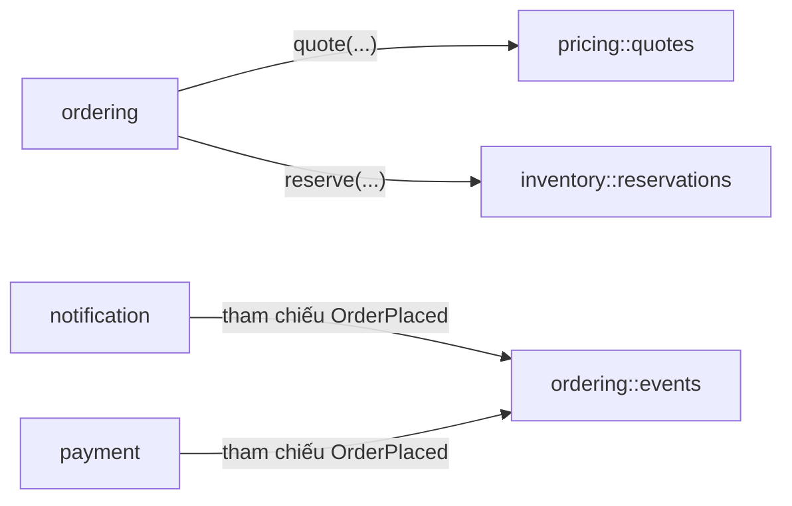

# Phân chia module theo khả năng thay đổi và trách nhiệm

Khi thiết kế một ứng dụng Spring Modulith, cách đặt package thường là quyết định dễ nhìn thấy nhất, nhưng **lý do các thành phần phải thay đổi** mới là một trong những căn cứ quan trọng để xác định ranh giới module. Nếu mỗi lần đổi chính sách khuyến mãi đều phải sửa code quản lý tồn kho, hoặc mỗi lần đổi cấu trúc bảng thanh toán đều phải sửa module đặt hàng, ứng dụng đang có những phụ thuộc vượt quá nhu cầu nghiệp vụ.

Một module tốt tập trung những thành phần **cùng chịu trách nhiệm cho một năng lực và thường thay đổi vì những lý do liên quan**, đồng thời cung cấp hợp đồng để phần còn lại của ứng dụng không phải biết cách nó thực hiện công việc. Điều này không có nghĩa các module không bao giờ được thay đổi cùng nhau: một tính năng xuyên quy trình vẫn có thể cần nhiều module phối hợp. Mục tiêu là **đặt quyết định vào đúng nơi**, tránh thay đổi lan truyền chỉ vì rò rỉ triển khai hoặc quyền sở hữu dữ liệu không rõ.

Bài học thuộc chương **Thiết kế module** của **SPRING_MODULITH_VERIFICATION_TESTING**. Sau khi tìm ranh giới từ trách nhiệm và khả năng thay đổi, chúng ta sẽ ánh xạ sang `@ApplicationModule`, `@NamedInterface`, `allowedDependencies` và kiểm chứng bằng `ApplicationModules.verify()`. Các ví dụ tiếp tục liên hệ `@ApplicationModuleTest`, kiểm thử sự kiện, cơ sở dữ liệu, tích hợp và quality gate CI để ngăn phụ thuộc sai hoặc hồi quy trong quá trình phát triển.

## 1. Kết quả cần đạt

Sau bài này, bạn có thể:

1. Phân biệt **thay đổi cùng vì một lý do nghiệp vụ** với **thay đổi đồng thời do một quy trình đi qua nhiều module**.
2. Xác định ranh giới qua quyền quyết định, invariant, dữ liệu sở hữu, vòng đời và tần suất thay đổi.
3. Lập **ma trận kịch bản thay đổi** để đánh giá ứng viên module trước khi quyết định package.
4. Nhận ra trường hợp nên tách, nên gộp hoặc nên giữ hai module cộng tác qua hợp đồng.
5. Biểu diễn ranh giới trong Spring Modulith bằng API công khai, named interface và quy tắc phụ thuộc.
6. Dùng kiểm thử kiến trúc, module, dữ liệu và sự kiện để kiểm tra thiết kế tiếp tục đúng qua các thay đổi.

## 2. “Khả năng thay đổi” nghĩa là gì?

Trong thiết kế phần mềm, một **lý do thay đổi** là loại quyết định có thể phát sinh từ nghiệp vụ, quy định, vận hành hoặc công nghệ. Các loại thay đổi ví dụ:

- Bộ phận kinh doanh sửa cách tính chiết khấu theo chiến dịch.
- Kho hàng thay quy tắc giữ hàng, hết hạn phiếu giữ hàng hoặc cách xử lý đồng thời.
- Đơn hàng bổ sung điều kiện hủy theo trạng thái giao hàng.
- Bộ phận chăm sóc khách hàng sửa mẫu email thông báo.
- Nhóm kỹ thuật thay JPA bằng một giải pháp persistence khác.

Các lý do này có **chủ thể quyết định**, **thời điểm phát sinh** và **phạm vi ảnh hưởng** khác nhau. Nếu module `checkout` chứa toàn bộ định giá, tồn kho, gửi email và thanh toán chỉ vì chúng cùng tham gia một use case “đặt hàng”, mỗi thay đổi riêng lẻ sẽ chạm vào một nhóm mã quá rộng.

### 2.1. Phân biệt ba quan sát dễ nhầm

| Quan sát | Điều có thể suy ra | Điều chưa thể kết luận |
| --- | --- | --- |
| Hai class luôn sửa cùng nhau khi thay một quy tắc | Có thể thuộc cùng trách nhiệm hoặc invariant | Chưa chắc phải nằm cùng module; có thể do API hiện tại quá yếu |
| Hai module cùng xuất hiện trong một pull request | Một thay đổi có thể ảnh hưởng nhiều năng lực | Không có nghĩa ranh giới sai; yêu cầu có thể thật sự xuyên module |
| Một module thay đổi thường xuyên hơn module khác | Có một vùng biến động cần cô lập | Không mặc nhiên phải tách mọi class thường sửa thành module mới |

**Change coupling** (mức liên quan thay đổi) là tín hiệu hữu ích, nhưng không phải tiêu chuẩn duy nhất. Cùng sửa hai file trong một commit vì refactor hàng loạt, nâng version thư viện hoặc format code không nói lên trách nhiệm nghiệp vụ của chúng. Ngược lại, hai thành phần có thể ít sửa cùng nhau trong lịch sử nhưng vẫn cần giữ cùng một bất biến giao dịch.

### 2.2. Hai câu hỏi thiết kế cần trả lời

Khi cân nhắc tách một tập hợp class, hãy hỏi đồng thời:

1. **Chúng cùng thay đổi vì một quyết định hay một luật chung nào?** Nếu có, đặt gần nhau giúp tăng gắn kết nội bộ (*cohesion*).
2. **Những thành phần bên ngoài có cần thay đổi theo mỗi lần luật đó đổi không?** Nếu không, ranh giới và hợp đồng phải che được thay đổi nội bộ để giảm phụ thuộc (*coupling*).

Nguyên tắc gần với *Single Responsibility Principle* ở mức kiến trúc: một module nên có một **trách nhiệm nghiệp vụ dễ mô tả**, thay vì một danh sách ngẫu nhiên các tác vụ kỹ thuật. Tuy nhiên, không nên hiểu máy móc “một lý do thay đổi = một class/module”; một năng lực thường chứa nhiều luật và use case liên quan.

## 3. Trách nhiệm quan trọng hơn số lượng class

Giả sử một hệ thống bán hàng có những quy tắc:

| Quy tắc | Ai có quyền quyết định? | Dữ liệu quan trọng | Thao tác cần bảo vệ |
| --- | --- | --- | --- |
| Mức giảm giá cho từng chiến dịch | Nghiệp vụ định giá | Bảng giá, chính sách khuyến mãi | Tạo báo giá theo chính sách hợp lệ |
| Không giữ hàng quá lượng khả dụng | Nghiệp vụ tồn kho | Tồn khả dụng, phiếu giữ hàng | Giữ/nhả hàng an toàn khi đồng thời |
| Đơn đã giao không được hủy như đơn mới | Nghiệp vụ đặt hàng | Trạng thái và lịch sử đơn | Chuyển trạng thái đơn hợp lệ |
| Thanh toán lặp không tạo hai lần thu | Nghiệp vụ thanh toán | Giao dịch, yêu cầu thu và hoàn tiền | Xử lý thông báo idempotent |
| Nội dung email theo phân khúc khách hàng | Nghiệp vụ thông báo | Mẫu thông báo, trạng thái gửi | Tạo và gửi thông báo đúng mẫu |

Ranh giới đáng tin cậy thường gắn với **nơi bảo vệ quyết định**, không gắn đơn thuần với bảng dữ liệu hoặc loại công nghệ. Ví dụ, `Order`, `OrderLine` và luật hủy đơn có thể thuộc `ordering`. Một record `PriceQuote` được đặt hàng sử dụng không có nghĩa `ordering` sở hữu **quy tắc tính khuyến mãi**. Nó chỉ sở hữu **giá đã chốt của đơn hàng** tại thời điểm xác nhận.

### 3.1. Invariant là dấu hiệu quan trọng của ranh giới

*Invariant* là điều kiện nghiệp vụ phải đúng trước và sau những thao tác được phép. Với tồn kho, bất biến có thể là “không xác nhận thêm phiếu giữ hàng vượt số lượng khả dụng”. Nếu hai module cùng cập nhật trực tiếp bảng `stock`, quyền bảo vệ invariant bị chia đôi; chỉ chia package không giải quyết được vấn đề.

Một thiết kế rõ trách nhiệm cho phép:

- `ordering` **yêu cầu** giữ hàng qua một hợp đồng công khai;
- `inventory` **quyết định** có giữ được hay không;
- `inventory` sở hữu transaction, cập nhật đồng thời và phiếu giữ hàng;
- `ordering` ghi nhận kết quả vào vòng đời đơn mà nó sở hữu.

Tách trách nhiệm không tự bảo đảm giao dịch xuyên module. Nếu các thao tác phải nhất quán ngay, cần quyết định transaction và hạ tầng phù hợp; nếu đi qua nhiều kho dữ liệu hoặc hệ thống độc lập, có thể cần trạng thái trung gian, bù trừ hay saga.

### 3.2. Một dữ liệu có thể có các ý nghĩa khác nhau

`price` trong `pricing` có thể là **giá đang được chào bán**. `price` trong `ordering` có thể là **giá đã chốt trên đơn hàng**. Hai giá trị giống nhau về kiểu `BigDecimal` nhưng có vòng đời và lý do thay đổi khác nhau. Khi giá niêm yết thay đổi ngày mai, đơn đã được xác nhận hôm nay thường không tự đổi theo.

Đây là một ví dụ về sự khác biệt ngữ nghĩa: không phải mọi nơi dùng cùng trường dữ liệu đều phải nằm trong cùng module. Một module có thể giữ bản chụp của thông tin đến từ module khác nếu nó sở hữu cách sử dụng và vòng đời bản chụp ấy.

## 4. Nghiên cứu tình huống: website bán hàng có nhiều tốc độ thay đổi

Giả sử ứng dụng ban đầu chỉ có `checkout`:

```text
com.example.shop/
├── ShopApplication.java
└── checkout/
    ├── CheckoutController.java
    ├── CheckoutService.java
    ├── PricingCalculator.java
    ├── PromotionRules.java
    ├── StockRepository.java
    ├── OrderRepository.java
    ├── EmailTemplateRenderer.java
    └── PaymentGatewayAdapter.java
```

Một đơn hàng có thể đi qua tất cả các thành phần này. Tuy nhiên, các lý do thay đổi lại khác nhau:

- Chiến dịch giảm giá sửa hằng tuần, chủ yếu ảnh hưởng chính sách định giá.
- Thuật toán chống giữ hàng vượt tồn thay đổi khi tải tăng, thuộc chuyên môn quản lý kho.
- Điều kiện hủy đơn do bộ phận vận hành đơn hàng điều chỉnh.
- Nội dung email và kênh gửi có thể thay hàng tháng theo nhu cầu chăm sóc khách hàng.
- Cổng thanh toán có thể thay adapter mà không làm thay đổi quyết định tạo đơn.

Nếu gom tất cả vào `checkout`, có thể khó xác định ai bảo vệ quy tắc nào; mọi nhóm buộc phải hiểu một phần rất rộng của ứng dụng trước khi sửa. Một thiết kế ứng viên là `ordering`, `pricing`, `inventory`, `payment` và `notification`. Đó vẫn chỉ là **giả thuyết ranh giới**: cần kiểm tra dữ liệu, invariant và nhu cầu phối hợp trước khi tạo package.

### 4.1. Ma trận kịch bản thay đổi

Tạo bảng trước khi code. Ký hiệu **S** = module chủ yếu phải sửa logic; **C** = có thể cần phối hợp vì thay đổi hợp đồng hoặc luồng chung; **–** = bình thường không cần sửa.

| Kịch bản | `ordering` | `pricing` | `inventory` | `payment` | `notification` |
| --- | :---: | :---: | :---: | :---: | :---: |
| Thêm công thức giảm giá theo chiến dịch | – | **S** | – | – | – |
| Đổi cách khóa bản ghi khi giữ hàng | – | – | **S** | – | – |
| Đổi điều kiện hủy đơn | **S** | – | C | C | C |
| Đổi mẫu email xác nhận | – | – | – | – | **S** |
| Đổi nhà cung cấp xử lý thanh toán | – | – | – | **S** | – |
| Thêm một hình thức thanh toán mới hiển thị ở checkout | C | – | – | **S** | C |
| Đổi dữ liệu cần cung cấp khi xác nhận đơn | **S** | C | C | C | C |

**Bảng là giả thuyết**, không phải số liệu đo được hay tiêu chuẩn tuyệt đối. Ví dụ thay quy định thuế có thể ảnh hưởng cả `pricing` lẫn `payment`, vì cả hai thật sự phải tuân theo quy định mới. Không có cấu trúc package nào triệt tiêu mọi thay đổi xuyên module.

### 4.2. Dùng ma trận để ra quyết định

Nếu sửa công thức khuyến mãi mà **chỉ** `pricing` thay đổi nội bộ, các module khác vẫn gọi một hợp đồng báo giá ổn định thì ranh giới có giá trị. Nếu sửa công thức khuyến mãi lại bắt `ordering` đọc thêm `promotion_rule_id`, `discount_table` và tự tính lại tiền, chi tiết định giá đã bị rò rỉ.

Tương tự, nếu `notification` thay template mà `ordering` phải biên dịch lại HTML, hai trách nhiệm đang bị trộn. `ordering` có thể phát `OrderPlaced` với những dữ kiện cần thiết; `notification` quyết định dùng template và kênh gửi nào.

### 4.3. Sơ đồ phụ thuộc mong muốn



Đây là **đồ thị tham chiếu mã nguồn ở mức module/API**. Trong thực tế sự kiện `OrderPlaced` do `ordering` phát và đi tới consumer, nhưng code listener của `notification` và `payment` phụ thuộc **kiểu sự kiện công khai** do `ordering` định nghĩa. Tránh để `ordering` import class triển khai nội bộ của `notification` hay `payment`, vì điều đó có thể tạo vòng phụ thuộc không cần thiết.

## 5. Nên tách hay gộp? Một bảng quyết định thực dụng

Không phải chức năng nào thay đổi khác ngày đều cần một module riêng. Việc tách module làm tăng số hợp đồng, kiểm thử tích hợp và cách xử lý lỗi giao tiếp. Ngược lại, gộp quá nhiều trách nhiệm khiến một nhóm thay đổi ảnh hưởng rộng.

| Câu hỏi | Tín hiệu nghiêng về **tách** | Tín hiệu nghiêng về **gộp/giữ chung** |
| --- | --- | --- |
| Quy tắc nghiệp vụ có cùng chủ sở hữu? | Nhiều nhóm quyết định, lý do thay đổi độc lập | Cùng một tập luật và một người chịu trách nhiệm |
| Dữ liệu có cùng vòng đời? | Cập nhật và lưu trữ độc lập | Một aggregate/invariant cần được bảo vệ cùng nhau |
| Thay đổi chính sách có cần sửa consumer? | Có thể ổn định nhờ hợp đồng nhỏ | Tách ra chỉ tạo chuyển tiếp phương thức vô nghĩa |
| Giao tiếp giữa hai phần là gì? | Lệnh/query/event có ý nghĩa nghiệp vụ rõ | Liên tục chia sẻ object nội bộ, cần phối hợp từng bước |
| Transaction có cần nguyên tử? | Có thể định nghĩa hợp đồng hoặc cơ chế nhất quán rõ | Hầu hết thao tác phải giữ một invariant chung trong một đơn vị |
| Mức độc lập khi kiểm thử? | Có test nghiệp vụ riêng và test tích hợp rõ | Hai phần luôn cần toàn bộ trạng thái nội bộ của nhau |
| Chi phí thay đổi về lâu dài? | Giảm đáng kể phụ thuộc lan truyền | Tạo nhiều API mà không làm đơn giản nghiệp vụ |

### 5.1. Ví dụ cần gộp

Giả sử nhóm tạo hai module `order_status` và `order_cancellation`, nhưng mọi lần hủy đơn đều phải kiểm tra và cập nhật cùng trạng thái `Order`, còn `order_status` cũng cần biết toàn bộ luật hủy. Hai module cứ import lẫn nhau và không có chủ sở hữu duy nhất cho state machine. Đây là tín hiệu nên xem lại khả năng **gộp vào `ordering`**, giữ hai service nội bộ thay vì hai application module ngang hàng.

### 5.2. Ví dụ cần tách

Giả sử `ordering` đang chứa công thức giảm giá, bảng campaign và quy tắc voucher, trong khi nhóm chính sách giá thay đổi độc lập và ứng dụng khác cũng cần báo giá. Một module `pricing` với hợp đồng `PricingQuotes.quote(...)` có thể giúp `ordering` không phải sửa theo mỗi thuật toán khuyến mãi. `pricing` sở hữu luật giá, còn `ordering` sở hữu giá cuối cùng được chốt cho đơn.

### 5.3. Ví dụ cần chờ thêm bằng chứng

Một hệ thống nhỏ có ba quy tắc khuyến mãi đơn giản, tất cả do cùng nhóm đặt hàng duy trì. Tách `pricing` sớm có thể chưa đem lại lợi ích rõ ràng. Trước mắt có thể tổ chức `ordering.internal.pricing` để bảo vệ logic trong nội bộ; khi xuất hiện vòng đời, trách nhiệm hoặc consumer riêng, tách thành module độc lập dựa trên bằng chứng.

**Số class và độ dài file không phải tiêu chí quyết định.** Một module có 100 class nhưng cùng phục vụ một năng lực có thể hợp lý hơn năm module nhỏ chỉ chuyển tiếp gọi nhau.

## 6. Dùng dữ liệu thực tế để kiểm tra giả thuyết ranh giới

Lịch sử thay đổi mã và câu chuyện từ người làm nghiệp vụ có thể bổ sung cho sơ đồ thiết kế.

### 6.1. Đọc lịch sử co-change đúng cách

Với các yêu cầu thay đổi gần đây, ghi lại:

1. **Lý do thay đổi:** chiến dịch giá, chính sách trả hàng, lỗi đồng thời, nâng cấp thư viện hay format code?
2. **Các class bị sửa:** chúng ở module nào, thuộc hành vi gì?
3. **Vì sao phải sửa cùng nhau:** thật sự vì một luật chung, hay vì API rò rỉ entity và chi tiết triển khai?
4. **Nếu đã có hợp đồng tốt:** thay đổi đó có chỉ cần sửa một module không?

Có thể dùng tỷ lệ các thay đổi chạm đồng thời hai nhóm class để phát hiện vùng liên kết bất thường. Nhưng trước khi kết luận, cần **loại những commit cơ học** như reformat, đổi tên toàn dự án, cập nhật version framework hoặc sửa generated code. Một chỉ số co-change cao chỉ là **điểm bắt đầu điều tra**, không phải chứng minh hai nhóm phải thuộc cùng module.

### 6.2. Nói chuyện với người sở hữu quy tắc

Lịch sử Git không ghi rõ mọi lý do kinh doanh. Hỏi những người quyết định chính sách:

- Ai phê duyệt thay đổi mức giảm giá hoặc điều kiện hoàn tiền?
- Bộ phận nào chịu trách nhiệm khi invariant bị phá vỡ?
- Những thay đổi nào cần được phát hành cùng nhau vì hợp đồng nghiệp vụ thật sự?
- Có quy tắc nào dùng cùng tên nhưng mang nghĩa khác ở hai ngữ cảnh?

Kết quả hữu ích là một **bản đồ trách nhiệm** có thể review được. Package được tạo sau khi nhóm đồng ý về chủ sở hữu, thay vì dùng tên package để ngầm quyết định ai sở hữu.

## 7. Ánh xạ sang package Spring Modulith

Theo quy ước phát hiện module thông dụng, các package con **trực tiếp** bên dưới package chứa `@SpringBootApplication` trở thành các application module. Sau khi đã phân định năng lực, tổ chức mã nguồn như sau:

```text
src/main/java/com/example/shop/
├── ShopApplication.java
├── ordering/                           # application module
│   ├── package-info.java
│   ├── OrderingOperations.java         # API mặc định ở package gốc
│   ├── PlaceOrder.java
│   ├── events/
│   │   ├── package-info.java          # @NamedInterface("events")
│   │   └── OrderPlaced.java
│   └── internal/
│       ├── PlaceOrderService.java
│       ├── Order.java
│       └── OrderRepository.java
├── pricing/
│   ├── package-info.java
│   ├── quotes/
│   │   ├── package-info.java          # @NamedInterface("quotes")
│   │   ├── PricingQuotes.java
│   │   ├── QuoteRequest.java
│   │   └── PriceQuote.java
│   └── internal/
│       ├── PromotionPolicy.java
│       ├── QuoteService.java
│       └── PriceRepository.java
├── inventory/
│   ├── package-info.java
│   ├── reservations/
│   │   ├── package-info.java          # @NamedInterface("reservations")
│   │   ├── InventoryReservations.java
│   │   ├── ReserveStock.java
│   │   └── ReservationReceipt.java
│   └── internal/
│       ├── StockReservationService.java
│       └── StockRepository.java
├── payment/
│   ├── package-info.java
│   └── internal/
│       └── OrderPlacedListener.java
└── notification/
    ├── package-info.java
    └── internal/
        ├── OrderPlacedListener.java
        └── EmailTemplateRenderer.java
```

Các thư mục `internal` có thể tổ chức tiếp thành `application`, `domain`, `persistence`, `adapter` tùy mức phức tạp. Những thư mục ấy là **các package kỹ thuật bên trong một module**, không phải lý do để tạo những application module tên `repository`, `service` hoặc `controller`.

### 7.1. API nào nên công bố?

| Module | Công bố | Giữ nội bộ |
| --- | --- | --- |
| `pricing` | `pricing::quotes`: yêu cầu và kết quả báo giá | Công thức khuyến mãi, bảng giá, cache, thuật toán làm tròn |
| `inventory` | `inventory::reservations`: lệnh giữ hàng và kết quả | Khóa, transaction, bảng tồn, repository |
| `ordering` | API tạo đơn ở package gốc, `ordering::events` | State machine, entity, persistence, điều phối use case |
| `payment` | Hợp đồng cần thiết cho thanh toán (nếu có consumer đồng bộ) | Payment gateway, trạng thái thu tiền, idempotency |
| `notification` | Có thể không cần API gọi đồng bộ; lắng nghe sự kiện | Template, nhà cung cấp email, retry gửi |

Một module **không bắt buộc có facade hoặc API đồng bộ** nếu chỉ phản ứng với các sự kiện công khai của module khác. Điều quan trọng là không làm rò rỉ phần nội bộ một cách vô tình.

## 8. Khai báo hợp đồng ổn định ở ranh giới

### 8.1. Báo giá từ module `pricing`

Ở `pricing/quotes/package-info.java`:

```java
@org.springframework.modulith.NamedInterface("quotes")
package com.example.shop.pricing.quotes;
```

Định nghĩa hợp đồng:

```java
// pricing/quotes/QuoteRequest.java
package com.example.shop.pricing.quotes;

public record QuoteRequest(String sku, int quantity) {
    public QuoteRequest {
        if (sku == null || sku.isBlank() || quantity <= 0) {
            throw new IllegalArgumentException("Yêu cầu báo giá không hợp lệ");
        }
    }
}
```

```java
// pricing/quotes/PriceQuote.java
package com.example.shop.pricing.quotes;

import java.math.BigDecimal;
import java.time.Instant;
import java.util.Currency;

public record PriceQuote(
    BigDecimal total,
    Currency currency,
    Instant validUntil
) {}
```

```java
// pricing/quotes/PricingQuotes.java
package com.example.shop.pricing.quotes;

public interface PricingQuotes {
    PriceQuote quote(QuoteRequest request);
}
```

Đây là API minh họa. Trong dự án thật cần định nghĩa rõ **đơn vị tiền**, **quy tắc làm tròn**, **điều kiện áp dụng ưu đãi**, thời điểm hết hiệu lực báo giá và xử lý khi giá đổi trước lúc chốt đơn. Nếu báo giá phụ thuộc khách hàng hoặc vùng thuế, `QuoteRequest` phải chứa ngữ cảnh cần thiết mà vẫn tránh công bố persistence model nội bộ.

Nhờ hợp đồng ổn định, `pricing.internal.PromotionPolicy` có thể thay thuật toán mà `ordering` không import trực tiếp chính sách khuyến mãi hoặc bảng chiến dịch.

### 8.2. Giữ hàng qua module `inventory`

Ở `inventory/reservations/package-info.java`:

```java
@org.springframework.modulith.NamedInterface("reservations")
package com.example.shop.inventory.reservations;
```

```java
// inventory/reservations/ReserveStock.java
package com.example.shop.inventory.reservations;

public record ReserveStock(String sku, int quantity) {
    public ReserveStock {
        if (sku == null || sku.isBlank() || quantity <= 0) {
            throw new IllegalArgumentException("Yêu cầu giữ hàng không hợp lệ");
        }
    }
}
```

```java
// inventory/reservations/ReservationReceipt.java
package com.example.shop.inventory.reservations;

import java.util.UUID;

public record ReservationReceipt(UUID reservationId) {}
```

```java
// inventory/reservations/InventoryReservations.java
package com.example.shop.inventory.reservations;

public interface InventoryReservations {
    ReservationReceipt reserve(ReserveStock command);
}
```

`inventory.internal.StockReservationService` triển khai interface và chịu trách nhiệm chống giữ vượt tồn. Bên ngoài không cần biết nó dùng JPA, SQL cập nhật có điều kiện hay lock; đó là vùng có thể thay đổi vì lý do vận hành của `inventory`.

Hợp đồng thực tế cần định nghĩa lỗi “không đủ hàng”, hành vi gọi lặp, thời hạn giữ hàng, trường hợp nhả hàng và ý nghĩa `reservationId`. Đừng giả định có `UUID` là đã tự có tính idempotent.

### 8.3. Chỉ định chính xác chiều phụ thuộc

Ở `ordering/package-info.java`:

```java
@org.springframework.modulith.ApplicationModule(
    allowedDependencies = {
        "pricing::quotes",
        "inventory::reservations"
    }
)
package com.example.shop.ordering;
```

Với hai named interface đã công bố, `ordering` chỉ có lý do tham chiếu hợp đồng báo giá và giữ hàng trong ví dụ. Nó không được import `pricing.internal.PromotionPolicy` hoặc `inventory.internal.StockRepository`.

Để `payment` và `notification` nhận sự kiện `OrderPlaced`, công bố package:

```java
// ordering/events/package-info.java
@org.springframework.modulith.NamedInterface("events")
package com.example.shop.ordering.events;
```

```java
// ordering/events/OrderPlaced.java
package com.example.shop.ordering.events;

import java.util.UUID;

public record OrderPlaced(UUID orderId) {}
```

Và tại `notification/package-info.java`:

```java
@org.springframework.modulith.ApplicationModule(
    allowedDependencies = "ordering::events"
)
package com.example.shop.notification;
```

`payment` có thể khai báo phụ thuộc tương tự nếu chỉ cần sự kiện, hoặc có thêm giao diện được công bố khác nếu có use case thanh toán đồng bộ. Cần xem **toàn bộ phụ thuộc thực tế** trước khi chốt danh sách; một `allowedDependencies` quá hẹp nhưng không đúng nhu cầu sẽ khiến bài kiểm thử kiến trúc báo lỗi cần phân tích.

### 8.4. `ordering` phối hợp nhưng không sở hữu mọi chính sách

Đoạn mã phác thảo sau cho thấy `ordering` chỉ gọi hợp đồng và sở hữu quyết định tạo đơn:

```java
package com.example.shop.ordering.internal;

import com.example.shop.inventory.reservations.InventoryReservations;
import com.example.shop.inventory.reservations.ReserveStock;
import com.example.shop.pricing.quotes.PricingQuotes;
import com.example.shop.pricing.quotes.QuoteRequest;
import org.springframework.stereotype.Service;

@Service
class PlaceOrderService {

    private final PricingQuotes pricing;
    private final InventoryReservations inventory;

    PlaceOrderService(PricingQuotes pricing, InventoryReservations inventory) {
        this.pricing = pricing;
        this.inventory = inventory;
    }

    void place(String sku, int quantity) {
        var quote = pricing.quote(new QuoteRequest(sku, quantity));
        var receipt = inventory.reserve(new ReserveStock(sku, quantity));

        // ordering lưu đơn với giá đã chốt và reservationId.
        // Chỉ xác nhận khi thỏa điều kiện giao dịch của use case.
        // Việc lưu đơn/phát OrderPlaced được triển khai bên trong ordering.
    }
}
```

Đây là **phác thảo hướng phụ thuộc**, chưa phải use case có thể chạy: cần triển khai ghi đơn, chính sách hết hạn báo giá, transaction và xử lý lỗi. Trong môi trường nhiều datasource hoặc hệ thống phân tán, giữ hàng và ghi đơn có thể cần trạng thái trung gian/bù trừ; không được hiểu rằng hai lời gọi đồng bộ tự động tạo atomicity. Kết quả không dùng trong đoạn ngắn nhằm nhấn mạnh **loại dữ liệu nhận về**; code sản xuất phải dùng `quote` và `receipt` để lưu trạng thái theo hợp đồng.

## 9. Đánh giá ranh giới bằng kịch bản thay đổi

Sau khi chia package, cách kiểm tra hữu ích là **mô phỏng thay đổi** thay vì chỉ nhìn cây thư mục.

### Kịch bản A — Khuyến mãi mới theo ngày trong tuần

Nhóm kinh doanh muốn khuyến mãi áp dụng vào cuối tuần. Nếu chỉ cần sửa `pricing.internal.PromotionPolicy` và test tính giá, còn `PricingQuotes.quote(...)` vẫn trả đúng `PriceQuote`, ranh giới `pricing` đang giúp cô lập thay đổi. Nếu bắt `ordering` hiểu `weekday_rule_id` và tính giảm giá, hãy đưa quyết định về module sở hữu.

### Kịch bản B — Tăng tải giữ hàng

Để ngăn tranh chấp tồn kho, nhóm chuyển cách cập nhật sang SQL có điều kiện hoặc dùng version/locking khác. Nếu `InventoryReservations.reserve(...)` giữ nguyên ngữ nghĩa và `ordering` không import repository/transaction helper nội bộ, việc thay đổi chỉ cần sửa `inventory` cùng test tích hợp dữ liệu. Nếu `ordering` tự `findStock → subtract → save`, ranh giới đã bị phá.

### Kịch bản C — Đổi mẫu email xác nhận

Nhóm thay template và nhà cung cấp email. Nếu `notification` tiêu thụ sự kiện nghiệp vụ ổn định rồi chọn template, `ordering` không cần biết thay đổi đó. Nếu `ordering` tạo HTML và gọi SDK gửi email trực tiếp, nên xem lại trách nhiệm của module.

### Kịch bản D — Thay điều kiện hủy đơn

Đây là thay đổi thuộc `ordering`, nhưng có thể **thật sự cần phối hợp** với `inventory` để nhả hàng và `payment` để hoàn tiền. Sự thay đổi qua nhiều module không tự động chứng minh thiết kế sai. Hãy phân biệt **đổi chính sách hủy** với **đổi thuật toán nhả hàng hoặc hoàn tiền**: mỗi phần có chủ sở hữu riêng, giao tiếp qua lệnh/sự kiện và quy trình trạng thái rõ ràng.

### Kịch bản E — Đổi hợp đồng thật sự

Nếu thị trường yêu cầu báo giá gắn chữ ký, khóa thời hạn và kiểm chứng khi chốt đơn, có thể phải thay `PriceQuote` và `ordering` đồng thời. Đây là **một thay đổi hợp đồng liên module có chủ đích**, cần versioning/consumer test và kế hoạch triển khai. Mục tiêu của modularity là khiến chi phí thay đổi **được nhìn thấy và quản lý**, không hứa sẽ không có thay đổi phối hợp nào.

## 10. Kiểm chứng kiến trúc với `ApplicationModules`

Spring Modulith cung cấp mô hình các application module và khả năng kiểm tra ranh giới:

```java
// src/test/java/com/example/shop/ModularityTests.java
package com.example.shop;

import org.junit.jupiter.api.Test;
import org.springframework.modulith.core.ApplicationModules;

class ModularityTests {

    @Test
    void modulesRespectDeclaredBoundaries() {
        ApplicationModules.of(ShopApplication.class).verify();
    }
}
```

Trong cấu hình module đóng (`CLOSED`) và các luật khai báo ở trên, `verify()` kiểm tra những vi phạm kiến trúc điển hình như:

- Phụ thuộc vòng giữa application module.
- Tham chiếu vào phần nội bộ chưa công bố của module khác.
- Phụ thuộc không nằm trong `allowedDependencies` khi module nguồn có giới hạn tường minh.

Ví dụ:

```java
// Sai: ordering biết implementation detail của pricing.
import com.example.shop.pricing.internal.PromotionPolicy;

// Đúng về ranh giới: ordering sử dụng hợp đồng được công bố.
import com.example.shop.pricing.quotes.PricingQuotes;
```

Nếu cần tái hiện lỗi trong test kiến trúc, hãy tạo một **tham chiếu thật** đến `PromotionPolicy` ở field, constructor hoặc method thay vì chỉ thêm một import không được sử dụng. Java có thể biên dịch class nội bộ `public` nhưng Spring Modulith vẫn xem đó là quan hệ qua ranh giới closed module. Để sửa, hãy chuyển hành vi cần thiết về hợp đồng công khai hoặc xem lại trách nhiệm sở hữu; không công bố cả package `internal` chỉ để kiểm thử xanh.

### 10.1. Giới hạn của `verify()`

`ApplicationModules.verify()` **không tự trả lời** hai module có nên gộp hay tách theo lý do thay đổi hay không. Một đồ thị phụ thuộc không có chu trình vẫn có thể chứa module `common` không ai sở hữu hoặc module `checkout` gom quá nhiều chính sách.

Việc xác định **chủ thể quyết định**, **dữ liệu**, **invariant**, **ngữ nghĩa hợp đồng** và **khả năng thay đổi độc lập** vẫn cần phân tích nghiệp vụ và review. `verify()` cũng không chứng minh giá được tính đúng, hai đơn không giữ vượt tồn, sự kiện được giao đúng một lần hay transaction xuyên hệ thống là nguyên tử.

### 10.2. Từ luật thiết kế đến quality gate

Một bài kiểm thử kiến trúc hữu ích vì nó chuyển quyết định “`ordering` không được biết `pricing.internal`” thành điều có thể chạy lại sau mỗi thay đổi. Nhưng quyết định “`pricing` sở hữu chính sách khuyến mãi” vẫn cần tài liệu và người review. Hai lớp kiểm soát bổ sung cho nhau.

## 11. Kiểm thử thay đổi độc lập qua `@ApplicationModuleTest`

Một ranh giới hợp lý tạo cơ hội kiểm tra từng năng lực với phạm vi context phù hợp.

### 11.1. Test module định giá

Ví dụ kiểm thử hợp đồng từ phía `pricing`:

```java
// src/test/java/com/example/shop/pricing/PricingModuleTests.java
package com.example.shop.pricing;

import static org.assertj.core.api.Assertions.assertThat;

import com.example.shop.pricing.quotes.PriceQuote;
import com.example.shop.pricing.quotes.PricingQuotes;
import com.example.shop.pricing.quotes.QuoteRequest;
import org.junit.jupiter.api.Test;
import org.springframework.beans.factory.annotation.Autowired;
import org.springframework.modulith.test.ApplicationModuleTest;

@ApplicationModuleTest
class PricingModuleTests {

    @Autowired PricingQuotes quotes;

    @Test
    void quoteIsPositiveForASaleableItem() {
        // Fixture cần có SKU-42 cùng chính sách giá được xác định.
        PriceQuote result = quotes.quote(new QuoteRequest("SKU-42", 2));
        assertThat(result.total()).isPositive();
        assertThat(result.currency()).isNotNull();
    }
}
```

Đoạn test chỉ là **khung có assertion**, cần triển khai `PricingQuotes`, cấu hình fixture/datasource và quy tắc giá thật mới chạy. Test chất lượng nên biết **kết quả giá kỳ vọng cụ thể** cho từng chiến dịch, trường hợp giá hết hiệu lực, tiền tệ và làm tròn. Khi đổi thuật toán khuyến mãi, các test này phát hiện thay đổi hành vi ngoài ý muốn mà không cần khởi động toàn bộ use case đặt hàng.

### 11.2. Test module đặt hàng với phụ thuộc thích hợp

Nếu muốn kiểm tra tích hợp của `ordering` với `pricing` và `inventory`, có thể dùng:

```java
package com.example.shop.ordering;

import org.junit.jupiter.api.Test;
import org.springframework.modulith.test.ApplicationModuleTest;
import org.springframework.modulith.test.ApplicationModuleTest.BootstrapMode;

@ApplicationModuleTest(mode = BootstrapMode.DIRECT_DEPENDENCIES)
class OrderingModuleTests {

    @Test
    void placesOrderUsingPublishedContracts() {
        // Thiết lập fixture, gọi OrderingOperations và assert trạng thái đơn.
    }
}
```

`DIRECT_DEPENDENCIES` khởi động module đang kiểm thử cùng những module phụ thuộc trực tiếp. Khi muốn cô lập `ordering`, có thể dùng phạm vi `STANDALONE` với test double cho `PricingQuotes`/`InventoryReservations`; khi cần nhiều tầng phụ thuộc, cân nhắc `ALL_DEPENDENCIES`. Test có thân rỗng ở ví dụ này **chưa kiểm chứng hành vi**: cần cung cấp fixture và assertion thực tế.

Việc lựa chọn bootstrap mode không nên quyết định ranh giới production. Nếu không thể kiểm thử một module mà không khởi động hầu hết ứng dụng, đó là tín hiệu cần xem lại số lượng hoặc loại phụ thuộc, nhưng cũng có thể do cấu hình test infrastructure chưa phù hợp.

## 12. Kiểm thử dữ liệu, sự kiện và tích hợp theo trách nhiệm

Khi module thay đổi vì lý do khác nhau, các bài kiểm thử cũng nên tập trung theo nơi bảo vệ luật.

| Module hoặc liên kết | Bài kiểm thử trọng tâm | Ví dụ hồi quy muốn phát hiện |
| --- | --- | --- |
| `pricing` | Công thức giá, điều kiện chiến dịch, tiền tệ, làm tròn | Quy tắc mới tính sai tổng tiền |
| `inventory` | Transaction và cập nhật đồng thời | Tồn `1`, hai yêu cầu giữ `1` cùng thành công |
| `ordering` | Chuyển trạng thái, chốt giá, xử lý thất bại ở use case | Đơn được báo `PLACED` khi chưa thỏa điều kiện |
| `payment` | Idempotency, trạng thái thu/hoàn tiền | Event phát lại gây thu tiền hai lần |
| `notification` | Payload, template, lỗi gửi và retry | Mẫu gửi sai hoặc một event tạo thông báo không mong muốn |
| Liên kết xuyên module | Contract/integration test qua API và sự kiện | Đổi `PriceQuote` làm caller hiểu sai thời hạn báo giá |

### 12.1. Database và invariant

Với `inventory`, cần test trường hợp hai lệnh giữ hàng đồng thời, rollback khi ghi phiếu giữ hàng thất bại và tính idempotent của request nếu hợp đồng có hứa. Chỉ tách package hoặc dùng `@Transactional` không tự bảo đảm chống race condition. Chạy test với cơ chế database/transaction đủ giống production để xác minh invariant.

### 12.2. Sự kiện và vòng đời dữ liệu

`ordering` có thể phát `OrderPlaced` để `payment` và `notification` phản ứng. Module phát sự kiện phải xác định **khi nào đơn thật sự được đặt**; module nhận phải chịu trách nhiệm xử lý lặp, lỗi và khả năng phục hồi. Nếu dùng xử lý sự kiện bất đồng bộ của Spring Modulith, cần hiểu cơ chế sau commit, publication registry và chính sách retry/phát lại theo cấu hình thực tế.

**Named interface chỉ công bố kiểu sự kiện**, không bảo đảm sự kiện được xử lý *exactly once*. Kiểm thử sự kiện phải xét payload, trạng thái transaction và kết quả khi handler bị gọi lại.

### 12.3. Một thay đổi có thể đi qua nhiều module

Giả sử triển khai hoàn tiền khi hủy đơn: `ordering` quyết định trạng thái hủy; `inventory` quyết định nhả phiếu giữ hàng; `payment` quyết định hoàn tiền. Có thể cần một quy trình điều phối với trạng thái trung gian và các sự kiện công khai. Test tích hợp phải mô phỏng lỗi ở từng bước để chứng minh không có đơn bị báo “hoàn tất” khi các nghĩa vụ quan trọng chưa được thực hiện.

Việc test quy trình xuyên module không phủ nhận cách chia module theo trách nhiệm. Nó cho thấy **cam kết của toàn bộ use case** được xây trên nhiều hợp đồng độc lập và cần kiểm chứng ở cấp tích hợp.

## 13. Quality gate trong CI và đo hiệu quả ranh giới

Một pipeline hữu ích cần kết hợp kiểm tra cấu trúc và các bài kiểm thử hành vi liên quan:

```text
Pull request
  │
  ├── Biên dịch và JUnit
  │     └── ApplicationModules.verify()
  │          └── Chặn phụ thuộc sai, chu trình và import nội bộ
  │
  ├── @ApplicationModuleTest
  │     └── Xác nhận hành vi theo hợp đồng module
  │
  ├── Database / transaction / concurrency tests
  │     └── Bảo vệ invariant của module sở hữu dữ liệu
  │
  ├── Event / integration / contract tests
  │     └── Kiểm tra giao tiếp và lỗi xuyên module
  │
  └── Các gate bắt buộc đều đạt → đủ điều kiện merge
```

Nếu dự án dùng Maven và các test được test runner phát hiện đúng, stage tương ứng có thể chạy `./mvnw -B test`; với Gradle dùng lệnh test được cấu hình trong dự án. Chỉ coi đây là quality gate nếu test kiến trúc thực sự được chạy và một vi phạm làm pipeline thất bại.

### 13.1. Theo dõi điều gì sau khi chia module?

Ngoài việc test xanh, hãy xem các pull request trong vài vòng phát triển:

- Một chính sách định giá nội bộ có thể được sửa mà không cần sửa `ordering` không?
- Việc thay cơ chế database của `inventory` có làm module ngoài thay đổi theo không?
- Các luồng nghiệp vụ xuyên module có dùng hợp đồng rõ và không tạo chu trình không?
- Có phụ thuộc mới vào entity/repository nội bộ phát sinh không?
- Việc kiểm thử từng module có cô lập được lỗi chính sách của nó không?

Đây là các quan sát **định tính**, có thể bổ sung số liệu về co-change hoặc số module bị chạm theo từng loại yêu cầu. Đừng tối ưu để “mỗi pull request chỉ sửa một module” bằng mọi giá; khi hợp đồng hoặc nghiệp vụ thật sự đổi thì nhiều module cùng sửa là điều bình thường.

## 14. Các phản mẫu thường gặp

| Phản mẫu | Vì sao gây khó thay đổi | Cách xử lý |
| --- | --- | --- |
| **Module theo thư mục kỹ thuật**: `controller`, `service`, `repository` | Một yêu cầu nghiệp vụ trải qua nhiều module kỹ thuật | Chia cấp cao theo năng lực; tầng kỹ thuật nằm bên trong |
| **Module quá lớn**: `checkout` chứa mọi chính sách giá, tồn, thanh toán | Thay đổi độc lập bị ghép vào cùng một nơi | Tách theo quyền quyết định và hợp đồng thật sự |
| **Module quá nhỏ**: mỗi DTO/entity một module | Nhiều hợp đồng vô nghĩa và gọi chéo liên tục | Gộp những thành phần cùng invariant, vòng đời |
| **Shared business logic**: mọi luật chuyển vào `common` | Không rõ chủ sở hữu và trách nhiệm bảo trì | Đặt luật ở module sở hữu, công bố API tối thiểu |
| **Rò rỉ persistence**: module ngoài sửa repository của nhau | Thay đổi schema lan truyền, invariant mất kiểm soát | DTO và hành vi nghiệp vụ công khai; repository nội bộ |
| **Bật `OPEN` để qua test** | Giấu vi phạm thay vì sửa nguồn phụ thuộc | Dùng `CLOSED` và named interface; `OPEN` có kế hoạch nếu chuyển đổi |
| **Mọi thứ là sự kiện** | Luồng cần kết quả ngay thành quy trình khó kiểm soát | Gọi đồng bộ khi quyết định phụ thuộc kết quả tức thời |
| **Chỉ nhìn co-change** | Refactor cơ học bị hiểu thành quan hệ nghiệp vụ | Đối chiếu nguyên nhân thay đổi, invariant, chủ sở hữu |
| **Chỉ chạy `verify()`** | Kiến trúc xanh vẫn có thể tính giá sai hoặc oversell | Thêm test module, database, event và integration |

## 15. Bài thực hành: chọn ranh giới theo lý do thay đổi

Một hệ thống đặt vé sự kiện hiện có một package `booking` với các thành phần:

```text
booking/
├── BookingService.java
├── SeatAvailabilityCalculator.java
├── SeatRepository.java
├── TicketPricingRules.java
├── EarlyBirdDiscount.java
├── BookingRepository.java
├── EmailTicketSender.java
├── RefundProcessor.java
└── PaymentGatewayAdapter.java
```

Yêu cầu thay đổi của sản phẩm:

1. Nhóm marketing cập nhật giá vé sớm và điều kiện mã giảm giá nhiều lần mỗi tháng.
2. Nhóm vận hành ghế phải chống bán cùng một ghế cho hai người trong thời điểm cao tải.
3. Quy tắc hủy đặt vé tùy trạng thái vé và thời hạn diễn ra sự kiện.
4. Nhà cung cấp email có thể thay mà không làm thay đổi việc chấp nhận đặt vé.
5. Nhà cung cấp thanh toán có thể thay đổi, và yêu cầu hoàn tiền được gửi lại khi mạng lỗi.

**Nhiệm vụ:** Đề xuất cấu trúc application module, đặt chủ sở hữu invariant, vẽ hai hướng phụ thuộc quan trọng, xác định hai named interface cần công bố và nêu bộ quality gate tối thiểu.

### 15.1. Một phương án lời giải

Có thể tách `booking`, `seating`, `pricing`, `payment`, `notification`. Đây là các **ứng viên**, không phải đáp án duy nhất. `seating` sở hữu trạng thái ghế và luật không giữ/bán trùng; `pricing` sở hữu cách tính báo giá; `booking` sở hữu vòng đời vé/đặt chỗ; `payment` sở hữu giao dịch và idempotency của thanh toán; `notification` sở hữu template và kênh gửi.

Một phân cấp:

```text
com.example.tickets/
├── TicketsApplication.java
├── booking/
│   ├── package-info.java
│   ├── events/
│   │   ├── package-info.java
│   │   └── BookingConfirmed.java
│   └── internal/
│       ├── BookingService.java
│       └── BookingRepository.java
├── seating/
│   ├── reservations/
│   │   ├── package-info.java
│   │   └── SeatReservations.java
│   └── internal/
│       └── SeatRepository.java
├── pricing/
│   ├── quotes/
│   │   ├── package-info.java
│   │   └── TicketQuotes.java
│   └── internal/
│       └── EarlyBirdDiscount.java
├── payment/
│   └── internal/PaymentGatewayAdapter.java
└── notification/
    └── internal/EmailTicketSender.java
```

`booking` gọi đồng bộ `seating::reservations` khi cần giữ ghế trước lúc xác nhận; `booking` gọi `pricing::quotes` để lấy báo giá. `payment` và `notification` có thể tiêu thụ sự kiện `booking::events` để thực hiện bước của chúng sau khi booking đạt trạng thái phù hợp. Khi xuất hiện yêu cầu hoàn tiền, chủ thể quyết định điều kiện hủy là `booking`, nhưng việc thực hiện hoàn tiền và chống xử lý lặp do `payment` sở hữu.

Ví dụ ở `booking/package-info.java`:

```java
@org.springframework.modulith.ApplicationModule(
    allowedDependencies = {
        "seating::reservations",
        "pricing::quotes"
    }
)
package com.example.tickets.booking;
```

Các package `seating.reservations` và `pricing.quotes` cần có `@NamedInterface` tương ứng. Nếu `payment`/`notification` phụ thuộc sự kiện công khai của booking, các module ấy khai báo `allowedDependencies = "booking::events"` với những phụ thuộc khác được ghi rõ nếu có.

**Các kiểm thử tối thiểu:** `ApplicationModules.of(TicketsApplication.class).verify()` chặn import `seating.internal.SeatRepository`; `@ApplicationModuleTest` xác minh báo giá và đặt vé; test database đồng thời chứng minh một ghế không bị giữ hai lần; test sự kiện và thanh toán lặp bảo vệ idempotency; CI chạy tất cả gate bắt buộc.

### 15.2. Câu hỏi phản biện

- Nếu cả giá vé và mã khuyến mãi do cùng một nhóm quản lý, thường cùng thay đổi, có cần tách `ticket_pricing` và `promotions` thành hai module ngay không? **Chưa chắc**; xem liệu chúng có vòng đời và hợp đồng độc lập thật sự hay không.
- Nếu mỗi hủy vé đều phải đồng bộ thay trạng thái ghế, có nên gộp `booking` với `seating`? **Không tự động**; phải xem ai sở hữu invariant ghế, tính nhất quán giao dịch và hợp đồng nhả chỗ.
- Nếu `seating` được đổi từ JPA sang SQL có điều kiện, `booking` nên sửa bao nhiêu? **Lý tưởng là không sửa** nếu API và cam kết giữ ghế không đổi.
- Nếu có yêu cầu mới “hoàn tiền trong bảy ngày”, module nào cần sửa? **Tùy chính sách**: `booking` có thể quyết định điều kiện hủy, `payment` quyết định thao tác hoàn tiền; thay đổi thật sự có thể cần test tích hợp cả hai.

## 16. Checklist trước khi chốt ranh giới

- [ ] Mỗi module có một năng lực và trách nhiệm có thể mô tả bằng ngôn ngữ nghiệp vụ.
- [ ] Mỗi invariant quan trọng có một chủ sở hữu rõ, đặc biệt với dữ liệu ghi và xử lý đồng thời.
- [ ] Đã có ma trận một số kịch bản thay đổi thực tế và giải thích lý do module nào phải sửa.
- [ ] Đã phân biệt co-change vì luật chung với co-change do API rò rỉ hoặc thay đổi cơ học.
- [ ] Đã đánh giá chi phí tách/gộp dựa trên hợp đồng, transaction và vòng đời dữ liệu.
- [ ] Package cấp application module được đặt theo năng lực, tầng kỹ thuật nằm bên trong.
- [ ] Các hợp đồng công khai chỉ gồm những kiểu/dữ kiện và hành vi mà consumer cần.
- [ ] `@NamedInterface` và `allowedDependencies` phản ánh hướng phụ thuộc được chấp thuận.
- [ ] Không có import xuyên module tới entity, repository hay service `internal`.
- [ ] Đồ thị module không có chu trình và mọi cạnh có lý do nghiệp vụ cụ thể.
- [ ] Có `ApplicationModules.verify()` trong CI để phát hiện vi phạm ranh giới.
- [ ] Có `@ApplicationModuleTest` cho use case, kiểm thử database/invariant cho nơi sở hữu dữ liệu và event/integration test cho hợp đồng giao tiếp.
- [ ] Sau vài vòng phát triển, nhóm có đánh giá lại change impact và điều chỉnh ranh giới dựa trên bằng chứng.

**Ghi nhớ:** Ranh giới module tốt không được xác định bằng số lượng thư mục hay số class, mà bằng **trách nhiệm và những lý do khiến mã phải thay đổi**. Gom các luật cùng chủ sở hữu và vòng đời; tách các năng lực có quyết định độc lập; cho chúng phối hợp qua hợp đồng công khai. Spring Modulith giúp **kiểm chứng ranh giới phụ thuộc đã chọn**, còn các bài kiểm thử hành vi, dữ liệu và sự kiện giúp chứng minh thay đổi bên trong một module không phá vỡ cam kết với phần còn lại của ứng dụng.
