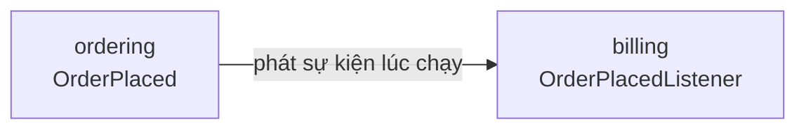
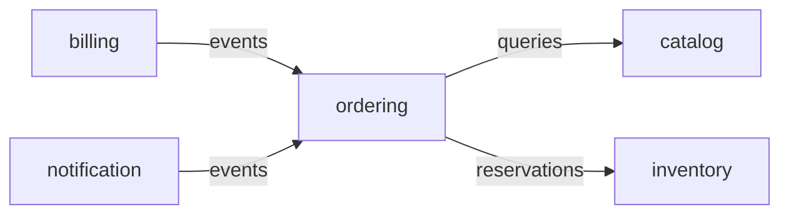

# Định danh dependency hợp lệ giữa các module

Một ứng dụng Spring Modulith có thể có các module `ordering`, `inventory`, `billing` và `notification` với package rõ ràng, nhưng kiến trúc vẫn khó bảo trì nếu chưa biết **module nào được phép phụ thuộc vào module nào, để làm gì và qua bề mặt nào**. Việc một class Java `public` có thể được `import` không chứng minh tham chiếu đó hợp lệ về nghiệp vụ. Ngược lại, một luồng có sự kiện đi từ `ordering` tới `billing` không có nghĩa mã nguồn `ordering` phải phụ thuộc vào lớp xử lý của `billing`.

Bài học **“Định danh dependency hợp lệ giữa các module”** thuộc chương **Thiết kế module** trong **SPRING_MODULITH_VERIFICATION_TESTING**. Ta sẽ xác định và ghi lại quan hệ phụ thuộc được phép dưới dạng **module nguồn → module đích → giao diện được công bố → lý do nghiệp vụ**, rồi kiểm chứng bằng `ApplicationModules.verify()`. Quy tắc kiến trúc này được kết hợp với `@ApplicationModuleTest`, kiểm thử sự kiện, cơ sở dữ liệu và tích hợp, cùng quality gate CI để ngăn phụ thuộc sai tái xuất hiện.

## 1. Mục tiêu học tập

Sau bài học, bạn có thể:

1. Phân biệt **phụ thuộc mã nguồn**, **luồng gọi lúc chạy**, **luồng sự kiện** và **phụ thuộc qua dữ liệu/hạ tầng**.
2. Xác định **bên phụ thuộc (source)**, **bên được phụ thuộc (target)** và **đường truy cập cụ thể** của một quan hệ.
3. Phân loại quan hệ hợp lệ theo **trách nhiệm nghiệp vụ**, **bề mặt API**, **chiều phụ thuộc**, **chu trình** và **mức kết dính**.
4. Khai báo `@NamedInterface` và `@ApplicationModule(allowedDependencies = ...)` cho các quan hệ được phép.
5. Dùng `ApplicationModules.verify()` làm bài kiểm thử kiến trúc và nhận biết loại vấn đề mà công cụ không tự phát hiện.
6. Xây dựng ma trận phụ thuộc, kịch bản kiểm thử module/sự kiện/database/tích hợp và quality gate trong CI.

## 2. Dependency là gì trong một modular monolith?

Trong ứng dụng nhiều module, một **dependency** (quan hệ phụ thuộc) có nghĩa một phần của module nguồn cần biết, sử dụng hoặc trông đợi điều gì đó do module đích cung cấp. Cần tách các kiểu quan hệ thay vì gộp tất cả thành một mũi tên trên sơ đồ.

| Loại quan hệ | Ví dụ | Hệ quả thiết kế |
| --- | --- | --- |
| **Phụ thuộc kiểu/mã nguồn** | `ordering` import `inventory.api.InventoryReservations` | Trình biên dịch và kiểm chứng kiến trúc nhận thấy sự phụ thuộc giữa các module |
| **Gọi phương thức đồng bộ** | `ordering` gọi `inventory.reserve(...)` | Module nguồn cần kết quả ngay; phải định nghĩa lỗi, transaction và thời gian chờ |
| **Sự kiện** | `ordering` phát `OrderPlaced`; `billing` lắng nghe | Dòng sự kiện lúc chạy đi theo một chiều; kiểu sự kiện công khai tạo phụ thuộc mã nguồn của listener |
| **Dữ liệu dùng chung** | `billing` đọc trực tiếp bảng `orders` của `ordering` | Có thể tạo phụ thuộc ngầm dù không import bất kỳ class nào |
| **Hạ tầng/khai báo cấu hình** | Consumer dùng topic, tên bảng, REST endpoint hoặc JSON schema của producer | Hợp đồng có thể nằm ngoài mô hình kiểu Java mà `verify()` phân tích |
| **Phụ thuộc gián tiếp** | `ordering → inventory → supplier` | Caller có thể bị ảnh hưởng bởi lỗi hoặc độ trễ ở các thành phần bắc cầu, nhưng không nên tự import nội bộ của chúng |

Trong Spring Modulith, trọng tâm của `ApplicationModules` là **cấu trúc và quan hệ giữa application module** ở mức mã nguồn/kiểu và các quy tắc kiến trúc đã khai báo. Phụ thuộc qua database, event broker, HTTP hoặc reflection có thể cần thêm công cụ và kiểm thử tích hợp; không nên khẳng định mọi phụ thuộc runtime đều được `verify()` phát hiện.

### 2.1. Hướng phụ thuộc mã nguồn khác hướng truyền thông điệp

Xem một sự kiện đơn hàng:



Trong mã nguồn, listener của `billing` tham chiếu đến kiểu `ordering.events.OrderPlaced`. Vì vậy **cạnh phụ thuộc kiểu** là:

```text
billing ──(import OrderPlaced)──> ordering::events
```

**Không có lý do** để `ordering` import `billing.internal.OrderPlacedListener` chỉ vì nó là bên phát sự kiện. Đặt sai hướng mũi tên có thể làm người thiết kế vô tình tạo chu trình `ordering → billing → ordering`.

### 2.2. Có dependency không đồng nghĩa sai

Một modular monolith không yêu cầu các module hoàn toàn cô lập. `ordering` phải làm việc với tồn kho và danh mục sản phẩm để tạo đơn. Vấn đề là:

- Nó phụ thuộc vào **hợp đồng nghiệp vụ công khai** hay **chi tiết triển khai**?
- Module đích có **sở hữu quyết định** được yêu cầu không?
- Caller có cần kết quả **đồng bộ** không?
- Quan hệ có tạo **chu trình** hoặc trao quyền đọc/ghi dữ liệu sai chỗ không?
- Hợp đồng có đủ rõ để **kiểm thử** và **thay thế triển khai** không?

Một quan hệ hợp lệ có thể là `ordering → inventory::reservations`, nhưng `ordering → inventory.internal.StockRepository` là sai về đóng gói và quyền sở hữu.

## 3. Xác định danh tính một cạnh phụ thuộc

Trước khi khai báo `allowedDependencies`, nên mô tả mỗi cạnh dưới dạng một bản ghi có ý nghĩa:

| Thuộc tính | Câu hỏi phải trả lời | Ví dụ |
| --- | --- | --- |
| **Source** | Mã thuộc module nào cần dùng chức năng? | `ordering` |
| **Target** | Module nào sở hữu chức năng? | `inventory` |
| **Published interface** | Bề mặt được công bố nào chứa hợp đồng? | `inventory::reservations` |
| **Reason** | Use case nào cần phụ thuộc? | Giữ hàng trước khi xác nhận đơn |
| **Interaction** | Đồng bộ, sự kiện hay truy vấn? | Gọi đồng bộ `reserve(...)` |
| **Contract** | Kiểu đầu vào/đầu ra và lỗi nghiệp vụ nào? | `ReserveStock`, `ReservationReceipt`, `InsufficientStock` |
| **Data ownership** | Ai cập nhật và bảo vệ dữ liệu? | Chỉ `inventory` cập nhật tồn/phiếu giữ |
| **Failure semantics** | Khi target lỗi, source làm gì? | Từ chối hoặc chuyển đơn sang trạng thái chờ theo chính sách |
| **Verification** | Bài kiểm thử nào bảo vệ cạnh? | `verify()`, module test, database/concurrency test |

Không chỉ ghi “`ordering` gọi `inventory`” vì mô tả đó không phân biệt được **gọi interface có chủ đích** với **đọc repository nội bộ**.

### 3.1. Ma trận “ai dùng gì” trước khi đặt package

Giả sử ứng dụng bán hàng có các trách nhiệm:

- `catalog` sở hữu trạng thái sản phẩm và dữ liệu tra cứu sản phẩm;
- `inventory` sở hữu khả năng giữ, nhả và nhập hàng;
- `ordering` sở hữu tạo/hủy đơn cùng trạng thái đơn;
- `billing` sở hữu thu tiền và hoàn tiền;
- `notification` sở hữu nội dung và kênh thông báo.

Bảng đề xuất:

| Source | Target/interface | Lý do hợp lệ | Không được phụ thuộc vào |
| --- | --- | --- | --- |
| `ordering` | `catalog::queries` | Lấy ảnh chụp thông tin sản phẩm cần chốt trên đơn | `catalog.internal.ProductEntity` |
| `ordering` | `inventory::reservations` | Yêu cầu giữ hàng và nhận kết quả | `inventory.internal.StockRepository` |
| `billing` | `ordering::events` | Biết đơn đã được chấp nhận để bắt đầu xử lý thanh toán | `ordering.internal.OrderService` |
| `notification` | `ordering::events` | Gửi thông báo khi đơn được xác nhận | `ordering.internal.OrderRepository` |
| `ordering` | `billing.internal.PaymentService` | **Không hợp lệ theo thiết kế này** | Phụ thuộc nội bộ/khả năng tạo vòng |
| `inventory` | `ordering.internal.OrderEntity` | **Không hợp lệ theo thiết kế này** | Tồn kho không sở hữu dữ liệu đơn |

Ma trận là **chính sách mục tiêu** phải được thống nhất với nghiệp vụ, không phải điều tự suy ra từ package hiện tại. Có hệ thống cần phối hợp thanh toán đồng bộ trước khi xác nhận đơn; khi đó có thể thiết kế hợp đồng `billing::payments` và cập nhật chính sách, thay vì gắn nhãn “cấm mọi phụ thuộc” cho `ordering → billing` trong mọi trường hợp.

## 4. Tiêu chí quyết định một dependency có hợp lệ hay không

Đánh giá theo các câu hỏi có thứ tự; nếu một điều kiện không đạt, đừng chỉ mở quyền truy cập để mã biên dịch.

### 4.1. Có lý do nghiệp vụ cụ thể không?

`ordering` cần `inventory.reserve(...)` vì giữ hàng là điều kiện xác nhận đơn. Ngược lại, `ordering` import `inventory.StockUtil` chỉ để tiện gọi một helper chung chưa đủ chứng minh một quan hệ kiến trúc hợp lý. Cần xét helper thuộc sở hữu của ai, vì sao phải công khai và liệu nó có ràng buộc nội bộ kho không.

Một dependency chỉ dựa trên câu “class đó ở sẵn đó” thường là dấu hiệu coupling ngẫu nhiên.

### 4.2. Module đích có sở hữu quyết định và dữ liệu không?

`inventory` cần tự bảo vệ invariant **không giữ vượt tồn**. `ordering` không nên đọc `StockEntity`, tự trừ `available`, rồi gọi `StockRepository.save(...)`: như vậy caller chiếm quyền quyết định của module đích.

Đối với truy vấn, caller có thể nhận một DTO công khai; đối với lệnh thay đổi, caller nên gửi **ý định** và nhận **kết quả nghiệp vụ**.

### 4.3. Kiểu đích có được công bố qua API không?

Với application module kiểu `CLOSED` (mặc định):

- Các kiểu Java có thể truy cập được trong **package gốc** của module thuộc bề mặt API mặc định.
- Một package con chỉ được xem là phần giao diện công khai khi được công bố phù hợp, ví dụ bằng `@NamedInterface`.
- Các kiểu dưới `internal` không tự trở thành API chỉ vì khai báo Java `public`.

**`public` trong Java là quyền truy cập ngôn ngữ; API module là chính sách kiến trúc.** Nếu caller import class nội bộ mà Java vẫn biên dịch, `ApplicationModules.verify()` có thể phát hiện phụ thuộc sai khi kiểm tra closed module.

### 4.4. Caller có được phép phụ thuộc vào target đó không?

Một module nguồn có thể khai báo `allowedDependencies` để giới hạn danh sách module hoặc named interface mà nó được tham chiếu. Một API đã công bố **không tự đồng nghĩa** mọi caller đều được sử dụng nếu caller có chính sách phụ thuộc hẹp.

Đánh giá phải đủ hai phía: **đích công bố đúng** và **nguồn được phép dùng đúng giao diện đó**.

### 4.5. Cạnh mới có tạo chu trình không?

Ví dụ:

```text
ordering → inventory → catalog → ordering
```

Ngay cả nếu mỗi cạnh đều tham chiếu một interface công khai, chu trình vẫn khiến thay đổi lan truyền và gây khó xác định chiều điều phối. Trong mô hình được Spring Modulith kiểm chứng, phụ thuộc vòng giữa các application module là một vi phạm điển hình. Khi xuất hiện vòng, hãy xem lại quyền quyết định, hướng sự kiện và khả năng tách hợp đồng ở module sở hữu.

### 4.6. Contract có che được cách triển khai không?

Quan hệ `ordering → inventory::reservations` có thể vẫn không tốt nếu interface trả `StockJpaEntity` hoặc `EntityManager`. Mặc dù một số phép kiểm chứng cấu trúc có thể thấy quan hệ hợp lệ với API đã công bố, **review hợp đồng** vẫn cần kiểm tra rò rỉ persistence, lỗi hạ tầng, transaction và độ ổn định dữ liệu.

## 5. Đặt tên dependency trong Spring Modulith

Trong các ví dụ dưới đây, mỗi application module là một package con trực tiếp của `com.example.shop`:

```text
com.example.shop/
├── ShopApplication.java
├── catalog/
│   ├── queries/
│   │   ├── package-info.java
│   │   ├── ProductQueries.java
│   │   └── ProductSnapshot.java
│   └── internal/ProductRepository.java
├── inventory/
│   ├── reservations/
│   │   ├── package-info.java
│   │   ├── InventoryReservations.java
│   │   └── ReserveStock.java
│   └── internal/StockRepository.java
├── ordering/
│   ├── package-info.java
│   ├── events/
│   │   ├── package-info.java
│   │   └── OrderPlaced.java
│   └── internal/PlaceOrderService.java
├── billing/
│   ├── package-info.java
│   └── internal/OrderPlacedListener.java
└── notification/
    ├── package-info.java
    └── internal/OrderPlacedListener.java
```

Những tên `catalog`, `inventory`, `ordering`, `billing`, `notification` là **định danh module** trong mô hình minh họa. Định danh thực tế phụ thuộc cách Spring Modulith phát hiện và cấu hình module; nếu dự án có quy tắc đặt ID khác, phải lấy đúng ID trong mô hình, không tự suy từ tên một Java class.

### 5.1. `module::namedInterface` có ý nghĩa gì?

Ký hiệu:

```text
inventory::reservations
       |         |
       |         +-- tên named interface được inventory công bố
       +------------ định danh application module đích
```

Đây **không phải** FQCN `com.example.shop.inventory.reservations`, cũng không phải cú pháp import Java. Nó là **định danh logic** dùng trong chính sách phụ thuộc của Spring Modulith.

Một tham chiếu chỉ có tên module, ví dụ `"ordering"`, biểu diễn phụ thuộc vào API mặc định ở package gốc của module đó trong những trường hợp cần cho phép bề mặt API gốc. Muốn giới hạn vào một package con đã công bố, dùng `"ordering::events"` sau khi có named interface `events`.

### 5.2. Công bố interface cho module đích

Trong `inventory/reservations/package-info.java`:

```java
@org.springframework.modulith.NamedInterface("reservations")
package com.example.shop.inventory.reservations;
```

Trong `catalog/queries/package-info.java`:

```java
@org.springframework.modulith.NamedInterface("queries")
package com.example.shop.catalog.queries;
```

Trong `ordering/events/package-info.java`:

```java
@org.springframework.modulith.NamedInterface("events")
package com.example.shop.ordering.events;
```

Một module có thể công bố nhiều named interface khi có **nhóm consumer và mục đích khác nhau**. Tránh công bố cả package `internal` chỉ để một import sai được chấp nhận. Nếu một kiểu thực sự cần thiết cho module khác, hãy chuyển nó thành **hợp đồng có chủ đích**, có người sở hữu và test bảo vệ.

### 5.3. Giới hạn module nguồn bằng `allowedDependencies`

Trong `ordering/package-info.java`:

```java
@org.springframework.modulith.ApplicationModule(
    allowedDependencies = {
        "catalog::queries",
        "inventory::reservations"
    }
)
package com.example.shop.ordering;
```

Trong `billing/package-info.java`:

```java
@org.springframework.modulith.ApplicationModule(
    allowedDependencies = "ordering::events"
)
package com.example.shop.billing;
```

Trong `notification/package-info.java`:

```java
@org.springframework.modulith.ApplicationModule(
    allowedDependencies = "ordering::events"
)
package com.example.shop.notification;
```

Danh sách này chỉ là **chính sách đề xuất cho ứng dụng ví dụ**. Nếu `billing` còn dùng API thanh toán ở module khác thì phải khai báo những quan hệ cần thiết và hợp lệ đó; không che giấu import để đạt test xanh.

**Chú ý:** Nếu một module không khai báo `allowedDependencies` hẹp, nó không tự do truy cập phần nội bộ của closed module khác. Quy tắc công bố API của module đích là một giới hạn độc lập.

## 6. Đưa sự phụ thuộc vào hợp đồng nghiệp vụ

Giả sử `ordering` cần kiểm tra catalog và giữ hàng trước khi tạo đơn.

### 6.1. API truy vấn sản phẩm thuộc module `catalog`

```java
// catalog/queries/ProductSnapshot.java
package com.example.shop.catalog.queries;

import java.math.BigDecimal;

public record ProductSnapshot(
    String sku,
    String name,
    BigDecimal unitPrice,
    boolean sellable
) {}
```

```java
// catalog/queries/ProductQueries.java
package com.example.shop.catalog.queries;

import java.util.Optional;

public interface ProductQueries {
    Optional<ProductSnapshot> findBySku(String sku);
}
```

`catalog` sở hữu cách tra cứu và diễn giải trạng thái sản phẩm. Trả `ProductSnapshot` giúp `ordering` không cần biết `ProductEntity` hoặc `JpaRepository` nội bộ. Đây là **API đọc**; trong một hệ thống đặt hàng thực tế cần quyết định riêng cách chốt giá và xử lý thay đổi giá đồng thời.

### 6.2. API giữ hàng thuộc module `inventory`

```java
// inventory/reservations/ReserveStock.java
package com.example.shop.inventory.reservations;

public record ReserveStock(String sku, int quantity) {
    public ReserveStock {
        if (sku == null || sku.isBlank() || quantity <= 0) {
            throw new IllegalArgumentException("Yêu cầu giữ hàng không hợp lệ");
        }
    }
}
```

```java
// inventory/reservations/ReservationReceipt.java
package com.example.shop.inventory.reservations;

import java.util.UUID;

public record ReservationReceipt(UUID id) {}
```

```java
// inventory/reservations/InventoryReservations.java
package com.example.shop.inventory.reservations;

public interface InventoryReservations {
    ReservationReceipt reserve(ReserveStock command);
}
```

Module `inventory` cần định nghĩa lỗi hết hàng, thời hạn phiếu giữ, idempotency key nếu xử lý lặp và điều kiện transaction. Không nên để caller tự `load → subtract → save` vì điều đó tạo phụ thuộc hành vi và đẩy invariant sang sai chủ sở hữu.

### 6.3. Bên gọi dùng đúng API được cấp phép

```java
// ordering/internal/PlaceOrderService.java
package com.example.shop.ordering.internal;

import com.example.shop.catalog.queries.ProductQueries;
import com.example.shop.inventory.reservations.InventoryReservations;
import com.example.shop.inventory.reservations.ReserveStock;
import org.springframework.stereotype.Service;

@Service
class PlaceOrderService {
    private final ProductQueries catalog;
    private final InventoryReservations inventory;

    PlaceOrderService(
        ProductQueries catalog,
        InventoryReservations inventory
    ) {
        this.catalog = catalog;
        this.inventory = inventory;
    }

    void placeOrder(String sku, int quantity) {
        var product = catalog.findBySku(sku)
            .orElseThrow(() -> new IllegalArgumentException("SKU không tồn tại"));
        if (!product.sellable()) {
            throw new IllegalStateException("Sản phẩm không được bán");
        }

        var reservation = inventory.reserve(new ReserveStock(sku, quantity));

        // Lưu đơn với giá đã chốt và reservation.id() trong ordering.
        // Phát OrderPlaced khi đơn thật sự đạt trạng thái đã cam kết.
    }
}
```

Đây là **đoạn minh họa cạnh phụ thuộc**, chưa phải use case chạy độc lập: triển khai thật cần repository, ngữ nghĩa giá, giao dịch, xử lý lỗi, chống yêu cầu lặp và phát sự kiện đúng thời điểm. Điểm kiến trúc đáng chú ý là class trong `ordering` chỉ import các kiểu thuộc hai named interface đã được công bố.

## 7. Lập đồ thị dependency hợp lệ và phát hiện vòng

Từ ma trận và code minh họa, ta có đồ thị phụ thuộc mã nguồn:



Đây là một đồ thị **có hướng**. Trong ví dụ, không có đường từ `inventory` quay lại `ordering`, cũng không có đường từ `ordering` sang `billing` hoặc `notification`; vì vậy đồ thị không tạo chu trình theo các cạnh đã nêu.

### 7.1. Một chu trình xuất hiện như thế nào?

Giả sử một lập trình viên muốn `inventory` kiểm tra trạng thái đơn nên thêm:

```text
ordering  → inventory
inventory → ordering
```

Dù `inventory` dùng một interface công khai của `ordering`, chu trình hai chiều vẫn tồn tại. Trước khi vội mở quyền, cần xác định lý do nghiệp vụ: **tồn kho có thật sự cần biết trạng thái đơn để bảo vệ luật giữ hàng**, hay chính `ordering` nên gửi lệnh `releaseReservation(...)` khi hủy đơn?

Các cách sửa có thể gồm:

- Chuyển quyết định về **module sở hữu**: `ordering` quyết định hủy, `inventory` quyết định nhả phiếu giữ theo lệnh.
- Giao tiếp bằng **sự kiện công khai** khi kết quả không cần ngay; tránh producer import listener.
- Đặt một hợp đồng tại module có trách nhiệm phù hợp nếu hai bên đang chia sẻ cùng một ý nghĩa nghiệp vụ.
- Xem lại ranh giới module khi hai phần liên tục cần truy cập trạng thái nội bộ của nhau.

**Không nên** tạo một module `common` mới chỉ để giấu vòng mà không rõ ai sở hữu luật; vòng có thể biến thành coupling ngầm.

### 7.2. Phụ thuộc trực tiếp và phụ thuộc bắc cầu

Nếu `ordering → inventory` và `inventory → supplier`, việc `ordering` bị ảnh hưởng bởi lỗi bên `supplier` lúc chạy **không có nghĩa** `ordering` nên import trực tiếp `supplier.internal.*`. Interface `InventoryReservations` cần định nghĩa cách ứng xử khi nguồn hàng không thể đáp ứng, còn chi tiết supplier nằm phía sau module `inventory`.

Khi kiểm thử tích hợp, có thể cần khởi động cả phụ thuộc bắc cầu; điều này khác với việc cấp quyền cho caller truy cập API của mọi module bắc cầu.

## 8. Kiểm chứng tự động bằng `ApplicationModules.verify()`

Đưa chính sách dependency thành một bài JUnit 5:

```java
// src/test/java/com/example/shop/ModularityTests.java
package com.example.shop;

import org.junit.jupiter.api.Test;
import org.springframework.modulith.core.ApplicationModules;

class ModularityTests {

    @Test
    void modulesOnlyUseAllowedDependencies() {
        ApplicationModules.of(ShopApplication.class).verify();
    }
}
```

`ApplicationModules.of(ShopApplication.class)` dựng mô hình module dựa trên ứng dụng. `verify()` áp dụng các quy tắc kiến trúc do Spring Modulith hỗ trợ, điển hình:

1. **Không có phụ thuộc vòng** giữa application module.
2. **Không tham chiếu vào phần nội bộ** của closed module khác.
3. **Không vượt quá giới hạn `allowedDependencies`** do module nguồn khai báo.

Phạm vi kiểm chứng thực tế còn phụ thuộc phiên bản, cấu hình và những quy tắc bổ sung trong classpath. Không nên diễn giải một lần `verify()` xanh là chứng minh toàn bộ quá trình nghiệp vụ, bảo mật hoặc dữ liệu đã đúng.

### 8.1. Bảng tình huống có thể thực hành

Với quy tắc `ordering` chỉ được `"catalog::queries"` và `"inventory::reservations"`:

| Tham chiếu thực tế | Kết quả kiến trúc mong muốn | Nguyên nhân |
| --- | --- | --- |
| `ordering` dùng `catalog.queries.ProductQueries` | **Hợp lệ** | Interface công bố, đúng danh sách phụ thuộc |
| `ordering` dùng `inventory.reservations.InventoryReservations` | **Hợp lệ** | Giao diện giữ hàng được cho phép |
| `ordering` dùng `inventory.internal.StockRepository` | **Vi phạm** | Đích là phần nội bộ, không thuộc named interface |
| `ordering` dùng `catalog.events.PriceChanged` | **Vi phạm trong cấu hình này** | Module nguồn chỉ được `catalog::queries`, không được `catalog::events` |
| `billing` dùng `ordering.events.OrderPlaced` | **Hợp lệ** | `billing` cho phép `ordering::events` |
| `billing` dùng `ordering.internal.OrderRepository` | **Vi phạm** | Tham chiếu vào nội bộ |
| `inventory` import một kiểu công khai của `ordering` tạo chu trình với `ordering → inventory` | **Vi phạm chu trình** | API công khai không làm phụ thuộc vòng trở nên hợp lệ |

Lưu ý: kết quả là **kỳ vọng về ranh giới** cho mô hình mô tả; để ví dụ Java biên dịch và ứng dụng chạy còn cần lớp, bean và dependency build phù hợp.

### 8.2. Tạo một vi phạm để kiểm thử kiến trúc

Không chỉ thêm dòng `import` không dùng đến vì nó có thể không tạo phụ thuộc bytecode đáng tin cậy. Hãy tạo một field/constructor thật:

```java
// ordering/internal/BadOrderingDependency.java
package com.example.shop.ordering.internal;

import com.example.shop.inventory.internal.StockRepository;

class BadOrderingDependency {
    private final StockRepository stocks;

    BadOrderingDependency(StockRepository stocks) {
        this.stocks = stocks;
    }
}
```

Giả sử `StockRepository` là kiểu Java truy cập được, bài test kiến trúc cần phát hiện quan hệ `ordering → inventory.internal`. Cách sửa **không phải** chuyển `inventory` sang `OPEN` hay thêm `inventory.internal` vào named interface. Hãy thay trường phụ thuộc thành `InventoryReservations`, đồng thời chuyển yêu cầu nghiệp vụ thành method của hợp đồng đó.

### 8.3. `verify()` không thay thế review lý do nghiệp vụ

Giả sử `catalog` công bố một `JpaRepository` ở package gốc và `ordering` được phép dùng API gốc. Một số phép kiểm chứng cấu trúc có thể không từ chối vì kiểu đã ở bề mặt công khai, trong khi thiết kế vẫn rò rỉ persistence và trao quyền cập nhật sai chỗ. Cần review hợp đồng để tránh những API `getEntityManager()`, `saveEntity(...)` hoặc DTO chứa entity nội bộ.

Ngoài ra, `verify()` không tự phát hiện việc một service truy cập trực tiếp bảng thuộc module khác bằng SQL string hoặc một HTTP client gọi sai endpoint nếu không có quan hệ kiểu rõ ràng. Những ranh giới này cần quy ước, kiểm thử tích hợp và kiểm soát quyền dữ liệu/hạ tầng bổ sung.

## 9. Kiểm thử module để chứng minh dependency có thể dùng được

Một cạnh hợp lệ ở mức cấu trúc vẫn có thể thất bại do Spring không tìm thấy bean, lỗi transaction hoặc ngữ nghĩa hợp đồng không đúng. `@ApplicationModuleTest` giúp kiểm tra hành vi trong phạm vi module và các phụ thuộc phù hợp.

### 9.1. Kiểm thử `ordering` với phụ thuộc trực tiếp

```java
// src/test/java/com/example/shop/ordering/OrderingModuleTests.java
package com.example.shop.ordering;

import org.junit.jupiter.api.Test;
import org.springframework.modulith.test.ApplicationModuleTest;
import org.springframework.modulith.test.ApplicationModuleTest.BootstrapMode;

@ApplicationModuleTest(mode = BootstrapMode.DIRECT_DEPENDENCIES)
class OrderingModuleTests {

    @Test
    void orderUsesCatalogAndInventoryContracts() {
        // Arrange: fixture cho catalog, inventory và ordering.
        // Act: gọi use case đặt hàng qua API công khai của ordering.
        // Assert: giá, phiếu giữ hàng, trạng thái đơn và lỗi đúng hợp đồng.
    }
}
```

`DIRECT_DEPENDENCIES` dùng khi cần khởi động module đang kiểm thử cùng các module phụ thuộc trực tiếp. Đây là **khung cấu hình**, chưa phải test hành vi hoàn chỉnh vì cần triển khai fixture và assertion. Với `STANDALONE`, dùng test double cho những collaborator bên ngoài khi cần cô lập. Với `ALL_DEPENDENCIES`, phạm vi có thể bao gồm phụ thuộc bắc cầu; chọn mode theo mục tiêu kiểm thử, không dùng mode để hợp thức hóa một dependency production sai.

### 9.2. Kiểm thử contract ở cả hai đầu

Với cạnh `ordering → inventory::reservations`, hai phía cần quan tâm khác nhau:

- **Producer (`inventory`)**: khi tồn đủ, `reserve` tạo phiếu hợp lệ; khi thiếu hàng, API từ chối theo lỗi đã tài liệu hóa; dữ liệu không bị ghi sai.
- **Consumer (`ordering`)**: kết quả giữ hàng được sử dụng để chấp nhận đơn; lỗi hết hàng không tạo đơn “đã đặt”; timeout hoặc request lặp được xử lý theo chính sách.

Khi API thay đổi tên method, payload hoặc semantics của lỗi, kiểm thử consumer giúp phát hiện ảnh hưởng xuyên module. Với những hợp đồng quan trọng, có thể bổ sung test tích hợp dùng cả hai module thay vì chỉ mock toàn bộ.

## 10. Kiểm thử dữ liệu và sự kiện để bảo vệ dependency ẩn

### 10.1. Phụ thuộc qua database

Một module có thể không import `inventory.StockRepository` nhưng vẫn chạy SQL trực tiếp trên bảng `stock`:

```sql
-- Ví dụ phản mẫu: ordering can thiệp dữ liệu do inventory sở hữu.
UPDATE stock
SET available = available - :qty
WHERE sku = :sku;
```

`ApplicationModules.verify()` không nhất thiết phát hiện phụ thuộc ẩn này vì quan hệ nằm trong SQL string hoặc truy cập hạ tầng. Cần bảo vệ bằng quy ước sở hữu schema/bảng, review query và kiểm thử tích hợp; trong hệ thống cần kiểm soát mạnh có thể dùng phân quyền database.

Hãy test tình huống tồn `1`, hai yêu cầu giữ `1` chạy đồng thời: tối đa một yêu cầu thành công và tồn kho không âm. Với giao dịch nhiều bước, kiểm tra rollback nhất quán. Việc có một interface công khai không tự bảo đảm bất biến dữ liệu.

### 10.2. Phụ thuộc qua sự kiện

Kiểu sự kiện là một hợp đồng cần xác định rõ:

```java
// ordering/events/OrderPlaced.java
package com.example.shop.ordering.events;

import java.util.UUID;

public record OrderPlaced(UUID orderId) {}
```

Module `billing` có thể đăng ký listener dùng `OrderPlaced`. Trong mô hình Spring Modulith, `billing` phụ thuộc vào `ordering::events` về mặt kiểu; **không cần** `ordering` import listener của `billing`.

Kiểm thử cần xác nhận sự kiện chỉ được xem là phản ánh một đơn đã được chấp nhận theo semantics giao dịch; listener xử lý đúng payload, không thu tiền trùng khi xử lý lại; lỗi handler có cơ chế retry/phục hồi phù hợp. `@NamedInterface` chỉ xác định bề mặt tham chiếu, không bảo đảm phát hoặc nhận sự kiện đúng một lần.

### 10.3. Phụ thuộc qua HTTP, message broker và schema

Nếu hai thành phần trao đổi qua HTTP hoặc một broker, hợp đồng có thể là URI, event type, schema JSON, phiên bản thông điệp hoặc ngữ nghĩa retry. Các quan hệ này phải được ghi trong ma trận dependency **dù** `verify()` không trực tiếp thấy một import Java xuyên module.

Cần test contract serialization, lỗi mạng, tương thích payload, authorization và tình huống thông điệp lặp. Đặc biệt, việc đặt HTTP client trong package `internal` không xóa mối phụ thuộc runtime vào API bên ngoài.

## 11. Đọc lỗi kiểm chứng để sửa đúng nguyên nhân

Khi `verify()` thất bại, không nên bắt đầu bằng việc mở thêm `allowedDependencies`. Hãy chẩn đoán:

| Dạng lỗi | Câu hỏi cần đặt | Cách sửa ưu tiên |
| --- | --- | --- |
| **Truy cập nội bộ** | Caller có thực sự cần kiểu triển khai đó không? | Công bố interface/DTO đúng nghiệp vụ; caller bỏ import `internal` |
| **Không nằm trong `allowedDependencies`** | Đây là yêu cầu nghiệp vụ mới hợp lệ hay phụ thuộc phát sinh tùy tiện? | Nếu hợp lệ, cập nhật chính sách có review; nếu không, loại phụ thuộc |
| **Chu trình module** | Module nào thật sự sở hữu quyết định? Có đang đảo hướng event? | Chỉnh hướng cộng tác, tách hợp đồng/luồng hoặc xem lại ranh giới |
| **Context test không khởi động** | Có thiếu bean/test infrastructure hay sai scope bootstrap? | Cấu hình test đúng phạm vi; không mở API production vô cớ |
| **Contract test thất bại** | API có đổi semantics mà consumer chưa thích ứng? | Sửa contract/migration hoặc triển khai, bổ sung test tương thích |
| **Integration/event test thất bại** | Transaction, retry, dữ liệu hoặc idempotency sai? | Sửa hành vi tại module sở hữu và policy tương tác |

### 11.1. Khi nào được sửa `allowedDependencies`?

Ví dụ có một use case mới yêu cầu `ordering` tham chiếu `billing::paymentRequests`. Hãy kiểm tra:

1. `billing` có thật sự sở hữu lệnh thanh toán này?
2. Có cần kết quả đồng bộ ngay để quyết định trạng thái đơn?
3. `billing::paymentRequests` đã được công bố với kiểu và lỗi ổn định?
4. Thêm cạnh này có tạo vòng với `billing → ordering::events` hiện tại không?
5. Có phương án điều phối/sự kiện khác tránh được vòng hay không?

Nếu thêm `ordering → billing` trong khi `billing → ordering` đã tồn tại, **chu trình không được sửa bằng cách chỉ mở danh sách phụ thuộc**. Cần giải quyết thiết kế. `allowedDependencies` thể hiện quyền tham chiếu được chấp thuận, không làm phụ thuộc vòng trở thành hợp lệ.

### 11.2. Tránh “ngoại lệ vĩnh viễn”

Chuyển module thành `OPEN` có thể hữu ích khi di trú ứng dụng cũ còn nhiều import chéo, nhưng cần thống kê quan hệ sai hiện có và tiêu chí đưa về `CLOSED`. Việc mở `internal` thành named interface để tránh test đỏ thường biến chi tiết triển khai thành API ngoài ý muốn. Không nên cho phép mọi module dùng mọi interface chỉ để giải quyết một lỗi cục bộ.

## 12. Quality gate CI cho chính sách phụ thuộc

Chính sách chỉ thực sự được bảo vệ nếu thay đổi mã phải vượt qua kiểm thử tự động:

```text
Pull request
   |
   +-- Compile / JUnit
   |       |
   |       +-- ApplicationModules.verify()
   |               ├── Không phụ thuộc vòng
   |               ├── Không import package nội bộ
   |               └── Không vượt allowedDependencies
   |
   +-- @ApplicationModuleTest / contract tests
   |       └── API và tương tác giữa các module hoạt động đúng
   |
   +-- Database / transaction / concurrency tests
   |       └── Invariant của module sở hữu dữ liệu được giữ
   |
   +-- Event / integration tests
           └── Payload, retry, idempotency và lỗi tương tác đúng
   |
   +-- Các gate bắt buộc đạt -> được xem xét merge
```

Với Maven, `./mvnw -B test` có thể chạy JUnit và bài kiểm thử kiến trúc nếu test đã được cấu hình đúng; dự án Gradle dùng lệnh test tương ứng. Kiểm tra `ModularityTests` thực sự được test runner phát hiện, không bị skip và lỗi verify làm job thất bại. Các test cần môi trường database/broker có thể chia stage nhưng phải có chính sách rõ ràng khi nào bắt buộc trước merge.

### 12.1. Thước đo cải thiện thực tế

Không chỉ theo dõi “test xanh”; có thể đánh giá theo từng vòng phát triển:

- Một thay đổi nội bộ của `inventory` có kéo `ordering` sửa theo không?
- Có tăng số lượng module phụ thuộc trực tiếp vào một module trung tâm mà không rõ lý do không?
- Có import mới vào `internal`, SQL vượt quyền sở hữu, hoặc sự kiện chứa entity nội bộ không?
- Các hợp đồng công khai có dễ hiểu và có consumer test cho trường hợp lỗi không?
- Khi xảy ra sự cố, có xác định được module sở hữu invariant và bài test cần bổ sung không?

Đồ thị ít cạnh không tự động là thiết kế tốt. Một cạnh có lý do nghiệp vụ rõ và hợp đồng được bảo vệ đáng giá hơn nhiều cạnh ẩn qua database hoặc helper chung.

## 13. Bài thực hành: phê duyệt hay bác bỏ dependency mới

Ứng dụng quản lý vé gồm `booking`, `seating`, `payment` và `notification`. Ban đầu:

```text
booking      → seating::reservations
payment      → booking::events
notification → booking::events
```

Nhóm phát triển đưa ra các đề xuất:

1. `booking` gọi `seating.internal.SeatRepository` để tự giữ ghế vì cần tốc độ cao.
2. `booking` dùng `seating::reservations.reserve(...)` và nhận mã phiếu giữ ghế.
3. `payment` import `booking.events.BookingConfirmed` để bắt đầu thu tiền.
4. `booking` import `payment.internal.PaymentService` để xem tiền đã thu hay chưa.
5. `notification` cần thêm thông tin địa điểm trong sự kiện `BookingConfirmed`.
6. `seating` chạy trực tiếp SQL cập nhật bảng `booking` để xác nhận đã có ghế.

### 13.1. Phân tích từng đề xuất

| Đề xuất | Đánh giá | Lý do hoặc hướng sửa |
| --- | --- | --- |
| (1) Gọi repository nội bộ | **Bác bỏ** | Vi phạm closed module; `seating` phải bảo vệ invariant không bán ghế trùng |
| (2) Gọi named interface | **Chấp thuận nếu contract đúng** | Phù hợp chủ sở hữu, cần test đồng thời và lỗi |
| (3) Listener import event | **Chấp thuận nếu được khai báo** | Phụ thuộc mã nguồn `payment → booking::events` hợp lệ |
| (4) Gọi `payment.internal` | **Bác bỏ thiết kế hiện tại** | Rò rỉ nội bộ, thêm cạnh `booking → payment` có nguy cơ tạo chu trình |
| (5) Thêm trường event | **Cần đánh giá hợp đồng** | Xác định nhu cầu thật, versioning và consumer test; không truyền entity nội bộ |
| (6) SQL vượt chủ sở hữu | **Bác bỏ** | `seating` không tự ghi bảng/trạng thái do `booking` sở hữu |

Khi thiết kế để `booking` biết trạng thái thanh toán, cân nhắc một read model có trách nhiệm rõ, sự kiện từ `payment`, hoặc một API truy vấn thanh toán công khai **mà không tạo chu trình mã nguồn**. Việc dùng sự kiện ngược chiều cần phân tích phụ thuộc kiểu và trạng thái workflow cẩn thận.

### 13.2. Bài tập tự triển khai

1. Vẽ đồ thị **phụ thuộc mã nguồn** từ ba cạnh ban đầu, phân biệt rõ với chiều sự kiện lúc chạy.
2. Viết `@NamedInterface("reservations")` của `seating` và `@NamedInterface("events")` của `booking`.
3. Khai báo `allowedDependencies` ở `booking`, `payment`, `notification` đúng các cạnh được duyệt.
4. Viết `ApplicationModules.of(TicketsApplication.class).verify()` trong JUnit.
5. Cố ý tạo field kiểu `seating.internal.SeatRepository` từ `booking` và quan sát kiểm thử kiến trúc; sửa thành interface công khai.
6. Đề xuất bài `@ApplicationModuleTest` cho giữ ghế, test cạnh tranh hai yêu cầu một ghế, test phát/nhận `BookingConfirmed`, và một integration test cho xử lý thanh toán lặp.

**Đối chiếu:** Một đồ thị đúng nên cho `booking` phụ thuộc `seating::reservations` và các consumer `payment`, `notification` phụ thuộc `booking::events`; `booking` không import listener thanh toán, còn `seating` không ghi dữ liệu booking. Chỉ dùng sự kiện khi semantics cho phép; giữ ghế thường cần phản hồi đủ rõ trước khi xác nhận vé.

## 14. Checklist trước khi thêm hoặc chấp thuận một dependency

- [ ] Xác định chính xác **source → target → named interface**.
- [ ] Có use case và lý do nghiệp vụ rõ ràng cho quan hệ.
- [ ] Target sở hữu luật, dữ liệu và quyết định được yêu cầu.
- [ ] Kiểu được tham chiếu nằm ở API package gốc hoặc named interface đã công bố.
- [ ] Caller chỉ được phép dùng phần target tương ứng trong `allowedDependencies`.
- [ ] Không import trực tiếp entity, repository hoặc service `internal` của module khác.
- [ ] Không phát sinh phụ thuộc vòng; phân biệt hướng event runtime với hướng import kiểu.
- [ ] Contract có định nghĩa dữ liệu, lỗi, transaction, retry và idempotency cần thiết.
- [ ] Không có phụ thuộc ẩn qua SQL, broker, HTTP hoặc schema ngoài phạm vi kiểm tra.
- [ ] `ApplicationModules.verify()` được chạy trong CI và thất bại khi vi phạm kiến trúc.
- [ ] `@ApplicationModuleTest`/contract tests bảo vệ hành vi cả producer và consumer.
- [ ] Kiểm thử database, concurrency, event và tích hợp bao phủ invariant và tác dụng phụ quan trọng.
- [ ] Mọi ngoại lệ `OPEN` hoặc quan hệ tạm được ghi lý do cùng điều kiện chấm dứt.
- [ ] Khi thêm một cạnh mới, nhóm đã đánh giá rủi ro thay đổi lan truyền và chu trình.

**Ghi nhớ:** Dependency hợp lệ giữa các module không phải là “mã nào import được mã nào”, mà là **một quyền sử dụng hợp đồng nghiệp vụ được module sở hữu công bố có chủ đích**. Định danh từng cạnh bằng source, target, interface và lý do; biểu diễn nó qua `@NamedInterface` và `allowedDependencies`; dùng `ApplicationModules.verify()` để chặn vi phạm cấu trúc, rồi dùng kiểm thử hành vi, dữ liệu và sự kiện để bảo vệ ý nghĩa thực tế của quan hệ đó.
