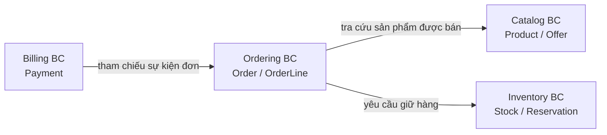

# Quan hệ module và bounded context

Một hệ thống thương mại có thể có các module `catalog`, `ordering`, `inventory`, `billing` và `shipping`. Cùng một từ **“sản phẩm”** đôi khi có nghĩa khác nhau ở mỗi nơi: danh mục quản lý thông tin bán hàng, kho quản lý đơn vị có thể xuất, còn đơn hàng lưu **ảnh chụp sản phẩm tại thời điểm đặt**. Nếu các module chia sẻ một `ProductEntity` toàn cục, thay đổi trong danh mục sẽ lan sang tồn kho và đặt hàng, dù quyết định nghiệp vụ của chúng khác nhau.

**Bounded context** trong Domain-Driven Design (DDD) giúp xác định **ranh giới mà một mô hình và ngôn ngữ nghiệp vụ có ý nghĩa nhất quán**. **Application module** của Spring Modulith là **ranh giới cấu trúc trong mã nguồn** mà ta có thể công bố API và kiểm chứng phụ thuộc. Hai khái niệm liên quan chặt chẽ, nhưng **không đồng nhất** và không tự động ánh xạ một-một trong mọi dự án.

Bài học thuộc chương **Thiết kế module** của **SPRING_MODULITH_VERIFICATION_TESTING**. Ta sẽ chuyển hiểu biết về bounded context thành quy tắc package, giao diện công khai, `allowedDependencies` và `ApplicationModules.verify()`, sau đó kết hợp `@ApplicationModuleTest`, kiểm thử sự kiện, cơ sở dữ liệu, tích hợp và quality gate trong CI để giữ được cả ranh giới mã nguồn lẫn cam kết nghiệp vụ.

## 1. Mục tiêu học tập

Sau bài này, bạn có thể:

1. Phân biệt **subdomain**, **bounded context**, **application module** và **microservice**.
2. Giải thích vì sao một thuật ngữ hoặc entity có thể mang ý nghĩa khác nhau giữa hai bounded context.
3. Chọn cách ánh xạ bounded context sang application module theo quy mô và trách nhiệm thực tế.
4. Đọc **context map** và phân biệt quan hệ hợp tác nghiệp vụ với chiều phụ thuộc mã nguồn.
5. Thiết kế Published Language, Open Host Service hoặc Anti-Corruption Layer để tránh làm rò rỉ mô hình của context này sang context khác.
6. Biểu diễn ranh giới bằng API package, `@NamedInterface`, `allowedDependencies`, rồi kiểm chứng bằng `ApplicationModules.verify()`.
7. Chọn kiểm thử module, sự kiện, database và tích hợp để bảo vệ những quy tắc mà kiểm tra cấu trúc không thể tự chứng minh.

## 2. Bounded context thực sự giới hạn điều gì?

Trong DDD, một **bounded context (BC)** là phạm vi mà các thuật ngữ, quy tắc và mô hình domain có một cách hiểu nhất quán. Nó thường gắn với một phần trách nhiệm và một nhóm người tham gia nghiệp vụ, nhưng không được xác định đơn thuần bằng tên phòng ban hoặc sơ đồ tổ chức.

Ví dụ cùng thuật ngữ `Order`:

| Context | `Order` có ý nghĩa gì? | Trạng thái/luật trọng tâm |
| --- | --- | --- |
| `ordering` | Yêu cầu mua hàng đã được ghi nhận, có dòng hàng và giá chốt | Có được hủy, sửa, xác nhận không? |
| `fulfillment` | Công việc đóng gói và hoàn tất giao hàng | Đã phân bổ hàng, đã bàn giao đơn vị vận chuyển chưa? |
| `billing` | Tham chiếu để đối soát khoản tiền cần thu/hoàn | Khoản thu nào đã xử lý, yêu cầu nào bị lặp? |

Các context có thể dùng cùng `orderId` để liên hệ, nhưng **không nhất thiết chia sẻ một class `Order`**. Trong `billing`, một `OrderPaymentReference` hoặc `PayableOrder` có thể là mô hình phù hợp hơn `ordering.internal.OrderEntity`.

### 2.1. Ubiquitous Language có phạm vi

*Ubiquitous Language* là ngôn ngữ thống nhất giữa chuyên gia nghiệp vụ và người phát triển **trong một bounded context**. Từ “giữ hàng” ở `inventory` có thể là một reservation có thời hạn; trong `ordering`, “đã đặt” có thể có nghĩa đơn đã được hệ thống chấp nhận và lưu bền vững. Hai trạng thái không nhất thiết xảy ra cùng lúc.

Khi một cuộc họp có những câu như “đã xác nhận nhưng chưa xác nhận theo nghĩa của kho”, đó là tín hiệu cần làm rõ **ranh giới ngữ nghĩa** và ngôn ngữ. Không nên tìm cách giải quyết chỉ bằng cách thêm một enum `GlobalStatus` có hàng chục giá trị áp dụng cho toàn hệ thống.

### 2.2. Subdomain không phải bounded context

**Subdomain** mô tả một phần bài toán kinh doanh: ví dụ bán hàng, định giá, vận hành kho hoặc thanh toán. Bounded context là **ranh giới của mô hình được dùng để giải quyết bài toán đó**. Một subdomain có thể được nhiều context hỗ trợ, hoặc một context có thể xử lý những phần liên quan của nhiều subdomain, tùy lịch sử và thiết kế.

Các nhãn *core*, *supporting*, *generic* của subdomain giúp ưu tiên đầu tư: nơi tạo lợi thế cạnh tranh đáng được mô hình hóa sâu; năng lực hỗ trợ có thể dùng giải pháp đơn giản hơn. Chúng **không** trực tiếp quyết định số lượng package hay cách cấu hình Spring Modulith.

### 2.3. Bounded context không có nghĩa mỗi context phải là một dịch vụ mạng

Bounded context là **ranh giới ngữ nghĩa và quyền sở hữu**. Nó có thể được triển khai trong cùng một tiến trình Java, trong một modular monolith hoặc trong hệ thống phân tán. Việc tách context thành microservice là một quyết định triển khai có thêm chi phí vận hành, dữ liệu phân tán và giao tiếp qua mạng.

Spring Modulith đặc biệt hữu ích khi ta muốn **giữ sự phân biệt đó trong một ứng dụng triển khai cùng nhau**: mỗi application module có API và nội bộ, các phụ thuộc sai được phát hiện trong kiểm thử, nhưng toàn ứng dụng vẫn có thể chạy trong một tiến trình Spring Boot.

## 3. Application module và bounded context giống và khác nhau ở đâu?

| Góc nhìn | Bounded context (DDD) | Application module (Spring Modulith) |
| --- | --- | --- |
| Mục đích | Giữ mô hình, thuật ngữ và quyết định nghiệp vụ nhất quán | Tổ chức mã nguồn, công bố API và giới hạn phụ thuộc |
| Cách xác định | Phân tích nghiệp vụ, trách nhiệm, mô hình và quan hệ với context khác | Quy tắc phát hiện module và cấu hình Spring Modulith |
| Ranh giới nhìn thấy | Ngôn ngữ, sự kiện, hợp đồng và quyền sở hữu dữ liệu | Package/module, kiểu công khai, named interface, dependency graph |
| Cơ chế bảo vệ | Context map, review domain, contract và test nghiệp vụ | `ApplicationModules.verify()`, `@ApplicationModuleTest`, test bổ sung |
| Có bắt buộc là tiến trình riêng? | Không | Không |
| Có tự phát hiện sai nghĩa nghiệp vụ? | Cần con người và kiểm thử chuyên biệt | Không; kiểm chứng chủ yếu các quan hệ cấu trúc |

Không nên tuyên bố `@ApplicationModule` **tạo ra** bounded context. Annotation chỉ là một phần cơ chế biểu diễn module; nếu mọi module cùng sửa một bảng và dùng một mô hình entity chung, bounded context vẫn chưa thật sự được bảo vệ.

### 3.1. Cách ánh xạ phổ biến: một context, một application module

Với ứng dụng vừa phải, chọn một application module cho mỗi bounded context là **điểm khởi đầu dễ hiểu**:

```text
com.example.commerce/
├── CommerceApplication.java
├── catalog/       # Catalog BC
├── ordering/      # Ordering BC
├── inventory/     # Inventory BC
├── billing/       # Billing BC
└── shipping/      # Shipping BC
```

Mỗi module có quyền kiểm soát mô hình và database logic của nó; bên ngoài chỉ tương tác qua API hoặc sự kiện được công bố. Cách này làm context map có thể tương ứng gần với dependency graph, nhưng **hai sơ đồ vẫn trả lời hai câu hỏi khác nhau**.

### 3.2. Một bounded context có thể gồm nhiều module

Một context lớn, ví dụ `fulfillment`, có thể có nhiều nhóm chức năng nội bộ như lập kế hoạch đóng gói, phân bổ kho và xử lý giao nhận. Nếu chúng dùng cùng ngôn ngữ và cùng một ranh giới ngữ nghĩa, không cần tự động gọi mỗi nhóm là một bounded context độc lập.

Có thể tổ chức thành **package nội bộ** của một application module `fulfillment`, hoặc thiết kế **nhiều application module** trong cùng một bounded context khi cần giới hạn phụ thuộc chi tiết hơn. Khi dùng nhiều application module, phải giải thích cả hai tầng: module nào được phép gọi module nào và chúng cùng thuộc context nghiệp vụ nào. Việc phát hiện module lồng nhau phụ thuộc cấu hình Spring Modulith; không nên giả định một thư mục con tự động trở thành application module ngang hàng.

### 3.3. Một module chứa nhiều context là tín hiệu cần xem lại

Một module `commerce` vừa quản lý thuật toán khuyến mãi, quyền ghi tồn, đối soát thanh toán và đặt đơn có thể phản ánh **ranh giới kỹ thuật quá rộng**. Nó khiến thay đổi ở nhiều chuyên môn đụng nhau và khó biết ai chịu trách nhiệm cho từng invariant.

Tuy nhiên, trong hệ thống nhỏ hoặc giai đoạn chuyển đổi, một package lớn có thể tạm chứa nhiều mô hình. Hãy ghi rõ phần cần tách, ưu tiên nơi có **ngữ nghĩa xung đột, vòng đời riêng hoặc dữ liệu bị ghi chéo**. Không tách máy móc chỉ vì tên context trong bản vẽ.

## 4. Ví dụ: cùng một “sản phẩm”, ba mô hình khác nhau

Xét ứng dụng thương mại với các ngữ cảnh:

- **Catalog:** quản lý SKU, tên hiển thị, trạng thái kinh doanh, giá niêm yết.
- **Inventory:** quản lý đơn vị hàng, tồn khả dụng, phiếu giữ hàng.
- **Ordering:** quản lý các dòng đơn, giá đã chốt, vòng đời đặt/hủy đơn.

Nếu dùng một `ProductEntity` toàn hệ thống, các cột về quảng cáo, tồn kho và dòng đơn có thể bị trộn trong một mô hình. Một thay đổi JPA mapping ở catalog có thể phá code inventory; một cập nhật giá niêm yết có thể vô tình thay ý nghĩa của đơn cũ.

### 4.1. Phân biệt các kiểu có chủ sở hữu

| Context | Kiểu nội bộ minh họa | Dữ liệu nó sở hữu | Vì sao không chia sẻ nguyên class? |
| --- | --- | --- | --- |
| `catalog` | `Product` | Tên, điều kiện bán, giá niêm yết | Thông tin tiếp thị và lifecycle riêng |
| `inventory` | `StockItem`, `Reservation` | Tồn khả dụng, giữ/nhả hàng | Invariant đồng thời, không phụ thuộc mapping catalog |
| `ordering` | `OrderLine` | SKU tham chiếu, tên và giá đã chốt | Đơn cũ không tự thay khi catalog đổi |

**Chia sẻ một mã định danh** như `sku` không đồng nghĩa chia sẻ aggregate, repository hoặc quyền cập nhật. `inventory` có thể cần biết SKU hợp lệ, nhưng không nhất thiết import `catalog.internal.ProductEntity`. `ordering` có thể lưu `sku`, `displayName`, `priceAtPurchase` như một bản chụp do chính nó sở hữu.

### 4.2. Các ranh giới giao tiếp cần thiết



Sơ đồ thể hiện **phụ thuộc mã nguồn tới hợp đồng**: `ordering` tham chiếu API của catalog và inventory; `billing` tham chiếu kiểu sự kiện công khai của ordering. Về mặt **event runtime**, thông báo `OrderPlaced` đi từ ordering đến billing, tức hướng truyền thông tin khác hướng import kiểu sự kiện.

Không cần một class `GlobalOrderAndProduct` dùng chung cho mọi context. Chính **hợp đồng trao đổi** là chỗ những mô hình riêng của chúng gặp nhau.

## 5. Context map: quan hệ giữa các bounded context

DDD sử dụng **context map** để mô tả các context và cách chúng phối hợp, bao gồm quan hệ tổ chức, quyền ảnh hưởng đến hợp đồng và cơ chế tích hợp. Một context map tốt không chỉ là sơ đồ gọi hàm.

### 5.1. Những kiểu quan hệ thường gặp

| Quan hệ trong DDD | Ý nghĩa | Ví dụ và tác động triển khai |
| --- | --- | --- |
| **Customer–Supplier** | Context cung cấp năng lực chủ động đáp ứng một phần nhu cầu của context tiêu thụ | `inventory` cung cấp API giữ hàng cho `ordering`; hai nhóm phối hợp phiên bản hợp đồng |
| **Open Host Service** | Context cung cấp giao diện tích hợp có chủ đích cho nhiều consumer | `catalog` công bố `CatalogOffers` thay vì mỗi caller truy cập repository riêng |
| **Published Language** | Các bên thống nhất biểu diễn trao đổi rõ, ổn định | `ProductOffer`, `OrderPlaced` hoặc schema event có ý nghĩa công khai |
| **Anti-Corruption Layer (ACL)** | Bên tiêu thụ dịch mô hình bên ngoài sang ngôn ngữ của mình | `ordering` ánh xạ `CatalogOffer` thành dữ liệu `OrderLine` |
| **Conformist** | Bên tiêu thụ chấp nhận mô hình nhà cung cấp khi không thể ảnh hưởng nó | Tích hợp hệ thống cũ; cần hiểu chi phí ràng buộc và thường bao bằng adapter |
| **Shared Kernel** | Hai context cố ý chia sẻ một phần mô hình nhỏ với quy trình thay đổi chung | Dùng một số value object nền tảng, nhưng phải kiểm soát chặt quyền sở hữu |
| **Partnership** | Hai nhóm phối hợp sâu, cùng lập kế hoạch và thay đổi | Hai năng lực buộc đồng bộ sản phẩm/hợp đồng theo một kế hoạch thống nhất |
| **Separate Ways** | Tránh tích hợp không cần thiết | Hai context có dữ liệu gần giống nhưng không có use case trao đổi thực sự |

Không phải mọi dự án đều cần đủ các mẫu này. Mẫu quan hệ giúp nhóm **diễn đạt lựa chọn và chi phí**, không phải danh sách annotation Spring Modulith. Ví dụ `@NamedInterface` là cách công bố package trong Java; nó không tự biến hợp đồng thành *Published Language* tốt nếu payload vẫn là JPA entity.

### 5.2. Upstream/Downstream phải gắn với hợp đồng

Trong quan hệ Customer–Supplier, một context thường **cung cấp** mô hình/giao diện (upstream) và bên kia **tiêu thụ** (downstream). Ví dụ trong hợp đồng tra cứu hàng, catalog cung cấp `ProductOffer`, ordering tiêu thụ. Đối với một quan hệ khác, một context có thể đổi vai trò.

Đừng suy rằng upstream/downstream luôn trùng hướng **lời gọi runtime**, hoặc rằng cùng một nhóm luôn là upstream cho mọi thứ. Cần ghi rõ **hợp đồng cụ thể** và **mô hình nào được coi là nguồn chân lý**.

### 5.3. Context map và dependency graph trả lời hai câu hỏi khác nhau

**Context map:** Ai sở hữu nghĩa của `ProductOffer`, ai có quyền đổi schema, hai nhóm thương lượng hợp đồng ra sao?

**Dependency graph:** Bytecode/kiểu Java trong `ordering` đang tham chiếu những application module và named interface nào, có tạo vòng hoặc truy cập `internal` không?

Kết quả mong muốn là hai sơ đồ **phù hợp nhau**, nhưng không nên dùng đồ thị `ApplicationModules` như bằng chứng tự động rằng mọi quan hệ tổ chức/ngữ nghĩa DDD đều đúng.

## 6. Thiết kế hợp đồng xuyên context: dịch, không xuất khẩu entity

Một hợp đồng công khai nên thể hiện **dữ liệu và hành vi đủ dùng cho quan hệ**, không cố buộc consumer hiểu toàn bộ mô hình của provider.

### 6.1. Catalog công bố một ngôn ngữ trao đổi nhỏ

Cấu trúc:

```text
com/example/commerce/
├── CommerceApplication.java
├── catalog/
│   ├── package-info.java
│   ├── offers/
│   │   ├── package-info.java           # @NamedInterface("offers")
│   │   ├── CatalogOffers.java
│   │   └── ProductOffer.java
│   └── internal/
│       ├── CatalogOfferService.java
│       ├── Product.java
│       └── ProductRepository.java
├── inventory/
│   ├── package-info.java
│   ├── reservations/
│   │   ├── package-info.java           # @NamedInterface("reservations")
│   │   ├── InventoryReservations.java
│   │   ├── ReserveStock.java
│   │   └── ReservationReceipt.java
│   └── internal/
│       ├── StockReservationService.java
│       └── StockRepository.java
├── ordering/
│   ├── package-info.java
│   ├── OrderingOperations.java
│   ├── events/
│   │   ├── package-info.java           # @NamedInterface("events")
│   │   └── OrderPlaced.java
│   └── internal/
│       ├── PlaceOrderService.java
│       ├── CatalogOfferTranslator.java
│       ├── Order.java
│       └── OrderRepository.java
└── billing/
    ├── package-info.java
    └── internal/OrderPlacedListener.java
```

`catalog`, `inventory`, `ordering`, `billing` là các package con trực tiếp của package chứa `CommerceApplication`, phù hợp cách phát hiện application module thông dụng. Các package `internal` chứa triển khai của từng context, không phải bề mặt API xuyên context.

Định nghĩa named interface:

```java
// catalog/offers/package-info.java
@org.springframework.modulith.NamedInterface("offers")
package com.example.commerce.catalog.offers;
```

```java
// catalog/offers/ProductOffer.java
package com.example.commerce.catalog.offers;

import java.math.BigDecimal;
import java.util.Currency;

public record ProductOffer(
    String sku,
    String displayName,
    BigDecimal listPrice,
    Currency currency,
    boolean sellable
) {}
```

```java
// catalog/offers/CatalogOffers.java
package com.example.commerce.catalog.offers;

import java.util.Optional;

public interface CatalogOffers {
    Optional<ProductOffer> findBySku(String sku);
}
```

Những record/interface này không chứa `ProductEntity`, JPA annotation, tên bảng hoặc `JpaRepository`. Chúng là **hợp đồng để trao đổi**, không phải bản sao toàn bộ domain của catalog. Các consumer cần biết rõ quy tắc: `Optional.empty()` ứng với SKU không tồn tại; `sellable=false` ứng với sản phẩm có tồn tại nhưng không thể bán.

Ở ứng dụng thương mại thật, giá tại thời điểm đặt có thể cần `PriceQuote`, hạn hiệu lực, thuế, chương trình khuyến mãi hoặc khóa giá. Khi đó nên thiết kế một API báo giá chuyên biệt hoặc context `pricing` tùy trách nhiệm. **Không nên coi `listPrice` tự động là giá đã chốt hợp lệ cho mọi giao dịch.**

### 6.2. Inventory công bố hành vi, không công bố trạng thái nội bộ

```java
// inventory/reservations/package-info.java
@org.springframework.modulith.NamedInterface("reservations")
package com.example.commerce.inventory.reservations;
```

```java
// inventory/reservations/ReserveStock.java
package com.example.commerce.inventory.reservations;

public record ReserveStock(String sku, int quantity) {
    public ReserveStock {
        if (sku == null || sku.isBlank() || quantity <= 0) {
            throw new IllegalArgumentException("Yêu cầu giữ hàng không hợp lệ");
        }
    }
}
```

```java
// inventory/reservations/ReservationReceipt.java
package com.example.commerce.inventory.reservations;

import java.util.UUID;

public record ReservationReceipt(UUID reservationId) {}
```

```java
// inventory/reservations/InventoryReservations.java
package com.example.commerce.inventory.reservations;

public interface InventoryReservations {
    ReservationReceipt reserve(ReserveStock command);
}
```

`inventory` chịu trách nhiệm transaction, khóa/cập nhật có điều kiện và luật chống giữ vượt tồn. Khi trả `ReservationReceipt`, nó không trao `StockEntity` cho `ordering`. Một API thực tế cần định nghĩa thêm hành vi thiếu hàng, hết hạn, nhả hàng, idempotency key khi gọi lặp và ý nghĩa kết quả sau lỗi; các đoạn mã trên chỉ minh họa ranh giới hợp đồng.

### 6.3. Ordering dùng Anti-Corruption Layer để giữ mô hình riêng

Đặt translator/adapter tại **bên tiêu thụ** nếu mục tiêu là che ngôn ngữ catalog khỏi domain ordering:

```java
// ordering/internal/CatalogOfferTranslator.java
package com.example.commerce.ordering.internal;

import com.example.commerce.catalog.offers.ProductOffer;
import java.math.BigDecimal;
import java.util.Currency;

final class CatalogOfferTranslator {

    OrderLineDraft toOrderLine(ProductOffer offer, int quantity) {
        if (!offer.sellable()) {
            throw new IllegalStateException("Sản phẩm không thể đặt");
        }
        return new OrderLineDraft(
            offer.sku(), offer.displayName(),
            offer.listPrice(), offer.currency(), quantity
        );
    }

    record OrderLineDraft(
        String sku, String name,
        BigDecimal agreedUnitPrice, Currency currency,
        int quantity
    ) {}
}
```

`OrderLineDraft` là mô hình **nội bộ của ordering**, không phải kiểu catalog bắt ordering dùng cho toàn bộ vòng đời. Trong hệ thống thật, tên `agreedUnitPrice` chỉ phù hợp khi luồng có chính sách chốt giá rõ ràng; translator có thể cần nhận **báo giá đã được xác nhận** thay vì `listPrice`. Các chi tiết đó thuộc logic hợp đồng của hệ thống cụ thể.

`PlaceOrderService` có thể sử dụng các hợp đồng:

```java
// ordering/internal/PlaceOrderService.java
package com.example.commerce.ordering.internal;

import com.example.commerce.catalog.offers.CatalogOffers;
import com.example.commerce.inventory.reservations.InventoryReservations;
import com.example.commerce.inventory.reservations.ReserveStock;
import org.springframework.stereotype.Service;

@Service
class PlaceOrderService {
    private final CatalogOffers catalog;
    private final InventoryReservations inventory;
    private final CatalogOfferTranslator translator = new CatalogOfferTranslator();

    PlaceOrderService(CatalogOffers catalog, InventoryReservations inventory) {
        this.catalog = catalog;
        this.inventory = inventory;
    }

    void place(String sku, int quantity) {
        var offer = catalog.findBySku(sku)
            .orElseThrow(() -> new IllegalArgumentException("SKU không tồn tại"));
        var line = translator.toOrderLine(offer, quantity);
        var reservation = inventory.reserve(new ReserveStock(sku, quantity));

        // ordering tự lưu đơn với line và reservation.reservationId().
        // Quy tắc chốt giá, giao dịch, lỗi và sự kiện cần triển khai riêng.
    }
}
```

Đây là **mã minh họa phân chia trách nhiệm**, không phải use case độc lập chạy ngay: còn thiếu aggregate, repository, kiểm tra giá, xử lý lỗi và các điều kiện transaction. Lợi ích kiến trúc là `ordering` **không** import `catalog.internal.Product`, `catalog.internal.ProductRepository` hoặc `inventory.internal.StockRepository`.

**ACL không bắt buộc là lớp mang tên `AntiCorruptionLayer`.** Nó là trách nhiệm dịch thuật tại ranh giới: có thể là mapper nhỏ, facade hoặc adapter phức tạp tùy mức khác biệt giữa hai mô hình. Không tạo lớp chuyển đổi rỗng cho mọi DTO nếu hai bên đã thống nhất một hợp đồng đủ ổn định và không có khác biệt ngữ nghĩa cần bảo vệ.

## 7. Biểu diễn ranh giới trong Spring Modulith

Định nghĩa context map giúp ta biết **quan hệ nào hợp lý**; Spring Modulith giúp chuyển quyết định thành **chính sách phụ thuộc có thể chạy kiểm thử**.

### 7.1. Module đích công bố giao diện cần thiết

Ở module `catalog` và `inventory`, ta đã đánh dấu:

```java
@org.springframework.modulith.NamedInterface("offers")
package com.example.commerce.catalog.offers;
```

```java
@org.springframework.modulith.NamedInterface("reservations")
package com.example.commerce.inventory.reservations;
```

Với application module loại `CLOSED` (mặc định), API ở **package gốc** là phần công khai mặc định; các package con như `offers` và `reservations` cần được công bố có chủ đích. Việc một class trong `internal` có modifier Java `public` không biến nó thành API hợp lệ của module đóng.

### 7.2. Module nguồn giới hạn dependency

Trong `ordering/package-info.java`:

```java
@org.springframework.modulith.ApplicationModule(
    allowedDependencies = {
        "catalog::offers",
        "inventory::reservations"
    }
)
package com.example.commerce.ordering;
```

Định danh `"catalog::offers"` nghĩa là **application module `catalog` + named interface `offers`**, không phải tên package Java hoặc tên class. Nhờ vậy `ordering` có thể import `CatalogOffers`, nhưng không được truy cập `catalog.internal.ProductRepository` hoặc một named interface khác chưa được chấp thuận trong chính sách này.

### 7.3. Công bố sự kiện từ Ordering cho Billing

Trong `ordering/events/package-info.java`:

```java
@org.springframework.modulith.NamedInterface("events")
package com.example.commerce.ordering.events;
```

```java
// ordering/events/OrderPlaced.java
package com.example.commerce.ordering.events;

import java.util.UUID;

public record OrderPlaced(UUID orderId) {}
```

Và trong `billing/package-info.java`:

```java
@org.springframework.modulith.ApplicationModule(
    allowedDependencies = "ordering::events"
)
package com.example.commerce.billing;
```

Listener có thể nhận sự kiện bằng một kiểu công khai:

```java
// billing/internal/OrderPlacedListener.java
package com.example.commerce.billing.internal;

import com.example.commerce.ordering.events.OrderPlaced;
import org.springframework.modulith.events.ApplicationModuleListener;
import org.springframework.stereotype.Component;

@Component
class OrderPlacedListener {

    @ApplicationModuleListener
    void on(OrderPlaced event) {
        // Billing quyết định cách khởi tạo/đối soát yêu cầu thanh toán.
        // Bảo đảm idempotency theo orderId và chính sách thực tế.
    }
}
```

Đây là **khung listener**, không chứa xử lý thanh toán thật và chưa kiểm thử retry hoặc idempotency. Cấu hình event publication, transaction và cơ chế retry cần được kiểm tra theo phiên bản/dependency Spring Modulith của ứng dụng.

**Chiều phụ thuộc mã nguồn:** `billing → ordering::events`, vì listener import `OrderPlaced`. **Chiều thông báo lúc chạy:** sự kiện được phát tại `ordering` và chuyển tới listener của `billing`. Hai hướng cần được phân biệt để tránh vô tình tạo `ordering → billing → ordering`.

### 7.4. Không lạm dụng OPEN module để che context bị trộn

Chuyển `catalog` thành `OPEN` giúp nới quy tắc đóng gói ở cấp application module, nhưng **không giải quyết** việc `ordering` phải hiểu cách `ProductEntity` hoạt động hoặc việc nhiều context cùng sửa một bảng. Trong hệ thống cũ, `OPEN` có thể được dùng **tạm thời** theo kế hoạch migration; nó không thay cho context map, Published Language hay ACL.

## 8. Ma trận bề mặt giao tiếp giữa các context

Một cách làm thực dụng là ghi lại **mô hình xuất bản**, **mô hình bên tiêu thụ** và **cách chuyển đổi**:

| Context cung cấp | Contract công khai | Context dùng | Mô hình của consumer | Ai dịch? |
| --- | --- | --- | --- | --- |
| Catalog | `ProductOffer` qua `catalog::offers` | Ordering | `OrderLine` và giá đã chốt | Adapter/translator của Ordering |
| Inventory | `ReservationReceipt` qua `inventory::reservations` | Ordering | Liên kết reservation với đơn | Ordering diễn giải receipt, không tự sửa tồn |
| Ordering | `OrderPlaced` qua `ordering::events` | Billing | Yêu cầu thanh toán/đối soát | Listener/service của Billing |
| Ordering | `OrderPlaced` hoặc sự kiện phù hợp | Shipping | Yêu cầu chuẩn bị giao | Shipping quyết định workflow riêng |

Không nên để `billing` nhận `OrderEntity` rồi đọc mọi trường private; cũng không nên để `ordering` tự ghi bảng `stock` để “giảm bước gọi API”. Một contract nhỏ được bảo vệ tốt thường rẻ hơn phụ thuộc xuyên context vào schema nội bộ.

### 8.1. Bảng phân loại phụ thuộc

| Phụ thuộc | Chấp nhận trong thiết kế mẫu? | Lý do |
| --- | --- | --- |
| `ordering → catalog::offers` | **Có** | Hợp đồng tra cứu đã công bố, đúng nhu cầu đặt đơn |
| `ordering → inventory::reservations` | **Có** | Inventory sở hữu luật giữ hàng |
| `billing → ordering::events` | **Có** | Nhận sự kiện đã công bố |
| `ordering → catalog.internal.ProductRepository` | **Không** | Xâm nhập mô hình/persistence của context khác |
| `ordering → inventory.internal.StockEntity` | **Không** | Trộn quyền cập nhật và invariant |
| `ordering → billing.internal.PaymentService` | **Không trong đồ thị mẫu** | Truy cập nội bộ, có nguy cơ chu trình với `billing → ordering` |
| `billing` chạy SQL đọc thẳng bảng `ordering.orders` | **Không theo nguyên tắc sở hữu ở đây** | Phụ thuộc ẩn qua dữ liệu, không nhất thiết bị `verify()` bắt |

Một hệ thống khác có thể cần `ordering` gọi đồng bộ API công khai của `billing` để xác nhận trước khi đặt đơn. Khi đó phải **thiết kế lại các cạnh** để không có vòng và xác định hợp đồng/thời điểm cam kết; không cấm máy móc chỉ vì bảng mẫu này không có cạnh đó.

## 9. Dữ liệu, transaction và nhất quán xuyên bounded context

**Tách mô hình không tự động tách database.** Một modular monolith có thể dùng chung một datasource vật lý, nhưng phải có **quyền sở hữu logic** đối với dữ liệu.

### 9.1. Quyền sở hữu và bản chụp

`catalog` sở hữu giá niêm yết hiện tại. `ordering` sở hữu giá đã chốt trên dòng đơn. Nếu catalog đổi giá sau khi đơn được xác nhận, ordering có thể tiếp tục giữ bản chụp để bảo đảm lịch sử. Việc hai context cùng lưu một giá trị ở những thời điểm khác nhau không nhất thiết là duplication sai; đó có thể là hai **nghĩa nghiệp vụ** khác nhau.

Ngược lại, hai module cùng trực tiếp `UPDATE stock` hoặc cùng sửa cột trạng thái đơn có thể phá invariant. Cần một chủ sở hữu cho thao tác ghi hoặc một quy trình đồng bộ/điều phối có cam kết rõ.

### 9.2. Đồng bộ hay bất đồng bộ?

| Nhu cầu | Lựa chọn thường gặp | Điều phải kiểm chứng |
| --- | --- | --- |
| Đặt đơn chỉ hợp lệ khi tồn kho đã được giữ | Lệnh đồng bộ `InventoryReservations.reserve(...)` | Lỗi hết hàng, race condition, rollback/bù trừ |
| Thanh toán bắt đầu sau khi đơn đã xác nhận | Sự kiện `OrderPlaced` | Event payload, xử lý lại, thứ tự, retry |
| Billing cần thông tin đơn để đối soát | Query API hoặc read model có chủ sở hữu | Độ mới dữ liệu, quyền truy cập, tương thích hợp đồng |
| Giao hàng cần cập nhật tiến độ riêng | Event/lệnh nghiệp vụ của shipping | Thời điểm cam kết, trạng thái trung gian, idempotency |

`@Transactional` với cùng datasource có thể hỗ trợ một số thao tác xuyên module trong cùng transaction nếu mọi thành phần thực sự tham gia transaction đó. **Không suy rộng** điều này cho HTTP, broker hoặc nhiều datasource độc lập. Nếu cần nhất quán cuối cùng, phải thiết kế trạng thái trung gian, retry, bù trừ và cách quan sát lỗi.

### 9.3. Sự kiện là hợp đồng nghiệp vụ, không phải entity serialization

Tránh kiểu sự kiện:

```java
// Phản mẫu: sự kiện làm rò rỉ JPA entity và toàn bộ mô hình nội bộ.
public record OrderPlaced(OrderEntity order) {}
```

Thay bằng dữ kiện công khai đủ để consumer phản ứng. Nếu billing cần tổng tiền đã chốt, hãy thêm một hợp đồng phù hợp với ngữ nghĩa thanh toán, có quy định version/schema và quyền sở hữu; không chuyển toàn bộ entity để “cho tiện”.

Sự kiện có thể được xử lý lặp hoặc thất bại tùy cấu hình publication và listener. `@NamedInterface` chỉ công bố **kiểu được phép tham chiếu**; nó không tự bảo đảm *exactly once* hoặc sửa lỗi xử lý bất đồng bộ.

## 10. Kiểm chứng ranh giới mã nguồn với `ApplicationModules`

Để biến chính sách package/đồ thị module thành một quality gate có thể chạy lại, tạo JUnit 5:

```java
// src/test/java/com/example/commerce/ModularityTests.java
package com.example.commerce;

import org.junit.jupiter.api.Test;
import org.springframework.modulith.core.ApplicationModules;

class ModularityTests {

    @Test
    void modulesRespectBoundedContextContracts() {
        ApplicationModules.of(CommerceApplication.class).verify();
    }
}
```

Trong mô hình closed application module thông dụng, `verify()` phát hiện những vi phạm kiến trúc như:

1. **Phụ thuộc vòng** giữa application module.
2. **Truy cập nội bộ** của module khác thay vì bề mặt API được công bố.
3. **Phụ thuộc vượt `allowedDependencies`** khi module nguồn đã khai báo giới hạn.

### 10.1. Thử tạo một phụ thuộc sai

Ví dụ đoạn dưới ở `ordering`:

```java
package com.example.commerce.ordering.internal;

import com.example.commerce.catalog.internal.ProductRepository;

class WrongOrderingDependency {
    private final ProductRepository products;

    WrongOrderingDependency(ProductRepository products) {
        this.products = products;
    }
}
```

Nếu `ProductRepository` có modifier Java cho phép import, code có thể **biên dịch** nhưng vẫn **sai ranh giới** vì `ordering` đã đi vào nội bộ `catalog`. Việc tạo field/constructor thật giúp hình thành một quan hệ kiểu đáng tin cậy cho công cụ kiểm tra; chỉ thêm import không sử dụng có thể không tạo phụ thuộc trong bytecode.

Cách sửa là cho `ordering` phụ thuộc `CatalogOffers` và để catalog tự truy cập repository. **Không** mở `catalog.internal` thành API hoặc chuyển module thành `OPEN` chỉ để lỗi biến mất.

### 10.2. `verify()` xanh có đủ để công nhận bounded context đúng?

**Không.** Công cụ không tự nhận biết rằng “giá niêm yết” và “giá đã chốt” phải là hai mô hình khác nhau, hoặc một `OrderEntity` bị dùng với nghĩa mâu thuẫn ở hai context. Nó cũng không tự phát hiện mọi SQL string đọc/ghi bảng thuộc context khác, hành vi gọi HTTP, lộ dữ liệu qua JSON hay lỗi xử lý transaction.

Cần **hai lớp đánh giá**:

- **Đánh giá ngữ nghĩa:** chuyên gia nghiệp vụ và nhóm kỹ thuật thống nhất tên, trách nhiệm, invariant, context map và lời hứa hợp đồng.
- **Đánh giá thực thi:** Spring Modulith kiểm chứng phụ thuộc, test module và test tích hợp xác minh hành vi thực tế.

Việc dùng `verify()` để chặn `ordering → catalog.internal` là đúng; dùng nó như bằng chứng toàn bộ thiết kế DDD tự động chính xác là quá mức.

## 11. Kiểm thử ứng dụng theo ranh giới bounded context

### 11.1. `@ApplicationModuleTest` tại context sở hữu

Ví dụ kiểm thử contract của catalog trong phạm vi module:

```java
// src/test/java/com/example/commerce/catalog/CatalogModuleTests.java
package com.example.commerce.catalog;

import static org.assertj.core.api.Assertions.assertThat;

import com.example.commerce.catalog.offers.CatalogOffers;
import org.junit.jupiter.api.Test;
import org.springframework.beans.factory.annotation.Autowired;
import org.springframework.modulith.test.ApplicationModuleTest;

@ApplicationModuleTest
class CatalogModuleTests {

    @Autowired CatalogOffers catalog;

    @Test
    void unknownSkuProducesNoOffer() {
        // Fixture phải bảo đảm SKU-NOT-FOUND không có trong dữ liệu test.
        assertThat(catalog.findBySku("SKU-NOT-FOUND")).isEmpty();
    }
}
```

Đây là **ví dụ cấu trúc có assertion**, cần triển khai adapter và repository, cấu hình datasource và fixture trước khi chạy. Test quan trọng tiếp theo là sản phẩm tồn tại nhưng `sellable=false`, dữ liệu giá/tiền tệ đúng và thay đổi mapping persistence không đổi contract đã cam kết.

### 11.2. Kiểm thử Ordering với các dependency trực tiếp

```java
// src/test/java/com/example/commerce/ordering/OrderingModuleTests.java
package com.example.commerce.ordering;

import org.junit.jupiter.api.Test;
import org.springframework.modulith.test.ApplicationModuleTest;
import org.springframework.modulith.test.ApplicationModuleTest.BootstrapMode;

@ApplicationModuleTest(mode = BootstrapMode.DIRECT_DEPENDENCIES)
class OrderingModuleTests {

    @Test
    void orderingUsesPublishedCatalogAndInventoryContracts() {
        // Arrange: fixture sản phẩm, tồn kho và dữ liệu đặt hàng.
        // Act: gọi OrderingOperations qua API được công bố.
        // Assert: đơn lưu đúng ảnh chụp, giữ hàng đúng và lỗi được xử lý.
    }
}
```

`DIRECT_DEPENDENCIES` có thể khởi động module đang kiểm thử cùng những module mà nó phụ thuộc trực tiếp; `STANDALONE` phù hợp khi muốn kiểm tra riêng với test double, còn `ALL_DEPENDENCIES` phục vụ các bài tích hợp cần phụ thuộc bắc cầu. Test có thân chỉ gồm comment ở trên là **khung cấu hình**, không được coi là kiểm thử hành vi đã hoàn tất.

Một thiết kế bounded context tốt thường cho phép kiểm thử một năng lực mà không phải nạp mọi chi tiết persistence/domain của các context khác, trừ khi bài test **cố ý** kiểm tra hợp đồng tích hợp giữa chúng.

### 11.3. Kiểm thử Anti-Corruption Layer

Vì ordering dịch `ProductOffer` thành `OrderLineDraft`, hãy kiểm thử ý nghĩa:

- SKU và tên hiển thị được sao chép đúng thời điểm đặt.
- Giá, tiền tệ và quy tắc chốt giá được xử lý đúng, không tự động thay khi catalog sửa về sau.
- Sản phẩm không được bán không được chuyển thành dòng đơn hợp lệ.
- Một trường mới của DTO catalog không làm ordering vô tình phụ thuộc vào chi tiết không cần thiết.

Khi catalog thay ORM, các test này giúp xác nhận ranh giới ngữ nghĩa ổn định. Khi catalog **đổi ý nghĩa** của `sellable` hoặc `listPrice`, đó là thay đổi hợp đồng cần phối hợp review và kiểm thử consumer, không chỉ refactor adapter.

### 11.4. Kiểm thử database và sự kiện

| Hợp đồng/invariant | Nơi sở hữu | Kiểm thử cần có |
| --- | --- | --- |
| Không giữ vượt tồn | Inventory | Hai request giữ cùng lượng hàng cuối, transaction/locking đúng |
| Giá đơn không bị thay theo catalog mới | Ordering | Lưu đơn, đổi giá catalog, đọc lại đơn giữ ảnh chụp |
| Sự kiện `OrderPlaced` phản ánh đơn đã chấp nhận | Ordering | Payload đúng và không tạo event xác nhận khi use case rollback |
| Không thu tiền hai lần khi nhận lại event | Billing | Xử lý cùng `orderId`/event ID lặp, chỉ một tác dụng phụ |
| Schema/DTO giữa context tương thích | Provider + consumer | Contract test và integration test các kịch bản lỗi |

Nếu các context dùng cùng datasource, việc test transaction phải kiểm tra **các thay đổi thật** và rollback thực tế. Nếu tích hợp qua broker hoặc hệ thống ngoài, cần kiểm tra retry, phát lại, mất kết nối và idempotency. **Không thể dùng `ApplicationModules.verify()` thay thế các bài kiểm thử này.**

## 12. Lộ trình từ mô hình dùng chung sang bounded context rõ ràng

Nhiều hệ thống cũ có `com.example.common.ProductEntity`, `OrderEntity` và các `GlobalService` được mọi module sử dụng. Chuyển đổi nên từng bước để giảm rủi ro hồi quy.

### Bước 1 — Phát hiện xung đột ngữ nghĩa

Phỏng vấn người hiểu nghiệp vụ và xem các use case: “sản phẩm” có nghĩa khác giữa catalog, kho và đơn hàng không? “Đã xác nhận” là xác nhận điều gì? Ai chịu trách nhiệm sửa luật và xử lý khi invariant bị phá?

Viết bảng **thuật ngữ → ý nghĩa trong context → dữ liệu sở hữu → quyết định được phép đưa ra**.

### Bước 2 — Vẽ context map dựa trên hợp đồng có thật

Ghi rõ provider, consumer, mẫu quan hệ (ví dụ Customer–Supplier hay ACL), kênh giao tiếp, điều kiện thay đổi hợp đồng và trách nhiệm xử lý lỗi. Một event có tên `OrderPlaced` cần có nghĩa nghiệp vụ rõ, không phải chỉ là thông báo “entity vừa được save”.

### Bước 3 — Tách mô hình nội bộ

Để `catalog` sở hữu entity sản phẩm; `inventory` sở hữu stock/reservation; `ordering` sở hữu order/order line. Có thể tiếp tục dùng cùng database vật lý trong giai đoạn đầu, nhưng module khác **không tự đọc/ghi bảng nội bộ** nếu không có một chính sách được thiết kế rõ ràng.

### Bước 4 — Định nghĩa Published Language và ACL

Tạo API/DTO có ý nghĩa đối với quan hệ, như `catalog::offers` và `inventory::reservations`. Consumer dịch từ hợp đồng sang mô hình nội bộ thay vì giữ trực tiếp entity của context khác. Đặc biệt chú ý hợp đồng lỗi, null/empty, đơn vị tiền, thời điểm chốt dữ liệu và hành vi gọi lặp.

### Bước 5 — Thay caller theo từng lát cắt nghiệp vụ

Chuyển dần caller khỏi các class `common` hoặc `internal` đang bị dùng xuyên context. Với mỗi nhánh, viết test hành vi trước/sau và kiểm tra database/transaction liên quan. Nếu còn nợ kiến trúc trong ứng dụng brownfield, ghi rõ các import cần xóa và tiêu chí đưa module về `CLOSED`.

### Bước 6 — Chốt giới hạn phụ thuộc và đưa vào CI

Thêm `@NamedInterface`, `allowedDependencies`, bài `ApplicationModules.verify()` và các bài kiểm thử module/integration. Không xem chỉ đổi package là xong nếu nhiều context vẫn cùng ghi bảng hoặc còn một mô hình `GlobalOrderStatus` không ai sở hữu.

## 13. Quality gate để giữ context map và code không lệch nhau

| Tầng bảo vệ | Chứng minh điều gì? | Ví dụ hồi quy cần chặn |
| --- | --- | --- |
| **Review context map** | Ý nghĩa, chủ sở hữu, quan hệ provider/consumer được mô tả rõ | Đưa luật hoàn tiền sang Ordering dù Billing mới là chủ sở hữu |
| **`ApplicationModules.verify()`** | Không vòng, không import nội bộ, không vượt phụ thuộc đã khai báo | Ordering import `catalog.internal.ProductRepository` |
| **Review API/ACL** | Không làm rò rỉ mô hình nội bộ và ngữ nghĩa mâu thuẫn | DTO công khai trả JPA entity hoặc trạng thái không rõ |
| **`@ApplicationModuleTest`** | Hành vi của module qua hợp đồng được công bố | `CatalogOffers` trả sai trạng thái bán |
| **Database/concurrency tests** | Transaction và invariant ở đúng chủ sở hữu | Hai đơn giữ vượt tồn cuối cùng |
| **Event/integration tests** | Payload, transaction, retry và consumer idempotency đúng | Event lặp gây thanh toán trùng |
| **CI** | Các lớp kiểm tra bắt buộc được chạy trước khi merge | Pull request đưa lại phụ thuộc sai nhưng vẫn qua pipeline |

Ví dụ dự án Maven có thể chạy `./mvnw -B test` để thực thi JUnit, bao gồm `ModularityTests`, nếu test đã cấu hình đúng; Gradle dùng tác vụ test tương ứng. Những bài cần database/broker thật có thể nằm trong stage riêng. Quan trọng là **bài kiểm thử ranh giới phải được thực thi thực sự và có khả năng làm pipeline thất bại**.

### 13.1. Mỗi lần đổi API xuyên context nên review gì?

1. Kiểu mới có thuộc **ngôn ngữ được công bố** hay đang kéo model nội bộ ra ngoài?
2. Bên nào sở hữu ngữ nghĩa và có quyền đổi field/enum?
3. Những consumer nào đang phụ thuộc vào contract, kể cả qua JSON/event schema?
4. Việc đổi dữ liệu có làm thay đổi ý nghĩa lịch sử hay thời điểm chốt nghiệp vụ?
5. Có cần phiên bản hóa, giai đoạn tương thích, migration hoặc consumer contract test không?
6. Cạnh phụ thuộc mới có được phép bởi `allowedDependencies` và có gây chu trình không?

Context map nên được xem là **tài liệu sống**: khi thay quan hệ thật giữa các context, cập nhật cách hiểu và hợp đồng tương ứng; không chỉ sửa annotation.

## 14. Phản mẫu thường gặp

| Phản mẫu | Vấn đề | Hướng điều chỉnh |
| --- | --- | --- |
| **Một domain model toàn cục** cho sản phẩm, đơn, thanh toán | Từ vựng khác ngữ cảnh bị ép chung | Giữ model nội bộ theo BC, trao đổi DTO/event có chủ ý |
| **Một bảng dữ liệu được nhiều module tự ghi** | Invariant không còn chủ sở hữu | Chọn chủ sở hữu logic, dùng API hoặc workflow nhất quán |
| **Mỗi bảng là một BC** | Bỏ qua luật và vòng đời nghiệp vụ | Chia theo mô hình/decision, không theo schema |
| **Mỗi package là một BC** | Nhầm cấu trúc Java với ranh giới ngữ nghĩa | Phân tích Ubiquitous Language, trách nhiệm và context map |
| **Mỗi BC bắt buộc là microservice** | Tăng chi phí phân tán không cần thiết | Dùng modular monolith nếu cùng tiến trình phù hợp |
| **Đưa mọi DTO vào `shared`** | Không ai rõ quyền sở hữu contract, lan truyền thay đổi | Để hợp đồng ở provider hoặc thiết kế Shared Kernel rất nhỏ có quản trị |
| **Dùng entity làm event payload** | Lộ persistence/lazy loading và quá nhiều trường | Event bất biến mang sự thật nghiệp vụ công khai |
| **Đổi `OPEN` khi `verify()` báo lỗi** | Hợp thức hóa phụ thuộc nội bộ thay vì sửa mô hình | Thiết kế named interface/ACL, migration có tiêu chí |
| **Tất cả giao tiếp phải là event** | Quyết định cần kết quả ngay bị trì hoãn mơ hồ | Gọi đồng bộ khi kết quả là điều kiện; event cho phản ứng thích hợp |
| **Chỉ cần `verify()` xanh là DDD đúng** | Công cụ không hiểu ý nghĩa nghiệp vụ | Review ngữ nghĩa, API contract và kiểm thử hành vi |

## 15. Bài thực hành: context map cho hệ thống đặt vé

Ứng dụng bán vé có các thuật ngữ:

- **Booking:** đặt vé, hủy vé, trạng thái yêu cầu.
- **Seating:** ghế có thể chọn và phiếu giữ ghế, với quy tắc không giữ cùng ghế cho hai người.
- **Pricing:** giá vé theo suất diễn và chính sách giảm giá.
- **Payment:** thu tiền và hoàn tiền, xử lý lại khi cổng thanh toán timeout.
- **Notification:** gửi thông báo xác nhận hoặc hủy.

Nhóm đang dùng một `TicketEntity` lớn chứa trạng thái đặt vé, giá, số ghế, thanh toán và cờ gửi email. `BookingService` trực tiếp gọi `SeatRepository`, `PaymentRepository` và `EmailSender`.

### 15.1. Yêu cầu

1. Đề xuất các bounded context và xác định trách nhiệm/luật quan trọng của mỗi context.
2. Chỉ ra **hai trường hợp cùng từ nhưng khác nghĩa**, ví dụ “vé đã xác nhận” ở Booking và “vé đã thanh toán” ở Payment.
3. Vẽ context map với ít nhất ba hợp đồng trao đổi và phân biệt provider/downstream.
4. Đề xuất cấu trúc Spring Modulith với các application module ở cấp gốc, API, named interface và package nội bộ.
5. Khai báo `allowedDependencies` cho Booking, Payment và Notification sao cho không tạo vòng mã nguồn.
6. Đề xuất một ACL giúp Booking sử dụng kết quả báo giá mà không import `PricingEntity`.
7. Viết bài `ApplicationModules.verify()` và liệt kê các test quan trọng cho ghế, thanh toán, sự kiện và transaction.

### 15.2. Một phương án đối chiếu

Có thể xác định các context `booking`, `seating`, `pricing`, `payment`, `notification`, với ranh giới như sau:

| Context | Sở hữu | Hợp đồng công khai đề xuất |
| --- | --- | --- |
| Booking | Vòng đời đặt/hủy, mã vé và dữ liệu vé đã chốt | `BookingOperations`, `booking::events` |
| Seating | Sơ đồ ghế, khả dụng, phiếu giữ ghế | `seating::reservations` |
| Pricing | Giá niêm yết, ưu đãi, báo giá theo ngữ cảnh | `pricing::quotes` |
| Payment | Giao dịch thu/hoàn tiền, idempotency | Có thể tiêu thụ `booking::events` hoặc công bố API lệnh khi có use case |
| Notification | Template, kênh và trạng thái gửi | Có thể chỉ tiêu thụ `booking::events` |

Các `package-info.java` minh họa:

```java
// booking/package-info.java
@org.springframework.modulith.ApplicationModule(
    allowedDependencies = {
        "seating::reservations",
        "pricing::quotes"
    }
)
package com.example.tickets.booking;
```

```java
// payment/package-info.java
@org.springframework.modulith.ApplicationModule(
    allowedDependencies = "booking::events"
)
package com.example.tickets.payment;
```

```java
// notification/package-info.java
@org.springframework.modulith.ApplicationModule(
    allowedDependencies = "booking::events"
)
package com.example.tickets.notification;
```

Giả định `seating.reservations`, `pricing.quotes` và `booking.events` có `@NamedInterface` tương ứng. Trong hướng thiết kế này, Booking không import service nội bộ của Payment, tránh chu trình `booking → payment → booking`.

ACL của Booking dịch `TicketQuote` thuộc Pricing sang `BookedTicketPrice` nội bộ, giữ **giá chốt cùng tiền tệ và thời điểm xác nhận**. Khi Pricing đổi chiến dịch, Booking không tự tính lại giá vé đã bán. Seating sở hữu invariant không giữ một ghế cho hai yêu cầu; Payment chịu trách nhiệm chống ghi nhận cùng khoản thu hai lần.

Kiểm thử kiến trúc:

```java
package com.example.tickets;

import org.junit.jupiter.api.Test;
import org.springframework.modulith.core.ApplicationModules;

class ModularityTests {

    @Test
    void boundedContextsKeepTheirDependencies() {
        ApplicationModules.of(TicketsApplication.class).verify();
    }
}
```

Kiểm thử bổ sung gồm `@ApplicationModuleTest` cho đặt vé/báo giá, test cạnh tranh hai yêu cầu cùng một ghế, test giá vé đã chốt không đổi theo bảng giá mới, test event xác nhận/hủy và listener Payment xử lý lặp an toàn. Khi hoàn tiền đi qua nhiều hệ thống, cần test trạng thái trung gian, retry và bù trừ theo quy trình thực tế.

### 15.3. Câu hỏi phản biện

- Nếu `seating` và `booking` dùng chung bảng `tickets`, có chắc chúng là cùng bounded context không? **Không**; cần tìm quyền ghi và nghĩa của dữ liệu, sau đó chọn cách lưu/đồng bộ phù hợp.
- Nếu Pricing công bố `PriceQuote`, Booking có bắt buộc lưu nguyên object đó mãi không? **Không**; Booking có thể dịch thành giá đã chốt do mình sở hữu.
- Nếu `payment` nhận `BookingConfirmed`, mã nguồn của module nào phụ thuộc vào kiểu event của module nào? **Payment phụ thuộc Booking** khi listener import event.
- Nếu `ApplicationModules.verify()` đạt, có thể khẳng định một ghế không bán hai lần không? **Không**; cần database/concurrency test.
- Nếu cả Booking và Seating thường cùng thay đổi khi thêm tính năng “đổi ghế”, có cần gộp hai context không? **Chưa chắc**; đây có thể là use case xuyên context chính đáng. Xét tiếp invariant, trách nhiệm, hợp đồng và chi phí phối hợp.

## 16. Checklist trước khi chốt quan hệ module và bounded context

- [ ] Mỗi bounded context có mô tả ngôn ngữ, mô hình, trách nhiệm và invariant riêng.
- [ ] Không đồng nhất máy móc subdomain, bounded context, application module và microservice.
- [ ] Mỗi application module có vị trí rõ trong bản đồ context hoặc có lý do tách kỹ thuật cụ thể.
- [ ] Các thuật ngữ trùng tên nhưng khác nghĩa không bị ép dùng một entity/enum toàn cục.
- [ ] Có context map mô tả provider/consumer, hợp đồng và cách thay đổi chúng.
- [ ] Dữ liệu và quyết định ghi có chủ sở hữu; không truy cập chéo repository một cách tùy tiện.
- [ ] Có Published Language/DTO/event hoặc ACL khi mô hình của hai context khác nhau.
- [ ] API công khai ở package gốc hoặc named interface có chủ đích; `internal` không bị xuất bản vô tình.
- [ ] `allowedDependencies` thể hiện những cạnh mã nguồn hợp lệ, không tạo phụ thuộc vòng.
- [ ] Đã phân biệt hướng sự kiện lúc chạy với hướng import kiểu sự kiện.
- [ ] Có `ApplicationModules.verify()` trong quality gate CI.
- [ ] Có `@ApplicationModuleTest` cho hành vi trong context và test hợp đồng phía consumer.
- [ ] Database/concurrency test bảo vệ invariant; event/integration test bảo vệ payload, transaction, retry và idempotency.
- [ ] Review định kỳ context map khi đổi ngữ nghĩa hoặc ranh giới trách nhiệm.

**Điểm cần nhớ:** **Bounded context xác định nơi một mô hình nghiệp vụ có ý nghĩa và ai sở hữu quyết định; application module xác định ranh giới mã nguồn có thể công bố và kiểm chứng.** Dùng context map để thiết kế quan hệ, dùng hợp đồng/ACL để dịch mô hình và dùng Spring Modulith để phát hiện phụ thuộc sai. Kết hợp kiểm thử kiến trúc với kiểm thử nghiệp vụ, dữ liệu và sự kiện mới bảo đảm các context có thể hợp tác mà không đánh mất trách nhiệm riêng.
