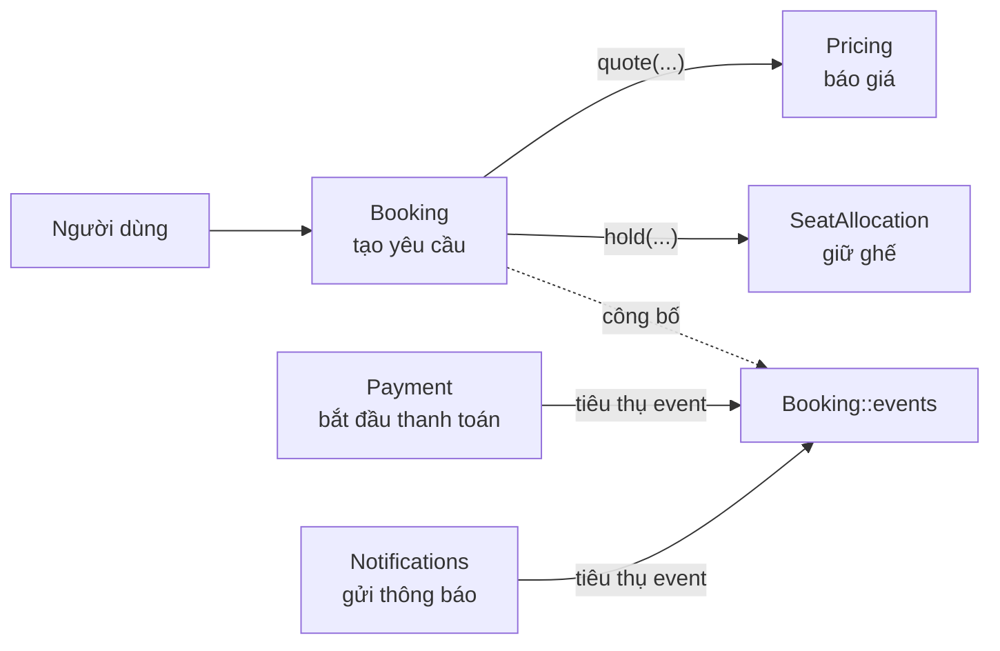
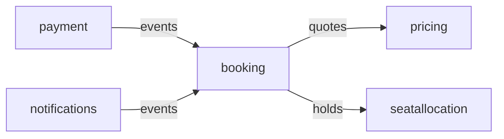
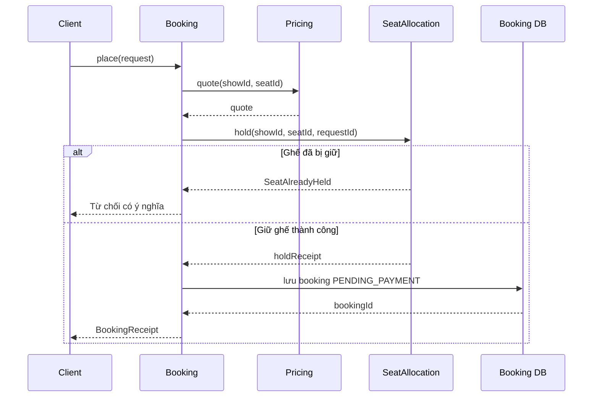

# Giữ module có lý do tồn tại và đường giao tiếp rõ ràng

Một ứng dụng có thể chia thành hàng chục package, nhưng vẫn khó thay đổi nếu không ai trả lời được câu hỏi: **“Module này tồn tại để chịu trách nhiệm về điều gì, và các module khác phải làm việc với nó như thế nào?”** Một module tên `common`, `services` hoặc `processing` có thể trở thành chỗ chứa code không rõ chủ sở hữu. Ngược lại, một module có nghiệp vụ riêng nhưng để caller truy cập thẳng repository của nó cũng chưa có ranh giới đáng tin cậy.

Trong **Spring Modulith**, thiết kế module cần đồng thời hai loại rõ ràng: **mục đích tồn tại** (năng lực, dữ liệu, quyết định, invariant thuộc về ai) và **đường giao tiếp** (ai được gọi lệnh, ai được truy vấn, ai tiêu thụ sự kiện, qua kiểu công khai nào). Thiếu một trong hai, sơ đồ package khó bảo vệ kiến trúc về lâu dài.

Bài thuộc chương **Thiết kế module** của **SPRING_MODULITH_VERIFICATION_TESTING**. Ta sẽ xây dựng một *module charter* — bản mô tả trách nhiệm và hợp đồng — rồi chuyển nó thành API package, `@NamedInterface`, `allowedDependencies` và `ApplicationModules.verify()`. Cuối cùng là các bài kiểm thử `@ApplicationModuleTest`, sự kiện, cơ sở dữ liệu, tích hợp và quality gate CI để ngăn phụ thuộc sai và hồi quy.

## 1. Kết quả cần đạt

Sau bài học, bạn có thể:

1. Giải thích **lý do tồn tại** của một application module bằng ngôn ngữ nghiệp vụ, không chỉ tên package hoặc framework.
2. Xác định dữ liệu, luật bất biến (*invariant*), quyết định và những việc module **không** chịu trách nhiệm.
3. Lập bản đồ **inbound/outbound communication**: consumer, provider, hợp đồng, kiểu tương tác và chính sách lỗi.
4. Quyết định khi nào gọi đồng bộ, khi nào dùng sự kiện và khi nào chỉ cần một package nội bộ thay vì tạo module mới.
5. Biểu diễn các hợp đồng trong Spring Modulith bằng closed module, named interface và giới hạn phụ thuộc.
6. Xác minh cấu trúc với `ApplicationModules.verify()` và bảo vệ hành vi bằng module, database, event, integration tests.
7. Review một module mới hoặc một thay đổi hợp đồng mà không vô tình mở rộng quyền truy cập vào nội bộ.

## 2. Module không chỉ là một thư mục có tên đẹp

So sánh hai đề xuất sau:

| Đề xuất | Mô tả duy nhất của nhóm | Vấn đề hoặc giá trị |
| --- | --- | --- |
| `helpers` | “Để chứa những class tiện dùng chung” | Không nêu quyết định, chủ sở hữu dữ liệu hoặc trách nhiệm; dễ thành nơi nhập nhằng |
| `seatallocation` | “Giữ/nhả ghế, không cho hai khách cùng giữ một ghế còn hiệu lực” | Có năng lực, invariant và hành vi bên ngoài cần sử dụng |
| `payment` | “Theo dõi yêu cầu thu/hoàn tiền, chống ghi nhận giao dịch lặp” | Có trách nhiệm độc lập và chính sách lỗi riêng |
| `controllers` | “Để chứa mọi HTTP controller” | Chỉ mô tả kỹ thuật; mỗi controller có thể thuộc một nghiệp vụ khác nhau |
| `notifications` | “Nhận sự kiện nghiệp vụ và quản lý mẫu, kênh, lịch sử gửi thông báo” | Có năng lực riêng, dù có thể không cần API đồng bộ |

Một tên như `service` không tự động sai khi nó là **package nội bộ** của `seatallocation`. Điểm cần tránh là biến nhóm kỹ thuật thành **application module cấp cao nhất** trong khi cùng một use case phải đi qua “module controller”, “module service” và “module repository”.

### 2.1. Phép thử “nếu xóa module này”

Hãy hỏi: **Nếu module biến mất, năng lực nghiệp vụ nào của hệ thống không còn được bảo đảm?**

- Xóa `seatallocation`: ứng dụng không còn quản lý khả dụng và giữ ghế an toàn.
- Xóa `payments`: hệ thống không còn xử lý và đối soát thu/hoàn tiền.
- Xóa `file-helpers`: ứng dụng mất vài tiện ích kỹ thuật, nhưng chưa xác định được trách nhiệm nghiệp vụ riêng.

Đây là câu hỏi định hướng chứ **không phải luật tuyệt đối**. Một module hạ tầng có thể có lý do tồn tại chính đáng nếu nó cung cấp năng lực nền tảng được quản trị rõ, chẳng hạn quản lý cấu hình khóa hoặc audit trail. Khi đó vẫn phải nêu **cam kết, chủ sở hữu và hợp đồng**, thay vì coi “dùng chung” là lý do đủ.

### 2.2. Sáu dấu hiệu một module có căn cứ vững

1. **Có mục tiêu cụ thể:** người làm nghiệp vụ có thể giải thích nó cung cấp khả năng gì.
2. **Có quyền quyết định:** module có thể chấp thuận hoặc từ chối một hành vi theo luật mình sở hữu.
3. **Có phạm vi dữ liệu hoặc chính sách:** biết dữ liệu nào được tạo/sửa, hoặc luật thuần tính toán nào do module duy trì.
4. **Có hợp đồng cần thiết:** những consumer thực sự cần nó được xác định; không công bố mọi thứ “để dự phòng”.
5. **Có thay đổi nội bộ được che giấu:** đổi thuật toán hoặc persistence không khiến caller buộc sửa nếu hợp đồng không đổi.
6. **Có kiểm chứng được:** có thể viết test cho invariant, kết quả hoặc tác dụng phụ mà module cam kết.

Không phải module nào cũng phải có database riêng. Một module định giá thuần tính toán vẫn có thể hợp lý nếu nó sở hữu chính sách và cung cấp kết quả rõ ràng. Không phải module nào cũng cần phương thức gọi đồng bộ: một module thông báo có thể chỉ nhận sự kiện.

## 3. Viết “module charter” trước khi thiết kế package

*Module charter* ở đây là bản mô tả ngắn giúp nhóm thống nhất mục đích và ranh giới. Nó **không phải annotation hay file bắt buộc** của Spring Modulith; có thể được lưu trong tài liệu kiến trúc hoặc review thiết kế. Việc quan trọng là câu trả lời có thể kiểm tra được.

| Mục | Câu hỏi | Ví dụ: `seatallocation` |
| --- | --- | --- |
| **Purpose** | Module tồn tại để làm gì? | Quản lý khả dụng và giữ ghế cho từng suất diễn |
| **Owns** | Quyết định/dữ liệu nào do nó sở hữu? | Ghế, phiếu giữ ghế, thời điểm hết hạn |
| **Invariants** | Điều gì phải luôn đúng? | Một ghế không có hai phiếu giữ còn hiệu lực được chấp nhận |
| **Exclusions** | Không chịu trách nhiệm về điều gì? | Không thu tiền, không quyết định hủy toàn bộ đặt vé |
| **Inbound contracts** | Bên ngoài được yêu cầu hành vi nào? | `SeatHolds.hold(...)`, `SeatHolds.release(...)` |
| **Outbound contracts** | Cần phụ thuộc module nào? | Có thể không cần module nghiệp vụ khác trong luồng giữ ghế |
| **Events** | Công bố/tiêu thụ sự thật gì? | Có thể công bố `SeatHoldExpired` nếu consumer cần |
| **Failure semantics** | Khi từ chối/lỗi thì caller phải hiểu gì? | Hết ghế là lỗi nghiệp vụ; lỗi database là lỗi hệ thống |
| **Verification** | Bài test quan trọng là gì? | Hai yêu cầu giữ cùng ghế: tối đa một được chấp nhận |
| **Change boundary** | Những thay đổi nào nên nằm bên trong? | Đổi khóa đồng thời, TTL hoặc schema lưu phiếu giữ |

Nếu nhóm không xác định được `Owns`, `Exclusions` và `Invariants`, nhiều khả năng ranh giới mới là ý tưởng sơ bộ. Viết charter trước sẽ tránh tình huống chuyển class qua lại chỉ vì một package đang có quá nhiều file.

### 3.1. Viết một câu có thể bị phản biện

Một mẫu hữu ích:

> Module **X** chịu trách nhiệm **quyết định Y** và **bảo vệ điều kiện Z**; các phần khác chỉ có thể **yêu cầu A hoặc đọc B** qua hợp đồng công khai, không được **trực tiếp làm C**.

Ví dụ:

> `seatallocation` quyết định việc giữ/nhả ghế và bảo vệ tính độc quyền của phiếu giữ ghế đang hiệu lực; `booking` chỉ được gọi API yêu cầu giữ ghế, không được tự sửa `SeatRepository`.

Câu này rõ hơn nhiều so với “`seatallocation` chứa `SeatService`, `SeatEntity` và `SeatRepository`”, vì mô tả thứ hai mới nói về **thành phần kỹ thuật**.

### 3.2. Phân biệt “own” và “use”

Hai module có thể cùng biết một định danh `seatId`, nhưng không cùng sở hữu trạng thái ghế. `booking` có thể lưu `seatId` để ghi nhận yêu cầu đặt vé; `seatallocation` sở hữu tính khả dụng và phiếu giữ ghế. Tương tự, `payment` có thể lưu `bookingId` để đối soát mà không được sửa `BookingEntity`.

Hãy tránh quy tắc sai “module nào đọc dữ liệu thì sở hữu dữ liệu đó”. **Sở hữu** liên quan đến quyền thay đổi ngữ nghĩa và bảo vệ bất biến; **sử dụng** có thể chỉ là nhận bản chụp hoặc tham chiếu theo hợp đồng.

## 4. Tình huống xuyên suốt: hệ thống bán vé sự kiện

Giả sử ứng dụng có các yêu cầu:

1. Khách chọn một ghế cho một suất diễn và đặt vé.
2. Hệ thống phải ngăn hai khách giữ cùng ghế trong thời gian phiếu giữ còn hiệu lực.
3. Giá vé có thể phụ thuộc hạng ghế và chiến dịch ưu đãi.
4. Sau khi tạo yêu cầu đặt vé, hệ thống có thể bắt đầu quy trình thanh toán.
5. Khách cần nhận thông báo theo trạng thái thích hợp.

Ứng viên module:

| Module | Lý do tồn tại | Quyết định chính | Không được tự làm |
| --- | --- | --- | --- |
| `booking` | Quản lý yêu cầu đặt vé và vòng đời của nó | Khi nào một yêu cầu được tạo, hủy, xác nhận theo chính sách | Tự sửa tồn ghế, tự ghi giao dịch ngân hàng |
| `seatallocation` | Quản lý quyền sử dụng ghế trong thời gian giữ | Phiếu giữ có hợp lệ và độc quyền không? | Tự quyết định trạng thái toàn bộ booking |
| `pricing` | Cung cấp báo giá theo chính sách giá hiện hành | Giá và điều kiện báo giá | Tự sửa booking đã chốt |
| `payment` | Xử lý yêu cầu thu/hoàn tiền và đối soát | Một khoản đã thu hay đã xử lý lặp chưa? | Tự sửa `BookingRepository` |
| `notifications` | Tạo và gửi thông báo theo sự kiện | Gửi thông tin nào, kênh nào, có cần retry không? | Xác nhận booking thay cho module sở hữu |

Không bắt buộc mỗi sản phẩm có đủ năm module. Với ứng dụng nhỏ, một số trách nhiệm có thể ở cùng module nếu thực sự cùng chủ sở hữu và nhịp thay đổi. **Đừng tách vì tên nghe hợp lý; hãy tách khi lời hứa và quyền quyết định đủ rõ để tạo hợp đồng.**

### 4.1. Đừng nhầm quy trình chung với chủ sở hữu chung

Một use case “đặt vé” đi qua `pricing` và `seatallocation`, nhưng điều này không có nghĩa mọi quy tắc về giá và giữ ghế thuộc `booking`. `booking` là nơi điều phối yêu cầu đặt vé, còn `pricing` chịu trách nhiệm tính báo giá và `seatallocation` chịu trách nhiệm bảo đảm ghế không bị giữ trùng.



Các mũi tên gọi `quote`/`hold` là hướng phụ thuộc của `booking` vào hợp đồng module khác. Mũi tên từ `payment`/`notifications` tới `Booking::events` diễn tả **tham chiếu kiểu sự kiện ở mã nguồn**, không phải chiều phát sự kiện lúc chạy. Chỉ khi yêu cầu được tạo theo semantics đã công bố mới nên có sự kiện thích hợp.

### 4.2. Ghi rõ trạng thái và lời hứa

Giả sử `booking` trả trạng thái `PENDING_PAYMENT` sau khi giữ được ghế và lưu yêu cầu. Điều này **không có nghĩa khách đã trả tiền**. Một sự kiện `BookingPlaced` chỉ nên mang nghĩa “yêu cầu đặt vé đã được tạo theo luật của Booking”, không mang nghĩa “đã thanh toán” hoặc “đã giao vé”.

Việc chọn tên trạng thái/sự kiện quyết định cách consumer ứng xử. Nếu hệ thống cần xác nhận chỉ sau thanh toán, phải thiết kế thêm đường phản hồi/quy trình giữa các module mà không tạo chu trình mã nguồn hoặc báo thành công quá sớm.

## 5. Vẽ cả hai phía của một module: inbound và outbound

Một module không hoạt động độc lập trong chân không. Với mỗi module, cần hai danh sách:

- **Inbound:** Ai có quyền gọi hoặc nhận thông tin do module công bố? Module cho phép những hành vi hoặc truy vấn nào?
- **Outbound:** Module này chủ động tham chiếu hợp đồng nào của module khác, vì lý do gì, và sẽ làm gì khi target không đáp ứng?

### 5.1. Ma trận đường giao tiếp

| Module nguồn | Module đích | Hợp đồng | Kiểu tương tác | Lý do nghiệp vụ |
| --- | --- | --- | --- | --- |
| `booking` | `pricing` | `pricing::quotes` | Đồng bộ: `quote(...)` | Cần báo giá trước khi chốt yêu cầu |
| `booking` | `seatallocation` | `seatallocation::holds` | Đồng bộ: `hold(...)` | Chỉ tạo booking khi ghế được giữ thành công |
| `payment` | `booking` | `booking::events` | Listener tham chiếu `BookingPlaced` | Bắt đầu quy trình thu tiền sau khi booking được tạo |
| `notifications` | `booking` | `booking::events` | Listener tham chiếu `BookingPlaced` | Gửi thông tin về yêu cầu mới |

Ma trận này là **đồ thị phụ thuộc kiểu Java**, không phải toàn bộ sơ đồ trao đổi thông điệp. Khi `booking` phát `BookingPlaced`, dữ kiện được chuyển lúc chạy đến `payment` và `notifications`; nhưng listener **import kiểu** `BookingPlaced` nên phụ thuộc mã nguồn từ `payment`/`notifications` tới `booking`.

### 5.2. Một đường giao tiếp phải có nhiều hơn tên method

Mỗi hợp đồng nên ghi:

| Thuộc tính | Ví dụ |
| --- | --- |
| Producer/owner | `seatallocation` |
| Consumer | `booking` |
| Hành vi | `hold(HoldSeat)` |
| Input | `showId`, `seatId`, `requestId`, thời hạn giữ nếu nghiệp vụ cho phép |
| Output | `SeatHoldReceipt(holdId, expiresAt)` |
| Từ chối hợp lệ | Ghế không tồn tại, ghế đã được giữ, suất diễn đóng |
| Hành vi gọi lại | `requestId` giúp phát hiện request lặp theo hợp đồng |
| Thời điểm cam kết | Phiếu giữ đã được ghi nhận nhất quán |
| Chủ sở hữu dữ liệu | `seatallocation`, không phải `booking` |
| Kiểm thử bắt buộc | Đồng thời, rollback, TTL/idempotency và consumer contract |

Chữ ký Java không tự nói hết ngữ nghĩa. Một API tên `hold(...)` nhưng chỉ ghi tạm vào bộ nhớ mà báo đã giữ thành công có thể phá quy trình booking khi ứng dụng khởi động lại. Cần định nghĩa **điều đã được cam kết sau khi phương thức trả về**.

## 6. Khi nào giao tiếp đồng bộ, khi nào dùng sự kiện?

Quyết định kênh giao tiếp dựa trên **nhu cầu có kết quả ngay** và **ý nghĩa của thông điệp**, không chỉ để giảm số import.

| Nhu cầu | Cách giao tiếp gợi ý | Vì sao |
| --- | --- | --- |
| Booking chỉ được tiếp tục khi giữ được ghế | Lệnh đồng bộ qua `SeatHolds` | Kết quả là điều kiện quyết định của use case |
| Cần báo giá hiện tại cho yêu cầu | Truy vấn đồng bộ qua `PricingQuotes` | Caller cần dữ liệu tại thời điểm quyết định |
| Booking đã được tạo; Payment bắt đầu tiến trình thu | Sự kiện `BookingPlaced` nếu quy trình cho phép bất đồng bộ | Producer không cần gọi trực tiếp implementation của payment |
| Sau khi booking được tạo cần gửi email | Sự kiện công khai | Gửi email không nên làm chủ sở hữu trạng thái booking |
| Booking cần biết ngay kết quả thanh toán để xác nhận vé | Thiết kế riêng hợp đồng/trạng thái điều phối phù hợp | Không thể chỉ đổi đồng bộ sang event rồi giả vờ đã có kết quả |

### 6.1. Lệnh, truy vấn và sự kiện nói những điều khác nhau

**Command:** “Hãy giữ ghế này” — người nhận có thể chấp nhận hoặc từ chối.

**Query:** “Báo giá cho hạng ghế này là bao nhiêu?” — yêu cầu thông tin, không mặc nhiên chuyển trạng thái.

**Event:** “Yêu cầu đặt vé đã được tạo” — thông báo về một sự thật đã xảy ra, consumer tự quyết định phản ứng.

Đặt tên đúng giúp biết ai sở hữu trách nhiệm. Event tên `DoPayment` hoặc `InvokeEmailService` thực chất là yêu cầu hành động đội lốt sự kiện; khi thiết kế cần phân biệt command bất đồng bộ với domain event.

### 6.2. Một module có thể chỉ nhận sự kiện

`notifications` có thể không cần một named interface đồng bộ cho các module khác gọi. Nó vẫn có lý do tồn tại nếu:

- Sở hữu template, quy tắc chọn kênh và lịch sử gửi;
- Có listener cho những event công khai có ý nghĩa;
- Bảo vệ xử lý lặp và lỗi gửi;
- Có test riêng cho nội dung, trạng thái và retry.

Vì vậy “không có API đồng bộ” **không đồng nghĩa** “module không hữu ích”. Ngược lại, một module chỉ có một utility method được mọi module import chưa chắc xứng đáng thành application module riêng.

### 6.3. Giao tiếp không làm mất trách nhiệm sở hữu

Nếu `booking` gọi `seatallocation.hold(...)`, module giữ ghế phải tự kiểm soát tính độc quyền và transaction ghi phiếu giữ. Caller không được gọi `findSeat()`, tự tính còn hay hết, rồi `saveSeat()` như một quy trình do mình điều khiển. Đó là **rò rỉ invariant** và thường tạo race condition.

Sự kiện cũng không trao quyền sửa dữ liệu của producer cho listener. `payment` nhận `BookingPlaced` để bắt đầu xử lý thanh toán nhưng không được tự cập nhật bảng `booking` bằng SQL hoặc import `BookingRepository`.

## 7. Chuyển module charter thành cấu trúc package

Theo cách phát hiện mặc định phổ biến của Spring Modulith, các package con **trực tiếp** của package chứa lớp ứng dụng Spring Boot là application module. Ví dụ:

```text
src/main/java/com/example/tickets/
├── TicketsApplication.java                 # @SpringBootApplication
├── booking/                                # application module
│   ├── package-info.java
│   ├── BookingOperations.java              # API mặc định ở package gốc
│   ├── PlaceBooking.java
│   ├── BookingReceipt.java
│   ├── events/
│   │   ├── package-info.java              # @NamedInterface("events")
│   │   └── BookingPlaced.java
│   └── internal/
│       ├── PlaceBookingService.java
│       ├── Booking.java
│       └── BookingRepository.java
├── seatallocation/
│   ├── package-info.java
│   ├── holds/
│   │   ├── package-info.java              # @NamedInterface("holds")
│   │   ├── SeatHolds.java
│   │   ├── HoldSeat.java
│   │   ├── SeatHoldReceipt.java
│   │   └── SeatAlreadyHeld.java
│   └── internal/
│       ├── SeatHoldService.java
│       ├── Seat.java
│       ├── SeatHold.java
│       └── SeatHoldRepository.java
├── pricing/
│   ├── package-info.java
│   ├── quotes/
│   │   ├── package-info.java              # @NamedInterface("quotes")
│   │   ├── PricingQuotes.java
│   │   ├── QuoteSeat.java
│   │   └── SeatPriceQuote.java
│   └── internal/
│       ├── PricingPolicy.java
│       └── PriceRepository.java
├── payment/
│   ├── package-info.java
│   └── internal/
│       ├── BookingPlacedListener.java
│       └── PaymentRepository.java
└── notifications/
    ├── package-info.java
    └── internal/
        ├── BookingPlacedListener.java
        └── EmailTemplateRenderer.java
```

Package `internal` giúp người đọc nhận ra triển khai không được công bố, nhưng Spring Modulith không dựa **duy nhất vào tên `internal`** để xác định phần bị đóng. Trong application module `CLOSED` mặc định, package gốc cung cấp API mặc định; package con không được công bố là phần nội bộ, trừ khi được khai báo thành **named interface** phù hợp.

### 7.1. Không xuất bản repository chỉ vì Java cho phép

`seatallocation.internal.SeatHoldRepository` có thể cần là interface Java `public` để những package nội bộ khác truy cập, nhưng nó **không vì thế trở thành API của module**. `booking` chỉ phụ thuộc `seatallocation.holds.SeatHolds`. `payment` cũng không được dùng `booking.internal.BookingRepository`.

**Phân biệt:** Java `public` là mức truy cập ngôn ngữ; Spring Modulith áp quy tắc đóng gói ở mức application module qua kiểm chứng kiến trúc. Điều này không giống việc đặt mỗi module trong một tiến trình riêng hoặc dùng JPMS `exports`.

## 8. Thiết kế hợp đồng giữ ghế

Trước hết, module `seatallocation` công bố đúng phần `holds`.

Trong `seatallocation/holds/package-info.java`:

```java
@org.springframework.modulith.NamedInterface("holds")
package com.example.tickets.seatallocation.holds;
```

Lệnh nghiệp vụ:

```java
// seatallocation/holds/HoldSeat.java
package com.example.tickets.seatallocation.holds;

import java.util.UUID;

public record HoldSeat(
    UUID showId,
    String seatId,
    UUID requestId
) {
    public HoldSeat {
        if (showId == null || requestId == null ||
            seatId == null || seatId.isBlank()) {
            throw new IllegalArgumentException("Yêu cầu giữ ghế không hợp lệ");
        }
    }
}
```

Kết quả công khai:

```java
// seatallocation/holds/SeatHoldReceipt.java
package com.example.tickets.seatallocation.holds;

import java.time.Instant;
import java.util.UUID;

public record SeatHoldReceipt(
    UUID holdId,
    Instant expiresAt
) {}
```

Một lỗi nghiệp vụ có ý nghĩa:

```java
// seatallocation/holds/SeatAlreadyHeld.java
package com.example.tickets.seatallocation.holds;

public class SeatAlreadyHeld extends RuntimeException {
    public SeatAlreadyHeld(String seatId) {
        super("Ghế hiện không thể được giữ: " + seatId);
    }
}
```

Và interface:

```java
// seatallocation/holds/SeatHolds.java
package com.example.tickets.seatallocation.holds;

public interface SeatHolds {
    SeatHoldReceipt hold(HoldSeat command);
}
```

Thiết kế này công bố **hành vi giữ ghế**, không công bố `SeatHoldEntity`, `SeatHoldRepository` hoặc thuật toán khóa. `requestId` gợi ý khóa idempotency, nhưng **chỉ có trường đó không tự bảo đảm idempotent**: module phải lưu và kiểm chứng mối quan hệ giữa `requestId`, nội dung yêu cầu và kết quả cũ.

### 8.1. Chính sách hợp đồng phải rõ

Đặc tả của `SeatHolds.hold(...)` cần trả lời:

1. Với một ghế đã được giữ hợp lệ, lỗi `SeatAlreadyHeld` được phát sinh khi nào?
2. Khi `requestId` cũ được gọi lại với cùng payload, có trả cùng receipt không?
3. Gọi lại cùng `requestId` nhưng ghế khác sẽ bị từ chối thế nào?
4. Thời hạn `expiresAt` là thời điểm nào và có thể gia hạn không?
5. Nếu database timeout trước lúc caller nhận kết quả, có thể truy vấn/lặp yêu cầu an toàn không?
6. Ghế có thể bị giữ bởi booking chưa thanh toán trong bao lâu?

Các câu này là **lời hứa của module**. Việc dùng optimistic locking, cập nhật SQL có điều kiện hoặc bảng phiếu giữ là **chi tiết triển khai** có thể thay đổi bên trong.

### 8.2. Bên trong module sở hữu invariant

Đoạn code dưới mô tả cấu trúc trách nhiệm, **không phải implementation hoàn chỉnh của concurrency**:

```java
// seatallocation/internal/SeatHoldService.java
package com.example.tickets.seatallocation.internal;

import com.example.tickets.seatallocation.holds.HoldSeat;
import com.example.tickets.seatallocation.holds.SeatHoldReceipt;
import com.example.tickets.seatallocation.holds.SeatHolds;
import org.springframework.stereotype.Service;
import org.springframework.transaction.annotation.Transactional;

@Service
class SeatHoldService implements SeatHolds {

    private final SeatHoldRepository holds;

    SeatHoldService(SeatHoldRepository holds) {
        this.holds = holds;
    }

    @Override
    @Transactional
    public SeatHoldReceipt hold(HoldSeat command) {
        // 1. Tra lại receipt theo requestId nếu yêu cầu đã được xử lý.
        // 2. Kiểm tra/ghi phiếu giữ theo thao tác có bảo đảm đồng thời.
        // 3. Chỉ khi ghi thành công mới trả receipt.
        return holds.holdAtomically(command);
    }
}
```

`SeatHoldRepository` và `holdAtomically(...)` ở đây là **port nội bộ giả định**, chưa có triển khai. Code không thể tự chạy nếu chưa tạo port/adapter và schema cần thiết. Cơ sở dữ liệu thực phải có cách chống hai request đồng thời đều chấp nhận cùng ghế, ví dụ constraint và thao tác có điều kiện/locking phù hợp với mô hình lưu trữ và thời hạn hiệu lực. Cần test cơ chế thật, không chỉ mock repository để khẳng định invariant.

## 9. Thiết kế hợp đồng công khai từ module Booking

`booking` có API mặc định ở package gốc:

```java
// booking/PlaceBooking.java
package com.example.tickets.booking;

import java.util.UUID;

public record PlaceBooking(
    UUID showId,
    String seatId,
    UUID requestId
) {}
```

```java
// booking/BookingReceipt.java
package com.example.tickets.booking;

import java.util.UUID;

public record BookingReceipt(
    UUID bookingId,
    String status
) {}
```

```java
// booking/BookingOperations.java
package com.example.tickets.booking;

public interface BookingOperations {
    BookingReceipt place(PlaceBooking command);
}
```

Chọn `status = "PENDING_PAYMENT"` là một **cam kết nghiệp vụ cụ thể**: booking đã được lưu theo điều kiện đã định, nhưng payment chưa hoàn thành. Trong hệ thống thật, nên định nghĩa các trạng thái và chuyển trạng thái chặt chẽ, dùng enum/value object thích hợp nếu cần.

### 9.1. Ứng dụng nội bộ phối hợp qua hợp đồng

```java
// booking/internal/PlaceBookingService.java
package com.example.tickets.booking.internal;

import com.example.tickets.booking.BookingOperations;
import com.example.tickets.booking.BookingReceipt;
import com.example.tickets.booking.PlaceBooking;
import com.example.tickets.seatallocation.holds.HoldSeat;
import com.example.tickets.seatallocation.holds.SeatHolds;
import com.example.tickets.pricing.quotes.PricingQuotes;
import com.example.tickets.pricing.quotes.QuoteSeat;
import org.springframework.stereotype.Service;

@Service
class PlaceBookingService implements BookingOperations {

    private final SeatHolds seats;
    private final PricingQuotes prices;
    private final BookingRepository bookings;

    PlaceBookingService(
        SeatHolds seats,
        PricingQuotes prices,
        BookingRepository bookings
    ) {
        this.seats = seats;
        this.prices = prices;
        this.bookings = bookings;
    }

    @Override
    public BookingReceipt place(PlaceBooking command) {
        var quote = prices.quote(new QuoteSeat(
            command.showId(), command.seatId()
        ));
        var hold = seats.hold(new HoldSeat(
            command.showId(), command.seatId(), command.requestId()
        ));

        // Persist booking using the agreed quote and hold receipt.
        // Define transaction/compensation, deduplication, and event publication.
        return bookings.createPendingPayment(command, quote, hold);
    }
}
```

Các kiểu `PricingQuotes`, `QuoteSeat` và `BookingRepository` là **hợp đồng/port giả định** cần được bổ sung theo cây package đã nêu; đoạn trên chỉ minh họa việc module Booking gọi những API đúng trách nhiệm. Nó chưa triển khai transaction, phát sự kiện hoặc xử lý lỗi, vì vậy không nên xem là một use case hoàn chỉnh đã chạy được.

`BookingRepository` thuộc `booking.internal`; module Payment không được import nó để “đánh dấu đã thu tiền”. Nếu cần kết quả thanh toán phản hồi về Booking, phải thiết kế một quan hệ và hợp đồng khác với đồ thị phụ thuộc phù hợp, không đảo chiều tùy ý để tránh vòng.

### 9.2. Sự kiện là đường ra có chủ đích

Tạo `booking/events/package-info.java`:

```java
@org.springframework.modulith.NamedInterface("events")
package com.example.tickets.booking.events;
```

```java
// booking/events/BookingPlaced.java
package com.example.tickets.booking.events;

import java.util.UUID;

public record BookingPlaced(
    UUID bookingId,
    UUID showId
) {}
```

Sự kiện `BookingPlaced` chỉ nên được công bố **khi module Booking thực sự đạt trạng thái mà sự kiện mô tả**. Nếu xử lý trong transaction, cần hiểu thời điểm publication/listener và ảnh hưởng rollback. Nếu listener chạy bất đồng bộ, consumer phải xử lý thông điệp lặp, lỗi và retry.

Không xuất bản toàn bộ `BookingEntity` trong payload chỉ để các module khác “lấy gì cũng được”. Nếu một consumer cần dữ liệu mới, thay đổi hợp đồng công khai cần được review về quyền sở hữu, tương thích schema và quyền truy cập.

## 10. Quy định đường phụ thuộc bằng Spring Modulith

Trước tiên `pricing` công bố named interface `quotes`:

```java
// pricing/quotes/package-info.java
@org.springframework.modulith.NamedInterface("quotes")
package com.example.tickets.pricing.quotes;
```

Với `seatallocation::holds` và `pricing::quotes` đã công bố, `booking/package-info.java` có thể khai báo:

```java
@org.springframework.modulith.ApplicationModule(
    allowedDependencies = {
        "seatallocation::holds",
        "pricing::quotes"
    }
)
package com.example.tickets.booking;
```

`payment` và `notifications` chỉ cần tham chiếu kiểu event `BookingPlaced` ở thiết kế ví dụ:

```java
// payment/package-info.java
@org.springframework.modulith.ApplicationModule(
    allowedDependencies = "booking::events"
)
package com.example.tickets.payment;
```

```java
// notifications/package-info.java
@org.springframework.modulith.ApplicationModule(
    allowedDependencies = "booking::events"
)
package com.example.tickets.notifications;
```

**`module::namedInterface`** gồm định danh application module và tên giao diện đã công bố. Đây không phải FQCN của package Java. Nếu module Payment còn cần phụ thuộc module khác một cách hợp lệ, danh sách phải được review và mở rộng **theo use case cụ thể**, không giấu import hoặc cấp quyền mọi module mặc định.

### 10.1. Đồ thị mã nguồn không có chu trình



Đây là **hướng tham chiếu kiểu**, vì `payment` import `booking.events.BookingPlaced`. Khi sự kiện được phát lúc chạy, nó đi từ Booking sang listener Payment, chiều đó **khác** với hướng dependency của mã nguồn.

Nếu sau này `booking` trực tiếp import `payment.internal.PaymentService`, thiết kế sẽ vừa xâm phạm nội bộ vừa có nguy cơ tạo `booking → payment → booking`. Hãy xác định ai sở hữu workflow thanh toán, cần phản hồi đồng bộ hay bất đồng bộ và hợp đồng nào có thể tổ chức mà không tạo vòng.

### 10.2. Ma trận truy cập hợp lệ

| Caller | Kiểu đích | Đánh giá | Vì sao |
| --- | --- | --- | --- |
| `booking` | `seatallocation.holds.SeatHolds` | Hợp lệ | Named interface đã công bố và được phép |
| `booking` | `pricing.quotes.PricingQuotes` | Hợp lệ | API báo giá đúng trách nhiệm |
| `booking` | `seatallocation.internal.SeatHoldRepository` | Sai | Xâm nhập triển khai/persistence của module khác |
| `booking` | `pricing.internal.PricingPolicy` | Sai | Caller tự lấy luật định giá nội bộ |
| `payment` | `booking.events.BookingPlaced` | Hợp lệ | Contract sự kiện đã công bố |
| `payment` | `booking.internal.BookingRepository` | Sai | Vượt quyền sở hữu và API module |
| `notifications` | `booking.events.BookingPlaced` | Hợp lệ | Dùng đúng hợp đồng đã khai báo |

Với Spring Modulith, package gốc của module `CLOSED` là bề mặt API mặc định; package con chỉ được công bố có chủ đích qua named interface phù hợp. `allowedDependencies` giới hạn **những module/giao diện mà caller được phép phụ thuộc**, không tự tạo bean, REST endpoint hay quyền bảo mật người dùng.

## 11. Trách nhiệm được thử thách khi lỗi xảy ra

Một sơ đồ đẹp có thể thất bại trong thực tế nếu không rõ ai xử lý lỗi giữa các module. Hãy xét các bước đặt vé: báo giá, giữ ghế, ghi booking, phát sự kiện.



Sơ đồ chỉ diễn tả **luồng dự kiến**. Nó không tự bảo đảm rằng ghi phiếu giữ ghế và ghi booking nằm trong cùng một transaction hoặc event đã được phát sau commit. Bài toán này phải được giải bằng chính sách giao dịch và thiết kế dữ liệu cụ thể.

### 11.1. Ma trận lỗi và chủ sở hữu xử lý

| Vấn đề | Ai sở hữu quy tắc? | Booking cần làm gì? | Test trọng tâm |
| --- | --- | --- | --- |
| Ghế đang được giữ | `seatallocation` | Không xác nhận booking, trả lỗi nghiệp vụ | Module test giữ ghế |
| Giá đã hết hiệu lực | `pricing` | Yêu cầu báo giá lại hoặc từ chối theo hợp đồng | Contract test giá |
| Giữ ghế thành công nhưng lưu booking lỗi | Workflow Booking cùng hợp đồng SeatAllocation | Rollback nếu cùng giao dịch hoặc bù trừ nhả ghế | Integration/transaction test |
| Gọi `place(...)` lặp do timeout | Booking và SeatAllocation theo từng ID | Không tạo booking/phiếu giữ trùng ngoài cam kết | Idempotency test |
| Listener thanh toán lỗi | `payment` | Không coi payment đã hoàn thành; quản lý retry/trạng thái | Event/integration test |
| Email không gửi được | `notifications` | Thực hiện retry/đối soát thông báo; không sửa booking trái thẩm quyền | Listener test |

Lỗi không làm “mất” quyền sở hữu: `booking` không được tự `UPDATE seat_holds`, và Payment không được cập nhật `booking` trực tiếp chỉ vì muốn khắc phục nhanh. Nếu cần hành động bù trừ, hãy công bố một **lệnh nhả ghế** được SeatAllocation sở hữu.

### 11.2. Ranh giới transaction không tự đi theo ranh giới package

Trong modular monolith dùng chung datasource, một transaction Spring có thể bao trùm các thao tác ở nhiều module khi mọi lời gọi và resource thực sự tham gia cùng transaction. Nhưng nếu có broker, HTTP hoặc nhiều datasource, `@Transactional` không tự tạo atomicity xuyên hệ thống.

Cần chọn rõ:

- Điều kiện nào để `BookingReceipt` được coi là thành công?
- Khi thành công, dữ liệu nào đã lưu bền vững?
- Khi một bước thất bại, ai rollback hoặc bù trừ?
- Sự kiện nào chỉ nên được xử lý sau commit?
- Nếu mất kết nối sau khi commit nhưng trước khi trả response, caller có thể gọi lại an toàn không?

**Giao tiếp rõ ràng là cả đường thành công lẫn đường thất bại**, không chỉ là interface Java.

## 12. Đưa quy tắc vào `ApplicationModules.verify()`

Tạo kiểm thử JUnit 5 ở package gốc ứng dụng:

```java
// src/test/java/com/example/tickets/ModularityTests.java
package com.example.tickets;

import org.junit.jupiter.api.Test;
import org.springframework.modulith.core.ApplicationModules;

class ModularityTests {

    @Test
    void moduleDependenciesRespectTheirContracts() {
        ApplicationModules.of(TicketsApplication.class).verify();
    }
}
```

Khi các module được Spring Modulith phát hiện đúng và áp dụng quy tắc đóng gói như thiết kế, `verify()` kiểm tra những vi phạm kiến trúc điển hình:

1. **Phụ thuộc vòng** giữa các application module.
2. **Tham chiếu tới phần nội bộ** của `CLOSED` module khác.
3. **Phụ thuộc ngoài danh sách** `allowedDependencies` đã khai báo.

### 12.1. Cố ý tạo một phụ thuộc sai

Giả sử `SeatHoldRepository` được khai báo Java `public` và caller trong Booking sử dụng:

```java
// booking/internal/WrongBookingDependency.java
package com.example.tickets.booking.internal;

import com.example.tickets.seatallocation.internal.SeatHoldRepository;

class WrongBookingDependency {
    private final SeatHoldRepository holds;

    WrongBookingDependency(SeatHoldRepository holds) {
        this.holds = holds;
    }
}
```

Đây là **mối quan hệ kiểu thực sự** (field/constructor), không phải import không sử dụng. Code có thể qua trình biên dịch nếu Java cho phép truy cập, nhưng vi phạm module `seatallocation` đóng và hạn chế `booking → seatallocation::holds`. `ApplicationModules.verify()` cần phát hiện thiết kế sai này.

Sửa bằng cách phụ thuộc `SeatHolds`, để SeatAllocation tự quản lý `SeatHoldRepository`. Không đổi module thành `OPEN` hoặc công bố `internal` chỉ để bài test xanh.

### 12.2. Giới hạn quan trọng của phép kiểm chứng

`verify()` **không chứng minh một module có lý do tồn tại đúng đắn**. Ví dụ, một module `helpers` chỉ chứa utility và có đồ thị phụ thuộc không vòng vẫn có thể qua kiểm tra cấu trúc. Công cụ cũng không biết ghế có được giữ độc quyền dưới tải cao hay không, điều kiện hết hạn có đúng nghiệp vụ không hoặc listener gửi hai email khi nhận event lặp.

Vì vậy cần **module charter + review trách nhiệm + kiểm thử hành vi**. `ApplicationModules.verify()` bảo vệ **ranh giới mà nhóm đã xác định**, chứ không tự khám phá toàn bộ bounded context hay thay thế người thiết kế.

## 13. Kiểm thử một module qua hợp đồng công khai

`@ApplicationModuleTest` cho phép khởi động context kiểm thử theo phạm vi application module, giúp quan sát module như một đơn vị có hành vi riêng.

### 13.1. Test `seatallocation` tại nơi sở hữu invariant

```java
// src/test/java/com/example/tickets/seatallocation/SeatAllocationModuleTests.java
package com.example.tickets.seatallocation;

import static org.assertj.core.api.Assertions.assertThat;

import com.example.tickets.seatallocation.holds.HoldSeat;
import com.example.tickets.seatallocation.holds.SeatHolds;
import java.util.UUID;
import org.junit.jupiter.api.Test;
import org.springframework.beans.factory.annotation.Autowired;
import org.springframework.modulith.test.ApplicationModuleTest;

@ApplicationModuleTest
class SeatAllocationModuleTests {

    @Autowired SeatHolds seats;

    @Test
    void holdReturnsReceiptForAvailableSeat() {
        // Fixture: tạo ghế A-01 còn khả dụng trong suất diễn đã chọn.
        UUID showId = UUID.fromString(
            "00000000-0000-0000-0000-000000000001"
        );
        var receipt = seats.hold(
            new HoldSeat(showId, "A-01", UUID.randomUUID())
        );

        assertThat(receipt.holdId()).isNotNull();
        assertThat(receipt.expiresAt()).isNotNull();
    }
}
```

Đây là **khung bài test có assertion**, không tự chạy nếu dự án chưa có repository, database, dữ liệu ghế `A-01` và triển khai `SeatHolds`. Test quan trọng hơn cần thêm là **hai request song song cùng ghế** chỉ một được chấp nhận, idempotency, hết hạn và rollback. Đó mới là những cam kết phân biệt module SeatAllocation với một helper đơn thuần.

### 13.2. Test Booking với dependency trực tiếp

```java
// src/test/java/com/example/tickets/booking/BookingModuleTests.java
package com.example.tickets.booking;

import org.junit.jupiter.api.Test;
import org.springframework.modulith.test.ApplicationModuleTest;
import org.springframework.modulith.test.ApplicationModuleTest.BootstrapMode;

@ApplicationModuleTest(mode = BootstrapMode.DIRECT_DEPENDENCIES)
class BookingModuleTests {

    @Test
    void placeBookingUsesPublishedPricingAndSeatContracts() {
        // Arrange: tạo show/seat, giá hợp lệ, dữ liệu booking.
        // Act: gọi BookingOperations.place(...).
        // Assert: booking PENDING_PAYMENT, giá/hold đúng,
        //         không tạo booking khi SeatHolds từ chối.
    }
}
```

`DIRECT_DEPENDENCIES` phù hợp khi bài test cần module Booking cùng các module mà nó phụ thuộc trực tiếp. Có thể dùng `STANDALONE` với test double cho `SeatHolds`/`PricingQuotes` nếu mục tiêu là chỉ kiểm tra điều phối, hoặc `ALL_DEPENDENCIES` khi thật sự cần phụ thuộc bắc cầu. Test có phần thân chỉ là comment **chưa phải kiểm thử hành vi hoàn chỉnh**; cần fixture và assertion cụ thể.

### 13.3. Test theo owner và theo đường giao tiếp

| Bài kiểm thử | Nơi đặt hoặc phạm vi | Điều cần chứng minh |
| --- | --- | --- |
| Lệnh `hold` từ chối ghế đã giữ | SeatAllocation module | Invariant do SeatAllocation sở hữu |
| Hai request giữ cùng ghế chạy đồng thời | SeatAllocation + database thật/phù hợp | Không chấp nhận hai phiếu giữ xung đột |
| Booking xử lý `SeatAlreadyHeld` | Booking module, có thể dùng test double | Caller không tạo booking sai |
| Booking cùng Pricing/SeatAllocation hoạt động đúng | Module/integration test | Đúng dữ liệu trao đổi, lỗi, transaction |
| `BookingPlaced` được công bố với payload đúng | Booking module/event test | Sự kiện phản ánh trạng thái cam kết |
| Payment nhận lại `BookingPlaced` | Payment + event/integration test | Không tạo yêu cầu thu tiền trùng |
| Thay adapter persistence giữ nguyên API | Module + database test | Consumer không bị ràng buộc implementation |

Một module có thể pass bài test riêng nhưng fail khi cộng tác; vì thế phải có **hai cấp**: hành vi trong module và hợp đồng giữa các module.

## 14. Sự kiện và cơ sở dữ liệu cũng là đường giao tiếp

### 14.1. Sự kiện công khai là một hợp đồng, không phải nhật ký entity

Một listener Payment có thể nhận:

```java
// payment/internal/BookingPlacedListener.java
package com.example.tickets.payment.internal;

import com.example.tickets.booking.events.BookingPlaced;
import org.springframework.modulith.events.ApplicationModuleListener;
import org.springframework.stereotype.Component;

@Component
class BookingPlacedListener {

    @ApplicationModuleListener
    void on(BookingPlaced event) {
        // Kiểm tra idempotency theo bookingId/eventId theo hợp đồng.
        // Ghi yêu cầu thu tiền do Payment sở hữu.
    }
}
```

Điểm thiết kế không nằm ở annotation listener mà ở **ý nghĩa sự kiện, payload, thời điểm phát, cách xử lý lại và quyền sở hữu tác dụng phụ**. `@ApplicationModuleListener` hỗ trợ mô hình listener module theo cơ chế của Spring Modulith, nhưng không tự tạo “exactly once” từ góc nhìn nghiệp vụ. Cần kiểm tra cấu hình transaction, publication registry/retry và database phù hợp phiên bản đang dùng.

### 14.2. Phụ thuộc ẩn qua database

Một class Booking có thể không import `SeatHoldRepository` nhưng lại chạy SQL:

```sql
-- Phản mẫu: Booking tự sửa dữ liệu phiếu giữ ghế của module khác.
UPDATE seat_hold
SET expires_at = :new_expiry
WHERE hold_id = :hold_id;
```

Phụ thuộc vẫn tồn tại dù `ApplicationModules.verify()` có thể không nhìn thấy nó trong đồ thị kiểu Java. Điều đó phá ownership: mỗi lần SeatAllocation đổi schema hoặc TTL, Booking có thể phải sửa theo.

Giải pháp là chuyển nhu cầu “gia hạn giữ ghế” thành lệnh nghiệp vụ công khai nếu thật sự cần, ví dụ `SeatHolds.extend(...)` với các điều kiện rõ. Có thể bổ sung **review SQL, phân quyền dữ liệu, kiểm thử tích hợp và quản lý schema** để bảo vệ ranh giới mà kiểm tra kiểu không bao phủ.

### 14.3. Quan hệ hạ tầng không biến mất vì đặt đúng package

Nếu `pricing` gọi dịch vụ giá bên ngoài qua HTTP, trách nhiệm `pricing` vẫn phải định nghĩa khi kết nối timeout, khi dữ liệu cũ còn được phép dùng và cách retry. Đặt client dưới `pricing.internal` giúp không làm rò rỉ SDK vào consumer; nó không xóa dependency runtime với hệ thống ngoài.

Hãy ghi các dependency quan trọng trong module charter hoặc sơ đồ tích hợp, kể cả khi chúng **không** xuất hiện dưới dạng import Java xuyên application module.

## 15. Quality gate trong CI: bảo vệ thiết kế qua mỗi thay đổi

Nếu phụ thuộc sai chỉ được phát hiện khi review thủ công, rất dễ tái xuất hiện sau vài tháng. Hãy đưa các ranh giới có thể kiểm chứng thành các gate bắt buộc:

```text
Pull request
   |
   +-- Compile và unit tests
   |       |
   |       +-- ModularityTests / ApplicationModules.verify()
   |               -> không vòng, không import nội bộ,
   |                  không vượt allowedDependencies
   |
   +-- @ApplicationModuleTest
   |       -> hành vi qua hợp đồng từng module
   |
   +-- Database / transaction / concurrency tests
   |       -> bảo vệ invariant ở module sở hữu dữ liệu
   |
   +-- Event / contract / integration tests
   |       -> payload, retry, idempotency, lỗi liên module
   |
   +-- Review module charter khi có module/contract mới
   |
   +-- Các gate bắt buộc đều đạt -> đủ điều kiện xem xét merge
```

Với dự án Maven, `./mvnw -B test` có thể chạy JUnit chứa `ModularityTests` nếu được cấu hình đúng; dự án Gradle dùng tác vụ test tương ứng. Bài test cần database/broker thật có thể nằm ở stage riêng. **Không chỉ tạo file test:** phải bảo đảm test runner phát hiện test, CI thực thi và kết quả thất bại chặn merge.

### 15.1. Khi pull request thay đổi module, review gì?

| Thay đổi | Câu hỏi bắt buộc | Kiểm chứng |
| --- | --- | --- |
| Tạo module mới | Năng lực nào bị mất nếu module không tồn tại? | Module charter và use case |
| Công bố interface mới | Consumer nào cần, vì sao không dùng API sẵn có? | Review bề mặt công khai, contract test |
| Thêm `allowedDependencies` | Cạnh mới có hợp lệ và tạo chu trình không? | `ApplicationModules.verify()` |
| Thêm sự kiện | Sự kiện phản ánh sự thật gì, khi nào được phát? | Event/transaction tests |
| Di chuyển repository | Ai sở hữu dữ liệu và invariant sau khi di chuyển? | Module/database tests |
| Chuyển module thành `OPEN` | Đây có phải ngoại lệ migration có thời hạn không? | Danh sách nợ và tiêu chí đóng lại |
| Đổi một DTO public | Có phá consumer hoặc schema đã lưu không? | Consumer contract và integration tests |

### 15.2. Theo dõi dấu hiệu ranh giới không còn phù hợp

Trong các vòng phát triển tiếp theo, quan sát:

- Một thay đổi nội bộ của SeatAllocation có buộc Booking sửa hàng loạt không?
- Các module có bắt đầu import helper/repository của nhau không?
- Có module không còn năng lực rõ ràng, chỉ chuyển tiếp lời gọi không?
- Có hai module cùng cập nhật một trạng thái do không ai nhận trách nhiệm?
- Đồ thị phụ thuộc có thêm vòng hoặc một module trở thành “trung tâm” không có lý do nghiệp vụ?
- Kiểm thử của một module có phải khởi tạo hầu hết ứng dụng vì phụ thuộc khó kiểm soát không?

Những tín hiệu này thúc đẩy review ranh giới. **Không tối ưu cho đồ thị ít cạnh bằng mọi giá**: một cạnh có use case rõ ràng và hợp đồng ổn định là điều bình thường trong modular monolith.

## 16. Khi nào nên gộp, tách hoặc xóa một module?

Không có quy tắc “mỗi entity một module” hoặc “mỗi module đúng một interface”. Hãy cân nhắc:

| Tình huống | Quyết định nên xem xét | Lý do |
| --- | --- | --- |
| Hai module luôn sửa cùng một invariant và truy cập lẫn nội bộ | **Gộp hoặc xác định lại ownership** | Có thể đang chia cắt một aggregate/quy tắc |
| Một package lớn chứa giá, tồn, thanh toán và email | **Tách theo quyền quyết định** | Nhiều lý do thay đổi và dữ liệu độc lập |
| Module `shared-utils` chỉ có vài helper | **Đưa về package nội bộ phù hợp** hoặc thư viện nền tảng có chủ đích | Chưa đủ lý do là module nghiệp vụ |
| Module chỉ nhận event và gửi thông báo | **Có thể giữ riêng** | Có khả năng/ownership và lỗi riêng dù không có API đồng bộ |
| Một module vừa phải có nhiều class nhưng cùng phục vụ một năng lực | **Có thể giữ chung** | Cohesion quan trọng hơn số lượng file |
| Một module có hai API cho consumer khác nhau | **Có thể dùng nhiều named interface** | Nhóm hợp đồng theo nhu cầu, không nhất thiết phải tách module |
| Module mới chỉ chứa wrapper gọi service của module khác | **Xem lại lý do tồn tại** | Nếu không có quyết định hoặc cam kết riêng, có thể là lớp thừa |

### 16.1. Module chỉ chuyển tiếp có thể là dấu hiệu sai

Ví dụ `seat-service-facade` chỉ làm `return seatallocation.hold(...)`, không sở hữu luật, không quản lý hợp đồng độc lập và không có consumer riêng. Nếu nó được tạo như một **application module ngang hàng**, có thể làm đồ thị phức tạp vô ích.

Nhưng một **adapter** nội bộ hoặc Anti-Corruption Layer của Booking dịch mô hình từ provider sang mô hình Booking có thể hoàn toàn hợp lý. Giá trị của nó là bảo vệ **ngữ nghĩa và sự ổn định**, không phải chỉ chuyển tiếp phương thức.

### 16.2. Module nền tảng vẫn phải có charter

Một module `audit` có thể tồn tại vì trách nhiệm ghi dấu vết bất biến phục vụ quy định và điều tra sự cố. Một module `identity` có thể quản lý tài khoản và quyền truy cập. Chúng có thể là năng lực hỗ trợ thay vì năng lực cốt lõi, nhưng vẫn cần API, ownership, failure semantics và test rõ.

Đừng áp quy tắc cứng “chỉ module trực tiếp sinh doanh thu mới hợp lệ”. Hãy hỏi module có **cam kết độc lập có thể bảo vệ** và **giảm phụ thuộc lan truyền** hay không.

## 17. Lộ trình sửa ứng dụng đang có module mơ hồ

Giả sử ứng dụng cũ có:

```text
com.example.tickets/
├── services/
│   ├── BookingService.java
│   ├── SeatService.java
│   ├── PricingService.java
│   └── EmailService.java
├── repositories/
│   ├── BookingRepository.java
│   ├── SeatRepository.java
│   └── PriceRepository.java
└── events/
    ├── BookingSaved.java
    └── EmailRequested.java
```

Không nên chỉ đổi package `services` thành `business`. Một lộ trình có kiểm soát:

1. **Lập bản đồ use case:** tạo/hủy booking, giữ/nhả ghế, báo giá, thanh toán và gửi thông báo.
2. **Viết charter ứng viên:** ai sở hữu luật, dữ liệu, điều không được phép làm?
3. **Thống kê caller:** những class nào đang dùng repository hoặc kiểu persistence của nhóm khác?
4. **Thiết kế đường giao tiếp:** command/query/event; quyết định thời điểm cam kết và xử lý lỗi.
5. **Chuyển từng lát cắt dọc:** đưa service, domain và repository của năng lực vào một module; không di chuyển hàng loạt mà chưa test.
6. **Công bố API nhỏ:** named interface hoặc package gốc; chuyển caller khỏi implementation detail.
7. **Thêm luật phụ thuộc:** `allowedDependencies`, `ApplicationModules.verify()` và test hợp đồng.
8. **Kiểm chứng hành vi:** database, transaction, event, concurrency và quy trình tích hợp.
9. **Xóa đường cũ:** loại bỏ import chéo repository, cập nhật charter và quality gate.

Nếu cần một giai đoạn chuyển đổi với module `OPEN`, ghi rõ **ngoại lệ, consumer còn phụ thuộc, thời hạn và tiêu chí trở về `CLOSED`**. Bật `OPEN` cho mọi module để bỏ qua lỗi kiến trúc không phải là hoàn thành refactor.

## 18. Bài thực hành: loại bỏ một module “chứa mọi thứ”

Bạn tham gia dự án cho thuê thiết bị. Hiện tại có module `rentalmanagement` chứa:

```text
rentalmanagement/
├── RentalService.java
├── DeviceStockRepository.java
├── RentalAgreementRepository.java
├── PriceCalculator.java
├── PaymentGatewayClient.java
├── EmailSender.java
└── RentalLifecycleListener.java
```

Yêu cầu nghiệp vụ:

- Không thể cho hai khách thuê cùng một thiết bị vật lý trong thời gian giao nhau.
- Giá thuê phụ thuộc loại thiết bị và chính sách ưu đãi, có thể thay đổi độc lập.
- Hợp đồng thuê có trạng thái `REQUESTED`, `ACTIVE`, `CANCELLED`, `RETURNED`.
- Khi một hợp đồng thuê được tạo, bộ phận thanh toán có thể xử lý khoản đặt cọc.
- Email chỉ là kênh thông báo; gửi email thất bại không tự động có nghĩa hợp đồng thuê không tồn tại.

### 18.1. Nhiệm vụ

1. Đề xuất ít nhất **ba application module** có lý do tồn tại, ownership và invariant riêng.
2. Viết **module charter ngắn** cho module quản lý khả dụng thiết bị, gồm cả việc nó không sở hữu.
3. Liệt kê inbound/outbound communication của module hợp đồng thuê.
4. Xác định hai quan hệ đồng bộ và một quan hệ sự kiện; giải thích vì sao chọn như vậy.
5. Tạo một named interface và khai báo `allowedDependencies` cho module gọi.
6. Nêu hai phụ thuộc sai có thể bị `ApplicationModules.verify()` phát hiện và một phụ thuộc ẩn qua database mà nó có thể bỏ sót.
7. Đề xuất test giữ thiết bị đồng thời, test trạng thái hợp đồng, test event đặt cọc và CI gate.

### 18.2. Gợi ý đối chiếu

Một hướng phân chia:

| Module | Trách nhiệm | Hợp đồng |
| --- | --- | --- |
| `rentals` | Vòng đời hợp đồng và cam kết thuê | `RentalOperations`, `rentals::events` |
| `deviceavailability` | Phiếu giữ thiết bị theo khoảng thời gian, chống trùng | `deviceavailability::reservations` |
| `rentalpricing` | Chính sách giá và báo giá thuê | `rentalpricing::quotes` |
| `deposits` | Yêu cầu thu/hoàn đặt cọc, idempotency | Có thể tiêu thụ `rentals::events` |
| `messaging` | Template, gửi và retry thông báo | Có thể tiêu thụ `rentals::events` |

Charter của `deviceavailability`: sở hữu thiết bị khả dụng và các khoảng thời gian giữ, bảo vệ invariant “một thiết bị không có hai hợp đồng giữ được chấp thuận cho cùng khoảng thời gian”, công bố `reserve(deviceId, period, requestId)`. Nó **không** quyết định tổng tiền thuê hoặc hợp đồng đã được thanh toán chưa.

`rentals` gọi `rentalpricing::quotes` và `deviceavailability::reservations` để có kết quả cần thiết trước khi tạo hợp đồng theo chính sách. Sau khi hợp đồng được tạo, `deposits` có thể tiêu thụ sự kiện `RentalRequested` để xử lý đặt cọc, và `messaging` có thể gửi thông báo.

Ví dụ khai báo:

```java
// deviceavailability/reservations/package-info.java
@org.springframework.modulith.NamedInterface("reservations")
package com.example.rental.deviceavailability.reservations;
```

```java
// rentals/package-info.java
@org.springframework.modulith.ApplicationModule(
    allowedDependencies = {
        "deviceavailability::reservations",
        "rentalpricing::quotes"
    }
)
package com.example.rental.rentals;
```

Khi `deposits` chỉ nhận sự kiện, nó có thể dùng `allowedDependencies = "rentals::events"` với điều kiện `rentals.events` đã công bố named interface tương ứng. Không để `rentals` import `deposits.internal.PaymentGatewayClient`, vì dễ tạo vòng với listener phía Deposits và làm lộ chi tiết thanh toán.

Hai vi phạm cấu trúc: `rentals` import `deviceavailability.internal.DeviceStockRepository`, hoặc `messaging` import `rentals.internal.RentalAgreementRepository`. Một phụ thuộc ẩn là Rentals chạy SQL cập nhật trực tiếp bảng đặt chỗ thiết bị; kiểm tra kiểu Java có thể không phát hiện. Cần `ApplicationModules.verify()`, test cạnh tranh hai yêu cầu thuê cùng thiết bị, test transaction/bù trừ, kiểm thử sự kiện lặp và tích hợp dữ liệu.

### 18.3. Câu hỏi phản biện

- Nếu `rentalpricing` có một hàm tính tiền rất nhỏ, ít thay đổi và chưa có consumer riêng, có bắt buộc là module độc lập? **Không**; có thể bắt đầu ở `rentals.internal.pricing` rồi tách khi có lý do.
- Nếu `messaging` chỉ nghe sự kiện và không cung cấp command đồng bộ, nó có mất lý do tồn tại không? **Không**, miễn là sở hữu quy tắc gửi/thử lại và có test.
- Nếu Rentals cần ghi nhận tiền đặt cọc đã thanh toán, có nên gọi thẳng `deposits.internal`? **Không**; cần thiết kế hợp đồng hoặc workflow phù hợp mà không làm vòng phụ thuộc.
- Nếu `verify()` xanh, thiết bị có chắc không bị đặt trùng? **Không**; invariant phải được kiểm chứng bằng database/concurrency test.

## 19. Checklist trước khi nhận một module mới

- [ ] Có thể mô tả **lý do tồn tại** của module bằng một năng lực, không chỉ một nhóm class/framework.
- [ ] Có chủ sở hữu quyết định, dữ liệu hoặc chính sách và các invariant quan trọng.
- [ ] Biết module **không** chịu trách nhiệm về hành vi/dữ liệu nào.
- [ ] Có inbound contracts rõ: consumer nào được gọi lệnh, truy vấn hoặc tham chiếu sự kiện?
- [ ] Có outbound contracts rõ: module cần phụ thuộc đâu và vì use case nào?
- [ ] Đã xác định thời điểm cam kết, lỗi nghiệp vụ, timeout, retry và idempotency khi cần.
- [ ] Đã chọn đồng bộ/sự kiện theo ngữ nghĩa, không chỉ để giảm import hoặc tạo bất đồng bộ giả.
- [ ] API ở package gốc hoặc named interface được công bố có chủ đích.
- [ ] Các repository, entity, adapter và thuật toán giữ trong package nội bộ.
- [ ] `allowedDependencies` phản ánh đúng những cạnh hợp lệ và không tạo chu trình.
- [ ] Module khác không import `internal` hoặc tự cập nhật bảng do module này sở hữu.
- [ ] `ApplicationModules.verify()` chạy trong CI và thất bại khi xuất hiện phụ thuộc sai.
- [ ] `@ApplicationModuleTest` kiểm tra hành vi qua contract; database/concurrency tests bảo vệ invariant.
- [ ] Event/integration tests bảo vệ payload, trạng thái, lỗi và tác dụng phụ khi xử lý lặp.
- [ ] Khi thay đổi thiết kế, module charter và sơ đồ giao tiếp được review/cập nhật.

**Điểm cần nhớ:** Một application module đáng giữ phải có **lý do tồn tại kiểm chứng được** và **đường giao tiếp có chủ đích**. Module bảo vệ quyết định của mình; các module khác chỉ yêu cầu hành vi hoặc tiêu thụ dữ kiện đã công bố. Spring Modulith giúp biến chính sách đó thành kiểm chứng phụ thuộc có thể chạy trong CI, còn kiểm thử module, database và sự kiện giúp chứng minh những cam kết nghiệp vụ thật sự được thực hiện.
