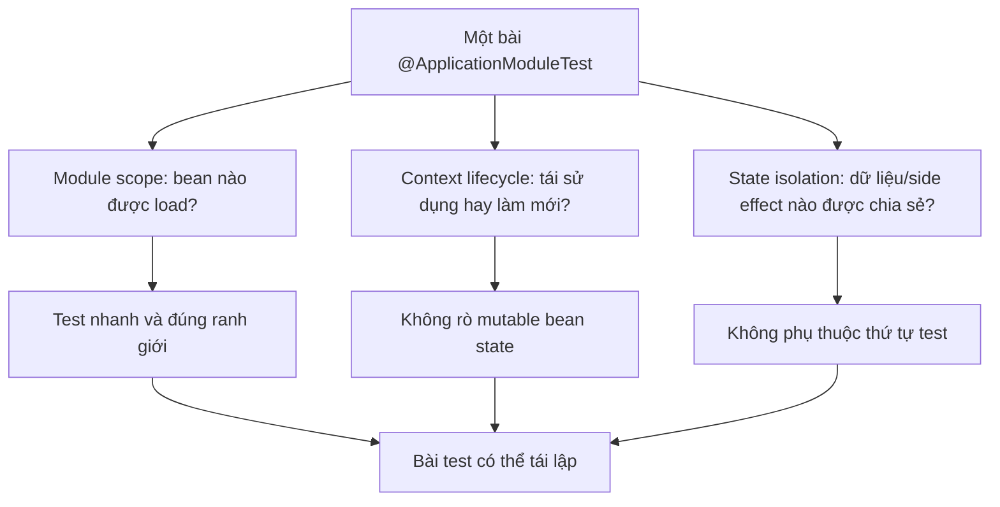

# Cô lập ApplicationContext giữa module test trong Spring Modulith

## 1. Vấn đề cần giải quyết

Trong một ứng dụng Spring Boot dùng Spring Modulith, các module như `orders`, `inventory` và `payments` cùng chạy trong một tiến trình nhưng có **ranh giới nghiệp vụ và phụ thuộc riêng**. Khi kiểm thử module `orders`, mục tiêu thường là khởi tạo đúng các bean cần thiết để kiểm chứng nghiệp vụ đơn hàng, không vô tình kéo vào mọi listener, scheduled job hoặc adapter bên ngoài của toàn hệ thống.

Ví dụ: một bài test `orders` phát `PaymentCaptured` và chờ đơn hàng trở thành `PAID`. Trong một application context quá rộng, listener khác không thuộc phạm vi test có thể nhận sự kiện, gửi HTTP, cập nhật dữ liệu tồn kho hoặc ghi outbox. Các side effect ấy làm bài test chạy chậm, khó chẩn đoán và thậm chí **pass nhờ sai bean**. Ngược lại, context quá hẹp có thể không có bean phụ thuộc cần thiết, khiến test không khởi tạo được.

**Cô lập `ApplicationContext` giữa module test** là lựa chọn có chủ đích về **những bean và cấu hình nào được bootstrap**, đồng thời quản lý **vòng đời và khả năng tái sử dụng Spring TestContext** để các bài test không ảnh hưởng nhau qua mutable singleton, listener, executor hoặc test configuration.

Bài học thuộc chương *Test isolation* của `SPRING_MODULITH_VERIFICATION_TESTING`. Mục đích của học phần là kiểm chứng ranh giới ứng dụng bằng `ApplicationModules`, thực hành `@ApplicationModuleTest`, sự kiện, database và tích hợp, đồng thời dùng quality gate CI để phát hiện phụ thuộc sai và hồi quy.

Sau bài này, bạn có thể:

1. Phân biệt **ranh giới module được bootstrap** và **cô lập dữ liệu** giữa hai scenario.
2. Sử dụng các bootstrap mode của `@ApplicationModuleTest` phù hợp với điều muốn kiểm chứng.
3. Giải thích Spring TestContext cache và khi nào cần `@DirtiesContext`.
4. Thiết kế test configuration, mock, fake và test fixture mà không lộ dependency xuyên module.
5. Tránh ô nhiễm state do singleton mutable, listener async, transaction và database dùng chung.
6. Chọn phạm vi module test, integration test và kiểm chứng `ApplicationModules.verify()` trong CI.

## 2. Ba tầng cô lập khác nhau

Từ “test isolation” dễ bị hiểu thành “mỗi test chạy trong một JVM mới”. Trên thực tế cần tách ba tầng:

| Tầng | Câu hỏi phải trả lời | Spring/Modulith hỗ trợ |
| --- | --- | --- |
| **Cô lập bean graph** | Test khởi động module nào và những dependency nào? | `@ApplicationModuleTest` với bootstrap mode, Spring Boot configuration. |
| **Cô lập vòng đời context** | Các test có tái sử dụng `ApplicationContext` đã tạo hay buộc khởi tạo lại? | Spring TestContext cache, `@DirtiesContext`, test configuration/profile. |
| **Cô lập dữ liệu và side effect** | Bản ghi DB, message, cache, job và singleton state có bị dùng chung không? | Fixture, transaction/cleanup, ID riêng, Testcontainers, reset fake/stub. |

**Không được đánh đồng ba tầng này.** Hai bài test có context khác nhau vẫn có thể đọc **cùng một database**. Hai bài test dùng chung một context vẫn có thể độc lập nếu bean dùng chung an toàn và mỗi bài tạo dữ liệu riêng. `@DirtiesContext` làm context bị loại khỏi cache, **không tự xóa database bên ngoài**.



## 3. ApplicationContext và application module không phải một khái niệm

**Spring `ApplicationContext`** là vùng chứa bean và cấu hình runtime. Nó quản lý dependency injection, lifecycle bean, event multicaster, transaction infrastructure, scheduler, cache manager và các thành phần Spring khác.

**Application module của Spring Modulith** là một phần kiến trúc được nhận diện từ cấu trúc package và quy tắc module. Ví dụ, các package trực tiếp dưới package ứng dụng gốc được phân tích thành những module riêng theo mô hình mặc định. Module có API công khai, package nội bộ và các phụ thuộc được cho phép.

Một application context có thể chứa **một**, **vài** hoặc **nhiều** application module. Việc một class có `@Service` không tự động cho phép một module khác phụ thuộc trực tiếp vào nó: **bean có trong context** và **dependency hợp lệ về kiến trúc** là hai điều khác nhau.

Giả sử ứng dụng ví dụ có cấu trúc:

```text
com.example.shop
├── ShopApplication.java
├── orders
│   ├── OrderService.java
│   ├── OrderQueries.java
│   ├── package-info.java
│   └── internal
│       ├── OrderRepository.java
│       └── PaymentCapturedListener.java
├── payments
│   ├── events
│   │   ├── package-info.java
│   │   └── PaymentCaptured.java
│   └── internal
│       └── PaymentCaptureService.java
└── inventory
    ├── InventoryQueries.java
    └── internal
        ├── InventoryRepository.java
        └── StockReservationListener.java
```

Đây là bố cục **minh họa**, không có nghĩa mọi dự án bắt buộc có đúng các package này. Nếu test `orders` chỉ cần nhận event công khai từ `payments.events` rồi đổi trạng thái đơn hàng, không có lý do mặc định phải khởi động bean của `inventory.internal`.

## 4. Bootstrap mode của `@ApplicationModuleTest`

Spring Modulith cung cấp `@ApplicationModuleTest` để bootstrapping một application module với sự tích hợp của Spring Boot Test. Một bài test được đặt trong package của module cần kiểm thử sẽ được gắn với module đó theo cách khám phá của Spring Modulith.

Có thể lựa chọn phạm vi qua `BootstrapMode`:

| Mode | Phạm vi định hướng | Khi nên dùng |
| --- | --- | --- |
| `STANDALONE` | Chỉ module đang kiểm thử và hạ tầng Spring cần thiết. | Kiểm tra logic và event listener nội bộ module, cô lập dependency ngoài. |
| `DIRECT_DEPENDENCIES` | Module hiện tại và các module phụ thuộc trực tiếp của nó. | Muốn chạy thật một dependency trực tiếp được công bố trong kiến trúc. |
| `ALL_DEPENDENCIES` | Module hiện tại cùng các module phụ thuộc trực tiếp và gián tiếp. | Kiểm thử tích hợp sâu hơn theo đồ thị dependency. |

`STANDALONE` là mode mặc định theo mô hình kiểm thử module thông dụng của Spring Modulith. Cách chọn mode và chi tiết bootstrapping cần đối chiếu với phiên bản thư viện của dự án.

Ví dụ một test đứng trong package `com.example.shop.orders`:

```java
package com.example.shop.orders;

import org.junit.jupiter.api.Test;
import org.springframework.modulith.test.ApplicationModuleTest;
import org.springframework.modulith.test.ApplicationModuleTest.BootstrapMode;

@ApplicationModuleTest(mode = BootstrapMode.STANDALONE)
class OrdersStandaloneTests {

    @Test
    void loadsOrdersModule() {
        // Các bean cần thiết của orders được khởi động.
        // Test assertion thực tế được bổ sung ở phần sau.
    }
}
```

Khi cần bao gồm module dependency trực tiếp:

```java
@ApplicationModuleTest(
        mode = BootstrapMode.DIRECT_DEPENDENCIES)
class OrdersWithDirectDependenciesTests {
    // Chỉ dùng khi hành vi cần dependency thật.
}
```

Khi cần toàn bộ dependency bắc cầu:

```java
@ApplicationModuleTest(
        mode = BootstrapMode.ALL_DEPENDENCIES)
class OrdersWithAllDependenciesTests {
    // Phạm vi rộng hơn; đánh đổi tốc độ và tính cô lập.
}
```

Đoạn code giả định test có import phù hợp; các class riêng phải đặt ở những file Java riêng trong dự án thật.

### 4.1. Mode dependency không có nghĩa load mọi module

Một hiểu nhầm là `ALL_DEPENDENCIES` đồng nghĩa khởi động toàn bộ ứng dụng. Thực chất phạm vi này theo **đồ thị các phụ thuộc của module hiện tại**, không phải tất cả module không liên quan. Muốn kiểm thử toàn bộ đường đi producer → consumer, có thể cần `@SpringBootTest` hoặc cấu hình tích hợp phù hợp nếu những module đó không nằm trong tập dependency được bootstrap.

**Hướng phụ thuộc có ý nghĩa.** Module `orders` có thể phụ thuộc vào contract `payments::events` để nghe `PaymentCaptured`. Điều đó không tự biến *toàn bộ module payments* thành runtime dependency của `orders`; mức độ bao gồm module còn tùy cách các dependency được mô hình hóa và bootstrap mode.

### 4.2. Chọn mode theo trách nhiệm của bài test

Đặt câu hỏi trước khi tăng bootstrap mode:

1. Kết quả muốn bảo vệ thuộc module nào?
2. Có cần **bean thật** của module ngoài hay một port/fake đủ để điều khiển scenario?
3. Dependency đã được công khai và cho phép theo quy tắc kiến trúc chưa?
4. Khi test fail, muốn chẩn đoán lỗi ở **module riêng** hay toàn luồng?
5. Cần kiểm chứng external adapter, database hay broker thật không?

Nếu `STANDALONE` fail vì thiếu bean và bạn đổi thẳng sang `ALL_DEPENDENCIES`, test có thể pass nhưng bạn đã **che mất một dependency chưa được thiết kế rõ ràng**. Hãy kiểm tra có nên khai báo port, thêm test double hoặc tạo integration test đúng cấp hay không.

## 5. Context cache của Spring TestContext hoạt động ra sao?

Spring TestContext Framework thường **cache các `ApplicationContext`** giữa những test có cùng cấu hình ngữ cảnh được hợp nhất. Việc reuse giúp giảm thời gian khởi động Spring Boot, Hibernate, DataSource hoặc các adapter nặng.

Một cách nhìn đơn giản:

```text
Test class A ─┐
              ├── cấu hình context tương đương ──> context có thể tái sử dụng
Test class B ─┘

Test class C ─── cấu hình context khác ─────────> context khác
```

Cache key phụ thuộc cấu hình mà TestContext dùng để xác định context, ví dụ configuration classes, context initializer, active profiles, property sources và những context customizer liên quan. Vì vậy, **hai test class khác nhau không mặc nhiên dùng context khác**, và **hai test có annotation trông tương tự không chắc dùng cùng context**.

Đặc biệt khi `@ApplicationModuleTest` lựa chọn module/bootstrapping khác nhau, cấu hình ngữ cảnh thường khác, nhưng không nên suy ra “mỗi method luôn có context mới”. Hãy đọc phạm vi thực tế và kiểm tra mutable state.

### 5.1. Điều gì sống cùng context được reuse?

Nếu hai test dùng lại cùng context, chúng cũng có thể dùng lại:

- Singleton bean có field mutable (counter, map, queue in-memory).
- Listener bean đăng ký trong event multicaster.
- Cache manager/các bộ nhớ đệm đặt trong context.
- Executor, scheduler và tác vụ đang chờ.
- Test double được gắn vào bean graph, theo cách reset của framework.
- Bean tích hợp đến DataSource, broker hoặc HTTP client.

Dữ liệu trong database riêng **không nằm trong Spring context cache**; DataSource có thể bị tạo lại nhưng cùng kết nối tới một database chưa được dọn.

### 5.2. Không viết test dựa trên giả định context sẽ luôn tươi mới

Ví dụ anti-pattern:

```java
@Component
class LastPaymentHolder {

    private String lastReference;

    void remember(String reference) {
        this.lastReference = reference;
    }

    String current() {
        return lastReference;
    }
}
```

Nếu một test thay đổi `lastReference`, test tiếp theo có thể đọc lại giá trị ấy khi bean singleton được reuse. Điều đó không phải lỗi của cache: bean này có mutable state và bài test chưa reset hoặc cô lập nó.

Với dữ liệu nghiệp vụ, nên giữ state trong transaction/database đúng ownership, dùng ID riêng và đọc qua API. Với một fake chỉ dành cho test, có thể tạo phương thức `reset()` và gọi giữa các scenario sau khi đã bảo đảm không còn tác vụ async đang dùng nó.

## 6. Sự khác nhau giữa cấu hình test cố định và cấu hình động

Giả sử module `orders` cần một `Clock` xác định để test kỳ hạn thanh toán. Có thể tạo test configuration:

```java
import java.time.Clock;
import java.time.Instant;
import java.time.ZoneOffset;

import org.springframework.boot.test.context.TestConfiguration;
import org.springframework.context.annotation.Bean;

@TestConfiguration(proxyBeanMethods = false)
class FixedClockTestConfig {

    @Bean
    Clock testClock() {
        return Clock.fixed(
                Instant.parse("2026-01-15T10:00:00Z"),
                ZoneOffset.UTC);
    }
}
```

Sau đó import cấu hình vào test:

```java
import org.springframework.context.annotation.Import;

@ApplicationModuleTest
@Import(FixedClockTestConfig.class)
class OrdersWithFixedTimeTests {
    // ApplicationContext dùng clock bất biến của test.
}
```

Nếu nhiều bài test dùng cùng một cấu hình clock **bất biến**, việc tái sử dụng context thường an toàn. Nếu các bài test dùng một bean `MutableClock` rồi thay đổi thời gian trong phương thức, chúng phải reset trạng thái hoặc dùng context/cấu hình riêng để tránh nhiễm chéo.

### 6.1. Active profile và test property

Khi môi trường test cần khác production, có thể khai báo:

```java
import org.springframework.test.context.ActiveProfiles;
import org.springframework.test.context.TestPropertySource;

@ApplicationModuleTest
@ActiveProfiles("module-test")
@TestPropertySource(properties = {
        "feature.order-notifications=false"
})
class OrdersWithoutExternalNotificationsTests {
    // Test chạy với một cấu hình được định danh rõ.
}
```

Đây là cấu hình minh họa; tên property phải là property có ý nghĩa với ứng dụng. Profile/property khác nhau có thể dẫn đến **context cache key khác**, vì chúng thay đổi thành phần cấu hình. Tuy nhiên, thay đổi property trong cùng một mutable singleton **sau khi context đã tạo** không tự tạo context mới.

Đối với `@DynamicPropertySource` và Testcontainers, cần kiểm tra thời gian sống của container với cache: một context được reuse nhưng container hoặc giá trị endpoint đã đổi có thể dẫn đến kết nối sai. Không thay đổi dynamic endpoint theo phương thức test mà giả định cache tự phân biệt mọi giá trị runtime.

## 7. Khi nào dùng `@DirtiesContext`?

`@DirtiesContext` là công cụ của Spring TestContext để đánh dấu một context **không còn an toàn để reuse**. Spring sẽ loại context đó khỏi cache và tạo lại khi cần. Nó hữu ích khi một bài test thực sự làm thay đổi state của các bean hoặc cấu hình runtime đến mức cleanup thủ công không đáng tin.

Ví dụ một class chủ động làm bẩn singleton in-memory test configuration:

```java
import org.springframework.test.annotation.DirtiesContext;

@ApplicationModuleTest
@DirtiesContext(
        classMode = DirtiesContext.ClassMode.AFTER_CLASS)
class MutableIntegrationInfrastructureTests {

    // Các test bên trong cố ý sửa state của bean test infrastructure.
    // Sau class, context bị đánh dấu dirty.
}
```

Nếu cần làm mới sau một **phương thức** cụ thể:

```java
@Test
@DirtiesContext(
        methodMode = DirtiesContext.MethodMode.AFTER_METHOD)
void changesGlobalTestInfrastructure() {
    // Hành vi này làm bean graph không còn an toàn để reuse.
}
```

Các ví dụ dùng mode tương ứng của annotation. Chỉ gắn annotation khi có nguyên nhân rõ ràng.

### 7.1. Ưu tiên reset có kiểm soát nếu đủ an toàn

Tạo context mới thường tốn chi phí: scan bean, cấu hình DataSource, JPA metadata, HTTP clients, migrations theo cách dự án cài đặt và khởi tạo test support. Một suite dùng `@DirtiesContext` tràn lan dễ khiến CI chậm mà vẫn **không** giải quyết state bị rò ra database hoặc message broker.

Thứ tự ưu tiên thường hợp lý:

1. Loại bỏ mutable singleton không cần thiết; dùng immutable configuration.
2. Dùng ID mới, fixture và transaction/cleanup để cô lập **dữ liệu nghiệp vụ**.
3. Reset test double/cache được quản lý với một điểm đồng bộ rõ ràng.
4. Tách profile/test configuration thành các nhóm context hợp lý.
5. Chỉ dùng `@DirtiesContext` nếu context thật sự bị thay đổi không thể reset an toàn.

**`@DirtiesContext` không xóa row DB đã commit, không đảm bảo queue rỗng và không tự undo side effect tới dịch vụ ngoài.**

## 8. Ngữ cảnh một module có thể thiếu dependency: phân biệt lỗi setup với lỗi kiến trúc

Một bài test `orders` theo mode `STANDALONE` có thể báo lỗi `NoSuchBeanDefinitionException` vì service bên trong `orders` inject một component ngoài module. Đây không phải lúc nào cũng là lỗi Spring; nó đang cho thấy **test context chưa đáp ứng dependency mà logic hiện tại yêu cầu**.

Có ba chiến lược tùy trách nhiệm:

| Chiến lược | Cách xử lý | Đánh đổi |
| --- | --- | --- |
| **Port thuộc module + test double** | Module sở hữu định nghĩa interface và dùng fake/mock trong test. | Test cô lập tốt, không kiểm chứng adapter thật. |
| **Mở bootstrap mode** | Chọn `DIRECT_DEPENDENCIES` hoặc `ALL_DEPENDENCIES`. | Kiểm tra dependency thật nhưng bean graph lớn hơn. |
| **Integration test riêng** | `@SpringBootTest` hoặc setup bao phủ đường phối hợp cần thiết. | Gần production hơn, tốn thời gian và khó khoanh vùng. |

Không thêm import tới `inventory.internal.InventoryRepository` chỉ để làm test `orders` chạy. Nếu module `orders` cần hỏi tồn kho, hãy thiết kế public API/port theo hướng dependency được phép và kiểm chứng bằng `ApplicationModules.verify()`.

### 8.1. Test double trong context

Với dự án sử dụng Spring Framework hỗ trợ `@MockitoBean`, một ví dụ có thể thay dependency bằng mock:

```java
import org.springframework.test.context.bean.override.mockito.MockitoBean;

@ApplicationModuleTest
class OrdersWithPaymentGatewayStubTests {

    @MockitoBean
    PaymentGateway paymentGateway;

    // PaymentGateway là interface do ứng dụng định nghĩa.
    // Cấu hình hành vi mock cụ thể tại mỗi test.
}
```

`@MockitoBean` thuộc Spring Framework các phiên bản mới có hỗ trợ Bean Override; ở những dự án cũ có thể dùng cách mock tương thích với phiên bản Spring Boot/Test đang chạy. Không trộn hai annotation giữa các phiên bản mà không kiểm tra dependency. Việc thay bean bằng mock là một **thay đổi test configuration**, có thể ảnh hưởng cache key và việc reuse context.

Tránh dùng một mock với trạng thái stubbing/interaction tồn từ test khác. Kiểm tra cơ chế reset của test framework và khai báo stubbing riêng cho từng scenario. Nếu phải kiểm chứng adapter ngoài thật, sử dụng integration test thay vì mock.

## 9. Ví dụ: module test chỉ kiểm chứng listener của `orders`

Giả sử module `payments` công bố event `PaymentCaptured` (hợp đồng công khai), module `orders` có listener xử lý và cập nhật trạng thái. Trong một test consumer, ta không cần khởi động business service nội bộ của `payments` để phát event: chỉ cần **kiểu event contract** và listener thuộc `orders`.

Kiểu nghiệp vụ minh họa:

```java
// File: com/example/shop/payments/events/PaymentCaptured.java
package com.example.shop.payments.events;

import java.util.UUID;

public record PaymentCaptured(UUID orderId, String transactionId) {}
```

```java
// File: com/example/shop/orders/OrderStatus.java
package com.example.shop.orders;

public enum OrderStatus {
    AWAITING_PAYMENT, PAID, PAYMENT_FAILED
}
```

```java
// File: com/example/shop/orders/OrderQueries.java
package com.example.shop.orders;

import java.util.Optional;
import java.util.UUID;

public interface OrderQueries {
    Optional<OrderStatus> statusOf(UUID orderId);
}
```

Trong package `orders`, bài test listener với context hẹp:

```java
package com.example.shop.orders;

import static org.assertj.core.api.Assertions.assertThat;

import java.time.Duration;
import java.util.UUID;

import org.junit.jupiter.api.Test;
import org.springframework.beans.factory.annotation.Autowired;
import org.springframework.modulith.test.ApplicationModuleTest;
import org.springframework.modulith.test.ApplicationModuleTest.BootstrapMode;
import org.springframework.modulith.test.Scenario;

@ApplicationModuleTest(mode = BootstrapMode.STANDALONE)
class OrdersPaymentListenerTests {

    @Autowired OrderQueries queries;
    @Autowired OrderFixture fixture;

    @Test
    void eventChangesOrderStateWithoutBootingAllModules(
            Scenario scenario) {

        UUID orderId = fixture.awaitingPaymentAndCommit();

        assertThat(queries.statusOf(orderId))
                .contains(OrderStatus.AWAITING_PAYMENT);

        scenario.publish(new PaymentCaptured(orderId, "TX-901"))
                .andWaitAtMost(Duration.ofSeconds(5))
                .forStateChange(
                        () -> queries.statusOf(orderId),
                        status -> status.filter(
                                s -> s == OrderStatus.PAID).isPresent())
                .andVerify(status ->
                        assertThat(status).contains(OrderStatus.PAID));
    }
}
```

`OrderFixture` là test helper **do dự án xây dựng**, phải được đăng ký hợp lệ trong test context và thực sự commit dữ liệu ban đầu. `PaymentCaptured`, `OrderStatus` và `OrderQueries` là kiểu ứng dụng tự định nghĩa. Test chỉ thành công nếu listener, repository, query adapter và transaction infrastructure của `orders` được bootstrap.

Điều được kiểm chứng:

1. Context chứa những thành phần cần thiết của module đang kiểm thử.
2. Event đi vào listener trong `orders`.
3. Listener xử lý và commit trạng thái thích hợp.
4. Public query API của `orders` quan sát được `PAID` theo đúng `orderId`.
5. Không cần khởi động các module độc lập chỉ để kiểm tra phản ứng của consumer.

**Không được suy ra:** test này chứng minh rằng production service của `payments` thực sự publish event đúng; điều đó cần producer event contract test riêng. Tương tự, sự kiện đã đến listener không tự chứng minh kết quả nghiệp vụ: chính predicate state trong scenario mới kiểm tra điều đó.

### 9.1. Listener bất đồng bộ và `AFTER_COMMIT`

Khi listener chạy với `@Async` hoặc `@TransactionalEventListener(phase = AFTER_COMMIT)`, cần làm rõ transaction phát event và transaction ghi state. Một listener after-commit mặc định không chạy khi không có transaction thích hợp, trừ cấu hình `fallbackExecution`. Thread async không tự thừa hưởng transaction của publisher.

Mẫu listener minh họa:

```java
@Async
@TransactionalEventListener(phase = TransactionPhase.AFTER_COMMIT)
public void on(PaymentCaptured event) {
    orderPaymentService.markPaid(event.orderId(), event.transactionId());
}
```

Đoạn trên phải đặt trong Spring bean có import/config phù hợp và application service `markPaid(...)` cần transaction ghi. Bài test phải cho phép stimulus/transaction đi đến pha commit; không đặt toàn bộ test trong transaction rollback kéo dài nếu điều đó ngăn listener after-commit chạy.

Đồng thời, đừng dùng `Thread.sleep(...)` để đợi listener: scenario chờ theo predicate với timeout hữu hạn là lựa chọn tốt hơn.

## 10. Không phải mọi bean state đều thuộc database

Một số side effect xảy ra ngay **trong context**, nhất là khi context được cache.

### 10.1. Singleton mutable và event subscriber

Ví dụ một test fake listener giữ danh sách event:

```java
final class RecordingPaymentListener {

    private final List<PaymentCaptured> captured = new ArrayList<>();

    void on(PaymentCaptured event) {
        captured.add(event);
    }

    List<PaymentCaptured> seen() {
        return List.copyOf(captured);
    }

    void clear() {
        captured.clear();
    }
}
```

Đây là class minh họa; cần import `List`/`ArrayList` và đăng ký bean/listener nếu muốn dùng thật. Nếu `RecordingPaymentListener` là singleton dùng chung context, danh sách `captured` có thể chứa event từ bài test trước.

Với listener chạy đa luồng, `ArrayList` còn không thread-safe. Test cần dùng cấu trúc đồng bộ phù hợp, chờ xử lý event hoàn tất rồi reset, hoặc dùng instance/scope cô lập. **Dùng `@DirtiesContext` không thay thế xử lý đồng bộ khi task nền đang tiếp tục chạy.**

### 10.2. Executor, scheduler, registry và cache

Một context có thể chứa:

- Executor đang xử lý `@Async`.
- Scheduled task chạy song song với test.
- Cache key còn dữ liệu của scenario trước.
- Event Publication Registry với publication chưa hoàn tất.
- In-memory queue/outbox hoặc mock server bean.
- Bean test fake giữ trạng thái toàn cục.

Nếu test xóa data trước khi task async kết thúc, listener có thể nhận dữ liệu không tồn tại, gây lỗi ở test kế tiếp. Không chỉ “dọn context”: phải biết **điểm hoàn tất công việc** và chiến lược cleanup cho tài nguyên ngoài context.

Khi cần test registry/retry, phải phân biệt state của bean registry trong context với **dữ liệu persistence registry trong database**. Khởi tạo lại context không nhất thiết xóa publication đã ghi bền.

## 11. Context isolation không thay thế DB isolation

Giả sử `OrdersPaymentListenerTests` và `InventoryReservationTests` bootstrap hai context khác nhau nhưng cùng `jdbc:postgresql://localhost:5432/testdb`. Nếu cả hai dùng `orderId` tĩnh hoặc cùng SKU tồn kho, chúng vẫn tác động qua lại trong database dù không chia sẻ Spring bean nào.

Để tránh:

1. Tạo business ID/correlation ID riêng cho từng scenario.
2. Commit fixture trước khi listener ở transaction khác cần đọc.
3. Xác minh state ban đầu trước stimulus, không chỉ state cuối.
4. Đọc lại state đã commit từ query API phù hợp, tránh JPA entity cũ.
5. Dọn dữ liệu sau khi mọi công việc bất đồng bộ liên quan đã kết thúc.
6. Khi tài nguyên không thể tách theo ID, dùng schema/container/database cô lập theo nhóm test phù hợp.

```text
Context A: orders module test ──┐
                               ├──> CÙNG PostgreSQL testdb
Context B: inventory module ───┘
                               |
                               +--> Dữ liệu vẫn dùng chung nếu không tách
```

### 11.1. Rollback test method có giới hạn

Trong Spring Test, `@Transactional` trên test có thể khiến transaction test rollback khi method kết thúc. Điều này hữu ích cho bài kiểm tra CRUD đồng bộ, nhưng **không tự rollback các giao dịch được listener async commit độc lập**.

Nếu publisher phát sự kiện trong transaction test đang mở, listener `AFTER_COMMIT` có thể không được gọi trước khi test kết thúc. Khi đó, đổi `STANDALONE` sang `ALL_DEPENDENCIES` **không giải quyết** vấn đề transaction. Chọn fixture có ranh giới commit rõ ràng, dùng test không giữ transaction lâu hoặc điều khiển transaction theo cơ chế Spring Test phù hợp.

### 11.2. Testcontainers và context cache

Testcontainers có thể cung cấp database/broker gần production để kiểm tra transaction và integration. Nhưng **một container dùng lại giữa nhiều test không tự reset row**. Nếu container được tạo/đóng theo class mà context chứa DataSource vẫn được cache và reuse sang class khác, có thể xuất hiện endpoint/connection không còn hợp lệ.

Do đó cần phối hợp lifecycle container với lifecycle context: không để context cache giữ cấu hình trỏ tới container đã dừng; hoặc dùng container có scope phù hợp, `@DirtiesContext` khi cần và cấu hình dynamic property nhất quán.

## 12. Phân biệt scope context và verification kiến trúc

Một test chạy được với `@SpringBootTest` không có nghĩa dependency của module hợp lệ. Khi tất cả bean được load, một service trong `orders` có thể vô tình inject trực tiếp `inventory.internal.InventoryRepository` và vẫn chạy được, dù điều đó phá ranh giới Modulith.

Một phép kiểm chứng bổ sung:

```java
import org.junit.jupiter.api.Test;
import org.springframework.modulith.core.ApplicationModules;

class ApplicationModuleArchitectureTests {

    @Test
    void dependenciesStayWithinDeclaredBoundaries() {
        ApplicationModules.of(ShopApplication.class).verify();
    }
}
```

`ShopApplication` là Spring Boot application class minh họa.

Để giới hạn dependency, có thể khai báo public API/named interface:

```java
// File: com/example/shop/payments/events/package-info.java
@org.springframework.modulith.NamedInterface("events")
package com.example.shop.payments.events;
```

```java
// File: com/example/shop/orders/package-info.java
@org.springframework.modulith.ApplicationModule(
        allowedDependencies = "payments::events")
package com.example.shop.orders;
```

Khi dùng cấu hình này, `orders` chỉ được phụ thuộc những API được khai báo phù hợp trong quy tắc allowed dependencies. Tên `payments::events` cần đúng tên module và named interface thực tế. Một test context hẹp có thể giúp phát hiện thiếu dependency sớm, nhưng **không thay thế** phân tích cấu trúc của `ApplicationModules.verify()`.

## 13. Phân tầng test để tránh lạm dụng context rộng

| Loại test | Có cần Spring context? | Điều muốn chứng minh | Dữ liệu cần cô lập |
| --- | --- | --- | --- |
| Unit test aggregate | Thường không. | Domain invariant và transition. | Object tạo mới từng test. |
| `@ApplicationModuleTest(STANDALONE)` | Có, phạm vi module. | Bean/module behavior, event handler, persistence nội bộ. | Fixture, transaction, async task trong module. |
| `@ApplicationModuleTest(DIRECT_DEPENDENCIES)` | Có, thêm dependency trực tiếp. | Tích hợp giữa module và dependency cần thiết. | Dữ liệu hai module và side effect. |
| `@ApplicationModuleTest(ALL_DEPENDENCIES)` | Có, thêm dependency bắc cầu. | Workflow qua đồ thị phụ thuộc của module. | State tại mọi dependency liên quan. |
| `@SpringBootTest` toàn ứng dụng | Có, thường rộng hơn. | Đường đi end-to-end, wiring toàn ứng dụng. | DB, broker, external stub, scheduler, cache. |
| `ApplicationModules.verify()` | Có thể thực hiện như test cấu trúc không cần bootstrap toàn ứng dụng. | Vi phạm dependency/API giữa module. | Không chủ yếu quan tâm DB state. |

Một suite cân bằng dùng phần lớn test nhỏ, một số module tests và số lượng phù hợp integration tests có ý nghĩa nghiệp vụ. Không đánh đổi toàn bộ modularity chỉ để giảm khó khăn setup của một test.

## 14. Dấu hiệu context bị nhiễm và quy trình điều tra

| Triệu chứng | Giả thuyết | Cách xác minh |
| --- | --- | --- |
| Test chạy riêng PASS, chạy cả suite FAIL. | Mutable singleton/cache hoặc DB dùng chung. | So sánh state đầu, test profile, ID, fake/reset và pending work. |
| Test module bị gọi listener không mong đợi. | Context rộng hoặc test import bean ngoài ý định. | Kiểm tra bootstrap mode, module graph và test configuration. |
| Bean `InventoryService` thiếu trong context. | Mode quá hẹp so với dependency thật. | Xem thiết kế port, dependency allowed và mode cần thiết. |
| `NoSuchBeanDefinitionException` xuất hiện sau khi đổi profile. | Bean điều kiện thay đổi theo profile/property. | Kiểm tra `@Conditional...` và context config hiện tại. |
| `@DirtiesContext` được thêm nhưng DB vẫn còn dữ liệu. | Dữ liệu nằm ngoài context cache. | Kiểm tra cleanup DB, queue, registry và container. |
| Test sau fail vì event cũ vẫn chạy. | Executor/registry/queue còn tác vụ chưa kết thúc. | Theo dõi correlation ID, listener completion và cleanup timing. |
| Context khởi động rất chậm trên CI. | Khởi tạo lại quá thường xuyên; dùng mode rộng. | Xem hit/miss context cache và phạm vi module test. |
| Test chỉ fail khi bật parallel. | Shared DB key, fake state, port hoặc resource. | Tách namespace dữ liệu hoặc tuần tự hóa tài nguyên chung. |
| Query tiếp tục thấy state cũ. | JPA persistence context/snapshot/cache hoặc reader sai. | Đọc qua public API với transaction mới khi cần. |

### 14.1. Các câu hỏi chẩn đoán theo thứ tự

1. Test này thuộc **module nào**, và `@ApplicationModuleTest` đang bootstrap mode nào?
2. Context chứa những bean/listener quan trọng nào? Có bean bị import ngoài ý định không?
3. Hai test có reuse cùng context theo cache không, và có mutable singleton nào bị thay đổi?
4. Cấu hình `@ActiveProfiles`, `@TestPropertySource`, mock/test configuration có khác nhau không?
5. Dữ liệu DB, queue, registry, cache và resource ngoại vi được tách thế nào?
6. Fixture có commit trước khi event được xử lý ở transaction khác không?
7. Listener async/after-commit đã kết thúc trước cleanup chưa?
8. Cần một mock/port ở module test hay một integration test rộng hơn?
9. Đồ thị module có được xác minh riêng bằng `ApplicationModules.verify()` không?
10. Sau khi thay đổi phạm vi context, test có còn kiểm chứng đúng hợp đồng nghiệp vụ và đúng ID không?

Không cố “sửa” test chỉ bằng `@DirtiesContext` hoặc tăng bootstrap mode trước khi biết nguồn nhiễm thuộc tầng nào.

## 15. CI quality gate: đúng module, đúng context, đúng dữ liệu

Trong CI, nên dùng nhiều phép kiểm chứng bổ trợ:

1. **Cấu trúc:** `ApplicationModules.of(...).verify()` để ngăn dependency vượt ranh giới.
2. **Module tests:** `@ApplicationModuleTest` ở mode nhỏ nhất đủ kiểm chứng hợp đồng.
3. **Data isolation:** mỗi test có fixture/ID riêng, transaction commit đúng và cleanup có tính đến async.
4. **Context lifecycle:** `@DirtiesContext` chỉ dùng khi bean/config thực sự bị làm bẩn; không làm default.
5. **Integration:** chạy những test có database, broker và module dependency thật ở phạm vi phù hợp.
6. **Determinism:** đồng hồ, random seed và fake/stub được kiểm soát; không phụ thuộc thứ tự test.
7. **Failure reporting:** log tên test, module scope, event/correlation ID, state cuối quan sát và timeout.

Lệnh Gradle minh họa, nếu dự án đã cấu hình JUnit tests trong task `test`:

```bash
./gradlew test
```

Nếu integration test nằm trong task riêng, pipeline cần chạy cả task đó. Không tự coi `test` là toàn bộ quality gate khi repository có nhiều test suite. Test bị timeout hoặc vi phạm dependency phải làm pipeline thất bại; không lạm dụng retry để che flaky tests.

### 15.1. Checklist trước khi thay context scope

- [ ] Tôi biết module hiện tại và public API nào cần được kiểm chứng.
- [ ] Tôi chọn mode nhỏ nhất vẫn load đủ listener/service/adapter cần thiết.
- [ ] Việc tăng mode không hợp thức hóa dependency `internal` sai.
- [ ] Mọi fake/mock và test property được khai báo ổn định, có cách reset khi cần.
- [ ] Dữ liệu DB và message được cô lập độc lập với context cache.
- [ ] Listener/background tasks đã có điểm đồng bộ trước cleanup.
- [ ] Test chạy riêng và trong cả suite cho cùng kết quả.
- [ ] Test có thể chạy song song hoặc đã khóa tài nguyên chung theo chính sách.
- [ ] Tôi chỉ dùng `@DirtiesContext` khi thật sự cần.
- [ ] CI có cả test cấu trúc module và test hành vi.

## 16. Bài tập thực hành

**Bài A — chọn bootstrap mode:** đặt một bài test dưới package `orders` và chạy với `STANDALONE`. Liệt kê các service cần thiết của module, xác định listener nào thuộc module này; không dựa vào bean của module khác. Thử `DIRECT_DEPENDENCIES`, so sánh cách khởi động và lý do chỉ dùng khi cần.

**Bài B — cache và singleton mutable:** tạo bean test `RecordingPaymentListener` lưu event trong collection. Viết hai test dùng chung context để thấy state có thể tràn qua ranh giới test. Thử reset có kiểm soát, rồi so sánh với việc dùng `@DirtiesContext(AFTER_CLASS)`. Đánh giá chi phí và độ tin cậy.

**Bài C — DB không sạch chỉ vì context mới:** dùng hai test context khác nhau cùng một database. Cho cả hai query cùng record có ID cố định rồi quan sát xung đột. Chuyển fixture sang ID riêng, kiểm tra baseline trước event và cleanup đúng thời điểm.

**Bài D — after-commit/async:** dùng listener xử lý sự kiện sau commit, chuẩn bị fixture trong transaction chưa commit rồi xem tác động. Tổ chức lại transaction fixture và test để listener có thể nhìn thấy dữ liệu. Không dùng sleep cố định.

**Bài E — test configuration:** tạo `FixedClockTestConfig` và import vào một module test. So sánh với một cấu hình test có clock mutable hoặc active profile khác, phân tích ảnh hưởng tới cache và tính độc lập của tests.

**Bài F — mock hay dependency thật:** cho một port thuộc `orders` cần một adapter ngoài module. Viết bản module test `STANDALONE` dùng test double hợp lệ, rồi bản tích hợp `DIRECT_DEPENDENCIES` hoặc `@SpringBootTest` dùng adapter thật. Chỉ ra lỗi mà từng bản bắt được.

**Bài G — làm bẩn context:** tạo test cố ý thay đổi cấu hình mutable của bean trong context. Chứng minh vì sao cần reset hoặc `@DirtiesContext`; kiểm tra rằng dùng annotation đó không xóa bản ghi DB đã commit.

**Bài H — architecture gate:** cố ý tạo dependency từ `orders` tới `inventory.internal` trong nhánh học tập, chạy test `ApplicationModules.verify()` và quan sát lỗi. Hoàn nguyên dependency; giữ mode context nhỏ thay vì khởi động toàn bộ ứng dụng để che lỗi.

**Tiêu chí hoàn thành:** học viên phân biệt ba tầng isolation, chọn mode phù hợp, hiểu cache và `@DirtiesContext`, tái lập dữ liệu/side effect giữa scenario, và có quality gate phát hiện cả lỗi ranh giới module lẫn hồi quy state.

## 17. Kết luận và tài liệu tham khảo

**Cô lập `ApplicationContext` không đồng nghĩa “mỗi test một Spring Boot app” và cũng không đồng nghĩa “database luôn sạch”.** Spring Modulith cho phép bootstrap module cần kiểm thử theo phạm vi được lựa chọn; Spring TestContext có thể cache và tái sử dụng context để chạy nhanh; còn dữ liệu nghiệp vụ, event, task nền và cache cần chiến lược isolation riêng.

Một module test đáng tin nên **khởi động đúng bean**, **không thừa dependency sai**, **tái lập state cho mỗi scenario** và **quan sát kết quả đã commit qua public API**. `ApplicationModules.verify()` kết hợp với `@ApplicationModuleTest` và integration test cần thiết tạo bộ kiểm chứng vừa bảo vệ kiến trúc vừa ngăn hồi quy trên CI.

Tài liệu tham khảo:

- [Spring Modulith — Testing Application Modules](https://docs.spring.io/spring-modulith/reference/testing.html): `@ApplicationModuleTest`, bootstrap modes và `Scenario`.
- [Spring Modulith — Fundamentals](https://docs.spring.io/spring-modulith/reference/fundamentals.html): mô hình module, API công khai và dependency.
- [Spring Modulith — Verifying Application Module Structure](https://docs.spring.io/spring-modulith/reference/verification.html): `ApplicationModules.verify()` và quy tắc phụ thuộc.
- [Spring Framework — Context Caching](https://docs.spring.io/spring-framework/reference/testing/testcontext-framework/ctx-management/caching.html): cache key, cache reuse và context lifecycle.
- [Spring Framework — DirtiesContext](https://docs.spring.io/spring-framework/reference/testing/annotations/integration-spring/annotation-dirtiescontext.html): thời điểm loại bỏ và khởi tạo lại context.
- [Spring Framework — Transaction Management in Tests](https://docs.spring.io/spring-framework/reference/testing/testcontext-framework/tx.html): `@Transactional`, commit và rollback trong test.
- [Spring Framework — Transaction-bound Events](https://docs.spring.io/spring-framework/reference/data-access/transaction/event.html): `@TransactionalEventListener`, `AFTER_COMMIT` và cấu hình fallback.
- [Testcontainers for Java](https://java.testcontainers.org/): database/broker thật cho kiểm thử tích hợp.
