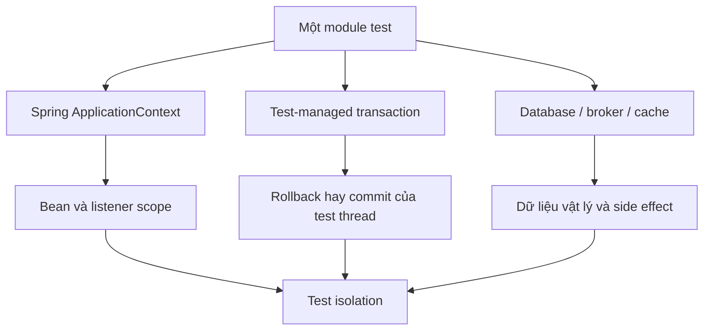
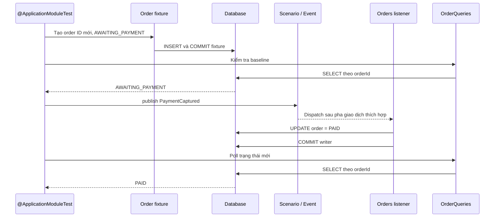

# Cô lập database và transaction trong kiểm thử Spring Modulith

## 1. Vì sao database isolation quyết định độ tin cậy của module test?

Trong ứng dụng Spring Modulith, một bài test có thể khởi động đúng module bằng `@ApplicationModuleTest` nhưng vẫn cho kết quả sai vì **database và transaction không được cô lập đúng**. Chẳng hạn, test A ghi đơn hàng `PAID` bằng một listener bất đồng bộ; test B dùng lại mã đơn và kiểm tra trạng thái `PAID`. Test B có thể pass ngay cả khi listener của chính B bị tắt, bởi dữ liệu của A vẫn còn trong cơ sở dữ liệu.

Ngược lại, test cũng có thể timeout dù logic listener đúng: fixture chỉ `saveAndFlush(...)` trong transaction chưa commit nên listener ở thread khác không thấy bản ghi, hoặc `@TransactionalEventListener(AFTER_COMMIT)` không được kích hoạt vì transaction phát event của test bị rollback.

**Cô lập database và transaction** là thiết kế để mỗi kịch bản:

1. Bắt đầu từ **trạng thái dữ liệu do chính nó tạo ra**, xác định được và không bị kịch bản khác làm nhiễu.
2. Dùng **ranh giới commit/rollback rõ ràng** để thread/transaction đọc nhìn thấy dữ liệu ở thời điểm cần thiết.
3. Không để dữ liệu, lock hoặc tác vụ nền của kịch bản này phá kịch bản khác.
4. Kết thúc với cách **dọn dẹp hoặc cô lập có kiểm soát**, kể cả khi có lỗi/timeout.
5. Vẫn quan sát kết quả qua **API hợp lệ của module**, thay vì truy cập repository nội bộ của module khác.

Chủ đề thuộc chương *Test isolation* của học phần `SPRING_MODULITH_VERIFICATION_TESTING`. Học phần hướng tới kiểm chứng ranh giới kiến trúc bằng `ApplicationModules` và quy tắc phụ thuộc giữa các module; thực hành `@ApplicationModuleTest`, kiểm thử event, database, tích hợp, và quality gate CI để ngăn phụ thuộc sai cũng như hồi quy.

Sau bài học, bạn có thể giải thích sự khác nhau giữa test-managed transaction và transaction trong ứng dụng; lựa chọn rollback, commit, cleanup hay database cô lập; xây dựng fixture cho event listener sau commit; phát hiện stale read và race condition; và thiết kế một suite module test có thể chạy riêng, trong full suite hoặc trên CI.

## 2. Bốn phạm vi thường bị nhầm với nhau

| Phạm vi | Nó kiểm soát điều gì? | Điều nó **không** tự bảo đảm |
| --- | --- | --- |
| `@ApplicationModuleTest` | Module/bean được bootstrap trong Spring context. | Database sạch, transaction mới cho mỗi listener. |
| Spring TestContext cache | Có tái sử dụng một `ApplicationContext` không. | Xóa row đã commit, xoá message hoặc reset broker. |
| `@Transactional` trên test | Test-managed transaction và hành vi rollback/commit theo Spring Test. | Rollback các transaction khác do async listener hoặc `REQUIRES_NEW` đã commit. |
| Testcontainers hoặc database riêng | Cung cấp hạ tầng DB/test environment với phạm vi phù hợp. | Reset dữ liệu từng method nếu container được tái sử dụng. |

Một context mới vẫn có thể kết nối **cùng PostgreSQL test database**. Một test method được rollback cũng có thể để lại **side effect đã commit** ở transaction khác. Tương tự, một Postgres container mới cho mỗi class giúp giảm nhiễm chéo *giữa class* nhưng không tự làm sạch trạng thái *giữa các method* trong class.



**Nguyên tắc:** chọn kỹ thuật isolation theo **nguồn state thực sự gây nhiễu**, không chỉ theo annotation nhìn thấy trên test class.

## 3. Một tình huống xuyên module để theo dõi

Giả sử có hai module:

- `payments` công bố event công khai `PaymentCaptured(orderId, transactionId, amount)` sau khi ghi nhận thanh toán.
- `orders` có listener xử lý event đó và chuyển đơn hàng từ `AWAITING_PAYMENT` sang `PAID`.

Module `orders` sở hữu repository, aggregate và trạng thái đơn hàng; test theo hợp đồng của module đọc kết quả qua `OrderQueries`.



Thứ tự này là *một execution path mong muốn*, không bảo đảm mọi listener đều xử lý sau commit hoặc bất đồng bộ. Tùy annotation và cấu hình, listener có thể chạy đồng bộ trong transaction hiện tại, chạy trên thread khác, hoặc chỉ chạy ở một transaction phase cụ thể.

## 4. Test-managed transaction và transaction của ứng dụng khác nhau thế nào?

Khi Spring TestContext nhận thấy test method dùng `@Transactional`, nó thường mở một **test-managed transaction** trước test và mặc định **rollback** khi test kết thúc, trừ khi được cấu hình commit theo chủ đích. Các thao tác ứng dụng với propagation phù hợp chạy cùng thread có thể tham gia transaction đó.

Tuy nhiên, Spring transaction thông thường gắn với thread/context thực thi. Một listener chạy ở executor khác hoặc một service sử dụng `Propagation.REQUIRES_NEW` có thể tham gia **transaction khác** với transaction của test.

| Loại giao dịch | Ai bắt đầu? | Lúc nào kết thúc? | Rollback của test có bao phủ? |
| --- | --- | --- | --- |
| **T-test** | Spring Test qua `@Transactional` trên test. | Kết thúc test hoặc khi điều khiển test transaction rõ ràng. | Có, với thay đổi vẫn thuộc T-test. |
| **T-fixture** | Service/`TransactionTemplate` tạo dữ liệu. | Khi phương thức/proxy/template hoàn thành. | Chỉ nếu thực sự tham gia T-test; nếu commit độc lập thì không. |
| **T-publisher** | Use case phát event. | Theo transaction của use case hoặc transaction nó tham gia. | Phụ thuộc quan hệ với T-test. |
| **T-listener** | Handler/application service của listener. | Khi transaction ghi của handler commit/rollback. | Không nếu là transaction độc lập đã commit. |
| **T-reader** | API đọc state. | Theo transaction đọc được cấu hình. | Không nhất thiết; có thể nhìn snapshot khác với writer. |

### 4.1. Mẫu test đồng bộ có rollback hiệu quả

Với phép kiểm chứng repository đồng bộ trong **cùng transaction**, rollback thường là lựa chọn hợp lý:

```java
import static org.assertj.core.api.Assertions.assertThat;

import org.junit.jupiter.api.Test;
import org.springframework.transaction.annotation.Transactional;
import org.springframework.modulith.test.ApplicationModuleTest;

@ApplicationModuleTest
@Transactional
class OrderRepositoryMappingTests {

    @Test
    void storesOrderAggregate() {
        Order order = Order.awaitingPayment("ORDER-LOCAL-1");
        repository.save(order);

        assertThat(repository.findById(order.getId())).isPresent();
        // Các thay đổi ở T-test thường rollback sau test.
    }
}
```

`Order`, `repository` và cách định danh là ví dụ giả định của ứng dụng; code cần đặt trong test thuộc module sở hữu repository. Với hạ tầng JPA, test này chủ yếu kiểm tra hành vi trong transaction hiện tại; để kiểm chứng **commit thật và reader độc lập**, cần test tích hợp với transaction boundaries riêng.

### 4.2. Mẫu test không nên bọc cả method trong một transaction dài

Một test như dưới đây có thể sai khi listener yêu cầu `AFTER_COMMIT`:

```java
@ApplicationModuleTest
@Transactional
class AfterCommitMistakeTests {

    @Test
    void mayNeverTriggerAfterCommitListener(Scenario scenario) {
        Order order = repository.save(Order.awaitingPayment("ORDER-X"));
        scenario.publish(new PaymentCaptured(order.getId(), "TX-X"))
                .andWaitForStateChange(
                        () -> queries.statusOf(order.getId()),
                        status -> status.filter(s -> s == OrderStatus.PAID)
                                        .isPresent());
    }
}
```

Đoạn này là **anti-pattern minh họa**, không khẳng định chính xác mọi phiên bản `Scenario.publish(...)` sử dụng chung T-test như thế nào. Vấn đề cần kiểm tra là transaction chứa event có **thực sự commit** để listener `AFTER_COMMIT` chạy hay không. Nếu event được publish vào transaction test rollback ở cuối method, handler có thể không có cơ hội chạy. Cũng không thể giả định listener async đọc được order chưa commit.

### 4.3. `@Commit` và `@Rollback(false)` không phải giải pháp “miễn phí”

Spring Test cho phép cấu hình một test-managed transaction **commit** thay vì rollback, ví dụ dùng `@Commit` hoặc `@Rollback(false)`. Điều này đôi khi cần cho một tình huống transaction đặc biệt, nhưng tạo dữ liệu thật trong database dùng chung.

**Hệ quả:** nếu test commit để kích hoạt `AFTER_COMMIT`, phải có chiến lược dọn dữ liệu và publication sau đó. Không nên đặt `@Commit` hàng loạt trên mọi test chỉ để listener chạy, bởi nó có thể làm suite phụ thuộc thứ tự và tạo constraint conflict.

## 5. Phân biệt `save`, `flush` và `commit`

Ba thao tác không đồng nghĩa:

- `save(...)` trong JPA/Spring Data có thể đưa entity vào trạng thái managed hoặc yêu cầu ghi theo cơ chế persistence.
- `flush()` ép đồng bộ các thay đổi đang được quản lý xuống cơ sở dữ liệu trong phạm vi transaction hiện tại.
- `commit` kết thúc transaction thành công, làm thay đổi được công bố theo ngữ nghĩa isolation của database.

```java
repository.save(order);
repository.flush(); // SQL có thể được thực thi, transaction vẫn đang mở.
// Không suy luận rằng thread khác đã thấy bản ghi mới.
```

Với isolation thông dụng như `READ_COMMITTED`, transaction khác thường không nhìn thấy những thay đổi chưa commit. Vì thế, fixture đã `saveAndFlush(...)` nhưng không commit có thể khiến listener query không thấy order, dẫn đến timeout hoặc exception.

**Không dùng sleep để “đợi flush thành commit”.** Chỉ khi transaction boundary kết thúc đúng cách, công việc ghi mới thực sự commit.

## 6. Fixture của mỗi scenario nên commit rõ ràng

Một fixture phù hợp cho event-driven test cần **tạo order riêng** rồi hoàn thành transaction trước khi stimulus được phát. Ví dụ API test fixture:

```java
import java.math.BigDecimal;
import java.util.UUID;

// Interface do dự án định nghĩa, không thuộc Spring Modulith.
public interface OrderFixture {
    UUID createAwaitingPaymentAndCommit(
            BigDecimal expectedAmount, String currency);
}
```

Có thể triển khai bằng `TransactionTemplate`, đặt trong test-support code của **chính module sở hữu dữ liệu**:

```java
import java.math.BigDecimal;
import java.util.UUID;

import org.springframework.transaction.PlatformTransactionManager;
import org.springframework.transaction.TransactionDefinition;
import org.springframework.transaction.support.TransactionTemplate;

final class JpaOrderFixture implements OrderFixture {

    private final OrderRepository orders;
    private final TransactionTemplate transactionTemplate;

    JpaOrderFixture(
            OrderRepository orders,
            PlatformTransactionManager transactionManager) {
        this.orders = orders;
        this.transactionTemplate =
                new TransactionTemplate(transactionManager);
        this.transactionTemplate.setPropagationBehavior(
                TransactionDefinition.PROPAGATION_REQUIRES_NEW);
    }

    @Override
    public UUID createAwaitingPaymentAndCommit(
            BigDecimal expectedAmount, String currency) {

        return transactionTemplate.execute(status -> {
            UUID id = UUID.randomUUID();
            OrderEntity order = OrderEntity.awaitingPayment(
                    id, expectedAmount, currency);
            orders.save(order);
            return id;
        });
    }
}
```

Các class `OrderRepository`, `OrderEntity` và factory `awaitingPayment(...)` là **định nghĩa minh họa của ứng dụng**, chưa phải mã tự chạy nếu không có domain model và test configuration thích hợp. Đặt fixture ở module `orders` hoặc trong test support hợp lệ; **không** khiến test của module khác import trực tiếp `orders.internal.OrderRepository`.

`PROPAGATION_REQUIRES_NEW` tạo một transaction riêng, tạm đình chỉ transaction ngoài nếu có và được transaction manager hỗ trợ. Sau khi callback thành công, transaction mới commit trước khi template trả về. Nếu callback ném exception, transaction mới rollback. Điều này giải quyết vấn đề fixture cần **dữ liệu đã commit** nhưng đổi lại là dữ liệu đó **không bị undo tự động** bởi rollback của test method bên ngoài.

### 6.1. Khi nào không cần `REQUIRES_NEW`?

Nếu test method không giữ transaction và gọi một bean fixture có `@Transactional` qua proxy Spring, propagation mặc định `REQUIRED` thường tạo transaction, commit khi phương thức hoàn tất. Đó có thể là phương án đơn giản và rẻ hơn.

Chỉ dùng `REQUIRES_NEW` khi có nhu cầu giao dịch độc lập đã được hiểu rõ: nó có thể giữ thêm connection khi phải tạm đình chỉ transaction ngoài, làm tăng rủi ro thiếu connection pool dưới tải đồng thời. Nếu dùng nhiều transaction manager, phải chọn đúng manager của database cần seed.

### 6.2. Đăng ký fixture trong `@ApplicationModuleTest`

Một class test fixture ở `src/test/java` không phải lúc nào cũng được component scan. Có thể tạo cấu hình rõ ràng:

```java
import org.springframework.boot.test.context.TestConfiguration;
import org.springframework.context.annotation.Bean;
import org.springframework.transaction.PlatformTransactionManager;

@TestConfiguration(proxyBeanMethods = false)
class OrdersFixtureConfiguration {

    @Bean
    OrderFixture orderFixture(
            OrderRepository orders,
            PlatformTransactionManager transactions) {
        return new JpaOrderFixture(orders, transactions);
    }
}
```

Lớp cấu hình phải có **quyền truy cập hợp lệ** tới repository của chính module `orders`. Import vào test qua `@Import(OrdersFixtureConfiguration.class)` khi cần. Không đưa một test-only fixture vào public API production chỉ để đơn giản hóa injection.

## 7. Viết test `Scenario` với baseline và commit rõ ràng

Giả định module `payments` công bố event công khai, còn listener trong `orders` cập nhật order. Các kiểu sau thuộc **domain ví dụ** do dự án cung cấp, đặt trong file Java riêng:

```java
// com/example/shop/payments/events/PaymentCaptured.java
package com.example.shop.payments.events;

import java.math.BigDecimal;
import java.util.UUID;

public record PaymentCaptured(
        UUID orderId, String transactionId,
        BigDecimal amount, String currency) {}
```

```java
// com/example/shop/orders/OrderStatus.java
package com.example.shop.orders;

public enum OrderStatus {
    AWAITING_PAYMENT, PAID, PAYMENT_FAILED
}
```

```java
// com/example/shop/orders/OrderPaymentView.java
package com.example.shop.orders;

import java.math.BigDecimal;
import java.util.UUID;

public record OrderPaymentView(
        UUID orderId,
        OrderStatus status,
        BigDecimal capturedAmount,
        String transactionId,
        String currency) {

    public boolean capturedSuccessfully() {
        return status == OrderStatus.PAID
                && capturedAmount != null
                && capturedAmount.signum() > 0
                && transactionId != null && !transactionId.isBlank()
                && currency != null && !currency.isBlank();
    }
}
```

```java
// com/example/shop/orders/OrderQueries.java
package com.example.shop.orders;

import java.util.Optional;
import java.util.UUID;

public interface OrderQueries {
    Optional<OrderPaymentView> paymentOf(UUID orderId);
}
```

Bài test trong module `orders`:

```java
import static org.assertj.core.api.Assertions.assertThat;

import java.math.BigDecimal;
import java.time.Duration;
import java.util.UUID;

import org.junit.jupiter.api.Test;
import org.springframework.beans.factory.annotation.Autowired;
import org.springframework.context.annotation.Import;
import org.springframework.modulith.test.ApplicationModuleTest;
import org.springframework.modulith.test.Scenario;

@ApplicationModuleTest
@Import(OrdersFixtureConfiguration.class)
class OrdersDatabaseIsolationTests {

    @Autowired OrderFixture fixture;
    @Autowired OrderQueries orderQueries;

    @Test
    void paymentEventChangesOnlyItsOwnCommittedOrder(
            Scenario scenario) {

        BigDecimal amount = new BigDecimal("125000.00");
        UUID orderId = fixture.createAwaitingPaymentAndCommit(
                amount, "VND");

        // Kiểm tra baseline ở một truy vấn độc lập với bước seed.
        assertThat(orderQueries.paymentOf(orderId))
                .get()
                .extracting(OrderPaymentView::status)
                .isEqualTo(OrderStatus.AWAITING_PAYMENT);

        // Không bọc toàn bộ test trong transaction rollback kéo dài.
        scenario.publish(new PaymentCaptured(
                        orderId, "TX-802", amount, "VND"))
                .andWaitAtMost(Duration.ofSeconds(8))
                .forStateChange(
                        () -> orderQueries.paymentOf(orderId),
                        view -> view.filter(
                                OrderPaymentView::capturedSuccessfully)
                                .isPresent())
                .andVerify(view -> {
                    OrderPaymentView paid = view.orElseThrow();

                    assertThat(paid.orderId()).isEqualTo(orderId);
                    assertThat(paid.status()).isEqualTo(OrderStatus.PAID);
                    assertThat(paid.transactionId()).isEqualTo("TX-802");
                    assertThat(paid.capturedAmount())
                            .isEqualByComparingTo(amount);
                    assertThat(paid.currency()).isEqualTo("VND");
                });
    }
}
```

Test này chỉ là *khung minh họa*: cần cung cấp listener, transaction service, query adapter và database trong test context. Kiểu event, DTO và fixture phải được import theo package dự án; `Duration.ofSeconds(8)` không phải giá trị mặc định hay khuyến nghị cố định.

Điểm đáng chú ý:

1. **Mỗi scenario sinh một `orderId` mới.** Không dùng ID chung của test class.
2. **Fixture commit trước khi event được kích hoạt.** Thread listener có thể query order thực sự đã tồn tại.
3. **Test kiểm tra baseline.** Nếu state đã `PAID` trước event, đó là lỗi thiết lập, không phải một kịch bản thành công.
4. **`Scenario` chờ state qua API đọc.** Query mới được thực hiện theo mỗi lần supplier được gọi.
5. **Predicate kiểm tra ý nghĩa nghiệp vụ.** `Optional.of(AWAITING_PAYMENT)` chưa đạt.
6. **Assertion xác minh tương quan.** Đúng order ID, mã giao dịch, amount và currency của scenario.
7. **Side effect cần được dọn/cô lập sau khi listener hoàn tất**, không dựa mù quáng vào rollback của test.

### 7.1. Tại sao test không trực tiếp gọi repository của module khác?

Một test consumer không nên import `orders.internal.OrderRepository` chỉ để quan sát state. Public query API cho biết điều mà consumer hợp lệ có thể đọc, đồng thời không làm test phụ thuộc JPA entity, schema và các implementation detail của module sở hữu.

Trong chính module `orders`, test repository/mapping nội bộ là hợp lệ khi mục tiêu là persistence; nhưng một test hợp đồng xuyên module nên kiểm tra state qua bề mặt API được phép. Đây cũng là lý do isolation DB và kiến trúc Modulith phải được kiểm chứng **song song**.

## 8. Listener sau commit và transaction ghi riêng

Khi listener được thiết kế xử lý sau commit:

```java
import org.springframework.scheduling.annotation.Async;
import org.springframework.stereotype.Component;
import org.springframework.transaction.event.TransactionPhase;
import org.springframework.transaction.event.TransactionalEventListener;

@Component
class PaymentCapturedListener {

    private final OrderPaymentService orders;

    PaymentCapturedListener(OrderPaymentService orders) {
        this.orders = orders;
    }

    @Async
    @TransactionalEventListener(phase = TransactionPhase.AFTER_COMMIT)
    public void on(PaymentCaptured event) {
        orders.markPaid(event);
    }
}
```

Listener chỉ chạy sau pha commit của transaction chứa event theo ngữ nghĩa Spring, nếu có transaction phù hợp; không có transaction thì mặc định không gọi listener (trừ `fallbackExecution` được bật có chủ đích). Annotation `@Async` cần cơ chế async đã được kích hoạt và handler chạy qua Spring.

Một service quản lý giao dịch ghi:

```java
import org.springframework.stereotype.Service;
import org.springframework.transaction.annotation.Propagation;
import org.springframework.transaction.annotation.Transactional;

@Service
class OrderPaymentService {

    private final OrderRepository orders;

    OrderPaymentService(OrderRepository orders) {
        this.orders = orders;
    }

    @Transactional(propagation = Propagation.REQUIRES_NEW)
    public void markPaid(PaymentCaptured event) {
        OrderEntity order = orders.findById(event.orderId())
                .orElseThrow();

        order.markPaid(
                event.transactionId(),
                event.amount(),
                event.currency());
        // Managed JPA entity được ghi/commit khi transaction kết thúc.
    }
}
```

Ví dụ này giả định repository, entity và domain method do ứng dụng triển khai. `REQUIRES_NEW` diễn đạt ý định **một transaction ghi độc lập**. Đối với listener async không có transaction đang tồn tại, propagation `REQUIRED` cũng có thể tạo transaction mới; `REQUIRES_NEW` đặc biệt làm rõ trách nhiệm của một handler chạy sau commit trong cùng thread với transaction resource còn gắn với thread.

Hãy gọi service qua một bean Spring được proxy để transaction interceptor hoạt động. Một method `@Transactional` được gọi bằng self-invocation trong cùng object thường không được proxy mode áp dụng transaction theo ý định.

### 8.1. Nếu listener rollback thì chuyện gì xảy ra?

Giả sử `order.markPaid(...)` ném exception hoặc DB constraint fail. Transaction T-listener rollback; event có thể đã được publish hoặc publication đã được ghi nhận, nhưng state `PAID` **không được commit**. Khi scenario chờ `PAID`, nó có thể timeout. Đây là lý do log và quan sát phải phân biệt **event published**, **handler invoked**, **writer committed** và **reader saw state**.

Nếu dự án bật Spring Modulith Event Publication Registry, trạng thái publication chưa hoàn tất có thể giúp điều tra việc xử lý lại theo cơ chế đã cấu hình; registry không tự làm rollback transaction của module khác hay bảo đảm business side effect được xử lý chính xác một lần.

## 9. Dữ liệu cô lập nhưng vẫn “không nhìn thấy”: transaction visibility

Test isolation không chỉ là dọn dữ liệu cũ. Test còn cần thấy **đúng dữ liệu đã commit**. Các nguyên nhân phổ biến:

| Triệu chứng | Có thể do | Cần xác minh |
| --- | --- | --- |
| Listener không thấy order mới tạo. | Fixture chưa commit, transaction đọc riêng không thấy row. | T-fixture đã kết thúc chưa? |
| Database primary đã `PAID` nhưng supplier vẫn thấy cũ. | JPA first-level cache, snapshot isolation, query cache. | Reader có mở lần đọc mới không? |
| API read model còn `AWAITING_PAYMENT`. | Projection/replica cập nhật bất đồng bộ. | Hợp đồng consistency của API là gì? |
| Test query sai đơn hàng. | Dùng shared ID hoặc correlation ID sai. | Event và query có cùng `orderId`? |
| State `PAID` đã có trước event. | Fixture/test cũ làm nhiễm dữ liệu. | Baseline đã được assert? |
| Thread async ghi xong nhưng test vẫn timeout. | Predicate sai, object cũ, transaction snapshot. | Giá trị supplier thực sự trả là gì? |

### 9.1. JPA first-level cache có thể làm supplier stale

Anti-pattern:

```java
OrderEntity cached = repository.findById(orderId)
        .orElseThrow();

scenario.publish(event)
        .andWaitForStateChange(
                cached::isPaid,
                paid -> paid);
```

Dù listener đã commit ở transaction khác, `cached` là cùng object Java. Supplier được gọi bao nhiêu lần cũng không buộc nó tự refresh.

Phương án tốt hơn là một **query service** trả DTO/snapshot mới theo đúng ID:

```java
scenario.publish(event)
        .andWaitForStateChange(
                () -> orderQueries.paymentOf(orderId),
                view -> view.filter(
                        OrderPaymentView::capturedSuccessfully)
                        .isPresent());
```

Tuy nhiên, một API query mới **không tự bảo đảm** nó mở transaction mới hoặc tránh mọi cache. Nếu query adapter chạy trong cùng persistence context kéo dài, hoặc đọc replica trễ, vẫn có thể nhận state cũ.

### 9.2. Isolation level và MVCC

Ở nhiều DB hỗ trợ MVCC, các transaction có thể nhìn các snapshot khác nhau. Cách diễn đạt sau là **mô hình phổ biến**, cần đối chiếu với DB cụ thể:

| Cách đọc | Có thể thấy commit mới của listener? | Lưu ý |
| --- | --- | --- |
| Transaction mới trên primary với `READ_COMMITTED`. | Thường có, sau khi writer commit. | Phù hợp cho nhiều state polling tests. |
| Nhiều query trong một transaction `READ_COMMITTED`. | Tùy DB nhưng mỗi statement thường thấy commit trước statement đó. | JPA managed entity cũ có thể vẫn stale. |
| Transaction `REPEATABLE_READ` giữ snapshot kéo dài. | Có thể không thấy commit mới. | Poll trên cùng snapshot có thể vô ích. |
| Đọc read replica async. | Có thể thấy sau primary. | Ngân sách timeout cần phản ánh replication. |
| Ứng dụng dùng cache/projection. | Tùy invalidation và update pipeline. | Test hợp đồng consumer cần quan sát đúng API. |

Một anti-pattern khác là khởi tạo một transaction đọc bao trùm toàn bộ quá trình `Scenario` poll. Nếu muốn đọc commit mới của writer, hãy tổ chức transaction đọc ở phạm vi phù hợp (ví dụ reader service trả projection qua lời gọi ngắn), không mặc định giữ một snapshot từ lúc baseline.

### 9.3. Đọc trong transaction mới chỉ khi có lý do

Một adapter có thể yêu cầu transaction đọc độc lập:

```java
@Transactional(
        readOnly = true,
        propagation = Propagation.REQUIRES_NEW)
public Optional<OrderPaymentView> paymentOf(UUID orderId) {
    return orderRepository.findById(orderId)
            .map(this::toView);
}
```

Đây là **method ví dụ** trong một bean query adapter, chưa gồm khai báo class, import và mapping. `REQUIRES_NEW` có chi phí tạo transaction/connection và không phải mặc định cần cho tất cả query; lựa chọn này phù hợp khi bắt buộc thoát transaction/snapshot cũ. Method phải được gọi qua Spring proxy. Với datasource khác hoặc cache khác, vẫn cần kiểm tra tính nhất quán thực tế.

## 10. Rollback, commit và cleanup: chọn chiến lược theo loại test

Không có một kỹ thuật phù hợp cho mọi trường hợp.

| Kiểu test | Chiến lược dữ liệu thường hợp lý | Cần chú ý |
| --- | --- | --- |
| Unit test domain thuần Java | Tạo object mới trong mỗi method. | Không cần DB hoặc Spring transaction. |
| Repository/JPA test đồng bộ | Test transaction rollback khi mọi ghi ở cùng transaction. | Có thể chưa kiểm tra commit/visibility ngoài transaction. |
| Module test với listener `AFTER_COMMIT` | Fixture commit rõ, handler ghi trong transaction thật, cleanup theo ID. | T-test rollback không bao phủ T-listener. |
| Module test có `@Async` | Dữ liệu riêng, điểm chờ hoàn tất, cleanup sau xử lý. | Không dọn khi worker đang chạy. |
| Integration test có outbox/registry | DB và dữ liệu publication được cô lập có chủ đích. | Retry có thể xử lý event cũ sau test. |
| Integration test có broker/DB thật | Container, schema hoặc namespace phù hợp; reset khi cần. | Testcontainers không tự reset mọi dữ liệu theo method. |

### 10.1. Rollback chỉ bao phủ phần nằm trong transaction được quản lý

Giả sử test method có T-test, một listener dùng T-listener độc lập và đã commit. Khi T-test rollback ở cuối method, phần dữ liệu thuộc T-listener **vẫn còn**. Điều này tạo rò rỉ test-to-test nếu fixture/query dùng ID chung.

Tương tự, một `TransactionTemplate` với `REQUIRES_NEW` dùng seed dữ liệu tạo ra row đã commit; tên `createAndCommit()` cần đi cùng chính sách dọn dữ liệu. Vì vậy, transaction isolation và data cleanup là hai trách nhiệm song song.

### 10.2. Cleanup sau khi công việc bất đồng bộ đã kết thúc

Một test có thể pass khi nhìn thấy `PAID` nhưng listener còn side effect khác: ghi receipt, publish event downstream hoặc cập nhật projection. Xóa ngay order trong `@AfterEach` có thể phá phần việc đang tiếp diễn.

Một quy trình hợp lý:

1. Gắn mọi bản ghi và event bằng `orderId`/`transactionId` riêng.
2. Đợi một **dấu hiệu hoàn tất đủ mạnh** cho các tác vụ liên quan đến phạm vi cleanup.
3. Xóa data theo quan hệ khóa ngoại trong transaction cleanup riêng, hoặc hủy môi trường test cô lập.
4. Reset fake/cache và xử lý publication/queue theo cơ chế hạ tầng test hỗ trợ.
5. Nếu scenario timeout khi tác vụ còn chạy, **không giả định** việc gọi `deleteById` ngay là an toàn; có thể cô lập môi trường và để điều tra sau.

Một rollback test thông thường không thay thế những bước trên trong hệ thống event-driven.

## 11. `@Sql` và reset dữ liệu: tiện lợi nhưng có giới hạn

Spring Test hỗ trợ chạy script SQL trước/sau test bằng `@Sql`. Đây là công cụ hữu ích khi cần tạo dữ liệu baseline hoặc dọn trạng thái phức tạp.

```java
import org.springframework.test.context.jdbc.Sql;

@Sql(
        scripts = "/sql/order-baseline.sql",
        executionPhase = Sql.ExecutionPhase.BEFORE_TEST_METHOD)
@ApplicationModuleTest
class OrderSqlFixtureTests {
    // Script được lưu trong test resources của dự án thật.
}
```

Đoạn này là **ví dụ API**, không có script nào được tạo trong bài học. Cần đặt file SQL thật trong classpath, chọn database/schema phù hợp và biết script chạy trong transaction nào.

Tùy cấu hình `@SqlConfig`, script có thể tham gia transaction hiện có hoặc được chạy theo transaction mode được chỉ định. Nếu mục tiêu là dữ liệu fixture **đã commit**, phải xác nhận execution/transaction mode thực tế, không suy rằng `@Sql` luôn commit. Trường hợp cần transaction riêng có thể cấu hình `SqlConfig.TransactionMode.ISOLATED` khi thích hợp và có transaction manager.

**Tránh lạm dụng `TRUNCATE` trước/sau mỗi test** khi nhiều scenario cùng dùng database hoặc chạy song song: một bài test có thể xóa dữ liệu khi bài khác đang xử lý. Dọn theo ID/namespace riêng hoặc cô lập schema/DB/container theo phạm vi thay vì reset toàn cục tùy tiện.

### 11.1. Cleanup SQL phải có ranh giới

Nếu ứng dụng có order, receipt và publication registry, dọn chỉ bảng order có thể để lại khóa ngoại hoặc event pending. Test cleanup phải tôn trọng mô hình dữ liệu và event lifecycle. Không tự xóa bảng registry trong môi trường dùng chung khi có worker khác đang theo dõi publication.

## 12. Testcontainers: hạ tầng thật không đồng nghĩa test độc lập

Testcontainers hỗ trợ khởi chạy database như PostgreSQL cho integration tests, giúp kiểm tra constraint, lock, isolation và transaction behavior gần với môi trường thật.

Một cấu hình minh họa với JUnit 5 và Spring Boot có hỗ trợ `@ServiceConnection`:

```java
import org.junit.jupiter.api.Test;
import org.springframework.boot.testcontainers.service.connection.ServiceConnection;
import org.springframework.modulith.test.ApplicationModuleTest;
import org.testcontainers.containers.PostgreSQLContainer;
import org.testcontainers.junit.jupiter.Container;
import org.testcontainers.junit.jupiter.Testcontainers;

@Testcontainers
@ApplicationModuleTest
class OrdersPostgresIntegrationTests {

    @Container
    @ServiceConnection
    static PostgreSQLContainer<?> postgres =
            new PostgreSQLContainer<>("postgres:16-alpine");

    @Test
    void verifiesDatabaseIntegration() {
        // Fixture và assertion thật cần được viết theo domain.
    }
}
```

Đây là **mẫu cho dự án có dependency/phiên bản Spring Boot và Testcontainers tương thích**, không phải điều kiện bắt buộc của Spring Modulith. `@ServiceConnection` cần hỗ trợ Spring Boot Testcontainers; nếu phiên bản dự án không có, có thể cấu hình DataSource bằng `@DynamicPropertySource` theo cách thích hợp.

Một static container tồn tại theo lifecycle test class và **có thể dùng chung data giữa các method trong class**. Cần fixture/cleanup riêng. Nếu Spring TestContext cache giữ context/DataSource trỏ tới container đã bị dừng giữa hai class, có thể sinh lỗi kết nối. Do đó, phải phối hợp scope container và scope context thay vì tạo container tùy tiện rồi mong cache luôn theo kịp.

### 12.1. Các mức isolation bằng container/schema

| Chiến lược | Ưu điểm | Nhược điểm |
| --- | --- | --- |
| Một DB/container cho toàn suite, ID riêng | Khởi động nhanh, tái sử dụng tài nguyên. | Cần cleanup và tránh shared global state. |
| Một schema riêng cho nhóm test | Tách bảng/constraint giữa nhóm, có thể chạy song song. | Cần cấu hình schema/search path/migrations cẩn thận. |
| Một DB/container cho mỗi class | Cô lập giữa class tốt hơn. | Khởi động nhiều, chi phí CI cao hơn. |
| Một DB/container cho mỗi method | Mức cách ly mạnh. | Chậm, không phải mặc định tốt. |
| Snapshot/restore DB được quản lý | Baseline giống nhau, test có thể tái lập. | Cần công cụ tương thích và đồng bộ với tasks nền. |

Không có đáp án tuyệt đối. Hãy chọn theo số lượng test, độ phức tạp của side effect, yêu cầu parallel, chi phí khởi động và ngân sách CI.

## 13. Database constraint, khóa và chạy song song

Cô lập test không chỉ nhằm tránh false positive; nó còn giúp tránh lỗi lock/constraint giả khi CI chạy concurrent.

Một số nguồn nhiễm chéo:

- Hai test dùng cùng `transactionId` và gặp unique constraint.
- Hai test tạo order ID riêng nhưng cùng thao tác trên một **SKU có tồn kho hạn chế**.
- Một test thực hiện `TRUNCATE` trong khi test khác đang query.
- Một test giữ transaction mở và lock row khiến listener của test khác timeout.
- Hai test cùng dùng sequence/state counter làm điều kiện assertion.
- Một listener đang retry event của test A khi test B bắt đầu.

Giải pháp tương ứng:

1. Sinh `orderId`, `transactionId` và test namespace riêng.
2. Cô lập tài nguyên *nghiệp vụ dùng chung*, không chỉ primary key.
3. Không reset toàn bộ database giữa các test chạy song song.
4. Giữ transaction ngắn, tránh chờ event async **khi đang giữ lock**.
5. Theo dõi và giải phóng task/lock đúng cách.
6. Nếu một tài nguyên bắt buộc dùng chung, chạy tuần tự hoặc cấp môi trường riêng.

```java
UUID orderId = UUID.randomUUID();
String transactionId = "TX-" + orderId;
String sku = "SKU-TEST-" + orderId;
```

UUID giúp tránh đụng ID nhưng **không thay thế unique constraint, optimistic locking hoặc transaction design** của ứng dụng. Nếu application business logic yêu cầu dùng cùng tài nguyên để kiểm tra concurrency, hãy tạo bài test riêng có đồng bộ chính xác để chủ động kiểm tra race.

### 13.1. Pool connection và `REQUIRES_NEW`

Nếu một test giữ T-test mở và gọi service `REQUIRES_NEW` nhiều lần, Spring cần giao dịch độc lập, có thể phải mượn connection khác trong khi connection ngoài vẫn bị giữ. Khi chạy song song và connection pool quá nhỏ, test có thể kẹt/timeout.

Đây không phải lý do bỏ `REQUIRES_NEW` trong mọi nơi, mà là lý do **không giữ transaction ngoài không cần thiết** trong test async và cấu hình connection pool theo tải đồng thời thực tế.

## 14. Sự kiện được xử lý lại cũng là state cần cô lập

Spring Modulith có Event Publication Registry để theo dõi publication chưa hoàn tất và hỗ trợ các cơ chế replay/resubmission theo cấu hình. Nếu test trước để lại publication incomplete, một lần xử lý lại có thể ghi dữ liệu vào database khi test sau đã bắt đầu.

Một scenario cần biết:

- Có publication cũ từ run/test khác không?
- Event có khóa `eventId` hoặc business key phù hợp không?
- Listener có idempotent để không tạo tác động phụ trùng không?
- Cơ chế replay/cleanup có được chạy trong môi trường cô lập không?
- Khi test xác nhận “không có side effect thứ hai”, nó đã biết **lần replay hoàn tất** hay chưa?

Đối với test idempotency, **trong cùng scenario** có thể cố ý publish lại cùng event. Nhưng **giữa hai scenario độc lập**, nên dùng các aggregate/transaction key khác nhau. Dữ liệu publication ở database cũng cần cleanup hợp lệ hoặc môi trường riêng; việc khởi động context mới không tự làm registry persistence trống.

## 15. Định nghĩa một “database isolation contract” cho mỗi test

Trước khi viết test, trả lời sáu câu hỏi:

1. **Baseline ở đâu?** Test tự tạo những row nào, có gì trong cache/queue trước stimulus?
2. **Ai sở hữu dữ liệu?** Module nào được phép ghi/read, có public API cho consumer không?
3. **Ai commit?** Fixture, producer, listener và reader dùng những transaction nào?
4. **Ai quan sát?** Query nào, transaction isolation và cache/replica có phù hợp không?
5. **Ai dọn?** Sau khi listener/async/retry hoàn tất, cleanup ở phạm vi nào?
6. **Ai chịu trách nhiệm khi fail?** Log nào cho thấy baseline, event ID, commit và state cuối?

Ví dụ tài liệu hóa kịch bản:

| Điều kiện | Thiết kế cụ thể |
| --- | --- |
| Dữ liệu xuất phát | Một order mới `AWAITING_PAYMENT`, amount = 125000 VND. |
| Định danh | `orderId` mới mỗi test; `TX-<orderId>` dành riêng cho scenario. |
| Fixture transaction | Ghi và commit trước stimulus. |
| Stimulus | `PaymentCaptured` theo cùng ID/amount. |
| Listener transaction | Ghi `PAID` trong transaction riêng, commit. |
| Reader | `OrderQueries.paymentOf(orderId)` từ snapshot hợp lệ. |
| Predicate | `PAID` và dữ liệu capture đầy đủ. |
| Assertion | Đúng order/transaction/amount/currency. |
| Cleanup | Sau khi công việc liên quan đã hoàn tất, xóa theo ID hoặc bỏ môi trường cô lập. |
| CI | Test chạy riêng, cả suite và parallel theo chính sách. |

Việc ghi rõ hợp đồng isolation giúp dễ phân tích vì sao một test PASS trên máy nhưng FAIL trên CI, thay vì tăng timeout hoặc thêm `@DirtiesContext` một cách ngẫu nhiên.

## 16. Kiểm chứng kiến trúc và quyền sở hữu dữ liệu

Cô lập transaction tốt không hợp thức hóa việc module `payments` truy cập `orders.internal.OrderRepository`. Theo tinh thần Spring Modulith, module chỉ dùng những API được module khác công bố theo dependency được phép.

Có thể công bố contract event dưới named interface:

```java
// com/example/shop/payments/events/package-info.java
@org.springframework.modulith.NamedInterface("events")
package com.example.shop.payments.events;
```

Module `orders` được phép phụ thuộc contract đó:

```java
// com/example/shop/orders/package-info.java
@org.springframework.modulith.ApplicationModule(
        allowedDependencies = "payments::events")
package com.example.shop.orders;
```

Tùy hệ thống, các module có thể thêm dependency khác theo thiết kế. Không mở rộng `allowedDependencies` chỉ vì fixture hoặc test không khởi tạo được.

Kiểm tra riêng cấu trúc:

```java
import org.junit.jupiter.api.Test;
import org.springframework.modulith.core.ApplicationModules;

class ModulithArchitectureVerificationTests {

    @Test
    void respectsModuleBoundaries() {
        ApplicationModules.of(ShopApplication.class).verify();
    }
}
```

`ShopApplication` là application class ví dụ. `verify()` giúp bắt dependency trái module boundary, còn test DB/transaction bắt lỗi rollback, visibility và side effect. **Một nhóm không thay thế nhóm còn lại.**

## 17. Chẩn đoán test flaky: lần lượt loại trừ từng tầng

| Hiện tượng | Giả thuyết | Cách kiểm tra |
| --- | --- | --- |
| Test pass một mình, fail trong suite. | Dữ liệu dùng chung, event cũ, cleanup không đủ. | Đối chiếu ID, baseline, registry, queue. |
| Test pass ngay khi event chưa được xử lý. | State đích còn từ test trước hoặc predicate quá dễ. | Assert baseline và correlation ID. |
| Listener báo “không tìm thấy order”. | Fixture chưa commit, sai ID hoặc DB/schema khác. | Kiểm tra T-fixture commit, datasource và ID. |
| `@TransactionalEventListener` không chạy. | T-publisher không commit/rollback, context thiếu listener. | Xem transaction phase và bootstrap mode. |
| DB primary đã `PAID`, API vẫn thấy cũ. | JPA managed entity, snapshot, cache/replica. | Query mới từ đúng nguồn/transaction. |
| Có dữ liệu còn sót sau khi test rollback. | T-listener hoặc fixture `REQUIRES_NEW` đã commit. | Liệt kê transaction độc lập và cleanup. |
| CI treo khi nhiều test parallel. | Row locks, pool thiếu connection, global reset. | Kiểm tra lock wait, thread và pool capacity. |
| Test khác fail khi test trước timeout. | Worker async còn chạy hoặc cleanup xóa quá sớm. | Kiểm tra completion signal và event correlation. |
| Testcontainers test fail khi sang class khác. | Context cache giữ DataSource trỏ container đã dừng. | Khớp lifecycle container và Spring context. |
| Unique constraint fail ngẫu nhiên. | ID/transaction key/SKU dùng chung. | Sinh dữ liệu riêng, tránh fixture toàn cục. |

Quy trình điều tra:

1. Chạy test **đơn lẻ** và xác nhận baseline.
2. Chạy **toàn class/suite**, so sánh ID và dữ liệu trước test.
3. Chạy theo chính sách **parallel** của CI, xác định tài nguyên dùng chung.
4. Thu thập điểm commit của fixture, publisher và listener.
5. Đối chiếu database primary với giá trị public query API trả về.
6. Tìm registry/queue/cache/worker còn từ scenario trước.
7. Chỉ điều chỉnh timeout sau khi có số liệu latency hợp lệ.
8. Không che lỗi bằng sleep/retry hoặc `@DirtiesContext` hàng loạt.

Log nên bao gồm test name, `orderId`, `transactionId`, trạng thái baseline, state cuối, thời điểm commit, timeout và các publication liên quan. Tránh log dữ liệu thanh toán thực hoặc thông tin nhạy cảm của người dùng.

## 18. CI quality gate cho database và transaction

Một pipeline tốt cần kiểm tra không chỉ “logic pass” mà còn “test phản ánh đúng transaction thật”.

1. **Architecture gate:** `ApplicationModules.of(...).verify()` để bảo vệ dependency module.
2. **Unit/domain tests:** quy tắc chuyển state không hợp lệ phải bị từ chối.
3. **Module tests:** `@ApplicationModuleTest` kiểm chứng listener và state với fixture riêng đã commit.
4. **Persistence tests:** test constraint, transaction rollback, optimistic locking hoặc isolation theo DB thực.
5. **Integration tests:** có DB/container/registry/broker thực khi cần, xác minh end-to-end.
6. **Isolation checks:** chạy test riêng và trong suite, có thể bật parallel ở nhóm hỗ trợ.
7. **Failure evidence:** timeout/assertion/constraint/vi phạm kiến trúc làm CI fail, kèm correlation ID và state cuối.

Với Gradle đã cấu hình JUnit test trong task `test`:

```bash
./gradlew test
```

Nếu integration tests nằm ở task riêng, CI cần chạy thêm task đó. Không mặc định lệnh `test` bao phủ mọi test tích hợp của dự án. Nếu sử dụng database khác trong production, cân nhắc chạy ít nhất một tầng test với đúng hệ DB để bắt khác biệt về isolation và locking.

### 18.1. Checklist review

- [ ] Test có tạo mới ID và fixture theo từng scenario không?
- [ ] Baseline đã được kiểm tra trước khi publish event không?
- [ ] Transaction của fixture đã commit khi listener khác thread cần đọc chưa?
- [ ] Có test-managed transaction bao quá lâu gây chặn after-commit không?
- [ ] T-listener có commit riêng; rollback test có thể để lại row nào?
- [ ] Supplier có cơ hội đọc state đã commit mới sau mỗi lần poll không?
- [ ] Predicate kiểm tra đúng state/invariant/correlation ID không?
- [ ] Cleanup có chờ async/retry hoàn tất và không xóa dữ liệu của test khác không?
- [ ] Container/schema/DB scope có phù hợp với parallel CI không?
- [ ] Test kiến trúc vẫn bảo vệ package/API và dependency giữa module không?

## 19. Bài tập thực hành

**Bài A — chứng minh giới hạn của rollback:** viết repository test `@Transactional` và xác minh row bị rollback sau test. Sau đó tạo fixture dùng `REQUIRES_NEW`, đối chiếu row còn tồn tại khi T-test rollback. Rút ra khi nào cần cleanup riêng.

**Bài B — `flush` khác commit:** trong test DB có hai transaction, writer tạo order và `flush()` nhưng chưa commit; reader khác transaction thử query. Commit writer rồi mở reader mới và so sánh. Ghi lại isolation của DB.

**Bài C — after-commit listener:** phát event trong test transaction bị rollback để thấy `@TransactionalEventListener(AFTER_COMMIT)` có thể không chạy; sau đó tổ chức stimulus có commit phù hợp, test lại state.

**Bài D — fixture độc lập:** viết `OrderFixture.createAwaitingPaymentAndCommit(...)` bằng `TransactionTemplate`; dùng UUID mới, kiểm tra baseline qua API rồi chạy scenario chờ `PAID`. Đừng cho test dùng một biến ID toàn cục.

**Bài E — stale read:** giữ một `OrderEntity` từ trước event trong JPA context; so sánh supplier `cached::isPaid` với public query API tạo snapshot mới. Giải thích vì sao timeout không nhất thiết là listener thất bại.

**Bài F — concurrent database tests:** hai scenario dùng ID riêng nhưng cùng SKU tồn kho. Chạy song song để quan sát nhiễm tài nguyên, rồi tách SKU/stock fixture hoặc database/schema.

**Bài G — Testcontainers:** chạy module integration test với PostgreSQL container, thêm constraint trùng transaction ID và thử gửi duplicate event. Kiểm tra locking/idempotency và lifecycle container/context cache.

**Bài H — cleanup với async:** mô phỏng listener xử lý chậm rồi cho test timeout; kiểm tra hậu quả nếu cleanup xóa row khi listener còn chạy. Thiết kế completion signal hoặc môi trường cô lập trước khi dọn.

**Bài I — kiến trúc và CI:** cùng một pipeline chạy module tests và `ApplicationModules.verify()`. Thử phụ thuộc `payments` → `orders.internal` trái quy tắc trên nhánh học tập và xác minh quality gate chặn rồi hoàn nguyên.

**Tiêu chí đạt:** người học giải thích được T-test/T-fixture/T-listener/T-reader, biết khi nào rollback an toàn và khi nào phải commit/cleanup, dựng scenario độc lập, đọc state mới qua API phù hợp và bảo vệ module boundary bằng kiểm thử cấu trúc.

## 20. Ghi nhớ và tài liệu tham khảo

**Cô lập database và transaction không đơn thuần là thêm `@Transactional` hoặc dùng Testcontainers.** Nó đòi hỏi hiểu rõ state xuất phát, các transaction độc lập, điểm commit, visibility của reader, side effect từ listener và chính sách cleanup trong full suite/CI.

Với test module Spring Modulith, cách tiếp cận thường hiệu quả là: **fixture mỗi scenario có ID riêng và đã commit; phát event bằng `Scenario`; chờ state qua query API hợp lệ; assertion theo business ID; dọn hoặc cô lập side effect sau khi kết thúc; và chạy `ApplicationModules.verify()` để kiểm tra kiến trúc**. Test đồng bộ đơn giản vẫn có thể dùng rollback; test async/after-commit cần thiết kế chặt hơn.

Tài liệu tham khảo:

- [Spring Modulith — Testing Application Modules](https://docs.spring.io/spring-modulith/reference/testing.html): `@ApplicationModuleTest`, `Scenario` và state change.
- [Spring Modulith — Working with Application Events](https://docs.spring.io/spring-modulith/reference/events.html): listener, event publication và retry/registry.
- [Spring Modulith — Verifying Application Module Structure](https://docs.spring.io/spring-modulith/reference/verification.html): `ApplicationModules.verify()` và module boundaries.
- [Spring Framework — TestContext Transaction Management](https://docs.spring.io/spring-framework/reference/testing/testcontext-framework/tx.html): test-managed transaction, rollback, commit và `TestTransaction`.
- [Spring Framework — Transaction Propagation](https://docs.spring.io/spring-framework/reference/data-access/transaction/declarative/tx-propagation.html): `REQUIRED`/`REQUIRES_NEW` và kết nối vật lý.
- [Spring Framework — Transaction-bound Events](https://docs.spring.io/spring-framework/reference/data-access/transaction/event.html): listener theo commit và `fallbackExecution`.
- [Spring Framework — Executing SQL Scripts in Tests](https://docs.spring.io/spring-framework/reference/testing/testcontext-framework/executing-sql.html): `@Sql` và transaction mode cho fixture.
- [Testcontainers for Java](https://java.testcontainers.org/): tích hợp database/broker với test.
