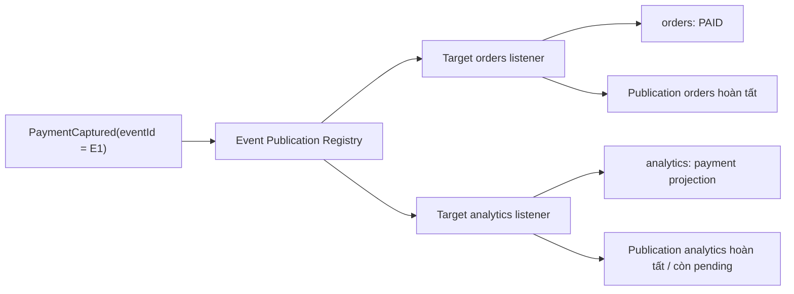
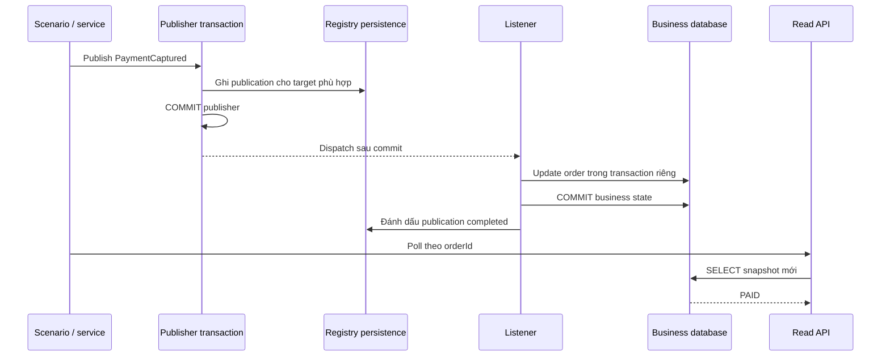

# Cô lập event publication registry trong kiểm thử Spring Modulith

## 1. Vì sao registry khiến các module test ảnh hưởng lẫn nhau?

Spring Modulith có thể sử dụng **Event Publication Registry** để ghi nhận những lần công bố application event cần được theo dõi cho các listener tương ứng. Khi được cấu hình với cơ chế lưu trữ bền vững, thông tin publication có thể **tồn tại lâu hơn một test method, một Spring `ApplicationContext` hoặc một lần chạy ứng dụng**.

Đây là tính năng quan trọng cho độ tin cậy của luồng sự kiện, nhưng cũng là một nguồn **rò rỉ trạng thái giữa các bài test**.

Hình dung bài test A công bố `PaymentCaptured`. Listener `orders` cố ý ném exception để kiểm tra lỗi; một publication vẫn ở trạng thái **chưa hoàn tất** theo cơ chế registry. Bài test B khởi động lại ứng dụng với cùng database để kiểm tra một đơn hàng khác. Nếu cấu hình có cơ chế xử lý lại các publication tồn đọng, event từ A có thể được xử lý trong khi B đang chạy.

Khi đó B có thể:

- Nhận thêm event không do chính mình tạo.
- Thấy bản ghi hoặc side effect bất ngờ.
- Bị lỗi unique constraint hay lock do publication cũ.
- Pass giả nếu chỉ đếm số event/đơn hàng chung.
- Timeout ngẫu nhiên vì listener, executor hoặc database đang xử lý công việc của test trước.

**Cô lập event publication registry** là bảo đảm mỗi kịch bản biết được **publication nào thuộc nó, đối tượng listener nào phải xử lý, trạng thái publication trước/sau stimulus là gì, và khi nào được dọn hoặc tái phát có chủ đích**.

Bài này thuộc chương *Test isolation* của học phần `SPRING_MODULITH_VERIFICATION_TESTING`. Phạm vi học phần là kiểm chứng ranh giới ứng dụng với `ApplicationModules` và các quy tắc phụ thuộc, thực hành `@ApplicationModuleTest`, kiểm thử event, database, tích hợp, cùng quality gate CI để ngăn sai phụ thuộc và hồi quy.

Sau bài học, bạn sẽ có thể:

1. Phân biệt **event được publish**, **publication được registry theo dõi**, **listener hoàn tất** và **state nghiệp vụ quan sát được**.
2. Nhận diện phạm vi lưu trữ và vòng đời của registry trong các module/integration tests.
3. Dùng correlation ID và listener target để cô lập các publication thuộc đúng scenario.
4. Thiết kế fixture, transaction và test probe có khả năng kiểm chứng trạng thái incomplete/completed mà không phụ thuộc thứ tự test.
5. Test lỗi, khởi động lại, resubmission/replay và idempotency trong một môi trường được cô lập có chủ đích.
6. Kết hợp kiểm thử registry với `Scenario`, public query API, xác minh `ApplicationModules.verify()` và CI.

## 2. Registry theo dõi điều gì?

Một application event có thể có **nhiều listener**. Khi cơ chế registry của Spring Modulith được bật và listener đủ điều kiện để được theo dõi, hệ thống cần biết publication của event tới **từng listener/target** đã được xử lý thành công hay chưa.

Hãy phân biệt bốn khái niệm:

| Khái niệm | Bằng chứng | Không nên suy luận |
| --- | --- | --- |
| **Publish event** | `ApplicationEventPublisher.publishEvent(event)` được gọi; trong test có thể thu event bằng `PublishedEvents`. | Listener đã chạy xong hoặc state đã commit. |
| **Registered publication** | Registry lưu thông tin publication theo event/target và transaction liên quan. | Tất cả target đã nhận hoặc hoàn tất. |
| **Publication completed** | Registry đánh dấu hoặc lưu nhận việc target hoàn tất theo cơ chế và cấu hình hiện tại. | Mọi downstream, broker, projection và read replica đều đã hội tụ. |
| **Business state visible** | Public query API trả đúng trạng thái/invariant sau xử lý. | Registry không còn publication chưa hoàn tất hoặc event không thể bị replay. |

Các thuật ngữ *incomplete*, *outstanding*, *completed* và cách lưu/giữ/xóa bản ghi có thể khác nhau theo phiên bản Spring Modulith và provider registry. Vì vậy, test cần kiểm tra **hợp đồng quan sát được** và cấu hình retention, không giả định mọi provider đều có bảng, cột hay bộ enum trạng thái y hệt nhau.

### 2.1. Một event có thể tạo nhiều publication

Ví dụ module `payments` công bố `PaymentCaptured`, hai module khác nhau cùng nhận:



Nếu `orders` xử lý xong nhưng `analytics` thất bại, **không được kết luận toàn bộ event đã xử lý hết chỉ vì order đã `PAID`**. Một test registry cần xác định *target nào* đang được kiểm chứng, thay vì chỉ hỏi “có record cho event không”.

Thông thường có thể nghĩ đến identity quan sát gồm:

```text
Business correlation:
    eventId / transactionId / orderId

Publication target:
    listener identifier hoặc target identifier

Publication lifecycle:
    registered -> xử lý -> completed
                   |
                   +-> incomplete khi chưa xác nhận hoàn tất
                         -> có thể resubmit theo cấu hình
```

Sơ đồ trên là **mô hình khái niệm**, không phải state machine công khai cố định của mọi implementation. Ví dụ, một provider có thể lưu completed publication để audit, provider khác hoặc chính sách retention có thể xóa chúng sau khi hoàn tất.

### 2.2. Registry không tự biến event thành exactly-once

Registry giúp theo dõi và hỗ trợ khả năng xử lý lại những publication chưa hoàn tất. Nhưng nó **không loại trừ** việc listener nhận cùng event nhiều lần, đặc biệt khi handler đã commit business data rồi gặp lỗi trước khi đánh dấu publication hoàn tất.

Vì thế:

- Publication tracking là **hạ tầng tin cậy cho delivery/processing**.
- Idempotency và unique constraint bảo vệ **business side effect**.
- Test cần kiểm tra cả hai nếu hợp đồng yêu cầu “không ghi hai lần”.

Một bài test chỉ thấy publication đã complete có thể bỏ sót duplicate receipt; một bài test chỉ thấy trạng thái `PAID` có thể bỏ sót publication còn pending.

## 3. Ranh giới transaction quyết định registry có gì

Với một listener có tracking phù hợp và một registry bền vững, một luồng có thể được hình dung như sau:



Đây là **luồng mô tả ý nghĩa**, không phải cam kết thứ tự mọi thao tác registry ở tất cả phiên bản, loại listener và transaction manager. Điểm cần bảo vệ là publication được ghi/hoàn tất trong những **ranh giới giao dịch có chủ đích**, và test không nhầm lẫn thời điểm ghi publication với thời điểm state nghiệp vụ đã visible.

### 3.1. Nếu publisher rollback?

Khi event được phát bên trong transaction rồi transaction đó rollback, listener `@TransactionalEventListener(phase = AFTER_COMMIT)` thường **không chạy**. Với registry transactionally integrated, publication liên quan được ghi trong transaction đã rollback cũng không trở thành một publication durable đã commit theo đường xử lý đó.

Không viết test đòi tìm một publication incomplete sau khi transaction publish chưa hề commit, trừ khi đang chủ động kiểm tra một cơ chế tracking ngoài transaction có hợp đồng khác.

### 3.2. Nếu listener ghi xong nhưng chưa đánh dấu complete?

Một failure window quan trọng:

1. Listener nhận event.
2. Listener ghi business data và transaction ghi **commit thành công**.
3. Một lỗi xảy ra trước hoặc trong bước ghi nhận completion.
4. Registry vẫn ghi publication chưa hoàn tất.
5. Resubmission/restart có thể đưa **cùng event** tới listener lần nữa.

Đây là kịch bản cần **idempotency** ở cấp domain hoặc persistence. Việc thấy order đã `PAID` không đủ để tuyên bố publication hoàn tất; ngược lại, thấy incomplete không chứng minh transaction nghiệp vụ chưa commit.

### 3.3. Tại sao `@Transactional` trên test dễ làm sai giả định?

Với `@Transactional` ở test method, Spring Test thường rollback transaction của method khi kết thúc. Nếu test phát event trong transaction đó mà không commit, listener after-commit chưa chắc được gọi và publication durable có thể không xuất hiện.

Nếu fixture `saveAndFlush(...)` mà transaction vẫn mở, listener ở thread khác cũng có thể không thấy dữ liệu đầu vào. Hãy thiết kế **transaction commit thật**, đặc biệt cho test muốn quan sát registry persistence/restart.

## 4. Những tầng isolation phải quản lý đồng thời

| Tầng | Có thể được chia sẻ giữa tests? | Cách cô lập |
| --- | --- | --- |
| **Spring `ApplicationContext`** | Có, do TestContext cache. | Test configuration bất biến, reset bean state khi phù hợp, `@DirtiesContext` khi cần. |
| **Registry storage** | Có, nếu cùng database/schema/provider. | Event key riêng, namespace/schema/container riêng hoặc cleanup có chủ đích. |
| **Business database** | Có, dù context khác nhau. | Fixture theo business ID riêng, transaction commit rõ, cleanup sau xử lý. |
| **Async executor/listener task** | Có, task có thể sống lâu hơn test. | Tín hiệu hoàn tất; không dọn dữ liệu khi handler còn chạy. |
| **Resubmission scheduler/startup policy** | Có, có thể chạy lại publication cũ. | Bật/tắt rõ theo mục tiêu, môi trường cô lập, không dùng chung dữ liệu test khác. |
| **Broker/read model bên ngoài** | Có, nếu integration test kết nối chung. | Consumer group/topic hoặc container riêng; reset theo scope. |
| **Public API và dependency graph** | Có, module test có thể load bean ngoài ý định. | Chọn `@ApplicationModuleTest` scope và xác minh `ApplicationModules.verify()`. |

**`@DirtiesContext` không xóa registry table đã commit.** Tương tự, Testcontainers cung cấp database/broker thực nhưng **không reset từng test method** nếu container được dùng lại. Cần kiểm soát lifecycle storage riêng với lifecycle Spring context.

### 4.1. Lỗi kinh điển: context khác, registry vẫn chung

```text
Test A: ApplicationContext A ──> DataSource ──┐
                                              ├──> Registry DB dùng chung
Test B: ApplicationContext B ──> DataSource ──┘

A để lại incomplete publication cho event E1.
B tạo context mới nhưng DB còn E1.
Resubmission B có thể xử lý E1 ngoài dự định.
```

Muốn cô lập B, phải giải quyết **dữ liệu E1 và chính sách resubmission**, không chỉ khởi động lại các bean.

## 5. Mỗi scenario cần correlation ID riêng và đúng target

Trong bài test event-driven, nên tạo ít nhất một **ID bất biến** cho stimulus:

```java
import java.util.UUID;

UUID eventId = UUID.randomUUID();
UUID orderId = UUID.randomUUID();
String transactionId = "CAPTURE-" + eventId;
```

Trong business event, mang đủ correlation data để khớp chính xác:

```java
// File: com/example/shop/payments/events/PaymentCaptured.java
package com.example.shop.payments.events;

import java.util.UUID;

public record PaymentCaptured(
        UUID eventId,
        UUID orderId,
        String transactionId) {}
```

Có hai lớp định danh:

- **Business correlation:** `eventId` xác định event logical, `orderId` xác định aggregate, `transactionId` hỗ trợ idempotency nghiệp vụ.
- **Listener target:** phân biệt publication tới `orders` và publication tới `analytics`, kể cả khi chúng thuộc cùng event.

Registry provider có thể tạo **publication ID nội bộ** riêng, không nhất thiết trùng `eventId`. Không viết assertion nhầm chúng thành cùng một ID. Correlation ID do ứng dụng thiết kế giúp lọc publication đúng scenario; cách truy vấn event payload và target phụ thuộc API/provider thực tế.

### 5.1. Một bẫy khi chỉ đếm registry rows

Đoạn logic sau không đáng tin khi registry dùng chung:

```java
assertThat(probe.countIncomplete()).isEqualTo(1);
```

Nếu test trước để lại publication, số lượng tổng thể không còn phản ánh event hiện tại. Thậm chí một event có nhiều listener cũng có thể tạo nhiều publication hợp lệ.

Đúng hơn:

```java
assertThat(probe.forEventAndTarget(eventId, targetIdentifier))
        .satisfies(records -> {
            // Kiểm tra publication của đúng event, đúng listener.
            // Có thể cần đối chiếu trạng thái theo retention policy.
        });
```

`probe` và `forEventAndTarget(...)` ở đây là **test-support API minh họa**, không phải phương thức chắc chắn có trên Spring Modulith registry. Muốn dùng thật, phải triển khai probe phù hợp với provider đang cấu hình.

### 5.2. Một scenario kiểm tra replay cố ý dùng lại ID

Quy tắc ID riêng áp dụng **giữa các scenario độc lập**. Trong một scenario kiểm chứng idempotency, việc phát lại **cùng eventId/transactionId** là có chủ đích. Cần ghi rõ mục tiêu:

```text
Scenario A: eventId = E1; orderId = O1
Scenario B: eventId = E2; orderId = O2
Scenario replay:
    lần 1: eventId = E3; orderId = O3
    lần 2: eventId = E3; orderId = O3  (cố ý lặp)
```

Không đổi `eventId` giữa hai lần replay rồi gọi đó là duplicate test.

## 6. Chọn chiến lược cô lập registry theo cấp test

| Loại test | Mục tiêu | Registry phù hợp |
| --- | --- | --- |
| **Unit test domain** | Xác minh `Order.markPaid(...)` và invariant. | Không cần registry; dùng object thuần Java. |
| **Producer publication test** | Đúng event type/payload được phát. | `PublishedEvents` thường đủ; không nhất thiết cần persistence registry. |
| **Consumer module test** | Listener phản ứng và state đổi đúng. | `Scenario` + public read API; registry chỉ cần nếu đó là hợp đồng đang test. |
| **Registry persistence integration test** | Publication được ghi, completed/incomplete theo cơ chế. | Bật provider registry thật, database/schema có khả năng cô lập. |
| **Resubmission/restart test** | Incomplete publication tồn tại qua restart và được xử lý lại. | Hai pha context/app, **giữ riêng dữ liệu registry qua restart**, cô lập khỏi test khác. |
| **E2E qua broker** | Event tới downstream và state hội tụ. | Registry cùng broker thật/test container, IDs/namespace riêng. |

**Không bắt mọi bài `@ApplicationModuleTest` phải khởi động registry persistence thật.** Một module test chuyên kiểm chứng trạng thái sau event có thể không cần xem chi tiết registry. Ngược lại, nếu yêu cầu là độ bền publication sau lỗi/restart, một fake chỉ lưu event trong bộ nhớ là chưa đủ.

### 6.1. `PublishedEvents` không phải publication registry

`PublishedEvents` trong Spring Modulith test hỗ trợ quan sát **application events được publish trong test**, còn Event Publication Registry theo dõi **publication/lifecycle của listener phù hợp** khi được bật. Ví dụ:

```java
import static org.assertj.core.api.Assertions.assertThat;

import org.junit.jupiter.api.Test;
import org.springframework.modulith.test.PublishedEvents;

@Test
void producerPublishesTheEvent(PublishedEvents events) {
    // Gọi use case thực sự phát PaymentCaptured.
    paymentApplicationService.capturePayment(orderId, transactionId);

    assertThat(events.ofType(PaymentCaptured.class)
            .matching(PaymentCaptured::orderId, orderId))
            .isNotEmpty();
}
```

Đây là **trích đoạn test**: `paymentApplicationService`, `orderId` và `transactionId` phải được fixture/setup cung cấp, đồng thời test phải được bootstrap bằng cấu hình test tương thích để inject `PublishedEvents`. Nó kiểm chứng publication của producer, **không** chứng minh listener đã hoàn tất hoặc registry không còn incomplete publication.

Tách riêng test registry nếu cần kiểm chứng tracking và resubmission.

## 7. Thiết kế test probe cho registry: quan sát có giới hạn và đúng provider

Không nên buộc public API nghiệp vụ của `orders` phơi bày bảng registry hoặc entity hạ tầng. Một **test-only adapter** có thể quan sát registry theo provider được chọn, phục vụ integration test và không trở thành dependency production giữa module.

Ví dụ hợp đồng test-support:

```java
// Các kiểu sau nằm ở source set test, không phải Spring Modulith API.
import java.util.List;
import java.util.UUID;

enum PublicationLifecycle {
    INCOMPLETE,
    COMPLETED
}

record PublicationObservation(
        UUID eventId,
        String targetIdentifier,
        PublicationLifecycle lifecycle) {}

interface PublicationProbe {
    List<PublicationObservation> forEvent(UUID eventId);

    default List<PublicationObservation> forEventAndTarget(
            UUID eventId, String target) {
        return forEvent(eventId).stream()
                .filter(p -> p.targetIdentifier().equals(target))
                .toList();
    }
}
```

Đây là **mô hình quan sát của test**, không khẳng định Spring Modulith cung cấp enum hoặc interface tương ứng. Adapter cần ánh xạ dữ liệu phù hợp với registry backend và **chính sách retention**. Nếu provider xóa publication completed, `COMPLETED` có thể không còn bản ghi cho probe đọc: test phải chọn một dấu hiệu completed khác hoặc kiểm tra **không còn outstanding** sau khi đã có điểm đồng bộ chứng minh handler xử lý xong.

Một thiết kế test-support tốt cần:

1. **Read-only** đối với phép query thông thường; không mutate registry trong predicate.
2. Lọc theo `eventId` **và** target khi kiểm tra một listener.
3. Tránh phụ thuộc cứng vào tên bảng/cột nội bộ trừ khi test chính xác adapter persistence đó.
4. Phân biệt “không tìm thấy publication” với “publication đã hoàn tất và bị xóa”.
5. Có khả năng cung cấp bằng chứng lỗi: event, target, trạng thái/cùng thời điểm, không lộ dữ liệu nhạy cảm.
6. Được triển khai trong phạm vi hạ tầng kiểm thử có quyền truy cập phù hợp, không vượt ownership module nghiệp vụ.

### 7.1. Không kiểm tra completed ngay bằng một truy vấn duy nhất

Nếu listener và registry xử lý bất đồng bộ, sau khi state trở thành `PAID`, bước ghi dấu completion có thể vẫn đang tiến hành. Một assertion ngay lập tức:

```java
assertThat(probe.forEvent(eventId))
        .allMatch(p -> p.lifecycle() == PublicationLifecycle.COMPLETED);
```

có thể sai hoặc thậm chí **pass trên danh sách rỗng**. Hãy dùng điều kiện chờ và kiểm tra sự tồn tại/thông tin target theo retention policy. Khi provider không giữ completed records, hãy kết hợp bằng chứng handler đã hoàn tất với việc publication không còn outstanding.

## 8. Fixture transaction: publication chỉ đáng kiểm tra sau commit thích hợp

Một helper dành riêng cho integration test có thể phát event **trong transaction mới đã commit** để bảo đảm kích hoạt ngữ nghĩa after-commit:

```java
import org.springframework.context.ApplicationEventPublisher;
import org.springframework.transaction.PlatformTransactionManager;
import org.springframework.transaction.TransactionDefinition;
import org.springframework.transaction.support.TransactionTemplate;

final class CommittedEventDriver {
    private final ApplicationEventPublisher publisher;
    private final TransactionTemplate transactions;

    CommittedEventDriver(
            ApplicationEventPublisher publisher,
            PlatformTransactionManager transactionManager) {
        this.publisher = publisher;
        this.transactions = new TransactionTemplate(transactionManager);
        this.transactions.setPropagationBehavior(
                TransactionDefinition.PROPAGATION_REQUIRES_NEW);
    }

    void publishAndCommit(Object event) {
        transactions.executeWithoutResult(status ->
                publisher.publishEvent(event));
    }
}
```

Đây là class **test-support minh họa**, cần được đăng ký vào test context bằng `@TestConfiguration`/`@Import` hoặc cách hợp lệ khác. `TransactionTemplate` với `REQUIRES_NEW` tạo transaction độc lập; khi callback thành công, commit xảy ra trước khi helper trả về.

**Giới hạn rất quan trọng:** helper này chỉ kiểm chứng việc publish của chính nó, **không** chứng minh production use case thật công bố event đúng lúc. Với bài end-to-end, nên gọi application service thật trong transaction và kiểm tra registry/event/state sau đó.

Nếu hệ thống dùng nhiều transaction manager hoặc registry lưu ở DataSource khác, cần chọn đúng manager và hiểu khả năng đồng bộ commit. Không giả định một transaction manager đơn lẻ điều phối atomically nhiều database hoặc external broker.

### 8.1. Không dùng rollback test để giả lập registry được dọn

Một test `@Transactional` có thể rollback test-managed transaction khi kết thúc, nhưng:

- Fixture `REQUIRES_NEW` có thể đã commit độc lập.
- Listener async có thể dùng transaction riêng.
- Registry publication đã commit ở transaction khác có thể vẫn tồn tại.
- Broker hoặc process bên ngoài không bị rollback cùng database transaction test.

Vì vậy, chiến lược cô lập registry phải tính tới **các commit riêng và side effect của listener**, không trông chờ một rollback tổng thể.

## 9. Ví dụ module test: cô lập event và state của chính scenario

Đây là test thuộc module `orders`, nhận event công khai của `payments` và xác minh trạng thái đơn hàng bằng API. Trong dự án thật, `OrderFixture` phải tự tạo một đơn hàng mới và commit trước khi event được xử lý.

Các kiểu nghiệp vụ minh họa:

```java
// File: com/example/shop/orders/OrderStatus.java
package com.example.shop.orders;

public enum OrderStatus {
    AWAITING_PAYMENT, PAID, PAYMENT_FAILED
}
```

```java
// File: com/example/shop/orders/OrderQueries.java
package com.example.shop.orders;

import java.util.Optional;
import java.util.UUID;

public interface OrderQueries {
    Optional<OrderStatus> statusOf(UUID orderId);
}
```

```java
// File: com/example/shop/orders/OrderFixture.java
package com.example.shop.orders;

import java.util.UUID;

public interface OrderFixture {
    UUID createAwaitingPaymentAndCommit();
}
```

Một test với `Scenario`:

```java
package com.example.shop.orders;

import static org.assertj.core.api.Assertions.assertThat;

import java.time.Duration;
import java.util.UUID;

import org.junit.jupiter.api.Test;
import org.springframework.beans.factory.annotation.Autowired;
import org.springframework.modulith.test.ApplicationModuleTest;
import org.springframework.modulith.test.Scenario;

@ApplicationModuleTest
class IsolatedPaymentEventTests {

    @Autowired OrderFixture fixture;
    @Autowired OrderQueries orders;

    @Test
    void processesOnlyThisScenariosOrder(Scenario scenario) {
        UUID orderId = fixture.createAwaitingPaymentAndCommit();
        UUID eventId = UUID.randomUUID();
        String transactionId = "CAPTURE-" + eventId;

        assertThat(orders.statusOf(orderId))
                .contains(OrderStatus.AWAITING_PAYMENT);

        scenario.publish(new PaymentCaptured(
                        eventId, orderId, transactionId))
                .andWaitAtMost(Duration.ofSeconds(8))
                .forStateChange(
                        () -> orders.statusOf(orderId),
                        value -> value.filter(s ->
                                s == OrderStatus.PAID).isPresent())
                .andVerify(value ->
                        assertThat(value).contains(OrderStatus.PAID));
    }
}
```

`PaymentCaptured` là record công khai đã khai báo ở mục 5, cần import đúng package. `OrderFixture` là test helper **do dự án triển khai**, có thể được đưa vào context bằng test configuration. Listener, repository và query adapter phải được bootstrap trong module test.

Test này bảo vệ **state contract**, không tự chứng minh registry có record completed. Để kiểm thử registry:

- Bật implementation registry phù hợp trong test integration context.
- Bảo đảm listener đủ điều kiện để publication được tracking.
- Gắn `eventId` riêng cho stimulus và ghi nhận listener target.
- Dùng test probe/provider API để xác nhận những publication thuộc test, theo đúng retention policy.
- Dùng một test riêng cho failure/resubmission, không trộn retry tự động không kiểm soát vào happy-path state test.

### 9.1. Tại sao `@ApplicationModuleTest` có thể không thấy registry?

Module test chỉ bootstrap phạm vi module và hạ tầng mà cấu hình test cho phép. Nếu test không có registry persistence dependency/configuration, nó có thể kiểm chứng listener và state nhưng **không** kiểm chứng được durability của registry.

Ngược lại, nếu mục tiêu là registry được lưu bền và sống qua restart, một integration test có **provider registry thật + database thật** là hợp lý hơn. Không mở rộng bừa `@ApplicationModuleTest` đến tất cả module chỉ vì muốn thấy một bean hạ tầng; hãy thiết kế test đúng trách nhiệm.

## 10. Viết test incomplete publication một cách có kiểm soát

Muốn chứng minh registry giữ publication chưa hoàn tất khi listener lỗi, cần một failure path **có thể lặp lại**:

1. Dùng một registry database/schema/namespace cô lập.
2. Tạo event ID mới và baseline không có publication tương ứng.
3. Kích hoạt listener có khả năng **fail có chủ đích** sau khi publication được đăng ký, trước completion.
4. Chờ **sự kiện fail hoặc trạng thái incomplete** theo điểm đồng bộ đáng tin; không đọc ngay sau `publishEvent(...)` rồi kết luận.
5. Xác nhận publication incomplete của **đúng event và listener**.
6. Đảm bảo retry tự động/startup resubmission không làm thay đổi state trước khi assertion kết thúc, hoặc cấu hình thử nghiệm để chủ động kiểm soát retry.
7. Cleanup/trả lại cấu hình sau khi background work liên quan đã dừng.

Ví dụ đặc tả test (pseudocode, không phải API Spring Modulith có sẵn):

```text
eventId = new random UUID
orderId = fresh committed order
target = orders payment listener identifier

assert publicationProbe.forEventAndTarget(eventId, target) is empty

testDriver.enableOneShotFailure(eventId, target)
committedPublisher.publishAndCommit(
    PaymentCaptured(eventId, orderId, transactionId))

await until listener failure is observed OR the registry reports
    a stable incomplete publication for eventId + target

assert exactly the expected publication for this event + target
assert order/payment side effects satisfy the rollback contract

disable automatic retry during this assertion, or synchronize it explicitly
release failure injection and clean up only after work is quiescent
```

**Tại sao không cung cấp câu SQL cố định?** Bảng/cột, serialized event payload, completion record và API quản trị registry phụ thuộc implementation/version. Một câu `DELETE FROM ...` viết cho JDBC provider không thể mặc nhiên áp dụng cho JPA hoặc provider khác. Test probe nên bọc chính provider được chọn, theo cách test infrastructure có thể kiểm soát.

### 10.1. Failing listener phải fail đúng nơi cần kiểm tra

Nếu cố ý ném exception **trước khi publication được ghi/commit**, không có lý do chắc chắn registry đã có publication incomplete. Nếu ném exception trong một listener không thuộc cơ chế tracking, registry cũng có thể không ghi gì. Nếu listener lỗi nhưng framework bắt/nuốt lỗi, test cần hiểu completion criteria của phiên bản đang dùng.

Hãy ghi rõ **failure point** và quan sát được ít nhất hai dấu hiệu độc lập: event đã được công bố theo đường transaction hợp lệ, và listener target đã thực sự đi qua failure path.

## 11. Completed publication: retention là một phần hợp đồng test

Không phải test nào cũng được phép kiểm tra “có một completed row”. Cơ chế lưu giữ/loại bỏ completed publication được quyết định bởi provider và chính sách cleanup của dự án.

| Trường hợp | Assertion đáng tin hơn |
| --- | --- |
| Provider giữ completed publication có thể query. | Chờ đúng target được đánh dấu completed theo API/provider. |
| Provider xóa hoặc purge completed publication. | Chờ listener xử lý xong và không còn incomplete publication cho event-target; không nhầm “không tìm thấy” với “chưa từng publish”. |
| Event có hai listener. | Kiểm tra trạng thái của từng target riêng biệt. |
| Handler cập nhật state nhưng completion mark chậm. | Chờ registry completion bằng điều kiện riêng; state `PAID` chưa đủ. |
| Listener chuyển tiếp đến downstream async. | Publication completion không tự chứng minh downstream đã cập nhật; test riêng state downstream. |

Khi cần bằng chứng “đã từng được đăng ký” và registry không giữ completed publication, kết hợp một observation hook/test instrumentation ở giai đoạn registration với assertion outcome, hoặc dùng test provider/policy cho phép audit. Không biến absence của row thành bằng chứng duy nhất rằng toàn bộ vòng đời thành công.

### 11.1. Predicate không được gây side effect

Trong `Scenario.andWaitForStateChange(...)` hoặc một awaiter dành cho registry, supplier phải **chỉ đọc**. Không gọi `resubmitIncompletePublications()`, `delete(...)` hay `publishEvent(...)` trong predicate, vì nó có thể được gọi nhiều lần, gây duplicate event và làm test tự thay đổi đối tượng kiểm chứng.

## 12. Test resubmission/restart: chủ động giữ state giữa hai pha

Điểm khó: một bài test isolation thông thường muốn **không giữ registry data** giữa test A/B; nhưng bài test **restart recovery** lại **cố ý giữ registry data qua hai lần khởi động**. Không phải mâu thuẫn; đó là hai phạm vi:

- **Giữa các integration tests độc lập:** dữ liệu registry phải tách hoặc được dọn.
- **Giữa hai pha của cùng recovery test:** incomplete publication cần được giữ trong **database dành riêng cho chính test đó**.

Một quy trình hai pha:

```mermaid
sequenceDiagram
    participant T as Recovery test
    participant C1 as App context phase 1
    participant R as Isolated registry DB
    participant C2 as App context phase 2
    participant B as Business DB

    T->>C1: Start với listener bị fail có kiểm soát
    C1->>R: Commit incomplete publication E9/target T1
    T->>R: Verify E9/T1 incomplete
    T->>C1: Stop context; không xóa registry
    T->>C2: Start context mới cùng registry DB
    C2->>R: Resubmit E9 theo cấu hình recovery
    C2->>B: Listener xử lý idempotently
    C2->>R: Mark completion theo provider policy
    T->>B: Verify side effect đúng 1 lần
    T->>R: Verify không còn incomplete E9/T1
    T->>C2: Stop và dọn môi trường cô lập
```

Cần dùng **cơ chế resubmission thực sự được dự án cấu hình**; không tự giả định startup của mọi ứng dụng luôn resubmit pending publications. Nếu ứng dụng dùng scheduler/operational endpoint để xử lý lại, recovery test phải gọi hoặc kích hoạt đúng con đường đó.

### 12.1. Những rủi ro của test restart

- Spring TestContext cache có thể giữ bean/DataSource cũ; một cách test restart cần kiểm soát lifecycle thực sự.
- Dữ liệu registry có thể bị dọn bởi script cleanup giữa pha 1 và pha 2.
- Listener có thể xử lý ngay ở pha 2 trước khi test cài đặt probe/observer.
- Nếu dùng container riêng mà container bị hủy sau pha 1, publication durable cũng biến mất.
- Nếu pha 2 được chạy trong database dùng chung các test khác, replay có thể đụng dữ liệu ngoại lai.
- Nếu listener đã commit business state ở pha 1 rồi chỉ fail bước completion, pha 2 phải bảo toàn **idempotency**.

Test recovery đáng tin nên dùng database/schema/container dành riêng cho test, cho phép giữ đúng state qua restart **trong cùng scenario**, sau đó giải phóng toàn bộ môi trường test khi kết thúc.

## 13. Cleanup registry: dọn đúng phạm vi, đúng thời điểm

Một anti-pattern nguy hiểm là cho mọi integration test chạy:

```sql
-- Anti-pattern nếu nhiều test hoặc service đang dùng chung registry:
DELETE FROM some_event_publication_table;
```

Đây là SQL *minh họa sai*, không phải tên bảng thật. Nếu các test chạy song song hoặc resubmission worker đang hoạt động, xóa toàn bộ publication có thể làm mất bằng chứng, gây race hoặc phá công việc của test khác.

Một chiến lược cleanup an toàn có thứ tự:

1. **Xác định ownership:** database/schema/tenant/namespace có thuộc riêng test này không?
2. **Ngăn phát thêm công việc:** dừng stimulus mới và đồng bộ các handler/retry worker liên quan.
3. **Đợi quiescence:** không còn task đang có thể truy cập publication của scenario trong phạm vi dọn.
4. **Dọn theo scope:** event ID/target nếu API/provider cho phép; hoặc hủy toàn bộ schema/container **riêng** của test.
5. **Dọn business side effects:** order, receipt, ledger, outbox/read model theo quan hệ dữ liệu hợp lệ.
6. **Xác minh hậu điều kiện:** dữ liệu của scenario không còn gây ảnh hưởng; nếu chưa chắc, giữ môi trường riêng phục vụ chẩn đoán thay vì xóa bừa.
7. **Ghi lỗi cleanup:** không lặng lẽ bỏ qua vấn đề publication pending.

### 13.1. Một số phương án cô lập

| Phương án | Ưu điểm | Hạn chế |
| --- | --- | --- |
| Event ID riêng + probe lọc theo target | Ít chi phí; dễ chạy nhiều test trên DB chung. | Không tự ngăn resubmission cũ hoặc side effect chia sẻ. |
| Cleanup có chọn lọc | Phù hợp khi provider cho phép và task đã dừng. | Cần hiểu backend và lifecycle; dễ race nếu chạy sớm. |
| Schema/database riêng theo test class | Tách durable registry mạnh hơn, thuận lợi cho recovery test. | Cần migrations/transaction manager/schema config riêng. |
| Testcontainers riêng | Có thể kiểm thử provider thật trong môi trường cô lập. | Tốn thời gian tạo container; phải kiểm soát context cache. |
| Fake/in-memory test registry | Nhanh, dễ unit test hành vi cơ bản. | Không chứng minh durability, restart hoặc SQL constraints. |
| `@DirtiesContext` | Làm mới bean graph khi context bị nhiễm. | Không xóa durable registry data trong database ngoài. |

### 13.2. `@Sql` không tự quyết định publication đã hoàn tất

Có thể dùng `@Sql` để setup/cleanup DB trong một môi trường test cô lập, nhưng phải biết transaction mode của script và lifecycle của listener. Một script chạy ở `AFTER_TEST_METHOD` có thể xóa dữ liệu **trước khi worker async/retry thật sự kết thúc**, nếu test chưa có điểm đồng bộ.

Vì vậy, đừng gắn một script `TRUNCATE` toàn registry vào mọi method chỉ để test pass nhanh. Nếu cần reset triệt để, dùng môi trường riêng và kết thúc các worker trước khi reset.

## 14. Cô lập test chạy song song

Khi JUnit chạy parallel, hai test dùng cùng registry database có thể tranh nhau:

- Event publication của listener cùng target.
- Unique constraint hoặc sequence trong registry backend.
- DataSource connection pool và lock.
- Startup resubmission job quét toàn bộ outstanding publications.
- Global cleanup script xóa bản ghi của test khác.
- Shared fake listener hay application cache trong context được reuse.

**Chỉ tạo `eventId` riêng chưa đủ** nếu có worker resubmit **mọi** outstanding publication trong cùng database. Dữ liệu hoàn toàn khác ID vẫn có thể bị xử lý ngoài dự kiến khi listener toàn cục chạy.

Chiến lược thực tế:

1. Tách registry provider storage theo schema/database/container khi bài test điều khiển resubmission.
2. Với test chỉ đọc/tracking, có thể dùng ID riêng và cleanup có chọn lọc nếu không có worker nền quét cross-test.
3. Chạy tuần tự các test đụng cùng scheduler/global registry mà không thể cô lập.
4. Dùng correlation ID trong event, listener logs và test report để truy vết.
5. Bảo đảm business data được cô lập: ID order, payment reference, SKU/ledger key đều riêng.
6. Không cấu hình job CI khác cùng dùng một shared registry database có dữ liệu thật hoặc dữ liệu của suite khác.

Một bài test pass tuần tự nhưng fail khi parallel là tín hiệu cần kiểm tra **nguồn lực dùng chung**, không phải mặc định tăng timeout.

## 15. State của registry khác state nghiệp vụ

Một test registry hoàn tất **không** tự chứng minh order đã `PAID` nếu listener chỉ gửi task đến một hàng đợi khác. Tương tự, `PAID` không chứng minh publication đã được đánh dấu complete. Hai nguồn đọc cần được kiểm chứng theo đúng mục tiêu.

| Event/registry observation | Business state observation | Cách hiểu |
| --- | --- | --- |
| Published event đúng | State vẫn `AWAITING_PAYMENT` | Producer pass; consumer có thể chưa xử lý. |
| Registry incomplete | State vẫn `AWAITING_PAYMENT` | Có thể listener thất bại trước commit hoặc chưa chạy. |
| Registry incomplete | State `PAID` | Có thể business commit đã xảy ra nhưng completion chưa ghi; cần idempotency khi replay. |
| Registry completed | State `PAID` | Listener/outcome có thể phù hợp, nhưng vẫn đối chiếu ID/invariant. |
| Registry completed | Read model vẫn cũ | Có thể projection cập nhật chậm hoặc completion chỉ bao phủ một bước. |
| Không có publication record | State `PAID` | Có thể completed đã bị purge, event không được tracking, hoặc state đổi theo đường khác. |

Chú ý: nếu có **nhiều listener** cho một event, trạng thái registry phải đọc theo target; không thể lấy kết luận của listener `orders` để áp dụng cho listener `analytics`.

### 15.1. Test state qua public API, không qua registry table

Khi muốn chứng minh trạng thái cuối, nên đọc API của module sở hữu dữ liệu:

```java
scenario.publish(event)
        .andWaitForStateChange(
                () -> orderQueries.statusOf(orderId),
                status -> status.filter(s ->
                        s == OrderStatus.PAID).isPresent())
        .andVerify(status ->
                assertThat(status).contains(OrderStatus.PAID));
```

Đây là mẫu `Scenario` cần có biến/bean được fixture/test cung cấp. Registry probe chỉ phục vụ test infrastructure, không phải đường truy cập business state của consumer.

## 16. Ranh giới Modulith khi test registry

Có hai loại phụ thuộc cần giữ tách biệt:

- **Business module dependency:** `orders` được phép sử dụng event contract `payments.events`, không import `payments.internal.PaymentRepository`.
- **Test infrastructure dependency:** registry probe/driver có thể hiểu persistence provider trong source set test/integration, nhưng không biến bảng registry thành public API sản xuất của module nghiệp vụ.

Nếu event contract nằm trong package con, có thể công bố qua named interface:

```java
// File: com/example/shop/payments/events/package-info.java
@org.springframework.modulith.NamedInterface("events")
package com.example.shop.payments.events;
```

Một module nhận có thể giới hạn dependency:

```java
// File: com/example/shop/orders/package-info.java
@org.springframework.modulith.ApplicationModule(
        allowedDependencies = "payments::events")
package com.example.shop.orders;
```

Cấu hình ví dụ phải khớp tên module/named interface thực trong ứng dụng. Không mở rộng dependency production chỉ để một test có thể truy cập registry implementation.

Kiểm chứng kiến trúc:

```java
import org.junit.jupiter.api.Test;
import org.springframework.modulith.core.ApplicationModules;

class ModulithBoundaryTests {

    @Test
    void moduleDependenciesAreValid() {
        ApplicationModules.of(ShopApplication.class).verify();
    }
}
```

`ShopApplication` là Spring Boot application class giả định. `ApplicationModules.verify()` giúp phát hiện dependency ngoài API/allowed dependencies; nó không kiểm chứng registry không còn pending. Ngược lại, một registry sạch không chứng minh dependency graph đúng.

## 17. Chẩn đoán test registry không ổn định

| Triệu chứng | Nguyên nhân có thể | Bước xác minh tiếp |
| --- | --- | --- |
| Test B nhận event của A. | A để lại incomplete publication, B bật resubmission. | Đối chiếu event ID, registry storage và policy startup. |
| Event xuất hiện trong `PublishedEvents` nhưng không có registry record. | Listener không được tracking, provider chưa bật, transaction rollback hoặc completed đã purge. | Kiểm tra configuration và đường event/transaction đúng. |
| Registry còn incomplete, order đã `PAID`. | Completion mark thất bại/trễ hoặc target khác chưa xong. | Lọc theo target, kiểm tra commit và idempotency. |
| Test “all completed” pass trên danh sách rỗng. | Predicate `allMatch` đúng với collection rỗng. | Assert tồn tại bản ghi/kết quả tương ứng trước khi kiểm tra. |
| Test incomplete pass rồi fail ngẫu nhiên. | Retry tự động làm publication chuyển trạng thái trước assertion. | Kiểm soát retry hoặc dùng synchronization xác định. |
| `@DirtiesContext` rồi vẫn thấy publication cũ. | Registry lưu bền ở database không bị reset. | Cô lập DB/schema hoặc cleanup theo scope. |
| Test restart không tìm được publication. | DB/container đã bị dọn giữa hai pha; publisher rollback. | Kiểm tra storage lifecycle và commit. |
| Handler xử lý duplicate tạo hai receipt. | Thiếu idempotency/unique constraint hoặc race. | Test business side effect sau replay completion. |
| Test fail khi parallel. | Shared registry cleanup, scheduler, lock, connection pool. | Cô lập provider storage hoặc chạy tuần tự nhóm test. |
| Test timeout nhưng registry completed. | Query consumer stale/read replica/target khác hoặc predicate sai. | Kiểm tra public read API, ID, isolation và workflow thực. |

Để chẩn đoán, ghi lại test name, `eventId`, `orderId`, target identifier, thời điểm registration, thời điểm listener bắt đầu/commit/complete, registry status cuối và business state cuối. Không log payload nhạy cảm hoặc payment data thật trong test report.

### 17.1. Phân loại lỗi trước khi sửa

1. **Không ghi publication:** kiểm tra tracking được bật, listener target đủ điều kiện, transaction publish và provider.
2. **Có publication nhưng listener chưa xử lý:** kiểm tra dispatch, async executor, startup/retry policy.
3. **Listener chạy nhưng không commit:** kiểm tra business exception/transaction rollback.
4. **Business commit nhưng registry incomplete:** kiểm tra completion recording và idempotency khi replay.
5. **Registry completed nhưng consumer thấy state cũ:** kiểm tra read model, isolation, cache/replica và target.
6. **Test bị nhiễm event của test khác:** kiểm tra registry storage, background worker và cleanup.
7. **Chỉ CI lỗi:** kiểm tra parallelism, DB scope, timeout và lifecycle container/context.

Không dùng `Thread.sleep(...)` để chữa tất cả trường hợp. Cần **điểm chờ theo trạng thái hoặc tín hiệu hoàn tất**, với timeout hữu hạn và thông báo lỗi có correlation ID.

## 18. Quality gate trong CI

Một pipeline kiểm thử event-driven Spring Modulith nên phân tầng:

1. **Architecture verification:** chạy `ApplicationModules.of(...).verify()` để phát hiện phụ thuộc sai.
2. **Producer publication tests:** dùng `PublishedEvents` kiểm tra event type/payload.
3. **Consumer module tests:** dùng `@ApplicationModuleTest`/`Scenario` kiểm chứng event gây state change đúng.
4. **Registry integration tests:** bật registry thật, database/schema cô lập, kiểm tra incomplete/completed theo retention policy.
5. **Recovery tests:** một số kịch bản restart/resubmission, cố ý giữ registry giữa hai pha cùng test và kiểm chứng idempotency.
6. **Isolation checks:** chạy test riêng, trong full suite và song song ở nhóm an toàn; tránh data/worker cross-test.
7. **Failure evidence:** timeout, state sai, publication sai target hoặc dependency violation phải làm CI fail với log đủ chẩn đoán.

Lệnh minh họa với dự án Gradle đã cấu hình JUnit tests trong task `test`:

```bash
./gradlew test
```

Nếu integration/recovery tests nằm trong task riêng, CI phải chạy các task tương ứng. Không mặc định `test` bao phủ test restart hoặc provider DB thật.

### 18.1. Checklist trước khi merge

- [ ] Test biết registry provider và retention policy đang dùng.
- [ ] Event ID, business ID và listener target được xác định rõ.
- [ ] Đã kiểm tra baseline: không có publication phù hợp từ trước.
- [ ] Publisher transaction đã commit đúng khi test cần publication durable.
- [ ] Test phân biệt completed của **từng target** với state nghiệp vụ.
- [ ] Retry/resubmission được bật/tắt theo mục tiêu và có điểm đồng bộ.
- [ ] Không dùng `allMatch` trên tập rỗng để khẳng định mọi publication complete.
- [ ] Không purge toàn bộ registry dùng chung trong test parallel.
- [ ] Cleanup chỉ chạy sau khi handler/retry worker cần thiết đã hoàn tất.
- [ ] Test restart giữ registry qua hai pha nhưng cô lập khỏi test khác.
- [ ] Listener có idempotency cho duplicate delivery.
- [ ] CI có cả kiểm chứng kiến trúc, state và registry khi thích hợp.

## 19. Bài tập thực hành

**Bài A — publication khác event capture:** viết producer test dùng `PublishedEvents` cho `PaymentCaptured`. Sau đó xác định vì sao test này không chứng minh registry có incomplete/completed publication. Thêm ghi nhận target theo registry provider test.

**Bài B — nhiều listener:** tạo hai listener đủ điều kiện theo dõi cùng loại event, trong đó một listener xử lý xong còn listener kia thất bại có chủ đích. Xác minh trạng thái publication **theo từng target**, không chỉ đếm tổng event.

**Bài C — test bị nhiễm registry:** dùng hai test chung database cô lập dành cho bài tập; test đầu để incomplete publication, test sau bật resubmission. Quan sát sự can thiệp, rồi sửa bằng database/schema riêng hoặc điều khiển resubmission có chủ đích.

**Bài D — transaction rollback:** phát event bên trong transaction bị rollback, so sánh việc event đã gọi `publishEvent(...)` với dữ liệu registry durable và callback `AFTER_COMMIT`. Sau đó publish trong một committed transaction và kiểm tra lại.

**Bài E — completion retention:** thay đổi chính sách lưu completed publication trong môi trường test phù hợp. Viết assertion không phụ thuộc cứng vào việc luôn còn completed row, nhưng vẫn có bằng chứng listener đã xử lý xong.

**Bài F — restart recovery:** trong một database riêng, cố ý để publication incomplete ở pha 1; restart context/app với handler hoạt động, kích hoạt resubmission theo cơ chế dự án. Kiểm tra incomplete được giải quyết và business side effect không bị nhân đôi.

**Bài G — idempotency dưới lỗi giữa commit/completion:** mô phỏng listener đã ghi thành công nhưng completion bị gián đoạn. Khi replay, dùng transaction ID/unique constraint để ngăn tạo receipt hoặc ledger entry thứ hai.

**Bài H — cleanup và parallel:** chạy hai kịch bản registry cùng provider storage, rồi thử cleanup toàn bộ registry khi một listener còn chạy trong môi trường học tập cô lập. Quan sát race; sửa bằng lifecycle synchronization và cleanup theo scope hoặc database riêng.

**Bài I — kiến trúc + CI:** chạy `ApplicationModules.verify()` cùng producer, consumer và registry tests. Thử import một repository `internal` của module khác trong nhánh bài tập, xác minh gate chặn; sau đó hoàn nguyên.

**Tiêu chí đạt:** người học có thể giải thích event publication registry độc lập với business state, cô lập ID/target/storage, bảo đảm transaction commit, kiểm soát retry/restart/cleanup, xử lý duplicate theo idempotency và duy trì quality gate kiến trúc.

## 20. Ghi nhớ và tài liệu tham khảo

**Event Publication Registry là một nguồn trạng thái bền vững của hạ tầng kiểm thử**, không chỉ là bộ sưu tập event tạm trong memory. Một test module đáng tin cần xem publication thuộc event nào, được gửi tới listener nào, còn outstanding hay đã complete theo provider policy, và có bị xử lý lại ngoài ý định hay không.

Cách tiếp cận hiệu quả là: **mỗi scenario có correlation ID riêng, fixture/transaction commit rõ, registry storage được cô lập theo scope phù hợp, reader/probe không gây side effect, cleanup sau khi worker đã dừng, recovery test giữ state qua restart có chủ đích và listener có idempotency**. Kết hợp kiểm chứng này với `Scenario`, public API, `ApplicationModules.verify()` và CI sẽ bảo vệ cả độ tin cậy event lẫn ranh giới Spring Modulith.

Tài liệu tham khảo:

- [Spring Modulith — Working with Application Events](https://docs.spring.io/spring-modulith/reference/events.html): event publication, registry, completion và resubmission.
- [Spring Modulith — Testing Application Modules](https://docs.spring.io/spring-modulith/reference/testing.html): `@ApplicationModuleTest`, `PublishedEvents` và `Scenario`.
- [Spring Modulith — Verifying Application Module Structure](https://docs.spring.io/spring-modulith/reference/verification.html): `ApplicationModules.verify()` và public dependency boundaries.
- [Spring Framework — Transaction-bound Events](https://docs.spring.io/spring-framework/reference/data-access/transaction/event.html): pha `AFTER_COMMIT`, `@TransactionalEventListener` và rollback.
- [Spring Framework — Transaction Propagation](https://docs.spring.io/spring-framework/reference/data-access/transaction/declarative/tx-propagation.html): `REQUIRES_NEW` và transaction độc lập.
- [Spring Framework — Context Caching](https://docs.spring.io/spring-framework/reference/testing/testcontext-framework/ctx-management/caching.html): Spring TestContext cache và lifecycle.
- [Testcontainers for Java](https://java.testcontainers.org/): database/broker cô lập cho kiểm thử registry và recovery.
