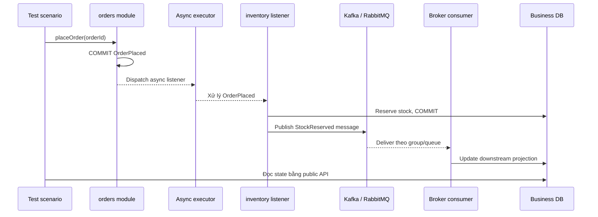

# Cô lập executor và message broker trong kiểm thử Spring Modulith

## 1. Bài toán: test đã kết thúc nhưng công việc bất đồng bộ vẫn chạy

Trong một ứng dụng Spring Modulith, module `orders` phát sự kiện `OrderPlaced`. Module `inventory` xử lý để giữ hàng; module `notifications` có thể tiếp tục gửi một thông điệp đến message broker cho dịch vụ bên ngoài. Khi test chạy, không phải mọi bước đều kết thúc cùng thời điểm với lời gọi publish event:

- Một listener `@Async` có thể vẫn nằm trong hàng đợi của `TaskExecutor`.
- Một listener `@TransactionalEventListener(phase = AFTER_COMMIT)` chỉ được kích hoạt sau commit của transaction phát sự kiện.
- Một externalizer hoặc adapter tích hợp có thể đưa thông điệp vào Kafka/RabbitMQ trong một transaction hay luồng xử lý riêng.
- Consumer broker có thể nhận thông điệp sau khi test method trả về, retry sau lỗi, hoặc tiếp tục xử lý một message còn sót từ test trước.

Vì thế, **chỉ tạo dữ liệu database riêng chưa đủ để có test isolation**. Giả sử test A dùng cùng một topic và consumer group với test B; thông điệp tồn đọng của A có thể bị consumer trong B xử lý. Nếu test B chỉ kiểm tra “có một reservation ở trạng thái `RESERVED`”, nó có thể pass nhờ dữ liệu/event không liên quan. Ngược lại, test B có thể timeout vì một task từ A chiếm hết executor hoặc vì consumer offset đã được commit từ lần chạy trước.

**Cô lập executor và message broker** nghĩa là làm rõ ranh giới của công việc bất đồng bộ, định danh của từng thông điệp, tài nguyên dùng chung, điểm đồng bộ và chính sách dọn dẹp; qua đó mỗi scenario chỉ dựa vào những sự kiện và state do chính nó thiết lập.

Bài thuộc chương *Test isolation* của học phần `SPRING_MODULITH_VERIFICATION_TESTING`. Học phần rèn kỹ năng kiểm chứng ranh giới kiến trúc bằng `ApplicationModules`, thực hành `@ApplicationModuleTest`, kiểm thử sự kiện, database, tích hợp và tổ chức quality gate trong CI để chặn phụ thuộc sai và hồi quy.

**Kết quả cần đạt:**

1. Phân biệt executor nội tiến trình, application event và external message broker.
2. Thiết kế test không phụ thuộc timing của worker thread hoặc message của test khác.
3. Cô lập executor, task queue, topic/queue, consumer group, offset và dead-letter/retry state phù hợp.
4. Dùng `Scenario` chờ state qua API công khai, có timeout và correlation ID.
5. Kiểm thử thật đường broker bằng Testcontainers khi cần, nhưng không lạm dụng broker trong unit/module tests.
6. Xử lý cleanup, duplicate delivery, rollback và background work sau timeout.
7. Bảo vệ ranh giới module và kiểm soát độ ổn định trên CI.

## 2. Ba tầng truyền thông cần phân biệt

| Tầng | Cơ chế ví dụ | Phạm vi mặc định | Điều cần cô lập |
| --- | --- | --- | --- |
| **Application event** | Spring `ApplicationEventPublisher`, `@EventListener` | Trong một Spring application context | Loại event, listener được bootstrap, transaction, event correlation |
| **Executor bất đồng bộ** | `@Async`, `TaskExecutor`, `ThreadPoolTaskExecutor` | Worker thread/queue trong JVM | Task đang chạy/chờ, executor bean, lifecycle shutdown, thread-local state |
| **Message broker** | Kafka, RabbitMQ qua adapter hoặc Spring Modulith event externalization | Ngoài JVM, thường lưu message/offset/queue bền | Topic/queue, consumer group, offsets, ack, retry, DLQ, broker lifecycle |

Một lệnh `applicationEventPublisher.publishEvent(event)` **không tự động gửi message tới Kafka/RabbitMQ**. Việc externalize application events cần được cấu hình thông qua cơ chế của ứng dụng/Spring Modulith hoặc adapter riêng. Tương tự, một `@Async` listener chỉ chuyển việc xử lý sang executor; nó không tự tạo một hàng đợi bền vững ngoài tiến trình.

Điều này ảnh hưởng trực tiếp đến test:

- Test **module xử lý sự kiện trong JVM** có thể kiểm tra bằng `@ApplicationModuleTest` + `Scenario`, không cần broker thật.
- Test **producer gửi message ra ngoài** cần kiểm chứng payload và quy tắc routing/serialization của adapter.
- Test **consumer message broker** cần kiểm chứng acknowledge/offset/retry, deserialization, business effect và lỗi.
- Test **end-to-end** cần đường đi publisher → broker → consumer → state thật, kèm database và hạ tầng có phạm vi cô lập.

### 2.1. Một đường đi minh họa



Sơ đồ thể hiện các bước **có thể** xảy ra; thứ tự và transaction boundary thực tế phụ thuộc thiết kế. Ví dụ, việc publish ra broker có thể qua một listener khác, một publication registry/outbox hoặc một adapter trực tiếp. Không suy từ hình minh họa rằng DB commit và message delivery là một transaction nguyên tử.

## 3. Nguồn nhiễm chéo từ executor

Spring có thể cache `ApplicationContext` giữa nhiều test class có cùng cấu hình. Các bean singleton trong context, bao gồm executor, có thể được **tái sử dụng**. Một task không đột nhiên biến mất chỉ vì một test method kết thúc.

Ba trường hợp dễ gặp:

1. **Task của test trước còn đang chạy:** nó commit dữ liệu hoặc publish event sau khi test sau đã bắt đầu.
2. **Task tồn trong queue:** executor có ít worker, công việc cũ chiếm tài nguyên khiến test mới timeout dù logic đúng.
3. **Thread-local state rò rỉ:** `SecurityContext`, MDC, tenant hoặc transaction-related context được đặt/đọc sai cách trên thread tái sử dụng; message có thể được xử lý với metadata nhầm.

| Dấu hiệu | Khả năng cao | Kiểm tra |
| --- | --- | --- |
| Test chạy riêng pass, chạy suite fail | Task cũ hoặc singleton mutable | Correlation ID, queue depth, các task đang chạy |
| Assertion chạy trước listener | `@Async` chạy sau test thread | Predicate chờ state, không assert ngay |
| Handler nhận tenant/user không đúng | Context propagation sai | Cấu hình TaskDecorator, lifecycle của MDC/SecurityContext |
| Test B timeout nhưng CPU vẫn bận | Executor bị bão hòa | Pool size, active count, queue size, blocking task |
| Sau `@DirtiesContext` vẫn có side effect | Work/DB/broker ở ngoài context | Kiểm tra shutdown và external resource |

**Context mới không tự hủy side effect đã ghi ra database hay broker.** Đóng một executor cũng không hoàn tác message đã được gửi hoặc transaction đã commit.

## 4. Chọn executor rõ ràng thay vì phụ thuộc cấu hình ngầm

Với một listener có tên executor cụ thể, application code có thể biểu thị ý định bằng:

```java
import org.springframework.context.event.EventListener;
import org.springframework.scheduling.annotation.Async;
import org.springframework.stereotype.Component;

@Component
class OrderPlacedListener {

    private final ReservationService reservations;

    OrderPlacedListener(ReservationService reservations) {
        this.reservations = reservations;
    }

    @Async("orderEventsExecutor")
    @EventListener
    public void on(OrderPlaced event) {
        reservations.reserveFor(event.orderId(), event.sku(),
                event.quantity());
    }
}
```

`OrderPlaced` và `ReservationService` là kiểu do ứng dụng định nghĩa. `@Async` phải được Spring async support kích hoạt (thường qua `@EnableAsync`); handler phải được gọi thông qua cơ chế Spring thích hợp. Nếu gọi phương thức annotated qua **self-invocation** trong cùng object, proxy-based async có thể không có hiệu lực.

Cấu hình executor minh họa:

```java
import org.springframework.context.annotation.Bean;
import org.springframework.context.annotation.Configuration;
import org.springframework.scheduling.annotation.EnableAsync;
import org.springframework.scheduling.concurrent.ThreadPoolTaskExecutor;

@Configuration(proxyBeanMethods = false)
@EnableAsync
class OrderAsyncConfiguration {

    @Bean(name = "orderEventsExecutor")
    ThreadPoolTaskExecutor orderEventsExecutor() {
        ThreadPoolTaskExecutor executor = new ThreadPoolTaskExecutor();
        executor.setCorePoolSize(2);
        executor.setMaxPoolSize(4);
        executor.setQueueCapacity(40);
        executor.setThreadNamePrefix("orders-events-");
        executor.setWaitForTasksToCompleteOnShutdown(true);
        executor.setAwaitTerminationSeconds(10);
        return executor;
    }
}
```

Các tham số ở đây chỉ minh họa, không phải giá trị chuẩn cho production. Pool/queue phải được sizing theo tải và chính sách backpressure. Khi executor được Spring quản lý, framework điều phối việc khởi tạo/đóng bean theo lifecycle thông thường.

**Điểm quan trọng cho test:** một executor được định danh cho nghiệp vụ giúp quan sát và cấu hình chính xác luồng cần kiểm tra, thay vì sử dụng chung một default executor khó kiểm soát cho mọi module. Tuy vậy, đặt tên bean không tự tạo isolation giữa test method; cùng context có thể vẫn reuse cùng executor.

### 4.1. Dùng executor đồng bộ có giúp test ổn định không?

Một số unit test thay executor bằng `SyncTaskExecutor` để chạy callback trên thread gọi. Cách này có thể hữu ích để kiểm tra logic dễ đoán **khi mục tiêu không bao gồm concurrency**.

Nhưng nó làm thay đổi ngữ nghĩa hệ thống:

- Race condition và queueing bị che khuất.
- Exception xuất hiện theo thread khác so với production.
- `@Async` không còn thực sự tách work khỏi caller nếu executor thay bằng đồng bộ.
- Transaction hoặc thread-local propagation có thể khác production.

Vì vậy, **không dùng executor đồng bộ làm bằng chứng cho correctness của quy trình bất đồng bộ**. Tách unit test logic khỏi integration test thật có executor, timeout, transaction và dữ liệu độc lập.

### 4.2. Không tạo executor mới cho từng assertion

Nếu test cần chờ một handler, đừng gọi `new Thread(...)`, tạo executor tùy tiện hoặc cho vòng lặp poll tự spawn thread mới. Việc đó tăng nondeterminism, khó shutdown và có thể khiến process test không kết thúc.

Nên sử dụng executor do Spring quản lý trong phạm vi test, đồng thời thiết kế **completion signal** hoặc predicate trạng thái; giới hạn số worker và xác định khi nào công việc thực sự hoàn tất.

## 5. Kiểm thử handler async: chờ hành vi, không chờ một khoảng thời gian

Một anti-pattern thường gặp:

```java
publisher.publishEvent(new OrderPlaced(orderId, "SKU-7", 2));
Thread.sleep(1000);
assertThat(reservationQueries.statusOf(orderId))
        .contains(ReservationStatus.RESERVED);
```

Một giây không phải bằng chứng listener đã chạy hoặc commit. Trên máy nhanh, sleep chỉ làm test chậm; trên CI bận, một giây có thể quá ngắn. Nếu worker không được bootstrap, listener lỗi hoặc transaction chưa commit, sleep lâu hơn không giải quyết được.

Trong Spring Modulith, dùng `Scenario` để kích hoạt và chờ state:

```java
import static org.assertj.core.api.Assertions.assertThat;

import java.time.Duration;
import java.util.UUID;

import org.junit.jupiter.api.Test;
import org.springframework.beans.factory.annotation.Autowired;
import org.springframework.modulith.test.ApplicationModuleTest;
import org.springframework.modulith.test.Scenario;

@ApplicationModuleTest
class InventoryAsyncHandlerTests {

    @Autowired ReservationQueries reservations;
    @Autowired ReservationFixture fixture;

    @Test
    void orderEventuallyReservesStock(Scenario scenario) {
        UUID orderId = fixture.pendingReservationAndCommit(
                "SKU-7", 2);

        assertThat(reservations.statusOf(orderId))
                .contains(ReservationStatus.PENDING);

        scenario.publish(new OrderPlaced(orderId, "SKU-7", 2))
                .andWaitAtMost(Duration.ofSeconds(8))
                .forStateChange(
                        () -> reservations.statusOf(orderId),
                        state -> state.filter(s ->
                                s == ReservationStatus.RESERVED)
                                .isPresent())
                .andVerify(state ->
                        assertThat(state).contains(
                                ReservationStatus.RESERVED));
    }
}
```

Đây là **ví dụ tổng hợp**, các kiểu `ReservationQueries`, `ReservationFixture`, `OrderPlaced`, `ReservationStatus` và listener thuộc ứng dụng minh họa, cần được khai báo/import theo dự án. `ReservationFixture.pendingReservationAndCommit(...)` phải tạo dữ liệu đã commit trước khi listener ở thread/transaction khác cần đọc.

Test này chứng minh **state được quan sát qua API đọc của module `inventory`**, không chứng minh broker ngoài nhận message; đó là một hợp đồng khác.

### 5.1. Chờ đúng correlation ID

Nếu một test khác có reservation `RESERVED`, assertion “có ít nhất một reservation đã giữ” có thể pass sai. Đọc state bằng **orderId riêng của scenario** và xác minh SKU/số lượng nếu đó là invariant.

Ví dụ public DTO:

```java
// File: com/example/shop/inventory/ReservationView.java
package com.example.shop.inventory;

import java.util.UUID;

public record ReservationView(
        UUID orderId,
        String sku,
        int requestedQuantity,
        int reservedQuantity,
        ReservationStatus status) {

    public boolean completed() {
        return status == ReservationStatus.RESERVED
                && requestedQuantity == reservedQuantity;
    }
}
```

```java
// File: com/example/shop/inventory/ReservationQueries.java
package com.example.shop.inventory;

import java.util.Optional;
import java.util.UUID;

public interface ReservationQueries {
    Optional<ReservationView> findByOrderId(UUID orderId);
}
```

Một predicate tốt sẽ đợi:

```java
state -> state.filter(ReservationView::completed).isPresent()
```

rồi `andVerify(...)` đối chiếu `orderId`, `sku` và số lượng. Đọc `Optional.isPresent()` không đủ nếu bản ghi `PENDING` đã tồn tại trước sự kiện.

## 6. Task đã hoàn tất hay chỉ state đã đạt?

Đối với nhiều handler, trạng thái cần kiểm tra được cập nhật **trước** một số side effect khác:

```text
Async listener:
    1. Update reservation = RESERVED, commit
    2. Publish StockReserved to broker
    3. Record audit or completion marker
```

Nếu test chỉ đợi `RESERVED` rồi xóa order/đóng broker ngay, bước 2 và 3 có thể vẫn đang chạy. Vì vậy:

- **State predicate:** chứng minh một kết quả nghiệp vụ cụ thể.
- **Task completion signal:** chứng minh worker đã chạy qua một mốc cần thiết để cleanup hoặc kiểm tra side effect âm.
- **Broker delivery/ack signal:** chứng minh một message đã được producer gửi, consumer nhận hoặc xử lý theo cấp hợp đồng tương ứng.

Chỉ dùng tín hiệu completion phù hợp với mục tiêu, không ép một enum `RESERVED` gánh tất cả trách nhiệm.

### 6.1. Đồng bộ có chủ đích bằng test probe

Khi cần điều khiển một race condition, có thể cung cấp một **test hook** tại một ranh giới hợp lệ, chẳng hạn chặn ở trước bước publish. Ví dụ helper test thuần Java:

```java
import java.time.Duration;
import java.util.concurrent.CountDownLatch;
import java.util.concurrent.TimeUnit;

final class TaskGate {

    private final CountDownLatch entered = new CountDownLatch(1);
    private final CountDownLatch release = new CountDownLatch(1);

    void enterAndWait() throws InterruptedException {
        entered.countDown();
        release.await();
    }

    boolean awaitEntered(Duration timeout) throws InterruptedException {
        return entered.await(timeout.toMillis(), TimeUnit.MILLISECONDS);
    }

    void release() {
        release.countDown();
    }
}
```

Đây chỉ là **công cụ test-support**, không phải API của Spring Modulith. Đưa gate vào adapter/listener thông qua dependency injection hoặc test-only hook có chủ đích, không nhét biến static vào production. Trong test:

1. Chờ worker báo đã tới đúng điểm (với timeout).
2. Xác minh điều kiện trước mốc xử lý.
3. Thả gate trong `finally` để không làm treo executor khi assertion thất bại.
4. Chờ completion tiếp theo và assert state/side effect tương ứng.

Không dùng `CountDownLatch` chung cho mọi test method khi context được cache: latch đã về 0 ở lần chạy trước sẽ không reset. Tạo probe/gate theo scenario hoặc reset trong môi trường đồng bộ an toàn. Với lỗi/scheduler, luôn có timeout để CI không treo vô hạn.

### 6.2. Tại sao kiểm tra active thread count chưa đủ?

`executor.getActiveCount() == 0` chưa chắc chứng minh mọi công việc hoàn tất: có thể còn task trong queue, task đã chuyển sang executor khác, gửi message broker xong nhưng consumer chưa nhận, hoặc callback đã spawn công việc mới. Các metric pool chỉ dùng để **chẩn đoán**, không thay thế business completion signal.

## 7. Transaction và executor: rollback test không rollback worker khác

Một transaction thường gắn với thread thực thi. Khi `@Async` chạy trên worker thread, transaction của test/publisher không tự chuyển sang worker. Nếu test tạo dữ liệu bằng `@Transactional` rồi chưa commit:

- Worker có thể không nhìn thấy row ban đầu.
- Listener có thể đọc state cũ hoặc không tìm thấy aggregate.
- `@TransactionalEventListener(AFTER_COMMIT)` có thể không chạy nếu transaction gốc rollback.
- Một service listener chạy trong transaction độc lập có thể commit dữ liệu **không bị rollback** bởi test.

Một cách thiết kế fixture rõ ràng là dùng `TransactionTemplate`:

```java
import java.util.UUID;

import org.springframework.transaction.PlatformTransactionManager;
import org.springframework.transaction.TransactionDefinition;
import org.springframework.transaction.support.TransactionTemplate;

final class CommittedOrderFixture {

    private final OrderRepository orders;
    private final TransactionTemplate transactions;

    CommittedOrderFixture(
            OrderRepository orders,
            PlatformTransactionManager transactionManager) {
        this.orders = orders;
        this.transactions = new TransactionTemplate(transactionManager);
        this.transactions.setPropagationBehavior(
                TransactionDefinition.PROPAGATION_REQUIRES_NEW);
    }

    UUID pendingAndCommit(String sku, int quantity) {
        return transactions.execute(status -> {
            UUID id = UUID.randomUUID();
            orders.save(Order.pending(id, sku, quantity));
            return id;
        });
    }
}
```

`OrderRepository` và `Order.pending(...)` là thành phần do ứng dụng xây dựng. Test-support fixture chỉ nên phụ thuộc repository **của module sở hữu**, không làm repository của module khác trở thành public API. `REQUIRES_NEW` phù hợp khi cần commit độc lập với test transaction; nếu test không nằm trong transaction và một bean fixture `@Transactional` dùng `REQUIRED` đã đủ, không cần ép `REQUIRES_NEW` cho mọi trường hợp.

**Lưu ý:** dữ liệu đã commit bằng fixture độc lập cần được dọn theo scope. Test rollback sau đó không tự hoàn tác được.

### 7.1. `@TransactionalEventListener` cần transaction phát event

Một listener:

```java
import org.springframework.scheduling.annotation.Async;
import org.springframework.transaction.event.TransactionPhase;
import org.springframework.transaction.event.TransactionalEventListener;

@Async("orderEventsExecutor")
@TransactionalEventListener(phase = TransactionPhase.AFTER_COMMIT)
public void on(OrderPlaced event) {
    reservationService.reserveFor(
            event.orderId(), event.sku(), event.quantity());
}
```

là **phương thức minh họa trong một Spring bean**, cần `reservationService` và cấu hình transaction/async thích hợp. Listener after-commit thường chỉ được gọi khi event phát trong transaction được commit; nếu không có transaction, mặc định không chạy trừ khi bật `fallbackExecution` một cách có chủ đích.

Nếu đã xử lý bất đồng bộ, service ghi state phải có transaction riêng/đúng. Việc gọi `publishEvent(...)` trong test không tự khẳng định business write đã commit, càng không chứng minh message broker đã nhận dữ liệu.

## 8. Message broker là nguồn state độc lập với Spring context

Khi tích hợp Kafka/RabbitMQ, state của broker có thể tồn tại sau khi test class/context kết thúc:

- Topic/queue và binding vẫn tồn tại.
- Messages chưa được consume/ack hoặc bị requeue.
- Kafka committed offsets của consumer group vẫn được giữ.
- Retry topics, dead-letter topic/queue (DLT/DLQ) có thể chứa message cũ.
- Consumer còn đang chạy và sử dụng tài nguyên chung.
- Producer có thể mới gửi trong lúc test cleanup bắt đầu.

`@DirtiesContext` chỉ yêu cầu Spring TestContext làm mới application context; nó **không dọn toàn bộ trạng thái broker bên ngoài**. Khi cần cô lập mạnh, phải có topic/queue/group/namespace riêng hoặc broker/container với lifecycle phù hợp.

### 8.1. Bốn tầng bằng chứng với broker

| Mốc | Bằng chứng ví dụ | Điều chưa chứng minh |
| --- | --- | --- |
| Adapter gọi publish/send | Mock port hoặc callback producer | Broker đã persist/ack message |
| Broker xác nhận send | Send result/ack phù hợp với client/config | Consumer đã xử lý |
| Consumer nhận hoặc ack/commit offset | Consumer log/ack/offset outcome | Business DB chắc chắn đã commit theo invariant |
| Public read API trả state đúng | Query state sau commit/hội tụ | Không có duplicate/outstanding message khác |

Đừng dùng `KafkaTemplate.send(...)` được gọi một lần làm bằng chứng rằng listener downstream đã cập nhật DB. Ngược lại, DB cuối đúng không tự chứng minh payload broker đúng hoặc không có message duplicate.

## 9. Kafka: cô lập topic, group, offset và DLT

Kafka khác cơ chế queue thông thường: message được lưu trong **topic partition**, còn consumer group duy trì **vị trí đọc/committed offsets**. Các topic có thể được nhiều group đọc độc lập.

Những rủi ro trong test:

| Cách dùng không an toàn | Vì sao sai | Cách cô lập |
| --- | --- | --- |
| Dùng consumer group tĩnh trên broker chung | Offset từ lần chạy trước ảnh hưởng test sau. | Group ID riêng theo test suite/nhóm thích hợp. |
| Hai test cùng group trong khi chạy song song | Consumer có thể được rebalance và chia partition, test này “ăn” message của test kia. | Không cho test độc lập cùng group; tách group/topic. |
| Dùng `auto.offset.reset=earliest` rồi nghĩ sẽ đọc từ đầu | Policy chỉ có tác dụng khi group không có offset hợp lệ. | Group ID mới hoặc seek/offset setup có chủ đích. |
| Consumer subscribe sau khi publish với `latest` | Có thể bỏ qua record đã phát trước khi group bắt đầu đọc. | Bảo đảm assignment/offset setup trước publish hoặc chọn chiến lược đúng. |
| Chỉ kiểm tra topic chính | Retry/DLT vẫn còn message từ scenario trước. | Cô lập và kiểm tra retry topics/DLT liên quan. |
| Chỉ đặt key `orderId`, không lọc payload | Message cũ/cùng key vẫn có thể bị tính nhầm. | Event ID và transaction ID riêng, assert đầy đủ. |

**Topic riêng** tạo cách ly mạnh hơn **group riêng** nếu test vừa producer vừa consumer và cần bảo đảm không có thông điệp ngoại lai. Tuy nhiên, mỗi test method tạo topic mới có chi phí provisioning; thường nên dùng topic riêng theo test class/suite và event ID riêng theo method, với consumer group/test probe phù hợp.

### 9.1. Message key không đồng nghĩa event ID

Với Kafka, key có thể dùng để định tuyến các message của cùng aggregate đến partition phù hợp, ví dụ `orderId`; event ID là dấu hiệu **tính duy nhất của lần phát** hoặc khóa idempotency của logical event.

```java
// Ý tưởng thiết kế message envelope của ứng dụng:
public record StockReservedMessage(
        UUID eventId,
        UUID orderId,
        String sku,
        int quantity) {}
```

Một consumer test nên kiểm tra `eventId` và `orderId`/SKU/quantity; không chỉ kiểm tra có một record cùng type.

Nếu dùng Spring Kafka, producer/consumer serializer, topic property, group ID và ack mode đều phải được cấu hình tương thích. Không mặc định Java record được gửi ra broker mà không cần serializer.

### 9.2. Consumer test observer không được cướp message của application consumer

Để quan sát một message đầu ra trên Kafka, test có thể dùng một **consumer group riêng**. Cách này cho phép observer nhận bản sao logical stream độc lập thay vì cạnh tranh partition với business consumer trong cùng group.

Nhưng observer cần:

1. Cấu hình offset hợp lệ trước khi stimulus phát.
2. Chờ consumer được assign partition trước khi dựa vào subscription, nếu dùng chính sách latest.
3. Lọc theo event ID của scenario.
4. Có timeout hữu hạn.
5. Đóng consumer và giải phóng resource theo scope test.

Bổ sung một test business-consumer riêng để chứng minh DB state; consumer observer nhận message không chứng minh handler chính đã commit.

## 10. RabbitMQ: cô lập queue, routing key, ack và DLQ

Với RabbitMQ, message thường được route từ **exchange** tới **queue** theo binding và routing key. Khác với Kafka group offsets, nhiều consumer trên cùng queue có thể cạnh tranh nhận message; ack/nack/requeue quyết định trạng thái delivery.

Rủi ro điển hình:

- Hai test dùng cùng tên queue; consumer của test A có thể nhận message do B gửi.
- Queue bền còn thông điệp từ lần chạy trước.
- Message chưa ack bị requeue khi consumer disconnect.
- DLQ chứa message lỗi của scenario cũ.
- Publisher gửi vào exchange nhưng binding test không đúng, khiến message không đi tới queue kỳ vọng.

Các chiến lược cô lập:

| Thành phần | Chiến lược thường hợp lý |
| --- | --- |
| Exchange | Dùng exchange dành cho integration-test suite, không dùng exchange production. |
| Queue | Tên queue duy nhất theo class/scenario hoặc server-named/exclusive auto-delete khi phù hợp. |
| Routing key | Thêm test namespace hoặc correlation key rõ ràng nếu hợp đồng cho phép. |
| Consumer | Dùng queue test riêng; không để test observer tranh message với application consumer trên cùng queue. |
| Ack/Nack | Chờ consumer thực sự ack/settle theo mục tiêu, không suy từ callback nhận message. |
| Retry/DLQ | Theo dõi và dọn theo scope trước/sau scenario, không để message lỗi cũ ảnh hưởng test khác. |

**Exclusive/auto-delete queue** rất hữu ích cho một số observer/test consumer tạm thời, nhưng không thay thế việc kiểm tra topology thật trong một bài integration test chuyên về queue bền. Nếu hợp đồng production yêu cầu durable queue, cần test ít nhất một đường phù hợp với semantics đó.

### 10.1. Tránh assert âm ngay sau publish

Một assertion “sau publish không có message trong DLQ” có thể pass đơn giản vì consumer chưa chạy. Khi cần chứng minh không phát sinh DLQ/retry sai, test phải có điểm đồng bộ cho quá trình xử lý trước rồi mới kiểm tra hậu điều kiện.

Ngược lại, nếu cố ý kiểm tra đường lỗi, hãy xác nhận **message của đúng event ID** đến DLQ và có error metadata phù hợp, không chỉ đếm tổng số message trong queue dùng chung.

## 11. Testcontainers: broker thật trong môi trường có chủ đích

Testcontainers giúp khởi tạo broker gần production để kiểm chứng serialization, routing, consumer group, offset hoặc acknowledge. Ví dụ minh họa một test class với RabbitMQContainer:

```java
import org.junit.jupiter.api.Test;
import org.springframework.boot.testcontainers.service.connection.ServiceConnection;
import org.springframework.modulith.test.ApplicationModuleTest;
import org.testcontainers.containers.RabbitMQContainer;
import org.testcontainers.junit.jupiter.Container;
import org.testcontainers.junit.jupiter.Testcontainers;

@Testcontainers
@ApplicationModuleTest
class RabbitBrokerIntegrationTests {

    @Container
    @ServiceConnection
    static RabbitMQContainer rabbit =
            new RabbitMQContainer("rabbitmq:3.13-management");

    @Test
    void publishesAndConsumesThroughBroker() {
        // Khởi tạo queue/binding dành riêng cho test.
        // Publish message, chờ đúng consumer hoàn tất và kiểm tra state.
    }
}
```

Mã này là **khung**, không phải test đầy đủ: cần ứng dụng có Spring AMQP, Testcontainers, Spring Boot Testcontainers và phiên bản hỗ trợ `@ServiceConnection`, cùng topology broker và assertion cụ thể. Phiên bản container được chọn phải tương thích môi trường CI. Test Kafka tương tự nhưng dùng container/client Kafka và các cấu hình broker tương ứng.

### 11.1. Scope container phải khớp scope ApplicationContext

Một lỗi khó chẩn đoán: static Testcontainer kết thúc khi test class A xong, nhưng Spring TestContext cache tái sử dụng một application context/DataSource/broker connection factory đã kết nối đến container của A trong test class B.

Các phương án:

1. Cô lập context khi lifecycle container thực sự đổi.
2. Sử dụng container có scope tương thích với context cache và test suite.
3. Dùng thông số kết nối động được quản lý phù hợp.
4. Không giả định mỗi class mới chắc chắn có context mới.
5. Không giả định một container mới là broker sạch nếu nó được cấu hình dùng volume/external storage bền.

**Testcontainers không xóa message/topic/queue theo từng method** nếu cùng broker container được tái sử dụng. Vẫn cần namespace hoặc cleanup theo scenario.

### 11.2. Khi nào không nên chạy broker thật?

Một bài unit test chuyển trạng thái aggregate hoặc test adapter dùng mock port không cần Kafka/RabbitMQ. Nếu mọi module test đều khởi động broker, suite có thể chậm, phụ thuộc Docker và khó khoanh vùng lỗi.

Một phân tầng hiệu quả:

- **Unit test:** test domain/mapper/serializer logic độc lập, dùng object/test double.
- **`@ApplicationModuleTest`:** test bean, event listener và state tại module boundary, có thể thay external broker bằng một port fake.
- **Adapter integration:** test producer/consumer thật trên broker container, assert routing, serialization, ack/retry.
- **End-to-end:** test đường producer → broker → consumer → database với state consumer-visible.

## 12. Bản thử nghiệm tối thiểu cho một broker publisher port

Module nghiệp vụ nên nói theo hợp đồng, không phụ thuộc trực tiếp vào các chi tiết queue/topic nếu không cần.

Ví dụ public port do module `inventory` sở hữu:

```java
// File: com/example/shop/inventory/StockNotificationPort.java
package com.example.shop.inventory;

import java.util.UUID;

public interface StockNotificationPort {
    void stockReserved(UUID eventId, UUID orderId, String sku, int quantity);
}
```

Một adapter nội bộ có thể dùng KafkaTemplate hoặc RabbitTemplate theo cấu hình ứng dụng; module khác không cần import lớp adapter ấy. Trong module test, có thể cung cấp test double để ghi lại notification theo event ID.

```java
import java.util.UUID;
import java.util.concurrent.ConcurrentHashMap;
import java.util.concurrent.ConcurrentMap;

final class RecordingStockNotificationPort implements StockNotificationPort {

    private final ConcurrentMap<UUID, StockReservedMessage> messages =
            new ConcurrentHashMap<>();

    @Override
    public void stockReserved(
            UUID eventId, UUID orderId, String sku, int quantity) {
        messages.put(eventId,
                new StockReservedMessage(eventId, orderId, sku, quantity));
    }

    StockReservedMessage observed(UUID eventId) {
        return messages.get(eventId);
    }

    void remove(UUID eventId) {
        messages.remove(eventId);
    }
}
```

`StockReservedMessage` là record minh họa từ phần Kafka, cần import theo package. Đây là **test double**, không phải adapter broker thật. Nó giúp kiểm tra việc gọi port theo ID mà không phải chia sẻ queue. Nếu nhiều test dùng cùng Spring context, collection vẫn có thể tồn tại giữa các test; mỗi scenario cần `eventId` riêng và cleanup/reset có đồng bộ sau khi handler kết thúc.

Đừng dùng test double này để tuyên bố serializer, broker routing hoặc consumer ack đúng: các vấn đề đó phải có integration test riêng.

## 13. Gắn completion signal với đúng message và đúng handler

Một test muốn khẳng định “message X đã được xử lý” cần nhận diện X ở tất cả các bước.

Có thể chuẩn hóa một envelope:

```java
// File: com/example/shop/contracts/MessageEnvelope.java
package com.example.shop.contracts;

import java.time.Instant;
import java.util.UUID;

public record MessageEnvelope<T>(
        UUID eventId,
        UUID aggregateId,
        String eventType,
        Instant occurredAt,
        T payload) {}
```

Một contract như vậy giúp:

- Correlate log và trace qua producer/consumer.
- Lọc state và message theo đúng test.
- Định nghĩa idempotency key.
- Phân biệt event từ retry với event mới.
- Kiểm tra dữ liệu liên quan trong message.

Không phải dự án nào cũng cần envelope generic; có thể dùng header của Kafka/RabbitMQ và payload rõ ràng. Quan trọng là **định danh phải sống qua serialization và broker**, không chỉ tồn tại trong ThreadLocal của publisher.

### 13.1. ThreadLocal không tự qua executor hoặc broker

`MDC`, `SecurityContext` và transaction context thường gắn với thread. Nếu listener async cần metadata, phải dùng cách truyền có chủ đích (tham số event, header/message, TaskDecorator hoặc cơ chế context propagation phù hợp), không mặc định mọi ThreadLocal tự xuất hiện trên worker.

Nếu dùng `TaskDecorator` để chuyển MDC/SecurityContext, hãy bảo đảm dọn/restore context ở `finally`; nếu không, pool tái sử dụng thread có thể mang dữ liệu từ task trước. Đừng truyền trực tiếp thông tin nhạy cảm của user vào message chỉ để test dễ quan sát.

## 14. Event Publication Registry không phải message broker

Spring Modulith có Event Publication Registry để theo dõi application-event publication tới listener phù hợp, giúp xử lý publication chưa hoàn tất theo cấu hình. Việc bật registry **không tự đồng nghĩa** Kafka/RabbitMQ đã nhận event.

Đối với đường externalization, cần phân biệt:

1. Application event được publish.
2. Publication được registry theo dõi theo cơ chế hỗ trợ.
3. Adapter/externalizer thực hiện send tới broker.
4. Broker xác nhận nhận/ghi message theo cấu hình.
5. Consumer nhận message.
6. Consumer commit business transaction và ack/commit offset.
7. Public query API quan sát được state cuối.

Một registry entry completed có thể chỉ cho biết một **mốc publication/listener theo dõi** đã hoàn tất, không bảo đảm toàn bộ downstream đã hội tụ. Ngược lại, registry incomplete có thể tồn tại dù business side effect đã commit, nếu completion mark thất bại. Retry có thể gây duplicate: **idempotency là trách nhiệm riêng**.

### 14.1. Vì sao không dọn registry khi async worker còn chạy?

Nếu test xóa registry rows hoặc queue trong lúc worker đang xử lý, completion attempt có thể không tìm thấy publication; worker có thể replay hoặc báo lỗi ngoài dự kiến. Phải xác định khi nào work thực sự quiescent rồi mới cleanup, hoặc cô lập hoàn toàn registry/broker environment và hủy sau test.

**Không dùng một thao tác TRUNCATE toàn bộ registry/broker cho các test chạy song song trên hạ tầng dùng chung.** Nó có thể phá test khác và biến suite thành nguồn gây lỗi nondeterministic.

## 15. Chọn cách cô lập tài nguyên theo từng cấp kiểm thử

| Cấp kiểm thử | Executor | Broker | State/cleanup |
| --- | --- | --- | --- |
| Unit domain | Không cần executor hoặc chạy đồng bộ theo mục tiêu | Fake port | Object mới, không side effect ngoài |
| Module listener async | Executor riêng/được cấu hình rõ, chờ predicate | Không cần broker thật nếu test chỉ state | Fixture commit, ID riêng, đợi handler cần thiết |
| Outbound publisher adapter | Có thể dùng executor thật nếu adapter async | Kafka/RabbitMQ container | Topic/queue test, message ID và send ack |
| Inbound consumer integration | Worker/concurrency theo cấu hình thật | Broker container với group/queue cô lập | Chờ consumer và DB commit |
| Retry/DLT/idempotency | Dùng điểm đồng bộ điều khiển failure/replay | Broker + retry/DLT isolation | Kiểm tra side effect không nhân đôi |
| End-to-end | Các executor liên quan | Broker thật/test environment | Public API và correlation qua toàn luồng |

Trong một dự án, không nhất thiết mỗi method đều có container và executor mới. **Mức cô lập tối thiểu** là mức vẫn ngăn test ảnh hưởng nhau và vẫn kiểm chứng đúng semantics cần bảo vệ.

## 16. Một kế hoạch kiểm thử outbound Kafka có thể tái lập

Giả sử module `inventory` publish `StockReservedMessage` ra topic `stock-reserved-test-*` trong test integration. Một quy trình thực hành có thể là:

```text
Setup
  - Khởi động Kafka container dành riêng cho suite/class.
  - Tạo topic test được quản lý theo namespace của suite.
  - Tạo consumer observer với group ID mới.
  - Bảo đảm observer đã assign partition/offset phù hợp.
  - Tạo orderId, eventId, SKU riêng; fixture commit.

Stimulus
  - Gọi use case/module event thực để phát StockReservedMessage.

Await
  - Chờ producer send outcome theo ack policy đang test.
  - Consumer observer poll bounded và lọc đúng eventId.
  - Nếu mục tiêu là consumer business, chờ public query API của consumer.

Verify
  - Kiểm tra key, headers, eventId, payload, schema/serialization.
  - Kiểm tra số lượng/logical uniqueness theo hợp đồng.
  - Nếu cần, kiểm tra DB state và invariant sau commit.

Cleanup
  - Dừng observer và xác minh các tác vụ liên quan đã quiescent.
  - Dọn topic/consumer group theo policy hoặc hủy container riêng.
  - Dọn dữ liệu domain theo scope ID; tránh ảnh hưởng test khác.
```

**Lưu ý:** chỉ dùng consumer observer với group riêng vẫn có thể thấy message của test khác nếu cùng topic; phải lọc event ID. Dùng topic riêng theo suite/test class giảm nhiễm mạnh hơn. Nếu bật retry/DLT, phải kiểm tra topic phụ và consumer group tương ứng.

### 16.1. Một test RabbitMQ tương tự

Với RabbitMQ, thay “topic/group offset” bằng exchange/routing/queue/ack:

```text
Setup:
  exchange test + queue test độc lập + binding đúng routing key.
  consumer test không tranh queue với business consumer.

Stimulus:
  gọi producer adapter của ứng dụng.

Await:
  xác nhận broker/consumer nhận message với correlation ID đúng.

Verify:
  payload, routing key, header, ack/error path.
  state business qua API nếu đó là mục tiêu.

Cleanup:
  chờ consumer settle, dừng consumer, hủy queue test.
  dọn DLQ/retry và DB theo phạm vi test.
```

Nếu một bài test muốn kiểm chứng consumer thật, hãy để business consumer nhận từ queue được tạo cho **test đó**, và dùng public read API để quan sát kết quả; không thêm một observer cạnh tranh vào cùng queue rồi làm business consumer mất message.

## 17. Test lỗi: retry, duplicate delivery và dead-letter

Những kịch bản lỗi mới là nơi isolation thường bị phá vỡ nhất.

### 17.1. Listener lỗi sau khi database đã commit

Giả sử consumer nhận `StockReservedMessage`, cập nhật DB rồi lỗi trước khi ack/commit offset. Broker có thể giao lại cùng message. Hai lần delivery không được tạo hai reservation độc lập hoặc trừ tồn kho hai lần.

Kịch bản test:

1. Tạo event ID/aggregate riêng và record baseline.
2. Cho handler xử lý lần đầu, commit business data.
3. Tạo failure tại mốc trước ack (chỉ trong test environment).
4. Đợi broker thực sự redeliver hoặc chủ động kích hoạt replay qua cơ chế đã hỗ trợ.
5. Đợi lần xử lý lại hoàn tất, không chỉ nhìn thấy state đã đạt ở lần đầu.
6. Kiểm tra invariant, số bản ghi/ledger/receipt và idempotency key.

Chỉ `assertThat(status).isEqualTo(RESERVED)` chưa đủ: status có thể đúng trong khi quantity bị trừ hai lần.

### 17.2. Test DLQ

Khi consumer gặp message không thể xử lý và policy đưa vào DLQ/DLT, cần:

- Đảm bảo cơ chế retry đã chạy đến ngưỡng hợp đồng.
- Lọc message DLQ theo event ID riêng.
- Kiểm tra loại lỗi/metadata thích hợp, tránh lộ payload nhạy cảm.
- Kiểm tra business data không bị commit sai.
- Dọn DLQ của scope test hoặc hủy tài nguyên riêng.

Một assertion âm “không có DLQ message ngay sau publish” không có giá trị nếu consumer chưa bắt đầu xử lý.

### 17.3. Poison message từ test trước

Nếu test A cố ý tạo message không parse được rồi không dọn queue/topic, test B có thể bị chặn do retry/rebalance/requeue message này. Kịch bản thường pass riêng nhưng fail trong CI suite.

Để khắc phục: dùng topic/queue riêng cho fault-injection tests, chính sách retry/DLQ kiểm soát được và cleanup sau khi consumer đã quiescent. Tránh để một poison message của bài học trở thành state dùng chung của mọi test.

## 18. Dọn executor và broker đúng thứ tự

Một cách hiểu sai thường gặp là “test pass → cleanup ngay”. Với luồng async, predicate pass chỉ chứng minh điều kiện chờ đã đúng. Những task hoặc message ngoài phạm vi predicate có thể chưa hoàn tất.

Quy trình cleanup có chủ đích:

1. **Ngừng tạo stimulus mới:** test không phát thêm event/message.
2. **Chờ các handler liên quan đạt điểm quiescent:** dùng completion signal, ack, consumer offset outcome hoặc event tracking phù hợp.
3. **Dừng observer/consumer test:** tránh observer còn poll sau khi topic/queue bị hủy.
4. **Dừng hoặc đóng executor/test app theo lifecycle:** tránh task dùng tài nguyên đã bị dọn.
5. **Dọn resource broker riêng:** queue/topic, retry/DLQ và consumer group nếu scope cho phép.
6. **Dọn dữ liệu business/registry theo ID:** chỉ sau khi không còn handler truy cập state đó.
7. **Kiểm tra hậu điều kiện:** test tiếp theo không còn event/side effect cũ có thể gây nhiễm.

Tùy thiết kế, bước 4 và bước 5 có thể phải phối hợp theo thứ tự khác; ví dụ cần giữ broker sống cho đến khi executor đã hoàn tất mọi send. **Mục tiêu là không đóng broker trước khi producer hoàn tất, và không xóa dữ liệu trước khi consumer hoàn tất.**

### 18.1. Timeout là một nhánh thất bại, không phải lệnh “xóa tất cả”

Khi test timeout, một task có thể vẫn đang chạy. Nếu `@AfterEach` xóa DB/queue ngay, worker có thể tiếp tục dùng resource đã biến mất, khiến lỗi phát sinh ở test sau.

Với failure injection/integration test phức tạp, giải pháp an toàn là cô lập **container/schema/namespace theo class** để có thể giữ môi trường cho chẩn đoán hoặc hủy sau khi đóng các worker liên quan. Đừng dọn tài nguyên toàn cục dùng chung với test khác để “khôi phục sạch” trong khi chưa biết worker nào còn sống.

## 19. Chạy song song trên CI: tránh tài nguyên cạnh tranh

Hai test có `orderId` khác nhau vẫn có thể bị ảnh hưởng nếu:

- Chúng dùng chung executor pool bị giới hạn worker.
- Chúng cùng dùng một Kafka consumer group hoặc RabbitMQ queue.
- Một test tạo topic/queue rồi test khác xóa nó.
- Cả hai dùng cùng username/tenant và cùng quota/inventory.
- Một test bật resubmission/retry toàn cục trong khi test kia đang chạy.
- Test A làm `@DirtiesContext` khi vẫn còn task dùng DataSource/broker của context.

Để chạy parallel an toàn, hãy cô lập tài nguyên theo **phạm vi có thể bị tranh chấp**: event/aggregate ID riêng, topic/queue/group thích hợp, DB/schema/tenant riêng khi cần, executor không chia sẻ mutable state hoặc blocking task, và tránh global reset.

| Resource | Có thể dùng chung nếu... | Nên tách khi... |
| --- | --- | --- |
| `ApplicationContext` | Bean stateless/được reset an toàn, config tương thích. | Test thay đổi bean global hoặc thay profile/config. |
| Executor | Task được correlates đúng, pool đủ và completion được đồng bộ. | Failure injection gây block, saturation hoặc shared state. |
| Kafka cluster | Topic/group namespace và ID độc lập. | Test reset offsets/admin topic hoặc cần isolation mạnh. |
| RabbitMQ broker | Queue/binding độc lập, consumer không tranh messages. | Test phá topology, DLQ hoặc retry dùng chung. |
| Database | Fixture unique và cleanup không cạnh tranh. | Global truncate, shared quota hoặc concurrency tests. |
| Publication registry | Không có worker resubmit cross-test và dữ liệu được phân scope. | Recovery/replay tests quét toàn bộ incomplete publications. |

**Đừng sửa flaky test bằng cách tăng timeout vô hạn.** Hãy quan sát pool queue, broker lag, offset/ack, transaction visibility, correlation ID và resource lifecycle để tìm nguồn nhiễm.

## 20. Bảo vệ ranh giới module trong bài test async/broker

Một lỗi kiến trúc là để module `orders` import trực tiếp `inventory.internal.InventoryRepository` hoặc `notifications.internal.KafkaPublisher` chỉ để test có thể thao tác với broker.

Thay vào đó:

- Module sở hữu dữ liệu công bố public query API/DTO cần thiết cho assertion.
- Module phát event công bố contract event, có thể qua `@NamedInterface`.
- Adapter broker nằm trong module sở hữu hoặc infrastructure phù hợp; consumer khác chỉ thấy contract/port.
- Test-only probe dùng hạ tầng kỹ thuật trong source set test, không biến bảng/queue nội bộ thành API production.
- Nếu cần tích hợp nhiều module thật, đặt bài test ở scope integration hợp lệ thay vì ép phụ thuộc production sai.

Ví dụ công bố event contract:

```java
// File: com/example/shop/orders/events/package-info.java
@org.springframework.modulith.NamedInterface("events")
package com.example.shop.orders.events;
```

Và giới hạn dependency của module nhận:

```java
// File: com/example/shop/inventory/package-info.java
@org.springframework.modulith.ApplicationModule(
        allowedDependencies = "orders::events")
package com.example.shop.inventory;
```

Tên module/interface cần khớp cấu trúc dự án. Test kiến trúc:

```java
import org.junit.jupiter.api.Test;
import org.springframework.modulith.core.ApplicationModules;

class ArchitectureTests {

    @Test
    void applicationModuleBoundariesAreValid() {
        ApplicationModules.of(ShopApplication.class).verify();
    }
}
```

`ShopApplication` là Spring Boot application class minh họa. `verify()` kiểm tra quan hệ phụ thuộc giữa module, **không** chứng minh executor đã drain hoặc broker queue không còn message. Các lớp test phải bổ trợ nhau.

## 21. Chẩn đoán nhanh theo dấu hiệu thực tế

| Triệu chứng | Giả thuyết | Cách xác minh |
| --- | --- | --- |
| `Scenario` timeout dù có event | Listener chưa chạy, transaction chưa commit, pool bị kẹt | Event ID, listener log, worker queue, commit |
| Producer test pass nhưng broker không có record | Chỉ kiểm tra application event, externalizer chưa chạy/lỗi | Adapter send/ack, topic/exchange/routing |
| Kafka test chỉ fail sau test khác | Group offset cũ, rebalance, topic dùng chung | Group ID, committed offsets, topic namespace |
| RabbitMQ test mất message ngẫu nhiên | Hai consumer cạnh tranh cùng queue | Queue name, binding và consumer count |
| Message cũ xuất hiện sau context restart | Broker/registry còn dữ liệu bền | Correlation ID, retry/DLQ, storage scope |
| DB state đạt nhưng downstream chưa hoàn tất | State predicate kết thúc trước bước broker | Bổ sung completion signal của mốc cần test |
| Cleanup gây lỗi phía listener | Task/consumer còn chạy khi xóa data | Trace timing, chờ quiescence |
| Consumer xử lý event hai lần | Redelivery sau ack/offset failure | Idempotency key, unique constraint, receipt count |
| Test pass với `SyncTaskExecutor`, fail với thread pool | Race/transaction/thread-local bị che | Test executor thật, synchronization có chủ đích |
| `@DirtiesContext` vẫn còn message | Broker ngoài context hoặc container được reuse | Cleanup broker/schema, không chỉ context |
| CI treo do listener fault-injection | Gate/latch không release; worker không shutdown | `finally`, timeout, thread dump/pool metrics |
| Test không phát hiện dependency sai | Chỉ kiểm tra state/broker, chưa verify cấu trúc | `ApplicationModules.verify()` |

Khi điều tra, ghi lại test name, `eventId`, `orderId`, topic/queue, consumer group, listener target, thời điểm publish, producer ack, consumer ack/offset, DB commit, state cuối và timeout. Không log dữ liệu khách hàng hoặc nội dung nhạy cảm thật.

## 22. Tổ chức quality gate CI

Một pipeline bảo vệ cả kiến trúc lẫn hành vi nên gồm:

1. **Architecture test:** `ApplicationModules.of(...).verify()` để ngăn import sai API của module khác.
2. **Module test:** `@ApplicationModuleTest` và `Scenario` kiểm tra listener chuyển state qua public API, với fixture commit và ID riêng.
3. **Executor integration:** một số scenario chạy executor thật để kiểm tra async, race, transaction và completion.
4. **Producer adapter tests:** kiểm tra message payload, serialization, topic/exchange/routing, broker send outcome.
5. **Consumer integration:** dùng broker thật/test container với group/queue cô lập, kiểm tra ack/retry và state DB.
6. **Failure path:** duplicate delivery, retry, DLQ, poison message, shutdown/restart và idempotency.
7. **Isolation verification:** chạy test riêng, full suite, và parallel ở các nhóm đủ khả năng cách ly.
8. **Failure reporting:** timeout hoặc state sai phải fail CI; log correlation/context đầy đủ, không dùng retry tùy tiện che flaky.

Với dự án Gradle đã cấu hình các test trong task `test`:

```bash
./gradlew test
```

Nếu integration tests/broker tests nằm trong task riêng, CI phải chạy cả task đó. Không giả định mọi dự án đều có Docker, Kafka hoặc RabbitMQ trong CI: những dependency cần được cấp đúng môi trường, hoặc test được phân suite với điều kiện chạy rõ ràng. Việc không chạy broker test vì thiếu hạ tầng phải được báo như một **khoảng trống kiểm chứng**, không coi là test đã pass.

### 22.1. Checklist review

- [ ] Đã phân biệt application event, executor và broker của scenario chưa?
- [ ] Module test chọn scope nhỏ nhất đủ kiểm tra handler thật?
- [ ] Fixture có ID/correlation riêng, baseline đã commit?
- [ ] Có timeout hữu hạn và predicate nghiệp vụ thay vì `Thread.sleep`?
- [ ] Executor được cấu hình/lifecycle rõ, không để task cũ tiếp tục không kiểm soát?
- [ ] Có điểm đồng bộ trước cleanup khi task còn side effect khác sau state change?
- [ ] Kafka topic/group/offset hoặc RabbitMQ queue/ack được cô lập đúng?
- [ ] Observer không cạnh tranh với business consumer?
- [ ] Retry/DLT/DLQ và Event Publication Registry có chiến lược isolation?
- [ ] Test duplicate xử lý xong lần replay mới assert idempotency?
- [ ] Container/context lifecycle có tương thích và cleanup an toàn?
- [ ] CI chạy cả test module, broker integration và kiến trúc khi thích hợp?

## 23. Bài thực hành

**Bài A — cô lập executor:** cấu hình `orderEventsExecutor` với tên thread/pool riêng, viết một listener `@Async` và test `@ApplicationModuleTest` chờ state qua `Scenario`. Chứng minh vì sao assertion ngay sau publish bị race.

**Bài B — giả lập executor đồng bộ:** dùng executor chạy cùng thread trong một unit test, sau đó chuyển sang pool thật trong integration test. Phân tích sự khác biệt về timing, exception, transaction và ThreadLocal.

**Bài C — task từ test trước:** tạo một listener dùng test gate, cố ý trì hoãn completion trong môi trường cô lập; chạy test tiếp theo và quan sát side effect khi gate được thả. Thiết kế cleanup trong `finally` và tách test resource để không nhiễm.

**Bài D — Kafka group offsets:** dùng một Kafka test cluster. Thử cùng một consumer group qua hai lần chạy và ghi lại tình huống committed offset ảnh hưởng phép đọc; sau đó tạo group ID riêng, thiết lập assignment/offset phù hợp và lọc event ID.

**Bài E — RabbitMQ queue sharing:** hai test observer cố ý consume cùng queue; quan sát khả năng cạnh tranh nhận message. Chuyển sang queue test riêng/binding phù hợp và kiểm tra từng message theo correlation ID.

**Bài F — broker container:** chạy adapter integration test với RabbitMQ hoặc Kafka qua Testcontainers; publish payload hợp lệ, đợi broker/consumer outcome và assert đúng header/routing/serialization. Kiểm tra rằng context cache không giữ kết nối tới container đã dừng.

**Bài G — retry và DLQ:** đưa một poison message vào queue/topic **riêng**, kiểm tra retry/DLQ theo event ID rồi cleanup sau khi consumer đã hoàn tất. Không để message lỗi ảnh hưởng test khác.

**Bài H — at-least-once:** mô phỏng consumer commit DB nhưng fail trước ack/offset commit, sau đó redelivery cùng event. Sau lần xử lý thứ hai, xác minh state và không có receipt/ledger entry trùng.

**Bài I — transaction và async:** fixture chỉ flush nhưng chưa commit, listener async query không thấy order. Sửa bằng transaction fixture commit thật; kiểm chứng lại state. Thảo luận tác động của `@TransactionalEventListener(AFTER_COMMIT)` và `REQUIRES_NEW`.

**Bài J — architecture/CI:** chạy `ApplicationModules.verify()` cùng test executor và broker; thử để module ngoài import repository `internal` qua một nhánh học tập rồi xác minh architecture gate bắt lỗi. Hoàn nguyên trước khi kết thúc.

**Tiêu chí hoàn thành:** các scenario có ID riêng, tài nguyên executor/broker được quản lý theo scope, task và message được đồng bộ đúng mốc, cleanup không phá work còn sống, test độc lập khi chạy riêng/full suite và quality gate phát hiện lỗi hành vi lẫn dependency module.

## 24. Tổng kết và tài liệu tham khảo

**Cô lập executor và message broker là cô lập công việc bất đồng bộ chứ không chỉ cô lập Java object.** ApplicationContext có thể được cache, task còn trong queue, message còn trên broker, consumer group có offset cũ, và retry/DLQ có thể kéo event từ scenario trước sang scenario sau. Vì vậy, một test đáng tin cần xác định **ai tạo event, executor nào chạy, broker resource nào được dùng, khi nào xử lý thật sự hoàn tất và ai có quyền cleanup**.

Trong Spring Modulith, hãy sử dụng `@ApplicationModuleTest` và `Scenario` để bảo vệ chuyển trạng thái qua public API; dùng test adapter/port hoặc broker thực khi cần kiểm chứng transport; giữ correlation ID, transaction boundary, idempotency và resource lifecycle rõ ràng; và chạy `ApplicationModules.verify()` trong CI để ngăn phá vỡ module boundary.

Tài liệu tham khảo:

- [Spring Modulith — Testing Application Modules](https://docs.spring.io/spring-modulith/reference/testing.html): `@ApplicationModuleTest`, `Scenario` và event/state tests.
- [Spring Modulith — Working with Application Events](https://docs.spring.io/spring-modulith/reference/events.html): listener và publication registry.
- [Spring Modulith — Event Externalization](https://docs.spring.io/spring-modulith/reference/events.html#externalization): công bố application events ra messaging infrastructure theo cấu hình.
- [Spring Modulith — Verifying Application Module Structure](https://docs.spring.io/spring-modulith/reference/verification.html): `ApplicationModules.verify()`.
- [Spring Framework — Task Execution and Scheduling](https://docs.spring.io/spring-framework/reference/integration/scheduling.html): `@Async`, executor và lifecycle.
- [Spring Framework — Transaction-bound Events](https://docs.spring.io/spring-framework/reference/data-access/transaction/event.html): `@TransactionalEventListener` và commit phase.
- [Spring for Apache Kafka Reference](https://docs.spring.io/spring-kafka/reference/): topic, consumer groups, offsets và listener/error handling.
- [Spring AMQP Reference](https://docs.spring.io/spring-amqp/reference/): exchange, queue, ack/retry và message handling.
- [Spring Framework — Context Caching](https://docs.spring.io/spring-framework/reference/testing/testcontext-framework/ctx-management/caching.html): tái sử dụng Spring TestContext.
- [Testcontainers for Java](https://java.testcontainers.org/): tích hợp message broker/database trong môi trường test.
