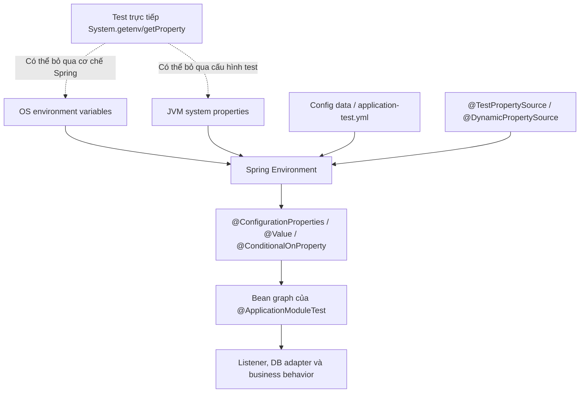

# Cô lập biến môi trường và system property trong kiểm thử Spring Modulith

## 1. Bài toán: test không đổi code nhưng kết quả lại đổi theo máy chạy

Trong một ứng dụng Spring Modulith, các module `orders`, `payments` và `notifications` thường có những cấu hình như:

- Cho phép hoặc tạm ngừng một luồng xử lý bằng feature flag.
- URL của payment gateway, message broker và database.
- Thời gian timeout, retry, số lượng worker.
- Profile đang hoạt động, tên topic/queue, tên schema.
- Khóa API và các thông tin xác thực phải được giữ bí mật.

Một bài test `orders` có thể chạy tốt trên máy cá nhân nhưng thất bại trên CI vì CI có biến `SHOP_ORDERS_CAPTURE_ENABLED=false`. Một bài test khác có thể gọi `System.setProperty("shop.orders.capture.enabled", "true")` để ép nhánh thành công, rồi quên trả lại giá trị cũ. Khi chạy chung suite, bài test thứ ba nhìn thấy một cấu hình **không do chính mình chọn**.

Còn nguy hiểm hơn, hai bài `@ApplicationModuleTest` có thể tái sử dụng cùng một Spring `ApplicationContext` đã được cache. Một test thay đổi system property sau khi context khởi động, nhưng các bean `@ConfigurationProperties` trước đó vẫn có giá trị đã bind ở thời điểm tạo bean; test quan sát cấu hình **không nhất quán** giữa bean và `System.getProperty(...)`.

**Cô lập biến môi trường và system property** có nghĩa là xác định chính xác *nguồn cấu hình*, *phạm vi hiệu lực*, *thời điểm được đọc*, *quyền sở hữu việc thay đổi* và *cách không để nó tác động sang test khác*. Mục tiêu là mỗi scenario dùng cấu hình được khai báo rõ ràng, có thể tái hiện và không phụ thuộc cấu hình tình cờ của máy hoặc test chạy trước.

Bài thuộc chương *Test isolation* của học phần `SPRING_MODULITH_VERIFICATION_TESTING`. Học phần tập trung kiểm chứng ranh giới kiến trúc với `ApplicationModules` và quy tắc phụ thuộc module; thực hành `@ApplicationModuleTest`, kiểm thử event, database, tích hợp và xây dựng quality gate CI để ngăn lỗi phụ thuộc và hồi quy.

**Kết quả học tập:**

1. Phân biệt OS environment variable, JVM system property, Spring `Environment` và cấu hình đã bind vào bean.
2. Cấu hình module test bằng `@TestPropertySource`, `@ActiveProfiles` và `@DynamicPropertySource` mà không làm bẩn toàn JVM.
3. Hiểu quy tắc ưu tiên và Spring TestContext cache ở mức đủ để chẩn đoán cấu hình bị ghi đè.
4. Tránh hack `System.getenv()` và dùng `System.setProperty(...)` trong test chạy song song.
5. Cô lập URL, credentials và namespace của dependency bên ngoài với Testcontainers/fixture thích hợp.
6. Kiểm chứng trạng thái/event bằng `Scenario` dưới cấu hình đã xác nhận trước stimulus.
7. Đưa kiểm thử cấu hình, ranh giới module và isolation vào CI quality gate.

## 2. Bốn lớp cấu hình không giống nhau

Một giá trị nhìn như `shop.orders.capture.enabled=true` có thể đến từ nhiều nơi:

| Lớp | Ví dụ | Phạm vi | Thời điểm đọc |
| --- | --- | --- | --- |
| **Biến môi trường của hệ điều hành** | `SHOP_ORDERS_CAPTURE_ENABLED=true` | Process và các process con được cấp env; không tự chung cho mọi process | JVM/Spring đọc khi khởi động hoặc khi code gọi `System.getenv(...)` |
| **Java system property** | `-Dshop.orders.capture.enabled=true` | Toàn một JVM, dùng chung giữa các test trong JVM đó | `System.getProperty(...)` hoặc Spring property resolution |
| **Spring `Environment` / `PropertySource`** | `@TestPropertySource(properties = "...")` | Spring application context/test configuration cụ thể | Khi điều kiện cấu hình/bean injection/binding được xử lý; cũng có thể được truy vấn runtime |
| **Bean cấu hình đã bind** | `@ConfigurationProperties` hoặc `@Value` | Bean và context chứa bean đó | Thường được bind/inject lúc bean khởi tạo |

Cùng một tên property **không bảo đảm** bốn lớp luôn cùng giá trị tại mọi thời điểm. Ví dụ, thay Java system property có thể làm `System.getProperty(...)` thay ngay, còn một singleton đã bind giá trị tại startup không tự động rebind.



Mũi tên không biểu thị thứ tự ưu tiên tuyệt đối. Spring Boot và Spring TestContext có nhiều nguồn cấu hình với thứ tự riêng; chỉ dựa vào tên property hoặc sự tồn tại của một biến không đủ để biết **nguồn nào đang thắng**.

### 2.1. Biến môi trường không có API Java chuẩn để sửa ngay trong process

Java cho phép đọc env qua `System.getenv("KEY")`, nhưng **không có API công khai portable** tương đương `System.setenv(...)` để thay đổi bảng env của chính JVM đang chạy. Việc dùng reflection để sửa map nội bộ của JDK, native hack hoặc thư viện sửa env toàn cục có thể lỗi ở JDK mới và ảnh hưởng các test khác.

Muốn thử một giá trị environment variable, hãy chọn một trong các cách:

- Cấp biến khi **khởi chạy JVM test** bằng Gradle/Maven/IDE/CI.
- Dùng Spring `PropertySource` trong test nếu mục tiêu là kiểm chứng bean nhận cấu hình từ `Environment`, không nhất thiết từ OS env thật.
- Dùng child process hoặc container được cấp env riêng nếu yêu cầu là kiểm chứng hành vi đọc `System.getenv(...)` thực sự.
- Refactor code đang gọi `System.getenv(...)` trực tiếp thành một adapter/port có thể cấp fake trong unit test.

Một file `.env` đặt trong repository **không mặc nhiên** được Spring Boot tải như OS environment variables; nếu dự án có cơ chế đọc `.env`, phải kiểm chứng cơ chế đó riêng.

### 2.2. System property là global state của JVM

`System.setProperty(...)`, `System.clearProperty(...)` và `System.getProperties()` thao tác trên cấu hình chung của một JVM. Nếu JUnit chạy nhiều test class trong cùng process hoặc chạy song song, một thay đổi có thể ảnh hưởng test không liên quan.

```java
System.setProperty("shop.orders.capture.enabled", "false");
// Test khác trong cùng JVM cũng có thể nhìn thấy false.
```

Ngay cả khi bạn khôi phục trong `finally`, một thread khác có thể đọc giá trị tạm thời giữa hai lời gọi. **Restore không biến một biến global thành thread-local.**

## 3. Ưu tiên cấu hình: phải biết test đang đọc nguồn nào

Spring Boot cung cấp cơ chế externalized configuration từ config data, biến môi trường, JVM properties, command-line arguments và các test-specific sources. Thứ tự chi tiết phụ thuộc loại source, các cấu hình Spring Boot/TestContext đang sử dụng và phiên bản.

Những quy tắc hữu ích khi viết test:

- `@TestPropertySource` của Spring TestContext cung cấp property cho context test; những giá trị này thường có ưu tiên cao hơn Java system properties và OS environment properties được đưa vào Spring `Environment`.
- `@DynamicPropertySource` đăng ký dynamic properties từ supplier. Theo quy tắc Spring TestContext, dynamic properties có ưu tiên cao hơn properties khai báo bằng `@TestPropertySource`.
- Spring Boot còn hỗ trợ test-specific properties qua một số test annotation/configuration và config data; khi có nhiều source cùng key, **xác minh giá trị cuối từ `Environment`**, không suy đoán.
- Với `@ConfigurationProperties`, tên property được xử lý theo quy tắc relaxed binding của Spring Boot; cách biến môi trường viết hoa/đổi dấu không phải lúc nào cũng giống một lệnh `System.getenv(...)` đọc key đúng chữ.
- `@Value` và direct `System.getProperty(...)` có thể có cách resolve khác với Spring Boot Binder; cần thống nhất một mô hình truy cập cho code nghiệp vụ.

Ví dụ hai nguồn cùng cấu hình:

```text
JVM: -Dshop.orders.capture.enabled=false
Test class:
    @TestPropertySource(properties = "shop.orders.capture.enabled=true")

Khi bean lấy qua Spring Environment trong context test,
giá trị test-specific có thể là true.

Nhưng code gọi trực tiếp:
    System.getProperty("shop.orders.capture.enabled")
vẫn có thể nhận false.
```

Đây là lý do nên để business code đọc cấu hình qua một **cơ chế Spring nhất quán**, thay vì trộn trực tiếp `System.getenv`, `System.getProperty` và các bean đã bind.

### 3.1. Quy tắc đặt tên biến môi trường

Ví dụ cấu hình logic của Spring Boot:

```properties
shop.orders.capture.enabled=true
shop.orders.payment-window=PT15M
```

Một cách biểu diễn env quen thuộc cho property đầu là `SHOP_ORDERS_CAPTURE_ENABLED`. Spring Boot Binder có quy tắc chuyển canonical property name thành environment-variable style (chữ hoa, dấu chấm thành gạch dưới, bỏ dấu gạch nối phù hợp). Tuy nhiên, code gọi `System.getenv("shop.orders.capture.enabled")` **không tự áp dụng relaxed binding**; nó tìm đúng tên env đó.

Hãy dùng dạng property canonical (lowercase, kebab-case ở segment) cho business config và ánh xạ qua `@ConfigurationProperties` khi thích hợp. Các cấu hình đặc biệt như index của list hoặc key của map cần quy tắc binding riêng, không suy mọi dấu gạch dưới đều tương đương.

## 4. Ưu tiên `@TestPropertySource` cho những giá trị test cố định

Trong một module test, có thể đưa property trực tiếp vào test context mà không thay đổi process/JVM:

```java
package com.example.shop.orders;

import static org.assertj.core.api.Assertions.assertThat;

import org.junit.jupiter.api.Test;
import org.springframework.beans.factory.annotation.Autowired;
import org.springframework.core.env.Environment;
import org.springframework.modulith.test.ApplicationModuleTest;
import org.springframework.test.context.TestPropertySource;

@ApplicationModuleTest
@TestPropertySource(properties = {
        "shop.orders.capture.enabled=true",
        "shop.orders.external-audit.enabled=false",
        "shop.orders.payment-window=PT15M"
})
class OrdersConfigurationTests {

    @Autowired Environment environment;

    @Test
    void usesExplicitModuleTestConfiguration() {
        assertThat(environment.getProperty(
                "shop.orders.capture.enabled"))
                .isEqualTo("true");

        assertThat(environment.getProperty(
                "shop.orders.external-audit.enabled"))
                .isEqualTo("false");
    }
}
```

Đây là **test về cấu hình của Spring context**, chưa chứng minh các use case hoạt động đúng. Các property `shop.orders.*` là tên giả định do ứng dụng thiết kế; giá trị chỉ có tác dụng nếu bean thực sự bind hoặc đọc những key này.

Ưu điểm của test property source:

1. Giá trị nằm ngay cạnh bài test nên dễ xem lại trong code review.
2. Không gọi `System.setProperty(...)`, giảm nguy cơ nhiễm chéo.
3. Tạo một phần cấu hình context để Spring TestContext có thể phân biệt các test có config khác nhau.
4. Dễ chia test theo feature flag hoặc implementation adapter mà không sửa env global.

**Giới hạn:** một property được khai báo nhưng không có bean nào sử dụng thì test có thể vẫn pass. Muốn chứng minh hành vi, phải gọi nghiệp vụ hoặc kiểm tra bean/conditional configuration tương ứng.

### 4.1. Dùng `@ActiveProfiles` cho cấu hình thuộc cả một nhóm

Nếu nhiều bài test cùng dùng một profile:

```java
import org.springframework.test.context.ActiveProfiles;
import org.springframework.test.context.TestPropertySource;

@ApplicationModuleTest
@ActiveProfiles("module-test")
@TestPropertySource(properties = {
        "shop.orders.external-audit.enabled=false"
})
class OrdersModuleProfileTests {
    // Test chạy dưới profile test đã khai báo.
}
```

Có thể đặt cấu hình chung trong `src/test/resources/application-module-test.yml` **nếu dự án thực sự cung cấp file đó**. Bài học này không tạo file cấu hình nào. `@ActiveProfiles` là cách rõ ràng để chọn active profiles cho test thay vì thay `spring.profiles.active` bằng `System.setProperty(...)` trong lúc suite đang chạy.

Test cần biết profile nào kích hoạt bean, datasource, listener hoặc property conditional. Một profile tên `test` không tự bảo đảm rằng external adapter được tắt: cần định nghĩa cấu hình và kiểm tra nó.

### 4.2. `@SpringBootTest(properties = ...)` và `@TestPropertySource`

Spring Boot test cũng hỗ trợ properties trực tiếp qua `@SpringBootTest(properties = {...})`. Tuy nhiên, khi dùng `@ApplicationModuleTest` đã là một cách bootstrap test của Spring Modulith, thường chỉ cần ghép `@TestPropertySource` và profile phù hợp thay vì thêm một annotation bootstrap `@SpringBootTest` riêng, có thể tạo cấu hình khó hiểu.

Chọn **một cách khai báo có chủ đích**, và xác minh `Environment` đọc được giá trị cuối. Đừng tạo nhiều nguồn cùng key chỉ để “ép” độ ưu tiên mà không rõ nguồn nào thắng.

## 5. Cấu hình nên bind vào kiểu có ý nghĩa thay vì chuỗi rải rác

Một module có thể định nghĩa cấu hình typed:

```java
// File: com/example/shop/orders/internal/OrdersSettings.java
package com.example.shop.orders.internal;

import java.time.Duration;
import org.springframework.boot.context.properties.ConfigurationProperties;

@ConfigurationProperties(prefix = "shop.orders")
public record OrdersSettings(
        boolean captureEnabled,
        boolean externalAuditEnabled,
        Duration paymentWindow) {}
```

Để dùng thật, cần đăng ký kiểu này bằng `@EnableConfigurationProperties(OrdersSettings.class)` hoặc cơ chế `@ConfigurationPropertiesScan` của ứng dụng. Java record binding là ví dụ cho những phiên bản Spring Boot hỗ trợ constructor binding phù hợp.

Bài test có thể inject settings và kiểm tra **giá trị đã bind** thay vì chỉ đọc chuỗi:

```java
@Autowired OrdersSettings settings;

@Test
void bindsTestSettings() {
    assertThat(settings.captureEnabled()).isTrue();
    assertThat(settings.externalAuditEnabled()).isFalse();
    assertThat(settings.paymentWindow())
            .isEqualTo(Duration.ofMinutes(15));
}
```

Code trên là một **trích đoạn bên trong test class** đã có `@ApplicationModuleTest` và `@TestPropertySource`. Cần import `Duration`, `Autowired`, `Test`, `assertThat` và đảm bảo `OrdersSettings` được đăng ký trong module/context được bootstrap.

Điểm cần phân biệt:

- `environment.getProperty(key)` chứng minh source trả đúng giá trị.
- `settings.paymentWindow()` chứng minh binding/conversion của bean đúng.
- Gọi use case và quan sát state mới chứng minh **hành vi chịu ảnh hưởng của property** là đúng.

Không coi một assertion config là thay thế test hành vi.

## 6. `@DynamicPropertySource` cho dependency có endpoint chỉ biết lúc runtime

Trong integration test, địa chỉ database hoặc broker có thể chỉ có sau khi container khởi động. Không nên ghi URL hoặc port ngẫu nhiên cố định trong code rồi hy vọng CI có đúng môi trường đó.

Spring TestContext hỗ trợ `@DynamicPropertySource`: một phương thức static đăng ký supplier lấy giá trị property động.

Ví dụ PostgreSQL với Testcontainers:

```java
import org.junit.jupiter.api.Test;
import org.springframework.modulith.test.ApplicationModuleTest;
import org.springframework.test.context.DynamicPropertyRegistry;
import org.springframework.test.context.DynamicPropertySource;
import org.testcontainers.containers.PostgreSQLContainer;
import org.testcontainers.junit.jupiter.Container;
import org.testcontainers.junit.jupiter.Testcontainers;

@Testcontainers
@ApplicationModuleTest
class OrdersPostgresConfigurationTests {

    @Container
    static PostgreSQLContainer<?> postgres =
            new PostgreSQLContainer<>("postgres:16-alpine");

    @DynamicPropertySource
    static void databaseProperties(DynamicPropertyRegistry registry) {
        registry.add("spring.datasource.url", postgres::getJdbcUrl);
        registry.add("spring.datasource.username",
                postgres::getUsername);
        registry.add("spring.datasource.password",
                postgres::getPassword);
    }

    @Test
    void repositoryUsesContainerDatabase() {
        // Dùng repository/query API để kiểm tra kết nối và state thực.
    }
}
```

Ví dụ giả định dự án có Testcontainers, JDBC driver, Spring Data/JPA và cấu hình module test tương thích. Cần migrations/schema và assertions thực tế để test có giá trị. Từ `registry.add(key, supplier)`, Spring sẽ resolve value qua supplier; **không** nhất thiết chạy supplier ngay lúc đăng ký.

### 6.1. Vì sao dynamic property không giống System.setProperty?

`@DynamicPropertySource` gắn việc cung cấp property với cấu hình context test. Nó tránh sửa Java system properties global và được Spring TestContext tích hợp vào quá trình xây context. Nhưng các supplier cũng có thể phụ thuộc **state ngoài context** (container đang sống, cổng tạm thời, server mock).

Do đó cần bảo đảm:

- Container/server có lifecycle tương thích với `ApplicationContext` có thể được cache.
- Supplier trả endpoint thực sự còn hợp lệ khi Spring resolve property.
- Không thay địa chỉ kết nối sau khi bean `DataSource` đã tạo rồi mong nó tự reconfigure.
- Nếu base test class kế thừa `@DynamicPropertySource` nhưng từng subclass dùng dynamic value khác nhau, có thể cần tách context cache hoặc dùng `@DirtiesContext` theo hướng dẫn Spring TestContext.
- Không đưa credentials thật vào log để xác minh supplier.

### 6.2. `@ServiceConnection` khi phù hợp

Trong những phiên bản Spring Boot/Testcontainers hỗ trợ, `@ServiceConnection` có thể giúp kết nối các container được hỗ trợ mà không tự cung cấp mọi JDBC property:

```java
import org.springframework.boot.testcontainers.service.connection.ServiceConnection;
import org.testcontainers.containers.PostgreSQLContainer;
import org.testcontainers.junit.jupiter.Container;

@Container
@ServiceConnection
static PostgreSQLContainer<?> postgres =
        new PostgreSQLContainer<>("postgres:16-alpine");
```

Đây là một **trích đoạn khai báo field trong test class có cấu hình Testcontainers hợp lệ**, không phải mã chạy độc lập. Chọn `@ServiceConnection` hoặc dynamic property phù hợp với phiên bản và nhu cầu thực tế, tránh khai báo hai cách cạnh tranh nhau cho cùng kết nối mà không biết nguồn cuối đang được dùng.

### 6.3. Biến môi trường trong container không phải env của JVM test

Khi gọi `container.withEnv("X", "Y")`, bạn đang cấp env cho **process bên trong container**, không tự đặt `System.getenv("X")` trong JVM chạy JUnit.

Ví dụ:

```java
PostgreSQLContainer<?> postgres =
        new PostgreSQLContainer<>("postgres:16-alpine")
                .withEnv("PGTZ", "UTC");
```

Dòng này chỉ minh họa việc truyền env xuống container. Nó không chứng minh ứng dụng Spring Boot ở JVM test nhìn thấy biến `PGTZ`. Hãy phân biệt **app process**, **database container** và **broker container** khi điều tra một biến môi trường.

## 7. Test context cache và tác dụng phụ từ property mutation

Spring TestContext Framework có thể cache và reuse các context có cấu hình tương đương. Những thành phần như active profiles, test property sources và context customizers có thể tham gia vào cache key.

Điều đáng chú ý là **thay đổi một Java system property trong lúc test chạy không đồng nghĩa cache key đã thay đổi**. Ví dụ:

```text
Test A:
    System.setProperty("shop.orders.capture.enabled", "false")
    -> ApplicationContext X được tạo và bind settings = false

Test B:
    System.setProperty("shop.orders.capture.enabled", "true")
    -> cùng cấu hình test context
    -> Spring TestContext có thể reuse ApplicationContext X
    -> settings.captureEnabled vẫn có thể = false

System.getProperty(...) hiện tại = true
settings bean đã bind = false
```

Thứ tự thực tế còn phụ thuộc test class, property source và context key; ví dụ chỉ minh họa **rủi ro**, không khẳng định mọi test B luôn dùng lại X.

### 7.1. Context reuse an toàn khi cấu hình không thay giữa test

Nếu hai test dùng cùng `@ApplicationModuleTest`, cùng `@ActiveProfiles` và cùng các property tĩnh, context reuse có thể là **lợi ích**: giảm chi phí khởi động Spring Boot. Điều cần cô lập là dữ liệu business, async tasks và mutable singleton state, không nhất thiết tạo context mới cho mỗi method.

Ngược lại, nếu một test thay đổi bean graph bằng profile/condition, hãy khai báo khác biệt **trong test configuration**, không dùng mutation global sau khi context đã khởi động.

### 7.2. `@DirtiesContext` có giới hạn

`@DirtiesContext` đánh dấu context bị bẩn để Spring bỏ cache và dựng lại khi cần. Nó có thể phù hợp nếu một test thật sự thay đổi state của bean/context mà không thể reset an toàn.

Nhưng nó **không**:

- Tự khôi phục `System.setProperty(...)`.
- Tự thay OS environment variables.
- Xóa DB row, Kafka topic/offset, RabbitMQ queue hay Event Publication Registry persistence.
- Bảo đảm task async đã ngừng trước khi dữ liệu bị cleanup.

Do đó, gắn `@DirtiesContext` khắp nơi thường làm suite chậm mà chưa giải quyết nguyên nhân property leak. Ưu tiên test-scoped property source, configuration bất biến và isolation tài nguyên đúng cấp.

## 8. Nếu bắt buộc phải thử code đọc `System.getProperty(...)` trực tiếp

Nhiều code legacy gọi Java API trực tiếp. Trong một unit test chạy **tuần tự trong JVM cô lập**, có thể tạm sửa rồi khôi phục system property:

```java
import static org.assertj.core.api.Assertions.assertThat;

import org.junit.jupiter.api.Test;

class LegacySystemPropertyTests {

    @Test
    void restoresPropertyAfterTest() {
        String key = "shop.legacy.feature";
        String original = System.getProperty(key);

        try {
            System.setProperty(key, "enabled");

            assertThat(System.getProperty(key))
                    .isEqualTo("enabled");
            // Gọi legacy code đang đọc key này.
        } finally {
            if (original == null) {
                System.clearProperty(key);
            } else {
                System.setProperty(key, original);
            }
        }
    }
}
```

Đây là **phương án cuối** để kiểm tra legacy behavior; test phải được chạy trong điều kiện không có test/thread khác phụ thuộc cùng key. `finally` giúp khôi phục khi assertion ném exception, nhưng không ngăn thread khác đọc giá trị tạm và không cứu được trường hợp process bị kill.

Nếu phải dùng cách này:

1. Cô lập test vào **test JVM/process riêng** hoặc bảo đảm không có đồng thời và không có background reader dùng key đó.
2. Lưu lại chính xác trạng thái **có hay không có** property trước test.
3. Restore bằng `clearProperty(...)` nếu ban đầu không tồn tại, không chỉ gán chuỗi rỗng.
4. Không đổi những key global có phạm vi lớn như default timezone, TLS trust store, proxy, encoding hoặc Spring profile giữa lúc context đang dùng.
5. Không gọi `System.setProperties(new Properties())` để “dọn sạch” toàn JVM — điều này có thể phá hàng loạt property hạ tầng.
6. Ưu tiên refactor mã đọc system property qua một adapter cấu hình có thể inject ở test.

### 8.1. Đọc environment variable thật: dùng một process khác nếu cần

Khi mục tiêu là kiểm chứng legacy code chỉ đọc `System.getenv("PAYMENT_PROVIDER_URL")`, một cách đúng là khởi chạy **một JVM con** với env được cấp từ bên ngoài. Trong Java, `ProcessBuilder.environment()` có thể điều chỉnh env của **child process** trước khi start:

```java
import java.util.Map;

ProcessBuilder builder = new ProcessBuilder(
        "java", "-version");

Map<String, String> childEnvironment = builder.environment();
childEnvironment.put("SHOP_TEST_MODE", "true");

// builder.start() sẽ tạo process con nhận env được cấp.
// Không đổi System.getenv("SHOP_TEST_MODE") trong JVM đang test.
```

Đây là **trích đoạn minh họa**; trong bài test thực, cần quản lý executable/classpath, timeout, exit code, stdout/stderr và đảm bảo process con được dừng đúng cách. `java -version` không đọc `SHOP_TEST_MODE`; nó chỉ minh họa cách cấp env. Để test behavior, process con phải chạy một probe/application kiểm tra biến đó.

Cách này phù hợp khi thật sự muốn kiểm tra OS env; với business logic thông thường, `MockEnvironment` hoặc test property source đơn giản và nhanh hơn.

## 9. Đơn vị hóa config reader bằng `MockEnvironment`

Không cần khởi động Spring Boot đầy đủ chỉ để test một policy lấy config từ `Environment`. Spring Test cung cấp `MockEnvironment`:

```java
import static org.assertj.core.api.Assertions.assertThat;

import org.junit.jupiter.api.Test;
import org.springframework.mock.env.MockEnvironment;

class GatewaySettingsReaderTests {

    @Test
    void readsAnExplicitGatewayMode() {
        MockEnvironment env = new MockEnvironment()
                .withProperty("shop.payment.gateway-mode", "stub");

        String mode = env.getProperty(
                "shop.payment.gateway-mode");

        assertThat(mode).isEqualTo("stub");
    }
}
```

Đây là test tối thiểu cho việc đọc property, chưa kiểm tra binder hoặc behavior của gateway. Có thể đưa `Environment` vào adapter/reader để test parser, validation hoặc fallback rõ ràng, sau đó có riêng test module để kiểm tra bean graph và condition.

Nếu muốn kiểm thử Spring Boot `@ConfigurationProperties` conversion/validation, nên dùng một test context/binder phù hợp; đừng viết một test `MockEnvironment.getProperty(...)` rồi tuyên bố toàn bộ mapping đã được kiểm chứng.

### 9.1. Thiết kế adapter thay vì gọi trực tiếp `System.getenv` khắp nơi

Ví dụ một port nội bộ của module:

```java
interface GatewayConfiguration {
    boolean captureEnabled();
    String endpoint();
}
```

Implementation Spring đọc từ typed settings hoặc `Environment`; unit test business logic tiêm fake:

```java
GatewayConfiguration fakeConfiguration = new GatewayConfiguration() {
    @Override
    public boolean captureEnabled() {
        return true;
    }

    @Override
    public String endpoint() {
        return "http://gateway-stub.invalid";
    }
};
```

URL miền `.invalid` dùng để làm rõ đây **không phải một endpoint có thể gọi thật**. Trong integration test cần HTTP stub server đang chạy và endpoint do test tạo, không dựa vào URL này để gửi network request.

Thiết kế port có chủ đích giúp test domain/consumer module không phụ thuộc môi trường CI hay system property global. Còn adapter config cần một test riêng để chứng minh property keys/binding đúng.

## 10. Feature flag có thể thay đổi **bean graph**, không chỉ kết quả if-else

Cấu hình có thể kiểm soát không chỉ một câu lệnh `if` mà cả việc bean có được tạo hay không:

```java
import org.springframework.boot.autoconfigure.condition.ConditionalOnProperty;
import org.springframework.stereotype.Component;

@Component
@ConditionalOnProperty(
        prefix = "shop.orders",
        name = "external-audit.enabled",
        havingValue = "true")
class ExternalOrderAuditAdapter implements OrderAuditPort {
    // Implementation minh họa.
}
```

Trong một `@ApplicationModuleTest`, property này có thể làm một adapter xuất hiện hoặc biến mất khi **context được khởi tạo**. Nếu code production không có implementation thay thế cho `OrderAuditPort`, context có thể fail vì thiếu bean.

Một test chỉ assert `Environment.getProperty("shop.orders.external-audit.enabled")` bằng `false` **chưa chứng minh** bean graph an toàn; nên kiểm tra wiring hoặc hành vi theo đúng mode.

### 10.1. Không “chữa” thiếu bean bằng cách nới bootstrap mode bừa bãi

Giả sử test `orders` thất bại với `NoSuchBeanDefinitionException` sau khi tắt adapter ngoài. Đổi từ `@ApplicationModuleTest` mode mặc định sang `ALL_DEPENDENCIES` có thể khiến một bean thật ở module khác xuất hiện và test chạy xanh, nhưng cũng có thể che **dependency chưa được thiết kế đúng**.

Hãy hỏi:

- Module `orders` cần một port với fake thay thế hay dependency thật?
- Có nên tạo `@TestConfiguration` cho một adapter test?
- `@ConditionalOnProperty` có điều kiện `matchIfMissing` phù hợp không?
- Test đang thuộc scope unit/module hay end-to-end?
- Dependency đó được phép theo `@ApplicationModule(allowedDependencies = ...)` chưa?

Property isolation và module boundary isolation phải đi cùng nhau.

## 11. Module test: cấu hình rõ, fixture commit, chờ state đúng

Xét luồng ví dụ:

- `payments` công bố event `PaymentCaptured`.
- `orders` có listener xử lý và cập nhật đơn hàng.
- Cấu hình `shop.orders.capture.enabled` quyết định có cho phép handler cập nhật hay không.
- `shop.orders.external-audit.enabled=false` khiến test không gọi adapter audit bên ngoài.

Các kiểu nghiệp vụ sau **do ứng dụng minh họa tự định nghĩa**, mỗi khai báo `public` nằm trong file Java riêng:

```java
// File: com/example/shop/payments/events/PaymentCaptured.java
package com.example.shop.payments.events;

import java.math.BigDecimal;
import java.util.UUID;

public record PaymentCaptured(
        UUID eventId,
        UUID orderId,
        String transactionId,
        BigDecimal amount) {}
```

```java
// File: com/example/shop/orders/OrderStatus.java
package com.example.shop.orders;

public enum OrderStatus {
    AWAITING_PAYMENT, PAID, PAYMENT_FAILED
}
```

```java
// File: com/example/shop/orders/OrderPaymentView.java
package com.example.shop.orders;

import java.math.BigDecimal;
import java.util.UUID;

public record OrderPaymentView(
        UUID orderId,
        OrderStatus status,
        UUID capturedEventId,
        String transactionId,
        BigDecimal capturedAmount) {

    public boolean matchesCapture(
            UUID expectedEventId,
            String expectedTransactionId,
            BigDecimal expectedAmount) {
        return status == OrderStatus.PAID
                && capturedEventId != null
                && capturedEventId.equals(expectedEventId)
                && expectedTransactionId.equals(transactionId)
                && capturedAmount != null
                && capturedAmount.compareTo(expectedAmount) == 0;
    }
}
```

```java
// File: com/example/shop/orders/OrderQueries.java
package com.example.shop.orders;

import java.util.Optional;
import java.util.UUID;

public interface OrderQueries {
    Optional<OrderPaymentView> paymentOf(UUID orderId);
}
```

Một bài test trong module `orders`:

```java
package com.example.shop.orders;

import static org.assertj.core.api.Assertions.assertThat;

import java.math.BigDecimal;
import java.time.Duration;
import java.util.UUID;

import org.junit.jupiter.api.Test;
import org.springframework.beans.factory.annotation.Autowired;
import org.springframework.core.env.Environment;
import org.springframework.modulith.test.ApplicationModuleTest;
import org.springframework.modulith.test.Scenario;
import org.springframework.test.context.TestPropertySource;

@ApplicationModuleTest
@TestPropertySource(properties = {
        "shop.orders.capture.enabled=true",
        "shop.orders.external-audit.enabled=false"
})
class OrdersCaptureConfigurationTests {

    @Autowired Environment environment;
    @Autowired OrderFixture fixture;
    @Autowired OrderQueries queries;

    @Test
    void eventChangesStateUnderExplicitConfiguration(
            Scenario scenario) {

        assertThat(environment.getProperty(
                "shop.orders.capture.enabled", Boolean.class))
                .isTrue();

        BigDecimal amount = new BigDecimal("125000.00");
        UUID orderId = fixture.awaitingPaymentAndCommit(amount);
        UUID eventId = UUID.randomUUID();
        String transactionId = "CAPTURE-" + eventId;

        assertThat(queries.paymentOf(orderId).orElseThrow().status())
                .isEqualTo(OrderStatus.AWAITING_PAYMENT);

        scenario.publish(new PaymentCaptured(
                        eventId, orderId, transactionId, amount))
                .andWaitAtMost(Duration.ofSeconds(8))
                .forStateChange(
                        () -> queries.paymentOf(orderId),
                        view -> view.filter(v ->
                                v.matchesCapture(
                                        eventId, transactionId, amount))
                                .isPresent())
                .andVerify(view -> {
                    OrderPaymentView paid = view.orElseThrow();
                    assertThat(paid.orderId()).isEqualTo(orderId);
                    assertThat(paid.status()).isEqualTo(OrderStatus.PAID);
                    assertThat(paid.transactionId())
                            .isEqualTo(transactionId);
                });
    }
}
```

**Các điều kiện để ví dụ trở thành test chạy được:**

1. `OrderFixture` là helper do dự án tự xây, được đăng ký trong test context và thực sự **commit** đơn hàng trước khi listener ở transaction khác cần đọc.
2. Listener, repository, query adapter và các bean cấu hình liên quan thuộc phạm vi `@ApplicationModuleTest`.
3. Handler thật đọc `shop.orders.capture.enabled` theo một cơ chế được xác định và cập nhật state trong transaction phù hợp.
4. Nếu listener dùng `@TransactionalEventListener(AFTER_COMMIT)`, transaction phát event phải thực sự commit; test không được ngầm giữ mọi thứ trong transaction rollback đến cuối.
5. `Scenario` chỉ chờ **state contract**. Để kiểm tra event publication của producer hay adapter audit bên ngoài, cần test tương ứng riêng.
6. Giá trị timeout chỉ là ví dụ; căn cứ thực tế phụ thuộc async/DB/CI.

Điểm quan trọng là test vừa **xác minh cấu hình trước stimulus**, vừa chứng minh **hành vi đã commit** của đúng đơn hàng và event. Kiểm tra property đơn độc không chứng minh feature flag có tác dụng.

### 11.1. Test nhánh feature disabled

Nếu cần xác minh `shop.orders.capture.enabled=false`, tạo **một test class có configuration riêng**:

```java
@ApplicationModuleTest
@TestPropertySource(properties = {
        "shop.orders.capture.enabled=false",
        "shop.orders.external-audit.enabled=false"
})
class OrdersCaptureDisabledTests {
    // Tạo order mới; phát event.
    // Chờ một tín hiệu handler/transaction hoàn tất thích hợp.
    // Sau đó assert order không chuyển PAID
    // hoặc chuyển tới trạng thái từ chối theo hợp đồng nghiệp vụ.
}
```

Không nên `System.setProperty("shop.orders.capture.enabled", "false")` giữa hai phương thức rồi hy vọng `@ConditionalOnProperty` tạo/hủy bean tương ứng. Bean graph được xác định khi context khởi tạo.

**Lưu ý về assertion âm:** đọc order ngay sau event và thấy `AWAITING_PAYMENT` chưa chứng minh handler đã quyết định bỏ qua event; nó có thể chưa chạy. Cần một completion/error signal phù hợp trước khi khẳng định “không cập nhật” theo hợp đồng.

## 12. Kiểm tra đường cấu hình thông qua profile và properties có thể gây rủi ro

Một số key ảnh hưởng phạm vi lớn hơn một module:

| Nhóm key | Rủi ro khi dùng global mutation | Cách test an toàn hơn |
| --- | --- | --- |
| `spring.profiles.active` | Bean graph/properties của toàn app đổi; context cache bất ngờ | `@ActiveProfiles` theo test class |
| `spring.datasource.*` | Trỏ vào DB thật hoặc DB của suite khác | Testcontainers + dynamic properties/service connection |
| Broker bootstrap URL | Producer gửi nhầm đến shared broker | Container/namespace riêng, dynamic endpoint |
| `user.timezone` hoặc default locale | Test ngày/giờ khác nhau theo thứ tự chạy | Inject `Clock`/`ZoneId`; tránh đổi global |
| Proxy / SSL truststore props | Ảnh hưởng network clients JVM-wide | Test process riêng; client config test-scoped |
| Feature flag dùng `@ConditionalOnProperty` | Bean tồn tại/không tồn tại từ lúc startup | Test class với property source xác định |
| API token / secret | Dễ lộ log hoặc dùng nhầm credential thật | Fake secret, secret store CI và test resource isolation |

Một sự cố nghiêm trọng là integration test vô tình đọc URL production từ OS env rồi gửi data thật. Hãy thiết kế **fail-closed test defaults**: test profile trỏ endpoint giả/container, adapter ngoài bị chặn nếu chưa có test-specific endpoint, và test kiểm tra bean endpoint/target đúng trước stimulus.

## 13. Secrets: kiểm chứng cấu hình mà không làm lộ thông tin

Trong thực tế, CI thường cấp token qua secret manager/environment injection. Cô lập secret quan trọng vì hai lý do: tránh tác động lên hệ thống thật và tránh lộ dữ liệu.

Các nguyên tắc:

1. Dùng fake token **không có giá trị thật** trong unit/module test.
2. Không in toàn bộ `System.getenv()`, `System.getProperties()` hay tất cả `PropertySources` vào log.
3. Chỉ log property key hoặc trạng thái có/không, **không log value** của secret.
4. Không đưa secret thật vào `@TestPropertySource(properties = "...")` được commit lên repository.
5. Với integration test bắt buộc credential thật, dùng environment CI có scope/permission tối thiểu và endpoint được kiểm soát.
6. Không để test default sang production khi key test thiếu; fail sớm với thông báo an toàn.
7. Nếu dùng Spring Boot Actuator endpoint cấu hình, lưu ý khả năng hiển thị giá trị nhạy cảm và cấu hình sanitization/access phù hợp.

Ví dụ kiểm tra có property mà không in giá trị:

```java
String credential = environment.getProperty(
        "shop.test.gateway-token");

assertThat(credential)
        .as("test gateway credential must be configured")
        .isNotBlank();

// Tránh assert message chứa credential hoặc in toString của config bean.
```

Với module test không cần gọi gateway, tốt hơn là **không yêu cầu credential thật** và dùng fake adapter phù hợp. Property isolation không có nghĩa mọi secret production đều phải được đưa vào test.

## 14. Thiết lập env/system properties ở ranh giới process trong CI

Nếu một bài integration test thực sự cần OS environment variable hoặc JVM property, hãy cấp giá trị khi **khởi động test JVM**, không mutate trong test method.

Ví dụ Gradle (Groovy DSL, cần dự án đã dùng Gradle/JUnit Platform):

```groovy
tasks.named('test', Test) {
    useJUnitPlatform()

    systemProperty 'shop.orders.capture.enabled', 'true'
    environment 'SHOP_TEST_MODE', 'true'
}
```

Đây là **ví dụ cấu hình build**, không phải lệnh đã chạy. `systemProperty` đặt `-D...` cho JVM test task; `environment` cấp biến cho test process. Nó không có nghĩa cả Gradle daemon hoặc những process khác sẽ có cùng property. Một test task có thể chạy nhiều class trong những JVM worker được quản lý; các property vẫn là global **trong từng worker JVM**.

Nếu hai nhóm test cần cấu hình xung đột (ví dụ một nhóm dùng gateway fake, nhóm khác dùng container thật), tách test tasks/forks hoặc khai báo profile/property sources riêng theo context thay vì để method thay đổi process-global state.

### 14.1. Chạy local, IDE và CI có thể có env khác nhau

Một file script hoặc IDE run configuration có thể truyền `SHOP_TEST_MODE=true`, nhưng CI chưa chắc có. Ngược lại, CI có thể tự cấp secret/URL mà laptop không có.

Để test tái hiện được:

- Ghi rõ **input cấu hình tối thiểu** cho từng test suite.
- Ưu tiên test property source nếu không yêu cầu env thật.
- Khi bắt buộc cần env process, kiểm tra giá trị hợp lệ và fail với thông báo key thiếu, không lộ secret.
- Tách các integration tests phụ thuộc hạ tầng ngoài khỏi các module tests nhanh.
- Không để kết quả xanh phụ thuộc profile do người chạy tự thêm trong shell.

### 14.2. Không thay cấu hình khi JVM đã khởi động

Một số hệ thống đọc config đúng **một lần** khi tạo singleton, client hoặc connection pool. Nếu test đổi property giữa runtime, client cũ vẫn dùng URL cũ.

Ví dụ `DataSource` đã được tạo từ `spring.datasource.url`. Thay `System.setProperty("spring.datasource.url", "...")` sau khi Spring Boot context khởi động **không tự chuyển** DataSource sang database mới. Cũng không an toàn khi client Kafka đã khởi tạo với bootstrap servers cũ.

Tạo context mới hoặc khởi chạy process test mới với cấu hình phù hợp nếu thật sự cần một topology khác.

## 15. Thử cấu hình với nhiều module nhưng giữ đúng dependency boundary

Spring Modulith phân tích các application modules và quan hệ phụ thuộc thông qua các public API/allowed dependencies. Một property có thể vô tình làm một bean thuộc module khác được load, hoặc che dependency sai bằng việc kích hoạt adapter thay thế.

Ví dụ module `orders` nhận event contract từ `payments.events`:

```java
// File: com/example/shop/payments/events/package-info.java
@org.springframework.modulith.NamedInterface("events")
package com.example.shop.payments.events;
```

```java
// File: com/example/shop/orders/package-info.java
@org.springframework.modulith.ApplicationModule(
        allowedDependencies = "payments::events")
package com.example.shop.orders;
```

Module `orders` không nên import `payments.internal.PaymentRepository` chỉ vì khi bật một feature flag thì bean đó đã có trong context. “Bean load được” không đồng nghĩa “phụ thuộc hợp lệ”.

Kiểm tra kiến trúc bằng bài test riêng:

```java
import org.junit.jupiter.api.Test;
import org.springframework.modulith.core.ApplicationModules;

class ModuleArchitectureTests {

    @Test
    void moduleDependenciesRespectBoundaries() {
        ApplicationModules.of(ShopApplication.class).verify();
    }
}
```

`ShopApplication` là Spring Boot application class giả định. Test này giúp bắt sai quan hệ phụ thuộc; nó **không** kiểm chứng env/config của CI đúng hoặc listener đã đổi state. Bởi vậy cần song song **architecture verification**, **configuration/binding tests** và **behavioral module/integration tests**.

## 16. Các anti-pattern và cách sửa

| Anti-pattern | Vấn đề | Thay thế |
| --- | --- | --- |
| `System.setProperty` trong `@BeforeEach`, không restore | Nhiễm mọi test trong cùng JVM | `@TestPropertySource` hoặc JVM test task riêng |
| Restore `finally` rồi cho chạy parallel | Thread khác vẫn có thể đọc giá trị tạm | Process isolation, serialized test hoặc refactor config |
| Reflection để sửa `System.getenv()` | Không portable, có thể lỗi trên JDK mới, global leak | Environment cho child process hoặc test `PropertySource` |
| Đổi `spring.profiles.active` giữa test methods | Profile/bean graph đã chốt khi context tạo | `@ActiveProfiles` theo class |
| Đổi datasource URL lúc context đã chạy | DataSource/connection pool không tự rebind | Context/process có cấu hình đúng từ đầu |
| Dùng một file `application-test.yml` nhưng không bật profile | Test đọc config khác mong đợi | `@ActiveProfiles("test")` và assert binding |
| `@DynamicPropertySource` trả URL container đã dừng | Context cache giữ endpoint không hợp lệ | Khớp lifecycle container/context |
| Log toàn bộ environment để debug | Lộ secrets, URLs/token nhạy cảm | Log tên property và source đã redacted |
| Chỉ assert `getProperty("enabled") == true` | Không chứng minh conditional bean/use case đúng | Thêm test wiring và state/event |
| Tăng `@ApplicationModuleTest` scope để có bean | Có thể che dependency kiến trúc không hợp lệ | Kiểm tra port, test double và `ApplicationModules.verify()` |
| Mọi test dùng cùng external topic/schema từ env CI | Thông điệp/data của suite khác lọt vào | Test namespace/container riêng, correlation ID |
| Gắn `@DirtiesContext` để reset env JVM | Không reset Java system properties | Định nghĩa config test-scoped hoặc fork |

## 17. Chẩn đoán khi cùng test nhưng hai môi trường cho hai kết quả

Đừng bắt đầu bằng cách tăng timeout. Hãy thu thập bằng chứng theo thứ tự.

### 17.1. Câu hỏi chẩn đoán

1. Test đang dùng profile nào? Có `@ActiveProfiles` rõ không?
2. Key được đọc qua `System.getenv`, `System.getProperty`, Spring `Environment`, `@Value` hay bean `@ConfigurationProperties`?
3. Có những property sources nào khai báo cùng key? Giá trị cuối trong `Environment` là gì?
4. Bean đã được bind từ lúc context startup chưa? Có test thay global property sau đó không?
5. Spring TestContext cache đang reuse context nào? Có cấu hình/profiles/dynamic property khác nhau không?
6. Fixture/test tự tạo endpoint và namespace riêng, hay dùng URL bên ngoài từ CI?
7. Listener async/after-commit có được bootstrap dưới feature flag hiện tại không?
8. Nếu registry/queue/DB còn dữ liệu cũ, đó có phải vấn đề state isolation **khác** với property không?
9. Có code truy cập thẳng package nội bộ module khác dù test context vẫn start được không?
10. CI đang chạy class/method parallel trong cùng JVM worker hoặc chia thành nhiều fork?

### 17.2. Bảng triệu chứng

| Triệu chứng | Nguyên nhân có thể | Hành động xác minh |
| --- | --- | --- |
| Local pass, CI báo bean thiếu | Profile/conditional property khác | Kiểm tra active profiles và bean conditions |
| Bean nhận `false` dù `System.getProperty` là `true` | Bean bind từ context trước, property source ưu tiên khác | Đọc Spring `Environment` và thời điểm bind |
| Test B bị ảnh hưởng từ A | A gọi `System.setProperty` hoặc dùng mutable singleton | Tìm global mutations, context cache |
| Env biến có mặt trong container nhưng Java không thấy | Biến chỉ cấp cho process trong container | Phân biệt host/test JVM/container |
| `@DynamicPropertySource` trỏ port không còn mở | Container đã dừng, context vẫn reuse | So khớp container/context lifecycle |
| Test đột nhiên gọi dịch vụ thật | Endpoint từ env CI thắng hoặc test default sai | Kiểm tra fail-closed config, fake adapter |
| `@ConditionalOnProperty` không thay sau `setProperty` | Bean graph đã khởi tạo | Tạo test context với property đúng từ đầu |
| `@ActiveProfiles` khác mà dữ liệu vẫn nhiễm | Hai context khác nhưng DB/broker dùng chung | Cô lập DB/schema/topic/queue |
| Test chỉ fail khi parallel | System property mutation hoặc shared endpoint/schema | Fork/serialize hoặc loại bỏ global mutation |
| `@DirtiesContext` không khắc phục | Global JVM env/DB/queue ngoài context còn đổi | Phân loại nguồn state và cleanup đúng |
| Property assertion pass nhưng state không đổi | Listener/transaction/predicate sai | Kiểm tra bootstrapping và `Scenario` |

### 17.3. Cách ghi log không làm lộ secrets

Nên ghi:

```text
test: OrdersCaptureConfigurationTests
activeProfiles: [module-test]
propertyKey: shop.orders.capture.enabled
resolvedFlag: true
configurationSource: test-specific property source
orderId: <test-generated-id>
eventId: <test-generated-id>
stateBefore: AWAITING_PAYMENT
stateAfter: PAID
```

Đừng ghi toàn bộ các property source, DSN có mật khẩu hoặc access token. Những giá trị `configurationSource` và `resolvedFlag` trong ví dụ phải được lấy qua API và logging được kiểm soát, không tự suy đoán khi có nhiều nguồn cạnh tranh.

## 18. Chiến lược kiểm thử configuration isolation theo từng cấp

| Cấp test | Mục tiêu | Phương pháp chủ đạo |
| --- | --- | --- |
| **Unit test adapter/config policy** | Parser, fallback, validation | `MockEnvironment`, fake config, constructor injection |
| **Module configuration test** | Property binding và conditional beans trong module | `@ApplicationModuleTest` + `@TestPropertySource`/`@ActiveProfiles` |
| **Module behavior test** | Flag cấu hình ảnh hưởng state/event đúng | `Scenario` + public query API, ID/fixture riêng |
| **Database integration test** | DataSource/credentials/schema đúng | `@DynamicPropertySource` hoặc `@ServiceConnection` + Testcontainers |
| **Process-env contract test** | Legacy `System.getenv` đọc env thật | Test JVM/child process với env được cấp từ lúc launch |
| **System-property compatibility test** | Legacy `System.getProperty` được xử lý đúng | JVM riêng; mutation có restore chỉ khi bảo đảm tuần tự |
| **End-to-end/infrastructure** | Broker, gateway và workflow đúng endpoint/test namespace | Endpoint động, fake credentials, broker/DB cô lập |
| **Architecture verification** | Module dependency không vượt public API | `ApplicationModules.verify()` |

Không cần chạy Testcontainers cho mọi phép đọc property. Nhưng cũng không dùng một unit test `MockEnvironment` làm bằng chứng rằng Kafka adapter thực sự kết nối và serialize message đúng.

## 19. CI quality gate cho biến môi trường và system property

Một bộ quality gate có thể áp dụng các nguyên tắc:

1. **Kiến trúc:** chạy `ApplicationModules.of(...).verify()` để bắt phụ thuộc sai giữa module.
2. **Cấu hình xác định:** mỗi test class khai báo profile/property hoặc nhận cấu hình rõ qua build task.
3. **Không mutate global state:** tìm và loại bỏ `System.setProperty`/env reflection hack trong tests có khả năng chạy song song; ngoại lệ legacy phải được cô lập/fork.
4. **Binding validation:** test các kiểu `@ConfigurationProperties`, giá trị mặc định, validation và conditional beans quan trọng.
5. **Hành vi:** `@ApplicationModuleTest` kiểm tra state/event của mỗi nhánh feature flag với baseline và ID riêng.
6. **Integration:** Testcontainers cung cấp endpoints động, test chỉ kết nối resource được phép.
7. **Secret safety:** không log env/property values nhạy cảm; không gắn credential production trong source test.
8. **Determinism:** chạy test đơn lẻ, full suite và parallel ở nhóm đủ an toàn.
9. **Reporting:** timeout, cấu hình thiếu, kết nối sai môi trường, dependency vi phạm hoặc state sai phải làm CI fail.

Nếu dự án Gradle đã cấu hình JUnit tests:

```bash
./gradlew test
```

Lệnh chỉ minh họa; bài học này **không thực thi** build hoặc test. Nếu integration tests nằm trong task riêng, pipeline phải chạy cả task đó. Một suite không chạy vì thiếu container/secret phải được báo là chưa đủ bằng chứng, không coi là PASS.

### 19.1. Checklist code review

- [ ] Mỗi module test khai báo profile/properties cần thiết rõ ràng?
- [ ] Không dựa vào env tình cờ của máy developer/CI?
- [ ] Code nghiệp vụ tránh gọi `System.getenv/getProperty` trực tiếp nếu có thể?
- [ ] Bean `@ConfigurationProperties` được bind và validate bằng test phù hợp?
- [ ] Test xác minh **hành vi** dưới cấu hình, không chỉ chuỗi property?
- [ ] Không mutate `spring.profiles.active`, datasource URL hoặc system property global giữa method?
- [ ] `@DynamicPropertySource` có supplier và container lifecycle đúng?
- [ ] App JVM và dependency container có được cấp env đúng phạm vi?
- [ ] Default integration endpoint không bao giờ trỏ sang production ngoài ý muốn?
- [ ] Không log secrets hoặc dump toàn bộ environment?
- [ ] Có ID/fixture/transaction riêng khi các test vẫn dùng chung DB/broker?
- [ ] CI kiểm chứng cả module boundaries và state/event behavior?

## 20. Bài tập thực hành

**Bài A — phân biệt nguồn:** tạo một process có `-Dshop.orders.capture.enabled=false`, nhưng một test class có `@TestPropertySource(properties = "shop.orders.capture.enabled=true")`. So sánh giá trị từ Spring `Environment` và `System.getProperty(...)`. Giải thích vì sao khác nhau không phải bug.

**Bài B — binding:** định nghĩa `OrdersSettings` với boolean và `Duration`. Test bind bằng `@TestPropertySource`, sau đó thay một giá trị sai kiểu để xác nhận lỗi được báo ở điểm khởi tạo/binding phù hợp.

**Bài C — profiles:** viết hai module test classes với `@ActiveProfiles` khác nhau; kiểm tra những bean conditional tương ứng, tránh đổi `spring.profiles.active` trong `@BeforeEach`.

**Bài D — global mutation:** trong JVM test cô lập, tạo một legacy test `System.setProperty` có `try/finally` restore. Viết thêm một test đọc cùng key; giải thích vì sao chạy song song vẫn không an toàn. Refactor thành property source hoặc config adapter.

**Bài E — env thật:** dùng Gradle hoặc IDE cấp `SHOP_TEST_MODE=true` từ lúc JVM test khởi động. So sánh với việc `@TestPropertySource` chỉ cung cấp `shop.test.mode=true` cho Spring `Environment`. Xác định trường hợp nào tác động `System.getenv("SHOP_TEST_MODE")`.

**Bài F — Testcontainers:** tạo PostgreSQL test container và đăng ký `spring.datasource.*` qua `@DynamicPropertySource`. Chạy test DB và giải thích lifecycle container/context cache; nếu dự án hỗ trợ, thử `@ServiceConnection` làm phương án thay thế.

**Bài G — feature flags:** dưới property `shop.orders.capture.enabled=true`, phát `PaymentCaptured` và chờ `PAID` bằng `Scenario`. Dưới `false`, dùng test class khác và kiểm tra outcome theo hợp đồng với completion signal đủ mạnh cho assertion âm.

**Bài H — secret protection:** tạo fake gateway token trong test configuration, kiểm tra bean nhận cấu hình nhưng **không log token**. Thử tình huống property thiếu và yêu cầu test fail sớm mà không fallback sang real endpoint.

**Bài I — context cache:** tạo hai test classes cùng test configuration; thay một property global ở runtime trong một class và quan sát nguy cơ lệch giữa bean đã bind với `System.getProperty`. Sửa bằng test-specific property source, không lạm dụng `@DirtiesContext`.

**Bài J — architecture + CI:** khai báo event interface ở `payments.events` qua `@NamedInterface`; chạy `ApplicationModules.verify()`. Thử import repository `payments.internal` từ `orders` trong nhánh học tập, xác minh gate bắt lỗi; hoàn nguyên. Chạy module configuration/state tests cùng architecture test trong CI.

**Tiêu chí đạt:** người học chỉ rõ phạm vi process/JVM/context/bean; khai báo test property đúng cách; phân biệt env với system property; không để global mutation nhiễm test khác; kiểm chứng state under feature flag với fixture độc lập; và bảo vệ dependency module trong quality gate.

## 21. Ghi nhớ và tài liệu tham khảo

**Biến môi trường thuộc phạm vi process; system property thuộc phạm vi JVM; Spring `Environment` thuộc context; bean cấu hình có thể đã bind giá trị ở lúc khởi tạo.** Vì vậy, muốn test cô lập phải khai báo nguồn cấu hình có chủ đích, không thay đổi global state giữa các method rồi hy vọng Spring tự cập nhật mọi bean.

Ưu tiên `@TestPropertySource`, `@ActiveProfiles` cho cấu hình cố định, `@DynamicPropertySource` hoặc `@ServiceConnection` cho endpoint động, và cấu hình test JVM riêng khi thật sự cần OS env/system properties. Kết hợp chúng với fixture riêng, transaction commit đúng, `Scenario` xác minh state và `ApplicationModules.verify()` xác minh kiến trúc. Một CI quality gate đáng tin phải phân biệt **cấu hình đọc đúng**, **hành vi đúng** và **module boundary đúng**.

Tài liệu tham khảo:

- [Spring Boot — Externalized Configuration](https://docs.spring.io/spring-boot/reference/features/external-config.html): thứ tự property sources, môi trường, system properties và cấu hình ứng dụng.
- [Spring Boot — Type-safe Configuration Properties](https://docs.spring.io/spring-boot/reference/features/external-config.html#features.external-config.typesafe-configuration-properties): binding, conversion và typed config.
- [Spring Framework — TestPropertySource](https://docs.spring.io/spring-framework/reference/testing/annotations/integration-spring/annotation-testpropertysource.html): cấu hình property cho test context.
- [Spring Framework — ActiveProfiles](https://docs.spring.io/spring-framework/reference/testing/annotations/integration-spring/annotation-activeprofiles.html): profile của integration tests.
- [Spring Framework — DynamicPropertySource](https://docs.spring.io/spring-framework/reference/testing/annotations/integration-spring/annotation-dynamicpropertysource.html): runtime property suppliers và precedence.
- [Spring Framework — Context Caching](https://docs.spring.io/spring-framework/reference/testing/testcontext-framework/ctx-management/caching.html): cache key và vòng đời context test.
- [Spring Modulith — Testing Application Modules](https://docs.spring.io/spring-modulith/reference/testing.html): `@ApplicationModuleTest` và `Scenario`.
- [Spring Modulith — Verifying Application Module Structure](https://docs.spring.io/spring-modulith/reference/verification.html): `ApplicationModules.verify()` và public dependency boundaries.
- [Testcontainers for Java](https://java.testcontainers.org/): cung cấp endpoint động cho integration tests.
- [Java SE — System](https://docs.oracle.com/en/java/javase/21/docs/api/java.base/java/lang/System.html): `getenv`, `getProperty`, `setProperty` và `clearProperty`.
