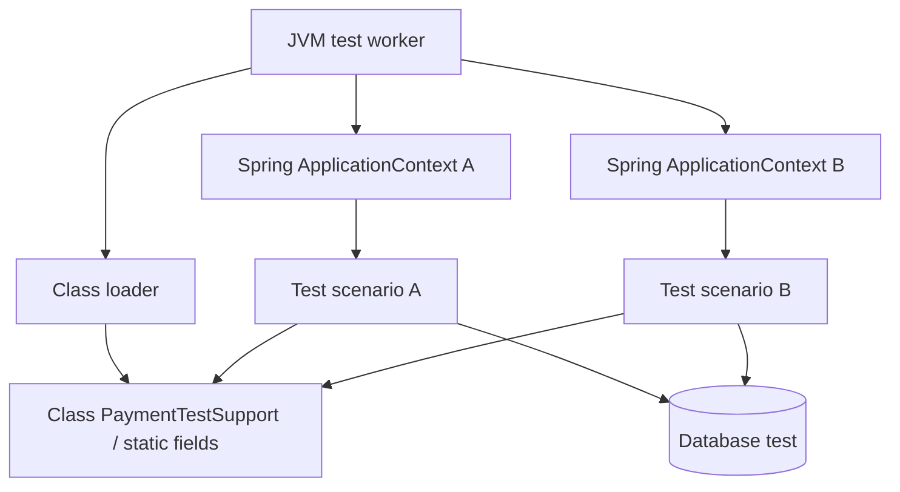
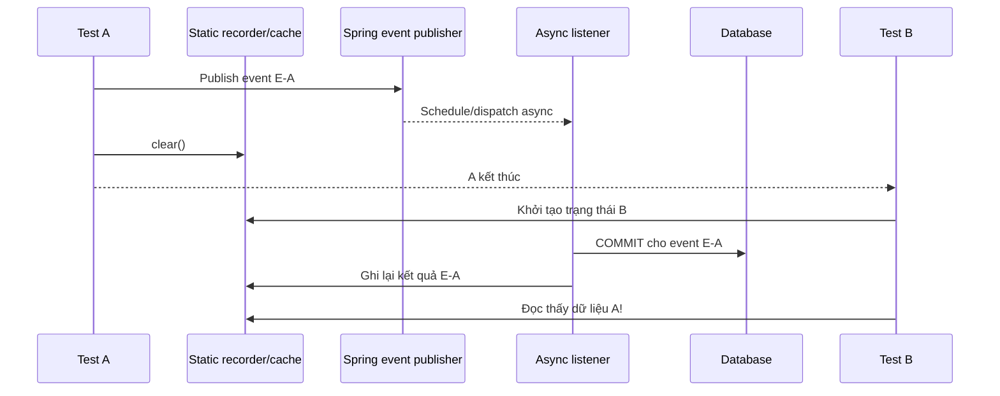

# Không để static state rò giữa các test trong Spring Modulith

## 1. Bối cảnh: vì sao test chạy riêng PASS nhưng chạy cả suite FAIL?

Giả sử module `payments` công bố sự kiện `PaymentCaptured`, còn module `orders` nhận sự kiện và chuyển đơn hàng sang trạng thái `PAID`. Một bài kiểm thử cần khẳng định rằng mỗi đơn hàng được cập nhật đúng giao dịch sau khi listener xử lý.

Một developer tạo một tập `static` để tránh xử lý sự kiện hai lần:

```java
// Anti-pattern: tập ID tồn tại trong toàn bộ JVM/class loader.
private static final Set<String> PROCESSED_TRANSACTIONS =
        ConcurrentHashMap.newKeySet();
```

Bài test A phát sự kiện với mã `CAPTURE-001`. Listener thêm mã đó vào tập và lưu đơn hàng. Bài test B dùng lại mã `CAPTURE-001`, nhưng tạo một đơn hàng khác. Listener thấy mã đã tồn tại, bỏ qua sự kiện; đơn hàng B không chuyển sang `PAID`. Khi chạy riêng test B, tập ban đầu rỗng nên B lại PASS.

Đổi thứ tự hai bài test có thể đảo kết quả. `@DirtiesContext` có thể khởi động lại Spring context nhưng **không mặc nhiên xóa tập static**. `@Transactional` có thể rollback database của test nhưng **không rollback bộ nhớ static**. Đó chính là hiện tượng *static state leakage*.

**Không để static state rò giữa các test** nghĩa là: không để trạng thái được thay đổi ở một scenario tồn tại ngoài vòng đời có chủ đích của scenario đó và ảnh hưởng đến kịch bản khác; đặc biệt chú ý những trạng thái dùng chung ở cấp JVM/class loader thay vì cấp đối tượng hoặc transaction.

Bài thuộc chương *Test isolation* trong học phần `SPRING_MODULITH_VERIFICATION_TESTING`. Bối cảnh học phần là kiểm chứng ranh giới Spring Modulith bằng `ApplicationModules` và quy tắc phụ thuộc giữa module; thực hành `@ApplicationModuleTest`, event, database và tích hợp, đồng thời xây quality gate CI để ngăn phụ thuộc sai và hồi quy.

Sau bài này, bạn có thể:

1. Phân biệt lifetime của biến `static` với test instance, Spring bean, `ApplicationContext` và database.
2. Nhận diện các dạng mutable static state gây lỗi ở event listener, fixture, cache, test double và helper.
3. Hiểu vì sao `static final` không đồng nghĩa một object không thể bị thay đổi.
4. Thiết kế scenario độc lập với ID riêng, trạng thái baseline rõ, fixture commit và state assertion đúng.
5. Chọn giữa loại bỏ state global, chuyển sang instance/test scope, reset có điều kiện hoặc cách ly JVM.
6. Kiểm tra tác động của async executor, `ThreadLocal`, mock static, context cache và test chạy song song.
7. Đưa kiểm tra isolation cùng `ApplicationModules.verify()` vào CI.

## 2. Static state có vòng đời như thế nào?

Trong Java, một field `static` gắn với **class** khi được nạp bởi một class loader. Nó không thuộc về một object cụ thể và không tự được tạo mới mỗi lần JUnit chạy một phương thức.

Hãy hình dung:



Hai context có thể chứa bean khác nhau nhưng vẫn chạy trong **cùng JVM và class loader**, nên cùng truy cập một field static. Một biến static cũng không được Spring TestContext quản lý như bean để tự reset theo lifecycle test.

| Phạm vi state | Ví dụ | Có tự tạo mới ở mỗi test method? |
| --- | --- | --- |
| **Biến local trong method** | `UUID orderId = UUID.randomUUID()` | Có, khi method chạy lại. |
| **JUnit test instance** | `private List<Event> seen = ...` | Mặc định JUnit Jupiter tạo instance mới cho mỗi test method; có ngoại lệ cấu hình. |
| **Spring singleton bean** | `@Service OrderService` có field mutable | Không; có thể tồn tại xuyên nhiều method/class khi context được reuse. |
| **Static field** | `static Set<UUID> processed` | Không; tồn tại trong lifetime class loader/JVM tương ứng. |
| **Database đã commit** | Bảng `orders`, `event_publication` | Không; độc lập với lifetime class/JVM. |
| **Broker / external system** | Kafka topic, RabbitMQ queue, API fake server | Không; cần chiến lược isolation riêng. |

Cũng cần phân biệt **static field theo một class loader** với “biến chung toàn hệ thống”: nhiều JVM hoặc nhiều class loader riêng có thể có các bản sao static khác nhau. Chính vì vậy static cache cũng không phải cơ chế bảo đảm idempotency hay coordination tin cậy khi ứng dụng được triển khai nhiều instance.

### 2.1. JUnit tạo test instance mới không giải quyết static state

JUnit Jupiter mặc định dùng lifecycle `PER_METHOD`: tạo một instance test class mới cho mỗi test method. Nhưng một field:

```java
private static int completedEvents = 0;
```

vẫn tồn tại qua nhiều instance của cùng class. Đổi từ `@TestInstance(PER_CLASS)` về mặc định giúp hạn chế **instance-field leakage** của test class, **không reset static field**.

Với `@TestInstance(TestInstance.Lifecycle.PER_CLASS)`, ngay cả **instance fields** của test class cũng có thể được giữ xuyên các method. Đây là lựa chọn có chủ đích khi cần non-static `@BeforeAll` hoặc chi phí tạo fixture đặc biệt, không phải mẹo để cô lập static.

### 2.2. `@BeforeAll` không phải mỗi scenario một lần

`@BeforeAll` chạy trước các test của class theo lifecycle JUnit, không có nghĩa dữ liệu khởi tạo ở đó sẽ tự reset sau từng test.

```java
// Anti-pattern cho workflow stateful:
private static UUID sharedOrderId;

@BeforeAll
static void createSharedOrder() {
    sharedOrderId = UUID.randomUUID();
}
```

Nếu bài A chuyển `sharedOrderId` sang `PAID`, bài B đọc cùng order sẽ không còn baseline `AWAITING_PAYMENT`. Có thể dùng `@BeforeAll` cho các tài nguyên **bất biến hoặc được chia sẻ có chủ đích**, nhưng không nên dùng một aggregate mutable làm fixture chung cho các scenario độc lập.

## 3. Không phải mọi static đều là vấn đề

Câu “không dùng static” quá cực đoan. Điểm cần kiểm tra là **tính thay đổi được, quyền sở hữu và phạm vi sử dụng**.

| Khai báo | Nguy cơ | Vì sao |
| --- | --- | --- |
| `static final int MAX_RETRIES = 3;` | Thường thấp | Giá trị primitive bất biến. |
| `static final String TOPIC = "orders-test";` | Thấp với hằng số; tên topic vẫn có thể bị dùng chung | Reference và nội dung String bất biến, nhưng tài nguyên broker mang tên đó có state riêng. |
| `static final Duration TIMEOUT = Duration.ofSeconds(5);` | Thấp | `Duration` bất biến. |
| `static final List<String> STATES = List.of(...)` | Thấp nếu phần tử cũng bất biến | Danh sách không hỗ trợ mutation qua API thông thường. |
| `static final ArrayList<Event> EVENTS = new ArrayList<>();` | Cao | Reference không đổi nhưng nội dung collection có thể thay đổi. |
| `static final AtomicInteger COUNT = new AtomicInteger();` | Cao | Object có thể được tăng/giảm dù reference là `final`. |
| `static final ConcurrentMap<UUID, Event> CACHE = ...` | Cao | Thread-safe không đồng nghĩa test-scoped. |
| `static ThreadLocal<Context> CURRENT = ...` | Cao | State trên từng thread sống qua những task dùng thread pool. |
| `static final Clock FIXED_CLOCK = Clock.fixed(...)` | Thường thấp | Clock cố định/bất biến, nếu dùng đúng một cấu hình không bị mutate. |
| `static final Testcontainer CONTAINER = ...` | Phụ thuộc thiết kế | Một container được chia sẻ có chủ đích; **dữ liệu trong container** vẫn cần reset/cô lập. |

**`final` chỉ hạn chế gán lại reference; nó không đóng băng object được tham chiếu.**

```java
static final List<String> IDS = new ArrayList<>();

IDS.add("CAPTURE-001"); // Vẫn thay đổi nội dung List.
```

Tương tự, dùng `ConcurrentHashMap` để tránh data race ở cấu trúc Map không giải quyết lỗi **dữ liệu cũ của test A được test B nhìn thấy**.

## 4. Những nguồn static state ẩn trong một ứng dụng Modulith

Không phải mọi state rò rỉ đều xuất hiện dưới tên `cache`. Những nguồn cần rà soát gồm:

| Nguồn | Ví dụ | Sai lệch có thể gặp |
| --- | --- | --- |
| Static collection | `PROCESSED_EVENT_IDS`, `RECORDED_EVENTS` | Test bỏ qua event hoặc đếm cả event cũ. |
| Static counter | `AtomicLong SEQUENCE`, `AtomicInteger CALLS` | Assertion số lần gọi phụ thuộc thứ tự test. |
| Static random generator | `Random(42)` dùng chung | Thứ tự sinh dữ liệu thay đổi giữa method/parallel run. |
| Static mutable clock | `AdjustableClock.INSTANCE` | Test khác nhận thời gian giả đã được đổi. |
| Static test fixture ID | `sharedOrderId`, `sharedTransactionId` | Trùng key, false positive khi chờ state. |
| Static mock/stub | `static Mockito.mock(...)`, scoped static mock bị quên đóng | Stubbing/call history hoặc method interception lan sang scenario khác. |
| Static ThreadLocal | `CURRENT_TENANT`, `MDC`, `SecurityContextHolder` strategy | Async worker xử lý sai tenant/correlation. |
| Static application registry | Tập listener, callback, hook, global singleton custom | Callback được gọi lặp hoặc vẫn giữ reference tới context cũ. |
| Static memoization | Cache kết quả dựa trên property/profile hoặc thời gian | Context mới vẫn nhận giá trị cache từ cấu hình cũ. |
| Thư viện bên ngoài | Global registry, metrics holder hoặc SDK singleton | Context thay đổi nhưng client/global state vẫn cũ. |

Một số Spring infrastructure có static factory/cache được thư viện quản lý; không nên tự ý clear chúng. Phạm vi bài này là **những mutable global states mà code ứng dụng hoặc test sở hữu/có quyền thiết kế lại**. Nếu gặp registry của thư viện thứ ba, phải dùng API lifecycle mà thư viện công bố thay vì sửa reflection vào field private.

## 5. Anti-pattern đặc biệt nguy hiểm: static idempotency cache trong listener

Giả sử module `orders` nhận `PaymentCaptured` từ `payments`:

```java
import java.util.Set;
import java.util.concurrent.ConcurrentHashMap;

import org.springframework.context.event.EventListener;
import org.springframework.stereotype.Component;
import org.springframework.transaction.annotation.Transactional;

@Component
class UnsafePaymentCapturedListener {

    private static final Set<String> PROCESSED =
            ConcurrentHashMap.newKeySet();

    private final OrderRepository orders;

    UnsafePaymentCapturedListener(OrderRepository orders) {
        this.orders = orders;
    }

    @EventListener
    @Transactional
    public void on(PaymentCaptured event) {
        if (!PROCESSED.add(event.transactionId())) {
            return;
        }

        Order order = orders.findById(event.orderId())
                .orElseThrow();
        order.markPaid(event.transactionId(), event.amount());
        // Commit có thể xảy ra sau khi static set đã được cập nhật.
    }
}
```

Các kiểu `PaymentCaptured`, `OrderRepository` và `Order.markPaid(...)` là domain implementation **minh họa**. Đoạn code này được đưa ra như **anti-pattern**, không phải giải pháp.

Có ít nhất bốn lỗi:

1. **Test leakage:** lần test sau dùng lại mã giao dịch sẽ bị bỏ qua dù context hoặc database đã reset.
2. **Không transaction-safe:** thêm mã vào static set xảy ra **trước commit**. Nếu DB transaction rollback, set vẫn giữ mã, retry bị coi là duplicate sai.
3. **Không bền vững:** restart process xóa set, vì vậy event có thể được xử lý lại mà không có bằng chứng idempotency.
4. **Không nhất quán nhiều instance:** mỗi JVM/pod có một set riêng; hai instance khác nhau có thể xử lý cùng event.

Chỉ thay `Set` bằng `ConcurrentHashMap` hoặc bọc `synchronized` không giải quyết 3 vấn đề còn lại.

### 5.1. Thiết kế đúng hơn: idempotency gắn với dữ liệu bền vững

Nếu yêu cầu nghiệp vụ là “một transaction capture chỉ được áp dụng một lần”, có thể lưu **khóa idempotency** vào database thuộc module sở hữu, kết hợp unique constraint và transaction hợp lệ:

```text
UNIQUE(transaction_id)
hoặc UNIQUE(consumer_name, event_id)

Transaction xử lý event:
  - đăng ký/kiểm tra khóa idempotency trong database;
  - cập nhật trạng thái và business side effect cần thiết;
  - commit hoặc rollback cùng nhau.
```

Một giao thức triển khai phù hợp sẽ phụ thuộc DB, concurrent delivery và lỗi:

- Unique constraint giúp DB phân xử hai worker concurrent cùng khóa.
- Transaction bảo đảm không ghi nhận “đã xử lý” khi business write rollback.
- Domain transition phải từ chối cập nhật sai và xử lý duplicate theo hợp đồng.
- Retry còn cần điểm xác nhận hoàn tất của listener/broker/publication registry.
- Nếu business side effect đi ra hệ thống ngoài, một DB transaction riêng không tự tạo atomicity xuyên broker/API; có thể cần outbox, inbox/idempotent consumer hoặc coordination khác.

**Không biến static cache thành nguồn sự thật nghiệp vụ.** Có thể có cache như tối ưu hiệu năng nhưng cần cơ chế durable correctness độc lập và chính sách invalidate theo lifecycle.

### 5.2. Event Publication Registry cũng không được thay bằng static list

Spring Modulith có Event Publication Registry để theo dõi publication tới listener phù hợp theo provider/cấu hình. Một static `List<Event>` trong test **không** chứng minh durable publication được ghi/complete hay có thể resubmit sau restart.

Phân biệt rõ:

- `PublishedEvents`: quan sát event được publish trong test context.
- Registry: theo dõi lifecycle publication/target theo cơ chế Spring Modulith và provider.
- Public query API: quan sát business state đã commit.
- Static list tự tạo: state in-memory do test sở hữu, dễ rò nếu không được cô lập.

Đừng dùng một trong bốn nguồn làm bằng chứng thay thế cho ba nguồn còn lại.

## 6. Static event recorder gây false positive

Một recorder hay được đưa vào test để đếm sự kiện:

```java
// Anti-pattern: dùng chung mọi test method cùng class loader.
public final class EventTestRecorder {

    public static final List<Object> EVENTS =
            new CopyOnWriteArrayList<>();

    private EventTestRecorder() {}

    public static void record(Object event) {
        EVENTS.add(event);
    }
}
```

Ngay cả `CopyOnWriteArrayList` cũng chỉ giải quyết một số vấn đề concurrent access. Nếu test A ghi một `OrderPaid`, test B assert `EVENTS.stream().anyMatch(e -> e instanceof OrderPaid)`, B có thể pass dù nghiệp vụ của B không hề phát event.

Những cách kiểm tra dễ sai:

```java
assertThat(EventTestRecorder.EVENTS).isNotEmpty();
assertThat(EventTestRecorder.EVENTS).anyMatch(
        event -> event instanceof OrderPaid);
```

Cách tốt hơn là dùng tính năng ghi nhận event của Spring Modulith khi mục tiêu là publication contract, hoặc một recorder **instance-scoped và được reset sau khi work đã hoàn tất**, luôn lọc theo `eventId`/`orderId` của kịch bản.

### 6.1. `PublishedEvents` cho producer contract

Ví dụ producer test (trích đoạn; các biến/service do fixture ứng dụng cung cấp):

```java
import static org.assertj.core.api.Assertions.assertThat;

import org.junit.jupiter.api.Test;
import org.springframework.modulith.test.ApplicationModuleTest;
import org.springframework.modulith.test.PublishedEvents;

@ApplicationModuleTest
class PaymentPublicationTests {

    @Test
    void publishesEventForCurrentOrder(PublishedEvents events) {
        UUID orderId = fixture.newOrderAndCommit();

        paymentService.capture(orderId, "CAPTURE-" + orderId);

        assertThat(events.ofType(PaymentCaptured.class)
                .matching(PaymentCaptured::orderId, orderId))
                .isNotEmpty();
    }
}
```

`fixture`, `paymentService` và `PaymentCaptured` là các thành phần **giả định** cần được khai báo/inject trong test thực tế. Test trên kiểm tra publication cho **đúng order** trong phạm vi test; không tự khẳng định listener consumer đã commit hoặc registry đã completed.

Với một publisher hoàn tất bất đồng bộ sau khi method trả về, cần dùng cách chờ event phù hợp với phiên bản Spring Modulith đang dùng, không assert ngay theo timing không được bảo đảm.

## 7. Tái lập mỗi scenario bằng dữ liệu local, không bằng static fixture

Giả sử module `orders` cần phản ứng với `PaymentCaptured`, ta có contract công khai:

```java
// File: com/example/shop/payments/events/PaymentCaptured.java
package com.example.shop.payments.events;

import java.math.BigDecimal;
import java.util.UUID;

public record PaymentCaptured(
        UUID eventId,
        UUID orderId,
        String transactionId,
        BigDecimal amount) {}
```

```java
// File: com/example/shop/orders/OrderStatus.java
package com.example.shop.orders;

public enum OrderStatus {
    AWAITING_PAYMENT, PAID, PAYMENT_FAILED
}
```

```java
// File: com/example/shop/orders/OrderPaymentView.java
package com.example.shop.orders;

import java.math.BigDecimal;
import java.util.UUID;

public record OrderPaymentView(
        UUID orderId,
        OrderStatus status,
        UUID lastProcessedEventId,
        String transactionId,
        BigDecimal capturedAmount) {

    public boolean matchesCapture(
            UUID expectedEventId,
            String expectedTransactionId,
            BigDecimal expectedAmount) {

        return status == OrderStatus.PAID
                && expectedEventId.equals(lastProcessedEventId)
                && expectedTransactionId.equals(transactionId)
                && capturedAmount != null
                && capturedAmount.compareTo(expectedAmount) == 0;
    }
}
```

```java
// File: com/example/shop/orders/OrderQueries.java
package com.example.shop.orders;

import java.util.Optional;
import java.util.UUID;

public interface OrderQueries {
    Optional<OrderPaymentView> paymentOf(UUID orderId);
}
```

Mỗi kiểu `public` ở trên nằm trong file Java riêng. Các API này thuộc **ứng dụng ví dụ**, không phải class được Spring Modulith sinh tự động.

Fixture test support có nhiệm vụ tạo một aggregate riêng:

```java
// File: test-support OrderFixture.java (minh họa)
import java.math.BigDecimal;
import java.util.UUID;

public interface OrderFixture {
    UUID awaitingPaymentAndCommit(BigDecimal amount);
}
```

Tên `AndCommit` chỉ đúng nếu implementation **thực sự hoàn thành transaction ghi** trước khi trả về. Với listener async/after-commit, `saveAndFlush(...)` trong transaction chưa commit không đủ. Fixture có thể dùng `TransactionTemplate` hoặc một bean transactional được gọi qua proxy và kết thúc giao dịch trước stimulus.

### 7.1. Test module không giữ ID ở field static

```java
package com.example.shop.orders;

import static org.assertj.core.api.Assertions.assertThat;

import java.math.BigDecimal;
import java.time.Duration;
import java.util.UUID;

import org.junit.jupiter.api.Test;
import org.springframework.beans.factory.annotation.Autowired;
import org.springframework.modulith.test.ApplicationModuleTest;
import org.springframework.modulith.test.Scenario;

@ApplicationModuleTest
class PaymentScenarioIsolationTests {

    @Autowired OrderFixture fixture;
    @Autowired OrderQueries orders;

    @Test
    void processesPaymentForFreshOrder(Scenario scenario) {
        BigDecimal amount = new BigDecimal("125000.00");

        // Mỗi invocation tự có một aggregate và logical event.
        UUID orderId = fixture.awaitingPaymentAndCommit(amount);
        UUID eventId = UUID.randomUUID();
        String transactionId = "TX-" + eventId;

        // Baseline phải đúng trước khi kích hoạt event.
        OrderPaymentView before = orders.paymentOf(orderId)
                .orElseThrow();
        assertThat(before.status())
                .isEqualTo(OrderStatus.AWAITING_PAYMENT);
        assertThat(before.transactionId()).isNull();

        scenario.publish(new PaymentCaptured(
                        eventId, orderId, transactionId, amount))
                .andWaitAtMost(Duration.ofSeconds(8))
                .forStateChange(
                        () -> orders.paymentOf(orderId),
                        state -> state.filter(v ->
                                v.matchesCapture(
                                        eventId, transactionId, amount))
                                .isPresent())
                .andVerify(state -> {
                    OrderPaymentView paid = state.orElseThrow();
                    assertThat(paid.orderId()).isEqualTo(orderId);
                    assertThat(paid.status()).isEqualTo(OrderStatus.PAID);
                    assertThat(paid.transactionId())
                            .isEqualTo(transactionId);
                    assertThat(paid.capturedAmount())
                            .isEqualByComparingTo(amount);
                });
    }
}
```

Ví dụ là **khung test**: để chạy được, dự án phải có listener `PaymentCaptured`, fixture bean, repository/query adapter và transaction infrastructure trong phạm vi `@ApplicationModuleTest`. Không nhất thiết bootstrap module producer thật khi test chỉ kiểm tra phản ứng của consumer với event contract.

Bài test có nhiều hàng rào chống false positive:

1. `orderId` và `eventId` là **biến local mới**, không dùng một static ID chung.
2. Fixture đã commit dữ liệu xuất phát; test xác nhận baseline `AWAITING_PAYMENT`.
3. Event tham chiếu đúng order và giao dịch của scenario.
4. Supplier đọc state bằng public query API qua từng lần poll.
5. Predicate đòi state `PAID` **và đúng event/transaction/amount**, không chỉ `Optional.isPresent()`.
6. `andVerify(...)` đưa ra assertion nghiệp vụ rõ ràng.
7. Timeout hữu hạn tránh treo CI khi handler không chạy hoặc rollback.

**Quan trọng:** cách này hạn chế nhiễm static trong **test code**, nhưng nếu production listener vẫn dùng static dedup cache ở mục 5, lỗi vẫn tồn tại. Khi phát hiện production static state có thể thay đổi hành vi, phải sửa thiết kế production chứ không chỉ tăng số UUID.

### 7.2. Không nhầm ID riêng với isolation của mọi tài nguyên

Hai scenario dùng `orderId` khác nhau vẫn có thể tranh một SKU, tài khoản, quota hoặc Kafka consumer group. Static leakage là một chiều isolation; DB, cache, executor, broker và Event Publication Registry còn cần cách quản lý riêng.

Nếu test có chủ đích phát **cùng logical event hai lần** để kiểm tra idempotency, hai lần phát **trong cùng một scenario** phải giữ nguyên event ID/transaction key. Giữa các scenario độc lập, ID nên khác nhau.

## 8. Dùng state theo đối tượng hoặc bean thay cho static khi phù hợp

Một class thuần Java có thể giữ state trong **instance** của nó:

```java
import java.util.ArrayList;
import java.util.List;

final class PaymentEventRecorder {

    private final List<PaymentCaptured> events = new ArrayList<>();

    void record(PaymentCaptured event) {
        events.add(event);
    }

    List<PaymentCaptured> events() {
        return List.copyOf(events);
    }
}
```

Unit test tạo recorder mới mỗi method:

```java
@Test
void recordsOnlyTheCurrentScenario() {
    PaymentEventRecorder recorder = new PaymentEventRecorder();
    UUID orderId = UUID.randomUUID();

    recorder.record(new PaymentCaptured(
            UUID.randomUUID(), orderId,
            "TX-" + orderId, new BigDecimal("100.00")));

    assertThat(recorder.events()).hasSize(1);
}
```

Cách này cô lập tốt **khi recorder thực sự được tạo mới** cho mỗi test. Nhưng nếu `PaymentEventRecorder` trở thành một singleton bean trong Spring context được reuse, nó lại là mutable state dùng chung mặc dù không có `static`.

Đây là phân biệt quan trọng:

- **Bỏ static** loại bỏ một nguồn global state cấp class loader.
- **Test instance scope / fixture scope** mới bảo đảm dữ liệu test không bị reuse.
- **Spring singleton** có thể vẫn rò state giữa các test reuse context.
- **Immutable object** và các phép đọc không tác động phụ thường dễ chia sẻ hơn.

### 8.1. Test-only fake trong Spring context

Một test double có thể dùng `ConcurrentMap<UUID, Event>` dưới dạng **instance field** để thu các event theo ID của scenario:

```java
import java.util.UUID;
import java.util.concurrent.ConcurrentHashMap;
import java.util.concurrent.ConcurrentMap;

final class RecordingPaymentPort implements PaymentNotificationPort {

    private final ConcurrentMap<UUID, PaymentCaptured> received =
            new ConcurrentHashMap<>();

    @Override
    public void notifyCapture(PaymentCaptured event) {
        received.put(event.eventId(), event);
    }

    PaymentCaptured recorded(UUID eventId) {
        return received.get(eventId);
    }

    void forget(UUID eventId) {
        received.remove(eventId);
    }
}
```

`PaymentNotificationPort` là port **giả định của ứng dụng**. Fake này không dùng static, và kết quả được lọc theo event ID. Dù vậy, nếu fake là singleton test bean, các entry của test trước **vẫn có thể tồn tại** cho đến khi được dọn hoặc context bị hủy; không đọc tổng số entry để suy ra một event mới đã được xử lý.

Nếu async listener ghi vào fake, cần chờ **đúng completion signal** trước khi assert và cleanup. `ConcurrentMap` không tự bảo đảm rằng producer đã chạy xong hay side effect khác không còn tiếp diễn.

## 9. Reset static state: chỉ là giải pháp tạm khi có kiểm soát

Trong legacy tests, đôi khi chưa thể thay đổi global static state ngay. Có thể cần reset để giảm nhiễm trong ngắn hạn:

```java
// Test-support nội bộ cho legacy code, chỉ khi đã kiểm soát concurrency.
final class LegacyRecorder {

    static final List<String> EVENTS = new ArrayList<>();

    static void reset() {
        EVENTS.clear();
    }
}
```

Và trong test:

```java
@BeforeEach
void prepare() {
    LegacyRecorder.reset();
}

@AfterEach
void cleanup() {
    LegacyRecorder.reset();
}
```

**Không coi đây là giải pháp mặc định.** Có các vấn đề:

1. Nếu test A và B chạy song song, A có thể clear dữ liệu B đang kiểm tra.
2. Nếu một task async từ A vẫn chạy sau `@AfterEach`, nó có thể ghi lại vào static state sau khi đã clear.
3. Reset không rollback side effect đã commit vào DB/broker.
4. Một static map có callback/listener reference có thể tạo memory leak ngay cả khi test state đã “pass”.
5. Nếu production dùng static cache làm logic nghiệp vụ, reset trong test có thể **che bug thực tế** về lifecycle, crash/restart và nhiều JVM.

Có thể chấp nhận reset khi tất cả điều kiện sau đều đúng: state chỉ phục vụ test, không có worker còn sử dụng, các test liên quan được chạy tuần tự hoặc cô lập process, và có kế hoạch thay bằng fixture/recorder scoped.

### 9.1. Reset trước hay sau test?

- Reset **trước test** giúp tạo baseline cho bài hiện tại nhưng có thể phá work của bài khác còn chạy.
- Reset **sau test** giúp hạn chế dữ liệu tồn dư nhưng có thể xảy ra trước một callback bất đồng bộ.
- Reset cả trước lẫn sau **không** sửa một race giữa test methods chạy song song.

Muốn reset an toàn, trước hết phải biết rằng không còn task nào có thể ghi/đọc state đó, có quyền sở hữu tài nguyên, và không có test khác cùng dùng. Trong nhiều trường hợp, **tạo instance riêng** đơn giản hơn cố đồng bộ global reset.

## 10. `@DirtiesContext` không reset static field

Spring TestContext cache có thể tái sử dụng application context giữa test classes có cấu hình tương đương. `@DirtiesContext` cho phép báo context không còn an toàn để reuse, nhưng phạm vi của nó là **Spring application context**.

Ví dụ:

```java
@ApplicationModuleTest
@DirtiesContext(
        classMode = DirtiesContext.ClassMode.AFTER_CLASS)
class ContextResetTests {
    // Spring context bị loại khỏi cache sau class.
}
```

Ngay cả sau annotation này:

```java
final class GlobalCache {
    static final Map<String, String> VALUES =
            new ConcurrentHashMap<>();
}
```

thì `GlobalCache.VALUES` **không tự bị clear**, bởi class có thể vẫn được nạp trong JVM/class loader đó.

| Biện pháp | Reset bean instance? | Reset static fields? | Reset DB/broker? |
| --- | --- | --- | --- |
| New test object (JUnit `PER_METHOD`) | Không tự reset Spring singleton | Không | Không |
| `@DirtiesContext` | Tạo lại context/beans khi cần | Không | Không |
| Reset static explicitly | Không | Chỉ field/cấu trúc được reset | Không |
| Mỗi test một JVM/fork riêng | Các bean/class được tạo trong JVM mới | Có theo process/class loader mới | Không nếu dùng external resource chung |
| DB schema/container mới | Không tự reset bean/static | Không | Cô lập DB của phạm vi mới; broker còn tùy thiết kế |
| Fixture ID riêng + cleanup | Không tự reset toàn bean | Không | Tách/dọn dữ liệu liên quan theo scope |

**Fork JVM riêng** có thể là một biện pháp cách ly dành cho legacy tests khó sửa, nhưng đắt hơn và có nguy cơ che lỗi production. Nó không thay thế thiết kế đúng cho code ứng dụng, nhất là khi production chạy nhiều instance hoặc xử lý lại event.

### 10.1. Testcontainers static field: ngoại lệ cần hiểu rõ

Nhiều hướng dẫn Testcontainers dùng:

```java
@Container
static PostgreSQLContainer<?> postgres =
        new PostgreSQLContainer<>("postgres:16-alpine");
```

`static` ở đây có thể là **chủ đích quản lý vòng đời container theo test class**, không phải anti-pattern mặc định. Nhưng một PostgreSQL container được chia sẻ có **dữ liệu mutable bên trong**; hai method có thể vẫn nhìn thấy row của nhau.

Nếu Spring TestContext cache reuse một DataSource trỏ container đã dừng sau class A, test B có thể lỗi kết nối. Hãy phối hợp lifecycle container, context và dữ liệu fixture. Không sửa bằng cách clear một static field container tùy tiện khi context vẫn dùng nó.

## 11. Static `ThreadLocal`: dạng rò rỉ khó thấy trong async tests

`ThreadLocal` cho phép mỗi thread giữ một giá trị riêng, nhưng thread trong executor pool **được tái sử dụng**. Vì vậy, một `static final ThreadLocal<String> CURRENT_TENANT` không phải “mỗi task một scope”.

Anti-pattern:

```java
final class TenantContext {

    static final ThreadLocal<String> CURRENT = new ThreadLocal<>();
}
```

Trong worker:

```java
TenantContext.CURRENT.set("tenant-A");
processEvent(event);
// Quên remove: task sau chạy trên cùng worker thấy tenant-A.
```

Hậu quả có thể rất nghiêm trọng: event của tenant B được xử lý với metadata của tenant A. Test chạy riêng có thể pass, nhưng test sau khi executor reuse cùng thread lại fail hoặc tệ hơn là pass giả.

Nếu bắt buộc dùng ThreadLocal, luôn dọn bằng `finally` trên **chính thread đã set**:

```java
String previous = TenantContext.CURRENT.get();

try {
    TenantContext.CURRENT.set(tenantId);
    processEvent(event);
} finally {
    if (previous == null) {
        TenantContext.CURRENT.remove();
    } else {
        TenantContext.CURRENT.set(previous);
    }
}
```

Đây là ví dụ pattern. Tùy semantics context, có thể cần bảo đảm dữ liệu được restore ở đúng mức lồng nhau. Với `MDC`, `SecurityContextHolder` hoặc tracing context, dùng API scope/clear/restore mà thư viện khuyến nghị. Không set context trong test thread rồi mặc định async thread sẽ nhận cùng ThreadLocal.

### 11.1. Lý tưởng hơn: truyền correlation qua event

Một event record có `eventId`, `orderId` và `transactionId` rõ ràng giúp consumer xử lý đúng dữ liệu không cần nhờ static context:

```java
PaymentCaptured event = new PaymentCaptured(
        eventId, orderId, transactionId, amount);
```

Nếu cần tenant ID cho nghiệp vụ, có thể thêm nó vào **contract event phù hợp với privacy/security** và kiểm tra ownership ở consumer; không nên tin mù quáng header do client không đáng tin gửi. Những metadata chỉ dùng để log/trace có thể được truyền qua chuẩn context propagation, nhưng phải thiết lập và dọn lifecycle phù hợp.

## 12. Static mock và test double: phải đóng đúng scope

Một static mock có thể làm những lời gọi tới method static bị intercept. Nếu cấu hình còn tồn tại sau test, bài khác có thể nhận hành vi đã stub ngoài ý định.

Ví dụ với Mockito static mocking (nếu dự án có phiên bản/dependency hỗ trợ):

```java
import static org.assertj.core.api.Assertions.assertThat;

import org.junit.jupiter.api.Test;
import org.mockito.MockedStatic;
import org.mockito.Mockito;

@Test
void mockStaticOnlyInsideExplicitScope() {
    try (MockedStatic<LegacyClock> mocked =
            Mockito.mockStatic(LegacyClock.class)) {

        mocked.when(LegacyClock::nowEpochMillis)
                .thenReturn(123456789L);

        assertThat(LegacyClock.nowEpochMillis())
                .isEqualTo(123456789L);
    } // MockedStatic được close ngay tại đây.
}
```

`LegacyClock` là class minh họa; ví dụ cần khai báo class có static method phù hợp và bộ dependency Mockito. Mockito static mocking có cơ chế scope theo thread trong nhiều trường hợp; nó **không** đảm bảo stub trên test thread sẽ tự áp dụng cho listener ở worker thread. Đừng dùng static mocking như một giải pháp điều khiển thời gian xuyên async.

Tốt hơn cho code có thể refactor là inject `Clock`, `IdGenerator` hoặc một port thay vì phụ thuộc direct static utility.

### 12.1. Test listener không dùng mock static để xác minh side effect

Nếu cần kiểm chứng listener gửi notification, hãy inject một interface/adapter test trong Spring context hoặc dùng integration test của broker. Static mocking một publisher toàn cục thường làm test phụ thuộc implementation detail và khó kiểm soát thread/transaction.

## 13. Random generator, clock và ID cũng có thể rò qua static

Một số biến static tưởng là “test convenience”:

```java
static final Random RANDOM = new Random(42);
static final AtomicLong IDS = new AtomicLong();
static final AdjustableClock CLOCK = new AdjustableClock(...);
```

đều chứa **mutable state**. Chúng tạo ra những lỗi khác nhau:

| Static helper | Triệu chứng | Cách thiết kế tốt hơn |
| --- | --- | --- |
| `Random(42)` dùng chung | Đổi thứ tự test làm input khác. | Tạo PRNG mới theo scenario, ghi seed để tái hiện. |
| `AtomicLong` ID generator | Test kỳ vọng ID = 1 nhưng nhận 14. | Generator instance riêng; integration test dùng UUID mới/DB ID đúng contract. |
| Mutable clock singleton | Test B thấy thời gian từ A. | Clock immutable per test, hoặc test context riêng có điểm reset an toàn. |
| Static cached profile | Context B đọc flag đã cache từ A. | Bind config theo Spring context/bean instance. |
| Static aggregator | Event của scenario trước tồn tại. | Recorder scoped, query theo event ID và cleanup sau completion. |

Cần phân biệt **determinism** với **isolation**: một seed cố định riêng cho mỗi test giúp lặp lại đầu vào; còn cùng một `Random` static có seed cố định thì không. Tương tự, hai integration tests dùng chung một ID cố định trên cùng database vẫn gây xung đột, dù giá trị ID hoàn toàn deterministic.

### 13.1. Không dùng timestamp cố định làm unique ID

Nếu code tạo ID từ clock:

```java
String orderId = "ORDER-" + clock.instant().toEpochMilli();
```

hai scenario dùng `Clock.fixed(...)` sẽ tạo cùng ID. Kể cả dùng clock thật, hai lời gọi có thể cùng mili-giây.

Dùng một ID generator có hợp đồng uniqueness phù hợp. Trong integration test chia sẻ DB, `UUID.randomUUID()` mới cho mỗi scenario thường là một cách đơn giản. Sau đó ghi ID vào log failure và dùng nhất quán trong fixture, event và assertions.

### 13.2. Không đưa static ID generator giả vào production để test dễ viết

Nếu production cần ID unique bền vững, hãy để database, UUID hoặc cơ chế distributed ID phù hợp chịu trách nhiệm. Một static `AtomicLong` chỉ chạy trong một JVM không bảo đảm unique xuyên restart/multiple instances.

## 14. Dữ liệu đã commit và event đang xử lý: static reset không đủ

Một module test event-driven thường có nhiều vòng đời:



Thậm chí khi test A có `@AfterEach` gọi reset, listener A vẫn có thể ghi vào static state sau đó. Điều này tạo race đặc biệt khó tái hiện vì phụ thuộc scheduling.

Một test muốn cleanup cần:

1. Xác định **các tác vụ** có quyền ghi vào recorder/cache.
2. Bảo đảm chúng đã đi qua **điểm hoàn tất phù hợp**, không chỉ một field state vừa thay đổi.
3. Ngăn stimulus mới trong giai đoạn cleanup.
4. Reset hoặc hủy state đúng scope (ưu tiên hủy instance fixture riêng).
5. Không xóa database/broker khi worker vẫn còn truy cập.
6. Nếu timeout, giữ môi trường cô lập hoặc dừng/đồng bộ worker theo lifecycle; không tùy tiện clear global state của test khác.

**Không dùng `Thread.sleep(...)` cố định** làm bằng chứng task đã xong. Với Spring Modulith, `Scenario.andWaitForStateChange(...)` đợi state nghiệp vụ; nếu còn side effect ngoài state, cần tín hiệu completion/ack độc lập.

## 15. JUnit parallel tests làm static leak rõ hơn

JUnit Jupiter có thể chạy tests song song theo cấu hình. Mutable static state có hai nhóm nguy cơ:

- **Thứ tự:** test nào chạy trước làm thay đổi đầu vào của test khác.
- **Đồng thời:** test A clear static collection trong lúc B ghi hoặc đang assert; race làm kết quả không ổn định.

Ngay cả một `ConcurrentHashMap` cũng không giải quyết việc **test A vô tình xóa dữ liệu test B**.

### 15.1. `@ResourceLock` cho legacy state bắt buộc dùng chung

JUnit Jupiter có annotation `@ResourceLock` để khai báo tài nguyên logic mà những test không được truy cập xung đột khi thực thi song song theo scheduler của engine:

```java
import org.junit.jupiter.api.Test;
import org.junit.jupiter.api.parallel.ResourceAccessMode;
import org.junit.jupiter.api.parallel.ResourceLock;

@ResourceLock(
        value = "legacy-global-payment-recorder",
        mode = ResourceAccessMode.READ_WRITE)
class LegacyRecorderCompatibilityTests {

    @Test
    void isolatedAccessWithinJupiterScheduling() {
        // Dùng legacy recorder dưới một resource lock chung.
    }
}
```

Đây là **biện pháp giảm rủi ro**, không phải sửa thiết kế. Mọi test khác cùng đụng recorder phải tuân thủ **cùng tên resource lock**; lock của JUnit không điều khiển những background tasks do executor tạo ra sau khi test kết thúc, và không điều phối giữa các JVM hoặc job CI khác nhau.

### 15.2. `@Isolated` hoặc chạy tuần tự khi thật cần

JUnit Jupiter cung cấp những cơ chế isolation/parallel configuration như `@Isolated` ở mức test class hoặc `@Execution(SAME_THREAD)` theo ngữ nghĩa của engine/version. Chúng giúp một nhóm tests tránh concurrent execution trong một engine, **không reset static data** và không tự ngừng async worker.

Với legacy code chưa sửa được, có thể tách test thành một JVM fork riêng và chạy tuần tự. Nhưng đây nên là **ngoại lệ được ghi nhận**, không phải cách đánh bóng suite để bỏ qua static-state bug trong production.

### 15.3. Chạy đúng một test riêng là phép thử quan trọng

Một lỗi điển hình:

```text
Run one test method: PASS
Run class: FAIL
Run full suite: FAIL ngẫu nhiên
Reverse order: có thể đổi method bị lỗi
Parallel CI: lỗi tăng tần suất
```

Đó là chỉ dấu mạnh của state leakage hoặc tài nguyên dùng chung, nhưng chưa đủ kết luận chắc chắn là static: database, Spring singleton, broker, registry, system property cũng có thể gây cùng triệu chứng. Cần phân loại nguồn state trước khi sửa.

## 16. Các trạng thái global khác: system properties, locale và security

Một số giá trị không nằm trong field `static` của code ứng dụng nhưng cũng có **global JVM state**:

- `System.setProperty(...)` làm thay đổi Java system properties.
- `TimeZone.setDefault(...)` hoặc `Locale.setDefault(...)` thay đổi default dùng chung.
- `SecurityContextHolder` có strategy và thread-bound state cần cleanup theo Spring Security.
- Các SDK client có global singleton registry hoặc static caches.
- Global MDC/tracing context có thể còn trên worker thread.

Một test đổi system property rồi restore trong `finally` vẫn có **khoảng thời gian** mà test khác thấy giá trị tạm. Thay bằng `@TestPropertySource`, `@ActiveProfiles` hoặc `@DynamicPropertySource` khi mục tiêu là cấu hình Spring context; khi bắt buộc test legacy Java global API, dùng process isolation hoặc serialization có chủ đích.

Cũng không nên dùng reflection để sửa `System.getenv(...)` trong JVM nhằm tạo env giả. Với code đọc môi trường thật, cấp env lúc khởi chạy test process; với business logic, inject một config adapter và dùng fake.

**Cô lập static state và cô lập process-global configuration là cùng một nguyên tắc về ownership/lifecycle, nhưng cần công cụ khác nhau tùy nguồn.**

## 17. Kiểm thử module boundaries vẫn cần thiết

Giả sử `orders` nhận event contract từ `payments.events`. Để giữ API rõ ràng:

```java
// File: com/example/shop/payments/events/package-info.java
@org.springframework.modulith.NamedInterface("events")
package com.example.shop.payments.events;
```

```java
// File: com/example/shop/orders/package-info.java
@org.springframework.modulith.ApplicationModule(
        allowedDependencies = "payments::events")
package com.example.shop.orders;
```

Tên module và named interface phải tương ứng cấu trúc thực tế. Test của `orders` nên dùng `OrderQueries` để đọc state consumer-visible, không import `payments.internal.*` hoặc repository của module khác.

Kiểm chứng kiến trúc:

```java
import org.junit.jupiter.api.Test;
import org.springframework.modulith.core.ApplicationModules;

class ModuleArchitectureTests {

    @Test
    void dependenciesRespectBoundaries() {
        ApplicationModules.of(ShopApplication.class).verify();
    }
}
```

`ShopApplication` là class ứng dụng Spring Boot minh họa. `ApplicationModules.verify()` giúp phát hiện dependency trái quy tắc; **nó không phát hiện mọi mutable static field hoặc race**, nên cần kết hợp test hành vi và kiểm tra isolation.

Không nên tạo một static bridge để “vượt ranh giới” (ví dụ `GlobalContext.getBean(OrderRepository.class)`) chỉ vì test không inject được repository của module khác. Cách đó vừa làm logic phụ thuộc global state, vừa che kiến trúc module không hợp lệ. Hãy xác định public port/API hoặc scope integration test đúng.

## 18. Quy trình tìm nguyên nhân static leak

Khi một test chỉ fail ở full suite:

**Bước 1 — tái hiện theo thứ tự.** Chạy riêng test nghi lỗi, chạy cặp test A→B và B→A, rồi full suite. Không sửa thứ tự test để che bug.

**Bước 2 — kiểm tra baseline.** Test có dùng ID/transaction key mới, đã commit fixture và xác nhận state chưa được xử lý trước stimulus không?

**Bước 3 — rà soát state trong test/support.** Tìm `static List/Map/Set`, counter, random, mutable clock, shared ID, fake recorder, static mock, `ThreadLocal` và global system property mutation.

**Bước 4 — rà soát production.** Có listener/cache/dedup/registry tự tạo dùng static mutable state không? Có side effect bị ghi trước commit hoặc không transactional không?

**Bước 5 — xem Spring context cache.** Bean test double/singleton có được reuse không? Có static data nằm ngoài context nên `@DirtiesContext` không tác dụng không?

**Bước 6 — xem async.** Task nào còn chạy sau test? Predicate `PAID` có đạt trước khi các side effect khác hoàn tất không? Cleanup có đua với worker không?

**Bước 7 — xem DB/broker/registry.** Row đã commit, publication pending, consumer offsets hoặc topic/queue có còn từ bài trước không?

**Bước 8 — sửa theo ownership.** Ưu tiên instance-scoped state, event ID riêng, transaction/DB idempotency và lifecycle-aware cleanup. Chỉ dùng lock/fork tạm khi chưa thể refactor.

**Bước 9 — kiểm chứng lại.** Chạy đơn lẻ, đảo thứ tự, full suite và parallel theo chính sách. Ghi seed, event ID, order ID và last observed state khi lỗi.

### 18.1. Bảng chẩn đoán

| Triệu chứng | Nguồn cần nghi ngờ | Hành động |
| --- | --- | --- |
| Test B thấy event của A | Static recorder hoặc singleton recorder | Lọc theo ID, instance scope, kiểm soát async completion |
| Listener bỏ qua event mới | Static `PROCESSED_IDS` hoặc idempotency key dùng lại | Bỏ static dedup, dùng DB idempotency; ID đúng phạm vi |
| `@DirtiesContext` không sửa được lỗi | Static field vẫn tồn tại, DB/broker còn state | Rà soát classloader/global resources |
| Chạy parallel mới fail | Static clear/append race, pool/DB dùng chung | Loại state global hoặc lock/cô lập phù hợp |
| Test kỳ vọng counter = 1 nhưng nhận 7 | Static `AtomicInteger` không reset | Counter instance-scoped theo scenario |
| Unit test random không tái hiện | Static RNG bị gọi từ nhiều tests | Generator per-test với seed ghi lại |
| Clock ở test B lệch | Mutable static clock hoặc global timezone | Clock bất biến/test-specific; tránh global mutation |
| `ThreadLocal` trả tenant cũ | Worker thread được reuse và quên remove | Cleanup trong finally, propagation rõ ràng |
| Static mock làm test khác sai | Scope mock không đóng hoặc phụ thuộc thread | try-with-resources, inject dependency |
| Test chỉ timeout trên CI | Listener chưa commit, static dedup hoặc stale JPA reader | Trace event → commit → query, kiểm tra predicate |
| Duplicate event tạo hai receipt | Static dedup không bền hoặc nhiều JVM | DB unique constraint/transaction/idempotency |
| Context khác nhau nhưng dữ liệu vẫn nhiễm | DB, broker, registry hoặc static chung class loader | Cô lập đúng loại tài nguyên |

## 19. CI quality gate: ngăn rò state trước khi merge

Một quality gate cho `SPRING_MODULITH_VERIFICATION_TESTING` nên có các tầng:

1. **Architecture verification:** `ApplicationModules.of(...).verify()` để chặn phụ thuộc trái module boundary.
2. **Unit/domain tests:** logic được tạo từ instance mới, fake dependency và ID local; không dựa vào global recorder.
3. **Producer event tests:** sử dụng `PublishedEvents` hoặc test port để kiểm tra event thuộc đúng scenario.
4. **Consumer module tests:** `@ApplicationModuleTest` + `Scenario` chờ state và invariant qua public API, fixture có commit rõ ràng.
5. **Static leak checks:** review những mutable static fields trong test/production event handlers, caches và helpers; yêu cầu ownership/reset chính xác nếu có ngoại lệ.
6. **Async/transaction tests:** kiểm tra cleanup sau handler completion, replay/idempotency và rollback behavior.
7. **Isolation checks:** chạy test độc lập, theo nhiều thứ tự và trong cả suite; kiểm tra parallel ở nhóm được hỗ trợ.
8. **Infrastructure tests:** database, Event Publication Registry, Testcontainers hoặc broker khi mục tiêu là durability/transport thật.
9. **Failure reporting:** timeout, duplicate event, stale state, sai dependency hoặc state rò đều làm CI fail; log correlation IDs để điều tra.

Lệnh Gradle minh họa cho dự án đã cấu hình test task:

```bash
./gradlew test
```

Nếu integration tests nằm trong task riêng, CI phải chạy cả task đó. Bài học này không chạy Gradle và không giả định lệnh `test` tự động chạy mọi suite. Không nên bật retry vô điều kiện chỉ để che những bài test bị rò static.

### 19.1. Checklist review

- [ ] Không có mutable static field giữ dữ liệu nghiệp vụ của scenario độc lập.
- [ ] `static final` chỉ dùng cho hằng số/immutable object hoặc lifecycle có chủ đích.
- [ ] Event listener không dùng static cache làm idempotency source of truth.
- [ ] Unit test tạo mới recorder/generator/clock khi có state mutable.
- [ ] Bean singleton test double có kế hoạch isolate/reset theo event ID và completion.
- [ ] Không dùng `@BeforeAll` để seed một aggregate mutable dùng chung toàn class.
- [ ] Test xác nhận baseline trước stimulus và dùng IDs riêng.
- [ ] Fixture commit trước async listener khi cần.
- [ ] Supplier của `Scenario` chỉ đọc state, không tạo side effect.
- [ ] `ThreadLocal`, MDC và static mocks được cleanup đúng scope.
- [ ] `@DirtiesContext` không bị hiểu nhầm là static reset.
- [ ] Tests có thể chạy riêng, trong suite và parallel theo tài nguyên thật.
- [ ] Architecture test vẫn chặn phụ thuộc vào package `internal` của module khác.

## 20. Bài tập thực hành

**Bài A — `static final` không bất biến:** tạo `static final ArrayList<String>`, cho test A thêm một phần tử và test B assert list rỗng. Chạy A→B và B→A. Chuyển sang list local mới trong từng test.

**Bài B — static counter:** dùng `static AtomicInteger` để đếm event trong hai scenario. Giải thích vì sao thread-safety không giải quyết isolation; thay bằng counter instance riêng hoặc test recorder có correlation ID.

**Bài C — idempotency bug:** triển khai một listener thử nghiệm dùng static `PROCESSED_IDS`. Cho handler fail/rollback sau khi thêm ID; replay event. Quan sát sự kiện bị bỏ qua sai. Chuyển idempotency sang cơ chế durable/transactional phù hợp.

**Bài D — module test với `Scenario`:** tạo fixture order mới đã commit, phát `PaymentCaptured` với event ID riêng, chờ `PAID` qua `OrderQueries`. Thêm assertion đúng transaction/amount. Không khai báo static `orderId`.

**Bài E — recorder và `PublishedEvents`:** so sánh một `static List<Object>` tự tạo với kiểm tra event theo ID qua `PublishedEvents`. Thử chạy hai test khác thứ tự; phân tích sự khác biệt về scope và giới hạn của event publication test.

**Bài F — Spring context reset:** viết test dùng một static cache và `@DirtiesContext(AFTER_CLASS)`. Quan sát cache có thể còn state dù bean/context thay mới; sửa bằng cách loại static hoặc tách state theo instance.

**Bài G — `ThreadLocal` trên executor:** hai task dùng cùng một thread pool nhỏ. Task đầu set tenant mà không remove; task sau quan sát giá trị cũ. Thêm `try/finally` cleanup và thiết kế context propagation đúng.

**Bài H — mock static:** với Mockito hỗ trợ `mockStatic(...)`, tạo scoped static mock trong `try-with-resources`. So sánh với cách không đóng scope; thảo luận vì sao async worker không tự nhận mock của thread test.

**Bài I — random/clock:** tạo `static Random(42)` hoặc static adjustable clock, chạy tests theo thứ tự khác nhau. Tách thành instance/seed cho từng test và clock bất biến để kết quả tái hiện.

**Bài J — parallel và legacy lock:** thử chạy một nhóm tests có static recorder với JUnit parallel. Dùng `@ResourceLock` làm biện pháp tạm; sau đó refactor để không cần shared recorder và chứng minh lock không còn cần thiết.

**Bài K — Testcontainers và static lifecycle:** dùng một PostgreSQL container static theo test class nhưng mỗi method tạo ID riêng. Chứng minh static container không tương đương static business data, và context cache phải phù hợp vòng đời container.

**Bài L — architecture gate:** giữ `payments.events` thành named interface; cố ý import `payments.internal` từ `orders` trong nhánh học tập, chạy `ApplicationModules.verify()` để kiểm chứng chặn sai ranh giới, rồi hoàn nguyên.

**Tiêu chí đạt:** học viên xác định đúng static lifetime, loại bỏ mutable global test state, biết xử lý trường hợp legacy/async, thiết kế fixture và event ID riêng, phân biệt reset context với reset static/DB, và kiểm chứng cấu trúc Modulith cùng hành vi trong CI.

## 21. Tổng kết và tài liệu tham khảo

**Static state rò giữa các test thường là lỗi vòng đời, không phải lỗi một dòng assertion.** Spring `ApplicationContext` có thể được dựng lại, JUnit có thể tạo test object mới, database có thể rollback, nhưng một mutable static field của class vẫn sống trong JVM/class loader và có thể tiếp tục ảnh hưởng những scenario khác.

Cách xử lý bền vững là **không dùng static mutable state làm nguồn dữ liệu nghiệp vụ hay test oracle**. Tạo recorder/fixture/clock/random generator đúng scope, sinh event/aggregate ID riêng, chờ công việc bất đồng bộ hoàn tất trước cleanup, đặt idempotency dựa trên dữ liệu bền vững và transaction phù hợp. Dùng `@DirtiesContext` hoặc JUnit resource lock như công cụ có phạm vi rõ, không thay thế thiết kế đó.

Kết hợp `@ApplicationModuleTest`, `Scenario` và `ApplicationModules.verify()` giúp kiểm tra cả **hành vi xuyên sự kiện, tính độc lập scenario và ranh giới kiến trúc**. CI quality gate cần phát hiện lỗi chạy theo thứ tự hoặc parallel, thay vì chỉ nhìn một test method chạy đơn lẻ.

Tài liệu tham khảo:

- [JUnit 5 User Guide — Test Instance Lifecycle](https://junit.org/junit5/docs/current/user-guide/#writing-tests-test-instance-lifecycle): `PER_METHOD`, `PER_CLASS` và lifetime của test instances.
- [JUnit 5 User Guide — Parallel Execution](https://junit.org/junit5/docs/current/user-guide/#writing-tests-parallel-execution): parallel mode, resource locks và isolation.
- [Spring Framework — Context Caching](https://docs.spring.io/spring-framework/reference/testing/testcontext-framework/ctx-management/caching.html): vòng đời và khả năng reuse Spring context.
- [Spring Framework — DirtiesContext](https://docs.spring.io/spring-framework/reference/testing/annotations/integration-spring/annotation-dirtiescontext.html): đánh dấu context bị bẩn.
- [Spring Modulith — Testing Application Modules](https://docs.spring.io/spring-modulith/reference/testing.html): `@ApplicationModuleTest`, `PublishedEvents` và `Scenario`.
- [Spring Modulith — Working with Application Events](https://docs.spring.io/spring-modulith/reference/events.html): listener và Event Publication Registry.
- [Spring Modulith — Verifying Application Module Structure](https://docs.spring.io/spring-modulith/reference/verification.html): `ApplicationModules.verify()` và module boundaries.
- [Java SE — ThreadLocal](https://docs.oracle.com/en/java/javase/21/docs/api/java.base/java/lang/ThreadLocal.html): thread-bound state, `get/set/remove`.
- [Mockito — MockedStatic](https://javadoc.io/doc/org.mockito/mockito-core/latest/org/mockito/MockedStatic.html): quản lý scope/close của static mocking.
- [Testcontainers for Java](https://java.testcontainers.org/): lifecycle container và dữ liệu dùng chung trong integration tests.
