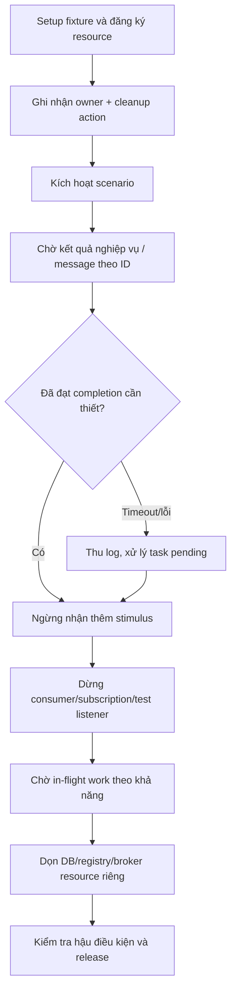

# Dọn listener, subscription và resource trong kiểm thử Spring Modulith

## 1. Vấn đề: test đã kết thúc nhưng listener vẫn còn hoạt động

Trong ứng dụng Spring Modulith, một hành động nghiệp vụ có thể phát Spring application event, được nhận bởi nhiều listener, sau đó kích hoạt task bất đồng bộ, luồng reactive hoặc một message consumer. Bài test đầu tiên chạy thành công; tới bài thứ hai, listener từ bài đầu vẫn nhận sự kiện hoặc một subscription cũ tiếp tục quan sát stream. Kết quả là test thứ hai thấy thêm event, ghi database hai lần hoặc timeout do resource đã bị đóng không đúng thứ tự.

Ví dụ: bài test A đăng ký thủ công một listener để đếm `PaymentCaptured`, rồi quên gỡ listener. Bài test B dùng lại Spring `ApplicationContext` do TestContext cache. Khi B publish event mới, cả listener của A và listener của B đều chạy. Nếu assertion chỉ kiểm tra “đã có ít nhất một event”, test có thể **pass giả**; nếu listener A còn giữ reference tới fixture đã cleanup, bài B có thể fail ở một thread khác.

Chủ đề **“Dọn listener, subscription và resource”** thuộc chương *Test isolation* của học phần `SPRING_MODULITH_VERIFICATION_TESTING`. Mục tiêu của học phần là kiểm chứng ranh giới kiến trúc bằng `ApplicationModules` và các quy tắc phụ thuộc giữa module; thực hành `@ApplicationModuleTest`, event, database, kiểm thử tích hợp và đưa quality gate vào CI để chặn phụ thuộc sai cùng hồi quy.

Trong bài này, **cleanup** không có nghĩa “xóa mọi thứ khi test kết thúc”, mà là:

- Biết **ai tạo** listener, subscription hoặc resource.
- Biết **ai sở hữu** và có quyền dừng/hủy nó.
- Biết **điểm hoàn tất** đủ an toàn trước khi dọn.
- Không để callback, message hoặc commit của scenario trước ảnh hưởng scenario sau.
- Không vô tình hủy resource đang được test khác hoặc Spring context sử dụng.

Sau khi học, bạn có thể thiết kế cleanup có vòng đời rõ ràng, tránh listener đăng ký trùng, hủy subscription đúng scope, quản lý executor và broker consumer, xử lý nhánh timeout/failure và xác minh isolation trong CI.

## 2. Bốn loại vòng đời phải phân biệt

Không phải mọi thứ được gọi là “listener” đều có cùng cơ chế đăng ký hoặc dọn.

| Thành phần | Ai thường đăng ký? | Cách kết thúc phù hợp | Điều không nên làm |
| --- | --- | --- | --- |
| Spring `@EventListener` / `@TransactionalEventListener` được khai báo trên bean | Spring khi khởi tạo context | Spring quản lý lifecycle qua context; test cô lập context/bean khi thật cần | Gỡ bừa listener production khỏi context đang được cache |
| `ApplicationListener` được thêm thủ công vào event multicaster | Test code hoặc infrastructure tự viết | Gỡ **chính instance listener** đã thêm, thường trong `finally` hoặc `AutoCloseable` | Chỉ clear bộ đếm mà quên unregister |
| Reactive `Flux.subscribe(...)`, Spring Integration `SubscribableChannel.subscribe(...)` | Caller tạo subscription/handler | `Disposable.dispose()` hoặc `unsubscribe(handler)` theo API | Tưởng GC hoặc kết thúc test method sẽ tự unsubscribe |
| Executor, scheduler, Kafka/RabbitMQ consumer, socket, container | Spring, test infrastructure hoặc external process | Stop, cancel, close, shutdown theo **ownership và lifecycle** tương ứng | Đóng resource dùng chung khi test khác còn chạy |

Một bài `@ApplicationModuleTest` chỉ bootstrap một phạm vi module/bean đã chọn; nó **không tự xóa dữ liệu database, offset broker, static field hoặc subscription mà test tạo ngoài cơ chế quản lý của Spring**.

### 2.1. Context-managed không đồng nghĩa test-method-scoped

Một bean với `@EventListener` có thể sống trong Spring context được reuse qua nhiều test methods/classes. Đây thường là hành vi **mong muốn** vì Spring TestContext cache làm test chạy nhanh.

Nếu listener là stateless và nhận event qua hợp đồng đúng, không cần unregister sau từng method. Nếu listener có mutable state, điểm sai thường là thiết kế state/test fixture, không phải việc Spring không hủy bean sau mỗi test.

Ngược lại, một listener **do test tự thêm** trong `@BeforeEach` cần có cách gỡ tương ứng, kể cả khi context vẫn được reuse.

### 2.2. Resource nằm ngoài context có thể sống lâu hơn context

Database, Kafka topic, RabbitMQ queue, HTTP mock server ngoài tiến trình và publication lưu bền có vòng đời riêng. `@DirtiesContext` chỉ làm Spring TestContext loại bỏ/khởi tạo lại context; nó **không** tự rollback một transaction listener đã commit, hủy topic, xóa pending publication hoặc chờ mọi tác vụ bất đồng bộ hoàn tất.

## 3. Mô hình ownership cho test resource

Một nguyên tắc đơn giản:

> **Thành phần nào tạo hoặc đăng ký một resource thì phải xác định chủ sở hữu cleanup của resource đó.**

Hãy dùng một bảng ownership khi thiết kế test:

| Resource | Phạm vi sở hữu mẫu | Cleanup khi nào? | Bằng chứng đã an toàn |
| --- | --- | --- | --- |
| Listener test được `addApplicationListener` | Test method | Sau assertion và sau khi event processing liên quan xong | Listener bị unregister; không còn callback test-owned |
| Reactor `Disposable` | Test method/fixture instance | Sau khi scenario hoàn tất hoặc fail | Subscription đã dispose; pipeline không giữ resource cần hủy |
| `SubscribableChannel` handler | Method hoặc test class | Unsubscribe cùng handler instance | Handler không còn được channel gọi cho sự kiện mới |
| Test-only executor | Test class/fixture sở hữu executor | Sau khi không còn task của scenario cần chạy | Task có kết quả terminal hoặc được xử lý theo cancellation policy |
| Spring-managed executor/consumer | Application context | Thường để Spring dừng khi context đóng | Container/bean lifecycle báo đã stop theo contract |
| Kafka test consumer observer | Test method/class | Sau khi đã quan sát đủ message | Consumer đóng, không còn poll/commit offset ngoài ý định |
| RabbitMQ test queue | Test class/environment riêng | Sau khi consumer đã settle và đóng | Queue/consumer test không còn message in-flight cần xử lý |
| Registry publication | Database/test environment | Sau khi listener/retry không còn đụng dữ liệu đó | Có quyền sở hữu database/target và chính sách cleanup rõ |
| Testcontainers container | Class/suite/environment | Khi app/context/client không còn phụ thuộc | Kết nối/worker đã đóng và lifecycle context phù hợp |

**Không đánh đồng “cleanup đã gọi” với “cleanup đã hoàn tất”.** Lệnh stop/cancel có thể trả về trước khi một callback đang chạy kết thúc. Phải hiểu semantics của API và tìm điểm đồng bộ đủ mạnh cho hợp đồng test.



Thứ tự chính xác giữa các bước tùy hệ thống: ví dụ không thể đóng broker trước khi producer cần gửi thông điệp hoàn tất, và không thể xóa đơn hàng trước khi consumer vẫn cần truy cập nó. Sơ đồ là **quy trình tư duy**, không phải trình tự shutdown cố định của mọi stack.

## 4. Spring event listener: loại nào nên gỡ?

Spring hỗ trợ các cơ chế như:

```java
@Component
class PaymentCapturedListener {

    private final OrderPaymentService payments;

    PaymentCapturedListener(OrderPaymentService payments) {
        this.payments = payments;
    }

    @EventListener
    void on(PaymentCaptured event) {
        payments.recordCapture(event);
    }
}
```

Listener trên là bean ứng dụng **do Spring đăng ký**. Trong test có context tái sử dụng, không nên chủ động gọi API multicaster để xóa listener này rồi bỏ mặc context ở trạng thái đã mất handler: bài test sau có thể fail không liên quan.

Khi muốn kiểm tra riêng phản ứng của module `orders`:

- Đặt test dưới package của module và dùng `@ApplicationModuleTest` với phạm vi bootstrap phù hợp.
- Không thêm một listener production thứ hai thủ công.
- Dùng `Scenario` để publish event và chờ state qua API của module.
- Nếu cần thay dependency ngoài, dùng test double/port hoặc test configuration được thiết kế hợp lệ.
- Với những listener chỉ đăng ký trong test, quản lý đăng ký và hủy một cách đối xứng.

**Mã minh họa** trong bài sử dụng các class domain như `PaymentCaptured` và `OrderPaymentService` do ứng dụng tự định nghĩa; không phải API sẵn có của Spring Modulith.

### 4.1. Listener thủ công qua event multicaster

Spring cung cấp `ApplicationEventMulticaster` và các triển khai như `SimpleApplicationEventMulticaster` để đăng ký `ApplicationListener` theo chương trình. Dưới đây là **unit test độc lập với Spring Boot context**:

```java
import static org.assertj.core.api.Assertions.assertThat;

import java.util.concurrent.atomic.AtomicInteger;

import org.junit.jupiter.api.Test;
import org.springframework.context.ApplicationEvent;
import org.springframework.context.ApplicationListener;
import org.springframework.context.event.SimpleApplicationEventMulticaster;

class ProgrammaticListenerLifecycleTests {

    static final class ProbeEvent extends ApplicationEvent {
        ProbeEvent(Object source) {
            super(source);
        }
    }

    @Test
    void unregistersTheExactListenerInstance() {
        var multicaster = new SimpleApplicationEventMulticaster();
        var calls = new AtomicInteger();

        ApplicationListener<ProbeEvent> listener =
                event -> calls.incrementAndGet();

        multicaster.addApplicationListener(listener);

        try {
            multicaster.multicastEvent(new ProbeEvent(this));
            assertThat(calls.get()).isEqualTo(1);
        } finally {
            multicaster.removeApplicationListener(listener);
        }

        multicaster.multicastEvent(new ProbeEvent(this));
        assertThat(calls.get()).isEqualTo(1);
    }
}
```

Ở ví dụ này, cùng một object `listener` được dùng cho `addApplicationListener(...)` và `removeApplicationListener(...)`. Tạo lambda mới trông giống hệt khi remove thường **không** bảo đảm gỡ đúng instance đã đăng ký.

Đây là bài unit test dành cho listener đăng ký thủ công trên multicaster *của test*. Không lấy multicaster dùng chung của application context rồi gỡ những listener framework quản lý.

### 4.2. Đăng ký có handle để cleanup không bị quên

Một wrapper `AutoCloseable` giúp gắn thao tác đăng ký với thao tác hủy:

```java
import java.util.concurrent.atomic.AtomicBoolean;

import org.springframework.context.ApplicationListener;
import org.springframework.context.event.ApplicationEventMulticaster;

final class ListenerRegistration implements AutoCloseable {

    private final ApplicationEventMulticaster multicaster;
    private final ApplicationListener<?> listener;
    private final AtomicBoolean closed = new AtomicBoolean();

    ListenerRegistration(
            ApplicationEventMulticaster multicaster,
            ApplicationListener<?> listener) {

        this.multicaster = multicaster;
        this.listener = listener;
        multicaster.addApplicationListener(listener);
    }

    @Override
    public void close() {
        if (closed.compareAndSet(false, true)) {
            multicaster.removeApplicationListener(listener);
        }
    }
}
```

Trong test:

```java
try (var registration =
        new ListenerRegistration(multicaster, testListener)) {
    // Kích hoạt stimulus; chờ/kiểm tra event.
} // close() cố gắng remove đúng listener được đăng ký.
```

Wrapper do **test-support tự định nghĩa**. Một handle như vậy nên sở hữu đúng resource mà test đăng ký. Không dùng nó để hủy bean listener production mà Spring quản lý.

**Lưu ý concurrency:** `removeApplicationListener(...)` không nhất thiết dừng một invocation đã được dispatch hoặc một callback đang chạy ở executor. Gỡ đăng ký chỉ ngăn các dispatch tương lai theo semantics của multicaster; nếu test cần chứng minh callback đã kết thúc, vẫn cần completion signal phù hợp.

## 5. Spring-managed `@EventListener`: không dùng cleanup làm thay đổi nghiệp vụ

Một số bài test cố gắng tự remove listener để chặn side effect không mong muốn. Ví dụ, test `orders` nhận một event nhưng muốn tránh email thật, rồi gỡ listener `notifications` ở cuối method.

Cách đó có ít nhất ba vấn đề:

1. Test đang sửa **bean graph hoạt động** của context dùng chung, làm bài sau khó đoán.
2. Gỡ listener có thể không đảo ngược được việc nó đã nhận event hoặc đã schedule task.
3. Test không còn phản ánh dependency/configuration mà application module thực sự cần.

Giải pháp tốt hơn là chọn **đúng phạm vi bootstrap**:

| Trách nhiệm test | Cách phù hợp |
| --- | --- |
| Test logic trong `orders` mà không cần email adapter | `@ApplicationModuleTest` phạm vi module, port/fake cho dependency ngoài |
| Test event contract của producer | `PublishedEvents`, lọc event type/ID |
| Test consumer xử lý event | `@ApplicationModuleTest` và `Scenario` chờ state |
| Test nhiều module phối hợp thật | Integration test với scope dependency hoặc `@SpringBootTest` phù hợp |
| Test email/Kafka adapter | Adapter integration test với fake server/broker test |
| Test listener dynamic do một plugin tự đăng ký | Test lifecycle đăng ký/hủy riêng, theo owner |

Không nới `@ApplicationModuleTest` sang toàn ứng dụng chỉ để một test setup dễ hơn, và cũng không loại bỏ listener production bằng side effect ngầm. Cả hai có thể làm test bỏ sót lỗi wiring hoặc ranh giới module.

## 6. Subscription trong Reactive Streams: hủy đúng đối tượng

Một lời gọi Reactor `Flux.subscribe(...)` thường tạo một subscription bắt đầu nhận tín hiệu; API có thể trả về `reactor.core.Disposable`. Khi test tạo subscription, test phải xác định lúc nào hủy bằng `dispose()`.

Ví dụ một test support dùng stream do **test sở hữu**:

```java
import static org.assertj.core.api.Assertions.assertThat;

import java.util.List;
import java.util.concurrent.CopyOnWriteArrayList;

import org.junit.jupiter.api.Test;
import reactor.core.Disposable;
import reactor.core.publisher.Sinks;

class ReactiveSubscriptionLifecycleTests {

    @Test
    void disposesItsOwnSubscription() {
        Sinks.Many<String> sink =
                Sinks.many().multicast().onBackpressureBuffer();

        List<String> received = new CopyOnWriteArrayList<>();
        Disposable subscription =
                sink.asFlux().subscribe(received::add);

        try {
            assertThat(sink.tryEmitNext("EVENT-A"))
                    .isEqualTo(Sinks.EmitResult.OK);
            assertThat(received).containsExactly("EVENT-A");
        } finally {
            subscription.dispose();
        }

        assertThat(subscription.isDisposed()).isTrue();
    }
}
```

Đoạn này là test **Reactor API**, không phải mặc định của `@ApplicationModuleTest` và chỉ có thể biên dịch khi dự án có Reactor. `Sinks.Many` ở đây là đối tượng local do test tạo, không chia sẻ với scenario khác. Một pipeline dùng `publishOn(...)` hoặc broker adapter có thể xử lý bất đồng bộ; test phải chờ tín hiệu hoàn tất trước assertion.

### 6.1. `dispose()` có nghĩa gì và không có nghĩa gì?

Hủy một Reactor subscription thường ngăn nhận **các tín hiệu tương lai** theo semantics của publisher/operator. Nó không tự:

- Rollback transaction database đã commit.
- Thu hồi HTTP request đã gửi tới server.
- Xóa message đã được broker nhận.
- Bảo đảm mọi callback đang chạy đã dừng tại đúng thời điểm gọi.
- Dọn những subscription khác mà code đã tạo nhưng test không giữ handle.

Nếu test có một listener `subscribe(...)` rồi đánh mất `Disposable`, sau đó chỉ tạo một `Disposable` mới để dispose, subscription cũ vẫn có thể tồn tại. **Giữ chính handle của lần đăng ký.**

### 6.2. Với pipeline hữu hạn, ưu tiên kiểm thử có completion rõ

Nếu bài toán là xử lý một `Mono` hoặc một `Flux` hữu hạn, có thể dùng `StepVerifier` khi dependency `reactor-test` được cung cấp. Test có thể kiểm chứng items, terminal signal, error, cancellation và virtual time theo semantics Reactor.

Khi test một hot stream sống liên tục, nên tạo subscription trong scope rõ và chủ động `thenCancel()`/dispose khi đã quan sát đủ tín hiệu. Không gọi `subscribe()` “fire-and-forget” ngay trong `@BeforeAll` nếu không có chiến lược hủy ở scope tương ứng.

### 6.3. Các hook global cũng phải được dọn nếu test tạo chúng

Một số Reactor hooks/scheduler factory có phạm vi toàn process. Test thay global hooks để chẩn đoán mà không reset có thể ảnh hưởng pipeline của test khác. Ưu tiên công cụ test cục bộ, và nếu phải thiết lập global hooks, hãy dùng API reset được thư viện công bố cùng cơ chế serialized/fork isolation.

Không dùng reflection để tự xóa những map static nội bộ của Reactor hoặc framework.

## 7. Spring Integration `SubscribableChannel`: subscribe và unsubscribe đối xứng

Nếu dự án dùng Spring Integration, `SubscribableChannel` cho phép đăng ký một `MessageHandler` và gỡ cùng handler đó.

Ví dụ unit test cho `DirectChannel`:

```java
import static org.assertj.core.api.Assertions.assertThat;

import java.util.List;
import java.util.concurrent.CopyOnWriteArrayList;

import org.junit.jupiter.api.Test;
import org.springframework.integration.channel.DirectChannel;
import org.springframework.messaging.MessageHandler;
import org.springframework.messaging.support.MessageBuilder;

class ChannelSubscriptionTests {

    @Test
    void removesTheSameHandler() {
        DirectChannel channel = new DirectChannel();
        List<String> observed = new CopyOnWriteArrayList<>();

        MessageHandler handler = message ->
                observed.add((String) message.getPayload());

        channel.subscribe(handler);

        try {
            boolean accepted = channel.send(
                    MessageBuilder.withPayload("ORDER-PLACED").build());

            assertThat(accepted).isTrue();
            assertThat(observed).containsExactly("ORDER-PLACED");
        } finally {
            channel.unsubscribe(handler);
        }
    }
}
```

`DirectChannel` là thành phần của Spring Integration, **không phải** broker bền vững. Cần dependency `spring-integration-core` để chạy đoạn minh họa này.

Trong hệ thống thật, việc test tạo handler trên một channel **được Spring context quản lý** có thể gây rò nếu không unsubscribe. Mặt khác, handler do Spring Integration flow cấu hình tự động thuộc lifecycle của flow/context; không gỡ thủ công một phần flow sản xuất nếu không kiểm soát toàn bộ vòng đời flow.

## 8. Event listener, subscription và message consumer khác nhau ở điểm nào?

Bảng sau giúp chọn phép đồng bộ và cleanup đúng:

| Hành vi | Đã hoàn tất theo nghĩa gì? | Thao tác cleanup thuộc owner |
| --- | --- | --- |
| Spring synchronous listener | Callback của listener trong đường dispatch đã trả về | Không unregister listener managed; test-owned listener remove khi không còn dispatch |
| `@Async` listener | Worker thực sự kết thúc công việc theo contract | Quiescence/completion signal trước reset hoặc đóng executor riêng |
| `@TransactionalEventListener(AFTER_COMMIT)` | Publisher transaction commit và callback được dispatch | Không đóng resource trước commit/callback; xác minh state đã visible |
| Reactor `Disposable` | Subscription bị cancel/dispose theo contract | `dispose()` handle của chính test |
| Spring Integration handler | Handler không còn subscribed | `unsubscribe(handler)` chính xác |
| Kafka listener container | Consumer stop theo API/lifecycle; record in-flight được xử lý theo config | Chỉ stop container do test sở hữu hoặc được test phép; cân nhắc offset/rebalance |
| RabbitMQ listener container | Consumer stop và ack/nack/requeue đã ổn định theo contract | Dừng đúng container/consumer; dọn queue test nếu thuộc scope |
| Testcontainers service | Client, listener, context không còn cần endpoint | Đóng container theo lifecycle phù hợp |

**Một trạng thái nghiệp vụ đạt đích không nhất thiết đồng nghĩa mọi side effect đã kết thúc.** Ví dụ listener có thể commit `PAID` rồi còn publish event `OrderPaid` ra broker. Nếu test đợi `PAID` và xóa đơn ngay, downstream vẫn có thể đang xử lý.

## 9. Quiescence: làm sao biết có thể cleanup?

*Quiescence* trong ngữ cảnh test là trạng thái mà **những tác vụ liên quan tới resource cần dọn không còn có thể tiếp tục tác động lên resource đó**. Đây là điều kiện mạnh hơn “đã chờ một khoảng thời gian”.

Một số dấu hiệu có ích:

- Future hoặc task-specific completion đã kết thúc, không chỉ executor có `activeCount == 0` trong một thời điểm.
- Listener đã báo một completion marker cho **đúng event ID**.
- Broker consumer đã xử lý/ack message theo mốc cần test.
- Một transaction ghi đã commit và query API nhìn thấy state.
- Retry/resubmission worker đã dừng hoặc được cách ly trong môi trường test.
- Không còn subscriber/test observer giữ reference tới data đã định xóa.

### 9.1. Dùng cổng test `CountDownLatch` khi cần kiểm tra race

Một gate do test sở hữu có thể cố ý giữ worker tại một điểm để xác minh thứ tự. Ví dụ helper:

```java
import java.time.Duration;
import java.util.concurrent.CountDownLatch;
import java.util.concurrent.TimeUnit;

final class ListenerGate {

    private final CountDownLatch entered = new CountDownLatch(1);
    private final CountDownLatch release = new CountDownLatch(1);

    void blockAtCheckpoint() throws InterruptedException {
        entered.countDown();
        release.await();
    }

    boolean awaitEntered(Duration timeout) throws InterruptedException {
        return entered.await(timeout.toMillis(), TimeUnit.MILLISECONDS);
    }

    void release() {
        release.countDown();
    }
}
```

Helper là **test-support do dự án định nghĩa**, không phải Spring Modulith API. Nếu đưa vào listener qua test configuration, mỗi scenario nên có gate riêng hoặc lifecycle được cô lập. Với test:

1. Chờ `awaitEntered(...)` với timeout hữu hạn.
2. Kiểm tra state trước mốc cần thử.
3. Luôn gọi `release()` trong `finally`, kể cả khi assertion lỗi.
4. Chờ future/handler completion sau khi release, thay vì kết thúc test ngay.
5. Chỉ cleanup dữ liệu khi callback không còn sử dụng resource.

**Không dùng static latch dùng chung mọi method.** Latch một lần đếm về 0 không reset; test sau có thể pass sớm. Không để một lỗi assertion giữ task chờ vô hạn rồi treo toàn bộ CI.

### 9.2. Cancel không đồng nghĩa transaction rollback

Nếu test gọi `future.cancel(true)`, việc interrupt task chỉ là một yêu cầu theo API concurrency: task có thể không kiểm tra interrupt, có thể đã commit DB hoặc đã publish message. Không được suy ra data đã quay về baseline. Sau cancel vẫn cần xác định outcome, cleanup transaction/resource và trạng thái worker.

### 9.3. Assertion âm đòi điểm đồng bộ riêng

Với yêu cầu “không có thông báo trùng”, đọc bộ đếm ngay sau publish và thấy `0` **không** chứng minh handler không tạo notification; handler có thể chưa chạy. Test phải biết stimulus đã được xử lý hoặc đã bị từ chối theo một terminal signal có thể quan sát, sau đó mới kiểm tra side effect âm.

## 10. `@BeforeEach`, `@AfterEach` và `try/finally`: đặt cleanup ở đâu?

Một số nguyên tắc:

- **Resource có scope chỉ một đoạn code:** ưu tiên `try-with-resources` nếu nó có `AutoCloseable`.
- **Resource tạo tại đầu test và dùng suốt method:** `try/finally` hoặc `@AfterEach` nếu có thể bảo đảm đăng ký/dọn đối xứng.
- **Resource dùng chung một test class:** quản lý theo `@BeforeAll`/`@AfterAll` hoặc class-scoped fixture có owner rõ, không dọn giữa các method đang dùng.
- **Resource thuộc Spring context:** ưu tiên lifecycle do Spring quản lý; `@DirtiesContext` chỉ khi context thật sự không an toàn để reuse.
- **Resource external/shared:** không xóa chỉ vì method kết thúc; phải có ownership và cách ly.

### 10.1. Gỡ đăng ký trong `finally` thường an toàn hơn chỉ dùng `@AfterEach`

```java
ListenerRegistration registration =
        new ListenerRegistration(multicaster, testListener);

try {
    publishAndVerifyScenario();
} finally {
    registration.close();
}
```

Ưu điểm: cleanup nằm ngay cạnh đăng ký, kể cả khi có nhiều bước setup. `@AfterEach` vẫn hữu ích cho fixture cấp method, nhưng cần cẩn thận khi bước setup ném lỗi trước lúc field nhận handle.

### 10.2. Nếu `@BeforeEach` setup thất bại thì sao?

Ví dụ anti-pattern:

```java
@BeforeEach
void prepare() {
    registerListener(); // Đã đăng ký.
    startExternalServer(); // Ném exception.
    // Handle chưa được lưu/cleanup.
}
```

Nếu setup có nhiều bước, nên giữ resource đã tạo vào stack cleanup trong scope test ngay khi tạo. Khi bước sau fail, những resource trước vẫn phải được dọn. Một helper `AutoCloseable` có thể gom nhiều hành động cleanup, thực hiện ngược thứ tự tạo và ghi nhận lỗi cleanup mà không nuốt lỗi gốc.

### 10.3. `@AfterAll` và `@TestInstance(PER_CLASS)`

Khi một test class chia sẻ broker observer hoặc test server, `@AfterAll` có thể phù hợp, nhưng test phải không còn worker/consumer đang tham chiếu resource đó. JUnit `PER_CLASS` khiến instance field cũng sống qua nhiều method; điều này không tự tạo isolation. Nếu test class có mutable recorder dùng chung, cần reset theo ID, đồng bộ hoặc tách fixture.

## 11. Cleanup stack có thể kiểm tra được

Có thể xây một utility nhỏ dành cho test để quản lý nhiều resource `AutoCloseable` theo nguyên tắc LIFO: dọn cái tạo sau trước.

```java
import java.util.ArrayDeque;
import java.util.Deque;

final class TestResources implements AutoCloseable {

    private final Deque<AutoCloseable> resources = new ArrayDeque<>();

    <T extends AutoCloseable> T own(T resource) {
        resources.push(resource);
        return resource;
    }

    @Override
    public void close() throws Exception {
        Exception failure = null;

        while (!resources.isEmpty()) {
            try {
                resources.pop().close();
            } catch (Exception cleanupError) {
                if (failure == null) {
                    failure = cleanupError;
                } else {
                    failure.addSuppressed(cleanupError);
                }
            }
        }

        if (failure != null) {
            throw failure;
        }
    }
}
```

Đây là code **test-support minh họa**. Nó sở hữu các resource mà test cố ý đăng ký vào stack; không tự quyết định cách dừng Kafka/RabbitMQ hoặc những bean Spring được quản lý nơi khác. Khi close một resource có thao tác bất đồng bộ, wrapper tương ứng phải bảo đảm completion semantics cần thiết trước khi trả về, hoặc expose một bước await riêng.

Dùng trong method:

```java
try (var resources = new TestResources()) {
    var registration = resources.own(
            new ListenerRegistration(multicaster, listener));
    // Đăng ký và sở hữu thêm resource theo nhu cầu.
    // Chạy scenario, xác minh outcome, chờ công việc liên quan.
} // Resource được close theo LIFO.
```

**Không nuốt lỗi cleanup:** nếu test assertion đã fail và cleanup cũng fail, cả hai đều hữu ích để tìm nguyên nhân. Utility trên lưu lỗi cleanup dưới dạng suppressed; cách JUnit ghép lỗi assertion với lỗi `close()` còn tùy ngữ nghĩa Java và runner.

## 12. Executor và scheduler: chủ sở hữu nào có quyền dừng?

Trong Spring Boot, `TaskExecutor`/`TaskScheduler` có thể là bean dùng chung cho nhiều module. Một module test **không** được gọi `shutdown()` trên executor production được context cache reuse chỉ để kết thúc một task của scenario, bởi các test sau sẽ không thể gửi task nữa.

Phân biệt:

| Resource | Chủ sở hữu phù hợp | Hành động |
| --- | --- | --- |
| Executor là bean singleton của context | Spring application context | Spring quản lý shutdown khi context đóng; test không kill tùy tiện |
| Executor riêng do test tạo | Test method/class | Chờ/cancel task có chủ đích, shutdown và awaitTermination |
| Future của task test tạo | Scenario | Chờ outcome hoặc cancel theo hợp đồng; không suy ra side effect được rollback |
| Scheduled task do fixture đăng ký động | Fixture/test infrastructure | Giữ handle để cancel task đăng ký |
| Production scheduled job | Spring/ứng dụng | Chọn profile/test config hoặc kiểm thử scheduler riêng thay vì stop global job tùy tiện |

### 12.1. Executor test-owned với lifecycle rõ

Ví dụ Java thuần để quản lý executor do **test tạo**:

```java
import static org.assertj.core.api.Assertions.assertThat;

import java.util.concurrent.ExecutorService;
import java.util.concurrent.Executors;
import java.util.concurrent.TimeUnit;

import org.junit.jupiter.api.Test;

class TestExecutorLifecycleTests {

    @Test
    void closesItsOwnExecutor() throws Exception {
        ExecutorService executor = Executors.newSingleThreadExecutor();

        try {
            var result = executor.submit(() -> "completed");
            assertThat(result.get(2, TimeUnit.SECONDS))
                    .isEqualTo("completed");
        } finally {
            executor.shutdown();

            if (!executor.awaitTermination(2, TimeUnit.SECONDS)) {
                executor.shutdownNow();
            }
        }
    }
}
```

Đây là ví dụ cho **executor local**, không phải yêu cầu gọi `shutdownNow()` trên bean `TaskExecutor` do Spring context quản lý. `shutdownNow()` chỉ cố ngắt task; không bảo đảm mọi công việc dừng tức thì hoặc rollback transaction đã commit.

### 12.2. Test scheduler và thời gian ảo

Một scheduler có thể giữ job/timer sau test nếu test tự đăng ký task rồi không cancel. Cần giữ `ScheduledFuture` hoặc handle tương đương và cancel khi không dùng nữa. Việc dùng `Clock.fixed(...)` cho business time **không tự huỷ hoặc tiến nhanh mọi task scheduled**; có thể cần mock scheduler hoặc công cụ virtual time phù hợp.

Không thay scheduler global hoặc Reactor hooks trong một test rồi bỏ mặc nhóm test khác, đặc biệt khi CI chạy song song.

## 13. Kafka consumer: stop container khác với xóa topic

Trong Spring Kafka, một listener được khai báo bằng `@KafkaListener` thường do framework quản lý qua listener container. `KafkaListenerEndpointRegistry` cho phép tìm container theo listener ID khi cấu hình phù hợp.

Ví dụ API mang tính minh họa:

```java
import org.springframework.kafka.config.KafkaListenerEndpointRegistry;
import org.springframework.kafka.listener.MessageListenerContainer;

class KafkaTestConsumerControl {

    private final KafkaListenerEndpointRegistry registry;

    KafkaTestConsumerControl(KafkaListenerEndpointRegistry registry) {
        this.registry = registry;
    }

    void stopListenerOwnedByThisTest(String id) {
        MessageListenerContainer container =
                registry.getListenerContainer(id);

        if (container == null) {
            throw new IllegalStateException(
                    "Listener container not found: " + id);
        }

        container.stop();
    }
}
```

**Chỉ dùng khi container đó thực sự thuộc scope test hoặc việc stop được test thiết kế có chủ đích.** Không gọi stop lên toàn bộ registry hoặc consumer production đang dùng trong context cache rồi quên start lại.

Tùy implementation, stop có thể có callback/lifecycle bất đồng bộ; test không nên suy “gọi `stop()` xong = mọi message đã xử lý xong và ack”. Cần chờ trạng thái dừng/điểm hoàn tất theo API và mục tiêu cụ thể.

### 13.1. Kafka có nhiều lớp state

- **Consumer container:** worker/poll loop của Spring trong JVM.
- **Consumer group:** thành viên, rebalance và committed offsets.
- **Topic/partition:** records được lưu trong broker.
- **Retry/DLT:** message lỗi còn trong topic phụ.
- **Business DB:** commit của handler.
- **Event Publication Registry:** nếu luồng ứng dụng có tracking, publication state được quản lý riêng.

Stop container **không xóa** committed offsets, topic records hoặc DLT. Tạo consumer observer group mới có thể giúp quan sát event độc lập, nhưng observer phải được đóng và có offset/assignment phù hợp trước stimulus.

### 13.2. Không dùng observer cùng group với consumer nghiệp vụ

Hai consumer trong cùng group có thể chia partition; test observer có thể “ăn” record mà consumer nghiệp vụ lẽ ra cần xử lý. Với test outbound message, dùng group observer riêng và lọc theo `eventId`; với test consumer inbound, để consumer nghiệp vụ xử lý, rồi đọc state qua public API.

Sau test, đóng observer do test sở hữu. Không xóa topic dùng chung hoặc reset offset của group production/test khác.

## 14. RabbitMQ: queue và consumer có lifecycle độc lập

RabbitMQ có exchange, binding, queue, consumer và ack/nack/requeue. Dọn một object Java không đồng nghĩa queue đã rỗng hoặc message đã được settle.

Những ví dụ cần phân biệt:

- **Test observer queue riêng:** test sở hữu queue/consumer, có thể hủy khi đã dừng consumer và kiểm tra đủ message.
- **Application listener container:** framework sở hữu; test không tự stop nếu context sẽ được reuse cho method khác.
- **Durable queue chung:** không được purge tùy tiện vì có thể chứa message test khác hoặc công việc hợp lệ.
- **DLQ/retry queue:** có thể giữ poison message từ scenario trước, cần isolation theo scope.

Một bài integration test có thể dùng queue duy nhất theo class hoặc môi trường, correlation ID riêng theo method, và cleanup khi không còn consumer in-flight. Với kiểm thử retry/DLQ, **không assert “queue rỗng” ngay sau publish**: consumer có thể chưa bắt đầu xử lý.

## 15. Event Publication Registry: dọn subscription không dọn publication bền

Spring Modulith hỗ trợ Event Publication Registry theo cấu hình và provider lưu trữ. Registry theo dõi publication cho các listener target phù hợp, trong đó có những publication **chưa hoàn tất** cần được resubmit/retry.

Một scenario có thể bị nhiễm nếu:

1. Test A phát `PaymentCaptured` rồi listener thất bại.
2. Registry giữ incomplete publication của A.
3. Test A gỡ listener hoặc hủy subscription do test tạo.
4. Test B dùng cùng database registry, khởi động retry/resubmission worker.
5. Worker xử lý lại event A trong lúc B đang chạy.

**Gỡ listener không tương đương xóa dữ liệu registry.** Cũng như `@DirtiesContext`, gỡ subscription không tự hoàn tác publication đã ghi bền.

| Mốc | Bằng chứng cần kiểm tra |
| --- | --- |
| Event được publish | `PublishedEvents` hoặc producer contract test |
| Publication được registry tracking | Provider/API test probe phù hợp, đúng event và listener target |
| Listener hoàn tất | Terminal/completion signal, transaction outcome |
| Business state visible | Public query API theo aggregate/correlation ID |
| Registry không còn outstanding | Query theo provider/retention policy và target |
| Recovery đã xử lý | Resubmission path hoàn tất, idempotency và business side effect không nhân đôi |

Nếu test recovery **cố ý giữ** incomplete publication qua restart, nó cần database/schema/container **riêng cho chính test**, không dọn giữa hai pha. Nếu là test độc lập, phải tách hoặc dọn publication theo scope và có điểm quiescence trước khi cleanup.

Không giả định tên bảng hoặc API xóa của mọi registry provider giống nhau; test infrastructure cần tương thích với provider/version đang sử dụng.

## 16. Database, transaction và cleanup: nên dọn khi nào?

Một listener `@TransactionalEventListener(phase = AFTER_COMMIT)` có thể chỉ chạy sau commit của transaction phát event. Một listener `@Async` thường chạy ở thread khác và có thể commit dữ liệu trong transaction riêng.

Vì vậy:

- Fixture chuẩn bị state cần **commit** trước khi listener khác transaction đọc.
- `saveAndFlush(...)` không đồng nghĩa transaction đã commit.
- `@Transactional` trên test method mặc định thường rollback test-managed transaction; **không** tự rollback transaction riêng của listener.
- Gọi `@AfterEach` xóa dữ liệu ngay khi test timeout có thể tạo race với handler vẫn đang chạy.
- Đợi một state terminal chỉ chứng minh **predicate đã đạt**, không bảo đảm audit/broker send/registry completion sau đó đã xong.

### 16.1. Một trình tự cleanup có trách nhiệm

1. Tạo aggregate/event/correlation ID riêng cho scenario.
2. Xác nhận fixture baseline đã commit, trước stimulus.
3. Kích hoạt event đúng một lần theo hợp đồng test.
4. Chờ business outcome qua API công khai, timeout hữu hạn.
5. Nếu cleanup tác động các side effect khác, chờ **completion signal tương ứng**.
6. Ngừng nhận thêm message/subscription thuộc test; gỡ test listener.
7. Đóng observer/consumer test-owned; đóng executor local nếu được sở hữu.
8. Dọn registry/DB/broker **theo ID/namespace** và khóa ngoại hợp lệ, hoặc hủy môi trường cô lập.
9. Xác minh không còn task có thể tác động lên dữ liệu đã dọn.
10. Nếu không chắc đã quiescent sau timeout, giữ môi trường cô lập để điều tra thay vì xóa bừa resource dùng chung.

Một test chỉ kiểm tra database mà không cần broker có thể có cleanup ngắn hơn. Mục tiêu là **mức quiescence đủ cho tài nguyên đang dọn**, không phải cố chờ mọi thành phần của ứng dụng mãi mãi.

## 17. Ví dụ `@ApplicationModuleTest`: listener do Spring quản lý, test chỉ dọn resource của mình

Giả sử module `payments` công bố event công khai, module `orders` xử lý. Dưới đây là các kiểu **do ứng dụng minh họa định nghĩa**, không phải class Spring Modulith tự sinh. Mỗi khai báo `public` nằm trong file Java riêng.

```java
// File: com/example/shop/payments/events/PaymentCaptured.java
package com.example.shop.payments.events;

import java.math.BigDecimal;
import java.util.UUID;

public record PaymentCaptured(
        UUID eventId,
        UUID orderId,
        String transactionId,
        BigDecimal amount) {}
```

```java
// File: com/example/shop/orders/OrderStatus.java
package com.example.shop.orders;

public enum OrderStatus {
    AWAITING_PAYMENT, PAID, PAYMENT_FAILED
}
```

```java
// File: com/example/shop/orders/OrderPaymentSnapshot.java
package com.example.shop.orders;

import java.math.BigDecimal;
import java.util.UUID;

public record OrderPaymentSnapshot(
        UUID orderId,
        OrderStatus status,
        UUID processedEventId,
        String transactionId,
        BigDecimal capturedAmount) {

    public boolean matches(
            UUID expectedEventId,
            String expectedTransactionId,
            BigDecimal expectedAmount) {

        return status == OrderStatus.PAID
                && expectedEventId.equals(processedEventId)
                && expectedTransactionId.equals(transactionId)
                && capturedAmount != null
                && capturedAmount.compareTo(expectedAmount) == 0;
    }
}
```

```java
// File: com/example/shop/orders/OrderQueries.java
package com.example.shop.orders;

import java.util.Optional;
import java.util.UUID;

public interface OrderQueries {
    Optional<OrderPaymentSnapshot> paymentOf(UUID orderId);
}
```

Test fixture cần trả về aggregate ID mới và đã commit:

```java
// Interface test-support do dự án triển khai.
import java.math.BigDecimal;
import java.util.UUID;

interface OrderFixture {
    UUID createAwaitingPaymentAndCommit(BigDecimal amount);
}
```

Một bài test cụ thể:

```java
package com.example.shop.orders;

import static org.assertj.core.api.Assertions.assertThat;

import java.math.BigDecimal;
import java.time.Duration;
import java.util.UUID;

import org.junit.jupiter.api.Test;
import org.springframework.beans.factory.annotation.Autowired;
import org.springframework.modulith.test.ApplicationModuleTest;
import org.springframework.modulith.test.Scenario;

@ApplicationModuleTest
class OrderListenerCleanupTests {

    @Autowired OrderFixture fixture;
    @Autowired OrderQueries orders;

    @Test
    void capturesPaymentWithoutRegisteringAnExtraListener(
            Scenario scenario) {

        BigDecimal amount = new BigDecimal("125000.00");
        UUID orderId =
                fixture.createAwaitingPaymentAndCommit(amount);
        UUID eventId = UUID.randomUUID();
        String transactionId = "TX-" + eventId;

        assertThat(orders.paymentOf(orderId).orElseThrow().status())
                .isEqualTo(OrderStatus.AWAITING_PAYMENT);

        scenario.publish(new PaymentCaptured(
                        eventId, orderId, transactionId, amount))
                .andWaitAtMost(Duration.ofSeconds(8))
                .forStateChange(
                        () -> orders.paymentOf(orderId),
                        state -> state.filter(view ->
                                view.matches(eventId, transactionId, amount))
                                .isPresent())
                .andVerify(state -> {
                    OrderPaymentSnapshot result = state.orElseThrow();

                    assertThat(result.orderId()).isEqualTo(orderId);
                    assertThat(result.status()).isEqualTo(OrderStatus.PAID);
                    assertThat(result.transactionId())
                            .isEqualTo(transactionId);
                    assertThat(result.capturedAmount())
                            .isEqualByComparingTo(amount);
                });
    }
}
```

**Giới hạn của mã mẫu:** dự án cần có listener `PaymentCaptured` thuộc module `orders`, repository/query adapter, bean `OrderFixture` được đăng ký trong test context và transaction manager phù hợp. Test method không cần tự thêm listener mới: Spring sở hữu lifecycle listener production.

Nếu listener sử dụng `@TransactionalEventListener(AFTER_COMMIT)`, đường phát event trong test phải có transaction commit thích hợp. Phụ thuộc phiên bản/cấu hình, không nên giả định mọi lời gọi `publish(...)` có cùng ngữ nghĩa transaction; kiểm tra đường xử lý của ứng dụng trước khi kết luận timeout do listener đã bị gỡ.

### 17.1. Test này có dọn hết resource không?

**Không.** Test trên chủ yếu kiểm chứng event → business state và hạn chế đăng ký listener trùng. Nó không tự dọn order đã commit, không xóa registry publication bền, không đóng broker. Chiến lược data cleanup của suite phải được thiết kế riêng theo scope fixture và sau khi các tác vụ liên quan hoàn tất.

Điều này là chủ đích: một ví dụ `Scenario` không nên giả vờ `andWaitForStateChange(...)` giải quyết toàn bộ lifecycle resources.

### 17.2. Khi thêm một test observer động

Nếu muốn test thu event bằng một observer đăng ký thủ công, hãy gói observer trong `ListenerRegistration` và `try-with-resources` như mục 4; đợi callback của observer xử lý **đúng event ID** trước khi đóng. Nếu dùng `PublishedEvents` cho publication contract, thường không cần tự đăng ký observer vào event multicaster.

## 18. Đoạn cleanup theo scope trong test dùng broker thật

Một thiết kế integration test có thể dùng:

```text
SETUP
  - Cấp riêng test namespace / topic / queue / consumer group nếu cần.
  - Khởi tạo observer/consumer test-owned, ghi lại handle.
  - Đăng ký listener động (nếu có), ghi lại handle.
  - Tạo business ID và event ID mới; fixture commit.

STIMULUS
  - Gọi use case hoặc publish event đúng một lần.

WAIT / VERIFY
  - Chờ đúng event ID, producer ack hoặc consumer completion theo mục tiêu.
  - Chờ public read API đạt state + invariant của scenario.
  - Nếu kiểm tra duplicate/retry, chờ cả lần redelivery hoàn tất.

TEARDOWN
  - Ngừng tạo stimulus mới.
  - Đóng subscription/observer đúng instance.
  - Chờ in-flight work đã kết thúc theo hợp đồng.
  - Dừng container/consumer thuộc sở hữu test nếu cần.
  - Dọn data/registry/message theo scope hoặc hủy môi trường test riêng.
  - Báo lỗi cleanup thay vì âm thầm bỏ qua.
```

Nếu observer và business consumer **cùng một RabbitMQ queue**, chúng có thể tranh nhau message; dùng queue observer riêng khi cần quan sát outbound transport. Với Kafka, observer có thể dùng consumer group riêng, nhưng vẫn cần thiết lập offset/assignment phù hợp và lọc theo event ID.

### 18.1. Vì sao cleanup theo tên queue/topic dùng chung nguy hiểm?

Một câu lệnh purge/truncate toàn bộ topic/queue hoặc registry có thể phá những test đang chạy song song. Tương tự, một test tự stop tất cả listener container của context có thể làm scenario khác không nhận event nữa.

Dọn đúng **resource test sở hữu**, được namespace/ID hóa. Nếu không thể tách vì hạ tầng dùng chung hoặc yêu cầu kiểm thử concurrency, sử dụng nhóm test chạy tuần tự hoặc environment riêng.

## 19. Context cache, `@DirtiesContext` và resource lifecycle

Spring TestContext cache tăng hiệu năng bằng cách reuse context có cấu hình tương đương. Hệ quả:

- Bean listener production có thể tiếp tục tồn tại qua nhiều test methods: **đúng theo thiết kế**.
- Test recorder singleton có thể giữ event từ scenario trước: phải lọc ID hoặc reset/instance-scope.
- Listener đăng ký động vào multicaster của context có thể tiếp tục hoạt động nếu quên remove.
- Test-only executor/scheduler được tạo ngoài context không bị Spring đóng khi context đóng.
- DB/broker/container không được làm sạch chỉ bằng context cache eviction.

`@DirtiesContext` phù hợp khi **context thật sự bị làm bẩn** và không thể reset an toàn. Không dùng nó để thay thế một lời gọi `unsubscribe()`/`dispose()` bị quên hoặc để tự động xóa dữ liệu ngoài context.

### 19.1. Static field có thể giữ reference tới context đã đóng

Một anti-pattern:

```java
final class GlobalEventBridge {
    static ApplicationEventPublisher publisher;
}
```

Nếu test giữ bean/publisher trong static field, sau khi context đóng static field vẫn có thể giữ reference tới context/bean cũ. Một test sau sử dụng bridge này có thể publish vào context đã đóng hoặc gặp callback state không hợp lệ.

Không dùng static global holder để vượt DI. Inject dependency qua Spring bean hoặc test fixture đúng scope. Nếu một thư viện dùng global registry chính thức, cần lifecycle API của thư viện và tách test tương ứng.

### 19.2. Testcontainers dùng `static @Container` có thể hợp lệ nhưng cần phối hợp lifecycle

Một container khai báo static để reuse theo class/suite không mặc nhiên là lỗi. Nhưng nếu Spring context cache giữ client/connection trỏ container đã được JUnit extension dừng sau class, bài test kế tiếp có thể lỗi kết nối. Chọn lifecycle context/container tương thích và vẫn cô lập dữ liệu giữa các test methods.

Không tự xóa container chung khi những context hoặc test khác vẫn giữ kết nối tới nó.

## 20. Dấu hiệu cleanup sai và cách chẩn đoán

| Triệu chứng | Nguyên nhân khả dĩ | Cách xác minh |
| --- | --- | --- |
| Event callback được gọi hai lần | Listener đăng ký thủ công hai lần hoặc quên remove | Liệt kê registration owner, kiểm tra listener instance |
| Test B thấy event của A | Static recorder/singleton recorder hoặc async callback A còn chạy | Correlation ID, completion/cleanup timing |
| `@DirtiesContext` xong DB vẫn có row | Listener commit riêng hoặc fixture commit | Transaction boundaries và DB cleanup |
| `Scenario` timeout sau test trước | Test trước stop executor/listener production dùng chung | Kiểm tra context lifecycle, container running state |
| Flux vẫn in log sau test | Subscription chưa dispose hoặc pipeline còn tác vụ | Theo dõi `Disposable`, scheduler và subscriber count |
| Spring Integration handler gọi lặp | SubscribableChannel handler chưa unsubscribe | Giữ chính handler instance đã subscribe |
| Kafka consumer test không nhận record | Group offset, partition assignment, container đã stop | Registry, group ID, offset và start/stop timing |
| RabbitMQ consumer thỉnh thoảng mất message | Observer cạnh tranh trên cùng queue | Queue/consumer ownership, ack/requeue |
| Cleanup làm listener báo row không tồn tại | Xóa dữ liệu trước khi async listener xong | In-flight work và transaction commit |
| Message cũ bị xử lý sau restart | Registry/broker còn publication chưa hoàn tất | Registry storage, retry/resubmission policy |
| Test treo khi failure injection | Gate không được release, task không cancel được | `finally`, bounded await, thread dump |
| Test pass ngay với state cũ | Reuse aggregate ID hoặc predicate quá dễ | Baseline và event/transaction ID mới |
| Test chỉ lỗi khi chạy song song | Global stop/purge/reset phá test khác | Namespace và lifecycle owner theo test |
| Java process không thoát sau suite | Thread/executor/test server do test tạo không đóng | Thread dumps, non-daemon threads, `close()/shutdown()` |

### 20.1. Cần log gì khi cleanup thất bại?

Ghi **thông tin truy vết không nhạy cảm**:

- Tên scenario và tên module đang kiểm thử.
- `orderId`, `eventId`, `transactionId` của dữ liệu giả.
- Listener target/subscription handle được tạo bởi test.
- Bước đăng ký, dispatch, commit, completion và cleanup đã đạt.
- Queue/topic/group/registry namespace thuộc test.
- Timeout hữu hạn và trạng thái quan sát cuối.
- Resource nào stop/close thất bại và exception tương ứng.

Không dump secrets, thông điệp nhạy cảm hoặc toàn bộ environment properties. Không nuốt lỗi cleanup vì có thể khiến suite tiếp tục chạy trong trạng thái không đáng tin cậy.

## 21. Kiểm chứng ranh giới kiến trúc khi dọn resource

Một test `orders` không nên import `notifications.internal.KafkaListenerContainer` hoặc `inventory.internal.InventoryRepository` chỉ để stop listener hoặc xóa dữ liệu. Làm vậy biến cleanup thành con đường **phá ranh giới module**.

Hướng phù hợp:

1. Module sở hữu event công bố event contract qua public API hoặc named interface.
2. Module sở hữu dữ liệu cung cấp public query API cho assertion consumer-visible.
3. Test infrastructure có quyền quản trị broker/container trong **integration-test scope**, không phải production API của module khác.
4. Resource cleanup nên đi qua test fixture/adapter sở hữu đúng resource; không truy cập thẳng package `internal` của module khác.
5. Test kiến trúc vẫn chạy tách biệt với test hành vi.

Ví dụ công bố event contract:

```java
// File: com/example/shop/payments/events/package-info.java
@org.springframework.modulith.NamedInterface("events")
package com.example.shop.payments.events;
```

Module consumer giới hạn dependency:

```java
// File: com/example/shop/orders/package-info.java
@org.springframework.modulith.ApplicationModule(
        allowedDependencies = "payments::events")
package com.example.shop.orders;
```

Kiểm chứng:

```java
import org.junit.jupiter.api.Test;
import org.springframework.modulith.core.ApplicationModules;

class ArchitectureVerificationTests {

    @Test
    void respectsModuleBoundaries() {
        ApplicationModules.of(ShopApplication.class).verify();
    }
}
```

`ShopApplication` là Spring Boot application class minh họa. Cấu hình `allowedDependencies` phải khớp đúng tên module/named interface của dự án. `ApplicationModules.verify()` có thể phát hiện dependency sai, nhưng **không** tự kiểm tra listener đã unsubscribe hay executor đã stop; hai nhóm test bổ trợ nhau.

## 22. CI quality gate: biến cleanup thành tiêu chí kiểm chứng

Một pipeline đáng tin nên có nhiều lớp:

1. **Architecture gate:** `ApplicationModules.of(...).verify()` để ngăn phụ thuộc vào package nội bộ module khác.
2. **Unit lifecycle tests:** thử đăng ký/hủy `ApplicationListener`, `Disposable` và `SubscribableChannel` với resource local.
3. **Module event tests:** `@ApplicationModuleTest` + `Scenario`, fixture commit và assertion đúng event ID/state.
4. **Async listener tests:** xác minh completion/cancellation, không có task cũ gây side effect giữa scenarios.
5. **Broker integration tests:** kiểm tra Kafka group/offset hoặc RabbitMQ queue/ack bằng môi trường có namespace riêng.
6. **Registry/recovery tests:** tách dữ liệu bền và kiểm tra resubmission/idempotency đúng target.
7. **Resource-leak check:** theo dõi thread còn sống, listener/subscriber count, open client, pending task/publication.
8. **Isolation check:** chạy một test riêng, cả class/suite và parallel ở nhóm an toàn.
9. **Failure reporting:** timeout, leak hoặc cleanup failure phải làm CI fail; không dùng retry tùy tiện để che lỗi.

Lệnh Gradle minh họa nếu dự án đã khai báo JUnit test trong task `test`:

```bash
./gradlew test
```

Nếu broker/integration tests có task riêng, CI phải chạy cả task đó. Bài học này **không thực thi Gradle** và không mặc định một lần `test` bao phủ toàn bộ integration tests.

### 22.1. Checklist review trước khi merge

- [ ] Tôi biết listener/subscription/resource nào do Spring sở hữu và cái nào do test tự tạo.
- [ ] Mỗi thao tác register/subscribe có thao tác unregister/unsubscribe tương ứng.
- [ ] Cleanup dùng đúng **handle/instance** đã đăng ký.
- [ ] Không stop listener/executor production trong context sẽ được reuse.
- [ ] Không giả định `dispose()`/`cancel()` rollback side effect đã commit.
- [ ] Có điểm đồng bộ trước cleanup khi async callback vẫn có thể chạy.
- [ ] Không chỉ `Thread.sleep(...)` để đợi task hoàn tất.
- [ ] Fixture có ID riêng, commit rõ ràng trước event async/after-commit.
- [ ] Predicate đợi state và invariant của đúng scenario.
- [ ] Kafka observer/RabbitMQ consumer thuộc queue/group test phù hợp.
- [ ] Registry incomplete publication và retry được quản lý riêng với subscription in-memory.
- [ ] Không purge/stop resource dùng chung của các test song song.
- [ ] `@DirtiesContext` được dùng có lý do, không thay thế cleanup đúng scope.
- [ ] Test kiến trúc vẫn xác minh dependency module.
- [ ] Cleanup failure được ghi nhận và làm test fail nếu ảnh hưởng tính tin cậy.

## 23. Bài tập thực hành

**Bài A — listener đăng ký thủ công:** dùng `SimpleApplicationEventMulticaster`, thêm một `ApplicationListener`, phát hai event và xác minh số lần gọi. Gỡ chính listener đã đăng ký, phát event thứ ba, xác minh bộ đếm không tăng.

**Bài B — lỗi lambda mới khi remove:** thử `addApplicationListener(event -> ...)` rồi `removeApplicationListener(event -> ...)` với một lambda expression khác. Giải thích vì sao không thể dựa vào việc hai lambda trông giống nhau để xóa đúng registration. Sửa bằng cách lưu handle listener.

**Bài C — Reactor subscription:** tạo `Sinks.Many` local, subscribe hai observer, dispose một observer, phát event tiếp theo. Kiểm chứng observer còn lại nhận theo hợp đồng; không hủy cả stream chỉ để bỏ một subscription do test sở hữu.

**Bài D — Spring Integration:** đăng ký `MessageHandler` vào `DirectChannel` và unsubscribe đúng instance trong `finally`. So sánh với cách quên unsubscribe trong context cache.

**Bài E — lifecycle qua `@AfterEach`:** tạo test listener trong `@BeforeEach`. Làm bước setup tiếp theo ném exception có chủ đích. Thiết kế cleanup stack/handle để listener cũ không tồn tại trong lần chạy sau.

**Bài F — async gate:** tạo một listener có `ListenerGate` và giữ callback tại checkpoint. Làm một assertion cố ý fail rồi bảo đảm `release()` trong `finally`; chờ worker hoàn tất trước khi dọn fixture. Không dùng sleep cố định.

**Bài G — state và completion:** listener cập nhật `PAID` rồi publish `OrderPaid` ra broker. Chứng minh chỉ chờ `PAID` chưa đủ để dọn broker/container; bổ sung completion signal phù hợp cho bước gửi.

**Bài H — Kafka:** tạo observer consumer với group riêng, lọc message theo event ID. Đóng observer sau assertion và không stop business listener container của module khác. Thử chẩn đoán khi group offset cũ làm test không thấy record.

**Bài I — RabbitMQ:** tạo queue dành riêng cho bài integration test, xác minh message theo correlation ID. Dừng consumer trước khi hủy queue; thử một error path đưa message vào DLQ và dọn đúng scope.

**Bài J — Event Publication Registry:** tạo publication incomplete có chủ đích, sau đó unregister một test observer. Kiểm tra registry data vẫn tồn tại. Thiết kế recovery test với provider/DB riêng để resubmit, đợi completion và xác minh idempotency.

**Bài K — Spring context cache:** viết hai test classes có cùng cấu hình. Test A thêm listener thủ công nhưng không remove; quan sát test B có thể nhận callback ngoài ý định. Sửa bằng `ListenerRegistration`, không mặc định dùng `@DirtiesContext` cho tất cả.

**Bài L — kiến trúc và CI:** thêm test `ApplicationModules.verify()`, module event scenario và lifecycle tests vào CI. Cố ý cho test/production code phụ thuộc package `internal` của module khác ở nhánh học tập; xác nhận architecture gate phát hiện rồi hoàn nguyên.

**Tiêu chí đạt:** mọi resource test-owned có chủ sở hữu và hành động cleanup rõ; listener/subscription được hủy đúng handle; callback async được đồng bộ trước teardown; DB/registry/broker không nhiễm giữa scenarios; architecture gate và behavior tests cùng hoạt động.

## 24. Ghi nhớ và tài liệu tham khảo

**Đừng dọn theo cảm giác “test đã xong”; hãy dọn theo ownership và điểm hoàn tất.** Listener do Spring đăng ký thuộc lifecycle của context. Listener/subscription do test tạo phải giữ handle để unregister/dispose. Executor, Kafka/RabbitMQ consumer và external resource cần stop/close theo owner; dữ liệu DB và Event Publication Registry lưu bền phải được xử lý độc lập.

Trong `SPRING_MODULITH_VERIFICATION_TESTING`, một bài test tốt vừa biết **đúng module và listener nào phải chạy**, vừa biết **khi nào listener thật sự hoàn tất**, **resource nào vẫn còn**, và **ai có quyền dọn**. Kết hợp `@ApplicationModuleTest`, `Scenario`, public query API, `ApplicationModules.verify()` và CI quality gate để phát hiện cả lỗi hành vi, lỗi cleanup và lỗi kiến trúc.

Tài liệu tham khảo:

- [Spring Modulith — Testing Application Modules](https://docs.spring.io/spring-modulith/reference/testing.html): `@ApplicationModuleTest`, `PublishedEvents` và `Scenario`.
- [Spring Modulith — Working with Application Events](https://docs.spring.io/spring-modulith/reference/events.html): listener, Event Publication Registry, xử lý lại event.
- [Spring Modulith — Verifying Application Module Structure](https://docs.spring.io/spring-modulith/reference/verification.html): `ApplicationModules.verify()` và module boundaries.
- [Spring Framework — Application Events](https://docs.spring.io/spring-framework/reference/core/beans/context-introduction.html): context, listener và event publication.
- [Spring Framework — Task Execution and Scheduling](https://docs.spring.io/spring-framework/reference/integration/scheduling.html): `@Async`, executor, scheduler và lifecycle.
- [Spring Framework — Transaction-bound Events](https://docs.spring.io/spring-framework/reference/data-access/transaction/event.html): `@TransactionalEventListener` và `AFTER_COMMIT`.
- [Spring Framework — Context Caching](https://docs.spring.io/spring-framework/reference/testing/testcontext-framework/ctx-management/caching.html): vòng đời context test.
- [Project Reactor — Reference Guide](https://projectreactor.io/docs/core/release/reference/): Reactor streams, subscription và cancellation.
- [Spring Integration — Reference](https://docs.spring.io/spring-integration/reference/): message channels và subscribe/unsubscribe.
- [Spring for Apache Kafka — Reference](https://docs.spring.io/spring-kafka/reference/): listener container, consumer group và offset.
- [Spring AMQP — Reference](https://docs.spring.io/spring-amqp/reference/): queue, consumer, ack và cleanup.
- [JUnit 5 User Guide](https://junit.org/junit5/docs/current/user-guide/): lifecycle callbacks, test instances và parallel execution.
- [Testcontainers for Java](https://java.testcontainers.org/): container lifecycle trong integration tests.
