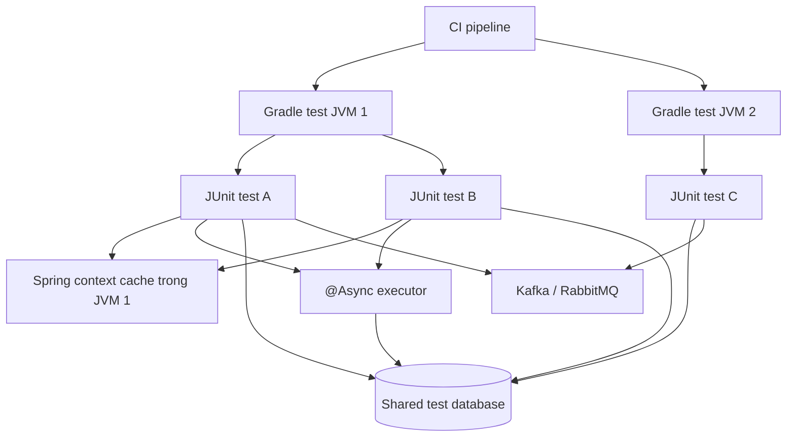
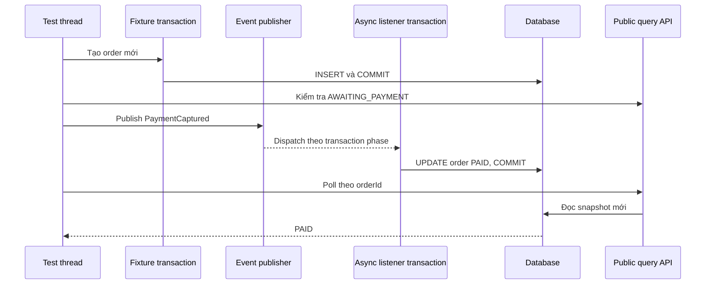

# Chạy test song song an toàn trong Spring Modulith

## 1. Vì sao chạy song song là bài kiểm tra kiến trúc và isolation?

Một bộ kiểm thử Spring Modulith có thể chạy xanh khi JUnit thực thi từng bài theo thứ tự, nhưng thất bại khi CI cho nhiều test chạy đồng thời. Lỗi không nhất thiết nằm trong business logic: hai scenario có thể cùng sửa một bản ghi thử nghiệm, dùng chung một listener recorder, chia sẻ consumer group Kafka, hoặc một test gọi `@DirtiesContext` khi test khác vẫn dùng bean của context đó.

Giả sử hai bài test nhận sự kiện `PaymentCaptured`:

- Test A tạo order A, phát event A, chờ A chuyển thành `PAID`.
- Test B tạo order B, phát event B, chờ B chuyển thành `PAID`.
- Cả hai dùng cùng một `transactionId = "TX-001"` hoặc một static recorder để ghi nhận event.
- Hai listener chạy trên một executor và cập nhật database trong các transaction độc lập.

Khi chạy tuần tự, ta có thể không nhận ra trùng transaction ID hoặc state tồn dư. Khi chạy song song, một test có thể thấy event của test kia, vi phạm unique constraint, hoặc vượt timeout vì một test đang giữ lock. Nếu assertion chỉ kiểm tra “đã có một đơn hàng `PAID`”, test thậm chí có thể **pass giả**.

**Chạy test song song an toàn** không chỉ là bật một cờ `parallel=true`. Đó là thiết kế **ranh giới dữ liệu, tài nguyên, transaction, event, executor và context** đủ độc lập để những scenario không ảnh hưởng nhau, đồng thời giữ được khả năng kiểm tra những race condition mà production thực sự có thể gặp.

Bài học thuộc chương *Test isolation* của học phần `SPRING_MODULITH_VERIFICATION_TESTING`. Học phần rèn kỹ năng kiểm chứng ranh giới kiến trúc Spring Modulith bằng `ApplicationModules` và các quy tắc phụ thuộc; thực hành `@ApplicationModuleTest`, kiểm thử event, database, tích hợp và xây dựng quality gate trong CI để ngăn phụ thuộc sai và hồi quy.

Sau bài này, bạn có thể:

1. Phân biệt **JUnit parallel execution**, **Gradle/JVM forks**, **thread bất đồng bộ của ứng dụng** và **nhiều CI jobs**.
2. Dùng `@Execution`, `@ResourceLock` và `@Isolated` theo đúng phạm vi phối hợp.
3. Thiết kế fixture và assertion không phụ thuộc thứ tự hay dữ liệu của test khác.
4. Xác định giới hạn của `@Transactional`, Spring TestContext cache và `@DirtiesContext` khi chạy đồng thời.
5. Cô lập Event Publication Registry, broker consumers, executor và side effect sau commit.
6. Viết `@ApplicationModuleTest` với `Scenario` chờ state của **đúng aggregate/event**.
7. Triển khai parallel CI có giới hạn tài nguyên, log chẩn đoán và phép kiểm chứng cấu trúc bằng `ApplicationModules.verify()`.

## 2. Song song diễn ra ở nhiều tầng khác nhau

Trước khi cấu hình, phải xác định **ai đang chạy đồng thời với ai**.

| Tầng | Cơ chế ví dụ | Có chung những gì? | Lock nào có thể điều phối? |
| --- | --- | --- | --- |
| **Test methods trong một JUnit engine** | JUnit Jupiter parallel methods | JVM, static state, có thể chung Spring context | `@ResourceLock`/`@Isolated` trong phạm vi Jupiter scheduler liên quan |
| **Các test classes trong một JUnit engine** | Parallel classes | JVM, TestContext cache, datasource/broker nếu dùng chung | JUnit resource locks nếu tất cả test liên quan khai báo đúng |
| **Nhiều Gradle test workers/JVM** | `maxParallelForks` | Không chung static Java fields, có thể chung DB, broker, file hoặc port | JUnit resource lock **không** phối hợp xuyên JVM |
| **Nhiều CI jobs/agents** | Matrix builds, shards | Có thể chung dịch vụ test nếu cấu hình sai | Cần namespace/môi trường riêng hoặc distributed coordination |
| **Executor của ứng dụng** | `@Async`, `TaskExecutor`, scheduler | Spring beans, DB, event registry, queues | JUnit locks **không dừng** background task sau khi method hoàn tất |
| **External consumer** | Kafka/RabbitMQ worker, service process | Topic/queue, offsets, DB, registry | Cần isolation hạ tầng, không dựa vào JUnit annotations |



Một resource lock do JUnit áp dụng trong JVM 1 có thể điều phối test A và B khi chúng cùng khai báo lock đó. Nó **không** ngăn test C ở JVM 2, cũng không tự chờ task `@Async` mà A đã đẩy vào executor.

### 2.1. Concurrency và parallelism khác nhau

*Concurrency* là nhiều hoạt động có thể tiến triển xen kẽ; *parallelism* là có thể thực thi đồng thời trên nhiều worker/core. Test isolation phải đúng dưới cả hai. Một race có thể xuất hiện ngay cả với một CPU core nếu thread chuyển qua lại giữa hai thao tác.

Một bài test **cố ý kiểm tra hai yêu cầu cùng lúc lên cùng aggregate** là concurrency test. Đó là trường hợp khác với việc **hai bài test độc lập vô tình chia sẻ một aggregate**. Loại thứ nhất cần thiết để kiểm tra idempotency, locking hoặc invariant; loại thứ hai là lỗi setup test.

## 3. Quy tắc gốc: độc lập về đầu vào và quan sát

Một scenario độc lập phải trả lời được:

1. **Baseline:** Dữ liệu nào tồn tại ngay trước stimulus? Do chính test tạo và commit hay đến từ trạng thái dùng chung?
2. **Identity:** `orderId`, `eventId`, `transactionId`, `tenantId`, SKU và message correlation thuộc scope nào?
3. **Stimulus:** Ai publish event hoặc gọi use case, với transaction boundary nào?
4. **Reader:** Assertion đọc **đúng ID** qua API/module nào, ở transaction/snapshot nào?
5. **Completion:** Khi nào handler/consumer thật sự hoàn tất, kể cả retry hoặc downstream side effect?
6. **Cleanup:** Ai được phép dọn DB/queue/registry, và đã chắc task cũ ngừng truy cập chưa?

Trong parallel tests, nếu không xác định được một trong sáu câu hỏi, việc tăng số worker chỉ làm lỗi khó truy vết hơn.

### 3.1. “Tạo UUID mới” cần thiết nhưng chưa đủ

Mỗi test nên dùng business ID và event ID riêng:

```java
UUID orderId = UUID.randomUUID();
UUID eventId = UUID.randomUUID();
String transactionId = "CAPTURE-" + eventId;
String sku = "SKU-TEST-" + orderId;
```

Nhưng hai order ID riêng vẫn có thể **tranh cùng inventory SKU mặc định**, cùng quota, cùng payment account hoặc cùng Kafka group. Cần cô lập *tài nguyên nghiệp vụ và hạ tầng có thể tranh chấp*, không chỉ primary key.

### 3.2. Một test không được đọc oracle toàn cục

Anti-pattern:

```java
assertThat(orderRepository.findAll())
        .anyMatch(order -> order.getStatus() == PAID);
```

Test này có thể pass nhờ order của test khác. Đúng hơn, test giữ ID từ fixture và kiểm tra bản ghi tương ứng:

```java
assertThat(orderQueries.statusOf(orderId))
        .contains(OrderStatus.PAID);
```

Đối với event/registry/broker cũng vậy: không khẳng định “có một event” mà phải kiểm tra đúng `eventId`, listener target, payload và transaction key.

## 4. JUnit Jupiter: cấu hình chạy song song có kiểm soát

JUnit Jupiter hỗ trợ song song, nhưng việc **bật parallelism** và **chỉ định execution mode** là hai bước cần đọc đúng cấu hình dự án.

Ví dụ nội dung cấu hình Jupiter trong `src/test/resources/junit-platform.properties` (đây là minh họa, bài học không tạo file này):

```properties
junit.jupiter.execution.parallel.enabled=true
junit.jupiter.execution.parallel.mode.default=concurrent
junit.jupiter.execution.parallel.mode.classes.default=concurrent
junit.jupiter.execution.parallel.config.strategy=fixed
junit.jupiter.execution.parallel.config.fixed.parallelism=4
```

Trong ví dụ này, các method/classes đủ điều kiện có thể chạy song song và Jupiter dùng chiến lược fixed parallelism. **Parallelism = 4 không phải bảo đảm luôn có tối đa đúng bốn thread trong toàn process:** thread từ Spring executor, scheduler, Gradle worker và hệ thống bên ngoài là những tầng riêng. Tùy cấu hình và JUnit scheduler, số thread thực tế cũng có thể chịu các điều kiện khác.

Khi mới triển khai, nên bắt đầu với số worker vừa phải, quan sát CPU, DB connection pool, lock và latency rồi mới tăng.

### 4.1. `@Execution(CONCURRENT)` và `@Execution(SAME_THREAD)`

Một test class có thể chỉ định chính sách:

```java
import org.junit.jupiter.api.Test;
import org.junit.jupiter.api.parallel.Execution;
import org.junit.jupiter.api.parallel.ExecutionMode;

@Execution(ExecutionMode.CONCURRENT)
class StatelessPolicyTests {

    @Test
    void validatesPaymentAmount() {
        // Không dùng shared mutable fixture.
    }

    @Test
    void validatesDeadline() {
        // Độc lập với method còn lại.
    }
}
```

Với test phải chạy tuần tự:

```java
@Execution(ExecutionMode.SAME_THREAD)
class LegacyMutableFixtureTests {

    @Test
    void caseOne() {}

    @Test
    void caseTwo() {}
}
```

**Giới hạn:** `SAME_THREAD` chủ yếu kiểm soát execution mode trong cấu trúc Jupiter; không phải global mutex đối với mọi test class/worker, và không ngăn background callbacks của ứng dụng. Nếu test dùng resource chung với các class khác, cần giải pháp ownership/resource-lock hoặc environment isolation đúng cấp.

### 4.2. Lifecycle `PER_CLASS` và `MethodOrderer`

JUnit Jupiter mặc định tạo test instance mới cho mỗi method. Với `@TestInstance(PER_CLASS)`, các method của class có thể dùng chung **instance fields**. Các method có orderer cũng có những quy tắc execution mode riêng; ở nhiều cấu hình, Jupiter không mặc nhiên chạy chúng concurrent nếu không có khai báo explicit phù hợp.

Đừng bật `@Execution(CONCURRENT)` trên class có `PER_CLASS` và một mutable field `List<Event> seen` mà không biết nó được reset/cô lập ra sao. Cũng đừng dùng thứ tự test làm cơ chế đồng bộ hay đảm bảo dữ liệu.

## 5. `@ResourceLock`: khóa đúng tài nguyên logic

Khi một resource **không thể tách ngay** trong một nhóm legacy tests, JUnit Jupiter cung cấp `@ResourceLock`. Những bài cùng khai báo tên resource có thể được scheduler phối hợp theo chế độ đọc/ghi.

Ví dụ một nhóm test tạm thời dùng chung fake gateway registry:

```java
import org.junit.jupiter.api.Test;
import org.junit.jupiter.api.parallel.ResourceAccessMode;
import org.junit.jupiter.api.parallel.ResourceLock;

@ResourceLock(
        value = "legacy:shared-gateway-registry",
        mode = ResourceAccessMode.READ_WRITE)
class LegacyGatewayRegistryTests {

    @Test
    void changesGatewayMode() {
        // Chỉ thay tài nguyên này dưới resource lock.
    }
}
```

Trong bài test khác dùng cùng global registry, phải khai báo **đúng cùng tên lock**. Nếu chỉ một class khai báo còn class khác không khai báo, không có bảo đảm phối hợp đầy đủ.

### 5.1. `READ` so với `READ_WRITE`

| Access mode | Ý nghĩa theo resource lock | Khi dùng |
| --- | --- | --- |
| `READ` | Nhiều test cùng giữ read lock có thể chạy song song | Chỉ đọc một tài nguyên thực sự không bị ghi bởi test đồng thời |
| `READ_WRITE` | Truy cập độc quyền theo resource name trong Jupiter scheduler | Test mutate resource chung hoặc yêu cầu loại trừ người đọc |

Ví dụ:

```java
@ResourceLock(
        value = "legacy:shared-configuration",
        mode = ResourceAccessMode.READ)
class ConfigurationReadOnlyTests {
    // Chỉ đọc config chung, không mutate.
}

@ResourceLock(
        value = "legacy:shared-configuration",
        mode = ResourceAccessMode.READ_WRITE)
class ConfigurationMutationTests {
    // Thay đổi config với khả năng restore và phạm vi được kiểm soát.
}
```

Ví dụ là hai class Java riêng. Annotation chỉ có ích nếu toàn bộ test liên quan thực sự tuân thủ cách đặt tên và access mode tương thích.

### 5.2. Những điều `@ResourceLock` không giải quyết

- Không đồng bộ giữa hai **Gradle JVM forks** hoặc hai CI jobs.
- Không chặn code production/background worker tự truy cập resource ngoài lịch JUnit.
- Không tự reset `System.setProperty`, static cache, database hoặc broker.
- Không bảo đảm task async của test A đã kết thúc trước khi JUnit cấp lock cho test B, nếu A trả về quá sớm.
- Không sửa một architecture dependency sai giữa module.
- Không thay thế unique constraint hoặc idempotency trong production.

**Phương án ưu tiên:** tách resource theo scenario; chỉ dùng lock khi việc tách chưa thể thực hiện hoặc bài test chủ động kiểm tra global configuration.

## 6. `@Isolated`: dành cho trường hợp cần loại trừ rộng hơn

JUnit Jupiter cũng hỗ trợ `@Isolated` ở cấp test class. Khi Jupiter chạy song song, một class được đánh dấu isolated có thể được lập lịch tránh chạy đồng thời với những test classes khác trong cùng execution scope theo ngữ nghĩa của Jupiter.

```java
import org.junit.jupiter.api.Test;
import org.junit.jupiter.api.parallel.Isolated;

@Isolated("Legacy code modifies JVM-wide default configuration")
class LegacyGlobalConfigurationTests {

    @Test
    void needsExclusiveJupiterExecution() {
        // Kiểm tra legacy global state trong phạm vi đã cô lập.
    }
}
```

`@Isolated` không tạo JVM mới, không ngừng task `@Async` chưa hoàn tất, không cấp database riêng và không phối hợp với CI job khác. Nếu một system property hoặc static state thay đổi mà test không restore, class tiếp theo vẫn nhìn thấy state sai dù không chạy đồng thời.

### 6.1. Khi nào nên tách test task/JVM thay vì annotation?

Nếu một class thật sự cần thay `TimeZone.setDefault(...)`, SSL trust store, system property global hoặc một SDK singleton khó reset, một **JVM test task/fork riêng** có thể tạo boundary tốt hơn. Điều này có chi phí khởi động và không giải quyết database/broker dùng chung.

Khi nghiệp vụ cho phép, refactor thành `Clock`, `ZoneId`, config port hoặc adapter test-scoped vẫn là giải pháp bền vững hơn.

## 7. Spring TestContext cache khi nhiều test cùng chạy

Spring TestContext Framework cache các `ApplicationContext` có cấu hình được hợp nhất tương đương. Hai `@ApplicationModuleTest` của cùng module, profile và test configuration có thể dùng chung context theo chính sách cache.

Vì vậy:

- **Spring singleton beans** có thể được gọi đồng thời bởi hai test.
- **Test doubles** được inject vào context có thể giữ mutable state/stubbing/call history.
- **Event listener beans** nhận event từ nhiều scenario cùng lúc.
- **TaskExecutor/TaskScheduler** của context có thể xử lý task của cả A và B.
- **DataSource/EntityManagerFactory** có thể được chia sẻ nhưng mỗi transaction/persistence context cần được quản lý đúng.
- **ApplicationContext khác nhau** vẫn có thể truy cập cùng database/broker ở ngoài process.

Không nên nghĩ “mỗi test method đều có một context mới”; cũng không nên tạo context mới cho mọi method chỉ để né một field mutable sai.

### 7.1. `@DirtiesContext` có thể phá parallel reuse nếu dùng sai

Một test đánh dấu context dirty sẽ khiến TestContext loại context khỏi cache và đóng nó theo lifecycle. Nếu test khác đang dùng cùng context hoặc bean thuộc context, việc chạy concurrent có thể dẫn tới lỗi do resource bị đóng.

Vì vậy các test có `@DirtiesContext` hoặc có hành vi phá context thường **không phù hợp để chạy concurrent với những test reuse cùng context**; cần cân nhắc scheduling/isolation theo hướng dẫn Spring TestContext.

```java
@ApplicationModuleTest
@DirtiesContext(
        classMode = DirtiesContext.ClassMode.AFTER_CLASS)
class ContextMutatingTests {
    // Chỉ dùng khi có lý do rõ ràng.
}
```

Đây không phải công thức “cứ gắn `@DirtiesContext` thì an toàn”. Nó không xóa row đã commit, không drain executor, không cleanup registry và không reset Java static fields.

### 7.2. Config khác nhau tạo context khác nhưng vẫn có thể chung DB

```text
Test A: profile=module-test-a -> Context A -> jdbc:postgresql://test-db/shop
Test B: profile=module-test-b -> Context B -> jdbc:postgresql://test-db/shop

Context không giống nhau nhưng database là một.
```

Đừng suy từ `@ActiveProfiles` hoặc `@TestPropertySource` rằng data isolation đã được bảo đảm. Cần kiểm tra JDBC URL/schema, tenant, broker topic/queue và cleanup policy.

### 7.3. `@MockitoBean`, test doubles và mutable state

Nếu test dùng bean override/mock trong Spring context, framework có cơ chế quản lý/reset mock phù hợp theo phiên bản. Tuy nhiên:

1. Không giả định hai scenario concurrent có thể cùng **stub lại một mock** rồi verify tương tác mà không race.
2. Không dùng static recorder hoặc singleton fake có queue chung làm oracle tổng.
3. Tránh một test reconfigure fake service khi test khác đang gọi nó.
4. Ưu tiên test fixture/ID riêng, fake keyed by correlation ID hoặc context riêng theo test configuration.
5. Kiểm tra tương thích annotation mock với phiên bản Spring Framework/Boot; không phối trộn API theo giả định.

Một mock dùng chung có thể thread-safe ở mức thực hiện method nhưng vẫn cho kết quả sai vì **stubbing và verification thuộc hai scenario khác nhau bị trộn**.

## 8. `@ApplicationModuleTest`: chọn phạm vi nhỏ nhất có ý nghĩa

Spring Modulith cho phép bootstrap module cần kiểm thử thay vì mặc định khởi động toàn bộ ứng dụng. Những bootstrap modes thông dụng:

| Mode | Phạm vi định hướng | Ảnh hưởng tới parallel test |
| --- | --- | --- |
| `STANDALONE` | Chỉ module hiện tại và hạ tầng Spring cần thiết | Ít listener/bean không liên quan hơn, giảm tác động chéo |
| `DIRECT_DEPENDENCIES` | Module hiện tại cùng dependency trực tiếp | Có thêm bean/tài nguyên tham gia event và DB |
| `ALL_DEPENDENCIES` | Module hiện tại và dependency bắc cầu | Phạm vi rộng hơn, dễ có nhiều side effect đồng thời |

Ví dụ:

```java
package com.example.shop.orders;

import org.springframework.modulith.test.ApplicationModuleTest;
import org.springframework.modulith.test.ApplicationModuleTest.BootstrapMode;

@ApplicationModuleTest(mode = BootstrapMode.STANDALONE)
class OrderModuleTests {
    // Viết test hành vi của orders bên trong class này.
}
```

Scope module **không tự bảo đảm test thread-safe**. Hai bài test `orders` concurrent có thể vẫn gọi cùng Spring singleton, dùng cùng DataSource hoặc gửi event vào một listener.

**Không đổi tất cả test sang `ALL_DEPENDENCIES` chỉ vì thiếu một bean**: điều đó có thể che một dependency thiết kế sai. Cần xem port, public API/named interface, test double hoặc integration-test scope phù hợp.

## 9. Case study: hai kịch bản thanh toán chạy cùng lúc

Giả sử module `payments` công bố event `PaymentCaptured`; module `orders` nhận event và cập nhật trạng thái đơn hàng.

Các kiểu domain sau **do ứng dụng minh họa định nghĩa**, mỗi khai báo `public` ở file Java riêng:

```java
// File: com/example/shop/payments/events/PaymentCaptured.java
package com.example.shop.payments.events;

import java.math.BigDecimal;
import java.util.UUID;

public record PaymentCaptured(
        UUID eventId,
        UUID orderId,
        String transactionId,
        BigDecimal amount) {}
```

```java
// File: com/example/shop/orders/OrderStatus.java
package com.example.shop.orders;

public enum OrderStatus {
    AWAITING_PAYMENT, PAID, PAYMENT_FAILED
}
```

```java
// File: com/example/shop/orders/OrderPaymentSnapshot.java
package com.example.shop.orders;

import java.math.BigDecimal;
import java.util.UUID;

public record OrderPaymentSnapshot(
        UUID orderId,
        OrderStatus status,
        UUID capturedEventId,
        String transactionId,
        BigDecimal capturedAmount) {

    public boolean matches(
            UUID expectedEventId,
            String expectedTransactionId,
            BigDecimal expectedAmount) {
        return status == OrderStatus.PAID
                && expectedEventId.equals(capturedEventId)
                && expectedTransactionId.equals(transactionId)
                && capturedAmount != null
                && capturedAmount.compareTo(expectedAmount) == 0;
    }
}
```

```java
// File: com/example/shop/orders/OrderQueries.java
package com.example.shop.orders;

import java.util.Optional;
import java.util.UUID;

public interface OrderQueries {
    Optional<OrderPaymentSnapshot> paymentOf(UUID orderId);
}
```

Fixture test-support có hợp đồng tạo dữ liệu đầu vào và commit:

```java
// Test-support interface do dự án triển khai.
import java.math.BigDecimal;
import java.util.UUID;

interface OrderFixture {
    UUID awaitingPaymentAndCommit(BigDecimal amount);
}
```

Tại module `orders`, một test riêng cho mỗi scenario:

```java
package com.example.shop.orders;

import static org.assertj.core.api.Assertions.assertThat;

import java.math.BigDecimal;
import java.time.Duration;
import java.util.UUID;

import org.junit.jupiter.api.Test;
import org.springframework.beans.factory.annotation.Autowired;
import org.springframework.modulith.test.ApplicationModuleTest;
import org.springframework.modulith.test.Scenario;

@ApplicationModuleTest
class PaymentEventIsolationTests {

    @Autowired OrderFixture fixture;
    @Autowired OrderQueries orders;

    @Test
    void consumesItsOwnPaymentEvent(Scenario scenario) {
        BigDecimal amount = new BigDecimal("125000.00");
        UUID orderId = fixture.awaitingPaymentAndCommit(amount);
        UUID eventId = UUID.randomUUID();
        String transactionId = "CAPTURE-" + eventId;

        // Không cho phép state đích tồn tại trước stimulus.
        OrderPaymentSnapshot before =
                orders.paymentOf(orderId).orElseThrow();

        assertThat(before.status())
                .isEqualTo(OrderStatus.AWAITING_PAYMENT);
        assertThat(before.capturedEventId()).isNull();

        scenario.publish(new PaymentCaptured(
                        eventId, orderId, transactionId, amount))
                .andWaitAtMost(Duration.ofSeconds(8))
                .forStateChange(
                        () -> orders.paymentOf(orderId),
                        value -> value.filter(v ->
                                v.matches(eventId, transactionId, amount))
                                .isPresent())
                .andVerify(value -> {
                    OrderPaymentSnapshot result = value.orElseThrow();

                    assertThat(result.orderId()).isEqualTo(orderId);
                    assertThat(result.status()).isEqualTo(OrderStatus.PAID);
                    assertThat(result.capturedEventId())
                            .isEqualTo(eventId);
                    assertThat(result.transactionId())
                            .isEqualTo(transactionId);
                    assertThat(result.capturedAmount())
                            .isEqualByComparingTo(amount);
                });
    }
}
```

**Giới hạn của code mẫu:** ứng dụng phải triển khai listener, fixture bean, repository/query adapter và transaction service phù hợp. `OrderFixture.awaitingPaymentAndCommit` phải trả về khi fixture đã commit thật. Test cần import kiểu event từ package công khai `payments.events`; không tự động có trong Spring Modulith.

Bài test này được thiết kế tốt cho parallel vì ID, amount, baseline và assertion đều nằm trong method. Nhưng nó còn cần:

- Listener xử lý đúng ID và có transaction riêng khi cần.
- Không có static cache/dedup theo một transaction key trùng với test khác.
- Fixture không tự `TRUNCATE` toàn bảng.
- Executor không bị test khác shutdown.
- Database/registry/queue đủ cô lập với kịch bản lỗi/retry.
- Cleanup sau khi công việc liên quan đã hoàn tất.

### 9.1. `Scenario` giúp chờ, nhưng không tự giải quyết mọi race

`Scenario.publish(...)` và `andWaitAtMost(...).forStateChange(...).andVerify(...)` giúp chờ một state thay vì `Thread.sleep(...)`. Tuy nhiên:

- Predicate chỉ đọc state của **đúng order** và nên là side-effect-free.
- Đạt `PAID` chưa chắc listener đã gửi xong event downstream hoặc ghi dấu publication completed.
- Một listener có thể đã commit nhưng query dùng persistence context cũ và thấy state stale.
- Timeout có thể do DB lock, connection pool saturation, task queue hoặc transaction publish không commit.
- Khi test bị timeout, handler nền **có thể còn chạy**; cleanup ngay lập tức có thể gây lỗi cho test khác.

Timeout 8 giây là giá trị minh họa; phải dựa trên độ trễ và SLA của suite. Đừng tăng timeout vô hạn để che resource contention.

## 10. Test-managed transaction không bao phủ mọi worker

Một test gắn `@Transactional` thường được Spring TestContext chạy trong test-managed transaction và mặc định rollback cuối method. Nhưng listener `@Async` có thể chạy ở thread khác, còn `@TransactionalEventListener(AFTER_COMMIT)` phụ thuộc transaction publish đã commit.



Tách ba loại transaction:

| Transaction | Điều cần bảo đảm | Rủi ro khi concurrent |
| --- | --- | --- |
| **Fixture transaction** | Dữ liệu đầu vào đã commit trước khi worker đọc | Listener thấy row chưa tồn tại hoặc gặp lock |
| **Publisher transaction** | Phù hợp với `AFTER_COMMIT` và registry tracking | Test rollback làm listener không chạy |
| **Listener/reader transaction** | Ghi state commit; reader quan sát snapshot mới | Pool cạn, lock wait, snapshot cache cũ |

Không bọc toàn bộ async scenario trong một transaction test kéo dài nếu listener after-commit cần commit mà test không cho commit xảy ra. `saveAndFlush(...)` không thay `commit`.

### 10.1. Fixture commit độc lập có thể cần `TransactionTemplate`

Trong test-support của module sở hữu order, có thể dùng:

```java
import java.util.UUID;

import org.springframework.transaction.PlatformTransactionManager;
import org.springframework.transaction.TransactionDefinition;
import org.springframework.transaction.support.TransactionTemplate;

final class OrderFixtureTransactions {

    private final OrderRepository repository;
    private final TransactionTemplate transactions;

    OrderFixtureTransactions(
            OrderRepository repository,
            PlatformTransactionManager transactionManager) {

        this.repository = repository;
        this.transactions = new TransactionTemplate(transactionManager);
        this.transactions.setPropagationBehavior(
                TransactionDefinition.PROPAGATION_REQUIRES_NEW);
    }

    UUID createAndCommit() {
        return transactions.execute(status -> {
            UUID id = UUID.randomUUID();
            repository.save(OrderEntity.awaitingPayment(id));
            return id;
        });
    }
}
```

Các kiểu `OrderRepository` và `OrderEntity` do ứng dụng minh họa tự triển khai. `REQUIRES_NEW` giúp tạo một transaction riêng đã commit khi callback thành công; nó **không** phải luôn bắt buộc: nếu caller không giữ transaction, một bean fixture `@Transactional` với `REQUIRED` có thể đủ.

**Quan trọng trong parallel:** `REQUIRES_NEW` có thể cần thêm database connection khi transaction ngoài đang giữ connection. Nhiều test đồng thời với pool nhỏ có thể gây connection pool exhaustion. Đừng dùng `REQUIRES_NEW` bừa bãi và đừng giữ T-test mở trong lúc chờ event async nếu không cần.

### 10.2. Không dùng rollback để tưởng đã cleanup xong

Rollback của test không tự undo những transaction mà listener đã commit độc lập, record registry bền hay message gửi broker. Nếu test A kết thúc mà listener A còn chạy, test B có thể thấy side effect của A dù A có `@Transactional`.

Vì vậy, isolation cần **data ownership + completion signal + cleanup theo scope**, không chỉ transaction annotation.

## 11. Database isolation khi chạy nhiều tests cùng lúc

Nhiều test dùng cùng database là bình thường nếu có quy tắc:

1. Mỗi scenario có unique business IDs và tránh dùng chung global keys không cần thiết.
2. Fixture tạo baseline qua transaction commit rõ ràng.
3. Không dùng `DELETE FROM orders` hoặc `TRUNCATE` toàn bảng trong `@AfterEach` khi test khác đang hoạt động.
4. Cleanup chỉ theo ID/namespace **sau khi async tasks đã quiescent**.
5. Không assert tổng row count của database dùng chung trừ khi environment được khóa/cô lập.
6. Kiểm tra unique constraints, foreign keys, optimistic/pessimistic locking theo DB thật.
7. Nếu một tài nguyên không thể tách theo ID, cấp schema/database riêng hoặc chạy nhóm test tuần tự.

### 11.1. Bẫy shared SKU và shared account

Hai test cùng dùng `sku = "SKU-DEFAULT"` và mỗi test kiểm tra “giữ hai sản phẩm thành công” có thể tranh một row inventory. Dù order ID khác nhau, một trong hai test bị `InsufficientStockException` là hành vi nghiệp vụ hợp lệ chứ không phải lỗi framework.

Cần phân biệt:

- **Business concurrency test:** cố tình tranh cùng SKU để kiểm chứng không oversell.
- **Isolation test:** tạo SKU/stock riêng cho mỗi scenario để tránh tranh chấp không liên quan.

Không “sửa” business concurrency test bằng cách sinh SKU khác nhau; đó sẽ làm mất điều kiện cần kiểm chứng. Ngược lại, không vô tình dùng shared SKU trong những module tests chỉ muốn kiểm tra payment transition.

### 11.2. `@Sql` cleanup dùng chung có thể xóa dữ liệu của test khác

Ví dụ nguy hiểm khi chạy concurrent:

```sql
-- Anti-pattern trong database dùng chung:
TRUNCATE TABLE orders CASCADE;
```

Một test có thể xóa row của test khác giữa lúc listener đang update. Ưu tiên cleanup theo `orderId`/test namespace, schema riêng hoặc container riêng. Nếu dùng `@Sql`, cần hiểu transaction mode của script và khi nào được thực thi.

### 11.3. Deadlock khác flaky assertion

Khi hai transaction lấy lock theo thứ tự khác nhau:

```text
T1: lock Order A -> chờ Inventory X
T2: lock Inventory X -> chờ Order A
```

DB có thể phát hiện deadlock và rollback một transaction. Đây là hành vi concurrency cần điều tra bằng lock/order/transaction design, không nên đổi `assertThat(...)` hoặc tăng timeout để che lỗi. Trong production, retry chỉ phù hợp với những thao tác có semantics idempotent và chính sách giới hạn rõ ràng.

## 12. Testcontainers: mức cô lập nào phù hợp?

Testcontainers có thể khởi tạo database/broker thật cho integration tests. Nhưng **một container được dùng chung không tự làm sạch dữ liệu giữa test methods**.

| Cách tổ chức | Ưu điểm | Hạn chế khi concurrent |
| --- | --- | --- |
| Một container cho suite, fixture IDs riêng | Khởi động nhanh, gần production | Cần cleanup và tránh global reset |
| Database/schema theo test class | Cô lập dữ liệu giữa classes tốt | Cần migration, connection/schema config |
| Container theo test class | Cô lập hạ tầng giữa classes | Chi phí khởi động, context cache phải khớp lifecycle |
| Container theo method | Cô lập mạnh | Có thể rất chậm khi parallel nhiều methods |
| External shared test environment | Dễ cấp hạ tầng cho CI | Cần namespace, quota và dọn theo job |
| Container cho recovery/retry test riêng | Bảo vệ kiểm thử lỗi khó đoán | Cần giữ state qua hai pha cùng scenario |

Ví dụ class-scoped PostgreSQL container với Spring Boot hỗ trợ service connection:

```java
import org.junit.jupiter.api.Test;
import org.springframework.boot.testcontainers.service.connection.ServiceConnection;
import org.springframework.modulith.test.ApplicationModuleTest;
import org.testcontainers.containers.PostgreSQLContainer;
import org.testcontainers.junit.jupiter.Container;
import org.testcontainers.junit.jupiter.Testcontainers;

@Testcontainers
@ApplicationModuleTest
class OrdersPostgresTests {

    @Container
    @ServiceConnection
    static PostgreSQLContainer<?> postgres =
            new PostgreSQLContainer<>("postgres:16-alpine");

    @Test
    void verifiesPersistenceBehavior() {
        // Fixture/query thực tế của dự án cần được bổ sung.
    }
}
```

Đây là **khung cấu hình**, yêu cầu các dependency Spring Boot Testcontainers/JUnit tương thích, driver và schema/migration thật. Nó không có sẵn bài test nghiệp vụ.

### 12.1. Container và Spring TestContext cache cần cùng lifecycle

Vấn đề phổ biến: container static của class A bị dừng sau class, nhưng Spring TestContext vẫn cache context/DataSource dùng endpoint của container đó và reuse trong class B. Kết quả là lỗi kết nối ngẫu nhiên.

Giải pháp phải xét **scope container, context cache key, dynamic properties và thời gian sống của connection factory**. Có thể:

- Dùng container có lifecycle phù hợp với context/suite.
- Tách test configuration/context khi container khác nhau.
- Dùng `@DirtiesContext` có chủ đích khi context thật sự tham chiếu resource đã hết hạn; tránh chạy concurrent với context đó.
- Cô lập database/schema cho test jobs thay vì chỉ tên Java class.

Không tự tin rằng `@ServiceConnection` hoặc `@DynamicPropertySource` tự giải quyết mọi vòng đời. Một supplier có thể trả endpoint khác trong khi datasource đã được tạo từ giá trị cũ.

## 13. Async executor: test hoàn tất không đồng nghĩa worker hoàn tất

Một test `@ApplicationModuleTest` có thể phát event rồi trả về trong khi `@Async` listener vẫn đang chạy. JUnit có thể ngay lập tức lập lịch test khác, ngay cả khi test methods chạy theo mode `SAME_THREAD`.

Nguy cơ:

- Worker cũ ghi data sau cleanup.
- Worker cũ tiếp tục dùng bean/mock đã bị test khác reset.
- Mutable test clock hoặc config bean bị đổi trong lúc worker đang đọc.
- Executor pool cạn queue/worker vì nhiều tests cùng submit.
- Test B nhìn thấy event của A trong recorder/global listener.
- Producer gửi broker sau khi test đã đóng container.

### 13.1. Chờ theo kết quả, không chờ thời gian cố định

Không dùng:

```java
publisher.publishEvent(event);
Thread.sleep(1000);
assertThat(queries.statusOf(orderId))
        .contains(OrderStatus.PAID);
```

Một giây không đảm bảo listener đã commit trên CI bận. Sử dụng polling theo trạng thái, có timeout hữu hạn và ID riêng như `Scenario`.

Nhưng đừng quên **quiescence**: nếu listener cập nhật `PAID` ở bước 1, rồi còn gửi email/broker ở bước 2, trạng thái `PAID` chưa chứng minh bước 2 xong. Cleanup resource của bước 2 phải chờ completion signal riêng.

### 13.2. `CountDownLatch` chỉ dùng như probe có scope

Một test cố tình tạo race có thể dùng gate:

```java
import java.time.Duration;
import java.util.concurrent.CountDownLatch;
import java.util.concurrent.TimeUnit;

final class ListenerCheckpoint {

    private final CountDownLatch entered = new CountDownLatch(1);
    private final CountDownLatch release = new CountDownLatch(1);

    void awaitRelease() throws InterruptedException {
        entered.countDown();
        release.await();
    }

    boolean waitUntilEntered(Duration duration)
            throws InterruptedException {
        return entered.await(
                duration.toMillis(), TimeUnit.MILLISECONDS);
    }

    void release() {
        release.countDown();
    }
}
```

Class này là test-support, không phải Spring Modulith API. Nếu test dùng nó:

1. Tạo checkpoint mới cho mỗi scenario.
2. Chờ worker báo đã tới mốc với timeout.
3. Luôn `release()` trong `finally` dù assertion fail.
4. Chờ worker hoàn tất sau khi release.
5. Không dùng static checkpoint/shared latch khi nhiều tests chạy đồng thời.

Gọi `future.cancel(true)` hoặc `shutdownNow()` không chắc rollback transaction đã commit; chỉ là cơ chế yêu cầu hủy/ngắt theo contract Java concurrency.

### 13.3. Pool size và timeout có thể là vấn đề tài nguyên

Nếu JUnit chạy 8 module tests, mỗi test phát nhiều event, `ThreadPoolTaskExecutor` có 2 workers/queue nhỏ và DB connection pool chỉ có 4 connections, độ trễ có thể tăng mạnh. Lúc đó test timeout không chứng minh listener sai logic.

Cần quan sát:

- Số active/queued tasks và rejected tasks.
- Connection pool usage/wait time.
- DB locks và transaction duration.
- Broker consumer lag/offsets.
- Runtime latency từng bước, không chỉ tổng timeout.

Một cấu hình parallelism hợp lý phải tính **tổng tải của JUnit + Spring async workers + Gradle forks**, không dựa vào CPU core count đơn thuần.

## 14. Event Publication Registry và resubmission chạy đồng thời

Spring Modulith có Event Publication Registry để theo dõi publication tới các listener target phù hợp. Với một provider durable, incomplete publication có thể sống qua method/context/restart và được xử lý lại theo cơ chế đã cấu hình.

Một kịch bản nhiễm chéo:

```text
Test A: eventId=E-A, target=orders listener
  -> listener fail, registry lưu incomplete publication E-A.

Test B: eventId=E-B, cũng dùng registry database.
  -> startup/scheduled resubmission quét incomplete publications.
  -> E-A được xử lý lại trong khi B đang chờ E-B.

Result:
  - side effect không thuộc B,
  - resource contention,
  - test đọc global count có thể pass sai.
```

Quy tắc:

- Dùng event/correlation ID riêng theo scenario.
- Khi kiểm tra registry, lọc theo logical event **và target identifier**; đừng chỉ đếm tất cả outstanding.
- Không giả định một event luôn có đúng một publication (có thể có nhiều listeners).
- Khi kiểm thử replay của cùng logical event, giữ nguyên ID/idempotency key **trong cùng scenario**.
- Nếu bật resubmission quét toàn bộ DB, chỉ ID riêng có thể chưa đủ: nên dùng registry DB/schema riêng hoặc chạy nhóm recovery tests tuần tự/cô lập.
- Không `TRUNCATE` registry chung khi worker của test khác đang chạy.
- Chờ đúng replay completion rồi kiểm tra idempotency; state `PAID` đã có từ lần đầu chưa chứng minh lần hai được xử lý an toàn.

`PublishedEvents` trong module test chỉ quan sát những application events được publish theo cơ chế test; nó **không** thay thế test về registry durability/completion hay business state.

## 15. Kafka/RabbitMQ: concurrency ngoài JVM không nghe theo JUnit locks

### 15.1. Kafka

Kafka có topics, partitions, consumer groups và committed offsets. Hai test chạy concurrent dùng cùng group có thể rebalance và chia partition, làm một test không đọc được record mà nó trông đợi. Ngay cả khi group khác nhau, nếu cùng topic thì mỗi observer vẫn có thể nhận message của test kia.

| Thành phần | Test isolation được khuyến nghị |
| --- | --- |
| Topic | Namespace riêng theo suite/class khi cần transport isolation |
| Consumer group | Group ID riêng cho test observer hoặc nhóm test có chủ đích |
| Offset/assignment | Bảo đảm observer đã sẵn sàng và offset policy đúng trước stimulus |
| Message key | Dùng aggregate ID theo hợp đồng partitioning |
| Logical event ID | Tạo riêng cho event, dùng để lọc/assert và idempotency |
| Retry/DLT topics | Cô lập hoặc dọn theo scope, không dựa vào tổng count |

Không đặt observer vào **cùng consumer group** với business consumer nếu mục tiêu là quan sát bản sao stream: nó có thể cạnh tranh nhận partition, làm consumer nghiệp vụ bỏ lỡ record.

### 15.2. RabbitMQ

RabbitMQ dùng exchange, queue, binding và ack/nack. Hai observer dùng cùng queue có thể chia message cho nhau, không phải mỗi observer đều nhận một bản sao. Một queue bền có thể chứa message từ test trước, và message chưa ack có thể requeue.

Nên dùng queue test riêng, routing/binding rõ, consumer lifecycle có owner, correlation ID đúng và cleanup queue/retry/DLQ sau khi consumer đã settle. Đừng purge queue dùng chung để “bắt đầu sạch” khi nhiều test đang chạy.

### 15.3. Broker Testcontainers vẫn cần namespace

Một Kafka/RabbitMQ container được dùng chung trong suite là chấp nhận được nếu các test phân scope topic/queue/group và xử lý resource lifecycle. Nếu cần test lỗi/phá topology/offset toàn cục, cấp broker riêng cho nhóm test hoặc chạy tuần tự. `@DirtiesContext` không xóa topic/queue hoặc committed offsets ở broker ngoài context.

## 16. Static state, clock, random, system properties: nguồn race trong cùng JVM

Một số shared states không nằm trong database:

```java
// Các ví dụ anti-pattern khi dữ liệu được mutate giữa tests.
static final Set<UUID> PROCESSED = ConcurrentHashMap.newKeySet();
static final AtomicInteger EVENT_COUNT = new AtomicInteger();
static final Random RANDOM = new Random(42);
static AdjustableClock CLOCK;
```

`static final` không có nghĩa object bất biến. `ConcurrentHashMap` và `AtomicInteger` có thread-safety ở mức thao tác nhưng **không tạo isolation giữa scenario**. Một counter đã tăng bởi test A có thể làm B assert nhầm. Một RNG có seed cố định nhưng dùng chung vẫn phụ thuộc thứ tự gọi.

Một số quy tắc:

1. Dùng object local/test-scoped cho mutable recorder, RNG, fixture, adjustable clock.
2. Dùng immutable `Clock.fixed(...)` khi business time phải xác định; không dùng nó để đo timeout polling.
3. Đừng sinh unique ID chỉ từ timestamp đã freeze.
4. Tránh thay `System.setProperty(...)`/`TimeZone.setDefault(...)` trong parallel tests: đây là global JVM state.
5. Dùng `@TestPropertySource`/`@ActiveProfiles` để cấu hình Spring context theo class, không mutate giữa methods.
6. Với legacy code bắt buộc đổi global state, isolate test process hoặc serialization có kiểm soát, restore trong `finally`.
7. Không dùng static `ThreadLocal` mà quên `remove()` trong executor worker; ThreadLocal state có thể rò giữa tasks chạy trên cùng thread.

### 16.1. Mock/fake instance state cũng có thể rò

Không có `static` không tự bảo đảm an toàn: một Spring singleton fake có thể được dùng bởi hai module tests concurrent trong cùng context. Nếu A gọi `fake.reset()` khi B đang chờ event, B có thể mất dữ liệu.

Ưu tiên fake keyed by event ID hoặc test-scoped fixture. Với test chỉ cần mock interaction, tránh re-stubbing cùng shared mock đồng thời và kiểm tra cơ chế reset theo test framework/version.

## 17. Cleanup trong parallel suite phải có ownership rõ

Dữ liệu test có thể được cleanup sau test, nhưng phải tránh global resets và race với worker vẫn hoạt động.

Một quy trình an toàn:

1. **Setup:** định danh test namespace, resource owner, business/event IDs.
2. **Commit fixture:** dữ liệu sẵn sàng cho transaction khác.
3. **Stimulus:** publish event/gọi use case theo hợp đồng.
4. **Await:** chờ state và completion đủ cho những resource sẽ dọn.
5. **Stop new work:** ngừng test observer/subscription và tác vụ test-owned theo cách an toàn.
6. **Quiescence:** chờ những worker còn có thể tác động tới dữ liệu của scenario kết thúc.
7. **Cleanup scoped:** xóa theo ID/schema/topic/queue của chính test hoặc hủy môi trường test riêng.
8. **Verify:** không còn resource thuộc test gây ảnh hưởng bài tiếp theo.
9. **Failure path:** khi timeout, không xóa bừa shared resource lúc worker còn chạy; ghi bằng chứng và cô lập môi trường để điều tra.

Không có cách cleanup chung cho tất cả. Với unit tests chỉ tạo object local, GC/lifecycle test method là đủ. Với broker/registry/recovery integration tests, cleanup phải bảo vệ durable side effects.

### 17.1. Không dùng `@AfterEach` để xóa toàn DB

Một anti-pattern:

```java
@AfterEach
void cleanup() {
    orderRepository.deleteAll();  // Có thể xóa dữ liệu test khác.
    registryAdmin.deleteAll();     // Có thể xóa pending của test khác.
}
```

Trong concurrent suite, A có thể cleanup khi B vừa seed dữ liệu. Kết quả false negative, timeout hoặc exception. Sửa bằng cleanup theo ID thuộc test, database/schema riêng, hoặc test execution strategy có isolation thật. Không xóa registry của module khác qua production API chỉ để bài test đơn giản hơn.

### 17.2. Cleanup lỗi phải được ghi nhận

Nếu broker consumer stop thất bại, queue không xóa được hoặc listener còn pending, đừng lặng lẽ bỏ qua. Những lỗi này có thể khiến test kế tiếp fail ngẫu nhiên. CI report nên ghi test name, resource owner/ID, completion point, cleanup exception và trạng thái còn lại (không log secret).

## 18. Kiểm thử concurrency thật: hai yêu cầu tranh cùng aggregate

**Chạy hai test khác nhau song song** không thay thế một **concurrency test có chủ đích**. Muốn kiểm tra invariant “một payment capture không được ghi hai lần”, hãy viết một test kiểm soát hai luồng đồng thời gọi cùng use case.

Ví dụ *khung ý tưởng Java*:

```java
import static org.assertj.core.api.Assertions.assertThat;

import java.util.concurrent.CountDownLatch;
import java.util.concurrent.Executors;
import java.util.concurrent.TimeUnit;

@Test
void duplicateCaptureDoesNotCreateTwoReceipts() throws Exception {
    UUID orderId = fixture.awaitingPaymentAndCommit(amount);
    String transactionId = "TX-" + UUID.randomUUID();

    var start = new CountDownLatch(1);
    var pool = Executors.newFixedThreadPool(2);

    try {
        var first = pool.submit(() -> {
            start.await();
            return captureService.capture(orderId, transactionId, amount);
        });
        var second = pool.submit(() -> {
            start.await();
            return captureService.capture(orderId, transactionId, amount);
        });

        start.countDown();

        // Hai outcome có thể khác nhau tùy contract:
        // một success, một already-processed / conflict hợp lệ.
        var resultA = first.get(10, TimeUnit.SECONDS);
        var resultB = second.get(10, TimeUnit.SECONDS);

        assertThat(resultA).isNotNull();
        assertThat(resultB).isNotNull();

        // Assertion quyết định là dữ liệu đã commit:
        assertThat(receiptQueries.countByTransaction(transactionId))
                .isEqualTo(1);
    } finally {
        start.countDown(); // Không giữ worker treo nếu setup/assert fail.
        pool.shutdownNow();
        pool.awaitTermination(5, TimeUnit.SECONDS);
    }
}
```

Đây là **khung minh họa**, không phải một test hoàn chỉnh: `captureService`, `fixture`, `amount`, `receiptQueries` và kết quả của service phải được triển khai theo contract dự án. Nếu method có thể ném exception hợp lệ do duplicate, test phải capture và assert **đúng outcome của từng Future** thay vì mặc định cả hai trả success. Cần xem transaction/lock behavior và cleanup sau khi worker kết thúc.

Lưu ý ba điểm:

- Hai worker cùng dùng **một transaction ID có chủ đích** trong **cùng test** để kiểm tra idempotency.
- Test method **không** tự bọc transaction dài nếu worker cần đọc fixture commit.
- `CountDownLatch` đồng bộ **thời điểm bắt đầu**, không chứng minh hai transaction thực sự cùng chạm critical section. Muốn kiểm tra race chính xác tại một điểm, dùng test gate/instrumentation có chủ đích.

### 18.1. Phải assert invariant sau transaction, không chỉ status

Nếu cả hai lời gọi trả về nhưng ledger có hai entries, test thất bại dù order đều `PAID`. Các invariant cần bảo vệ tùy domain:

- Một payment transaction → tối đa một receipt.
- Không trừ inventory hai lần cho cùng logical reservation.
- Tổng ledger entries/balance đúng sau hai yêu cầu.
- Event idempotency key được ghi/áp dụng atomically với business effect.
- Dữ liệu trạng thái cuối được quan sát sau commit, không phải trên JPA entity cached.

Đây là kiểm thử logic đồng thời **của ứng dụng**; còn test isolation bảo đảm các cuộc thử không tranh nhau dữ liệu ngoài ý định.

## 19. Tài nguyên hữu hạn: parallelism không đồng nghĩa tốc độ cao hơn

Nâng JUnit worker count có thể làm build chậm hơn khi hệ thống bị nghẽn:

| Tài nguyên | Dấu hiệu quá tải | Hướng xử lý |
| --- | --- | --- |
| CPU | Runnable threads nhiều, wall time tăng | Giới hạn parallelism/forks |
| Memory | GC nhiều, OOM | Giảm JVM forks/context count, tối ưu fixture |
| DB connections | Hikari timeout/wait | Rút ngắn transaction, cân nhắc pool/fork count |
| DB locks | Deadlock/lock wait | Tách test data, kiểm tra lock ordering |
| Executor queue | Pending tasks/rejection | Giới hạn task load, chờ hoàn tất, sizing phù hợp |
| Kafka/RabbitMQ | Consumer lag/rebalance, channel limit | Tách groups/queues, giới hạn concurrency |
| Testcontainers/Docker | Container startup chậm, CPU/RAM pressure | Reuse có kiểm soát, cấp đủ hạ tầng |
| CI runner | Timeout chỉ khi concurrent suite | Đo bottleneck trước khi tăng timeouts |

Đặc biệt, nếu Gradle chạy `maxParallelForks = 4` và mỗi JVM lại cho JUnit parallelism 8, số test threads tiềm năng tăng đáng kể, **chưa tính** Spring executors. Không nên nhân hai mức parallelism mà không kiểm soát database, container và memory.

## 20. Gradle CI: một cách bật song song có kiểm soát

Ví dụ Groovy DSL dành cho dự án đã dùng Gradle/JUnit Platform:

```groovy
tasks.named('test', Test) {
    useJUnitPlatform()

    // Bắt đầu bằng 1 fork để Jupiter @ResourceLock
    // có thể điều phối các test cùng JVM.
    maxParallelForks = 1

    systemProperty 'junit.jupiter.execution.parallel.enabled', 'true'
    systemProperty 'junit.jupiter.execution.parallel.mode.default', 'concurrent'
    systemProperty 'junit.jupiter.execution.parallel.mode.classes.default', 'concurrent'
    systemProperty 'junit.jupiter.execution.parallel.config.strategy', 'fixed'
    systemProperty 'junit.jupiter.execution.parallel.config.fixed.parallelism', '4'
}
```

Đây là **đoạn cấu hình minh họa**, không phải build đã sửa hoặc chạy. Khi chuyển sang nhiều forks, `@ResourceLock` và `@Isolated` chỉ có ý nghĩa trong scheduler của JVM/engine tương ứng. Những test cùng DB/broker vẫn cần data/namespace isolation xuyên process.

### 20.1. Nên phân loại suites thay vì bật concurrent toàn bộ cùng lúc

Một hướng triển khai theo giai đoạn:

1. **Unit tests stateless:** cho chạy concurrent trước, vì ít hạ tầng dùng chung.
2. **Module tests với fixture riêng:** bật concurrent sau khi có ID/correlation và transaction commit rõ.
3. **Persistence tests:** chạy concurrent nếu cleanup scoped và không có global `TRUNCATE`.
4. **Broker/registry recovery tests:** thường cô lập bằng environment hoặc chạy tuần tự khi phải kiểm soát resubmission/topology.
5. **Legacy global-state tests:** tách task/JVM hoặc dùng lock/isolated tạm, có kế hoạch refactor.
6. **Architecture test:** chạy sớm và bắt buộc trong quality gate; không cần broker thật.

Để tránh một flaky suite làm giảm độ tin cậy pipeline, không coi “bật parallel cho tất cả” là một mục tiêu tự thân. Mục tiêu là **tốc độ nhưng vẫn giữ bằng chứng kiểm thử đáng tin**.

### 20.2. Stress tests không nên làm thay đổi hợp đồng của unit tests

Có thể chạy một nhóm integration/concurrency tests nhiều vòng để phát hiện race hiếm. Nhưng số lần chạy nhiều không bảo đảm tìm ra mọi interleaving. Khi phát hiện race:

- Lưu seed, event ID, aggregate ID và execution configuration.
- Thu log start/commit/ack và trạng thái cuối.
- Biến case lỗi thành regression test có điểm đồng bộ/invariant rõ.
- Tránh “sửa” chỉ bằng retry test bị fail; retry che nhiễm state mà không sửa nguyên nhân.

## 21. Bảo vệ kiến trúc Modulith khi test song song

Cùng chạy nhiều module tests không cho phép module này truy cập package nội bộ của module kia. Ví dụ module `orders` nhận event contract công khai từ `payments.events` qua named interface:

```java
// File: com/example/shop/payments/events/package-info.java
@org.springframework.modulith.NamedInterface("events")
package com.example.shop.payments.events;
```

```java
// File: com/example/shop/orders/package-info.java
@org.springframework.modulith.ApplicationModule(
        allowedDependencies = "payments::events")
package com.example.shop.orders;
```

Nếu test `orders` thiếu state setup, không nên import `payments.internal.PaymentRepository` để thao tác trực tiếp vào dữ liệu module khác. Dùng public command/query API hoặc test infrastructure đúng ownership/scope. Điều này vừa giữ kiến trúc đúng vừa tránh các test bypass invariant rồi tranh DB state khó chẩn đoán.

Kiểm chứng cấu trúc bằng:

```java
import org.junit.jupiter.api.Test;
import org.springframework.modulith.core.ApplicationModules;

class ModuleBoundaryTests {

    @Test
    void verifiesDeclaredDependencies() {
        ApplicationModules.of(ShopApplication.class).verify();
    }
}
```

`ShopApplication` là Spring Boot application class minh họa; quy tắc named interface và tên module phải khớp ứng dụng thật.

**`ApplicationModules.verify()` không phát hiện mọi race, DB deadlock hay data leak**, nhưng nó bảo đảm module graph không bị phá chỉ để test setup hoặc parallel execution “chạy được”. Ngược lại, một parallel suite xanh không chứng minh public dependency boundaries đúng.

## 22. Chẩn đoán flaky tests theo triệu chứng

| Triệu chứng | Nghi vấn đầu tiên | Bằng chứng cần thu |
| --- | --- | --- |
| Chạy riêng PASS, full suite FAIL | Dữ liệu/bean/static/queue chung | Baseline, IDs, config, thứ tự test |
| Chỉ fail khi bật parallel | Resource contention, cleanup đua với worker | Timeline test/async/commit/cleanup |
| `PAID` có sẵn trước stimulus | Shared aggregate ID hoặc residue | Assert baseline và event ID |
| DB unique constraint fail ngẫu nhiên | Trùng business key/transaction ID | Key và fixture ownership |
| Listener không thấy row mới | Fixture chưa commit | T-fixture boundary, datasource/schema |
| `AFTER_COMMIT` listener không chạy | Transaction publisher rollback/chưa commit | Transaction phase và event path |
| `Scenario` timeout nhưng DB đúng | JPA stale reader, snapshot, predicate sai | Query API, new transaction, last observed state |
| Test sau gặp bean/context đã đóng | `@DirtiesContext` concurrent hoặc cleanup sai | TestContext reuse/eviction timeline |
| Test sau không có listener | Test trước stop/gỡ bean production | Listener registration/owner |
| Kafka test mất record | Shared group/rebalance/offset | Group ID, topic, assignment, offsets |
| RabbitMQ consumer nhận nhầm | Shared queue hoặc requeue | Queue/binding, ack, correlation |
| Registry replay event cũ | Incomplete publication từ test trước | Event ID/target, resubmission policy |
| Deadlock/connection timeout | Locks/pool contention | DB lock graph, Hikari waiting count |
| JUnit lock không hiệu quả trên CI | Nhiều forks/jobs hoặc background work | Worker count, CI sharding, test execution scope |
| Thread không thoát sau suite | Executor/test server không đóng | Thread dump, test-owned resources |

### 22.1. Quy trình điều tra bảy bước

1. **Tái hiện:** chạy method đơn lẻ, class, full suite và parallel với cùng input.
2. **So ID:** kiểm tra `orderId`, `eventId`, `transactionId` và các global business keys.
3. **So state baseline:** xác minh fixture ban đầu có đúng không và đã commit chưa.
4. **So lifecycle:** listener/context/executor/registry/broker nào còn từ scenario trước?
5. **So timeline:** publish → handler start → business commit → completion → query → cleanup.
6. **So resource:** connection pool, DB locks, consumer lag, executor queue, containers.
7. **Sửa đúng tầng:** fixture/namespace/isolation/transaction/concurrency design, rồi chạy lại full suite và stress có kiểm soát.

Đừng bắt đầu bằng `@DirtiesContext` ở mọi test hoặc tăng `Duration.ofSeconds(...)` gấp mười. Những thay đổi đó có thể làm CI chậm mà không xóa nguyên nhân.

### 22.2. Log vừa đủ, không lộ thông tin

Nên ghi test name, module, event/aggregate IDs giả, transaction/correlation ID, thread name, consumer group/topic/queue test namespace, thời điểm commit, last observed state, exception và cleanup outcome.

Không dump toàn bộ environment variables, secrets, token, dữ liệu thanh toán thật hoặc message payload nhạy cảm chỉ để chẩn đoán parallelism.

## 23. CI quality gate: định nghĩa tiêu chí “song song an toàn”

Một pipeline có giá trị cần nhiều lớp độc lập:

1. **Architecture gate:** `ApplicationModules.of(...).verify()` kiểm tra dependency boundaries.
2. **Unit tests:** logic domain, immutable fixtures, deterministic clock/random khi cần.
3. **Module tests:** `@ApplicationModuleTest` và `Scenario` xác minh state/event theo ID và commit.
4. **Persistence tests:** unique constraint, locking, rollback/commit, concurrent writes trên DB phù hợp.
5. **Async tests:** listener completion, retry/idempotency, cleanup không đua với worker.
6. **Registry tests:** đúng target publication, incomplete/completed, recovery tách environment.
7. **Broker tests:** Kafka group/offset hoặc RabbitMQ queue/ack với namespace riêng.
8. **Parallel suite:** bật trên nhóm đủ isolation, kiểm tra nhiều thứ tự và execution configurations.
9. **CI evidence:** report correlation ID, thread/transaction timeline và resource usage khi fail.
10. **No silent retries:** test flaky phải có issue/root-cause; không biến retry thành điều kiện PASS mặc định.

Một tiêu chí để merge:

> Cùng một commit, cùng một configuration và cùng một tập test phải cho **kết luận nghiệp vụ nhất quán**, bất kể thứ tự chạy được phép, song song trong phạm vi hỗ trợ và các test độc lập có đang thực thi hay không.

Test concurrency chuyên biệt có thể cố ý tạo conflict; điều cần ổn định là **hợp đồng outcome/invariant**, không nhất thiết thứ tự thread nào thắng.

### 23.1. Checklist review

- [ ] Test có ID/fixture độc lập và baseline được assert trước stimulus?
- [ ] Không có static state/singleton fake được mutate bởi nhiều methods không kiểm soát?
- [ ] Có phân biệt JUnit parallel, Gradle forks và Spring async?
- [ ] `@ResourceLock` chỉ dùng cho resource thật sự shared và tất cả tests liên quan cùng tuân thủ?
- [ ] Không kỳ vọng JUnit lock phối hợp xuyên JVM/CI jobs?
- [ ] `@DirtiesContext` không chạy đồng thời với bài khác reuse cùng context?
- [ ] Transaction fixture commit rõ, listener có transaction/reader phù hợp?
- [ ] Predicate `Scenario` chờ state của đúng event/aggregate?
- [ ] Async worker hoàn tất tới mốc cần thiết trước cleanup?
- [ ] DB cleanup theo ID/schema, không global truncate trong parallel suite?
- [ ] Kafka topic/group/offset và RabbitMQ queue/ack có namespace/correlation rõ?
- [ ] Registry incomplete/replay không ảnh hưởng scenario khác?
- [ ] Testcontainers lifecycle tương thích với context cache và parallel execution?
- [ ] CI đo load/pool/locks thay vì chỉ tăng timeout khi fail?
- [ ] Architecture gate vẫn bảo vệ `internal` packages và named interfaces?

## 24. Bài tập thực hành

**Bài A — bật parallel có giới hạn:** cấu hình JUnit Jupiter với parallelism = 2 rồi 4. So sánh runtime, số concurrent tests và resource usage. Không mặc định parallelism lớn hơn luôn nhanh hơn.

**Bài B — static recorder:** tạo hai test cùng ghi vào `static List<Event>`. Chạy concurrent và quan sát false positive/race; sửa bằng recorder per-test hoặc correlation ID + ownership rõ.

**Bài C — `@ResourceLock`:** hai test cùng sửa một global fake registry. Khai báo cùng lock `READ_WRITE`, so sánh với không khóa. Sau đó tách fixture để không còn cần lock.

**Bài D — `@Isolated`:** tạo test legacy thay JVM-wide timezone trong môi trường học tập. Dùng isolated/restore với `finally`; giải thích vì sao điều đó không bảo vệ một JVM fork khác và vì sao inject `Clock` tốt hơn.

**Bài E — Spring context reuse:** tạo hai classes cùng `@ApplicationModuleTest` profile. Gắn một mutable singleton recorder vào context; xác minh data có thể nhiễm giữa tests. Sửa scope/ID thay vì dùng `@DirtiesContext` hàng loạt.

**Bài F — transaction commit:** tạo fixture có `saveAndFlush(...)` nhưng transaction chưa commit; listener async không thấy dữ liệu. Thay bằng transaction fixture commit rõ, kiểm tra public query API.

**Bài G — DB resource conflict:** hai tests dùng order ID khác nhau nhưng cùng SKU inventory với stock hữu hạn. Chạy concurrent rồi phân biệt lỗi test setup với concurrency invariant thật. Tách SKU cho isolation test.

**Bài H — `Scenario` song song:** tạo các order/event IDs độc lập, test chờ `PAID` của đúng ID và assert amount/transaction. Không dùng `findAll().anyMatch(PAID)` làm oracle.

**Bài I — retry/idempotency:** trong **một** test, cho hai worker gửi cùng transaction ID concurrent tới cùng order; đợi cả hai hoàn tất rồi kiểm tra không tạo hai receipts.

**Bài J — Event Publication Registry:** để một incomplete publication có chủ đích trong database cô lập, bật resubmission và xem nó có thể chạy cùng một test khác. Sửa bằng registry storage namespace riêng hoặc test scheduling phù hợp.

**Bài K — Kafka:** chạy hai observers cùng group rồi quan sát rebalance/partition sharing. Chuyển sang group riêng và lọc event ID; đảm bảo consumer assignment trước publish.

**Bài L — RabbitMQ:** dùng hai observers cạnh tranh trên một queue và ghi lại message distribution. Cấp queue test riêng hoặc để business consumer xử lý và đọc state qua API.

**Bài M — Testcontainers:** cho hai test classes dùng static containers với context cache. Kiểm tra lifecycle mismatch và data residue. Chọn schema/container scope tương thích rồi thử parallel.

**Bài N — executor cleanup:** chặn một listener qua test gate, cho test fail trước khi release; bảo đảm `finally` release gate, chờ worker rồi mới cleanup. Không dùng sleep để giả định đã hoàn tất.

**Bài O — CI/architecture:** thêm `ApplicationModules.verify()` và module tests vào cùng quality gate, chạy sequential và parallel suites. Thử tạo dependency vào package `internal` của module khác trên nhánh học tập, xác minh architecture test chặn rồi hoàn nguyên.

**Tiêu chí đạt:** từng scenario có dữ liệu, event và resource ownership rõ; parallel execution không làm assertion phụ thuộc thứ tự; concurrency test cố ý vẫn kiểm tra được invariant; JUnit/Gradle/CI không phối hợp sai phạm vi; và architecture gate bảo vệ ranh giới module.

## 25. Tổng kết và tài liệu tham khảo

**Test song song an toàn là tính chất của thiết kế isolation, không phải tính năng được bật chỉ bằng một annotation.** JUnit `@Execution` quyết định cách lập lịch, `@ResourceLock`/`@Isolated` điều phối trong phạm vi Jupiter, còn Spring context, database, executor, Event Publication Registry và broker đều có vòng đời và state riêng.

Một chiến lược hiệu quả cho `SPRING_MODULITH_VERIFICATION_TESTING` là: **test nhỏ và module-scoped; fixture theo ID mới, commit rõ; test event theo correlation; chờ state qua `Scenario` với timeout hữu hạn; cleanup sau khi worker liên quan kết thúc; cô lập registry/broker và global resources theo đúng cấp; giữ riêng concurrency tests có chủ đích; và chạy `ApplicationModules.verify()` trong CI**.

Tài liệu tham khảo:

- [JUnit 5 User Guide — Parallel Execution](https://junit.org/junit5/docs/current/user-guide/#writing-tests-parallel-execution): mode parallel, `@ResourceLock`, `@Isolated`.
- [JUnit 5 User Guide — Test Instance Lifecycle](https://junit.org/junit5/docs/current/user-guide/#writing-tests-test-instance-lifecycle): `PER_METHOD`, `PER_CLASS`.
- [Spring Framework — TestContext Parallel Test Execution](https://docs.spring.io/spring-framework/reference/testing/testcontext-framework/parallel-test-execution.html): điều kiện, giới hạn chạy Spring integration tests song song.
- [Spring Framework — Context Caching](https://docs.spring.io/spring-framework/reference/testing/testcontext-framework/ctx-management/caching.html): reuse và eviction `ApplicationContext`.
- [Spring Framework — TestContext Transaction Management](https://docs.spring.io/spring-framework/reference/testing/testcontext-framework/tx.html): transaction rollback/commit trong test.
- [Spring Modulith — Testing Application Modules](https://docs.spring.io/spring-modulith/reference/testing.html): `@ApplicationModuleTest`, `Scenario` và `PublishedEvents`.
- [Spring Modulith — Working with Application Events](https://docs.spring.io/spring-modulith/reference/events.html): listener, Event Publication Registry và resubmission.
- [Spring Modulith — Verifying Application Module Structure](https://docs.spring.io/spring-modulith/reference/verification.html): `ApplicationModules.verify()` và module boundaries.
- [Gradle — Testing in Java & JVM Projects](https://docs.gradle.org/current/userguide/java_testing.html): test workers/forks và cấu hình test tasks.
- [Spring for Apache Kafka — Reference](https://docs.spring.io/spring-kafka/reference/): consumer group, offset, concurrency.
- [Spring AMQP — Reference](https://docs.spring.io/spring-amqp/reference/): queue, consumer, ack/retry.
- [Testcontainers for Java](https://java.testcontainers.org/): container lifecycle và hạ tầng integration tests.
