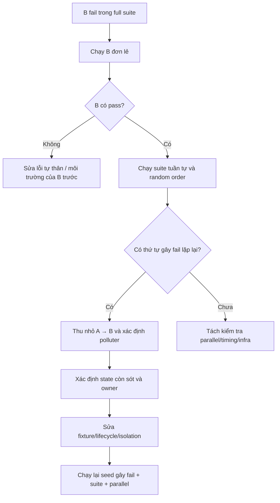

# Phát hiện test phụ thuộc thứ tự trong Spring Modulith

## 1. Dấu hiệu cần bắt: test B chỉ lỗi khi chạy sau test A

**Dấu hiệu mạnh nhất** của *order-dependent test* là cùng một test B, cùng cấu hình, chạy một mình thì PASS nhưng chạy sau một test A thì FAIL (hoặc ngược lại). A được gọi là **polluter** nếu nó để lại trạng thái ảnh hưởng tới B; B là **victim** nếu assertion hoặc setup của B bị trạng thái đó tác động.

Một ví dụ trong Spring Modulith:

```text
1. Test A: PaymentCaptured(eventId=E-A, transactionId=TX-001)
   -> listener xử lý, static idempotency cache giữ TX-001.

2. Test B: tạo order mới, dùng lại transactionId=TX-001.
   -> listener bỏ qua event vì tưởng đã xử lý.
   -> B chờ PAID rồi timeout.

Run B alone                 -> PASS
Run A rồi B trong cùng JVM  -> FAIL
Run B rồi A                 -> B PASS
```

Không phải mọi lỗi “chạy cả suite mới fail” đều do thứ tự. Lỗi chỉ xuất hiện khi chạy **đồng thời** có thể là race; lỗi phụ thuộc giờ hiện tại có thể là time-sensitive; lỗi xuất hiện trên CI có thể là khác database hoặc broker. Bài học này đi thẳng vào **cách phân biệt, tái hiện, xác định test gây nhiễm và sửa bằng bằng chứng**.

Nó thuộc chương **Test isolation** của học phần `SPRING_MODULITH_VERIFICATION_TESTING`: kiểm chứng ranh giới kiến trúc bằng `ApplicationModules`, quy tắc phụ thuộc module; dùng `@ApplicationModuleTest` để thử event, database và tích hợp, đồng thời có quality gate CI chống phụ thuộc sai và hồi quy.

**Đầu ra mong muốn:** sau khi thực hiện quy trình dưới đây, bạn có thể ghi lại một ca tái hiện kiểu **A → B = FAIL, B đơn lẻ = PASS**, chỉ ra nguồn trạng thái tồn dư (JVM/context/DB/registry/broker), sửa đúng owner và chứng minh B không còn phụ thuộc thứ tự.

## 2. Phân loại trước khi bật random order

| Quan sát | Khả năng cần kiểm tra | Phép thử phân biệt |
| --- | --- | --- |
| B FAIL khi A chạy trước; B PASS khi chạy riêng | **Order dependency** do state còn sót hoặc setup ngầm | Chạy A→B và B→A **tuần tự**, cùng môi trường |
| A và B đều PASS tuần tự nhưng FAIL concurrent | Race, shared resource, cleanup đè nhau | Giữ nguyên input, bật/tắt parallel riêng |
| Thất bại gần midnight hoặc deadline | Clock/timezone/TTL | Inject clock cố định và kiểm tra boundary |
| FAIL sau khi restart app dù không còn test A | Dữ liệu DB/broker/registry bền vững | Dùng schema/topic/queue/registry mới |
| Chỉ FAIL trên một CI runner | Endpoint, profile, pool size, timing | Ghi cấu hình không nhạy cảm và resource metrics |
| B PASS nhờ bản ghi của A, dù handler B không chạy | **Order-dependent false positive** | Assert baseline và correlation ID của B |
| FAIL khi test method order thay nhưng class order giữ nguyên | Shared static/test instance/singleton trong class | Randomize method order, giữ parallel OFF |
| FAIL khi class order thay nhưng methods không đổi | Context cache, static state, DB/broker xuyên classes | Randomize class order, giữ parallel OFF |

**Quy tắc chẩn đoán:** đầu tiên bật **đảo thứ tự tuần tự**, không bật parallel đồng thời. Nếu thay cả order lẫn parallelism, rất khó phân biệt state leakage với data race.

## 3. Quy trình phát hiện trong 6 lượt chạy

Một cách làm có thể lặp lại, không dựa vào cảm giác:

1. **Run 1 – B đơn lẻ trên môi trường chuẩn:** xác nhận B PASS. Dùng test database/broker đã định nghĩa scope rõ, không lén dùng dữ liệu từ run trước.
2. **Run 2 – toàn class/suite tuần tự:** giữ cùng profile, không đổi parallelism. Ghi test đứng ngay trước B và điểm mà B thất bại.
3. **Run 3 – đảo/random thứ tự method:** chạy một vài seed, mỗi lượt ghi seed, kết quả và thứ tự thực tế.
4. **Run 4 – đảo/random thứ tự class:** giữ JVM fork = 1 để hạn chế thay đổi scope; tiếp tục ghi seed và thực tế scheduling.
5. **Run 5 – thu nhỏ cặp gây lỗi:** kiểm tra A→B, B→A và B riêng, sau đó loại dần test không cần thiết.
6. **Run 6 – sau khi sửa:** chạy lại seed đã từng fail, ít nhất một seed mới, toàn suite và parallel **như một phép kiểm tra khác**.



### 3.1. Vì sao “B PASS đơn lẻ” chưa đủ để kết luận?

Nếu môi trường của lần chạy đơn lẻ là database mới nhưng suite dùng database cũ, bạn đã thay **hai biến**: thứ tự và state môi trường. Muốn chứng minh order dependency, phải kiểm soát hoặc ghi rõ những yếu tố còn lại: JVM/process, schema, active profile, Testcontainers scope, event registry và broker namespace.

Đồng thời, một test có thể **pass sai** khi chạy sau A. Ví dụ B chỉ kiểm tra “có một payment thành công”, và payment của A vẫn còn. Vì vậy hãy kiểm tra cả **độ độc lập của oracle**, không chỉ số lần fail.

### 3.2. Bảng ghi bằng chứng ngắn gọn

| Run | Cấu hình | Thứ tự liên quan | Kết quả B | Ghi chú |
| --- | --- | --- | --- | --- |
| R1 | Tuần tự, DB sạch, 1 fork | B | PASS | Baseline |
| R2 | Tuần tự, cùng điều kiện | A→B | FAIL | B chờ event E-B nhưng không đổi state |
| R3 | Tuần tự, cùng điều kiện | B→A | PASS | Hướng phụ thuộc |
| R4 | Tuần tự, cùng điều kiện | C→A→B | FAIL | C có thể không liên quan |
| R5 | Tuần tự, cùng điều kiện | C→B | PASS | Nghi A là polluter |
| R6 | Sau sửa | A→B | PASS | Cần kiểm tra invariant, không chỉ PASS |

Bảng là **mẫu chẩn đoán**; hãy thay bằng kết quả thực tế. Khi thiếu bằng chứng A→B, đừng gắn nhãn nguyên nhân là A chỉ vì log cho thấy nó đứng ngay trước B.

## 4. Bật random order trong JUnit Jupiter, giữ parallel tắt

JUnit Jupiter có `MethodOrderer.Random` và `ClassOrderer.Random`. Chúng hữu ích để phát hiện test ngầm dựa vào thứ tự mà không cần sửa annotation cho từng method.

Ví dụ file cấu hình JUnit Platform:

```properties
# src/test/resources/junit-platform.properties
junit.jupiter.execution.parallel.enabled=false
junit.jupiter.testmethod.order.default=org.junit.jupiter.api.MethodOrderer$Random
junit.jupiter.testclass.order.default=org.junit.jupiter.api.ClassOrderer$Random
junit.jupiter.execution.order.random.seed=20261126
```

**Trong ví dụ**, seed là giá trị cố định nhằm tái hiện thứ tự ngẫu nhiên tương ứng với điều kiện run. Thử một seed khác để phát hiện những trường hợp khác.

Cần hiểu đúng:

- Annotation `@TestMethodOrder(...)` trên một class có thể ghi đè method orderer mặc định.
- Class orderer liên quan đến cách Jupiter sắp xếp descriptors trong phạm vi nó quản lý; không bảo đảm thứ tự toàn bộ bài test từ mọi engine, plugin hoặc Gradle worker.
- Một seed không cố định lịch của **thread `@Async`, DB lock, broker consumer hoặc CI job**.
- Nếu có nhiều JVM forks, mỗi worker có class loader/context riêng; thứ tự tổng thể không được bảo đảm chỉ bằng seed của JUnit.
- Với một số phiên bản JUnit, các cấu hình và khả năng áp dụng orderer cần kiểm tra theo tài liệu phiên bản dự án; không suy từ thứ tự source file.

### 4.1. Ví dụ cấu hình qua Gradle không sửa code test

Groovy DSL minh họa:

```groovy
tasks.named('test', Test) {
    useJUnitPlatform()

    // Giai đoạn truy tìm order dependency: chỉ một test JVM,
    // không chạy JUnit methods/classes song song.
    maxParallelForks = 1

    systemProperty 'junit.jupiter.execution.parallel.enabled', 'false'
    systemProperty 'junit.jupiter.testmethod.order.default',
            'org.junit.jupiter.api.MethodOrderer$Random'
    systemProperty 'junit.jupiter.testclass.order.default',
            'org.junit.jupiter.api.ClassOrderer$Random'

    def orderSeed = project.findProperty('orderSeed') ?: '20261126'
    systemProperty 'junit.jupiter.execution.order.random.seed', orderSeed
}
```

Đây là **cấu hình để người học áp dụng**, bài học không sửa `build.gradle`. Một vài lệnh chạy thử:

```bash
./gradlew test --rerun-tasks -PorderSeed=20261126
./gradlew test --rerun-tasks -PorderSeed=42
./gradlew test --rerun-tasks -PorderSeed=9173
```

`--rerun-tasks` giúp không bị Gradle task up-to-date bỏ qua lượt thử. Nếu dự án tổ chức integration tests thành task riêng, cần áp dụng cấu hình random/seed và chạy **đúng task chứa test nghi vấn**; `test` không mặc nhiên bao phủ mọi suite.

**Lưu lại cả seed và cấu hình thực tế.** Nếu thử nhiều seed trên shared database mà không reset/cô lập state giữa các lượt, một lượt mới có thể bị ô nhiễm bởi lượt trước, làm kết luận sai.

### 4.2. Vì sao một seed chạy PASS không chứng minh độc lập?

Seed chỉ đưa ra một (hoặc một số) thứ tự trong phạm vi scheduler. Với 30 test, không thể kỳ vọng ba seed bao phủ mọi cặp order. Random order là **công cụ phát hiện**, không phải bằng chứng hình thức rằng test đã độc lập.

Khi phát hiện lỗi, chuyển từ random sweep sang **ca tái hiện tối thiểu có điều kiện rõ**, rồi sửa nguyên nhân.

## 5. Ca tái hiện nhỏ nhất: static state khiến B phụ thuộc A

Đây là đoạn test cố ý có lỗi để người học nhìn thấy hướng phụ thuộc. Nó **không được giữ trong CI sản xuất** sau bài tập.

```java
import static org.assertj.core.api.Assertions.assertThat;

import java.util.Set;
import java.util.concurrent.ConcurrentHashMap;

import org.junit.jupiter.api.AfterAll;
import org.junit.jupiter.api.Order;
import org.junit.jupiter.api.Test;
import org.junit.jupiter.api.TestMethodOrder;
import org.junit.jupiter.api.MethodOrderer;

@TestMethodOrder(MethodOrderer.OrderAnnotation.class)
class OrderDependencyReproductionTests {

    // Anti-pattern: mutable state xuyên test methods trong cùng JVM.
    static final Set<String> processedTransactions =
            ConcurrentHashMap.newKeySet();

    @Test
    @Order(1)
    void a_leavesAProcessedTransactionBehind() {
        processedTransactions.add("TX-001");
    }

    @Test
    @Order(2)
    void b_assumesAnEmptyTransactionRegistry() {
        assertThat(processedTransactions).isEmpty(); // FAIL sau A.
    }

    @AfterAll
    static void releaseDemoState() {
        processedTransactions.clear();
    }
}
```

Kết quả:

- Chạy B **một mình** trong trạng thái ban đầu sạch: PASS.
- Chạy cả class với A trước B: B FAIL.
- Chạy B trước A trong cùng môi trường ban đầu sạch: B PASS.

`@Order` ở đây **chỉ để tái hiện lỗi một cách có kiểm soát**. Giữ annotation này như “cách chữa” sẽ chỉ che nguyên nhân phụ thuộc. Một listener production dùng static set có thể còn gây lỗi nặng hơn: nếu transaction DB rollback sau khi ID đã được thêm vào set, lần xử lý lại có thể bị bỏ qua sai; nhiều JVM lại không chia sẻ set nên idempotency không đáng tin.

### 5.1. Sửa đúng phạm vi test

Nếu đây chỉ là recorder dành cho unit test, tạo state mới cho mỗi instance hoặc mỗi method:

```java
import static org.assertj.core.api.Assertions.assertThat;

import java.util.HashSet;
import java.util.Set;

import org.junit.jupiter.api.Test;

class IndependentRecorderTests {

    @Test
    void firstScenarioRecordsItsOwnTransaction() {
        Set<String> processed = new HashSet<>();
        processed.add("TX-001");
        assertThat(processed).containsExactly("TX-001");
    }

    @Test
    void secondScenarioStartsWithAnEmptyRecorder() {
        Set<String> processed = new HashSet<>();
        assertThat(processed).isEmpty();
    }
}
```

Tất cả input và oracle thuộc đúng method. Không cần order annotation và không cần shared cleanup.

**Nếu state nằm trong Spring singleton listener hoặc database**, việc tạo instance test class mới **không giải quyết**. Lúc đó phải sửa owner của state: sử dụng idempotency key bền/transactional ở module sở hữu, giả test-scoped đúng cách, hoặc có cơ chế cleanup/cô lập thật.

## 6. Tìm polluter khi full suite có hàng trăm test

Sau khi có một run thất bại, dùng nguyên tắc **delta debugging**. Không đọc ngay toàn bộ code rồi phỏng đoán hàng chục biến.

Giả sử thứ tự gây lỗi là:

```text
T01, T02, T03, T04, T05, T06, T07, B(FAIL)
```

Mục tiêu: tìm tập tối thiểu đứng trước B vẫn làm B fail.

1. Giữ B và **một nửa các test tiền nhiệm**: thử `T01..T04 → B`.
2. Nếu B vẫn fail, tập nghi vấn nằm trong nhóm đó; nếu B pass, thử `T05..T07 → B`.
3. Tiếp tục chia nhỏ tới khi được một polluter A hoặc một tổ hợp như `A + C → B`.
4. Chạy lại **cặp/tổ hợp** với cùng context/database lifecycle đã gây lỗi.
5. Đảo hướng `B→A`, chạy B riêng, và lưu bằng chứng quan sát source state.

### 6.1. Vì sao “test đứng ngay trước B” chưa chắc là polluter?

Một test A ở đầu suite có thể thay system property hoặc để incomplete publication trong registry. Nhiều test khác chạy qua nhưng không bị ảnh hưởng. Tới B mới đọc property hoặc khởi động resubmission thì lỗi bộc lộ.

Đó là **polluter không liền kề**. Vì vậy hãy thu nhỏ toàn bộ tập tiền nhiệm, không chỉ xem test cuối.

### 6.2. Khi test A và C phối hợp gây lỗi

Có trường hợp A tạo dữ liệu, C bật retry worker, B mới bị ảnh hưởng. A đơn lẻ trước B có thể PASS, C đơn lẻ trước B cũng PASS, nhưng A→C→B FAIL.

Delta debugging đơn giản có thể không tìm thấy polluter đơn lẻ. Khi một nửa không tái hiện được, thử **tổ hợp**, giữ điều kiện context/DB restart đúng. Ghi rõ kết quả là interaction-induced order dependency thay vì gán tội một class.

### 6.3. Không dùng CLI selection làm cam kết thứ tự tuyệt đối

```bash
./gradlew test --tests "com.example.shop.orders.PaymentEventTests"
```

Lệnh trên chọn tập test theo pattern, **không phải** công cụ buộc các methods/classes chạy theo thứ tự người viết pattern. Với ca A→B cần chứng minh, bạn có thể dùng một **test tái hiện chuyên biệt** gọi các bước public/setup của A và B theo trình tự trong cùng method, hoặc một test class chẩn đoán có `@TestMethodOrder` tạm thời.

**Tránh gọi trực tiếp method mang `@Test` của class khác** để “ép thứ tự”: cách đó bỏ qua lifecycle của JUnit, Spring test injection, extensions và transaction handling. Trích phần stimulus/fixture thành helper hoặc dùng integration harness riêng.

## 7. Quan sát baseline để bắt test PASS giả

Order dependency không chỉ gây FAIL. Một test có thể PASS vì được hưởng kết quả của test trước.

Anti-pattern:

```java
@Test
void paymentWasCaptured() {
    assertThat(orderQueries.findAnyPaidOrder()).isPresent();
}
```

Nếu test A đã tạo một order `PAID`, bài B sẽ xanh ngay cả khi listener B không chạy.

Tốt hơn, mỗi test tự chứng minh ba mốc:

```text
Baseline:
  orderId=O-B mới, status=AWAITING_PAYMENT
  processedEventId=null
  publication của eventId=E-B chưa có (nếu test registry)

Stimulus:
  PaymentCaptured(E-B, O-B, transactionId=TX-B)

Outcome:
  status=PAID
  processedEventId=E-B
  transactionId=TX-B
  amount/invariant đúng, sau commit
```

### 7.1. Quy tắc cho oracle

| Oracle yếu | Vấn đề | Oracle mạnh |
| --- | --- | --- |
| `findAll().anyMatch(PAID)` | Nhặt row của A | Query bằng `orderId` của B |
| `events.size() > 0` | Event recorder còn dữ liệu cũ | Lọc event type + `eventId`/`orderId` |
| `countIncomplete() == 1` | Publication từ scenario trước | Query đúng event + listener target |
| `topic có record` | Record cũ trên broker | Message correlation ID + payload |
| `cache.contains("TX-001")` | Shared key từ A | Key mới hoặc event ID có phạm vi rõ |
| `assertNotChanged()` ngay sau publish | Listener có thể chưa chạy | Chờ terminal/completion signal trước assertion âm |

Trong kiểm thử Spring Modulith, **không cần truy cập trực tiếp repository nội bộ module khác** để làm oracle mạnh: module sở hữu dữ liệu có thể cung cấp public query API hoặc test infrastructure đúng scope.

## 8. Ví dụ `@ApplicationModuleTest` phát hiện state dùng lại

Một scenario cụ thể trong module `orders`: nhận `PaymentCaptured` của `payments` và ghi nhận thanh toán. Test phải pass khi chạy độc lập cũng như sau mọi test có event tương tự.

### 8.1. Contract ứng dụng ví dụ

Các class/record sau là **API minh họa do ứng dụng tự định nghĩa**, không phải class Spring Modulith cung cấp.

```java
// File: com/example/shop/payments/events/PaymentCaptured.java
package com.example.shop.payments.events;

import java.math.BigDecimal;
import java.util.UUID;

public record PaymentCaptured(
        UUID eventId,
        UUID orderId,
        String transactionId,
        BigDecimal amount) {}
```

```java
// File: com/example/shop/orders/OrderPaymentSnapshot.java
package com.example.shop.orders;

import java.math.BigDecimal;
import java.util.UUID;

public record OrderPaymentSnapshot(
        UUID orderId,
        PaymentStatus status,
        UUID processedEventId,
        String transactionId,
        BigDecimal capturedAmount) {

    public boolean paidFor(
            UUID expectedEventId,
            String expectedTransactionId,
            BigDecimal expectedAmount) {

        return status == PaymentStatus.PAID
                && expectedEventId.equals(processedEventId)
                && expectedTransactionId.equals(transactionId)
                && capturedAmount != null
                && capturedAmount.compareTo(expectedAmount) == 0;
    }
}
```

```java
// File: com/example/shop/orders/PaymentStatus.java
package com.example.shop.orders;

public enum PaymentStatus {
    AWAITING_PAYMENT, PAID, FAILED
}
```

```java
// File: com/example/shop/orders/OrderQueries.java
package com.example.shop.orders;

import java.util.Optional;
import java.util.UUID;

public interface OrderQueries {
    Optional<OrderPaymentSnapshot> paymentOf(UUID orderId);
}
```

```java
// File: test-support com/example/shop/orders/OrderFixture.java
package com.example.shop.orders;

import java.math.BigDecimal;
import java.util.UUID;

interface OrderFixture {
    UUID createAwaitingPaymentAndCommit(BigDecimal amount);
}
```

`OrderFixture` phải được dự án triển khai và đăng ký vào test context, với **transaction ghi hoàn tất trước khi trả về**. Một `saveAndFlush(...)` nằm trong transaction vẫn mở chưa chứng minh dữ liệu đã visible với listener ở thread khác.

### 8.2. Test không phụ thuộc thứ tự

```java
package com.example.shop.orders;

import static org.assertj.core.api.Assertions.assertThat;

import java.math.BigDecimal;
import java.time.Duration;
import java.util.UUID;

import com.example.shop.payments.events.PaymentCaptured;
import org.junit.jupiter.api.Test;
import org.springframework.beans.factory.annotation.Autowired;
import org.springframework.modulith.test.ApplicationModuleTest;
import org.springframework.modulith.test.Scenario;

@ApplicationModuleTest
class PaymentCapturedScenarioTests {

    @Autowired OrderFixture fixture;
    @Autowired OrderQueries orders;

    @Test
    void capturesPaymentForItsOwnFreshOrder(Scenario scenario) {
        BigDecimal amount = new BigDecimal("125000.00");
        UUID orderId = fixture.createAwaitingPaymentAndCommit(amount);
        UUID eventId = UUID.randomUUID();
        String transactionId = "TX-" + eventId;

        // Quan sát ngay dữ liệu B, trước khi phát event B.
        OrderPaymentSnapshot baseline =
                orders.paymentOf(orderId).orElseThrow();

        assertThat(baseline.status())
                .isEqualTo(PaymentStatus.AWAITING_PAYMENT);
        assertThat(baseline.processedEventId()).isNull();
        assertThat(baseline.transactionId()).isNull();

        scenario.publish(new PaymentCaptured(
                        eventId, orderId, transactionId, amount))
                .andWaitAtMost(Duration.ofSeconds(8))
                .forStateChange(
                        () -> orders.paymentOf(orderId),
                        state -> state.filter(v ->
                                v.paidFor(
                                        eventId, transactionId, amount))
                                .isPresent())
                .andVerify(state -> {
                    OrderPaymentSnapshot paid = state.orElseThrow();
                    assertThat(paid.orderId()).isEqualTo(orderId);
                    assertThat(paid.status()).isEqualTo(PaymentStatus.PAID);
                    assertThat(paid.processedEventId()).isEqualTo(eventId);
                    assertThat(paid.transactionId())
                            .isEqualTo(transactionId);
                    assertThat(paid.capturedAmount())
                            .isEqualByComparingTo(amount);
                });
    }
}
```

Điều kiện chạy ví dụ: listener consumer thật và query adapter đã được bootstrap trong module test; fixture bean và transaction manager được cấu hình; event contract công khai có thể được module `orders` phụ thuộc hợp lệ. `Scenario.publish(...)` phải kích hoạt đường listener tương thích; với `@TransactionalEventListener(AFTER_COMMIT)` cần bảo đảm publisher transaction thực sự commit.

**Ba bằng chứng chống phụ thuộc thứ tự** ở đây là:

1. Fixture **tạo và commit order mới**; không dùng ID cố định của test khác.
2. Baseline **chưa PAID và chưa có processedEventId**; không thể pass nhờ dữ liệu cũ.
3. Predicate chờ trạng thái đích **của đúng eventId, transactionId, amount**; không chỉ chờ `status == PAID` trên bất kỳ row.

Đây là test **hành vi business state**, chưa phải test durability của Event Publication Registry hoặc broker acknowledgement; hai thứ ấy cần test integration riêng.

### 8.3. Test logic đã độc lập, nhưng fixture có thể vẫn gây nhiễm

Nếu `createAwaitingPaymentAndCommit(...)` tự gọi `deleteAll()` trước khi tạo order, hai test concurrent có thể xóa dữ liệu của nhau. Nếu fixture dùng cùng payment account hoặc SKU toàn cục, order ID riêng vẫn chưa đủ.

Trong bài order-dependency, hãy kiểm tra **fixture implementation, cleanup hook và owner DB** trước khi kết luận chỉ test assertion là nguyên nhân.

## 9. Nguồn order dependency số 1: static và singleton state

Những dạng gây nhiễm phổ biến nhất:

| Dạng trạng thái | Test A làm gì? | Test B bị gì? |
| --- | --- | --- |
| `static Set<eventId>` | A lưu một ID đã xử lý | B bỏ qua event nếu ID trùng |
| `static AtomicInteger` | A tăng counter | B kiểm tra số lần gọi = 1 nhưng nhận 2 |
| `static Random(42)` | A lấy vài số | B sinh input khác khi chạy sau A |
| `static AdjustableClock` | A tiến clock qua deadline | B nhìn thấy thời điểm đã quá hạn |
| `static ThreadLocal` | Worker A không remove tenant | Worker B đọc tenant cũ khi cùng thread |
| Spring singleton fake | A thêm event, không dọn | B đọc recorder chứa event A |
| Mock bean reuse | A thay stubbing/call history | B có outcome sai hoặc verify sai |
| Static mock scope | A quên close hoặc chặn method không đúng thread | B nhận behavior đã stub |
| Global config | A gọi `System.setProperty` hoặc `Locale.setDefault` | B khởi tạo bean/format sai |

### 9.1. `@DirtiesContext` không xóa static field

`@DirtiesContext` yêu cầu Spring TestContext loại context khỏi cache. Nó **không** clear Java static cache, không rollback transaction đã commit và không xóa Kafka topic/queue. Nếu B được chữa tạm bằng `@DirtiesContext`, phải đo xem state nào thực sự đã được reset; đừng coi đó là bằng chứng root cause.

### 9.2. Spring singleton là trường hợp khác static

Hai test classes có cùng `@ApplicationModuleTest` configuration có thể reuse một `ApplicationContext`. Một recorder bean không static nhưng là singleton vẫn có thể giữ state qua classes.

Cách sửa ưu tiên:

- Fake/recorder chỉ chứa dữ liệu keyed by event ID và không dùng global counts.
- Mỗi scenario có fixture/resource ownership rõ.
- Test context configuration tách riêng khi bean graph khác hoặc fake có lifecycle không thể reset an toàn.
- Hoặc loại bỏ fake có state nếu chỉ cần `PublishedEvents`/public API.
- Nếu reset, bảo đảm không có callback async nào còn ghi và không có test khác đang dùng cùng bean.

Một test B pass sau khi dùng `@DirtiesContext` có thể giúp khoanh vùng **context-scoped state**, nhưng không đủ kết luận root cause nếu việc đóng context còn làm dừng executor/listener.

## 10. Nguồn order dependency số 2: dữ liệu database và transaction

Một lỗi điển hình:

```text
A: @BeforeAll seed order=ORDER-1
A: test chuyển ORDER-1 thành PAID
B: test cũng expect ORDER-1 có status AWAITING_PAYMENT
B: FAIL nếu chạy sau A; PASS khi DB sạch
```

Cần phân biệt:

- **Test-managed transaction:** với `@Transactional` ở test, thường rollback sau method, nhưng không mặc nhiên bao phủ transaction của listener ở thread khác.
- **Fixture transaction:** nếu fixture dùng `REQUIRES_NEW` và commit, dữ liệu tồn tại sau method trừ khi được cleanup.
- **Listener transaction:** có thể commit business state độc lập với test rollback.
- **Persistence context của reader:** có thể giữ snapshot/entity cũ; assertion cần một cách đọc fresh theo hợp đồng.
- **DB-generated timestamps/IDs:** có thể khác mỗi run; test không nên dựa vào global sequence = 1.

### 10.1. Một bẫy with after-commit listeners

Nếu A phát event trong transaction được commit, listener `@TransactionalEventListener(phase = AFTER_COMMIT)` có thể chạy bất đồng bộ và ghi DB sau khi A đã trả về. B bắt đầu ngay sau A và thấy side effect trễ.

Nếu test B fail khi A chạy trước **dù JUnit parallel đã tắt**, đừng vội kết luận chỉ do static state: **background work của A có thể còn chạy**. Cần trace:

```text
A publishes event
A publisher transaction COMMIT
A test method returns
B test starts
A listener COMMIT occurs after B baseline
```

Khắc phục bằng điểm đồng bộ completion của A, ownership dữ liệu riêng và cleanup sau khi quiescent. `Thread.sleep(...)` cố định không chứng minh các task đã hoàn tất.

### 10.2. Không cleanup toàn bảng trong test suite dùng chung

Ví dụ anti-pattern:

```sql
-- Sai nếu database dùng chung hoặc test worker còn chạy:
TRUNCATE TABLE orders CASCADE;
```

Nếu B chạy sau A thì nhận DB sạch và PASS, nhưng nếu có task của A còn chạy, B vẫn có thể nhiễm lại. Khi chạy parallel, việc xóa toàn bảng còn phá test khác.

Giải pháp: fixture theo ID mới, cleanup theo owner/namespace và chờ worker tương ứng; hoặc dùng database/schema/container riêng cho nhóm cần full reset.

## 11. Nguồn order dependency số 3: Event Publication Registry

Spring Modulith có Event Publication Registry để tracking publication tới listener target theo provider/cấu hình. Một event có thể có nhiều publication; trạng thái incomplete có thể được xử lý lại.

Kịch bản A→B:

```text
A:
  publish PaymentCaptured E-A
  listener orders fail có chủ đích
  registry giữ incomplete publication E-A / target orders

B:
  khởi động context hoặc chạy job resubmission
  E-A được retry khi B đang kiểm tra E-B
  B thấy side effect cũ, lock, duplicate hoặc unexpected event
```

### 11.1. Cách kiểm chứng đây là nguồn nhiễm

1. Xác định **registry provider và nơi lưu** mà A/B thật sự dùng.
2. Ghi correlation ID của A/B và listener target.
3. Sau A, trước B, quan sát incomplete publications **của A** theo provider/test probe phù hợp.
4. Chạy B với resubmission có kiểm soát để xác nhận publication A được xử lý trong khoảng B.
5. Lặp lại B với **registry database/schema riêng**, giữ các yếu tố khác tương đương.
6. Khi B không còn nhiễm, sửa chiến lược isolation/retry/cleanup và kiểm chứng lại A→B.

**Không** suy rằng registry đã sạch chỉ vì `PublishedEvents` của B không thấy E-A. `PublishedEvents` và durable Event Publication Registry là hai cơ chế khác nhau. Cũng không giả định một completed publication luôn còn row: retention khác nhau theo provider.

### 11.2. Điều không được làm

Không xóa toàn bộ publication registry trước mỗi test bằng một câu SQL cứng nếu backend/worker còn dùng chung. Nếu bài test recovery cố ý giữ incomplete publication qua restart, phải giữ nó **trong hai pha cùng scenario**, không để rò sang một scenario độc lập.

## 12. Nguồn order dependency số 4: broker, executor và subscriptions

| Resource | Dấu hiệu phụ thuộc thứ tự | Phép chứng minh |
| --- | --- | --- |
| `@Async` executor | B chờ lâu hơn sau A, task của A còn trong queue | Trace event IDs, worker start/end, queue depth |
| Listener đăng ký thủ công | B nhận hai callback sau A | Ghi registration owner, unregister đúng handle |
| Reactor subscription | B nhận event từ subscriber của A | Giữ `Disposable` của A và dispose trước B |
| Kafka topic/group | B không đọc được event vì offset cũ; hoặc đọc event của A | So group ID, topic, committed offset, correlation |
| RabbitMQ queue | B consume message A bị requeue | So queue, ack/nack, message correlation |
| Retry/DLT/DLQ | Poison message của A còn tồn tại | Isolate retry queue/topic và quan sát đúng message |
| Testcontainers | Context B giữ kết nối tới container của A đã dừng | So lifecycle container và cached context/client |

### 12.1. Kafka: group offset là state liên test

Một nhóm consumer Kafka có committed offsets. Nếu A và B dùng cùng group ID, B có thể bắt đầu từ offset đã được A commit hoặc cạnh tranh partition. `auto.offset.reset=earliest` không tự đưa group có offset hợp lệ về đầu topic.

Để test outbound message, dùng observer group riêng, kiểm soát assignment/offset trước publish, lọc theo event ID. Khi cần tách mạnh, dùng topic namespace riêng cho class/suite. Không giả định đổi group sẽ tự ngăn message của A tồn tại trên **cùng topic**.

### 12.2. RabbitMQ: không để message A bị giao lại cho B

Một durable queue có thể giữ message chưa ack từ A; consumer B start thì nhận lại. Nếu test muốn xác minh business consumer, cho nó dùng queue thuộc đúng integration environment rồi kiểm tra state qua public API. Một observer khác trên cùng queue sẽ cạnh tranh nhận message, không phải quan sát bản sao.

### 12.3. `@DirtiesContext` và static `@Container` không phải reset broker

Mở context mới vẫn có thể dùng broker cũ; hủy context không xóa Kafka offsets hay RabbitMQ queue. Ngược lại, một Testcontainers `static @Container` class-scoped có thể bị dừng sau class A, trong khi cached context của B vẫn dùng endpoint đó. Cần phối hợp lifecycle context/container chứ không chỉ gắn `@DirtiesContext` vào mọi class.

## 13. Cấu hình, clock và random cũng gây phụ thuộc thứ tự

Một số lỗi không nằm trong event/DB:

- A gọi `System.setProperty("shop.feature.enabled", "false")` rồi không restore; B đọc property hoặc khởi tạo bean theo flag đó.
- A thay `TimeZone.setDefault(...)`; B so ngày, deadline hoặc serialization khác.
- A tiến một singleton `AdjustableClock` sang ngày hôm sau; B bị coi là quá hạn.
- A dùng một `static Random(42)` lấy n số; B nhận một chuỗi random khác tùy số lần A đã gọi.
- A sửa mock/stub bean được context cache; B nhìn thấy behavior của A.

### 13.1. Test property khác system property

Với Spring tests, ưu tiên `@TestPropertySource`/`@ActiveProfiles` hoặc `@DynamicPropertySource` cho những thuộc tính thuộc context. Không dùng `System.setProperty(...)` giữa methods để trông chờ một bean `@ConfigurationProperties` đã bind tự cập nhật.

Nếu bắt buộc kiểm thử code legacy đọc system property, cô lập trong test JVM/process hoặc chạy tuần tự thật, lưu giá trị cũ và restore trong `finally`. Restore vẫn không loại bỏ race với thread khác trong lúc property tạm được thay.

### 13.2. Đồng hồ cố định không làm timestamp thành ID duy nhất

Nếu ID được tạo từ `clock.instant().toEpochMilli()`, hai tests cùng `Clock.fixed(...)` có thể tạo ID giống nhau. Dùng UUID hoặc một ID generator có hợp đồng uniqueness đúng; trong test dùng lại chính ID fixture trả về để giữ oracle xác định.

**Deterministic input** và **independent identity** là hai yêu cầu khác nhau: test có thể cố định thời gian/seed nhưng vẫn phải tránh collision với scenario khác.

## 14. Chỉ đảo thứ tự chưa đủ: phải giữ ranh giới module đúng

Để tránh lỗi setup, đôi khi người viết test import thẳng repository `internal` của module khác rồi tự seed dữ liệu. Điều này vừa phá ranh giới kiến trúc vừa khiến nhiều test cùng sửa dữ liệu mà không đi qua invariant của module sở hữu.

Ví dụ module `payments` công bố event contract qua named interface:

```java
// File: com/example/shop/payments/events/package-info.java
@org.springframework.modulith.NamedInterface("events")
package com.example.shop.payments.events;
```

Module `orders` nhận contract:

```java
// File: com/example/shop/orders/package-info.java
@org.springframework.modulith.ApplicationModule(
        allowedDependencies = "payments::events")
package com.example.shop.orders;
```

Test kiến trúc:

```java
import org.junit.jupiter.api.Test;
import org.springframework.modulith.core.ApplicationModules;

class ModuleBoundaryVerificationTests {

    @Test
    void moduleDependenciesAreValid() {
        ApplicationModules.of(ShopApplication.class).verify();
    }
}
```

`ShopApplication` là Spring Boot application class minh họa. Các tên module/named interface phải khớp cấu trúc ứng dụng thật. `ApplicationModules.verify()` phát hiện dependency sai; nó **không tự phát hiện test order dependency**, nên cần cả architecture gate lẫn suite-order gate.

## 15. Một bộ kiểm chứng sau khi sửa order dependency

Sau khi tìm ra A pollute B, không dừng ở việc B chạy xanh một lần. Cần chứng minh:

| Check | Câu hỏi |
| --- | --- |
| **B một mình** | B tự tạo đủ baseline và không cần A setup? |
| **A→B tuần tự** | B còn bị state của A tác động không? |
| **B→A tuần tự** | A có bất ngờ phụ thuộc B không? |
| **A→C→B** | Một test trung gian có thể kích hoạt retry/context lifecycle làm tái nhiễm không? |
| **Random method order** | Nhiều seed từng fail và seed mới có PASS không? |
| **Random class order** | Cross-class context/DB/registry vẫn an toàn? |
| **Parallel suite** | Nếu chạy đồng thời được hỗ trợ, có race mới không? |
| **Full integration job** | Database/broker thật và cleanup không để pending? |
| **Architecture verification** | Có phải sửa lỗi bằng import trái module boundary không? |

### 15.1. Kiểm chứng “không phụ thuộc” bằng invariant, không chỉ màu xanh

Khi B pass, vẫn đối chiếu:

- Event B được publish đúng type/payload; cần dùng `PublishedEvents` nếu hợp đồng test là producer publication.
- Order B sau commit có `processedEventId = E-B` và `transactionId = TX-B`.
- Không có receipt/ledger side effect trùng đối với cùng logical event.
- Registry không còn outstanding publication **của B** nếu bài đang kiểm tra registry completion và retention policy cho phép quan sát.
- Không có message của A bị tính vào assertion của B.
- Cleanup không xóa dữ liệu hoặc đóng listener dùng chung ngoài ownership của B.

Một test xanh nhờ A để lại state là **lỗi kiểm thử**, dù CI không hiển thị stack trace.

## 16. CI quality gate: vừa dò order, vừa dò race

Nên tách **hai phép kiểm** để thông tin lỗi không trộn lẫn:

### Gate A — Sequential randomized order

- JUnit parallel OFF.
- Gradle forks = 1 trong nhóm đang dò.
- Chạy suite với những seed được ghi vào report; tối thiểu replay seed từng phát hiện lỗi.
- Mỗi lượt có môi trường fixture/DB/registry/broker được cô lập hoặc reset **đúng phạm vi**.
- Khi fail, log test order, seed, polluter-victim candidates, correlation IDs và state cuối.

### Gate B — Parallel isolation

- Bật JUnit parallel cho nhóm test đủ điều kiện, giới hạn thread và resource usage.
- Nếu tăng Gradle forks, hiểu rằng JUnit `@ResourceLock` không khóa được test ở JVM khác.
- Test nào mutate global configuration hoặc dùng cùng registry/broker topology mà chưa tách được cần môi trường riêng hoặc chạy tuần tự.
- Kiểm tra DB pool/locks, async executor queue, consumer lag, context cache và cleanup races.
- Một test có seed PASS ở Gate A vẫn có thể FAIL ở Gate B vì race; phân loại riêng.

**Không dùng test retries làm cơ chế mặc định biến FAIL thành PASS.** Retry hữu ích để thu thêm bằng chứng nhưng phải giữ được seed, execution configuration và failure trace, đồng thời có issue/root cause nếu flakiness tồn tại.

### 16.1. Artifact chẩn đoán khi Gate A fail

Ví dụ nội dung log gọn, không chứa dữ liệu thật:

```text
suite: spring-modulith-module-tests
runMode: sequential-random-order
seed: 20261126
testUnderInvestigation: PaymentCapturedScenarioTests
suspectedPolluter: PaymentFailureRecoveryTests
isolatedVictim: PASS
suspectThenVictim: FAIL
reverseOrder: PASS
orderId: O-B
eventId: E-B
transactionId: TX-B
baseline: AWAITING_PAYMENT
lastObserved: AWAITING_PAYMENT
registryOutstandingForOtherEvent: E-A / orders-target
nextAction: reproduce with isolated registry storage
```

**Không kết luận nguồn registry chỉ từ log mẫu.** Trong một vụ việc thực, cần xác minh bằng provider/query và so sánh khi cô lập storage. Không dump toàn bộ environment/credentials hoặc payment payload nhạy cảm để điều tra.

## 17. Bài thực hành theo tiến trình phát hiện

**Bài A — tái hiện phụ thuộc:** chạy class `OrderDependencyReproductionTests` ở mục 5; xác nhận B PASS khi chạy riêng, nhưng FAIL sau A. Bỏ `@Order` và randomize seed để xem triệu chứng xuất hiện theo thứ tự được chọn. Sau đó sửa sang state local.

**Bài B — tìm polluter trong 8 tests:** chuẩn bị 7 tests không liên quan và một A có side effect. Chạy B sau mọi test, rồi chia đôi tập tiền nhiệm để tìm cặp tối thiểu. Ghi lại cả các lần thử không tái hiện.

**Bài C — false positive:** viết B chỉ assert `findAnyPaidOrder().isPresent()`; cho A tạo một order `PAID`. Quan sát B PASS sai. Sửa thành baseline + event ID + query đúng aggregate.

**Bài D — context cache:** tạo test recorder bean singleton; A ghi một event, B kiểm tra tổng events. Chạy đảo thứ tự class. Thay oracle bằng ID scoped hoặc test fixture thực sự cô lập, không mặc định gắn `@DirtiesContext`.

**Bài E — database transaction:** A có fixture `REQUIRES_NEW` commit nhưng không dọn; B dùng lại business key. Xác minh B lỗi sau A. Sửa bằng key/namespace riêng và cleanup sau completion.

**Bài F — async tail:** A publish event, chờ state sớm rồi kết thúc trước khi listener gửi event tiếp. B bắt đầu và quan sát side effect muộn của A. Bổ sung completion signal để cleanup đúng mốc.

**Bài G — Event Publication Registry:** A tạo incomplete publication có chủ đích trong database test riêng; B kích hoạt resubmission. Kiểm tra publication A có gây ảnh hưởng B không. Tách registry storage hoặc resubmission scope; không purge toàn registry chung.

**Bài H — Kafka/RabbitMQ:** A để message chưa consume/ack hoặc committed group offset; B dùng lại queue/group. Chạy B riêng và A→B. Sửa bằng topic/queue/group namespace và correlation ID đúng.

**Bài I — config/clock:** A mutate `System.setProperty` hoặc adjustable clock singleton; B đọc outcome khác. Sửa bằng `@TestPropertySource` hoặc clock per-test và kiểm tra cả seed random order.

**Bài J — Gate A/B:** chạy sequential random-order với seed cố định rồi bật parallel ở một job khác. Ghi rõ trường hợp nào là **order dependency**, trường hợp nào là **concurrency race**, không trộn kết luận.

**Bài K — kiến trúc:** thêm `ApplicationModules.verify()` vào CI. Tạo thử dependency trái `payments::events` trong nhánh học tập, chứng minh architecture gate phát hiện; hoàn nguyên trước khi kết thúc.

## 18. Checklist chốt nguyên nhân

Trước khi đóng một lỗi test phụ thuộc thứ tự, xác nhận:

- [ ] Có ít nhất một ca tái hiện **A→B FAIL, B đơn lẻ PASS** dưới điều kiện kiểm soát được.
- [ ] Đã chạy **tuần tự** để loại ảnh hưởng của việc đồng thời ngoài ý định.
- [ ] Đã lưu JUnit random seed và thứ tự quan sát thực tế.
- [ ] Nếu không có polluter đơn lẻ, đã xem xét tổ hợp A+C→B.
- [ ] B tự tạo baseline, dữ liệu fixture đã commit và không dựa vào test khác.
- [ ] Event/aggregate/transaction IDs của B là riêng và oracle lọc theo đúng ID.
- [ ] Không có static/singleton fake/mock/config state rò qua context/JVM.
- [ ] Không có async listener từ A còn thay state khi B bắt đầu.
- [ ] Database, registry và broker có ownership/cleanup theo scope phù hợp.
- [ ] Không dùng global `deleteAll()/TRUNCATE` để che lỗi.
- [ ] Sau sửa, seed gây fail cũ và nhiều order mới đều PASS với invariant đúng.
- [ ] Parallel suite được kiểm tra **riêng** để phát hiện race.
- [ ] `ApplicationModules.verify()` vẫn PASS; không sửa bằng cách phá module boundary.

## 19. Kết luận và tài liệu tham khảo

**Phát hiện test phụ thuộc thứ tự** là quá trình chứng minh rằng một test cần trạng thái do test khác để lại, hoặc bị trạng thái đó phá hỏng. Cách thực tế nhất là **randomize thứ tự nhưng tắt parallel, lưu seed, thu nhỏ A→B, tìm state còn sót ở đúng tầng, sửa ownership và chạy lại cả seed lỗi lẫn suite**.

Trong Spring Modulith, nơi cần soi kỹ nhất là **Spring TestContext cache, listener/event async, fixture transaction đã commit, Event Publication Registry, database/broker bền vững và oracle không lọc event ID**. `@ApplicationModuleTest` cùng `Scenario` hỗ trợ kiểm tra trạng thái nghiệp vụ đúng thời điểm; `ApplicationModules.verify()` bảo vệ ranh giới module. Chỉ khi cả hai loại kiểm chứng cùng đúng, CI quality gate mới phản ánh độ tin cậy của ứng dụng.

Tài liệu tham khảo:

- [JUnit 5 User Guide — Test Execution Order](https://junit.org/junit5/docs/current/user-guide/#writing-tests-test-execution-order): method/class orderers và random seed.
- [JUnit 5 User Guide — Parallel Execution](https://junit.org/junit5/docs/current/user-guide/#writing-tests-parallel-execution): phân biệt order với parallel tests, resource locks.
- [Spring Framework — TestContext Parallel Test Execution](https://docs.spring.io/spring-framework/reference/testing/testcontext-framework/parallel-test-execution.html): giới hạn khi chạy Spring tests đồng thời.
- [Spring Framework — Context Caching](https://docs.spring.io/spring-framework/reference/testing/testcontext-framework/ctx-management/caching.html): reuse context giữa classes.
- [Spring Framework — Test-managed Transactions](https://docs.spring.io/spring-framework/reference/testing/testcontext-framework/tx.html): rollback/commit và listener ngoài transaction.
- [Spring Modulith — Testing Application Modules](https://docs.spring.io/spring-modulith/reference/testing.html): `@ApplicationModuleTest`, `Scenario` và `PublishedEvents`.
- [Spring Modulith — Application Events](https://docs.spring.io/spring-modulith/reference/events.html): event listener và Event Publication Registry.
- [Spring Modulith — Verification](https://docs.spring.io/spring-modulith/reference/verification.html): `ApplicationModules.verify()`.
- [Gradle — Testing in Java & JVM Projects](https://docs.gradle.org/current/userguide/java_testing.html): test filtering, workers và rerun.
- [Testcontainers for Java](https://java.testcontainers.org/): cô lập hạ tầng DB/broker cho integration tests.
